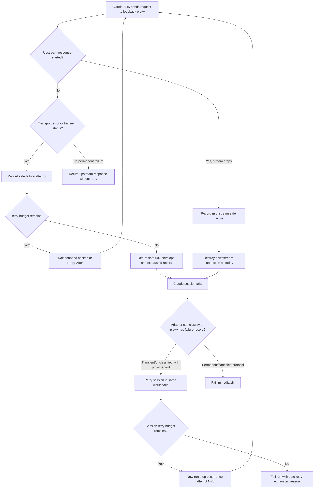
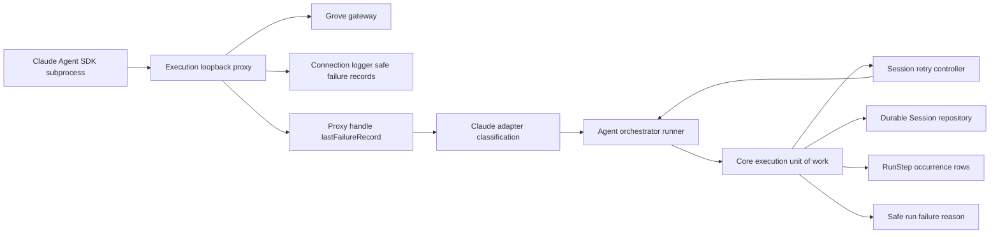

# Enhancement: Grove proxy failure records, retry budget, and session retry

## Parent feature

This enhancement spans the existing execution-runner features: `feature-loopback-runner-proxy.md`, `feature-runner-connection-layer-claude-agent-adapter.md`, `feature-durable-session-run-step-telemetry.md`, `feature-recover-failed-run.md`, and `feature-sanitized-failure-reason.md`. The parent behavior already routes Claude Agent SDK subprocess traffic through the execution loopback proxy for Grove-style endpoint alteration, records durable sessions and run-step occurrences, exposes safe failure reasons, and supports manual `POST /v1/runs/:id/recover`.

## What

Autocatalyst will make transient Grove-path provider failures visible and survivable. The loopback proxy will always record safe upstream failure diagnostics, use a time-based retry budget for pre-response transient failures, and expose the last safe failure record to the Claude adapter. When a Claude session dies without a classifiable provider error but the proxy recorded a relevant failure, the execution path will classify the failure as transient, retry the model session in the same workspace with bounded backoff, and persist each failed attempt as durable session/run-step activity. Exhausted retries will fail the run with a new safe reason that says the retry budget was exhausted, while permanent failures, protocol errors, validation failures, authorization failures, and cancellation continue to fail immediately.

## Why

Long-running `implementation.build` sessions on the Grove-backed Claude profile sometimes die with only `Runner failed before terminal result.` even though manual `POST /v1/runs/:id/recover` with `mode: resume` succeeds. Operators get neither the proxy-side cause nor automatic recovery from transient network and gateway interruptions. This enhancement closes the gap by making the proxy leave safe evidence for every upstream failure, absorbing roughly one-minute pre-response connectivity losses, and automatically re-running interrupted sessions when the existing recovery behavior shows that the same workspace can continue safely.

## User stories

- Operators can inspect safe logs for Grove-path upstream failures and see whether the proxy retried, exhausted, timed out, or saw a mid-stream drop.
- Operators can rely on short connectivity interruptions, including sleep/wake Wi-Fi reconnects and gateway restarts up to about one minute, being absorbed by the proxy before the run fails.
- Operators can see a failed run reason that names transient provider/session retry exhaustion instead of the bare `Runner failed before terminal result.` fallback.
- Execution maintainers can read the proxy's last safe failure record through a typed proxy handle method instead of scraping logs.
- Execution maintainers can test fail-then-succeed and exhausted-retry session sequences without live model calls or real delays.
- Cost and debugging users can see durable session rows and run-step attempts for both failed and successful retry attempts.

## Design changes

This is a backend execution enhancement with no UI or visual design changes. Operator-visible behavior appears through existing logs, durable run/session/step records, failure reasons, and recovery APIs.

### Operator flow



### Interaction behavior

- Proxy retry is limited to failures before the upstream response starts. Mid-stream failures remain non-replayable at proxy level and are handled only by session-level retry.
- Session retry reuses the current run workspace and is equivalent in intent to `recover` with `mode: resume`; it must never replace the workspace or start over.
- Each failed session attempt is visible as a durable session row and each retry uses a new run-step occurrence attempt number.
- Request logging remains optional, but safe upstream failure records are always emitted through the connection logger and never contain bodies, headers, prompts, secrets, raw SDK messages, or unredacted URLs.

## Technical changes

### Affected files

- `packages/execution/src/loopback-proxy.ts` — add always-on safe failure records, retry budget enforcement, mid-stream byte tracking, timeout outcome, last-failure handle method, and retry-success info logging.
- `packages/execution/src/request-alteration.ts` — replace the old default retry count with budget-driven retry policy, keep endpoint `maxRetries` as an attempt cap when set, and honor bounded `Retry-After`.
- `packages/execution/src/connection.ts` — thread proxy failure access through the connection/proxy handle and keep connection logger integration safe.
- `packages/execution/src/failure-reasons.ts` — add the safe exhausted session retry reason while preserving `transient_provider_failure` and normalization of unknown raw strings.
- `packages/claude-agent-adapter/src/claude-agent-adapter.ts` — enrich `claude.adapter.session_failed` diagnostics, classify unclassified failures with proxy records as `transient_provider_failure`, and expose safe proxy fields in failure metadata.
- `packages/core/src/execution-run-unit-of-work.ts` — add bounded session retry around unclassified/pre-terminal transient session failures, preserving workspace and recording attempts.
- `packages/core/src/execution-session-recorder.ts` — ensure failed session attempts are recorded with safe diagnostics and included in totals.
- `packages/core/src/run-step-catalog.ts`, `packages/core/src/run-lifecycle.ts`, `packages/persistence/src/domain-repositories.ts` — verify or extend attempt numbering and repeated run-step occurrence behavior for session retries.
- `context-agent/wiki/code-map.md` — document proxy failure records, `PROXY_RETRY_BUDGET_MS`, `RUNNER_SESSION_MAX_RETRIES`, and `RUNNER_SESSION_RETRY_BASE_DELAY_MS`.

### Changes

#### Introduction and overview

Dependencies and assumptions:

- Builds on the existing loopback proxy and request-alteration boundary from ADR-023 and `feature-loopback-runner-proxy.md`.
- Builds on durable sessions/run-step occurrences from `feature-durable-session-run-step-telemetry.md`.
- Builds on safe failure reason persistence from `feature-sanitized-failure-reason.md`.
- Builds on manual failed-run recovery from `feature-recover-failed-run.md`; automatic session retry is intentionally narrower and only resumes the same workspace.
- Grove proxy failures are treated as provider-connectivity failures unless classified as permanent by status/error class.

Technical goals:

- Emit safe structured proxy failure evidence for every upstream failure regardless of optional request dump logging.
- Let the proxy ride out transient pre-response connectivity failures for `PROXY_RETRY_BUDGET_MS`, default `60000`, capped at `300000`.
- Preserve `endpoint.maxRetries` as an explicit attempt cap for existing profiles that set it.
- Classify proxy-backed unclassified Claude session failures as `transient_provider_failure`.
- Retry pre-terminal unclassified/transient session failures up to `RUNNER_SESSION_MAX_RETRIES`, default `2`, with exponential backoff from `RUNNER_SESSION_RETRY_BASE_DELAY_MS`.
- Keep permanent failures and cancellation non-retryable.
- Persist useful session/run-step telemetry for each attempt.

Glossary:

- **Proxy failure record** — safe structured metadata for an upstream proxy failure attempt or mid-stream drop.
- **Response started** — upstream headers have been received and any downstream response may have begun.
- **Mid-stream failure** — an upstream error after headers/body streaming has started; not replayable at the proxy.
- **Session retry** — re-invoking the provider session for the same run step/workspace after a transient pre-terminal failure.

#### System design and architecture



Component responsibilities:

- The proxy owns HTTP attempt classification, retry timing, response-start tracking, byte counts, and safe records.
- The connection layer owns logger wiring and exposes typed access to the proxy's last safe record.
- The Claude adapter owns SDK error inspection, cause-chain-safe diagnostics, and classification when proxy evidence explains an otherwise unclassified failure.
- Core owns session retry policy, durable attempt/session recording, cancellation checks, and final safe failure mapping.
- Persistence owns monotonic session sequence and run-step occurrence/attempt rows.

#### Detailed design

Proxy failure record shape should be provider-neutral and safe:

```ts
type ProxyUpstreamFailureOutcome = 'retrying' | 'exhausted' | 'mid_stream' | 'timeout';

type ProxyUpstreamFailureRecord = {
  profileName?: string;
  upstreamOrigin: string;
  attempt: number;
  outcome: ProxyUpstreamFailureOutcome;
  status?: number;
  errorCode?: string;
  elapsedMs: number;
  responseStarted: boolean;
  bodyBytesStreamed: number;
};
```

Safety rules:

- `upstreamOrigin` is origin-only, not full URL/path/query.
- Records do not include request/response bodies, headers, prompts, raw messages, secret handles, credential values, or filesystem paths.
- Error information is limited to safe names/codes such as `ECONNRESET`, `ETIMEDOUT`, `ENOTFOUND`, or `EAI_AGAIN`.

Retry policy:

- `PROXY_RETRY_BUDGET_MS = 60000` default; values above `300000` clamp to `300000`.
- Retry clock starts before the first attempt.
- Existing delay curve remains: 250 ms base, exponential doubling, 5 s cap, jitter.
- `Retry-After` is honored only up to the remaining budget.
- If `endpoint.maxRetries` is unset, elapsed budget controls attempts.
- If `endpoint.maxRetries` is set, it caps attempts in addition to budget.
- Non-transient 4xx responses other than 408 and 429 are not retried.
- Once upstream headers have been received, the proxy never retries and continues current destroy behavior for broken streams.

Session retry policy:

- Retry when the session fails before any terminal result and either the error is classified `transient_provider_failure` or the error remains unclassified and a proxy failure record exists for the session.
- Do not retry provider auth failures, validation failures, protocol errors, unsupported capabilities, result contract failures, workspace/materialization failures, or canceled runs.
- Default retry limit is `RUNNER_SESSION_MAX_RETRIES = 2`, meaning one initial session plus up to two retries.
- Backoff starts at `RUNNER_SESSION_RETRY_BASE_DELAY_MS` and doubles per retry; tests inject clock/sleep so no real delay is needed.
- Before each retry, core checks whether the run was canceled or otherwise transitioned; if so, stop retrying and preserve cancellation semantics.
- Exhaustion fails with a new known safe reason, for example `transient_provider_session_retries_exhausted`.
- `POST /v1/runs/:id/recover` remains available after exhaustion because the run ends in normal `failed` state.

Adapter diagnostics:

`claude.adapter.session_failed` should add only safe scalar fields:

- error class name;
- cause-chain class names;
- `errno` or `code` when present;
- subprocess exit code and signal when present;
- elapsed session time;
- last SDK event type received;
- number of SDK events received;
- proxy failure fields when available.

Any raw `error.message`, provider body, prompt, header, token, or secret must be excluded or redacted before logging.

#### Security, privacy, and compliance

- Always-on failure records are deliberately metadata-only. They must be safe for ordinary structured logs.
- Tests must place a sentinel secret in a request header and in a scripted error message and assert it never appears in proxy records or adapter failure logs.
- The proxy must not expand optional request dump logging; this enhancement only adds safe failure metadata and uses existing redaction for any dump paths.
- Failure reasons stay allowlisted/safe; unknown strings still normalize to the generic fallback.

#### Observability

Logs:

- Every upstream failure emits one connection logger record with the safe proxy failure record.
- A request that eventually succeeds after retry emits one info-level record with attempt count and elapsed time so flakiness is visible.
- Session retries emit safe start/fail/retry/exhausted records with attempt number and reason code.

Durable records:

- Each failed session attempt writes a `Session` row with safe outcome diagnostics.
- Each retry creates a new run-step occurrence or increments the run-step attempt number according to existing lifecycle conventions, so `GET /v1/runs/:id/steps` shows attempts.
- Session totals and cost inputs include failed attempts where telemetry is available.

#### Testing plan

Unit tests:

- `loopback-proxy.spec.ts`: scripted upstream covers retrying, exhausted, timeout, mid_stream, retry-then-success, byte counts, responseStarted, and no secret leakage.
- `request-alteration.spec.ts`: budget defaults, max cap, endpoint `maxRetries` cap, transient status set, non-transient 401 behavior, and bounded `Retry-After`.
- `claude-agent-adapter.spec.ts`: scripted failing session logs safe class/cause/code/exit/signal/event counts, uses proxy record to classify transient failure, and redacts sentinel secret from error message.
- `execution-run-unit-of-work` session retry tests: fail then succeed, fail three times/exhaust, classified permanent failure, cancellation between attempts, and no real delay.
- Session recorder/repository tests: failed attempt rows and attempt sequencing are persisted and ordered.

Integration tests:

- A control-plane or execution integration test drives a scripted Claude adapter/proxy sequence with no model call and asserts retry behavior, run-step attempts, session rows, and final run outcome.
- No test makes a live model call.

#### Alternatives considered

1. Only set `maxRetries: 5` on the `grove-cp3` profile. This is useful as a stopgap but covers only short blips of roughly 8–11 seconds and does not record mid-stream drops or automate session resume.
2. Retry mid-stream requests inside the proxy. Rejected because streamed provider responses may not be replayable once headers/body have reached the SDK, and duplicate side effects could occur. Session retry is the safer boundary.
3. Rely only on manual `POST /v1/runs/:id/recover`. Rejected because operators still receive opaque failures and have to notice and recover transient interruptions manually.

#### Risks

- Automatic session retry could repeat non-idempotent provider/tool effects. Mitigation: retry only pre-terminal session failures, reuse the same workspace, avoid proxy mid-stream replay, preserve durable failed attempts, and keep permanent/protocol failures non-retryable.
- Failure records could leak secrets if they include headers or messages. Mitigation: define a strict metadata shape and test sentinel leakage.
- Attempt numbering may already have conventions that differ from this spec. Mitigation: implement using the existing run lifecycle/repository attempt semantics and add tests rather than adding a parallel attempt field.
- Some provider failures may remain unclassified if the proxy has no corresponding failure record. Mitigation: keep the generic safe fallback and manual recovery path.

## Task list

- [ ] **Story: Proxy failure records and safe diagnostics**
  - [ ] **Task: Define safe proxy failure record type and logger path**
    - **Description**: Add a typed safe record for upstream proxy failures and emit it through the existing connection logger for every transport/status/timeout/mid-stream failure, independent of optional request dump logging.
    - **Acceptance criteria**:
      - [ ] Record carries profile name, upstream origin, attempt number, outcome, status/error code, elapsed time, response-start state, and streamed body byte count.
      - [ ] Records never include bodies, headers, prompts, raw messages, secrets, secret handles, full URLs, or local paths.
      - [ ] A scripted upstream test asserts each outcome shape.
      - [ ] A sentinel secret in a request header is absent from emitted records.
    - **Dependencies**: None
  - [ ] **Task: Track response-start and body-byte state in the proxy**
    - **Description**: Instrument `loopback-proxy.ts` so each upstream attempt knows whether headers were received and how many upstream body bytes reached the downstream client before failure.
    - **Acceptance criteria**:
      - [ ] Pre-response failures report `responseStarted: false` and zero streamed bytes.
      - [ ] Mid-stream failures report `responseStarted: true` and the actual streamed byte count.
      - [ ] Existing stream destroy behavior remains unchanged for mid-stream failure.
    - **Dependencies**: Task: Define safe proxy failure record type and logger path
  - [ ] **Task: Expose the last proxy failure record on the proxy handle**
    - **Description**: Add a typed handle method that returns the latest safe failure record for the proxy instance/session without scraping logs.
    - **Acceptance criteria**:
      - [ ] The method returns `undefined` before any failure.
      - [ ] The method returns the most recent safe record after failure.
      - [ ] The method is reachable through the connection handle used by the Claude adapter.
      - [ ] Tests cover multiple failures and record replacement.
    - **Dependencies**: Task: Define safe proxy failure record type and logger path
  - [ ] **Task: Log retry-then-success flakiness**
    - **Description**: Emit one info-level safe record when an upstream request succeeds after one or more proxy retries.
    - **Acceptance criteria**:
      - [ ] The record includes final attempt count and elapsed time.
      - [ ] The record excludes headers, bodies, prompt content, and secrets.
      - [ ] A scripted retry-then-success test asserts the record appears once.
    - **Dependencies**: Task: Define safe proxy failure record type and logger path

- [ ] **Story: Proxy retry budget for transient pre-response failures**
  - [ ] **Task: Replace default one-retry policy with budget-governed attempts**
    - **Description**: Add `PROXY_RETRY_BUDGET_MS` with default `60000` and clamp `300000`; when `endpoint.maxRetries` is absent, retry transient pre-response failures until the elapsed budget is spent.
    - **Acceptance criteria**:
      - [ ] Old default `defaultMaxRetries = 1` no longer limits unset endpoints.
      - [ ] Delay curve remains 250 ms base, exponential doubling, 5 s cap, with jitter.
      - [ ] Tests use injected clock/sleep and no real delay.
      - [ ] Connection refused for 20 simulated seconds then success succeeds and logs one retry-success record.
    - **Dependencies**: Story: Proxy failure records and safe diagnostics
  - [ ] **Task: Preserve endpoint maxRetries as an attempt cap**
    - **Description**: Keep existing explicit `endpoint.maxRetries` behavior as a maximum attempt count layered over the new budget.
    - **Acceptance criteria**:
      - [ ] Profiles that set `maxRetries` stop after the configured cap even if time remains.
      - [ ] Existing valid max bounds continue to apply.
      - [ ] Tests cover unset, low explicit cap, and maximum explicit cap.
    - **Dependencies**: Task: Replace default one-retry policy with budget-governed attempts
  - [ ] **Task: Honor Retry-After within remaining budget**
    - **Description**: Apply `Retry-After` for transient statuses only when the delay fits inside the remaining retry budget; otherwise exhaust safely.
    - **Acceptance criteria**:
      - [ ] Transient status with small `Retry-After` delays and retries.
      - [ ] `Retry-After` beyond remaining budget does not oversleep.
      - [ ] Permanent `401` is not retried.
      - [ ] Permanent failure returns the generic safe 502 envelope after budget exhaustion where applicable and logs `exhausted`.
    - **Dependencies**: Task: Replace default one-retry policy with budget-governed attempts
  - [ ] **Task: Cover timeout and mid-stream non-retry behavior**
    - **Description**: Add tests proving timeout is recorded safely and mid-stream drops are recorded but never proxy-retried.
    - **Acceptance criteria**:
      - [ ] Timeout records outcome `timeout`.
      - [ ] Drop after response start records outcome `mid_stream`.
      - [ ] Mid-stream path destroys the connection as today.
      - [ ] No retry attempt is made after response start.
    - **Dependencies**: Task: Replace default one-retry policy with budget-governed attempts

- [ ] **Story: Claude adapter classification and safe session diagnostics**
  - [ ] **Task: Enrich `claude.adapter.session_failed` safe fields**
    - **Description**: Capture safe SDK/subprocess diagnostic fields for failed Claude sessions without logging raw error messages or provider payloads.
    - **Acceptance criteria**:
      - [ ] Log includes error class name, cause-chain class names, errno/code, exit code, signal, elapsed session time, last SDK event type, and SDK event count when present.
      - [ ] A scripted failing session test asserts those fields.
      - [ ] A sentinel secret in an error message is absent from logs.
    - **Dependencies**: Story: Proxy failure records and safe diagnostics
  - [ ] **Task: Classify unclassified proxy-backed Claude failures as transient**
    - **Description**: When a Claude session ends before terminal result with no classifiable error and the proxy recorded a failure during that session, classify it as `transient_provider_failure` and attach the safe proxy fields to failure metadata.
    - **Acceptance criteria**:
      - [ ] The run no longer reaches the bare `Runner failed before terminal result.` reason for these proxy-backed cases.
      - [ ] Proxy failure fields are present only in safe diagnostic metadata.
      - [ ] Permanent classified failures keep their original classification.
    - **Dependencies**: Task: Expose the last proxy failure record on the proxy handle; Task: Enrich `claude.adapter.session_failed` safe fields

- [ ] **Story: Bounded session retry in the same workspace**
  - [ ] **Task: Add session retry constants and policy helper**
    - **Description**: Introduce `RUNNER_SESSION_MAX_RETRIES` default `2` and `RUNNER_SESSION_RETRY_BASE_DELAY_MS`, plus a helper that decides which failures are retryable.
    - **Acceptance criteria**:
      - [ ] Retryable: `transient_provider_failure` and unclassified pre-terminal errors with a proxy failure record.
      - [ ] Not retryable: protocol errors, provider auth, validation/contract failures, unsupported capabilities, workspace/materialization failures, and canceled runs.
      - [ ] Constants are named and documented in code.
    - **Dependencies**: Story: Claude adapter classification and safe session diagnostics
  - [ ] **Task: Retry failed sessions through the execution unit of work**
    - **Description**: Wrap model session execution so retryable pre-terminal failures re-run the session in the existing workspace with exponential backoff and never use `start_over`.
    - **Acceptance criteria**:
      - [ ] Fail then succeed produces a successful run-step result.
      - [ ] Fail three times exhausts default retries and fails with the new safe reason.
      - [ ] Backoff uses injected sleep/clock in tests and no real delay.
      - [ ] Workspace identity/root is unchanged across attempts.
    - **Dependencies**: Task: Add session retry constants and policy helper
  - [ ] **Task: Respect cancellation and permanent failure during retry loop**
    - **Description**: Check run state/cancellation before retrying and ensure permanent failures short-circuit retry immediately.
    - **Acceptance criteria**:
      - [ ] A failure after the run is canceled does not retry and preserves canceled behavior.
      - [ ] A classified permanent failure is not retried.
      - [ ] Tests cover cancellation between attempts and permanent auth/protocol failures.
    - **Dependencies**: Task: Retry failed sessions through the execution unit of work
  - [ ] **Task: Preserve manual recovery after retry exhaustion**
    - **Description**: Ensure exhausted session retries fail through normal run failure flow so `POST /v1/runs/:id/recover` still works.
    - **Acceptance criteria**:
      - [ ] Exhausted run has safe failure reason such as `transient_provider_session_retries_exhausted`.
      - [ ] Recovery route accepts the failed run according to existing recovery policy.
      - [ ] No raw diagnostic appears in `failureReason`, SSE transition, or API read.
    - **Dependencies**: Task: Retry failed sessions through the execution unit of work

- [ ] **Story: Durable attempt recording and documentation**
  - [ ] **Task: Record failed session attempts and retry run-step occurrences**
    - **Description**: Persist a failed `Session` row for each session attempt that dies and create or update run-step occurrences with increasing attempt numbers for each retry.
    - **Acceptance criteria**:
      - [ ] Failed attempts appear in `listRunSessions` with sequence ordering.
      - [ ] New run-step occurrence for retry has next `attempt` number.
      - [ ] Cost/session totals include failed attempts where telemetry is available.
      - [ ] Tests cover fail-then-succeed and exhausted retries.
    - **Dependencies**: Story: Bounded session retry in the same workspace
  - [ ] **Task: Add no-model-call scripted integration coverage**
    - **Description**: Drive scripted adapter/proxy sequences through the production seams without live model calls or real delays.
    - **Acceptance criteria**:
      - [ ] Tests cover fail then succeed, fail three times, classified permanent failure, and failure after cancellation.
      - [ ] Tests assert run status/failure reason, sessions, and run-step attempts.
      - [ ] No test requires provider credentials or network beyond local scripted servers.
    - **Dependencies**: Task: Record failed session attempts and retry run-step occurrences
  - [ ] **Task: Update the agent code map**
    - **Description**: Document the new proxy failure record, retry budget constant, and session retry constants in `context-agent/wiki/code-map.md`.
    - **Acceptance criteria**:
      - [ ] Code map names the owning modules for proxy records and retry constants.
      - [ ] Code map explains that proxy retry is pre-response only and session retry owns mid-stream recovery.
      - [ ] Code map states tests use scripted providers and no model calls.
    - **Dependencies**: Story: Bounded session retry in the same workspace
