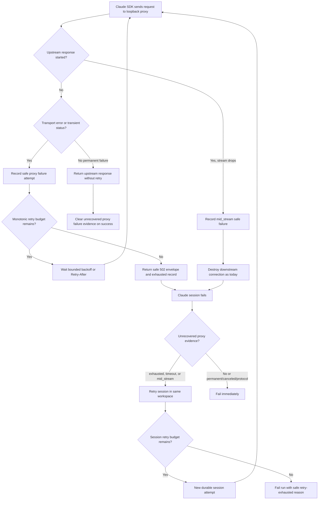
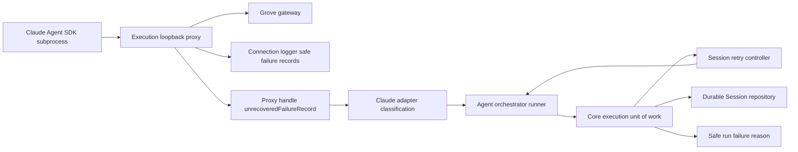

# Enhancement: Grove proxy failure records, retry budget, and session retry

## Parent feature

This enhancement spans the existing execution-runner features: `feature-loopback-runner-proxy.md`, `feature-runner-connection-layer-claude-agent-adapter.md`, `feature-durable-session-run-step-telemetry.md`, `feature-recover-failed-run.md`, and `feature-sanitized-failure-reason.md`. The parent behavior already routes Claude Agent SDK subprocess traffic through the execution loopback proxy for Grove-style endpoint alteration, records durable sessions, exposes safe failure reasons, and supports manual `POST /v1/runs/:id/recover`. This enhancement narrows itself to the Grove loopback-proxy path and does not change the OpenAI fetch transport retry default or the Claude SDK subprocess retry environment default.

## What

Autocatalyst will make transient Grove-path provider failures visible and survivable. The loopback proxy will always record safe upstream failure diagnostics, use a proxy-only monotonic time retry budget for pre-response transient failures, and expose the last unrecovered safe failure record to the Claude adapter. When a Claude session dies without a classifiable provider error and the proxy recorded an unrecovered failure that explains the session death, the execution path will classify the failure as transient, retry the model session in the same workspace with bounded backoff, and persist each failed attempt as a durable session row. Exhausted retries will fail the run with a new safe reason that says the retry budget was exhausted, while permanent failures, protocol errors, validation failures, authorization failures, and cancellation continue to fail immediately.

## Why

Long-running `implementation.build` sessions on the Grove-backed Claude profile sometimes die with only `Runner failed before terminal result.` even though manual `POST /v1/runs/:id/recover` with `mode: resume` succeeds. Operators get neither the proxy-side cause nor automatic recovery from transient network and gateway interruptions. This enhancement closes the gap by making the proxy leave safe evidence for every upstream failure, absorbing roughly one-minute pre-response connectivity losses, and automatically re-running interrupted sessions when the existing recovery behavior shows that the same workspace can continue safely.

## User stories

- Operators can inspect safe logs for Grove-path upstream failures and see whether the proxy retried, exhausted, timed out, or saw a mid-stream drop.
- Operators can rely on short connectivity interruptions, including sleep/wake Wi-Fi reconnects and gateway restarts up to about one minute, being absorbed by the proxy before the run fails.
- Operators can see a failed run reason that names transient provider/session retry exhaustion instead of the bare `Runner failed before terminal result.` fallback.
- Execution maintainers can read the proxy's last unrecovered safe failure record through a typed proxy handle method instead of scraping logs.
- Execution maintainers can test fail-then-succeed and exhausted-retry session sequences without live model calls or real delays.
- Cost and debugging users can see durable session rows for both failed and successful retry attempts.

## Design changes

This is a backend execution enhancement with no UI or visual design changes. Operator-visible behavior appears through existing logs, durable session records, failure reasons, and recovery APIs.

### Operator flow



### Interaction behavior

- Proxy retry is limited to failures before the upstream response starts. Mid-stream failures remain non-replayable at proxy level and are handled only by session-level retry.
- Session retry reuses the current run workspace and is equivalent in intent to `recover` with `mode: resume`; it must never replace the workspace or start over.
- Each failed session attempt is visible as a durable `Session` row with the next per-run `sequence`. Session retry does not create new `run_steps` rows; a run-step `attempt` keeps its existing meaning of step re-entry through lifecycle transitions such as recovery.
- Request logging remains optional, but safe upstream failure records are always emitted through the connection logger and never contain bodies, headers, prompts, secrets, raw SDK messages, or unredacted URLs.
- A connection that was already streaming when the machine slept is expected to surface as `mid_stream` on wake. The proxy cannot replay it; session retry is the recovery layer for that case.

## Technical changes

### Affected files

- `packages/execution/src/loopback-proxy.ts` — add always-on safe failure records, proxy-only retry budget enforcement, monotonic clock injection, mid-stream byte tracking, timeout outcome, unrecovered-failure handle method, success clearing, and retry-success info logging.
- `packages/execution/src/request-alteration.ts` — keep shared `defaultMaxRetries = 1` behavior unchanged for fetch transport and Claude SDK env; add only proxy-specific retry-budget helpers or types if shared endpoint parsing belongs there.
- `packages/execution/src/connection.ts` — thread proxy failure access through the connection/proxy handle and keep connection logger integration safe.
- `packages/execution/src/failure-reasons.ts` — add the safe exhausted session retry reason while preserving `transient_provider_failure` and normalization of unknown raw strings.
- `packages/claude-agent-adapter/src/claude-agent-adapter.ts` — enrich `claude.adapter.session_failed` diagnostics, classify unclassified failures with unrecovered proxy records as `transient_provider_failure`, and expose safe proxy fields in failure metadata.
- `packages/core/src/execution-run-unit-of-work.ts` — add bounded session retry around unclassified/pre-terminal transient session failures, preserving workspace and recording durable session attempts.
- `packages/core/src/execution-session-recorder.ts` — ensure failed session attempts are recorded with safe diagnostics and included in totals.
- `context-agent/wiki/code-map.md` — document proxy failure records, `PROXY_RETRY_BUDGET_MS`, `RUNNER_SESSION_MAX_RETRIES`, and `RUNNER_SESSION_RETRY_BASE_DELAY_MS`.

### Changes

#### Introduction and overview

Technical goals:

- Emit safe structured proxy failure evidence for every upstream failure regardless of optional request dump logging.
- Let only the loopback proxy ride out transient pre-response connectivity failures for `PROXY_RETRY_BUDGET_MS`, a named code constant with default `60000` ms.
- Keep `defaultMaxRetries = 1` unchanged for the non-proxy `fetch_transport` path and for `CLAUDE_CODE_MAX_RETRIES`.
- Preserve `endpoint.maxRetries` as an explicit attempt cap for proxy requests when set.
- Classify proxy-backed unclassified Claude session failures as `transient_provider_failure` only when the proxy evidence is unrecovered (`exhausted`, `timeout`, or `mid_stream`) and no upstream response has completed successfully since that record.
- Retry pre-terminal unclassified/transient session failures up to `RUNNER_SESSION_MAX_RETRIES`, default `2`, with exponential backoff from `RUNNER_SESSION_RETRY_BASE_DELAY_MS`, default `2000` ms.
- Keep permanent failures and cancellation non-retryable.
- Persist useful session telemetry for each attempt.

Glossary:

- **Proxy failure record** — safe structured metadata for an upstream proxy failure attempt or mid-stream drop.
- **Unrecovered proxy failure record** — the latest proxy record with outcome `exhausted`, `timeout`, or `mid_stream`, with no later upstream response completion on the same proxy handle. `retrying` never qualifies.
- **Response started** — upstream headers have been received and any downstream response may have begun.
- **Mid-stream failure** — an upstream error after headers/body streaming has started; not replayable at the proxy.
- **Session retry** — re-invoking the provider session for the same run step/workspace after a transient pre-terminal failure.

#### System design and architecture



Component responsibilities:

- The proxy owns HTTP attempt classification, monotonic retry timing, response-start tracking, byte counts, success clearing, and safe records.
- The connection layer owns logger wiring and exposes typed access to the proxy's latest unrecovered safe record.
- The Claude adapter owns SDK error inspection, cause-chain-safe diagnostics, and classification when unrecovered proxy evidence explains an otherwise unclassified failure.
- Core owns session retry policy, durable session recording, cancellation checks, and final safe failure mapping.
- Persistence owns monotonic session sequence. This enhancement does not create run-step rows during in-dispatch retries.

#### Detailed design

Proxy failure record shape should be provider-neutral and safe:

```ts
type ProxyUpstreamFailureOutcome = 'retrying' | 'exhausted' | 'mid_stream' | 'timeout';

type ProxyUpstreamFailureRecord = {
  profileName?: string;
  upstreamOrigin: string;
  attempt: number;
  outcome: ProxyUpstreamFailureOutcome;
  status?: number;
  errorCode?: string;
  elapsedMs: number;
  responseStarted: boolean;
  bodyBytesStreamed: number;
};
```

Safety rules:

- `upstreamOrigin` is origin-only, not full URL/path/query.
- Records do not include request/response bodies, headers, prompts, raw messages, secret handles, credential values, or filesystem paths.
- Error information is limited to safe names/codes such as `ECONNRESET`, `ETIMEDOUT`, `ENOTFOUND`, or `EAI_AGAIN`.

Proxy-only retry policy:

- `PROXY_RETRY_BUDGET_MS = 60000` is a named code constant used only by the loopback proxy retry loop. It is not an environment variable and not a new `RunnerEndpointSettings` field in this slice.
- Because the value is a code constant, this enhancement does not add API-contract schema, validation, or OpenAPI changes for configuration. The prior clamp language is removed.
- The proxy uses a separate resolver such as `resolveProxyRetryBudget(endpoint)` or equivalent. It must not replace the shared `resolveRetryPolicy(endpoint)` behavior used by fetch transport and Claude SDK process environment mapping.
- Retry budget and elapsed times use an injected monotonic clock, not wall clock. Tests control this clock. Wall-clock timestamps may still be used for log timestamps, but budget decisions and `elapsedMs` come from the monotonic clock.
- Retry clock starts before the first proxy attempt.
- Existing delay curve remains: 250 ms base, exponential doubling, 5 s cap, with jitter.
- `Retry-After` is converted against the remaining budget on the same monotonic clock and honored only up to the remaining budget.
- If `endpoint.maxRetries` is unset, elapsed proxy budget controls proxy attempts.
- If `endpoint.maxRetries` is set, it caps proxy attempts in addition to budget.
- Non-transient 4xx responses other than 408 and 429 are not retried.
- Once upstream headers have been received, the proxy never retries and continues current destroy behavior for broken streams.

Unaffected retry consumers:

- Non-proxy `fetch_transport` continues to use the existing default retry policy with `defaultMaxRetries = 1` when `endpoint.maxRetries` is unset.
- Claude SDK subprocess environment mapping continues to compute `CLAUDE_CODE_MAX_RETRIES` from `endpoint.maxRetries ?? defaultMaxRetries`.
- Tests must assert both unchanged behaviors for an endpoint with no `maxRetries`.

Stacked retry layers and worst case:

- Grove-path requests can sit under three retry layers: proxy budget, Claude SDK subprocess retries, and session retries.
- Worst-case proxy wait before final run failure is: `(1 + SDK retries) × PROXY_RETRY_BUDGET_MS × (1 + RUNNER_SESSION_MAX_RETRIES)` plus session retry backoff.
- With defaults: `(1 + 1) × 60000 × (1 + 2) = 360000 ms`, plus `2000 + 4000 = 6000 ms` backoff, for about `366000 ms`, or 6 minutes 6 seconds, before the run fails when the network is fully down and every SDK retry/request exhausts the proxy budget.
- A simulated-clock test should prove the default worst case matches this formula without real delay.

Unrecovered evidence handling:

- The proxy handle exposes either the latest unrecovered failure record or enough state for the adapter to decide. A `retrying` record never qualifies as retry evidence.
- A completed upstream response clears the unrecovered failure evidence or advances a last-success marker so an earlier recovered blip cannot explain a later unrelated SDK crash.
- Qualifying outcomes are only `exhausted`, `timeout`, and `mid_stream`.

Session retry policy:

- Retry when the session fails before any terminal result and either the error is classified `transient_provider_failure` or the error remains unclassified and there is qualifying unrecovered proxy evidence.
- Do not retry provider auth failures, validation failures, protocol errors, unsupported capabilities, result contract failures, workspace/materialization failures, or canceled runs.
- Default retry limit is `RUNNER_SESSION_MAX_RETRIES = 2`, meaning one initial session plus up to two retries.
- Backoff starts at `RUNNER_SESSION_RETRY_BASE_DELAY_MS = 2000` and doubles per retry; tests inject clock/sleep so no real delay is needed.
- Before each retry, core checks whether the run was canceled or otherwise transitioned; if so, stop retrying and preserve cancellation semantics.
- Exhaustion fails with a new known safe reason, for example `transient_provider_session_retries_exhausted`.
- `POST /v1/runs/:id/recover` remains available after exhaustion because the run ends in normal `failed` state.

Adapter diagnostics:

`claude.adapter.session_failed` should add only safe scalar fields:

- error class name;
- cause-chain class names;
- `errno` or `code` when present;
- subprocess exit code and signal when present;
- elapsed session time;
- last SDK event type received;
- number of SDK events received;
- unrecovered proxy failure fields when available.

Any raw `error.message`, provider body, prompt, header, token, or secret must be excluded or redacted before logging.

#### Security, privacy, and compliance

- Always-on failure records are deliberately metadata-only. They must be safe for ordinary structured logs.
- Tests must place a sentinel secret in a request header and in a scripted error message and assert it never appears in proxy records or adapter failure logs.
- The proxy must not expand optional request dump logging; this enhancement only adds safe failure metadata and uses existing redaction for any dump paths.
- Failure reasons stay allowlisted/safe; unknown strings still normalize to the generic fallback.

#### Observability

Logs:

- Every upstream failure emits one connection logger record with the safe proxy failure record.
- A request that eventually succeeds after retry emits one info-level record with attempt count and elapsed time so flakiness is visible.
- Session retries emit safe start/fail/retry/exhausted records with attempt number and reason code.

Durable records:

- Each failed session attempt writes a `Session` row with safe outcome diagnostics.
- A retried session writes the next per-run `Session.sequence` with the same step, role, and round as the original in-dispatch attempt.
- No new `RunStep` occurrence is created for an in-dispatch session retry. Existing `RunStep.attempt` semantics remain reserved for step re-entry through lifecycle transitions such as recovery.
- Session totals and cost inputs include failed attempts where telemetry is available.
- Retried sessions inside convergence must not increment the convergence round count; they are transport/session attempts within the same round.

#### Testing plan

Unit tests:

- `loopback-proxy.spec.ts`: scripted upstream covers retrying, exhausted, timeout, mid_stream, retry-then-success, byte counts, responseStarted, unrecovered-record clearing, monotonic elapsed time, and no secret leakage.
- `request-alteration.spec.ts` or targeted connection tests: verify the proxy budget helper is proxy-only and that unchanged consumers still use `defaultMaxRetries = 1`.
- Fetch transport unchanged test: endpoint with no `maxRetries` still has the old OpenAI/fetch retry behavior.
- Claude subprocess env unchanged test: endpoint with no `maxRetries` still produces `CLAUDE_CODE_MAX_RETRIES` from `defaultMaxRetries`.
- Monotonic sleep/wake test: wall clock jumps forward ten minutes while monotonic clock does not; the proxy still retries and succeeds within monotonic budget.
- Worst-case timing test: simulated clocks prove defaults take approximately `366000 ms` before final failure for full network outage, with no real delay.
- `claude-agent-adapter.spec.ts`: scripted failing session logs safe class/cause/code/exit/signal/event counts, uses only unrecovered proxy records to classify transient failure, and redacts sentinel secret from error message.
- Session retry tests: fail then succeed, fail three times/exhaust, classified permanent failure, cancellation between attempts, recovered blip followed by unrelated crash, mid_stream drop, exhausted request, and no real delay.
- Durable session tests: failed attempt rows are persisted with increasing session sequence and no new run-step occurrence is created.
- Convergence retry test: retried transport/session attempts do not change the convergence round count.

Integration tests:

- A control-plane or execution integration test drives a scripted Claude adapter/proxy sequence with no model call and asserts retry behavior, session rows, and final run outcome.
- No test makes a live model call.

#### Alternatives considered

1. Only set `maxRetries: 5` on the `grove-cp3` profile. This is useful as a stopgap but covers only short blips of roughly 8–11 seconds and does not record mid-stream drops or automate session resume.
2. Retry mid-stream requests inside the proxy. Rejected because streamed provider responses may not be replayable once headers/body have reached the SDK, and duplicate side effects could occur. Session retry is the safer boundary.
3. Rely only on manual `POST /v1/runs/:id/recover`. Rejected because operators still receive opaque failures and have to notice and recover transient interruptions manually.
4. Replace the shared `defaultMaxRetries` policy with a global budget. Rejected because it would unintentionally change OpenAI fetch transport and Claude SDK subprocess retry behavior outside the Grove proxy problem.

#### Risks

- Automatic session retry could repeat non-idempotent provider/tool effects. Mitigation: retry only pre-terminal session failures, reuse the same workspace, avoid proxy mid-stream replay, preserve durable failed attempts, and keep permanent/protocol failures non-retryable.
- Failure records could leak secrets if they include headers or messages. Mitigation: define a strict metadata shape and test sentinel leakage.
- Recovered proxy blips could be misused as evidence for unrelated later crashes. Mitigation: qualifying evidence excludes `retrying` records and is cleared or superseded when a response completes successfully.
- Stacked retry layers can extend failure time. Mitigation: document the worst-case formula and defaults, and test simulated elapsed time.
- Some provider failures may remain unclassified if the proxy has no corresponding unrecovered failure record. Mitigation: keep the generic safe fallback and manual recovery path.

## Task list

- [ ] **Story: Proxy failure records and safe diagnostics**
  - [ ] **Task: Define safe proxy failure record type and logger path**
    - **Description**: Add a typed safe record for upstream proxy failures and emit it through the existing connection logger for every transport/status/timeout/mid-stream failure, independent of optional request dump logging.
    - **Acceptance criteria**:
      - [ ] Record carries profile name, upstream origin, attempt number, outcome, status/error code, monotonic elapsed time, response-start state, and streamed body byte count.
      - [ ] Records never include bodies, headers, prompts, raw messages, secrets, secret handles, full URLs, or local paths.
      - [ ] A scripted upstream test asserts each outcome shape.
      - [ ] A sentinel secret in a request header is absent from emitted records.
    - **Dependencies**: None
  - [ ] **Task: Track response-start and body-byte state in the proxy**
    - **Description**: Instrument `loopback-proxy.ts` so each upstream attempt knows whether headers were received and how many upstream body bytes reached the downstream client before failure.
    - **Acceptance criteria**:
      - [ ] Pre-response failures report `responseStarted: false` and zero streamed bytes.
      - [ ] Mid-stream failures report `responseStarted: true` and the actual streamed byte count.
      - [ ] Existing stream destroy behavior remains unchanged for mid-stream failure.
      - [ ] A sleep/wake-style streaming interruption is represented as `mid_stream` and not proxy-retried.
    - **Dependencies**: Task: Define safe proxy failure record type and logger path
  - [ ] **Task: Expose unrecovered proxy failure evidence on the proxy handle**
    - **Description**: Add a typed handle method or state accessor that returns the latest unrecovered safe failure record for the proxy instance/session without scraping logs.
    - **Acceptance criteria**:
      - [ ] The method returns `undefined` before any qualifying unrecovered failure.
      - [ ] `retrying` records never qualify as retry evidence.
      - [ ] Outcomes `exhausted`, `timeout`, and `mid_stream` qualify until a later upstream response completes successfully.
      - [ ] A successful response clears the unrecovered evidence or advances a last-success marker.
      - [ ] Tests cover recovered blip clearing, multiple failures, and record replacement.
    - **Dependencies**: Task: Define safe proxy failure record type and logger path
  - [ ] **Task: Log retry-then-success flakiness**
    - **Description**: Emit one info-level safe record when an upstream request succeeds after one or more proxy retries.
    - **Acceptance criteria**:
      - [ ] The record includes final attempt count and monotonic elapsed time.
      - [ ] The record excludes headers, bodies, prompt content, and secrets.
      - [ ] A scripted retry-then-success test asserts the record appears once.
      - [ ] The successful completion clears unrecovered failure evidence.
    - **Dependencies**: Task: Expose unrecovered proxy failure evidence on the proxy handle

- [ ] **Story: Proxy-only retry budget for transient pre-response failures**
  - [ ] **Task: Add proxy-specific retry budget without changing shared default retries**
    - **Description**: Add `PROXY_RETRY_BUDGET_MS = 60000` as a code constant used only by the loopback proxy retry loop. Use a separate resolver such as `resolveProxyRetryBudget(endpoint)` and leave shared `defaultMaxRetries = 1` behavior intact for other consumers.
    - **Acceptance criteria**:
      - [ ] Endpoint with no `maxRetries` retries proxy attempts until the proxy budget is spent.
      - [ ] Non-proxy `fetch_transport` retry policy for an unset endpoint remains unchanged.
      - [ ] Claude subprocess env still computes `CLAUDE_CODE_MAX_RETRIES` from `endpoint.maxRetries ?? defaultMaxRetries`.
      - [ ] No API-contract, OpenAPI, or endpoint-settings schema change is introduced for this constant.
    - **Dependencies**: Story: Proxy failure records and safe diagnostics
  - [ ] **Task: Use injected monotonic time for proxy budget and elapsed fields**
    - **Description**: Measure proxy retry budget, remaining `Retry-After` time, and failure-record `elapsedMs` with an injected monotonic clock rather than wall clock.
    - **Acceptance criteria**:
      - [ ] Tests can advance monotonic time without real delay.
      - [ ] Wall-clock timestamp jumps do not consume retry budget.
      - [ ] A test jumps wall clock forward ten minutes while monotonic time does not, then the request retries and succeeds.
      - [ ] Failure-record elapsed values come from monotonic time.
    - **Dependencies**: Task: Add proxy-specific retry budget without changing shared default retries
  - [ ] **Task: Preserve endpoint maxRetries as a proxy attempt cap**
    - **Description**: Keep existing explicit `endpoint.maxRetries` behavior as a maximum proxy attempt count layered over the new proxy budget.
    - **Acceptance criteria**:
      - [ ] Profiles that set `maxRetries` stop after the configured cap even if monotonic budget remains.
      - [ ] Existing valid max bounds continue to apply.
      - [ ] Tests cover unset, low explicit cap, and maximum explicit cap.
    - **Dependencies**: Task: Add proxy-specific retry budget without changing shared default retries
  - [ ] **Task: Honor Retry-After within remaining monotonic budget**
    - **Description**: Apply `Retry-After` for transient statuses only when the delay fits inside the remaining proxy retry budget; otherwise exhaust safely.
    - **Acceptance criteria**:
      - [ ] Transient status with small `Retry-After` delays and retries.
      - [ ] `Retry-After` beyond remaining monotonic budget does not oversleep.
      - [ ] Permanent `401` is not retried.
      - [ ] Permanent failure returns the generic safe 502 envelope after budget exhaustion where applicable and logs `exhausted`.
    - **Dependencies**: Task: Use injected monotonic time for proxy budget and elapsed fields
  - [ ] **Task: Cover timeout and mid-stream non-retry behavior**
    - **Description**: Add tests proving timeout is recorded safely and mid-stream drops are recorded but never proxy-retried.
    - **Acceptance criteria**:
      - [ ] Timeout records outcome `timeout`.
      - [ ] Drop after response start records outcome `mid_stream`.
      - [ ] Mid-stream path destroys the connection as today.
      - [ ] No retry attempt is made after response start.
    - **Dependencies**: Task: Use injected monotonic time for proxy budget and elapsed fields

- [ ] **Story: Claude adapter classification and safe session diagnostics**
  - [ ] **Task: Enrich `claude.adapter.session_failed` safe fields**
    - **Description**: Capture safe SDK/subprocess diagnostic fields for failed Claude sessions without logging raw error messages or provider payloads.
    - **Acceptance criteria**:
      - [ ] Log includes error class name, cause-chain class names, errno/code, exit code, signal, elapsed session time, last SDK event type, and SDK event count when present.
      - [ ] A scripted failing session test asserts those fields.
      - [ ] A sentinel secret in an error message is absent from logs.
    - **Dependencies**: Story: Proxy failure records and safe diagnostics
  - [ ] **Task: Classify only unrecovered proxy-backed Claude failures as transient**
    - **Description**: When a Claude session ends before terminal result with no classifiable error, classify it as `transient_provider_failure` only if the proxy has qualifying unrecovered evidence from that session.
    - **Acceptance criteria**:
      - [ ] Qualifying outcomes are `exhausted`, `timeout`, and `mid_stream`.
      - [ ] A `retrying` record followed by a successful upstream response and later unrelated crash is not classified as transient and is not retried because of the recovered blip.
      - [ ] An `exhausted` request is classified as transient.
      - [ ] A `mid_stream` drop is classified as transient.
      - [ ] Permanent classified failures keep their original classification.
    - **Dependencies**: Task: Expose unrecovered proxy failure evidence on the proxy handle; Task: Enrich `claude.adapter.session_failed` safe fields

- [ ] **Story: Bounded session retry in the same workspace**
  - [ ] **Task: Add session retry constants and policy helper**
    - **Description**: Introduce `RUNNER_SESSION_MAX_RETRIES = 2` and `RUNNER_SESSION_RETRY_BASE_DELAY_MS = 2000`, plus a helper that decides which failures are retryable.
    - **Acceptance criteria**:
      - [ ] Retryable: `transient_provider_failure` and unclassified pre-terminal errors with qualifying unrecovered proxy evidence.
      - [ ] Not retryable: protocol errors, provider auth, validation/contract failures, unsupported capabilities, workspace/materialization failures, and canceled runs.
      - [ ] Constants are named and documented in code.
      - [ ] Worst-case default failure time is documented as about `366000 ms` for a fully down Grove network with default SDK retry and session retry settings.
    - **Dependencies**: Story: Claude adapter classification and safe session diagnostics
  - [ ] **Task: Retry failed sessions through the execution unit of work**
    - **Description**: Wrap model session execution so retryable pre-terminal failures re-run the session in the existing workspace with exponential backoff and never use `start_over`.
    - **Acceptance criteria**:
      - [ ] Fail then succeed produces a successful run-step result.
      - [ ] Fail three times exhausts default retries and fails with the new safe reason.
      - [ ] Backoff uses injected sleep/clock in tests and no real delay.
      - [ ] Workspace identity/root is unchanged across attempts.
      - [ ] Simulated-clock test verifies the worst-case default formula: `(1 + SDK retries) × PROXY_RETRY_BUDGET_MS × (1 + RUNNER_SESSION_MAX_RETRIES)` plus `2000 + 4000` ms backoff.
    - **Dependencies**: Task: Add session retry constants and policy helper
  - [ ] **Task: Respect cancellation and permanent failure during retry loop**
    - **Description**: Check run state/cancellation before retrying and ensure permanent failures short-circuit retry immediately.
    - **Acceptance criteria**:
      - [ ] A failure after the run is canceled does not retry and preserves canceled behavior.
      - [ ] A classified permanent failure is not retried.
      - [ ] Tests cover cancellation between attempts and permanent auth/protocol failures.
    - **Dependencies**: Task: Retry failed sessions through the execution unit of work
  - [ ] **Task: Preserve manual recovery after retry exhaustion**
    - **Description**: Ensure exhausted session retries fail through normal run failure flow so `POST /v1/runs/:id/recover` still works.
    - **Acceptance criteria**:
      - [ ] Exhausted run has safe failure reason such as `transient_provider_session_retries_exhausted`.
      - [ ] Recovery route accepts the failed run according to existing recovery policy.
      - [ ] No raw diagnostic appears in `failureReason`, SSE transition, or API read.
    - **Dependencies**: Task: Retry failed sessions through the execution unit of work

- [ ] **Story: Durable session-attempt recording and documentation**
  - [ ] **Task: Record failed session attempts as session rows**
    - **Description**: Persist a failed `Session` row for each session attempt that dies and persist retried sessions with the next per-run `sequence` while keeping the same step, role, and round.
    - **Acceptance criteria**:
      - [ ] Failed attempts appear in `listRunSessions` with sequence ordering.
      - [ ] Retried successful attempts appear as later session rows for the same step, role, and round.
      - [ ] No new `run_steps` row is created by an in-dispatch session retry.
      - [ ] Existing `RunStep.attempt` semantics are unchanged.
      - [ ] Cost/session totals include failed attempts where telemetry is available.
    - **Dependencies**: Story: Bounded session retry in the same workspace
  - [ ] **Task: Protect convergence round accounting during session retry**
    - **Description**: Ensure transport/session retries inside `implementation.build` do not increment convergence round counters or alter implementer/reviewer round semantics.
    - **Acceptance criteria**:
      - [ ] A retried implementer session remains in the same convergence round.
      - [ ] A retried reviewer session remains in the same convergence round.
      - [ ] Tests assert session sequence increases while convergence round does not.
    - **Dependencies**: Task: Record failed session attempts as session rows
  - [ ] **Task: Add no-model-call scripted integration coverage**
    - **Description**: Drive scripted adapter/proxy sequences through the production seams without live model calls or real delays.
    - **Acceptance criteria**:
      - [ ] Tests cover fail then succeed, fail three times, classified permanent failure, recovered blip followed by unrelated crash, and failure after cancellation.
      - [ ] Tests assert run status/failure reason and session rows.
      - [ ] Tests assert no new run-step row is created for session retry.
      - [ ] No test requires provider credentials or network beyond local scripted servers.
    - **Dependencies**: Task: Record failed session attempts as session rows; Task: Protect convergence round accounting during session retry
  - [ ] **Task: Update the agent code map**
    - **Description**: Document the new proxy failure record, proxy-only retry budget constant, unaffected retry consumers, and session retry constants in `context-agent/wiki/code-map.md`.
    - **Acceptance criteria**:
      - [ ] Code map names the owning modules for proxy records and retry constants.
      - [ ] Code map explains that proxy retry is pre-response only and session retry owns mid-stream recovery.
      - [ ] Code map states `defaultMaxRetries` remains unchanged for fetch transport and `CLAUDE_CODE_MAX_RETRIES`.
      - [ ] Code map states tests use scripted providers and no model calls.
    - **Dependencies**: Story: Bounded session retry in the same workspace
