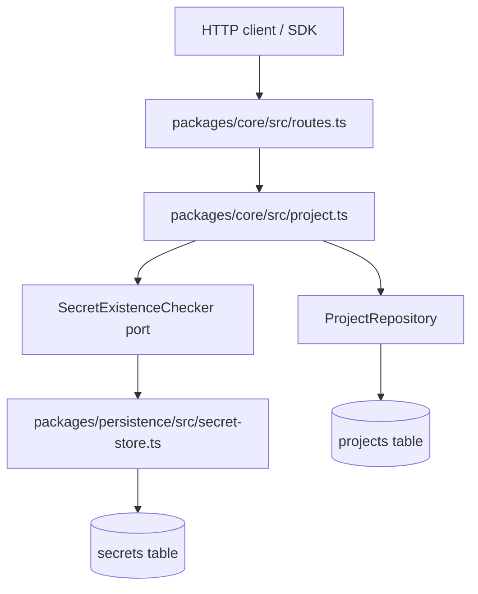
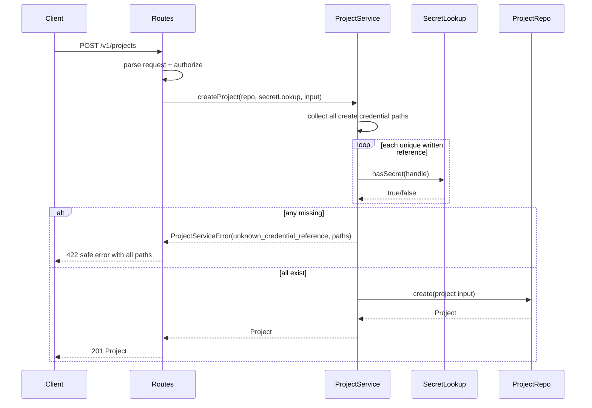

# Reject unknown project credential references

## Parent feature

This enhances `context-human/specs/feature-project-management-api.md`, which added tenant-scoped `/v1/projects` create, list, read, and update endpoints that accept credential references after validating only their secret-handle format.

## What

Project creation and project updates will reject credential references that point at no stored secret. A client can still reference credentials only by handle, but saving a Project now verifies that every newly written handle exists in the secret store and returns a clear `422 unknown_credential_reference` error when any referenced handle is unknown. Create validates all project credential locations. Patch validates only the credential locations supplied in the patch body, so unrelated edits such as renaming a Project do not revalidate or block on pre-existing dangling references.

## Why

A well-formed but stale or mistyped secret handle currently saves successfully and fails later during issue intake or pull-request work, where the error is farther from the configuration mistake and harder to diagnose. Validating references at the Project write boundary matches the settings model's cross-reference guarantees, gives API clients immediate feedback, and establishes the secret-existence port needed by later connection-test and credential-deletion work without decrypting secret values.

## User stories

- As an API client developer, I can save a Project only when its credential references point at existing secrets, so configuration mistakes are caught before work starts.
- As a repository owner, I receive a clear field-level error for each missing credential reference, so I can correct the exact setting without exposing token values.
- As an Autocatalyst operator, secret existence checks do not require unlocking or decrypting stored secrets, so validation stays safe and cheap.
- As a maintainer of existing data, I can rename a Project that already contains a dangling credential handle, so historical bad data does not block unrelated metadata updates.

## Design changes

This is a backend/API enhancement with no end-user UI changes. The user experience remains the HTTP and SDK flow from the parent feature with one changed failure mode:

1. The client creates a secret with `POST /v1/secrets` and receives a `sec_...` handle.
2. The client creates or updates a Project with that handle in `issueTrackerSetting.credentialRef`, `codeHostSetting.credentialRef`, or `credentialRefs[]`.
3. If every written handle exists, the Project write succeeds as it does today.
4. If one or more written handles do not exist, the API returns `422` with `error.code: "unknown_credential_reference"`, a safe message, and details listing offending field paths such as `issueTrackerSetting.credentialRef`, `codeHostSetting.credentialRef`, or `credentialRefs[1]`. The response must not include plaintext secret values and should not rely on decrypting secrets.

## Technical specification

### Introduction and overview

#### Prerequisites and assumptions

- ADR-005 and ADR-006 define REST transport and `/v1` API versioning.
- ADR-007 defines shared contract types and schema-first API behavior.
- ADR-008 defines configuration records/settings and cross-reference validation expectations.
- `context-human/specs/feature-project-management-api.md` is the parent feature; it intentionally left secret existence checks out of scope and validates only `secretHandlePattern`.
- `context-human/specs/feature-principal-config-secret-store.md` introduced `SecretStore` and `POST /v1/secrets`.
- `context-human/concepts/settings.md`, `context-human/concepts/trackers.md`, and `context-agent/standards/api-conventions.md` constrain error behavior and secret-safety language.
- Secrets are not tenant-owned in this slice; any existing handle is acceptable regardless of creator.

#### Goals and objectives

- Add a narrow secret-existence port beside `SecretStore` and `SecretResolver` without changing the secret table schema.
- Validate all credential references on `POST /v1/projects` before persistence.
- Validate only credential reference fields present in `PATCH /v1/projects/:id`.
- Return one `422 unknown_credential_reference` response that reports all missing reference field paths.
- Avoid secret decryption, plaintext loading, or secret value logging during existence checks.
- Update shared contract, OpenAPI, SDK behavior, production wiring, tests, and `context-agent/wiki/code-map.md`.

#### Non-goals

- Tenant ownership checks for secrets.
- Deleting secrets or deleting credentials when settings are removed.
- Testing whether a stored credential works with a provider.
- Revalidating existing Projects on read, list, or unrelated updates.
- Secret store schema changes.
- New SDK methods or client-side credential validation beyond existing error surfacing.

#### Glossary

- **Credential reference**: A `CredentialReference` object whose `id` is a secret handle and whose `purpose` describes how a Project setting uses it.
- **Secret handle**: A non-secret identifier matching `sec_...` and stored in the `secrets` table.
- **Existence port**: A narrow interface such as `hasSecret(handle): Promise<boolean>` that checks for a row without decrypting its value.
- **Written reference**: A credential reference supplied in the current create or patch request body.

### System design and architecture

#### High-level architecture



The route layer keeps parsing, auth, policy checks, and error-to-status mapping. The Project service owns which fields to validate for create versus update and prevents persistence when unknown references are present. The new secret-existence port is implemented by `SqliteSecretStore`, the same store production already uses for `POST /v1/secrets`, but the method reads only the `secrets` table.

#### Component breakdown

- `packages/core/src/secret.ts`: Add and export a small structural port, for example `SecretExistenceChecker` with `hasSecret(handle: string): Promise<boolean>`. Keep it separate from `SecretResolver` to avoid implying decryption or unlock requirements.
- `packages/persistence/src/secret-store.ts`: Implement the port in `SqliteSecretStore` with a `SELECT`/lookup on `secrets.handle`; do not check `#encryptionKey`, decrypt ciphertext, return values, or log handles/values.
- `packages/core/src/project.ts`: Accept the existence port as a dependency for create/update. Collect written credential reference paths, call `hasSecret` for each, aggregate missing paths, and throw a new `ProjectServiceError` code.
- `packages/core/src/routes.ts`: Pass the secret-existence port into create/update calls and map the new service error to HTTP `422`.
- `apps/control-plane/src/server.ts` or the production composition module: Wire the existing `SqliteSecretStore` instance into Project routes for both secret creation and Project validation.
- `packages/api-contract`: Export `unknownCredentialReferenceErrorCode` or equivalent contract constant, add `422` responses for project create/update in OpenAPI, and keep SDK errors flowing through the existing error type.
- `context-agent/wiki/code-map.md`: Record the new port and the `unknown_credential_reference` error code.

#### Primary create sequence



#### Primary update sequence

```mermaid
sequenceDiagram
    participant Client
    participant Routes
    participant ProjectService
    participant SecretLookup
    participant ProjectRepo

    Client->>Routes: PATCH /v1/projects/:id
    Routes->>Routes: parse request + authorize
    Routes->>ProjectService: updateProject(repo, secretLookup, input)
    ProjectService->>ProjectService: collect only credential paths present in patch body
    alt patch writes credential references
        loop each unique written reference
            ProjectService->>SecretLookup: hasSecret(handle)
            SecretLookup-->>ProjectService: true/false
        end
    else rename-only or no credential write
        ProjectService->>ProjectService: skip secret existence recheck
    end
    alt any missing
        ProjectService-->>Routes: ProjectServiceError(unknown_credential_reference, paths)
        Routes-->>Client: 422 safe error; no update
    else all written references exist or none supplied
        ProjectService->>ProjectRepo: update(tenant, id, patch)
        ProjectRepo-->>ProjectService: Project or null
        ProjectService-->>Routes: Project or null
        Routes-->>Client: 200 Project or 404
    end
```

### Detailed design

#### Data model and schema

No database schema changes are required. `SqliteSecretStore.hasSecret(handle)` should query only `secrets.handle` and return a boolean. It must work before unlock because it does not depend on encryption metadata or `#encryptionKey`.

Representative core port:

```ts
export interface SecretExistenceChecker {
  hasSecret(handle: string): Promise<boolean>;
}
```

`SqliteSecretStore implements SecretStore, SecretResolver, SecretExistenceChecker`. The exact interface name may vary, but it should remain narrow and exported from `@autocatalyst/core`.

#### API contracts

`POST /v1/projects` adds:

- `422`: request is syntactically valid but one or more credential references point at no stored secret.

`PATCH /v1/projects/:id` adds the same `422` response for written credential references only.

Error response shape follows existing API error conventions:

```json
{
  "error": {
    "code": "unknown_credential_reference",
    "message": "Project credential references must point at existing secrets.",
    "details": {
      "fields": [
        "issueTrackerSetting.credentialRef",
        "credentialRefs[1]"
      ]
    }
  }
}
```

The exact details property name can follow the local contract style, but it must name each offending field path and must not include plaintext secret values. It may include handles only if existing API conventions consider handles non-secret; prefer paths alone because they are sufficient for remediation and avoid echoing mistyped handles.

Malformed handles remain `400 validation_error` because the request schema already rejects non-`sec_` ids. Missing but well-formed handles become `422 unknown_credential_reference`. Missing/cross-tenant Project ids on update remain `404`.

#### Key business logic

Credential paths to validate on create:

1. `issueTrackerSetting.credentialRef` when `issueTrackerSetting` is non-null and contains `credentialRef`.
2. `codeHostSetting.credentialRef` when `codeHostSetting` is non-null and contains `credentialRef`.
3. Each `credentialRefs[index]`.

Credential paths to validate on update:

1. `issueTrackerSetting.credentialRef` only when the request includes `issueTrackerSetting` and it is non-null with `credentialRef`. A supplied `null` clears the setting and performs no secret check.
2. `codeHostSetting.credentialRef` only when the request includes `codeHostSetting` and it is non-null with `credentialRef`. A supplied `null` clears the setting and performs no secret check.
3. Each `credentialRefs[index]` only when the request includes the `credentialRefs` array.
4. `displayName`-only updates perform no secret checks and must succeed for a Project that already contains dangling handles.

Validation should aggregate missing paths before throwing. Duplicate references may be checked once internally for efficiency, but every offending field path should be reported. The service should run existence checks before `repository.create` or `repository.update` so failed requests leave Projects unchanged.

#### Error model

Extend `ProjectServiceErrorCode` with `unknown_credential_reference`. The error should carry safe details, for example:

```ts
interface UnknownCredentialReferenceDetails {
  readonly fields: readonly string[];
}
```

`handleProjectServiceError` maps:

- `forbidden` -> `403`
- `conflict` -> `409`
- `not_found` -> `404`
- `unknown_credential_reference` -> `422` with contract-exported code

#### Production wiring

The Project route dependencies currently include `projects` and `secrets`. The dependency shape should either use `secrets` as an object that satisfies both `SecretStore` and the new existence port, or add an explicit `secretExistence`/`credentialReferenceChecker` dependency. Production must pass the same `SqliteSecretStore` instance used by `POST /v1/secrets` so a handle created over the public API is immediately accepted by Project writes.

#### SDK behavior

No new SDK methods are required. Existing `createProject` and `updateProject` calls should surface the `422` through the SDK's existing API error type. Export the new error code from the contract so callers can branch on it.

### Security, privacy, and compliance

- `hasSecret` must not decrypt, return, log, or otherwise expose secret values.
- Existence checks must work while locked; requiring unlock would encourage using `resolveSecret` and would load plaintext unnecessarily.
- Error messages and details must be safe. Field paths are required; plaintext is forbidden.
- Tenant ownership remains out of scope because secrets currently have no tenant. This means any existing handle is accepted.
- Keep existing authentication, authorization, non-model-principal, and tenant-scoped Project rules unchanged.
- Avoid adding request logs or diagnostics that include secret values. If logging missing references is needed for debugging, log counts and paths only.

### Observability

Use existing route logging and error handling. No new metrics or alerts are required. A future operational metric could count `unknown_credential_reference` responses, but this enhancement does not require a telemetry schema change.

### Testing plan

#### Unit and service tests

- `packages/core/src/secret.spec.ts`: prove the new port is structurally usable and distinct from `SecretResolver` semantics.
- `packages/persistence/src/secret-store` tests: `hasSecret` returns true for a created handle, false for an unknown well-formed handle, and works before unlock on an existing database.
- `packages/core/src/project.spec.ts`: create validates `issueTrackerSetting.credentialRef`, `codeHostSetting.credentialRef`, and every `credentialRefs[]` entry; update validates only supplied credential fields; rename-only update skips checks; multiple bad references produce one error with all field paths; failed validation does not call repository create/update.
- `packages/core/src/routes.spec.ts`: maps `unknown_credential_reference` to `422` with safe code/message/details.

#### Contract and OpenAPI tests

- Export the new error code from `packages/api-contract`.
- Add `422` responses for `POST /v1/projects` and `PATCH /v1/projects/:id` in the OpenAPI document.
- Update `openapi.spec.ts` to assert the `422` responses and error code visibility.
- Confirm malformed handles still produce schema validation, not `unknown_credential_reference`.

#### End-to-end tests

Add a production-server test that uses HTTP only for Project writes and no direct Project repository writes:

1. Start the production server with real persistence and the real secret store.
2. Create a secret with `POST /v1/secrets`.
3. Create a Project referencing the returned handle; expect `201`.
4. Create a Project referencing a well-formed but never-stored handle; expect `422 unknown_credential_reference`, field-path details, and no saved Project.
5. Patch a Project to a missing credential handle; expect `422` and no Project change.
6. Seed or otherwise arrange a Project with a dangling handle outside the Project API only where needed to prove historical-data behavior; then send a rename-only `PATCH` through HTTP and expect success. If the test can create the dangling state only through persistence setup, keep direct writes out of the API-driving phase and document why the setup represents pre-existing legacy data.

### Alternatives considered

- **Use `SecretResolver.resolveSecret` to check existence.** Rejected because it requires unlock, decrypts plaintext, and broadens the validation path's secret exposure.
- **Defer validation until issue intake or pull-request open.** Rejected because it preserves the current late, opaque failure mode and does not match settings cross-reference behavior.
- **Revalidate all stored references on every update.** Rejected because it would block unrelated edits to Projects that already contain dangling handles, making cleanup harder and surprising clients.
- **Add tenant ownership to secrets now.** Rejected as out of scope; the current secret model has no tenant field.

### Risks

- Existing route dependency types may assume `secrets` is only `SecretStore`; implementation should keep the new port structural or add a clearly named dependency to avoid awkward casts.
- If error details include handles, clients may copy them into logs. Prefer field paths only unless the existing API error convention requires values.
- The E2E rename-only test needs a legacy dangling Project. Creating that state should be isolated to test setup, while the actual behavior under test must be driven through the production HTTP server.
- Concurrent deletion is out of scope because secret deletion does not exist yet; future deletion work must decide whether Project references become dangling after deletion.

## Task list

- [ ] **Story: Add a non-decrypting secret existence port**
  - [ ] **Task: Define and export the secret existence interface**
    - **Description**: Add a narrow port beside `SecretStore` and `SecretResolver` in `packages/core/src/secret.ts`, such as `SecretExistenceChecker.hasSecret(handle)`, and export it from the core public entry point. Keep the name and documentation clear that it checks only existence and does not resolve plaintext.
    - **Acceptance criteria**:
      - [ ] Core exports the new interface from `packages/core/src/index.ts`.
      - [ ] The interface has one operation that returns a boolean existence result for a handle.
      - [ ] Documentation/comments distinguish it from `SecretResolver` and prohibit plaintext access.
      - [ ] Existing `SecretStore` and `SecretResolver` callers continue to compile.
    - **Dependencies**: None
  - [ ] **Task: Implement `hasSecret` in `SqliteSecretStore`**
    - **Description**: Extend `SqliteSecretStore` to implement the new core port by looking up `secrets.handle` directly. The method must not require unlock or touch encrypted columns except as ordinary row data selected by the ORM if unavoidable.
    - **Acceptance criteria**:
      - [ ] `SqliteSecretStore` structurally implements the new port.
      - [ ] `hasSecret` returns true for an existing handle and false for an unknown handle.
      - [ ] `hasSecret` does not check `#encryptionKey` and works while the store is locked.
      - [ ] The method never returns, decrypts, or logs a secret value.
    - **Dependencies**: "Task: Define and export the secret existence interface"
  - [ ] **Task: Cover secret existence behavior with tests**
    - **Description**: Add store-level tests for true, false, and locked-store behavior. Use real SQLite persistence so the test proves the implementation reads the `secrets` table without decrypting.
    - **Acceptance criteria**:
      - [ ] A stored handle produces `hasSecret(handle) === true`.
      - [ ] A well-formed but unknown handle produces `false`.
      - [ ] After a secret is stored and the store is reconstructed but not unlocked, `hasSecret(handle)` still returns true.
      - [ ] Tests do not assert or expose plaintext values beyond controlled setup.
    - **Dependencies**: "Task: Implement `hasSecret` in `SqliteSecretStore`"

- [ ] **Story: Validate Project credential references in the service**
  - [ ] **Task: Add the `unknown_credential_reference` service error**
    - **Description**: Extend `ProjectServiceErrorCode` and `ProjectServiceError` details support so Project validation can report missing credential references with safe field paths.
    - **Acceptance criteria**:
      - [ ] `ProjectServiceErrorCode` includes `unknown_credential_reference`.
      - [ ] The error can carry details with all offending field paths.
      - [ ] The default message is clear and does not mention plaintext or provider internals.
      - [ ] Existing error mappings for forbidden/conflict/not_found remain unchanged.
    - **Dependencies**: None
  - [ ] **Task: Collect written Project credential reference paths**
    - **Description**: Add helper logic in `packages/core/src/project.ts` to enumerate credential references and their field paths for create and update requests. Create should enumerate all credential locations; update should enumerate only fields actually present in the patch body.
    - **Acceptance criteria**:
      - [ ] Create collects `issueTrackerSetting.credentialRef`, `codeHostSetting.credentialRef`, and every `credentialRefs[index]` when present.
      - [ ] Update collects setting credential refs only when the corresponding setting key is supplied and non-null.
      - [ ] Update collects `credentialRefs[index]` only when `credentialRefs` is supplied.
      - [ ] `displayName`-only updates produce an empty validation set.
    - **Dependencies**: "Task: Add the `unknown_credential_reference` service error"
  - [ ] **Task: Enforce existence checks before create/update persistence**
    - **Description**: Change `createProject` and `updateProject` to accept the new secret existence port, check all collected references, aggregate missing paths, and throw before calling repository persistence when any handle is unknown.
    - **Acceptance criteria**:
      - [ ] `createProject` rejects when any written credential handle is unknown.
      - [ ] `updateProject` rejects only for unknown handles in fields supplied by the patch.
      - [ ] Multiple missing references are reported in one error.
      - [ ] Repository `create`/`update` is not called when validation fails.
      - [ ] Rename-only update of a Project with dangling stored references succeeds when the repository returns the updated Project.
    - **Dependencies**: "Task: Define and export the secret existence interface", "Task: Collect written Project credential reference paths"
  - [ ] **Task: Add Project service tests for credential validation**
    - **Description**: Extend `packages/core/src/project.spec.ts` with focused tests using a fake existence checker and fake Project repository.
    - **Acceptance criteria**:
      - [ ] Create checks all three credential locations.
      - [ ] Update checks only supplied credential locations.
      - [ ] Several bad references produce a single `unknown_credential_reference` error with all expected paths.
      - [ ] A failed create or update leaves the repository untouched.
      - [ ] Rename-only patch succeeds without calling the existence checker.
    - **Dependencies**: "Task: Enforce existence checks before create/update persistence"

- [ ] **Story: Expose the new API error through routes, contract, OpenAPI, and SDK**
  - [ ] **Task: Export the new contract error code and OpenAPI responses**
    - **Description**: Add `unknown_credential_reference` to the shared contract exports and include `422` responses on both Project write operations in the OpenAPI document.
    - **Acceptance criteria**:
      - [ ] The error code is exported from `packages/api-contract`.
      - [ ] OpenAPI lists `422` for `POST /v1/projects`.
      - [ ] OpenAPI lists `422` for `PATCH /v1/projects/:id`.
      - [ ] The response schema uses the existing error envelope.
    - **Dependencies**: "Task: Add the `unknown_credential_reference` service error"
  - [ ] **Task: Map the Project service error to HTTP 422**
    - **Description**: Update `handleProjectServiceError` in `packages/core/src/routes.ts` so `unknown_credential_reference` returns a `422` response with the contract error code, safe message, and path details.
    - **Acceptance criteria**:
      - [ ] Route mapping returns status `422`.
      - [ ] Response `error.code` is `unknown_credential_reference`.
      - [ ] Response details include each offending field path.
      - [ ] Response does not include plaintext secret values.
    - **Dependencies**: "Task: Export the new contract error code and OpenAPI responses", "Task: Enforce existence checks before create/update persistence"
  - [ ] **Task: Wire the existence port into Project routes**
    - **Description**: Extend route dependencies and production composition so Project create/update receives the same secret store instance used by `POST /v1/secrets`. Keep list/read behavior unchanged.
    - **Acceptance criteria**:
      - [ ] Route dependency types expose the secret existence port or a `secrets` object that satisfies it.
      - [ ] `POST /v1/projects` passes the port to `createProject`.
      - [ ] `PATCH /v1/projects/:id` passes the port to `updateProject`.
      - [ ] Production server composition passes the existing `SqliteSecretStore` instance.
    - **Dependencies**: "Task: Implement `hasSecret` in `SqliteSecretStore`", "Task: Map the Project service error to HTTP 422"
  - [ ] **Task: Add route, OpenAPI, and SDK regression tests**
    - **Description**: Cover error mapping, OpenAPI response declarations, and SDK behavior without adding SDK methods. The SDK should surface the response through its existing API error path.
    - **Acceptance criteria**:
      - [ ] Route tests assert `422` response shape for unknown credential references.
      - [ ] `openapi.spec.ts` asserts both Project write operations include `422`.
      - [ ] Contract tests or exports prove the new error code is publicly available.
      - [ ] SDK tests show create/update Project calls surface the existing error type for the new `422`.
    - **Dependencies**: "Task: Wire the existence port into Project routes"

- [ ] **Story: Prove behavior end-to-end and update agent documentation**
  - [ ] **Task: Add production-server E2E coverage for create**
    - **Description**: Write an end-to-end test that starts the production server, creates a secret through `POST /v1/secrets`, creates a Project referencing the returned handle, and then attempts creation with a well-formed but unstored handle.
    - **Acceptance criteria**:
      - [ ] The valid handle path returns `201`.
      - [ ] The unknown handle path returns `422 unknown_credential_reference`.
      - [ ] The unknown-handle response includes safe field-path details.
      - [ ] The failed create does not save a Project visible through `GET /v1/projects`.
      - [ ] The test drives Project writes only through HTTP, not direct Project repository writes.
    - **Dependencies**: "Task: Wire the existence port into Project routes"
  - [ ] **Task: Add production-server E2E coverage for patch**
    - **Description**: Extend the E2E coverage to patch an existing Project to an unknown handle and to prove rename-only patch succeeds for a legacy Project that already has a dangling handle.
    - **Acceptance criteria**:
      - [ ] PATCH writing an unknown credential handle returns `422 unknown_credential_reference`.
      - [ ] The failed PATCH leaves the Project unchanged.
      - [ ] A rename-only PATCH of a Project with a dangling stored handle returns `200`.
      - [ ] Any direct persistence setup is limited to arranging legacy pre-existing data; the behavior assertions use HTTP.
    - **Dependencies**: "Task: Add production-server E2E coverage for create"
  - [ ] **Task: Update `context-agent/wiki/code-map.md`**
    - **Description**: Record the new secret existence port, `SqliteSecretStore.hasSecret`, Project service validation behavior, and `unknown_credential_reference` error code for future agents.
    - **Acceptance criteria**:
      - [ ] The code map mentions the new core secret port.
      - [ ] The code map mentions the persistence implementation and locked-store behavior.
      - [ ] The code map mentions the Project service create/update validation semantics.
      - [ ] The code map records the new API error code and status.
    - **Dependencies**: "Task: Add production-server E2E coverage for patch"
