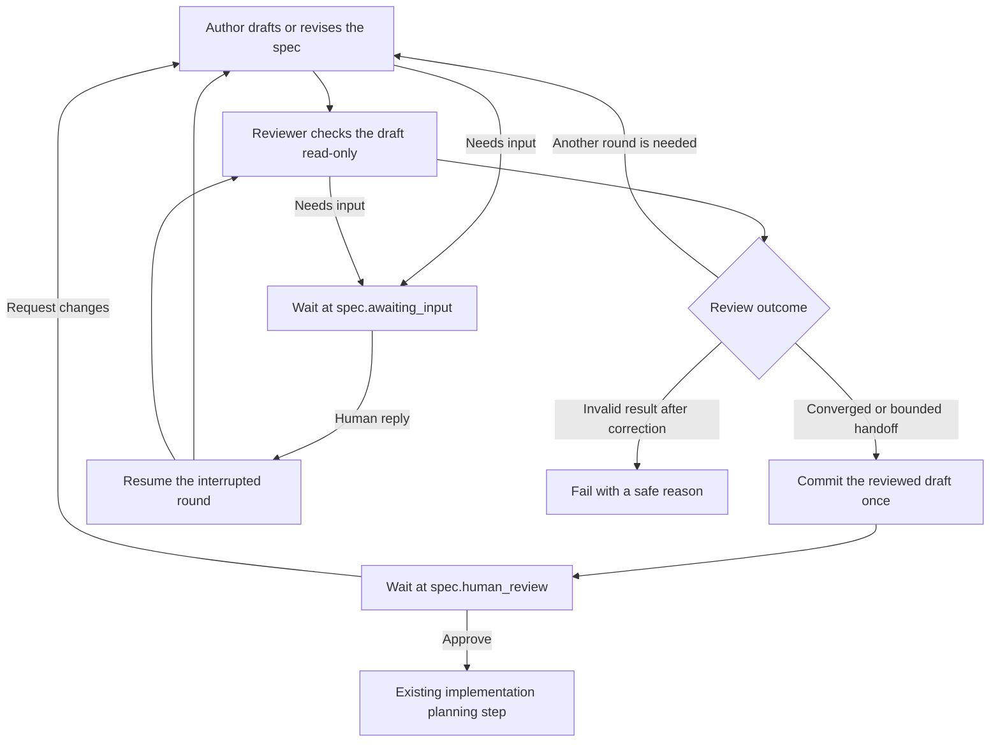

# Enhancement: Review specs before the human gate

## Parent feature

[Producing-step implementer/reviewer convergence loop](feature-producing-step-convergence-loop.md) defines the two-role review loop. This enhancement wires that loop into [real spec authoring](feature-author-real-conformant-spec.md) without changing the build loop.

## What

Before Autocatalyst asks a human to approve a feature or enhancement spec, a separate, read-only reviewer checks the draft against the request and the repository's architecture contracts. The author receives the findings and records what it fixed or declined. The human gets the reviewed draft, the findings, and the author's responses. If the review reaches its round limit, the human gets the last reviewed draft with unresolved findings called out, not a claim that the spec converged.

## Why

`spec.author` declares both roles, but production dispatch currently runs only the author. The first independent check is therefore the human gate, where gaps in scope, design, or test coverage cost another revision. A bounded model review catches those gaps earlier and lets the human see what remains in dispute.

## User stories

- A project owner can review the committed draft alongside the model reviewer's findings and the author's dispositions before approving it to build from.
- A project owner can request changes at the spec gate and receive a newly reviewed revision.
- An operator can answer a question from either role and see the interrupted review continue without losing its prior findings.
- An operator can distinguish a converged draft, a draft handed off at the round limit, and a failed reviewer session without reading provider logs.

## Design changes

### Flow

### Spec and Activity views

Use the existing spec feedback list and Activity view. Reviewer findings appear as `artifact` feedback, including target-level findings without a text anchor. Activity shows author and reviewer sessions under `spec.author`. A fixed finding shows the author's summary and `addressed` status; a declined finding shows the author's reason and `wont_fix` status. Neither blocks approval. Humans can disagree by leaving their own feedback and requesting changes.

At a bounded handoff, show that automated review did not converge, list the remaining findings, and make clear that approval accepts the draft despite those findings. The existing Approve action is that explicit human sign-off; there is no automatic approval. Keep Request changes available when there is open reviewer feedback, even when Approve is available. Human-authored feedback retains its existing approval rules. Reuse the run detail and reply surfaces; no new screen or review workflow is needed.

### Scope

Feature and enhancement runs use the loop. Bug and file-issue runs keep their current `spec.author` behavior: bug triage is issue-canonical, and file-issue runs produce intake for `issues.file`. Neither produces a committed spec with a `spec.human_review` gate; applying the same completion and sign-off rules would change those workflows. No review passes are added to `implementation.plan` or `docs.update`. Routing defaults, provider defaults, and implementation convergence behavior stay unchanged.

## Technical changes

### Affected files

- `packages/core/src/orchestrator.ts`, `run-workflows.ts`, `convergence-policy.ts`, and `convergence-checkpoint.ts` — select reviewed spec dispatch, apply workflow policy, and route completion and input replies.
- `packages/core/src/layered-convergence-engine.ts`, `convergence-engine.ts`, and the role dispatch boundary — reuse round orchestration and inject spec-specific draft, review, and exit behavior.
- `packages/core/src/spec-authoring-context.ts`, `spec-authoring-service.ts`, `spec-frontmatter.ts`, and `execution-context-resolver.ts` — build role-specific context, render review candidates, and complete the selected spec.
- `packages/core/src/convergence-feedback.ts`, `feedback-lifecycle.ts`, and `spec-review-gate.ts` — record dispositions by feedback ID and apply the spec-only approval rule.
- `apps/control-plane/src/server.ts` and `spec-authoring-context-loader.ts` — compose production role dispatch and load request, issue, and feedback context.
- `packages/api-contract/src/convergence.ts`, `spec-authoring.ts`, `run-step.ts`, and `run-replies.ts`; `packages/execution/src/result-contracts.ts`, `result-normalizers.ts`, and `provider-schema-projection.ts` — support role-specific result validation and spec round, pause, and completion metadata without changing existing result shapes.
- `apps/web/src/runs/spec-decision.ts`, `use-spec-review-controller.ts`, and `apps/web/src/features/spec/` — distinguish advisory review findings from human approval blockers and show bounded handoff status in the existing controls.
- `context-human/concepts/review.md` and `context-agent/wiki/code-map.md` — document the new production path and its differences from build review.

### Changes

#### Dispatch and policy

Keep the orchestrator as the only authority for run transitions. In the production dispatch path, an AI-active `spec.author` occurrence with both roles and a file-canonical workflow enters the layered convergence engine under the existing per-run dispatch queue. Resolve both routes using `(spec.author, implementer)` and `(spec.author, reviewer)`. A single configured model still runs separate sessions and emits the existing distinctness warning. Missing routing or convergence wiring fails clearly on the production path; it must not fall back to unreviewed authoring. Retain explicit test and scripted-fake seams.

Read `maxRounds` and `depth` from the workflow's policy for `spec.author`, not from `implementation.build`. Default to three rounds per altitude and one whole-spec altitude. An altitude is the focus of a review pass. Reuse policy depth values and ordering: `build_only` means whole spec only; `layout` adds requirements and structure first; `public_api` adds behavior and contract review after that; `full` also adds internal design and testability before the whole-spec pass. At every altitude, the reviewer sees a complete candidate. Altitude changes the prompt's focus, not the Markdown contract. The spec strategy does not run TypeScript declaration checks, build drift checks, git round commits, or implementation checkpoint refs. Build retains these behaviors unchanged.

#### Role inputs and results

1. The implementer keeps the materialized `mm:planning` and `mm:writing-guidelines` inputs and the existing request, issue, work-kind, and ownership context. On revision, also provide the previous candidate, authorable feedback IDs and text, prior dispositions, and any human answer relevant to the session. Reuse the existing path on a gate revision rather than minting a second spec.
2. Use a dedicated reviewed-author round contract with a strict `{ spec, dispositions }` envelope. `spec` uses the unchanged `autocatalyst.spec_author.v1` shape and its trusted frontmatter stamping and validation. `dispositions` reuses `FindingDisposition`: `fixed` requires a summary and `declined` requires a reason. The round contract requires exactly one disposition per requested ID, including nonblocking findings handed into a subsequent round. Empty dispositions are valid only when none are required. Reject missing, duplicate, or unrelated IDs after bounded correction; a model cannot update feedback by guessing its ID. Keep the one-shot author contract intact.
3. After validation, the host renders the exact candidate Markdown into a contained, round-specific file in workspace scratch. Review and completion use the same validated candidate and rendering rules. Pass the candidate file and canonical destination separately so the reviewer never mistakes an older committed spec for the current draft. The reviewer receives the request and issue text, relevant repository context, and the candidate path. It reads the draft and the concepts or ADRs it cites and checks scope, consistency, edge cases, and testable acceptance criteria. It does not share the author's conversation memory or edit either workspace root.
4. Register `autocatalyst.reviewer_result.v1` for `spec.author` and choose validation and result capture by trusted step and role before the generic spec-author case. Give each occurrence, altitude, round, role, and retry a distinct scratch result path. The host or adapter captures the reviewer's structured response; the reviewer does not need a write tool. Support the role contracts through the configured provider's capture mechanism. If the configured route cannot enforce read-only review or capture its result, fail safely. A valid `needs_input` terminal result is not a missing JSON result. Missing, empty-object, or invalid reviewer output that survives the tolerance pipeline fails the run; it must not become `satisfied` or trigger completion.

#### Findings and gate rules

Create model-authored `artifact` feedback from validated reviewer findings, with provenance derived from the routed session, not model output. Persist severity in the round record. Retain anchors only if they validate against the reviewed candidate; otherwise keep target-level feedback. Feed all findings from a completed review to the next author round if one runs. Fresh `blocker` or `warning` findings require another round while budget remains; `info` alone does not. A materially unchanged repeat of an explicitly declined finding does not restart the loop; a new concern or a repeated finding that the author claimed to fix can still require another round. Keep original findings, reasons, and summaries in the round audit even when matching repeat findings by signature.

Apply dispositions against only the IDs carried into the round. After the selected draft is committed and before gate entry, put fixed reviewer items in `addressed` and declined items in `wont_fix`, preserving the summary or reason in the thread. Carry a disposition forward only if it still applies to the candidate being handed off; a reviewer that reports the defect again leaves an open finding. At the cap or oscillation cutoff, keep undisposed findings open with their actual severity. Record `max_rounds` or `oscillation`, never `converged`, and hand off the last candidate that got a valid review. This is the spec-specific escalation: `spec.human_review` is the human sign-off point; `spec.awaiting_input` is reserved for questions from either role. The build escalation path does not change.

For approval, treat addressed reviewer items and open advisory items from this review as nonblocking, including open findings at a bounded handoff. Derive the exception from trusted reviewer provenance and the current spec completion checkpoint, not merely from `author.kind` or a client-supplied ID. Open reviewer findings remain eligible for Request changes and are sent back to the author on that path. Declined reviewer findings do **not** block approval, even at blocker severity; the human can request changes against the underlying concern. Do not exempt unrelated artifact feedback. Keep the API gate authoritative and make the client use the same blocking/advisory distinction. If the ready draft or its required feedback/checkpoint writes cannot be verified, fail rather than enter the gate with incomplete records.

When the human requests changes at `spec.human_review`, start a new convergence occurrence with the current committed draft and all open human `artifact` feedback, plus any open reviewer findings being revisited. A human item becomes `addressed` only for a valid `fixed` disposition on the selected draft. A declined or not-yet-fixed human item remains open for the existing human disposition flow. Approval continues to confirm the approver's own addressed human items; it does not pretend that the human originated the model's findings. Remove the blanket open-to-addressed update from the reviewed completion path.

#### Checkpoints and input pauses

Save step and producing-step identity as `spec.author` in the spec checkpoint and pause metadata. Store the reviewed round outcomes, altitude, session references, feedback IDs, and dispositions. On successful handoff, preserve this record alongside the completion fields needed to find the spec artifact. The gate uses the current completed occurrence, not any older matching step. Do not put candidate content, absolute scratch paths, or provider payloads in public checkpoints. Accept old build checkpoints and keep the current build checkpoint and cumulative summary shapes unchanged.

When a role returns `needs_input`, record its question, interrupted role, altitude and round, completed-round state, and the candidate identifier and digest if the reviewer was interrupted. Do not commit or run completion. Use the existing `needs_input` edge to `spec.awaiting_input` and accept the existing run reply `guidance` request there when it matches the active spec pause, with a spec-question classification distinct from build escalation. Resume via the workflow edge to `spec.author` and pass the reply to the interrupted role. Do not reset the completed-round budget or recreate findings already recorded. If scratch was recreated, regenerate the interrupted round's candidate with the saved inputs and answer, then review that candidate before it can be selected. A stale answer must not resume a newer occurrence.

#### Commit and completion boundary

The reviewer reads a host-rendered scratch file, not an intermediate commit. On convergence or bounded handoff, the engine returns the selected validated author result separately from the convergence checkpoint. The orchestrator calls `#runSpecAuthoringCompletion` once for that completed occurrence, then uses `applyDirective` to enter `spec.human_review`. Completion persists the artifact and workspace metadata through the existing path. Do not call it for input pauses, failed reviews, or incomplete rounds.

Reuse the same renderer and trusted frontmatter for the final file. The bytes selected for completion must match the candidate reviewed in the selected round. The host commits only the canonical spec path and compares against the branch's committed contents, not an uncommitted worktree copy. A changed accepted result makes one add or revise commit; an unchanged result makes none. Preserve stable identity fields and avoid changing dates solely because unchanged content was reviewed again. Make retry after a partial completion safe: if the selected bytes are already at `HEAD`, recover the matching artifact/checkpoint without committing again, including when the first attempt committed before creating the artifact. Do not amend previous commits or stage unrelated files.

#### Compatibility, safety, and observability

Use existing run steps, sessions, feedback, artifact records, and checkpoint storage. No new endpoint, table, or backfill is needed. The existing reply endpoint recognizes spec guidance at the matching pause; existing clients and build guidance keep their current semantics. Persist and log the run, step, role, altitude, round, outcome, and safe error code. Do not log draft text, feedback bodies, raw provider output, credentials, or host paths. Guard workspace containment at the host boundary, apply the actual read-only tool policy, and keep git mutations with the host.

#### Verification and alternatives

Use deterministic provider results at the execution boundary to exercise production control-plane dispatch with a real git workspace and persisted sessions. Assert role routes, the review input file, final git bytes and history, feedback, and pause state. Cover a reviewer contract failure after correction, a declined blocker, cap sign-off, human revise, input pauses from each role, no-op and interrupted completion, and a configured nondefault depth. Keep existing build integration coverage and add regression assertions for bug and file-issue behavior.

A separate spec review step would duplicate routing, feedback, and pause mechanics. Committing each spec round, as build does, would publish intermediate drafts and compete with the existing spec completion commit. The chosen approach keeps the shared round driver and gives the spec its own candidate and completion behavior. The main risks are reviewing stale bytes, accidentally exempting human feedback, or losing round state after a pause. Candidate digests, occurrence-scoped checkpoint and feedback IDs, and real-git/gate tests address those risks.

## Task list

- [ ] **Story: Dispatch real spec author and reviewer sessions**
  - [ ] **Task: Add role-specific spec round contracts and context**
    - **Description**: Preserve the author payload inside the reviewed round envelope, add the cold reviewer prompt, and register role-specific capture and validation at the execution boundary.
    - **Acceptance criteria**:
      - [ ] The author receives materialized planning skills, candidate context, and the exact feedback IDs it must dispose; nested spec validation still uses runtime-owned frontmatter fields.
      - [ ] The reviewer receives the current candidate path, issue or request, and instructions to verify cited concepts; it has no write-capable tools and returns `autocatalyst.reviewer_result.v1` through host capture.
      - [ ] Role, round, and retry outputs cannot overwrite each other. Empty or malformed reviewer verdicts and missing, duplicate, or foreign disposition IDs fail after bounded correction.
    - **Dependencies**: None
  - [ ] **Task: Wire the spec strategy into the production loop**
    - **Description**: Reuse the layered engine's role dispatch and loop for file-canonical `spec.author`, with spec-only candidate rendering, altitude prompts, and exit behavior.
    - **Acceptance criteria**:
      - [ ] Production dispatch uses both `spec.author` routes and records both sessions; a single-model configuration still reviews and warns.
      - [ ] Default policy runs one altitude with up to three rounds. A nondefault policy changes the round cap and prompt focus without invoking build checks or commits.
      - [ ] Bug and file-issue runs keep their one-shot paths, and `implementation.build` retains its current routing, commits, checks, checkpoint, and escalation behavior.
    - **Dependencies**: Task: Add role-specific spec round contracts and context
- [ ] **Story: Hand off the right draft with an auditable review**
  - [ ] **Task: Persist findings and apply spec approval rules**
    - **Description**: Persist model findings as `artifact` feedback, track dispositions by ID, and use the current checkpoint to distinguish advisory findings from human gating feedback.
    - **Acceptance criteria**:
      - [ ] A fixed reviewer finding is `addressed` at the gate with its summary; a declined blocker is visible as `wont_fix` with its reason and does not block approval.
      - [ ] Capped review keeps outstanding findings open and visible, shows the capped state in existing spec controls, and offers explicit approval or Request changes without treating the draft as converged.
      - [ ] Human feedback still gates approval. A human revise reply reaches the next author with open feedback and triggers a fresh reviewer pass; only actually fixed IDs become `addressed`.
    - **Dependencies**: Task: Wire the spec strategy into the production loop
  - [ ] **Task: Commit only the selected spec at completion**
    - **Description**: Return the validated selected draft with the round checkpoint and invoke existing spec completion before the transition to the human gate.
    - **Acceptance criteria**:
      - [ ] Convergence or bounded handoff calls completion once for the occurrence, preserves its round record with `spec.author` identity, and commits the exact selected reviewed bytes.
      - [ ] No commit occurs on intermediate rounds, input pauses, or invalid review. A changed accepted revision makes one spec-only commit; an unchanged revision or retry after commit-before-artifact failure makes none.
      - [ ] Completion failure does not advance to the gate, and a subsequent successful retry does not create duplicate artifact or commit records.
    - **Dependencies**: Task: Persist findings and apply spec approval rules
  - [ ] **Task: Resume spec review after input from a human**
    - **Description**: Store the active question and round state, accept guidance at the spec awaiting-input step, and resume the interrupted review through ordinary dispatch.
    - **Acceptance criteria**:
      - [ ] A question from either role pauses at `spec.awaiting_input` with `producingStep: spec.author`; the reply reaches the correct role and the loop resumes without premature completion.
      - [ ] Resume preserves completed rounds and finding IDs. Stale replies are rejected, and rematerializing scratch does not allow an unreviewed candidate to advance.
      - [ ] Existing implementation guidance behavior and classification remain unchanged.
    - **Dependencies**: Task: Wire the spec strategy into the production loop
- [ ] **Story: Prove and document production behavior**
  - [ ] **Task: Exercise production dispatch on a real git workspace**
    - **Description**: Drive the control plane from issue intake through the real dispatch and result-validation wiring, replacing only model or external service boundaries with deterministic fixtures.
    - **Acceptance criteria**:
      - [ ] A feature run shows a persisted `spec.author` reviewer session, an `artifact` finding with a fix in the accepted Markdown, and `spec.human_review` with `waitingOn: human`. Git contains exactly the selected draft and no intermediate or empty spec commits.
      - [ ] A forced malformed reviewer result fails with a clear sanitized reason instead of reaching the gate. Regression cases cover decline, cap, human revise, both input-pause roles, and enhancement-specific kind and path handling.
    - **Dependencies**: Task: Commit only the selected spec at completion; Task: Resume spec review after input from a human
  - [ ] **Task: Update review docs and run validation**
    - **Description**: Update the review concept through the repository's human-doc approval path, refresh the agent code map, and run the repository checks.
    - **Acceptance criteria**:
      - [ ] `context-human/concepts/review.md` explains scratch review, the spec cap handoff, and the distinction between reviewer and human feedback. `context-agent/wiki/code-map.md` points to dispatch, contracts, checkpoints, completion, and tests.
      - [ ] `pnpm nx run-many -t lint,typecheck,test -p core control-plane` passes. Targeted contract, execution, and web gate tests also pass for the changed code.
    - **Dependencies**: Task: Exercise production dispatch on a real git workspace
