# Enhancement: Review specs before the human gate

## Parent feature

[Producing-step implementer/reviewer convergence](feature-producing-step-convergence-loop.md) defines the two-role loop. This enhancement applies it to [real spec authoring](feature-author-real-conformant-spec.md). Instead of committing a draft each round as the parent feature proposed, the host reviews drafts in scratch and commits only the selected draft.

## What

Before a feature or enhancement spec reaches human review, a separate reviewer checks it against the request and the repository’s architecture contracts. The author receives the findings and records what it fixed or declined. Passage-specific findings point to the relevant text in the committed spec when the passage can still be identified. If the loop reaches its limit, the human receives the last validly reviewed draft with outstanding findings visible. Approval remains a separate human action.

## Why

`spec.author` declares both roles, but production dispatch currently runs only the author. That makes the human gate the first independent check. Reviewing earlier catches gaps before handoff, and highlighting the passage behind each finding lets the approver evaluate it without searching the spec by hand.

## User stories

- A spec approver can read the reviewed draft alongside the reviewer’s findings and the author’s responses, and jump from a passage finding to its highlight.
- A spec approver can distinguish a converged draft from one handed off at the review limit and decide what to do about outstanding findings.
- A spec approver can request changes and receive an independently reviewed revision.
- An operator can answer a question from either role and resume the interrupted review without losing completed rounds.

## Design changes

*(Added by design specs stage — frame as delta on the parent feature's design spec)*

```mermaid
flowchart TD
  A[Author drafts or revises] --> B[Reviewer reads the scratch draft]
  B -->|More work and rounds remain| A
  B -->|Converged or bounded handoff| C[Commit selected draft and attach passage anchors]
  C --> D[Wait at spec.human_review]
  D -->|Request changes| A
  D -->|Decline an eligible open finding with a reason| D
  D -->|Feedback settled and human approves| E[Existing implementation planning step]
  A -->|Needs input| Q[Wait at spec.awaiting_input]
  B -->|Needs input| Q
  Q -->|Human answers| R[Resume the interrupted role]
  B -->|Invalid result after correction| F[Fail with a clear reason]
```

Reuse the Spec feedback cards and Activity view. Activity shows both sessions under `spec.author`. A passage finding with a valid range uses the existing spec highlight and navigation. A document-wide finding or a passage that cannot be located stays visible in the feedback list without a highlight. A fixed model finding shows `resolved` with the author’s fix summary. A declined finding shows `wont_fix` with the author’s reason. Neither state means that the human has approved the spec. How a human closes a comment the author declined is tracked in #192; this enhancement does not change that workflow.

For a bounded handoff, show that automated review did not converge. Keep Request changes available when items are open, and keep approval subject to the existing gate rules. For eligible **open model findings** at that handoff, show **Decline finding** on the card with a required reason and confirmation. This handles a finding the loop did not settle, not a comment the author already declined. On success, refresh the card and gate controls without advancing the run. On rejection, show the error and keep the displayed item unchanged. Reuse the run reply surface for questions from either role, identifying the asking role. No new screen or visual component is needed.

## Technical changes

### Affected files

*(Populated during tech specs stage — list files that will change and why)*

- `packages/core/src/orchestrator.ts`, `run-workflows.ts`, `convergence-policy.ts`, `convergence-checkpoint.ts`, and `layered-convergence-engine.ts` — select the spec strategy in normal dispatch, apply workflow policy, and resume and complete reviewed occurrences.
- `packages/core/src/spec-authoring-context.ts`, `spec-authoring-service.ts`, `spec-frontmatter.ts`, and `spec-anchor-validator.ts` — build the role contexts, render and commit the selected candidate, and validate host-computed anchors. Wire the contexts in `apps/control-plane/src/server.ts` and `spec-authoring-context-loader.ts`.
- `packages/core/src/convergence-feedback.ts`, `feedback-lifecycle.ts`, `domain-repositories.ts`, and `control-plane-service.ts`; `packages/persistence/src/domain-repositories.ts`; and control-plane feedback routes — persist findings, bind their anchors, and settle dispositions. Keep `spec-review-gate.ts` and `listBlockingFeedback` approval semantics unchanged.
- `packages/api-contract/src/{convergence,spec-authoring,feedback,run-replies}.ts` and `packages/execution/src/{result-contracts,result-normalizers,provider-schema-projection}.ts` — define the reviewed-author envelope, the spec reviewer finding variant, role-specific capture, and scoped feedback and question replies.
- `apps/web/src/runs/` and `apps/web/src/features/spec/` — show bounded handoff and the open-finding action, and verify that existing highlights work for model findings. Update client contracts, test doubles, and web E2E waits.
- `apps/control-plane/src/fake/`, production-path integration tests, and `docs/operators/fake-mode.md` — exercise two-role spec dispatch, fixture revisions, and launch accounting.
- `context-human/concepts/{review,feedback}.md` and `context-agent/wiki/code-map.md` — document the spec loop, quote binding, disposition rules, and module entry points.

### Changes

*(Added by tech specs stage — frame as delta on the parent feature's tech spec)*

#### Dispatch and policy

Use the layered convergence engine on the normal dispatch queue. Select its spec strategy for `spec.author` when the workflow produces a file-canonical spec and the step has both roles. Resolve `(spec.author, implementer)` and `(spec.author, reviewer)` through the existing routing table. When both resolve to the same model, keep separate sessions and emit the existing distinctness warning. Unusable routes, missing production wiring, or an adapter that cannot enforce reviewer access or capture its result fail explicitly; none may silently fall back to one-shot authoring.

Feature and enhancement runs use the loop. Bug triage and `file_issue` use `spec.author` to produce issue-canonical output, not a Markdown spec or a `spec.human_review` gate. Keep their current one-shot paths. This enhancement does not add review to `implementation.plan` or `docs.update`, change routing defaults, or change build convergence behavior.

Read `depth` and `maxRounds` from the workflow’s policy for `spec.author`. Default to three rounds per altitude and one whole-spec altitude. An altitude is the focus of a review pass: `build_only` is whole-spec review; `layout` prepends requirements and structure; `public_api` also adds behavior and contracts; `full` also adds internal design and testability before the final whole-spec pass. Each pass sees the complete draft. Only the build strategy runs build-contract checks, creates build checkpoint refs, or commits each round.

#### Role inputs and results

1. Keep the materialized `mm:planning` and `mm:writing-guidelines` inputs and existing issue, request, and ownership context. Give the author the previous draft, the exact feedback IDs it must address, finding text and prior dispositions, and any answer intended for the current session. Pin the existing spec path on a gate revision. The author returns a structured result; only the host writes the canonical spec and commits it.
2. Register a strict reviewed-author `{ spec, dispositions }` envelope. The nested `spec` retains the `autocatalyst.spec_author.v1` payload and trusted frontmatter stamping and validation. Reuse `FindingDisposition`: require a fix summary or a decline reason and exactly one disposition for every carried ID. Reject missing, duplicate, and unrelated IDs after bounded correction. Keep the bare one-shot author contract unchanged.
3. Render validated, system-stamped Markdown with the completion renderer into a host-owned, contained scratch candidate. Give the reviewer the candidate path and canonical destination separately, together with the request and linked issue, if any. In a fresh session, the reviewer reads the candidate file and relevant cited concepts or ADRs and checks scope, contradictions, edge cases, and testability. The reviewer has read-only access to both roots and no state-changing tools.
4. Require the reviewer to mark each finding as `scope: 'passage'` or `scope: 'document'`. For each passage finding, instruct it to copy one short, exact, contiguous quote from the candidate Markdown source into `passageQuote`, and check that the quote appears only once. Use document scope only for genuinely document-wide concerns such as a missing section or overall scope. The reviewer supplies the quote verbatim, not an offset, path, or artifact ID; it must not supply `anchor`.
5. Keep `autocatalyst.reviewer_result.v1` and its `satisfied`/`findings` envelope. Select its strict spec finding variant by trusted step and role for capture, provider projection, and validation. The variant adds the required scope and a passage-only `passageQuote` string; it does not accept `anchor`. The passage prompt requires a quote, but validation tolerates omitted or whitespace-only passage quotes as location failures, not as lost findings. A document finding must omit the quote. Keep the build variant and existing anchor input unchanged. Do not trim or normalize a nonblank quote during capture or result repair.
6. Capture the reviewer result through the host or adapter, not a reviewer write tool. Separate scratch outputs by occurrence, altitude, round, role, and retry. Handle a valid runner `needs_input` result before requiring a completed payload. If the reviewer verdict is missing or invalid after bounded correction, fail with an actionable, sanitized reason. Never interpret an invalid verdict as `satisfied`.

#### Feedback, quotes, and anchor binding

Persist valid model findings as `artifact` feedback with the routed reviewer session’s model attribution. The item starts without an anchor because the artifact may not exist yet. Keep the stable feedback ID, severity, scope, original quote, candidate digest, and quote lookup result in host-owned round state. At intake, perform an exact lookup against the bytes the reviewer read. Record whether the quote was absent, not found, unique, or non-unique. Feed open model findings, including `info`, into the next author round. Reuse the ID for a materially unchanged repeat of the same concern; do not merge separate passages just because they have the same title. Record which round supplied the binding evidence. A repeat of a valid decline does not force another round. A repeat of a claimed fix stays open and needs a new disposition or a bounded handoff.

After committing the selected draft and creating or recovering its artifact, bind the tracked findings before opening the gate. Use the exact committed Markdown returned by the spec API, including frontmatter. Apply these rules to findings from the occurrence and to carried open model findings it re-evaluates; leave human anchors and unrelated historical feedback alone.

1. Leave intentionally document-wide findings unanchored and record `document_scope` in the round audit. For a passage finding, require a nonblank quote that was unique in the candidate where it was reported. Otherwise leave it at target level and audit `quote_missing`, `quote_not_found_in_candidate`, or `quote_non_unique_in_candidate`.
2. Search the selected Markdown for that exact quote. Do not use fuzzy matching, normalization, or a first-match shortcut; count overlapping matches too. If the quote is gone or now appears more than once, keep the feedback at target level and audit `quote_removed_from_selected` or `quote_non_unique_in_selected`.
3. For a unique match, build `{ kind: 'artifact_range', artifactId, from, to, quotedText }` using the committed artifact’s ID. Compute zero-based, half-open offsets in Unicode code points, for example by matching over `Array.from(markdown)`. Validate against the selected artifact and Markdown with `validateSpecAnchor` ([ADR-033](../adrs/adr-033-spec-comment-anchors.md)) before persisting. The range must reproduce the exact quote even when astral characters precede it. A validator mismatch after a unique match indicates a host error; retry or fail completion rather than silently dropping the anchor.
4. Add a host-only repository operation that sets or clears the anchor on the existing feedback ID; do not create a second feedback row or expose a new public anchor format. Verify run, tenant, artifact target, and model-review provenance. Make writes idempotent: a repeated bind of the same anchor is a no-op, and a carried finding that falls back loses any prior range that would misidentify a passage. Record the outcome and reason against the finding in the round audit. Existing human-anchor validation and read-time reconciliation remain unchanged.

#### Dispositions and human sign-off

Apply dispositions only for the selected draft. When a model finding is fixed and not re-raised, mark it `addressed` with the author’s summary and finish it as `resolved` by the system before entering the gate. This is convergence acceptance, not human confirmation. Keep declined model findings `wont_fix` with the author’s reason. **A valid author decline does not block approval, even for a blocker**, but the approver still decides whether to approve or request another revision. A converged spec has no open or addressed model findings from the loop.

At `max_rounds` or `oscillation`, hand off the last draft that received a valid review, record the actual outcome, and leave undisposed findings open. Do not auto-close them or exempt them from the approval predicate. `spec.human_review` is the escalation point for review limits; `spec.awaiting_input` is for questions from a role. A human can request changes over open findings, or decline eligible open model findings one at a time before separately approving.

Extend `PATCH /v1/runs/:id/feedback/:feedbackId` to accept `{ status: 'wont_fix', body: '<nonblank reason>' }` for that bounded handoff. Use existing feedback-update authorization, additionally require a human principal, and restrict the operation to an open `artifact` item with trusted model-review provenance that the active completed spec checkpoint lists as outstanding. Scope both run and feedback to the tenant. Serialize with gate replies and use a compare-and-set status update that appends the reason. Return the updated item on `200`, `400` for malformed input, `403` for denied authority, `404` for missing or out-of-scope resources, and `409` for a stale gate, ineligible item, or invalid state. Do not expand resolve/reopen authority or change the rules for handling author-declined comments (#192).

A human revise reply opens a fresh convergence occurrence with the committed spec and applicable open artifact feedback, including open model findings from a prior handoff. A valid fixed disposition on human feedback moves it to `addressed`; a declined or unfixed human item stays open, with the reason recorded if declined. Do not use reviewed completion’s predecessor behavior of blanket-addressing open items. Approval still confirms only the approver’s own addressed human items and checks the normal per-target precondition. Other open or unconfirmed items continue to block.

#### Checkpoints, pause, and completion

Store `producingStep: 'spec.author'`, logical occurrence ID, altitude, round, role session IDs, findings and dispositions by ID, outcome, and completion metadata in the existing checkpoint storage. Keep build checkpoints compatible and do not add a table or backfill. Keep candidate bytes in scratch; keep resume-only data private and expose safe audit fields, including location reason codes. Do not expose scratch paths or raw quotes in logs or telemetry.

On a question from either role, persist the asking role, question, occurrence, round, completed-round state, and any pending candidate key and digest. Follow `needs_input` to `spec.awaiting_input` without completing. Extend the existing guidance reply contract to identify the active pause step and distinguish a spec question from build escalation; reject stale or consumed replies. Resume the interrupted role via the existing edge to `spec.author`, passing the answer without resetting the budget or recreating findings. If a pending candidate is lost, regenerate that candidate and obtain a valid review of its replacement before selecting it.

Once the loop selects a draft, run `#runSpecAuthoringCompletion` once logically per completed occurrence before applying the directive into `spec.human_review`. Verify the candidate digest and commit the exact reviewed bytes. Preserve creation metadata on revision and keep an unchanged draft from producing a date-only commit. Compare with `HEAD` and commit only the canonical spec path if changed; do not make empty, duplicate, or intermediate commits. Checkpoint the selected digest and completion progress so a retry after git succeeds can recover the commit and artifact, bind anchors, and apply dispositions without duplicate rows or thread entries. Do not enter the gate until the spec, artifact, anchor decisions, dispositions, and completion record are durable. Do not run completion for an input pause or a failed review.

#### Verification and operational impact

Use deterministic providers at the production dispatch boundary and a real git workspace. Verify both routes and sessions, exact selected bytes at `HEAD`, stable feedback IDs and fix summaries, valid anchors as returned through `GET /v1/runs/:id/feedback`, and the stop at `spec.human_review`. Test unique, missing, non-unique, and vanished quotes; include a match after `🚀` that fails if counted in UTF-16 units. Include a quote that moves but stays unique, a quote that becomes ambiguous after revision, and a document-wide finding that intentionally has no anchor. Assert fallback audit reasons and that retrying after the commit does not create duplicate feedback or commits. Cover invalid reviewer results, declines, review limits, human revise, questions from both roles, stale replies, and unchanged build and issue-canonical paths.

Fake mode uses the normal dispatch path, a satisfied reviewer by default, and one fixed disposition per carried ID from trusted inputs. An ordinary spec pass launches two sessions but increments the implementer’s fixture-pass counter only once. Preserve deterministic fixture revisions and human anchor behavior, one-shot accounting for bug and file-issue runs, and the failure fixture’s first matching launch. Update seed expectations and wait for persisted role or step state in end-to-end tests instead of waiting for a single launch. Record run, step, role, altitude, round, outcome, fallback code, and safe failure code in existing telemetry. Do not log spec text, feedback bodies, quotes, credentials, or host paths.

A separate reviewer step would duplicate routing, pause handling, and feedback. Per-round spec commits would publish intermediate drafts and compete with the existing final write. Model-supplied offsets would be unreliable, and the final artifact ID may not exist during review. Quote-only capture keeps the reviewer read-only and leaves range calculation to the host. The trade-off is that a valid critique can lose its highlight when the text changes; the finding remains visible and the audit explains why.

## Task list

*(Added by task decomposition stage)*

- [ ] **Story: Run spec review through production dispatch**
  - [ ] **Task: Define spec role prompts and result contracts**
    - **Description**: Add the reviewed-author envelope and read-only reviewer context. Select the spec reviewer variant and its provider projection by trusted step and role.
    - **Acceptance criteria**:
      - [ ] The author receives the previous draft, human revision input, and exact carried IDs; invalid dispositions fail after bounded correction.
      - [ ] The reviewer reads the rendered candidate, the issue, and cited concepts. Its prompt requires a short, exact, unique quote for passage findings and reserves document scope for whole-spec concerns.
      - [ ] Capture accepts quote-only spec findings under `autocatalyst.reviewer_result.v1`, preserves exact quote text, rejects model-authored anchors, and leaves the build shape unchanged. The reviewer cannot edit either root.
    - **Dependencies**: None
  - [ ] **Task: Wire the spec strategy into the shared driver**
    - **Description**: Select file-canonical spec dispatch, apply workflow policy, and checkpoint progress and outcomes without invoking build-only checks or git writes.
    - **Acceptance criteria**:
      - [ ] Both spec routes record sessions; same-model routing warns but still reviews, and missing wiring fails clearly.
      - [ ] Default policy is one altitude and three rounds per altitude; configured limits and depth are honored.
      - [ ] The checkpoint identifies `spec.author`. Bug and file-issue dispatch and build convergence remain unchanged.
    - **Dependencies**: Task: Define spec role prompts and result contracts
  - [ ] **Task: Persist and resume spec questions**
    - **Description**: Save the interrupted role and round and deliver a valid answer to that role through `spec.awaiting_input`.
    - **Acceptance criteria**:
      - [ ] Both roles can pause and resume without resetting completed rounds, committing a draft, or duplicating findings. Stale or consumed replies are rejected.
      - [ ] A lost pending candidate is regenerated and reviewed before selection. Build replies retain their shape and behavior.
    - **Dependencies**: Task: Wire the spec strategy into the shared driver
- [ ] **Story: Hand off the selected spec with traceable feedback**
  - [ ] **Task: Track findings and dispositions by ID**
    - **Description**: Persist `artifact` feedback with model provenance, carry findings and human revisions into author prompts, and evaluate dispositions for the selected draft.
    - **Acceptance criteria**:
      - [ ] Fixed model findings pass through `addressed` and reach `resolved` with their summaries before the gate. A declined blocker remains visible as `wont_fix` and does not block explicit approval.
      - [ ] A repeated claimed fix stays open; bounded handoff preserves open items and the nonconverged outcome. Human feedback is addressed only by a valid fixed disposition.
    - **Dependencies**: Task: Wire the spec strategy into the shared driver
  - [ ] **Task: Bind passage quotes to the selected artifact**
    - **Description**: Record candidate quote checks, locate each eligible quote in the selected Markdown, and persist or clear only the model finding’s anchor with an audit entry.
    - **Acceptance criteria**:
      - [ ] A unique passage quote becomes a valid `artifact_range` on the committed artifact, with exact code-point offsets after `🚀`. A relocated unique quote binds at the new range.
      - [ ] Missing, non-unique, and vanished quotes fall back to target level with the corresponding round audit reason. Document scope is distinguishable from failed passage binding.
      - [ ] Rebinding is idempotent, does not create feedback rows, and does not modify human anchors or unrelated feedback.
    - **Dependencies**: Task: Track findings and dispositions by ID
  - [ ] **Task: Complete and commit the selected draft**
    - **Description**: Invoke spec completion after selection. Persist the artifact, anchor decisions, and dispositions before advancing to the gate.
    - **Acceptance criteria**:
      - [ ] Only changed selected bytes generate a spec-only commit. No-op revisions, intermediate rounds, pauses, and failed reviews generate no spec commit.
      - [ ] A retry after git succeeds recovers the same commit and artifact without duplicate rows, anchors, or thread entries. Partial completion cannot advance to the gate.
    - **Dependencies**: Task: Bind passage quotes to the selected artifact
  - [ ] **Task: Add explicit decline for open findings at a bounded handoff**
    - **Description**: Show the handoff outcome and add the scoped feedback update and card action without changing the approval predicate.
    - **Acceptance criteria**:
      - [ ] Open findings at the cap block approval. The approver can request changes or decline an eligible open item with a reason and must still approve separately.
      - [ ] Wrong tenant, provenance, state, or stale gate cannot change an item. Human-originated items and author-declined comment handling are unaffected.
    - **Dependencies**: Task: Complete and commit the selected draft
- [ ] **Story: Prove the loop and document it**
  - [ ] **Task: Make scripted spec sessions role-aware**
    - **Description**: Add reviewed role payloads to fake mode and separate provider launch accounting from the author-pass counter.
    - **Acceptance criteria**:
      - [ ] An ordinary pass launches two sessions and increments the author-pass counter once. Human feedback is addressed through real dispositions.
      - [ ] The `spec-review`, `implementation-review`, and `failed` seeds reach their expected states. Full-wiring and web tests wait for persisted role or step state.
    - **Dependencies**: Task: Complete and commit the selected draft
  - [ ] **Task: Exercise production dispatch on real git**
    - **Description**: Run a feature workflow with deterministic providers through normal control-plane dispatch and inspect sessions, feedback API output, and branch history.
    - **Acceptance criteria**:
      - [ ] A feature run stops at `spec.human_review` with both role sessions, a committed fix, and a resolved `artifact` finding anchored to the correct passage. Missing, repeated, and vanished quotes remain visible as target-level feedback.
      - [ ] A forced invalid reviewer result fails clearly. Tests cover the review limit, a declined blocker, human revise, both question roles, and unchanged build and issue-canonical behavior.
    - **Dependencies**: Task: Persist and resume spec questions; Task: Add explicit decline for open findings at a bounded handoff; Task: Make scripted spec sessions role-aware
  - [ ] **Task: Update documentation and run validation**
    - **Description**: Document scratch review, quote binding, cap handoff, and fake-mode accounting. Update the human concepts through the approval path and refresh the agent code map.
    - **Acceptance criteria**:
      - [ ] `context-human/concepts/review.md` and `context-agent/wiki/code-map.md` explain the spec loop. Feedback and operator docs explain anchor fallback and distinguish convergence from human approval.
      - [ ] `pnpm nx run-many -t lint,typecheck,test -p core control-plane` and `pnpm nx run web:e2e` pass. Targeted contract and execution tests cover role-specific schema capture and feedback updates.
    - **Dependencies**: Task: Exercise production dispatch on real git
