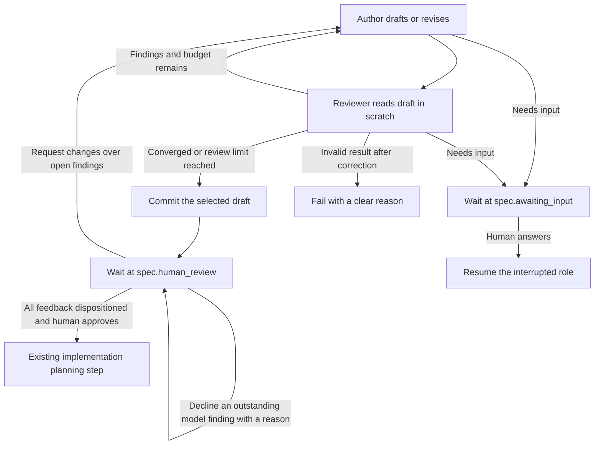

# Enhancement: Review specs before the human gate

## Parent feature

[Producing-step implementer/reviewer convergence](feature-producing-step-convergence-loop.md) defines the two-role loop. This enhancement applies it to [real spec authoring](feature-author-real-conformant-spec.md). Unlike the parent feature’s proposed per-round spec commits, this enhancement reviews drafts in scratch and commits only the selected draft.

## What

Before a feature or enhancement spec reaches human review, a separate reviewer checks the draft against the request and the repository’s architecture contracts. The author receives the findings and records what it fixed or declined. If automated review reaches its limit, the human sees the last reviewed draft and can request another revision or explicitly decline each outstanding model finding before approving. Approval always remains a separate human action.

## Why

`spec.author` declares both roles, but production dispatch currently runs only the author. This makes the human gate the first independent check. A bounded review catches gaps earlier and shows the human what changed, what the author declined, and what still needs a decision.

## User stories

- A spec approver can read the reviewed draft alongside the reviewer’s findings and the author’s responses.
- A spec approver can request changes and receive an independently reviewed revision.
- A spec approver can distinguish convergence from a bounded handoff and decide what to do about each outstanding finding.
- An operator can answer a question from either role and have the interrupted review resume without losing completed rounds.

## Design changes

*(Added by design specs stage — frame as delta on the parent feature's design spec)*

Use the existing Spec feedback list and Activity view. Activity shows both sessions under `spec.author`. The feedback list shows reviewer findings even when they have no text anchor. A fixed reviewer finding is `resolved`, with the author’s fix summary in its thread. A declined finding is `wont_fix`, with the reason visible. Neither state implies human approval. If the approver disagrees with an already settled model finding, they can raise a human comment and request changes.

For a bounded handoff, show that automated review did not converge. Every open item still counts toward Request changes and blocks approval. For eligible open model findings, show **Decline finding** on the feedback card with a required reason and a confirmation. The action changes only that item to `wont_fix`; it does not advance the run. Refresh the card and decision controls on success, and show any rejection without changing the local status. The standard Approve action becomes available under the existing gate rules. Reuse the run reply surface for model questions, with enough context to identify the asking role. No new screen is needed.

## Technical changes

### Affected files

*(Populated during tech specs stage — list files that will change and why)*

- `packages/core/src/orchestrator.ts`, `run-workflows.ts`, `convergence-policy.ts`, `convergence-checkpoint.ts`, and `layered-convergence-engine.ts` — dispatch, bound, checkpoint, resume, and complete reviewed spec occurrences.
- `packages/core/src/spec-authoring-context.ts`, `spec-authoring-service.ts`, and `spec-frontmatter.ts`; `apps/control-plane/src/server.ts` and `spec-authoring-context-loader.ts` — build role context, render candidates, and persist the selected spec.
- `packages/core/src/convergence-feedback.ts`, `feedback-lifecycle.ts`, `control-plane-service.ts`, and `routes.ts`; `packages/api-contract/src/feedback.ts` and `run-replies.ts` — record dispositions and add scoped model-finding decline and spec-question replies. Keep `spec-review-gate.ts` and `listBlockingFeedback` approval semantics unchanged.
- `packages/api-contract/src/convergence.ts` and `spec-authoring.ts`; `packages/execution/src/result-contracts.ts`, `result-normalizers.ts`, and `provider-schema-projection.ts` — add the reviewed author result, role-specific capture, and spec checkpoint support without breaking existing build or one-shot shapes.
- `apps/web/src/runs/spec-decision.ts`, `use-spec-review-controller.ts`, `use-run-detail.ts`, and `apps/web/src/features/spec/` — show the bounded handoff, model feedback, and per-item decline action in existing views. Update client contracts and test doubles with the API.
- `apps/control-plane/src/fake/` — update scripted role results, launch and author-pass accounting, seed checks, and `full-wiring.e2e.spec.ts`. Update `apps/web/e2e/{spec-gate,spec-review,start-run-from-issue}.spec.ts` and any shared fixtures or wait conditions that assume one role per spec pass.
- `context-human/concepts/review.md` and `feedback.md`, `docs/operators/fake-mode.md`, and `context-agent/wiki/code-map.md` — document reviewed spec dispatch, the explicit human disposition action, fake behavior, and module entry points.

### Changes

*(Added by tech specs stage — frame as delta on the parent feature's tech spec)*

#### Dispatch and policy

Use the existing layered convergence driver and the orchestrator’s normal dispatch queue. For `spec.author`, select the reviewed path when the workflow produces a file-canonical spec and the step carries both roles. Resolve routes by `(spec.author, implementer)` and `(spec.author, reviewer)`. If only one model is configured, keep separate sessions and emit the existing distinctness warning. Missing production wiring or an unusable role route fails clearly; it never silently skips review. Fake mode uses this same path. An explicitly injected one-shot test seam is not a production fallback.

Feature and enhancement runs are in scope. Bug triage is issue-canonical, and file-issue runs use `spec.author` to prepare issue intake. Neither workflow commits a spec or uses `spec.human_review`, so both retain their existing dispatch and completion paths. Do not add review to `implementation.plan` or `docs.update`, change routing defaults, or change the implementation loop’s result, commit, checkpoint, or escalation behavior.

Resolve `maxRounds` and `depth` from the workflow policy for `spec.author`. Default to three rounds per altitude and one whole-spec altitude. An altitude is the focus of a review pass. Reuse the depth ordering: `build_only` runs whole-spec review; `layout` adds requirements and structure review before it; `public_api` also adds behavior and contract review; `full` also adds internal design and testability review before the final whole-spec pass. Every pass sees the complete draft. The spec strategy does not run build-contract checks, create build checkpoint refs, or make per-round git commits.

#### Author and reviewer results

1. Keep the materialized `mm:planning` and `mm:writing-guidelines` inputs and existing issue, request, work-kind, and ownership context. Give the author the previous draft, the exact feedback IDs it must address, their text and prior dispositions, and any human answer meant for this session. On a gate revision, pin the existing spec path.
2. Register a separate reviewed-author round contract with a strict `{ spec, dispositions }` envelope. `spec` retains the `autocatalyst.spec_author.v1` payload and its trusted frontmatter normalization, stamping, and validation. `dispositions` reuses `FindingDisposition`: `fixed` requires a summary and `declined` requires a reason. Require exactly one disposition per carried ID and reject missing, duplicate, or unrelated IDs after bounded correction. An empty array is valid only when no IDs were carried. Keep the bare spec-author contract unchanged for callers that still use it.
3. Render validated Markdown with the completion renderer into a host-owned, contained scratch candidate. Give the reviewer the current candidate path and canonical destination separately, along with the request, linked issue if present, and repository context. The reviewer reads the candidate and relevant cited concepts or ADRs and checks scope, contradictions, edge cases, and testability. It runs in a fresh context with enforced read-only access to both roots. It cannot edit the spec or invoke state-changing tools.
4. Resolve result capture and validation by trusted step and role before generic spec-author handling. Use `autocatalyst.reviewer_result.v1` for reviewer verdicts, with host or adapter capture rather than a reviewer write tool. Separate scratch outputs by occurrence, altitude, round, role, and retry. A valid runner `needs_input` result is handled before requiring a completed role payload. Missing or malformed reviewer verdicts after bounded correction fail with a sanitized reason, not `satisfied`. Fail safely if the selected adapter cannot enforce the reviewer’s access policy or capture the required result.

#### Feedback and human sign-off

Persist validated reviewer findings as `artifact` feedback with model attribution derived from the routed session. Record severity, session references, feedback IDs, and dispositions in the round audit. Keep an anchor only when it validates against the reviewed candidate and still maps unambiguously to the selected draft; otherwise use target-level feedback. Feed all open model findings into the next author round, regardless of severity: an `info` finding that is recorded as feedback still requires a disposition. Match materially unchanged repeats to the same finding ID within the attempt and record the repeat in the audit. A repeat of a valid decline does not start another round. A repeat of a claimed fix remains open and requires another disposition or bounded handoff. A new concern gets its own ID.

Apply dispositions only for the selected draft. For a fixed reviewer item, record `addressed` with the author’s summary and have the system finish it as `resolved` before entering the gate. This is convergence acceptance, as in build, not confirmation by the human approver. Keep declined reviewer items `wont_fix` with the author’s reason. **A valid decline does not block approval, even for a blocker**, but it never substitutes for approval. A converged spec has no open or addressed reviewer items from the loop. Do not enter the gate on a partial disposition write; retry by feedback ID and expected status without duplicating thread entries.

At `max_rounds` or `oscillation`, hand off the last draft that received a valid review, record the actual outcome, settle dispositions that still apply to that draft, and leave undisposed reviewer findings open. `spec.human_review` is the human escalation point as well as the approval gate; `spec.awaiting_input` is only for questions from a role. Do not auto-dispose an open finding because a limit was reached. The human can request changes over open findings, or explicitly decline eligible findings one at a time and then approve. There is no advisory exemption in the client or server. `feedback.md` and ADR-018’s requirement that all feedback be dispositioned before advancing remains intact.

Extend `PATCH /v1/runs/:id/feedback/:feedbackId` with `{ status: 'wont_fix', body: '<reason>' }`, where the reason must contain non-whitespace text. Use existing feedback-update authorization and additionally require a human principal. Accept only an open `artifact` item with trusted model-review provenance that the active completed spec checkpoint lists as outstanding at a bounded handoff. This includes an item carried from an earlier occurrence if it is still outstanding in the current one. Check run and tenant ownership and serialize the status change against gate replies; use a compare-and-set status transition and append the human’s reason. Return the updated item on `200`, validation error on malformed input, `403` for denied authority, `404` for missing or out-of-scope run/item, and `409` for a stale gate, wrong provenance/target, or invalid state. Existing resolve/reopen operations and originator rules stay unchanged. This is a narrow additional disposition authority, not a change to the gate predicate; document it in `feedback.md` through human review.

A human revise reply opens a fresh convergence occurrence with the committed spec and all open artifact feedback applicable to that revision, including open model findings from a prior handoff. Human feedback becomes `addressed` only when a valid `fixed` disposition applies to the selected draft. A declined or unfixed human item remains open, with the reason recorded if declined. Do not use the blanket open-to-addressed update in reviewed completion. Approval still confirms only the approver’s own addressed human items, then applies the existing per-target precondition. Other open or unconfirmed items continue to block.

#### Checkpoint, pause, and commit boundary

Persist a spec checkpoint with `producingStep: 'spec.author'`, a logical occurrence ID, altitude and round progress, role session references, findings and dispositions keyed by ID, and outcome. Retain completion metadata alongside the round record. No new table or backfill is needed. Keep existing build checkpoint readers and writers compatible. Store candidate bytes in scratch, not in public checkpoint JSON; publish only safe identifiers and outcome metadata.

For a question from either role, save the asking role, question, occurrence, altitude, round, completed-round state, and any pending candidate key and digest. Transition via `needs_input` to `spec.awaiting_input` without completion. Extend the existing replies contract so `guidance` at that pause includes the active pause step ID and response classification identifies a spec question, distinct from build escalation. Reject stale or already consumed replies; preserve the existing build request shape. Use the workflow edge back to `spec.author` and feed the answer to the interrupted role without resetting completed rounds or recreating findings. If the pending candidate is lost on rematerialization, regenerate only the interrupted candidate and obtain a valid review of the replacement before selecting it.

On convergence or bounded handoff, return the selected validated result and checkpoint to the orchestrator. Run `#runSpecAuthoringCompletion` once per completed occurrence, before `applyDirective` enters `spec.human_review`. Commit the exact bytes reviewed in the selected round; verify the candidate digest and reuse the same trusted rendering. Keep creation identity stable on revisions and avoid a date-only change when the approved-for-handoff content is unchanged. Compare against `HEAD`, stage only the canonical spec path, and make one commit for a changed draft and none for an unchanged draft. Never make empty, duplicate, or intermediate spec commits. Completion must be retry-safe if git succeeds before artifact or checkpoint persistence: recover the matching commit and artifact metadata without committing again. Do not advance until the selected spec and its required records are durable. No completion runs for an input pause or failed review.

#### Fake mode and verification

Fake mode exercises the production spec loop, as it does for build. Select scripted payloads by role and result contract. For feature and enhancement reviewers, return `{ status: 'satisfied' }` by default. For reviewed implementers, return the scripted spec and one `fixed` disposition with a summary for each carried feedback ID, using the IDs in trusted task inputs rather than reading or updating feedback directly. The first pass has an empty disposition array. Keep deterministic passage edits and anchor offsets on revision. Human comments become `addressed` through the same disposition path as live review, not a fake-only or blanket status update.

Count every actual scripted provider launch in `launch.count`: an ordinary initial reviewed spec or revision has two launches, one per role. Keep the per-run spec author pass counter implementer-only so reviewer launches do not advance the fixture revision. Preserve the one-shot accounting for bugs and file-issue runs and the failure fixture’s first matching launch behavior. Update `spec-review`, `implementation-review`, and `failed` seed expectations, fake-mode documentation, full-wiring assertions, and web tests; use persisted step and role events to wait for completion rather than relying on a single launch.

Use a production control-plane dispatch test with deterministic provider results and a real git workspace. Confirm both role routes and sessions, reviewer read-only access, reviewed bytes at `HEAD`, feedback and summaries, and the exact `spec.human_review` stop. Exercise an invalid reviewer result after correction, default and nondefault depth, a declined blocker, a converged fix with no reviewer items left `addressed`, and a bounded handoff where approval fails until open items are explicitly handled. Cover human revision, input from both roles, stale replies, commit recovery, no-op revisions, and unchanged build and issue-canonical paths. Record run, step, role, altitude, round, outcome, and safe error code through existing telemetry; do not log draft text, feedback bodies, credentials, or host paths.

A separate reviewer step would duplicate routing, question handling, and feedback. Per-round spec commits would publish throwaway drafts and compete with the existing completion write. A gate exemption would hide unresolved state from the common approval predicate. The chosen design keeps one round driver, verifies the draft’s bytes before committing, and makes every outstanding gate disposition explicit.

## Task list

*(Added by task decomposition stage)*

- [ ] **Story: Run the spec author and reviewer through production dispatch**
  - [ ] **Task: Add reviewed spec role contracts and context**
    - **Description**: Add the author envelope, separate role prompts and capture, and reviewer read-only tooling. Preserve the one-shot contract and nested frontmatter stamping.
    - **Acceptance criteria**:
      - [ ] The author receives the planning skills, previous draft, and exact disposition IDs; invalid IDs fail after bounded correction.
      - [ ] The reviewer reads the current scratch candidate, checks the issue and cited contracts, and returns `autocatalyst.reviewer_result.v1` without write access.
      - [ ] Role outputs cannot overwrite one another, and invalid reviewer output cannot be interpreted as satisfied.
    - **Dependencies**: None
  - [ ] **Task: Wire the spec strategy into the shared driver**
    - **Description**: Select reviewed dispatch for file-canonical `spec.author` and apply the spec policy, candidate renderer, and exit outcomes.
    - **Acceptance criteria**:
      - [ ] Both spec role routes record sessions; same-model routing still reviews and warns.
      - [ ] One altitude and three rounds per altitude are the defaults; configured depth and round limit are honored.
      - [ ] Bug and file-issue runs keep one-shot dispatch, and build retains its present behavior.
    - **Dependencies**: Task: Add reviewed spec role contracts and context
  - [ ] **Task: Persist and resume spec questions**
    - **Description**: Save the interrupted role and round and route its answer through the existing awaiting-input workflow edge.
    - **Acceptance criteria**:
      - [ ] Either role can pause at `spec.awaiting_input`; a matching reply resumes that role with the answer, without losing completed rounds or duplicating feedback.
      - [ ] A stale reply is rejected, scratch recovery cannot select an unreviewed draft, and build guidance remains compatible.
    - **Dependencies**: Task: Wire the spec strategy into the shared driver
- [ ] **Story: Hand off the selected spec under the existing approval contract**
  - [ ] **Task: Record and settle findings by ID**
    - **Description**: Persist reviewer feedback and round history, replace blanket addressing with validated dispositions, and feed open items into gate revisions.
    - **Acceptance criteria**:
      - [ ] Fixed reviewer findings reach `resolved` with the fix summary; convergence leaves no reviewer item open or addressed. A declined blocker is `wont_fix` and does not block explicit approval.
      - [ ] Bounded handoff preserves open findings and its nonconverged outcome. A repeated claimed fix remains open rather than being silently resolved.
      - [ ] Human revise triggers fresh review. Only valid fixed human IDs become `addressed`, and the approver’s confirmation still follows existing rules.
    - **Dependencies**: Task: Wire the spec strategy into the shared driver
  - [ ] **Task: Complete and commit the selected draft**
    - **Description**: Invoke spec completion once after the shared loop returns a selected draft. Persist spec metadata with the `spec.author` checkpoint.
    - **Acceptance criteria**:
      - [ ] Git contains the exact bytes last selected for handoff, with one spec-only commit on change and none for unchanged content, interrupted rounds, or failure.
      - [ ] A retry after commit-before-artifact failure recovers without duplicate commits, artifacts, or thread entries; incomplete persistence does not enter the gate.
    - **Dependencies**: Task: Record and settle findings by ID
  - [ ] **Task: Add explicit decline at a bounded spec handoff**
    - **Description**: Add the scoped feedback update and card action, show the handoff outcome, and keep the common blocking predicate.
    - **Acceptance criteria**:
      - [ ] Open findings at the cap block approval; Request changes remains available. An authorized human can decline an eligible item with a reason and must still approve separately.
      - [ ] Wrong tenant, provenance, state, or stale gate cannot change an item. Human-originated items and originator-only resolve/reopen behavior are unaffected.
    - **Dependencies**: Task: Complete and commit the selected draft
- [ ] **Story: Keep fake runs, end-to-end tests, and operator guidance working**
  - [ ] **Task: Make scripted spec sessions role-aware**
    - **Description**: Emit the reviewed author envelope with one fixed disposition per carried ID, script a satisfied reviewer, and separate author-pass from launch accounting.
    - **Acceptance criteria**:
      - [ ] Fake mode uses the normal reviewed path. An ordinary spec pass has two launches but advances the author-pass counter once; fixture revisions still mark human comments `addressed` through the real disposition path.
      - [ ] `spec-review`, `implementation-review`, and `failed` seeds reach their expected states; `full-wiring.e2e.spec.ts` verifies both spec roles and the failure fixture.
    - **Dependencies**: Task: Complete and commit the selected draft
  - [ ] **Task: Exercise review through production dispatch on real git**
    - **Description**: Use deterministic providers at the dispatch boundary and assert persisted state, git history, and the human gate. Update web end-to-end fixtures and waits for the two-role pass.
    - **Acceptance criteria**:
      - [ ] A feature run has a persisted spec reviewer session, a resolved artifact finding with a fix in the selected Markdown, no blocking reviewer items, and a committed draft waiting at `spec.human_review`.
      - [ ] Invalid reviewer output fails clearly; tests cover decline, cap disposition before approval, human revision, both input-pause roles, and enhancement kind and path.
      - [ ] Web `spec-gate`, `spec-review`, and `start-run-from-issue` still verify the scripted revision and gate behavior.
    - **Dependencies**: Task: Persist and resume spec questions; Task: Add explicit decline at a bounded spec handoff; Task: Make scripted spec sessions role-aware
  - [ ] **Task: Update documentation and run validation**
    - **Description**: Update the review and feedback concepts through the human-doc approval path, refresh the agent code map, and update fake-mode launch-count, seed, failure, and revision documentation.
    - **Acceptance criteria**:
      - [ ] The docs explain scratch review, the spec cap handoff, unchanged approval preconditions, reasoned model-finding decline, and two launches per ordinary fake spec pass.
      - [ ] `pnpm nx run-many -t lint,typecheck,test -p core control-plane` and `pnpm nx run web:e2e` pass. Targeted contract and execution checks cover the new role and API schemas.
    - **Dependencies**: Task: Exercise review through production dispatch on real git
