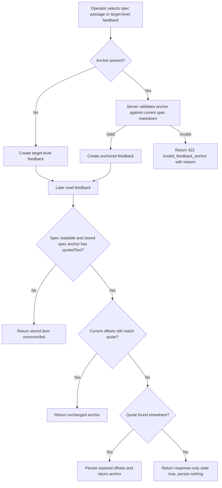
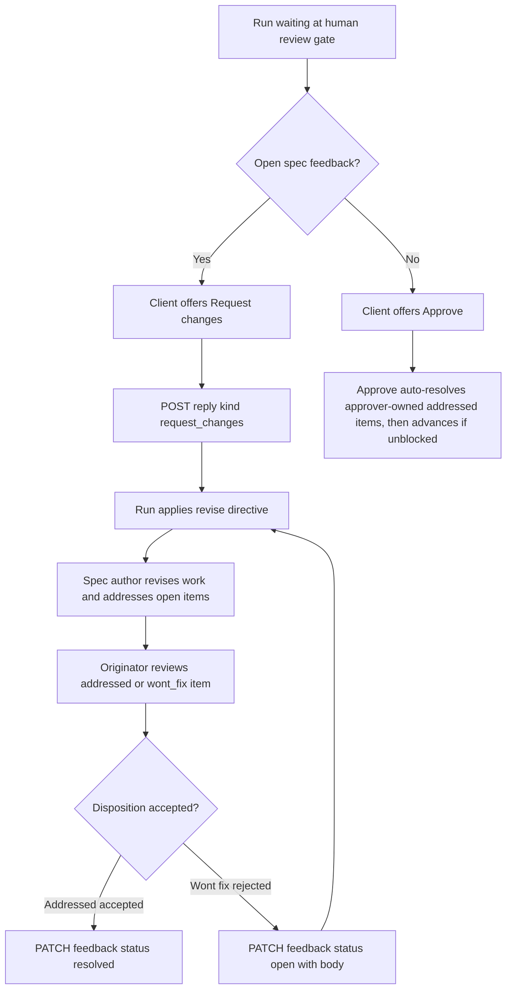
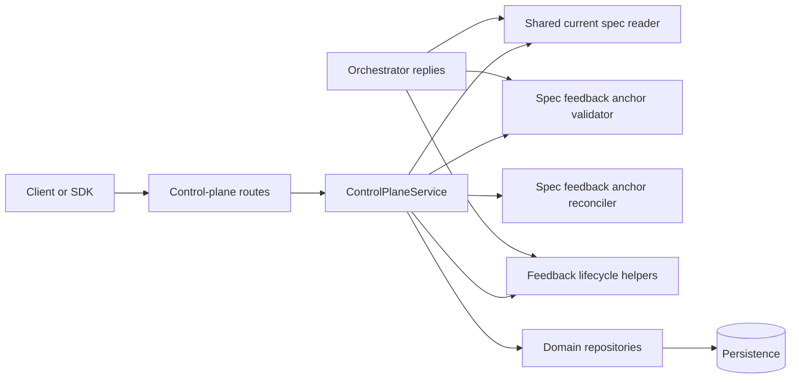
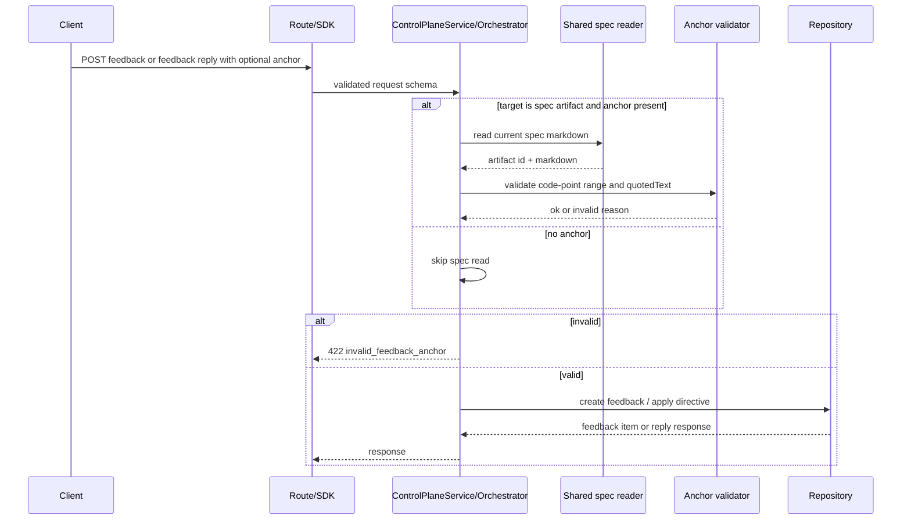
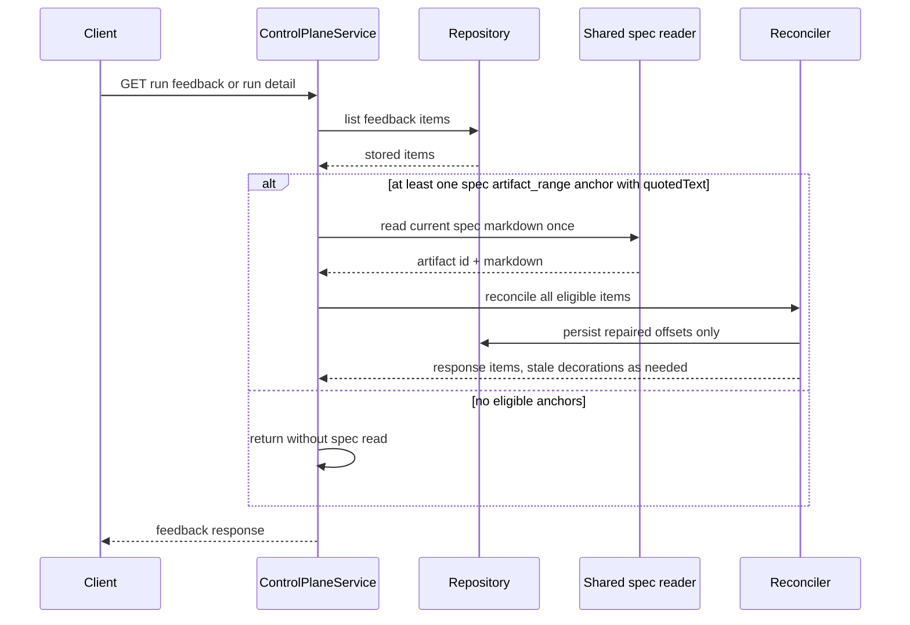

# Enhancement: Spec feedback anchors, request changes, resolve and reopen

## Parent feature

This enhances `feature-spec-artifact-feedback-gate.md`, the spec artifact feedback gate where operators review authored specs, raise feedback items, and decide whether a run may advance. It also extends the existing run reply and feedback lifecycle behavior described by ADR-018 and ADR-033.

## What

Spec feedback can carry an optional source-text anchor that the control plane validates and repairs. When an operator creates spec feedback with an anchor, the server checks that the supplied code-point offsets target the current spec artifact and reproduce the supplied quote. When feedback is read later, the server attempts to reconcile anchored spec comments against the current spec: unchanged anchors are returned as-is, moved quotes have their stored offsets repaired to the first matching occurrence, missing quotes are returned with a response-only `stale: true`, legacy anchors without `quotedText` remain unchanged, and an unreadable spec during a read leaves stored feedback available and unreconciled. Operators can request changes over already-raised open spec feedback without creating a new item, and can resolve an addressed item or reopen a declined item through a feedback PATCH route.

## Why

Spec comments currently point at passages that may move or disappear when an agent revises the entire Markdown source, and the control plane does not enforce that an anchor actually matches the spec text being reviewed. Operators also need a way to send a run back for revision after raising comments separately, and need API support for the existing resolve and reopen lifecycle transitions. This closes the gap between the accepted anchor design, the feedback concept, and the API surface so every client sees consistent ranges, stale comments remain visible, and gate decisions reflect the status of tracked feedback.

## User stories

- An operator can raise spec feedback with an anchor and know the control plane rejected stale or mismatched offsets before the item was created.
- An operator can raise target-level spec feedback with no anchor when the comment concerns the whole artifact or came from a non-rendered channel.
- An operator can read spec feedback after a revision and see anchored comments repaired to moved text, or marked stale when the quoted text no longer exists.
- An operator can request changes for already-raised open spec feedback without creating a duplicate feedback item.
- A feedback originator can resolve an addressed item, or reopen a declined item with an explanation, through the API.
- A client developer can rely on the SDK and OpenAPI contract for anchor validation errors, request-changes replies, and feedback status updates.

## Design changes

This enhancement is mostly control-plane and contract work, but it changes the operator-facing behavior exposed to clients.

### Spec review feedback behavior

### Gate decision behavior

### UI and client contract implications

- The web client may continue requiring anchors for spec-page comments, but the control plane contract keeps `anchor` optional for all feedback paths.
- A stale spec anchor is rendered from the response as still attached to its quote, but the client must treat `stale: true` as response-only state and never send it back.
- Request changes is a reply action over existing open feedback, not a comment composer action. Its response classifies the directive as `revise` and intentionally has no `createdFeedbackId`.
- Resolve and reopen are item-level actions. Reopen requires body text because it appends a thread entry explaining why the decline is rejected.

## Technical changes

### Affected files

- `packages/api-contract/src/domain-value-objects.ts` — keep stored `feedbackAnchorSchema` strict with optional `quotedText`; add or expose response schema support for `artifact_range` anchors with optional response-only `stale`.
- `packages/api-contract/src/feedback.ts` — define PATCH request/response schemas, error shapes, and feedback response schemas that can include response-only stale anchors.
- `packages/api-contract/src/run-replies.ts` — add `request_changes` to `runReplyRequestSchema` and reply response classification expectations.
- `packages/api-contract/src/openapi.*` and OpenAPI tests — document optional anchors, spec-anchor validation errors, request-changes replies, and PATCH feedback responses.
- `packages/core/src/control-plane-service.ts` — share current-spec markdown reading with `getRunSpec`, apply anchor validation on feedback creation, reconcile anchors on feedback list reads and single-item feedback responses, and add the feedback update operation.
- `packages/core/src/orchestrator.ts` — validate spec anchors before feedback replies create items or directives apply, implement `request_changes`, preserve implementation-gate anchor behavior, and wire resolve/reopen directives at gates.
- `packages/core/src/feedback-lifecycle.ts` — reuse existing `resolveFeedback`, `reopenFeedback`, and lifecycle guards from the new route/service operation without weakening authority rules.
- `packages/core/src/index.ts` — export any new validator/reconciler/service types needed by the control plane or tests.
- `apps/control-plane/src/routes.ts` — add `PATCH /v1/runs/:id/feedback/:feedbackId`, map 400/403/404/409/422 responses, and ensure policy checks run before mutation.
- `apps/control-plane/src/spec-author.integration.spec.ts` and related fake/scripted harness files — cover production-server wiring with no model calls.
- `packages/sdk/src/client.ts` — add `updateRunFeedback(id, feedbackId, request)` and update `replyToRun` typing for `request_changes`.
- `context-human/concepts/feedback.md` — proposed human-owned doc diff for request-changes reply, reconciliation on read, and response-only stale.
- `context-human/concepts/api.md` — proposed human-owned doc diff for the new reply kind and PATCH feedback route semantics.
- `context-agent/wiki/code-map.md` — update agent-owned navigation notes for validator, reconciler, shared spec reader, reply kind, and route.

### Changes

#### Introduction and overview

Prerequisites and assumptions:

- ADR-033 is accepted and owns the anchor model: spec anchors are code-point offsets plus quoted text, repaired on read with first-match search.
- ADR-018 is accepted and owns the feedback item lifecycle: `open -> addressed -> resolved | wont_fix`, with reopen from `wont_fix` to `open`.
- Existing feedback anchors remain optional in shared schemas and across feedback paths. The web client's stricter requirement for spec-page comments is out of scope.
- Existing `getRunSpec` behavior defines the authoritative current spec markdown text and readable-spec failure behavior. Anchor validation must read the same artifact and text.
- Existing lifecycle helpers enforce transition and originator authority; the new API route should call them rather than duplicate lifecycle logic.

Goals:

- Reject invalid spec anchors on write before creating feedback or applying a revise directive.
- Count offsets in Unicode code points, not UTF-16 code units.
- Reconcile anchored spec feedback exactly once per feedback read request by reading the spec once and applying deterministic first-match repair.
- Keep stale response state out of persistence and out of client write schemas.
- Add request-changes replies without creating feedback items.
- Expose resolve and reopen through a policy-protected PATCH route and SDK method.
- Update contract docs, human concepts, and agent code map in the same implementation PR.

Non-goals:

- Mapping rendered-document selections back to Markdown source offsets.
- Requiring every control-plane spec comment to include an anchor.
- Adding disambiguating prefix/suffix context to anchors.
- Changing reviewer result contracts, reviewer prompts, or convergence finding anchor validation.
- Adding withdraw transitions or feedback support at docs and PR gates.
- Supporting general implementation feedback through `POST /v1/runs/:id/feedback`.

Glossary:

- Spec anchor: an `artifact_range` anchor for the current spec artifact, with `from`, `to`, and `quotedText`.
- Code-point offset: an index into `Array.from(markdown)` or equivalent Unicode scalar/code-point sequence, not JavaScript string length.
- Stale anchor: a response-only indication that the quoted text no longer appears in the current spec.
- Repaired anchor: a persisted update to `from` and `to` after the quote is found elsewhere in the current spec.

#### System design and architecture

Component breakdown:

- Shared current spec reader: a core helper used by both `getRunSpec` and spec-anchor validation/reconciliation. It returns the current spec artifact id, path, and markdown source, and preserves `GET /v1/runs/:id/spec` failure semantics.
- Spec anchor validator: a pure or mostly pure function that receives the current spec metadata/text and an optional anchor. It only validates present anchors for spec feedback and returns typed reasons: `wrong_kind`, `wrong_artifact`, `out_of_range`, `missing_quoted_text`, and `text_mismatch`.
- Spec anchor reconciler: a read-side component that compares stored anchors with the current spec text, persists offset repairs, and decorates response anchors with `stale: true` only when the quote is absent.
- Reply classifier: `request_changes` becomes a first-class reply kind that maps to revise only at `spec.human_review` when open artifact feedback exists.
- Feedback update route: a policy-protected item operation that maps `{status: resolved}` to `resolveFeedback` and `{status: open, body}` to `reopenFeedback`.

Primary write sequence:

Primary read sequence:

#### Detailed design

Data model and schemas:

- The stored anchor schema remains strict and unchanged for persistence: `quotedText` stays optional, and no stored object may contain `stale`.
- Add a response-only feedback anchor schema that reuses the existing `artifact_range` member but permits optional `stale?: true | boolean` only in read responses. Fresh and repaired anchors omit `stale`; they do not send `stale: false`.
- `runReplyRequestSchema` gains `{ kind: "request_changes" }` with no other fields. The schema should be strict so extra fields fail validation.
- `updateRunFeedbackRequestSchema` is strict and accepts:
  - `{ status: "resolved", body?: string }`
  - `{ status: "open", body: string }` for reopen; schema may allow optional body generally, but service validation must require it for `open`.
- Shared `anchor` fields remain optional in feedback, run reply, and convergence schemas.

Anchor validation algorithm:

1. If target is not the spec artifact path handled by this issue, leave existing behavior unchanged.
2. If no anchor is present, accept without reading the spec.
3. Read the current spec using the shared spec reader. If there is no spec artifact for the work kind, return 404 matching `GET /v1/runs/:id/spec`; if the spec artifact exists but the file is unreadable, preserve the existing persistence failure behavior from the spec reader.
4. Validate `anchor.kind === "artifact_range"`; otherwise reject `wrong_kind`.
5. Validate `anchor.artifactId === currentSpec.artifactId`; otherwise reject `wrong_artifact`.
6. Validate `quotedText` is present and is a string; otherwise reject `missing_quoted_text`.
7. Convert markdown to a code-point array. Let `n = codePoints.length`. Validate `0 <= from < to <= n`; otherwise reject `out_of_range`.
8. Join code points in `[from, to)` and compare exactly to `quotedText`; otherwise reject `text_mismatch`.
9. Accept and persist the original anchor.

Reconciliation algorithm:

1. During `GET /v1/runs/:id/feedback`, thread-reply responses, and PATCH feedback responses, identify items whose target is the spec artifact and whose anchor is `artifact_range` with `quotedText`. Include all item statuses.
2. Read the current spec once for the request when at least one eligible item exists. If the spec cannot be read during a read response, do not fail `GET /v1/runs/:id/feedback`, thread-reply responses, or PATCH responses. Return the stored feedback items with their stored anchors unreconciled, omit `stale`, perform no writes, and log a safe warning with the run id. This is intentionally different from writes, because read-side repair is opportunistic and feedback history must remain readable after workspace pruning or file loss.
3. For each eligible item, compare the code-point slice at stored offsets to `quotedText`. If it matches, return the stored anchor unchanged and do not write.
4. If it differs, search the current spec text for the first code-point occurrence of `quotedText`.
5. If found, persist only the repaired `from` and `to` offsets on the feedback item, return the repaired anchor, and omit `stale`.
6. If not found, return the anchor with `stale: true`, leave stored offsets unchanged, and do not change item status, thread, or quote.
7. Legacy anchors without `quotedText` are returned unchanged and never marked stale.

API contracts:

- `POST /v1/runs/{id}/feedback` with target `artifact`:
  - Accepts absent `anchor`.
  - With present spec anchor, can return `422` `{ code: "invalid_feedback_anchor", details: { reason } }`.
  - Returns `404` when an anchored spec comment cannot read the current spec.
- `POST /v1/runs/{id}/replies`:
  - Existing `feedback` replies at `spec.human_review` apply the same spec-anchor validation before creating an item or applying a directive. Rejection leaves the run at the gate and creates no item.
  - Existing implementation-gate `feedback` replies keep optional anchors of any kind unchanged.
  - New `request_changes` reply returns the existing reply response shape with `classification.directive = "revise"`, the artifact target, and no `createdFeedbackId`. It returns 409 when there are no open items for the target or when the step does not accept the reply.
- `PATCH /v1/runs/{id}/feedback/{feedbackId}`:
  - Request: strict body with `status` of `resolved` or `open`, plus optional `body`.
  - Response: updated feedback item.
  - Errors: 400 invalid request body, 403 unauthorized or model principal, 404 missing item or item from another run, 409 invalid lifecycle state or reopen not applicable at current gate.
- `POST /v1/runs/{id}/feedback/{feedbackId}/thread` and `PATCH /v1/runs/{id}/feedback/{feedbackId}` return one feedback item. These responses should pass that one item through the same reconciler used by list reads, with one spec read at most, and with read failures degrading to the stored item unreconciled.

Business rules:

- `request_changes` applies at `spec.human_review` only when at least one open artifact feedback item exists. It creates no items and leaves open items open until the spec author addresses them. At `implementation.human_review` and every other step, it returns the same 409 class as other replies that do not apply there.
- `status: resolved` is valid only from `addressed` and only for the originating principal. Any other principal receives 403; any other status receives 409.
- `status: open` is valid only from `wont_fix`, requires a body, and only for the originating principal. This requires extending `reopenFeedback` with the same originator check used by `resolveFeedback`, throwing the same `feedback_not_originator` error code for 403 mapping, because the helper currently only checks `wont_fix` status and has no external callers beyond its module tests. Reopen applies the revise directive only when the run is waiting at the gate for that item's target; otherwise it returns 409.
- Model principals cannot call the PATCH route.
- Approve behavior remains: approving can auto-resolve the approver's own `addressed` items, but approval is blocked while any item is `open`, or `addressed` and raised by another principal.

#### Security, privacy, and compliance

- Authentication and authorization: all new mutations use existing route authentication and policy points. The PATCH route must call the policy point before reading or mutating feedback, with a new resource descriptor and action for updating run feedback.
- Principal authority: lifecycle transitions must use the authenticated principal. Model principals are authors but not operators for this route and receive 403.
- Input validation: all request schemas are strict. The server enforces anchor semantics beyond schema parsing, because `quotedText` remains optional in the shared stored schema for legacy compatibility.
- Data privacy: quoted spec text is already part of user-authored specs and feedback payloads. Do not add logs that emit full specs, quotes, thread bodies, tokens, or authorization headers.
- Persistence safety: never persist response-only `stale`; tests should prove write schemas reject it and stored rows never contain it.

#### Observability

- Log validation failures at debug level with safe reason codes, run id, feedback target, and artifact id presence only; omit spec text and quotes.
- Log reconciliation repairs at info or debug level with run id, feedback id, old/new offsets, and code-point lengths; omit quote contents.
- Log stale detections at debug level with run id and feedback id; stale is not an error.
- Existing API metrics should cover route status codes. If route-level metrics exist, include counts for `invalid_feedback_anchor`, `request_changes_conflict`, feedback resolve, and feedback reopen outcomes.

#### Testing plan

Unit tests:

- Anchor validator accepts valid code-point ranges and rejects `wrong_kind`, `wrong_artifact`, `out_of_range`, `missing_quoted_text`, and `text_mismatch`. Include an emoji before the target text to prove code-point offsets after the emoji validate.
- Reconciler leaves matching anchors untouched, repairs moved anchors, chooses the first duplicate match, marks missing quotes stale without persistence, repairs stale anchors when text returns, and leaves legacy anchors without `quotedText` unchanged.
- Stored/write schemas reject `stale`; response schemas accept it.
- Prompt/result-contract tests prove the spec author prompt and result contract contain no offsets and no step asks an agent to maintain anchors.
- Request schema tests cover `request_changes` and strict PATCH body parsing.

Service and route tests:

- `POST /v1/runs/:id/feedback` accepts unanchored artifact feedback, rejects invalid anchors with 422 details, and returns 404 for anchored spec feedback when no readable spec exists.
- `feedback` replies at `spec.human_review` validate anchors before creation/directive; rejected replies leave the run unchanged and create no item.
- Implementation review feedback replies remain unchanged and allow unanchored or arbitrary optional anchors.
- Feedback list reads reconcile once per request, and single-item thread-reply/PATCH responses reconcile the returned item once.
- `request_changes` applies revise at spec and implementation review gates only when open target feedback exists; otherwise 409.
- PATCH resolve/reopen enforces originator, status, body, policy, model-principal, run ownership, and gate applicability rules.
- Approval tests cover auto-resolving approver-owned addressed items and blocking on open or other-principal addressed items.

Integration/wiring tests:

- Through the production server and scripted spec authoring harness, read a spec, post anchored and unanchored comments, reject wrong quoted text, request changes, observe scripted revision addressing comments, observe repaired offsets on next read, observe removed text marked stale and still listed, resolve one comment as originator, and approve.
- No test makes a model call.

Documentation tests:

- OpenAPI generation lists the new reply kind, PATCH route, optional anchor requirements, 422 invalid anchor response, and 400/403/404/409 PATCH responses.
- Human approval of this spec authorizes the implementer to edit only `context-human/concepts/feedback.md` and `context-human/concepts/api.md`, limited to the named passages for request-changes replies, reconciliation on read with response-only `stale`, and the PATCH feedback route; the PR diff must not make broader human-doc changes.
- Agent-owned code map is updated directly during implementation.

#### Alternatives considered

- Require anchors for all spec feedback in the control plane: rejected because target-level comments and chat-channel comments are valid; the web client may enforce stricter UX locally.
- Persist stale state: rejected because staleness is a function of current spec text and can become fresh again after a later revision.
- Ask spec-author agents to update offsets: rejected by ADR-033 because models miscount offsets and the control-plane quote check is more reliable.
- Create a feedback item when requesting changes: rejected because request changes should operate over comments already raised and avoid duplicates.
- Add separate resolve and reopen endpoints: rejected in favor of one item-level PATCH that exposes lifecycle status changes through a single route.

#### Risks

- Duplicate quote first-match repair can move a comment to the wrong occurrence. This is accepted by ADR-033 and should be documented; future disambiguation context is out of scope.
- Code-point indexing is easy to accidentally replace with JavaScript UTF-16 indexing. Validator and reconciler tests with emoji must guard this.
- Read-side reconciliation writes during reads. Keep writes narrowly scoped to repaired offsets, avoid writing unchanged items, ensure stale decoration is never persisted, and degrade to unreconciled stored feedback when the spec cannot be read.
- Single-item responses from thread replies or PATCH may bypass list feedback reconciliation if implemented separately. Share the same one-item reconciliation path so clients never replace their cached item with an older range than a list read would return.
- Policy ordering for PATCH must avoid leaking cross-run item existence or mutating before authorization. Tests should verify the policy point is called before work.

## Task list

- [ ] **Story: Validate spec anchors on write**
  - [ ] **Task: Introduce shared current spec reader**
    - **Description**: Extract the spec markdown/artifact lookup used by `getRunSpec` into a shared core helper that returns the current spec artifact id, path, and markdown source while preserving existing not-found/readability behavior. Update `getRunSpec` to call it.
    - **Acceptance criteria**:
      - [ ] `getRunSpec` behavior and response data remain unchanged through existing tests.
      - [ ] Anchor validation can call the same helper and receive the same markdown/path/artifact id.
      - [ ] A run with no readable spec produces the same 404 behavior for anchored spec feedback as `GET /v1/runs/:id/spec`.
    - **Dependencies**: None
  - [ ] **Task: Build spec anchor validator**
    - **Description**: Add a validator for optional spec feedback anchors that enforces `artifact_range`, current spec artifact id, code-point bounds, required `quotedText`, and exact quote reproduction. Return typed invalid reasons for route error mapping.
    - **Acceptance criteria**:
      - [ ] Valid anchors whose offsets reproduce the quote are accepted.
      - [ ] Invalid anchors return `wrong_kind`, `wrong_artifact`, `out_of_range`, `missing_quoted_text`, or `text_mismatch` as appropriate.
      - [ ] Tests prove offsets are counted in Unicode code points using an emoji before the target text.
      - [ ] The stored shared anchor schema still keeps `quotedText` optional for legacy rows.
    - **Dependencies**: "Task: Introduce shared current spec reader"
  - [ ] **Task: Enforce validation on feedback creation and spec feedback replies**
    - **Description**: Wire the validator into `POST /v1/runs/:id/feedback` for artifact/spec feedback and into `feedback` replies at `spec.human_review`, before item creation or directive application. Preserve unanchored acceptance and implementation-gate behavior.
    - **Acceptance criteria**:
      - [ ] Artifact feedback with no anchor is accepted without reading the spec.
      - [ ] Present invalid spec anchors return 422 `invalid_feedback_anchor` with `details.reason`.
      - [ ] Rejected spec feedback replies leave the run at its gate and create no feedback item.
      - [ ] Implementation human-review feedback replies still accept optional anchors of any kind and unanchored replies.
      - [ ] Thread replies and reviewer findings are unchanged.
      - [ ] A scripted revised spec rejects an anchor that matched the previous spec but no longer matches.
    - **Dependencies**: "Task: Build spec anchor validator"
  - [ ] **Task: Document anchor write contract in schemas and OpenAPI**
    - **Description**: Keep shared `anchor` fields optional, add route/reply descriptions for optional anchors and spec quote validation, and list the 422 invalid-anchor response.
    - **Acceptance criteria**:
      - [ ] Contract schemas continue to parse absent anchors for feedback paths.
      - [ ] OpenAPI route descriptions state that a present spec anchor must reproduce its quoted text.
      - [ ] OpenAPI lists `422 invalid_feedback_anchor` and reason values for relevant write paths.
    - **Dependencies**: "Task: Enforce validation on feedback creation and spec feedback replies"

- [ ] **Story: Reconcile spec anchors on read**
  - [ ] **Task: Add response-only stale anchor schema**
    - **Description**: Extend feedback read response schemas so `artifact_range` anchors may include optional `stale` while stored/write schemas stay strict and reject `stale`.
    - **Acceptance criteria**:
      - [ ] Feedback read response schemas accept an `artifact_range` anchor with `stale: true`.
      - [ ] Stored/write anchor schemas reject an anchor with a `stale` key.
      - [ ] Tests prove stored rows never contain `stale`.
    - **Dependencies**: None
  - [ ] **Task: Build spec anchor reconciler**
    - **Description**: Implement read-side reconciliation for spec feedback anchors with `quotedText`, including unchanged comparison, first-match repair, stale decoration, legacy-anchor bypass, and all-status coverage.
    - **Acceptance criteria**:
      - [ ] Matching anchors are returned unchanged and no write occurs.
      - [ ] Moved quotes persist repaired offsets and return the repaired anchor.
      - [ ] Duplicate quotes repair to the first match.
      - [ ] Missing quotes return `stale: true`, persist nothing, and keep item/thread/status unchanged.
      - [ ] A quote that returns in a later revision repairs on the next read and no longer has `stale`.
      - [ ] Legacy anchors without `quotedText` are returned unchanged with no stale field.
      - [ ] Resolved and non-open items are reconciled too.
    - **Dependencies**: "Task: Add response-only stale anchor schema", "Task: Introduce shared current spec reader"
  - [ ] **Task: Wire reconciliation into feedback and single-item responses**
    - **Description**: Apply the reconciler to `GET /v1/runs/:id/feedback` and all single-item responses that include feedback, ensuring the current spec is read once per request when eligible anchors exist, and read failures degrade to unreconciled stored feedback rather than failing the feedback response.
    - **Acceptance criteria**:
      - [ ] Feedback list reads reconcile eligible spec anchors.
      - [ ] Thread-reply responses and PATCH responses reconcile their single returned feedback item with the same repaired/stale anchor behavior as list reads.
      - [ ] The spec markdown is read once per read request, not once per item.
      - [ ] Reads with only unanchored feedback or legacy anchors do not unnecessarily read the spec.
      - [ ] If the spec file is missing or unreadable during a feedback list, thread-reply response, or PATCH response, the response still succeeds with stored anchors unreconciled, no `stale`, no writes, and a safe warning containing the run id but no spec text.
    - **Dependencies**: "Task: Build spec anchor reconciler"
  - [ ] **Task: Verify agents are not asked to maintain offsets**
    - **Description**: Add tests or source checks showing the spec author prompt and result contract carry no anchor offsets and no instruction asks an agent to update anchors.
    - **Acceptance criteria**:
      - [ ] Prompt text checks fail if offset-maintenance instructions are introduced.
      - [ ] Result contract checks fail if anchor offsets are added to the spec author output contract.
    - **Dependencies**: "Task: Build spec anchor reconciler"

- [ ] **Story: Request changes over existing feedback**
  - [ ] **Task: Add `request_changes` reply contract**
    - **Description**: Extend `runReplyRequestSchema`, SDK typing, and OpenAPI so clients can send `{ "kind": "request_changes" }` with no other fields. Preserve the existing reply response shape.
    - **Acceptance criteria**:
      - [ ] `runReplyRequestSchema` accepts strict `request_changes` requests and rejects extra fields.
      - [ ] The reply response supports `classification.directive = "revise"`, the artifact target, and no `createdFeedbackId`.
      - [ ] SDK `replyToRun` accepts the new kind.
      - [ ] OpenAPI lists the new reply kind.
    - **Dependencies**: None
  - [ ] **Task: Implement request-changes orchestration**
    - **Description**: At the spec human-review gate, apply the revise directive when at least one open feedback item exists for the artifact target. Return conflicts otherwise and leave existing feedback untouched until the spec authoring step addresses it.
    - **Acceptance criteria**:
      - [ ] `request_changes` at `spec.human_review` with open artifact feedback sends the run back to spec production/revision.
      - [ ] `request_changes` at `implementation.human_review` returns the same 409 class as other inapplicable replies, because this issue defines no supported flow that leaves open implementation feedback standing at that gate.
      - [ ] At `spec.human_review` with no open artifact feedback, the response is 409 with a message saying no open feedback exists.
      - [ ] At any other step, the response is the same 409 class as other inapplicable replies.
      - [ ] Open spec items stay open until the spec author addresses them; a scripted revision test sees them move to `addressed`.
    - **Dependencies**: "Task: Add `request_changes` reply contract"

- [ ] **Story: Resolve and reopen feedback through the API**
  - [ ] **Task: Add feedback update contract and SDK method**
    - **Description**: Define strict PATCH request/response schemas, add `PATCH /v1/runs/:id/feedback/:feedbackId` to the OpenAPI contract with documented errors, and add `updateRunFeedback(id, feedbackId, request)` to the SDK.
    - **Acceptance criteria**:
      - [ ] Request schema accepts `status: resolved` or `status: open` and optional `body` while rejecting unknown fields.
      - [ ] Response parses as the updated feedback item contract schema.
      - [ ] OpenAPI lists the route and `400`, `403`, `404`, and `409` responses.
      - [ ] `openapi.spec.ts` asserts the route and responses.
      - [ ] SDK method parses responses with the contract schema.
    - **Dependencies**: None
  - [ ] **Task: Implement route, policy, and lifecycle mapping**
    - **Description**: Add the route and service operation that call the authorization policy point before work, reject model principals, map `resolved` to `resolveFeedback`, and map `open` to `reopenFeedback`.
    - **Acceptance criteria**:
      - [ ] `status: resolved` succeeds only from `addressed` for the principal who raised the item.
      - [ ] Another principal resolving receives 403; invalid source statuses receive 409.
      - [ ] `reopenFeedback` itself is extended to check the actor against `feedback.thread[0].author`, throw `feedback_not_originator` for non-originators, and its unit tests cover the new guard.
      - [ ] `status: open` succeeds only from `wont_fix`, requires `body`, and only for the originator.
      - [ ] Another principal reopening receives 403 and changes nothing: the item stays `wont_fix`, the thread is unchanged, and no revise directive is applied.
      - [ ] A model principal receives 403.
      - [ ] Missing feedback or feedback from another run returns 404.
      - [ ] Tests verify the policy point is called before mutation with the new resource descriptor and action.
    - **Dependencies**: "Task: Add feedback update contract and SDK method"
  - [ ] **Task: Apply revise directive on reopen and preserve approval semantics**
    - **Description**: When reopening a `wont_fix` item, send the run back to revise only if it is waiting at the gate for that item's target. Confirm approval still auto-resolves approver-owned addressed items and blocks on unresolved feedback.
    - **Acceptance criteria**:
      - [ ] Reopening at the matching gate applies the revise directive.
      - [ ] Reopening when the run is not waiting at the matching gate returns 409.
      - [ ] Approving with the approver's own `addressed` items succeeds and resolves them without PATCH.
      - [ ] Approving returns 409 `feedback_gate_blocked` while any item is `open`.
      - [ ] Approving returns 409 `feedback_gate_blocked` while any item is `addressed` and raised by another principal.
      - [ ] An operator can resolve an addressed item through PATCH and then approve successfully.
    - **Dependencies**: "Task: Implement route, policy, and lifecycle mapping"

- [ ] **Story: End-to-end wiring and documentation updates**
  - [ ] **Task: Add production-server wiring test**
    - **Description**: Use the production server and scripted spec authoring harness to exercise anchored and unanchored comments, invalid quote rejection, request changes, revision addressing, offset repair, stale marking, resolve, and approve.
    - **Acceptance criteria**:
      - [ ] The test reads the spec and posts a valid anchored comment.
      - [ ] The test posts an unanchored comment.
      - [ ] The test sees wrong quoted text rejected.
      - [ ] The test requests changes at the spec gate and sees scripted revision address comments.
      - [ ] The test sees an anchored comment's offsets repaired on the next feedback read.
      - [ ] The test sees a removed quote marked stale and still listed.
      - [ ] The test resolves one comment as originator and approves.
      - [ ] No test makes a model call.
    - **Dependencies**: "Task: Wire reconciliation into feedback and single-item responses", "Task: Implement request-changes orchestration", "Task: Apply revise directive on reopen and preserve approval semantics"
  - [ ] **Task: Prepare human-owned concept doc diffs**
    - **Description**: Update `context-human/concepts/feedback.md` and `context-human/concepts/api.md` as proposed diffs in the same PR, limited to the passages authorized by approval of this spec; the current workflow has no separate documentation approval step.
    - **Acceptance criteria**:
      - [ ] `feedback.md` describes request-changes replies over existing spec comments.
      - [ ] `feedback.md` describes reconciliation on read and response-only `stale`.
      - [ ] `api.md` describes the new reply kind, PATCH feedback route, and relevant errors.
      - [ ] The PR diff touches only `context-human/concepts/feedback.md` and `context-human/concepts/api.md` for human-owned docs, and only in the named passages authorized by this approved spec.
    - **Dependencies**: "Task: Add `request_changes` reply contract", "Task: Add feedback update contract and SDK method", "Task: Add response-only stale anchor schema"
  - [ ] **Task: Update agent code map**
    - **Description**: Record durable navigation notes for the validator, reconciler, shared spec reader, request-changes reply kind, and PATCH route in `context-agent/wiki/code-map.md`.
    - **Acceptance criteria**:
      - [ ] Code map names the modules that own anchor validation and reconciliation.
      - [ ] Code map names the route and SDK method for feedback updates.
      - [ ] Code map notes the request-changes reply kind and its orchestration location.
    - **Dependencies**: "Task: Add production-server wiring test"
