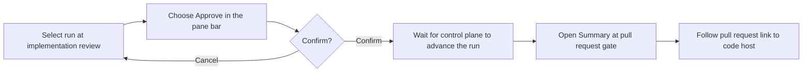
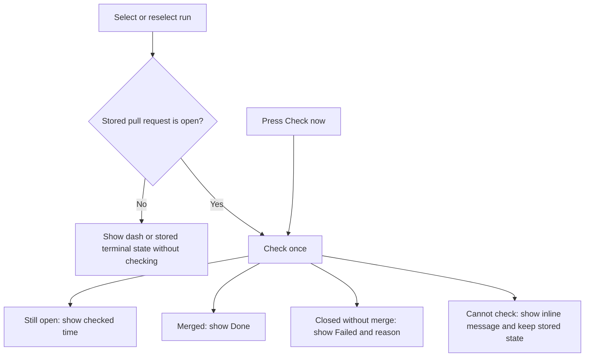
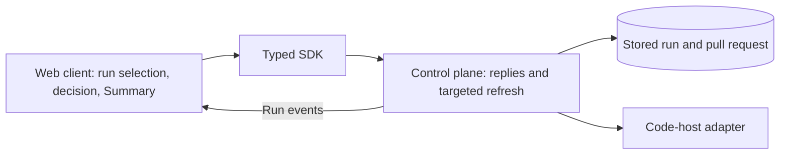
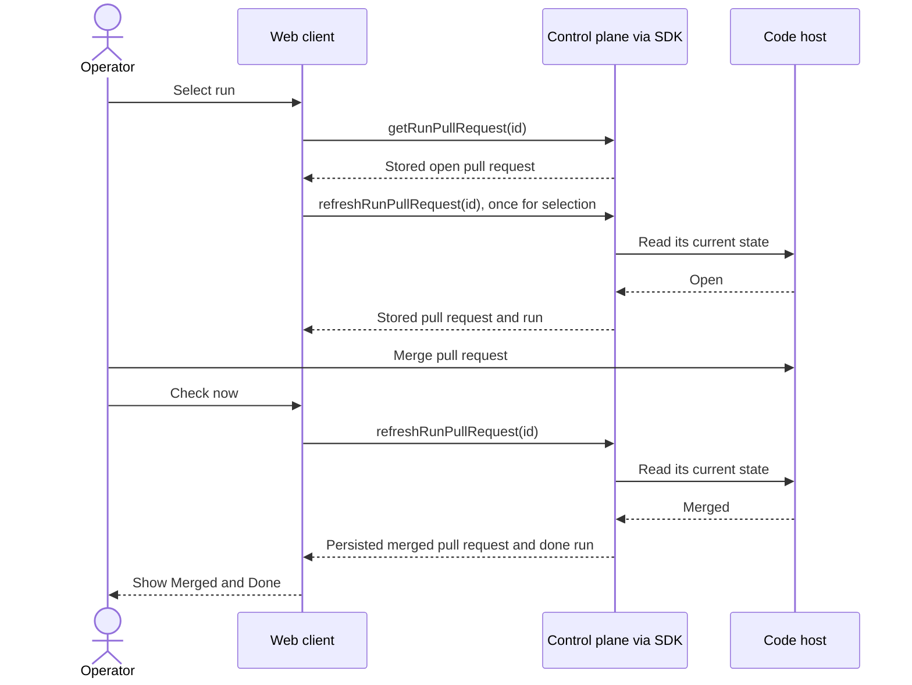

# Approve implementation and finish at the pull request

## What

An operator can approve an implementation from the web client and follow the run through its pull request. The run shows Done when the pull request merges, or Failed with a reason when the pull request closes without merging.

## Why

An operator reached implementation review but could not approve it from the client. Closing that gap lets the operator advance the run and return after acting on the code host to see whether the work finished or why it failed.

## Personas

- **Enzo: Engineer** — approves completed implementation, follows the pull request, and reads the outcome.
- **Phoebe: PM** — approves a revised spec and can see when the run is ready for implementation review or has finished.

## Narratives

### From spec review to a merged pull request

Phoebe comments on a spec and requests changes. After the revision addresses her comment, she confirms approval, including confirmation of the addressed comment. The run reaches implementation review.

Enzo selects the run and confirms Approve. The run advances, and the Summary shows an open pull request. Enzo follows the link and merges it on the code host. Back in the client, he presses Check now and sees Merged on the pull request and Done on the run.

### A pull request closes without merging

Enzo checks an open pull request after it was closed on the code host. The Summary shows Closed, and the run shows Failed with the reason “The pull request was closed without merging.” Neither Approve nor Check now is offered.

## User stories

**From spec review to a merged pull request**

- Phoebe can approve a revised spec and see that the run reached implementation review.
- Enzo can confirm implementation approval without filing feedback.
- Enzo can open the pull request from the Summary and check it again after acting on the code host.
- Enzo can distinguish a run that needs review from one that is done.

**A pull request closes without merging**

- Enzo can distinguish a closed pull request from a merged one and read why the run failed.
- Enzo can see why a pull request check could not finish without mistaking the check error for a run failure.

## Goals

- Show exactly one decision, Approve, at implementation review; remove it once the run leaves that gate.
- Check an open pull request once per selection and once per accepted manual click. Send zero additional check requests during a 10-second idle test.
- Show the pull request state and the run's resulting status without a reload after a successful check.
- Show a readable reason on failed runs and keep check errors in the pull request row without changing the run.

## Non-goals

- A testing guide, test result recording, or feedback at the implementation gate. Keep the existing Acceptance empty state.
- Merging from the client or the control plane, or showing pull request checks, review state, or mergeability.
- Polling, timers, or automatic retry for pull request checks.
- Failure recovery (#121), changes to the Activity tab, or changes to the phase bar.

## Design spec

Follow [Run detail](../concepts/run-detail.md), [UX](../concepts/ux.md), and the [design system](../../context-agent/wiki/design-system.md) sections on the detail pane, gate decision, status indicators, and empty states. Reuse the pane bar, confirmation popover, Summary fact row, and status chip. The row states below are the visual reference; no new layout or tokens are needed.

### Approve implementation

Use the #138 decision control and confirmation interaction, with the prompt “Approve this implementation?” No spec comment counts, addressed-comment copy, or Request changes action apply to this decision. It is available regardless of the active tab or spec readiness. Keep the #135 Acceptance copy unchanged. Disable the decision during submission and keep approval errors in the confirmation popover. The pull request gate and terminal runs have no decision button. The spec gate keeps its existing behavior, including addressed-comment confirmation and the spec overlay.

### Check the pull request

| Summary row state | Presentation |
| --- | --- |
| No pull request | Keep the existing dash. |
| Open | Show its number and link, `Open` in `--color-subtext`, and `Check now`. Omit the button on failed runs, even if the stored pull request is open. |
| Checking | Keep the known state and link. Disable `Check now`; show a spinner and the status line `Checking`. |
| Checked and still open | Show `Checked just now` with the time of the successful check. Nothing else changes. |
| Merged | Show `Merged` in `--color-green`; remove `Check now`. The run chip shows `Done`, not `Needs review`, after the run advances. |
| Closed | Show `Closed` in `--color-red`; remove `Check now`. A run closed without a merge shows `Failed` and its reason on the Summary state line. |
| Check error | Keep the known state and link. Show the message in the row, not a toast. Re-enable `Check now` wherever it is normally available. |

Keep the existing numbered `url` link opening in a new tab (`target="_blank"`, `rel="noopener noreferrer"`). State is always a word as well as a color. Announce check status changes without moving focus. Keep the shared #176 chip: `Needs review` while waiting on the operator, `Done` on completion, and `Failed` on failure.

### Error and failure copy

| Check result | Inline message |
| --- | --- |
| `409 conflict` | The control plane's conflict message. |
| `502` / `credential_missing` | “The code host credential is missing. Update it in this project's settings.” |
| `502` / `authentication_failed` | “The code host rejected the credential. Update it in this project's settings.” |
| `502` / `not_found` | “The pull request was not found.” |
| `502` / `provider_unavailable` | “The code host could not be reached.” |

A failure reason is separate from a check error. Show `pull_request_closed_without_merge` as “The pull request was closed without merging.” Show any other stored `failureReason` as plain text without rewriting it. For legacy records without a reason, keep the Failed chip and do not invent a reason.

## Tech spec

### Introduction and overview

This is the web client slice of [#140](https://github.com/markdstafford/autocatalyst/issues/140). It builds on [#135: run detail pane](feature-run-detail-pane.md), [#138: spec gate decision](feature-decide-spec-gate-track-comments.md), [#139: targeted pull request refresh](feature-refresh-one-pull-request.md), and [#176: shared status chip](feature-run-status-chip-list-detail-tidy.md). #139 is present in PR #186's merge on the current baseline. Playwright uses the #130 fake-server fixture and #128 seed scenarios; the control plane serves the built client as in #129.

[ADR-031](../adrs/adr-031-web-client-architecture.md) and [ADR-032](../adrs/adr-032-web-client-stack.md) govern client state, SDK use, and UI primitives. Use the existing typed REST, authentication, and persistence boundaries (ADRs 004, 005, 007, and 009). A gate is a workflow step at which a run waits for a human; the run, human-pause, and tracker contracts remain in [Run](../concepts/run.md), [HITL](../concepts/hitl.md), and [Trackers](../concepts/trackers.md). A check means a targeted code-host observation through the control plane, not a read of the stored pull request or a CI check.

### System design and architecture

- `runs/run-detail-pane.tsx` composes the shared gate decision and Summary. Extend `runs/spec-gate-decision.tsx` or extract its shared button and popover so spec and implementation use the same interaction with separate decision rules.
- `runs/use-run-detail.ts` already loads the stored pull request and reads new facts on run events. Coordinate the check action with these reads and with the selection lifecycle in `routes/runs-page.tsx`. Keep selected-run updates on the `replaceRun` path in `use-run-list.ts` so the list and pane derive status from the same run.
- `runs/run-detail-summary.tsx` renders check controls and messages beside the pull request fact. Keep check feedback separate from the stored fact's loading, missing, or read-error state. Use one tested module to format failed-run reasons.

### Detailed design

**Existing interfaces.** Use `getRunPullRequest(id)` (`GET /v1/runs/:id/pull-request`) to read `{ pullRequest }`; handle the existing missing-record response as a dash. Use `refreshRunPullRequest(id)` (`POST /v1/runs/:id/pull-request/refresh`, JSON `{}`) for checks. Its `200` contains `{ pullRequest, run }`; the shapes and public check reasons are in [`pull-request.ts`](../../packages/api-contract/src/pull-request.ts) and [`run.ts`](../../packages/api-contract/src/run.ts). No new API, SDK method, data schema, or migration is needed.

**Approval.** Show the implementation decision only at `implementation.human_review` on a nonterminal run waiting on a human. Follow #138's guard conventions for optional run fields and suppress the control for explicit non-human waiting or non-live status. Confirm via `replyToGate('approve')`, which calls `replyToRun(id, { kind: 'approve' })`; never send an implementation `request_changes` reply or create feedback. Refresh from the server and let its step transition remove the button. Do not infer the next step in the client. Reset pending confirmation state on run or gate changes.

**Selection and manual checks.** Track one automatic-check opportunity for each selection, including direct navigation and A → B → A. Use the initial stored pull request read for that selection to decide whether to spend it; only `open` triggers a POST. A missing, merged, or closed record does not. If approval later creates a pull request while the selection remains unchanged, read and show it through the normal detail updates; do not turn that update into a check. Tab switches, pane visibility changes, renders, list reads, run events, and stream reconnects do not create another selection. Route automatic and manual checks through the same in-flight guard so a click cannot overlap an automatic check.

**Apply results.** Associate check state and responses with the selection occurrence and pull request identity, not just the run ID. Drop stale responses after a selection change, including a return to the same run, and prevent older detail reads from restoring an Open row after a successful terminal check. On `200`, publish the returned pull request and pass the returned run through `replaceRun`, preserving the existing stale-run protections. Record the completion time locally for an Open result; it is a display fact, not a persisted field or a timer. Never derive run status from the pull request word alone.

**Handle errors.** The control plane enforces transition eligibility: a stored Open pull request off `pr.human_review`, including one on a terminal run, returns `409 conflict`. Do not preempt that response with a client-side gate check or try to move the run. On `409`, show only the public conflict message. On `502 pull_request_check_failed`, map `ControlPlaneClientError.response.error.details.reason` to the copy above and do not render the raw message, details, or exception. For unexpected check failures, use a generic inline message such as “Could not check the pull request.” Leave the stored pull request, run, and last successful check time intact on failure. Never retry automatically.

### Security, privacy, and compliance

Use the existing authenticated SDK client and rely on the control plane to enforce run ownership, route authorization, and request validation. The browser neither reads nor stores code-host credentials and does not call the provider to check state. Render public messages and persisted failure reasons as text, not HTML; never include raw provider output, credentials, or raw exceptions in check feedback or client logs. The operator's explicit external link is the only navigation to the code host in this flow.

### Observability

Use the row's checking, checked-time, and inline error states to show what happened. Keep existing control-plane request logging for #139 and the existing run events for transitions. Add no client telemetry, metrics, or alerts for this slice.

### Testing plan

- **Unit and component:** Test the failure-reason formatter for the known code, an unknown stored reason, and absence. Use a fake at the public SDK interface to cover all four `502` reasons, `409`, and a generic unexpected error. Assert inline copy, no raw details, unchanged facts, and manual availability where eligible. Cover approval visibility independent of spec readiness, approval submission, and check coordination including stale responses and duplicate triggers.
- **Playwright:** Extend the spec-gate journey and add production-path implementation and pull request coverage using `apps/web/e2e/fixtures/fake-server.ts` and the built client. Each spec uses a free port and fresh state directory and seeds through the existing seed command. Use `fakeServer.writePullRequestState(number, state)` for `<state directory>/pull-requests/<number>.state`; take the number from the seed or row. Observe actual refresh POSTs, without intercepting their responses. The browser talks only to the loopback fake server; no external network or model calls, mocked SDK, injected run data, or client test hooks.
- **Manual smoke test:** Build with `pnpm nx build web`; start `AUTOCATALYST_CLIENT_DIR=apps/web/dist pnpm nx run control-plane:serve-fake` and seed with `pnpm nx run control-plane:seed-fake -- --scenario all`. Connect at `http://127.0.0.1:4010` with `fake-mode-token`. Approve the implementation-review seed and confirm Open in Summary. Wait 30 seconds and verify no extra refresh POST. Check while open; then write `merged` to the numbered state file and check for Merged and Done. Repeat the closed path on `--scenario pr-open --issue 8`, using that seed's own state file. See [fake mode](../../docs/operators/fake-mode.md).

### Alternatives considered

- **Poll or trigger a check on every detail refresh.** This would detect host changes without an operator action, but it would also call the host while the operator stays on one run. A selection check plus Check now gives prompt feedback with a bounded number of calls.
- **Show a separate implementation-only confirmation.** This would avoid touching the spec control but duplicate its keyboard, busy, and error behavior. Share the interaction while keeping the gate-specific rules separate.

### Risks

- Existing list and event-driven rereads can race a check or an approval. Reuse the shared run replacement path and guard pull request responses by selection and read order. Test late responses and a pull request that appears after approval.
- Prerequisite UI behavior can regress when sharing the decision control. Keep the spec overlay and comment rules unchanged and prove the existing comment-to-revision-to-approval path in Playwright.
- A test may edit the wrong pull request's file or start counting after selection. Use the seed's returned number and register the exact run-specific POST observer before navigation; use a separate issue for the closed seed.

## Task list

This list is for planning and does not authorize implementation.

- [ ] **Story: Approve implementation in the run pane**
  - [ ] **Task: Extend the shared gate decision**
    - **Description**: Reuse the #138 pane-bar button and confirmation popover for implementation, with a distinct approve-only decision rule.
    - **Acceptance criteria**:
      - [ ] A run waiting at `implementation.human_review` shows one Approve button on any tab, even before the spec loads. It has neither Request changes nor spec comment confirmation copy.
      - [ ] Confirming calls `replyToRun` once with kind `approve`, creates no feedback, and removes the button after the server advances the run. Cancel sends nothing, and errors stay in the popover.
      - [ ] No decision appears at the pull request gate or on done or failed runs. Spec decisions and #135's Acceptance empty state stay unchanged.
    - **Dependencies**: #135, #138.
  - [ ] **Task: Prove both approvals in Playwright**
    - **Description**: Extend the existing seeded spec-gate journey and cover the separately seeded implementation gate through the production web client.
    - **Acceptance criteria**:
      - [ ] On `spec-review`, comment, request changes, wait for the revision and addressed comment, confirm spec approval including the addressed comment, and see `implementation.human_review` with Approve.
      - [ ] On `implementation-review`, confirm Approve and see `pr.human_review`, an Open pull request in Summary, and no decision button. Verify the existing Acceptance empty state before approval.
    - **Dependencies**: Task: Extend the shared gate decision; #130.
- [ ] **Story: Follow the pull request to its outcome**
  - [ ] **Task: Coordinate targeted checks with run selection**
    - **Description**: Add the selection and manual triggers to the detail flow. Apply successful SDK responses to the stored fact view and shared run row; keep transient check state separate.
    - **Acceptance criteria**:
      - [ ] First selection and A → B → A each check an open stored pull request once. Missing, merged, and closed stored facts do not trigger a check. Staying on the same run produces no additional POST, including after approval, tab changes, event rereads, or reconnects.
      - [ ] One check is in flight per current selection; stale responses cannot update another selection or overwrite newer terminal facts. No timer, interval, or retry calls the endpoint.
      - [ ] A `200` updates the pull request and run from the response; Open records a successful check time. Errors leave run and stored fact unchanged.
    - **Dependencies**: #135, #139.
  - [ ] **Task: Render pull request checks and inline messages**
    - **Description**: Extend the Summary pull request row with state words and tokens, manual action, and the check status and error copy in the design spec.
    - **Acceptance criteria**:
      - [ ] The number link retains its URL, new-tab behavior and `rel="noopener noreferrer"`; no pull request still shows a dash. Open, Merged, and Closed use the specified tokens.
      - [ ] Check now is available for Open except on failed runs. It is disabled while checking, with a spinner and `Checking`; a successful Open check shows `Checked just now` with a time.
      - [ ] Component tests fake the public SDK and cover each `502` reason, a `409` with the control plane's message, and a safe fallback for other failures. Errors stay inline, disclose no raw provider output or credentials, and leave manual checking available when eligible.
    - **Dependencies**: Task: Coordinate targeted checks with run selection.
  - [ ] **Task: Show failed-run reasons**
    - **Description**: Format `failureReason` in the Summary state line with one tested module, and use the shared status chip for the run outcome.
    - **Acceptance criteria**:
      - [ ] The formatter maps `pull_request_closed_without_merge` to “The pull request was closed without merging.” and returns other stored reasons unchanged. Absence does not fabricate a reason.
      - [ ] The list and pane show the shared Needs review, Done, or Failed chip from the run state. Failed runs show their stored reason when present and neither decision nor Check now.
    - **Dependencies**: #135, #176; Task: Extend the shared gate decision; Task: Render pull request checks and inline messages.
  - [ ] **Task: Prove open and merged pull request behavior in Playwright**
    - **Description**: Observe real run-specific refresh POSTs and change only the fake host state file to drive merge detection.
    - **Acceptance criteria**:
      - [ ] On `pr-open`, selection makes one refresh POST; a 10-second idle wait makes zero more. Selecting another run and returning makes one more.
      - [ ] Check now with the file still `open` shows `Checked just now` and leaves Open and Needs review unchanged. Writing `merged` to that pull request's file and checking shows Merged and Done without Needs review.
      - [ ] Selecting the `merged` seed shows Done and Merged with no refresh POST.
    - **Dependencies**: Task: Render pull request checks and inline messages; Task: Show failed-run reasons; #130.
  - [ ] **Task: Prove closed and prefailed run behavior in Playwright**
    - **Description**: Verify close-without-merge and a seeded failure through the production client without injecting run data.
    - **Acceptance criteria**:
      - [ ] Seed a second `pr-open` run on the spare labeled issue (`--issue 8`), write `closed` to that pull request's own state file, and press Check now. The row shows Closed and the run shows Failed with the readable close reason.
      - [ ] Select the `failed` seed and see Failed and its stored reason. Both failed runs lack a decision button and Check now.
    - **Dependencies**: Task: Render pull request checks and inline messages; Task: Show failed-run reasons; #130.
  - [ ] **Task: Record the client wiring in the code map**
    - **Description**: Update `context-agent/wiki/code-map.md` with the Summary pull request row, check triggers and response handling, and failed-run reason module.
    - **Acceptance criteria**:
      - [ ] The map names the modules that own the row, the two check triggers, and failure-reason formatting. Change the design system only if the implementation adds a rule.
    - **Dependencies**: Task: Coordinate targeted checks with run selection; Task: Render pull request checks and inline messages; Task: Show failed-run reasons.
