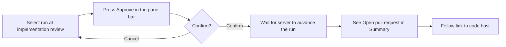
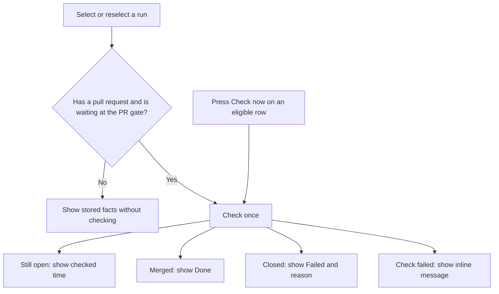
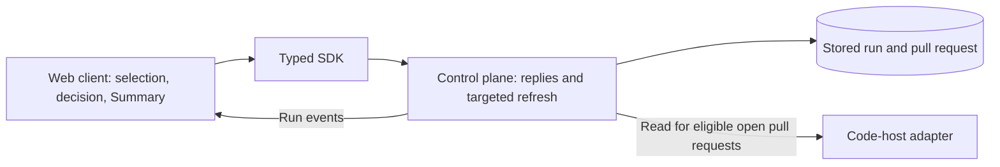
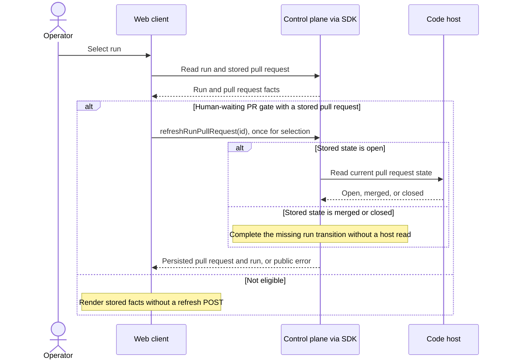

# Approve implementation and finish at the pull request

## What

Operators can approve an implementation from the web client and follow the run through its pull request. The client shows Done when the pull request merges and Failed with a reason when it closes without merging. The operator still merges on the code host.

## Why

An operator reached implementation review but could not approve the run from the client. This feature closes that gap and lets the operator see whether the work finished or why it failed, without having to reconcile the run's status and the pull request by hand.

## Personas

- **Enzo: Engineer** — reviews the implementation, approves the run, and follows its pull request to an outcome.
- **Phoebe: PM** — reviews the spec and confirms that the run advances to implementation review after the revision and approval flow.

## Narratives

### From spec review to a merged pull request

Phoebe comments on a spec and requests changes. When the revision addresses her comment, she approves the spec and confirms the addressed comment. The run advances to implementation review.

Enzo confirms Approve on the implementation. The run advances to the pull request gate. He follows the link in Summary, merges the pull request on the code host, then returns to the client and presses Check now. Summary shows Merged and the run shows Done.

### A pull request closes without merging

Enzo selects a run whose pull request is open and awaiting review. The first check still finds it open. Later, another reviewer closes the pull request on the code host without merging it.

Enzo presses Check now. The row shows Closed, the run shows Failed, and Summary explains that the pull request was closed without merging. Neither Approve nor Check now is available on the failed run.

## User stories

**From spec review to a merged pull request**

- Phoebe can request a spec revision, approve the revision, and see that the run reached implementation review.
- Enzo can approve an implementation without entering feedback or opening a particular tab.
- Enzo can follow the pull request link, check its state again, and distinguish a run that needs review from one that is done.

**A pull request closes without merging**

- Enzo can distinguish a closed pull request from a merged one and read why the run failed.
- Enzo can tell when a check failed without mistaking that error for a run failure.

## Goals

- Offer exactly one decision, Approve, at the implementation gate. Remove it when the run leaves the gate.
- Check eligible runs once per selection and once per accepted manual click. Send no extra refresh POST during a 10-second idle test.
- Update the pull request row and run status from a successful check without a page reload.
- Show stored failure reasons in Summary and show check errors inline without changing the run's status.

## Non-goals

- A testing guide, test results, or implementation feedback. Keep the existing Acceptance empty state.
- Merging from the client or control plane, or displaying pull request checks, review state, or mergeability.
- Polling, timers, or automatic retries for pull request checks.
- Failed-run recovery (#121), Activity changes, and phase bar changes.

## Design spec

Follow [Run detail](../concepts/run-detail.md), [UX](../concepts/ux.md), and the [design system](../../context-agent/wiki/design-system.md) for the detail pane, gate decision, status indicators, and empty states. Reuse the pane bar, confirmation popover, Summary fact row, and shared status chip. The table below is the visual reference; no new layout or tokens are needed.

### Approve implementation

Reuse #138's decision interaction with the prompt “Approve this implementation?” Show Approve on any tab, independent of spec readiness. Do not show Request changes, spec comment counts, or addressed-comment copy for implementation. Disable the control while submitting and keep submission errors in the popover. Preserve the spec gate's comment and confirmation behavior, including the spec overlay. The pull request gate and terminal runs have no decision button. Keep #135's Acceptance copy unchanged.

### Check the pull request

Both selection and Check now require an existing pull request and a nonterminal run waiting on a human at `pr.human_review`. Eligibility follows the run, not the pull request state alone.

| Summary row state | Presentation |
| --- | --- |
| No pull request | Keep the existing dash. No Check now. |
| Open | Show `Open` in `--color-subtext`. Show Check now only if the run is eligible. |
| Checking | Keep the known state and link. Disable Check now while a request is in flight; show a spinner and the status line `Checking`. |
| Checked and still open | Show `Checked just now` and the time of the last successful check. The pull request and run states do not change. |
| Merged | Show `Merged` in `--color-green`. Keep Check now only while the run still qualifies at the pull request gate. Once the run advances, show Done and remove Check now. |
| Closed | Show `Closed` in `--color-red`. Keep Check now only while the run still qualifies at the pull request gate. Once the run fails, show Failed and the reason, and remove Check now. |
| Check error | Keep the known state and link. Show the message in the row, not a toast. Re-enable Check now if the run is still eligible. |

Keep the numbered link to the pull request's `url` with `target="_blank"` and `rel="noopener noreferrer"`. Use state words as well as color. Announce check status without moving focus. Keep #176's shared chip for the list and pane: Needs review while waiting on the operator, Done on completion, and Failed on failure.

### Error and failure copy

| Check result | Inline message |
| --- | --- |
| `409 conflict` | The control plane's public conflict message. |
| `502` / `credential_missing` | The code host credential is missing. Update it in this project's settings. |
| `502` / `authentication_failed` | The code host rejected the credential. Update it in this project's settings. |
| `502` / `not_found` | The pull request was not found. |
| `502` / `provider_unavailable` | The code host could not be reached. |
| Other check failure | Could not check the pull request. |

A check error is separate from a failed run's reason. In the existing Summary failure line, display `pull_request_closed_without_merge` as “The pull request was closed without merging.” Display other stored `failureReason` values as plain text without rewriting them. If a legacy record has no reason, keep the Failed chip without inventing one.

## Tech spec

### Introduction and overview

[#140](https://github.com/markdstafford/autocatalyst/issues/140) builds on [#135: run detail](feature-run-detail-pane.md), [#138: spec gate decisions](feature-decide-spec-gate-track-comments.md), [#139: targeted refresh](feature-refresh-one-pull-request.md), and [#176: status chip](feature-run-status-chip-list-detail-tidy.md). The current baseline includes #139 from PR #186. Testing uses #128's fake seeds, #129's served client, and #130's fake-server fixture.

Follow [ADR-031](../adrs/adr-031-web-client-architecture.md) and [ADR-032](../adrs/adr-032-web-client-stack.md) for client boundaries and UI primitives. Use the existing [API](../concepts/api.md), [run](../concepts/run.md), [human pause](../concepts/hitl.md), and [tracker](../concepts/trackers.md) contracts. A *check* is a call to the targeted refresh endpoint, not a read of the stored pull request or a code-host CI check. No server, SDK contract, or persistence changes are in scope.

### System design and architecture

- Extend the shared decision in `apps/web/src/runs/run-detail-pane.tsx` and `spec-gate-decision.tsx`, keeping gate-specific rules separate from the confirmation interaction.
- Coordinate checks with selection in `routes/runs-page.tsx` and detail reads in `runs/use-run-detail.ts`. Use `replaceRun` from `runs/use-run-list.ts` to update the selected run and list together.
- Extend `runs/run-detail-summary.tsx` to present the check action and status separately from stored pull request loading and read errors. Put failure-reason formatting in one tested module.

### Detailed design

**Existing interfaces.** Read `{ pullRequest }` with `getRunPullRequest(id)` (`GET /v1/runs/:id/pull-request`); retain the existing dash for a missing record. Check with `refreshRunPullRequest(id)` (`POST /v1/runs/:id/pull-request/refresh`, body `{}`). Apply the `200` response `{ pullRequest, run }` rather than inferring the run status from the pull request. See [`pull-request.ts`](../../packages/api-contract/src/pull-request.ts) and [`run.ts`](../../packages/api-contract/src/run.ts).

**Approval.** Use #138's gate guard pattern for `implementation.human_review`: require a nonterminal run and reject explicit non-live status or non-human waiting. Follow the existing spec guard's fallback for omitted status or waiting fields. Confirm through `replyToGate('approve')`, which sends `replyToRun(id, { kind: 'approve' })`. Do not create feedback or send `request_changes`. Use the server's run transition to remove the button; reset the confirmation when the selected run or gate changes.

**Check eligibility.** Use one predicate for the selection trigger and Check now. Follow the guard style in `runs/spec-decision.ts`: require `currentStep === 'pr.human_review'`, `terminal === false`, and no status other than `in_progress` when present. Require `waitingOn === 'human'` from the run read projection and a successfully loaded pull request for that run. An event with omitted waiting metadata is not evidence of a new human wait; use the projected run. An open pull request on a failed, canceled, or off-gate run is displayed without a POST, action, or check error on selection. Recheck eligibility against the latest facts before dispatching a manual check. The server remains authoritative if the run moves after the client evaluates the guard.

**Review decision: terminal pull request repair.** Confirm at spec review the narrow exception to #140's rule against refreshing stored Merged or Closed rows on selection. If the run is still nonterminal and waiting at `pr.human_review`, both triggers are eligible even when the stored pull request is terminal. #139 can persist the pull request before applying the run directive; its refresh completes the missing advance or fail without reading the code host. A completed pair such as Merged and Done or Closed and Failed never triggers a selection POST or shows Check now. This exception does not recover a failed run.

**Selection and manual checks.** Evaluate one automatic opportunity per selection against the initial stored pull request read and the current run read for that selection. If either fact is missing, unreadable, or ineligible, do not send the POST or re-arm on subsequent reads. Selecting another run and returning, or navigating directly to a run, starts a new selection. Tab switches, pane visibility changes, renders, stream reconnects, and run-event rereads do not. If approval creates a pull request while the operator stays on the run, show it through normal detail updates and offer Check now at the gate; do not start a new automatic check. Use one in-flight guard for both triggers so a manual click cannot overlap the current check. Do not poll or retry.

**Apply results.** Key transient check state and responses to the selection occurrence and pull request identity, not just the run ID. Ignore a late result from a prior selection, including A → B → A. Coordinate stored reads and checks so an older detail read cannot restore Open after a terminal result or overwrite a newer fact. On success update the pull request fact and send the returned run through `replaceRun`, preserving stale-run protection. For an Open result, capture the successful completion time locally; no persisted timestamp or timer is needed.

**Handle errors.** A run or gate can move while the operator clicks or while a check runs. On `409`, show the public conflict message in the row and leave the run and stored fact unchanged. On `502 pull_request_check_failed`, use the public `details.reason` from the typed SDK error to choose the specified copy. Use the generic message for unexpected failures. Keep the last successful check time and stored facts intact on errors; never render raw provider details.

### Security, privacy, and compliance

Use the authenticated SDK and existing server authorization and validation. The browser does not handle code-host credentials or call the code host to check state. Render conflict messages and stored failure reasons as text, not HTML. Do not put credentials, provider output, or raw exceptions in check messages or client logs. The numbered link is the operator's explicit navigation to the code host.

### Observability

Show checking, checked time, and check errors in the row. Use the existing control-plane request logs and run transition events. Add no client telemetry, metrics, or alerts.

### Testing plan

- **Unit and component:** Test the known failure code, unknown stored text, and absence. Fake the SDK at its public interface to cover each `502` reason, a `409` returned from an eligible manual check after a gate race, and the safe fallback. Verify no changes to stored facts on error. Selecting a failed run with a stored Open pull request and selecting a run at `pr.finalize` with a stored Open pull request must each produce zero refresh POSTs, no Check now, and no check error. Cover both Merged and Closed stored pull requests with a human-waiting run still at the gate: selection sends one refresh and applies the returned Done or Failed run. Also verify Check now remains available if a repair check fails while the run is still eligible, then disappears after a successful manual repair. Cover selection races and duplicate triggers.
- **Playwright:** Use the built client with `apps/web/e2e/fixtures/fake-server.ts`. Each spec file starts a fake server on a free port with a fresh state directory and uses the fixture's seed command. Register request observers before selecting a run. Observe real refresh POSTs without replacing responses. Use `writePullRequestState(number, state)` to change only the numbered fake host state file. The browser uses the loopback fake server only; no external network or model calls, mocked SDK, injected run data, new route, or client test hook.
- **Manual smoke test:** Build with `pnpm nx build web`. Start `AUTOCATALYST_CLIENT_DIR=apps/web/dist pnpm nx run control-plane:serve-fake` and seed with `pnpm nx run control-plane:seed-fake -- --scenario all`. Connect at `http://127.0.0.1:4010` with `fake-mode-token`. Select the implementation-review run, verify Acceptance is unchanged, and approve. Confirm the pull request row is Open and the decision is gone. Wait 30 seconds and verify no extra refresh POST. Press Check now while open and verify the checked time. Write `merged` to the file for the number shown in the row, then check for Merged and Done. For the close path, run `pnpm nx run control-plane:seed-fake -- --scenario pr-open --issue 9`. Select that run, wait for its initial Open check to finish, then write `closed` to `.autocatalyst-fake/pull-requests/<number>.state` using the number from that seed's output. Press Check now and verify Closed, Failed, and the readable reason. Select the seeded failed run and verify its stored reason. In a fresh fake-mode session, verify the spec-review revision and approval path reaches implementation review. See [fake mode](../../docs/operators/fake-mode.md).

### Alternatives considered

- **Check on every detail reread.** This might detect host changes sooner, but it would send requests while the operator stays on one run. Limit checks to selection and explicit clicks.
- **Skip all stored terminal pull requests.** This avoids unnecessary calls for completed pairs but strands a still-gated run after an interrupted transition. Reuse #139's no-host-read repair only for the gated mismatch.
- **Create an implementation-only confirmation control.** That avoids touching the spec control but duplicates its keyboard, pending, and error behavior. Share the interaction without sharing the spec decision rules.

### Risks

- List and detail rereads can race checks and approvals. Guard responses by selection and read order and use the existing run replacement path.
- Sharing the decision control could change spec review. Preserve the spec overlay and comment rules and prove the revision-to-approval flow in Playwright.
- `pr-open` on spare issue 8 stalls at the enhancement's spec gate. Use spare bug issue 9, as the existing seed test does, and use the pull request number returned by that seed rather than guessing the file name.

## Task list

This list is for planning and does not authorize implementation.

- [ ] **Story: Approve implementation in the run pane**
  - [ ] **Task: Extend the shared gate decision**
    - **Description**: Reuse the #138 confirmation interaction for implementation with a distinct approve-only rule.
    - **Acceptance criteria**:
      - [ ] A run waiting at `implementation.human_review` shows Approve on any tab, independent of spec readiness, with no Request changes or spec comment copy.
      - [ ] Confirm sends one `replyToRun` with kind `approve` and creates no feedback. Cancel sends nothing. Submission errors stay in the popover.
      - [ ] The button leaves after the server advances the run and is absent at the pull request gate and on terminal runs. The spec gate and Acceptance empty state are unchanged.
    - **Dependencies**: #135, #138.
  - [ ] **Task: Prove both approval gates in Playwright**
    - **Description**: Exercise spec revision and both approvals against the production client served by the fake control plane.
    - **Acceptance criteria**:
      - [ ] On `spec-review`, comment, request changes, wait for revision, confirm approval including the addressed comment, and see implementation review with Approve.
      - [ ] On `implementation-review`, verify the Acceptance empty state, confirm Approve, and see the pull request gate with an Open row and no decision button.
    - **Dependencies**: Task: Extend the shared gate decision; #130.
- [ ] **Story: Follow the pull request to its outcome**
  - [ ] **Task: Coordinate targeted checks with run selection**
    - **Description**: Add the shared eligibility guard and single-flight check flow. Apply the SDK response to the pull request fact and the shared run record.
    - **Acceptance criteria**:
      - [ ] Selection and reselection check once only when the run is nonterminal and human-waiting at `pr.human_review` with a stored pull request. A gated Merged or Closed pair is eligible for #139 repair; a completed pair is not.
      - [ ] Tab switches, pane visibility changes, run updates, approval on the same selection, and stream reconnects do not trigger another POST. No timer, interval, or retry calls the route.
      - [ ] Overlapping triggers do not duplicate an in-flight check. Stale responses cannot update another selection or restore older facts. Success applies the returned run and pull request; errors preserve both.
    - **Dependencies**: #135, #139; spec review confirmation of the gated terminal-state exception.
  - [ ] **Task: Render pull request checks and inline messages**
    - **Description**: Extend the Summary row with the existing safe link, state styling, manual action, and check feedback.
    - **Acceptance criteria**:
      - [ ] The existing link and dash behavior are preserved. Open, Merged, and Closed use the specified text and tokens.
      - [ ] Check now uses the selection eligibility guard, including gated terminal-state repair, and is absent on terminal or off-gate runs. During a check it is disabled with a spinner and Checking; a successful Open check shows Checked just now with a time.
      - [ ] Conflict, known provider reason codes, and unexpected failures use the specified inline copy. No toast, credential, or raw provider output appears. Manual checking stays available after an error if still eligible.
    - **Dependencies**: Task: Coordinate targeted checks with run selection.
  - [ ] **Task: Cover check eligibility, repair, and errors at the SDK boundary**
    - **Description**: Use the public SDK test double for component tests; keep the production wiring tests separate.
    - **Acceptance criteria**:
      - [ ] Selecting a failed run or a run at `pr.finalize`, each with a stored Open pull request, sends zero refresh POSTs and shows neither Check now nor a check error.
      - [ ] For each stored terminal state with a human-waiting run at `pr.human_review`, selection calls refresh once and applies the returned outcome. A failed repair check keeps Check now available; a successful repair removes it.
      - [ ] Each of the four `502` reasons, the manual `409` race, and the unexpected-error fallback show safe inline copy without changing the stored facts. Tests also cover duplicate triggers and stale results across selections.
    - **Dependencies**: Task: Render pull request checks and inline messages.
  - [ ] **Task: Show failed-run reasons**
    - **Description**: Format `failureReason` in the existing Summary failure line and reuse the shared status chip for the run outcome.
    - **Acceptance criteria**:
      - [ ] One tested module maps `pull_request_closed_without_merge` to “The pull request was closed without merging.” Other stored text is unchanged and absence does not invent a reason.
      - [ ] The list and pane show the shared Needs review, Done, or Failed chip from the run state. Failed runs have neither the decision button nor Check now.
    - **Dependencies**: #135, #176; Task: Extend the shared gate decision; Task: Render pull request checks and inline messages.
  - [ ] **Task: Prove open and merged pull request behavior in Playwright**
    - **Description**: Observe real run-specific refresh POSTs and drive merge detection using only the fake host state file.
    - **Acceptance criteria**:
      - [ ] Selecting `pr-open` sends one refresh POST. Ten idle seconds send none; selecting another run and returning sends one more.
      - [ ] Check now with the file still `open` shows the checked time and leaves Open and Needs review unchanged. Writing `merged` to that run's file and checking shows Merged and Done without Needs review.
      - [ ] Selecting the `merged` seed shows Done and Merged with no refresh POST.
    - **Dependencies**: Task: Render pull request checks and inline messages; Task: Show failed-run reasons; #130.
  - [ ] **Task: Prove closed and prefailed run behavior in Playwright**
    - **Description**: Seed the second `pr-open` run on spare bug issue 9 and use the pull request number from the seed output.
    - **Acceptance criteria**:
      - [ ] Seed with `--scenario pr-open --issue 9` (fixture `seed({ scenario: 'pr-open', issue: 9 })`). Select the run and wait for its initial Open check. Write `closed` to its own numbered state file and press Check now. The row shows Closed and the run shows Failed with the readable reason.
      - [ ] Select the `failed` seed and see Failed and its stored reason. Both failed runs lack Approve and Check now.
    - **Dependencies**: Task: Render pull request checks and inline messages; Task: Show failed-run reasons; #130.
  - [ ] **Task: Record the client wiring in the code map**
    - **Description**: Record the owner modules and behavior in `context-agent/wiki/code-map.md`.
    - **Acceptance criteria**:
      - [ ] The map names the row, eligibility guard, two check triggers, terminal-pair repair exception, and failure reason formatter. Change the design system only if a rule is added.
    - **Dependencies**: Task: Coordinate targeted checks with run selection; Task: Render pull request checks and inline messages; Task: Show failed-run reasons.
