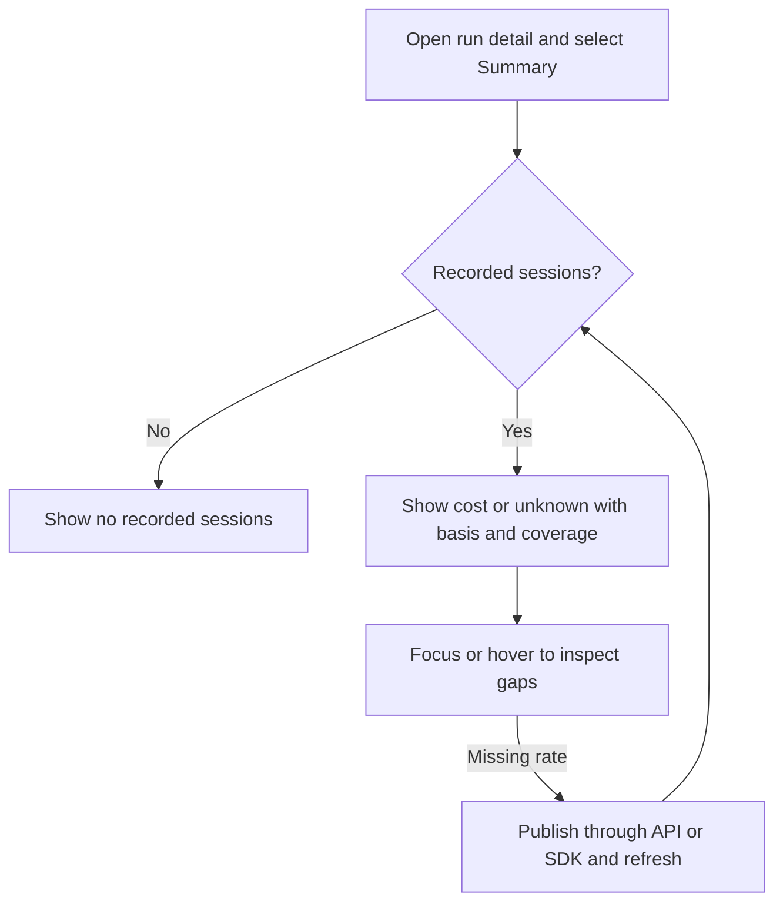
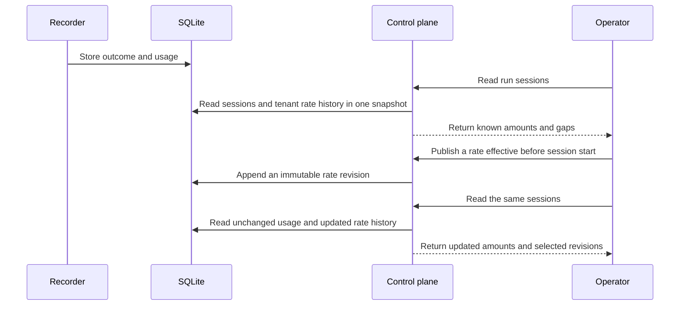

# Cache-aware token usage and session cost

## What

Autocatalyst records fresh input, cache reads, cache writes, and output for each recorded model session. Operators can see what that work costs at configured API list prices, including work done through a subscription. When only part of a run can be priced, Autocatalyst shows what is known and explains what is missing.

## Why

Current totals can hide most of a session’s usage. One Claude session showed 40 ordinary input tokens while native records showed about 993,000 cache reads and 115,000 cache writes. Codex reported 7.34 million cumulative input tokens in #169 without a cache split. A comparable breakdown and a labeled price let operators compare runs without mistaking list prices for a bill.

## Personas

- **Enzo: Engineer** — publishes rates and compares usage and cost across runs.
- **Phoebe: PM** — checks progress and cost without inspecting individual sessions.

## Narratives

### Compare two runs

Enzo opens a completed bug run and checks how much input came from cache. He compares it with a feature run at the same pricing basis. The feature run shows a known subtotal: one model has no rate, and some tokens were priced at an estimated long-context band.

Enzo publishes the missing rate, effective before the session started. On refresh, the session contributes without rerunning any work. The estimated band stays labeled, and both runs still say “API list price.”

### Check a run in progress

Phoebe opens a running feature run. Summary shows cost so far and explains that it covers recorded sessions only. Before the first session was recorded, it showed a dash rather than a zero-dollar charge.

A timed-out attempt contributes the usage it reported. Phoebe focuses the Cost tooltip and sees that the attempt may have used more tokens than were recorded. The Tokens tooltip distinguishes reported counts from unknown counts and classes that do not apply.

## User stories

**Compare two runs**

- Enzo can compare the four token classes without counting cached input or reasoning twice.
- Enzo can publish, read, correct, and retract rates through the API or SDK.
- Enzo can price earlier sessions by publishing a rate without rewriting usage.
- Enzo can retrieve session, step, and run amounts and see which charges are missing and why.
- Enzo can record the rate revisions used for a comparison.

**Check a run in progress**

- Phoebe can see cost so far and tell that it is not a subscription charge.
- Phoebe can distinguish a complete amount, an incomplete subtotal, unknown cost, and no recorded sessions.
- Phoebe can inspect actual reasons with a pointer or keyboard.
- Phoebe can distinguish measured, unknown, not-applicable, and legacy token data.
- Phoebe can see newly recorded sessions on refresh, including usage from unsuccessful attempts.

## Goals

- Every new recorded session has normalized usage or explicit missing states, regardless of rate availability and outcome.
- Session reads return exact integer nano-dollar charges for the terms that can be priced, rate revision IDs, and gaps. The same read returns logical step and run subtotals. A backdated rate applies on the next read without a backfill job.
- Summary shows the pricing basis, all four token classes, and reasons for incomplete cost. A representative bug run and feature run cover both adapters and establish the baseline for #195.

## Non-goals

- Rate management UI, bundled rates, or automatic retrieval of provider prices.
- Rollups above the run, separate phase or role totals, or tuning analytics.
- Reconstructing legacy cache splits or tracking launches interrupted before their sessions are recorded.
- Recording or pricing failed direct calls before #122 records them. Successful direct calls that already produce sessions are in scope.
- Subscription charges, allowances, forecasts, budgets, or alerts.

## Design spec

### User flow



### Summary rows

Keep the existing description list, Time row, loading and fetch-error states, keyboard-focusable tooltips, and refresh path. Use the API total for Cost. Do not price or sum session costs in the browser. Format integer nano-dollars exactly, with at least two fractional digits and up to nine as needed. Append `so far` to the amount or status for `in_progress`, including in accessible text. That label describes run progress, not whether all recorded sessions are priced.

| Cost state | Example for a non-running run |
| --- | --- |
| Complete | `$0.42 · API list price` |
| Incomplete with a known subtotal | `$0.42 · API list price · Incomplete` (tooltip identifies this as the known subtotal) |
| Recorded sessions, no displayable subtotal | `Unknown · API list price · Incomplete` |
| No recorded sessions | `—` (accessible text: `No recorded sessions`, or `No recorded sessions so far` when running) |
| Older server with sessions but no `costTotals` | `Pricing unavailable` |

A measured and priced zero displays `$0.00`; if other charges are unknown, it still says **Incomplete**. Show that label without relying on color or interaction. In the tooltip, say `Recorded sessions only` and explain that API list price is not a subscription charge. List actual gap reasons, affected billing keys where known, session counts, and affected token counts where known. When any tokens were priced at an estimated long-context band, label the amount **Includes estimates** next to **Incomplete**. The tooltip gives the estimated token count and says the true amount may be higher (lowest-band fallback) or differ in either direction (sample-based estimate). For `missing_request_size`, explain that those tokens could not be priced in any feasible band. Say when additional affected tokens cannot be counted. Explain representation overflow separately from missing usage.

The Tokens row uses the disjoint counts in normalized `usage` groups, with exact integer sums. Show Fresh input, Cache reads, Cache writes, and Output in the tooltip. A class is `Not applicable` only when every recorded session establishes that state; show `Unknown` when no count is known and the class is not ruled out. Mark a known subtotal **Incomplete** if counts or invocation coverage are missing. Unknown rate or request size does not make a measured token count incomplete. With no known normalized count, show `Unknown · Incomplete`; with no sessions, show `—`. Reasoning and retention buckets may appear under their parent classes but never add to the total.

For all-legacy runs, keep the old compact sum, including zero, with a **Legacy** label. List normalized classes as unknown and explain that the legacy sum may overlap or contain placeholders. For mixed runs, mark the normalized subtotal incomplete and show the separate legacy sum and session count in the tooltip. Never add the two sums.

## Tech spec

### Introduction and overview

This work completes pricing deferred by [durable session telemetry](feature-durable-session-run-step-telemetry.md) (#89) and extends the [run detail pane](feature-run-detail-pane.md). It follows SQLite/Drizzle (ADR-004/019), contract-first `/v1` (ADR-005–007), service-owned configuration (ADR-008), tenant authorization (ADR-009), the two telemetry stores (ADR-030), and existing web conventions (ADR-031/032 and `context-agent/wiki/design-system.md`). Session grain and attribution remain as in ADR-015; see Contract updates for the pricing refinement. No new pricing store or higher-level rollup ships.

| Term | Meaning |
| --- | --- |
| Billing key | Provider and exact served model ID. Distinct from the model Autocatalyst dispatched. |
| Counter scope and meaning | Scope is the work a counter covers: one request, a thread to date, or an invocation result. Meaning is what it counts, such as inclusive or fresh input. Convert to the same disjoint classes and verify scope before comparing or subtracting two observations. |
| Usage group | Disjoint work with one billing key (or no provable key) and common request-size evidence. An inclusive remainder is counted once, not once per possible model. |
| Closed input coverage | The group has a validated inclusive input count or all applicable input counts are known. Their total bounds every request in that group even if other groups in the invocation are missing. |
| Request size, ceiling, and hint | Size is one request’s input: fresh, reads, and writes once each. A ceiling bounds every request in a group. A hint is one observed size from the same owned thread and attempt that cannot be tied to the billed counts. It never proves a band, but pricing uses it to choose an estimated band when exact evidence cannot (pricing step 4). |
| Band and treatment | A band selects rates by request size. Treatment for a disjoint token portion is a numeric rate, non-applicability, or a reason it cannot be charged. Treatment is invariant when it resolves to the same result in every feasible band. |
| Nano-dollar and gap | A nano-dollar is one billionth of a US dollar. A gap names the evidence or representation problem that prevented pricing; it is not a zero charge. |

### System design and architecture


Adapters interpret native usage. The agent runner, direct orchestrator, and execution unit of work carry it independently of structured-result parsing. `execution-session-recorder.ts` writes usage, not prices. The control plane selects rates and computes amounts; the client formats them.



### Detailed design

#### Usage and persistence

Add nullable `sessions.usage_json TEXT` with a Drizzle migration (`ALTER TABLE sessions ADD COLUMN usage_json TEXT`). Store validated JSON. Add optional `usage` to the create, stored, and HTTP session shapes; omit it for rows with a null column. The recorder supplies it on every new recorded session. No backfill. Preserve session identity, sequence, ordering, and legacy JSON. Groups are embedded accounting evidence, not new sessions or a native request log.

- `usage` contains `coverage: complete | partial | unavailable`, `totals`, and ordered `groups`. Coverage tracks whether evidence accounts for the invocation, not whether every counter is known. `partial` means other work may be missing; `unavailable` means there are no validated owned normalized counts. Native closure can make an unsuccessful attempt complete.
- `totals` and each group’s `tokens` carry `freshInput`, `cacheRead`, `cacheWrite`, and `output`. Values are nonnegative safe integers (including proved zero), `null` for unknown, or `not_applicable`. Optional `cacheWriteByRetention` holds known counts keyed by `5m`, `1h`, or another reported retention label. Optional `reasoningOutput` is a subset of output. A bad subset does not invalidate a valid parent count. Keep independently validated buckets if the total is unknown.
- Each group also has `model: {provider, model} | null` and `requestInputTokens: nonnegative safe integer | null`. It may carry positive `contextWindowTokens` only if native evidence bounds all requests it represents, and `inputTotalCeilingTokens` only from closed input coverage (zero is valid). Do not use a known subtotal, an unsafe sum, or observations from a different scope as a bound. A closed group can belong to a partial invocation.
- An unsized group may carry `requestSizeHint: {method: 'nearest_sample' | 'largest_sample', inputTokens}` for band estimation. Use a validated single-request sample from the same native thread and attempt. Pick the closest in native observation order to the group’s observations, breaking ties by earliest sample; if the group cannot be placed in that order, pick the largest eligible sample. Exclude replays, earlier resumed work, and unrelated threads. Do not attach a hint to a group spanning threads. Hints never establish attribution, coverage, or a bound; pricing uses them only to choose an estimated band (step 4).
- Preserve groups separately unless they cover disjoint work, have the same billing key and input accounting rules, and can be combined without losing exact sizes or changing which requests a bound or sample describes. Merge requests with the same key, accounting rules, and exact size into one group. If a session would exceed 256 groups, merge adjacent same-key groups into range groups carrying `requestInputRange: {min, max}` instead of an exact size; pricing treats `min` as a floor and `max` as a ceiling. Keep an unpartitionable inclusive count once, with null model if unproved. Never copy session totals into another chargeable group. Do not persist native thread or request IDs.
- Use `openai` for confirmed Codex and native OpenAI work and `anthropic` for Claude and native Anthropic work. Match exact served IDs, without aliases or dispatch fallback except where a transport confirms identity for the represented work. `Session.model` and `cost.model` still describe dispatch.
- Derive totals from disjoint groups. A known subtotal is not a complete total when a group or invocation coverage is missing. With no known count, use `not_applicable` only when established for the invocation; otherwise use null. On safe-integer overflow set the affected total to null and keep the groups. Totals do not generate charges. Validate derived totals, bounds, subsets, and coverage before persisting.

**Compatibility projections — exception for spec-gate approval.** The “never zero for missing values” rule applies to normalized `usage`. The existing strict numeric `tokens` and `cost.tokens` remain identical compatibility projections, with zero placeholders for unknown, not-applicable, or unrepresentable counts. Keep `input` inclusive for Codex and OpenAI and fresh for Claude and Anthropic; preserve validated native inclusive input even when its split is unknown. Project output including reasoning, cache reads, and cache writes. `usageAvailable` means at least one validated count is available, not complete usage. OpenAPI and SDK descriptions for both projections must explain that zero need not be measured; Summary and clients that need missing states must read `usage`. Approval at `spec.human_review` accepts this exception for those two fields only.

**Create, stored, and read costs.** Strict create cost accepts only `{model, tokens, usd?: null}`; `cost.tokens` must match session `tokens`. Persistence writes `usd: null`. Reject a non-null amount, including zero, and any computed field, including `gaps: []`. Keep the original three-field `cost_json` shape. The stored decoder tolerates legacy omission or a numeric `usd`, but read-time pricing does not rely on those values. There is no public session-create route. Neither stored JSON nor the create result carries computed metadata. Legacy rows retain their stored projections and `usageAvailable`; their priced reads return null with `legacy_cache_detail`, plus `missing_usage` if `usageAvailable` was false. Neither gap asserts a token count.

#### Native capture and attempt boundaries

Accumulate only work owned by one invocation and attempt, across all of its turns. Retries are separate attempts. Deduplicate by request identity or cumulative counter position, not equality of independently scoped request counts. Carry observations received before native failure, cancellation, timeout, or result parsing failure to the same recorder as successful usage. Do not wait for a success payload after termination or change the execution outcome because accounting failed. Use a secondary summary only to replace overlapping evidence or fill a verified residual; do not add it to counts for the same work.

**Codex app-server 0.160.1** (`packages/codex-agent-adapter/src/codex-app-server.ts`). Match `thread/start` response `thread.id`, `modelProvider`, and `model` with the existing `openai` and no-fallback launch guard. Use `turn/start` response `turn.id` to bind owned turns and process queued notifications after acknowledgement. Match `thread/tokenUsage/updated.params.{threadId,turnId}` to an owned turn. Use `tokenUsage.total` counters `inputTokens` (inclusive), `cachedInputTokens`, `outputTokens`, and `reasoningOutputTokens`. Subtract cached from inclusive when both validate; reasoning never adds to output. Cache writes do not apply to the confirmed OpenAI path. Treat a contradictory positive wire `cacheWriteInputTokens` as a capture anomaly: keep independently valid counts but do not assume that input still splits into only fresh and reads. Do not add `tokenUsage.last` to `total` or use `totalTokens` as a fifth class.

| Native case | Rule for 0.160.1 |
| --- | --- |
| Fresh and multi-turn | Start the fresh thread at zero. Attribute growth of comparable `total` counters once. An update spanning multiple requests is not a request-size sample. An owned final-turn update and matching `turn/completed.params.{threadId,turn.id,turn.status}` close the ordinary path when no counter interval is missing or ambiguous; failed native completion may also close it. Result parsing is independent. |
| Resume | The production launcher currently uses `thread/start`. For resumed native streams, `thread/resume` identifies the thread but does not provide a pre-turn `tokenUsage.total` baseline tied to the resumed counter. The first owned update anchors later same-scope deltas; it does not contribute its total or `last`. A second owned monotonic update can contribute the difference, but coverage stays partial. One update alone yields unavailable usage. Do not use a prior session’s stored totals or invent a resume-baseline notification. |
| Replay, reset, interruption | Unchanged snapshots add no counts or new samples. On an unexplained drop, stop using the affected counter for deltas in that scope; keep earlier proved counts and mark partial if work may be lost. Do not restart from zero without a new owned fresh thread. Keep observations received before termination; without closure mark partial or unavailable. |
| Reroute | `model/rerouted.params.{threadId,turnId,fromModel,toModel,reason}` flags the affected turn. The notification has no counter offset or request ID that joins it to `tokenUsage.total` or `last`. Mark ranges overlapping that turn unattributed, including previously buffered deltas for it. Keep their validated counts once; do not assign the whole turn to `toModel` or split it at notification arrival. Other turns retain their confirmed key only if the identity for those turns is established and their deltas do not cross the ambiguous range. |
| Child threads | Use `item/started` and `item/completed` with `params.{threadId,turnId}` and `item.type: collabAgentToolCall`, `item.senderThreadId`, and `item.receiverThreadIds` to link child work. `item.agentsStates` describes lifecycle, not accounting. A failed spawn with no child ID or work is not proof of execution. For linked children, the stream does not prove whether child counts overlap a parent total or provide a joined served key for their usage. Do not add child counters to the parent total. Keep any potentially inclusive parent range once with null key, and mark partial when child coverage cannot be established. Ignore unrelated thread notifications. |
| Size | `tokenUsage.last.inputTokens` can be exact size for a positive owned delta when `last` matches all applicable pricing counters of that delta and thus accounts for it. A nonmatching `last` has no request identity on this notification to prove a disjoint subtraction; keep the whole delta unsized. An eligible owned `last` can be an estimation hint only. `modelContextWindow` alone does not prove a bound for all requests in a cumulative range. |

Treat reroute and child classification as provisional until the attempt ends, so late markers can remove a key without adding or deleting counters. Test the unsupported cases against the pinned wire shape, not against simulated metadata the app-server does not send. Do not add provider resume support to the launcher as part of this feature.

**Claude Agent SDK** (adapter dependency `^0.3.177`; exercise the lockfile-resolved version). Read `message.model` and `message.usage` on final assistant records. Deduplicate by `request_id`, otherwise stable `message.id` scoped to SDK session and parent tool. Associate streamed frames with the final record; repeated frames and content blocks do not add requests. Count distinct native requests even if output is superseded. Use `parent_tool_use_id` and linked child lifecycle metadata for ownership, not model identity. Map `input_tokens` to fresh, `cache_read_input_tokens` to reads, and `cache_creation_input_tokens` to writes. Keep `cache_creation.ephemeral_5m_input_tokens` and `ephemeral_1h_input_tokens` where validated. Derive exact size only for a single request with closed input coverage. `modelUsage` is a keyed aggregate, not request-size or retention evidence. Do not price from SDK `contextWindow`, `total_cost_usd`, or `modelUsage.costUSD`.

- With no child work, use a terminal `modelUsage` aggregate once per exact key when scoped to the invocation, including a usable error result. Subtract deduplicated final requests only when containment is established and the counts reconcile. Keep any remaining counts at that key, with unknown size and retention unless independently reported. If overlap cannot be resolved, use the authoritative scoped aggregate once instead of the overlapping requests. Mark coverage partial if work may have been omitted.
- With children, keep linked final requests with proved ownership. For closure without a scoped native child total, require the child lifecycle to close and deduplicated requests to match the terminal keyed totals exactly by model and applicable counter. Then keep the requests, not another copy of the totals. An unexplained remainder or completion marker does not prove inclusion. If reconciliation fails, keep only proven non-overlapping work and mark partial.
- Use unkeyed terminal usage only for the matching active invocation with no child evidence. If it provably contains the final requests, keep those and their exact keys, and retain the uncovered remainder once with null key. If containment cannot be established, do not sum them; prefer the authoritative scoped inclusive aggregate once, without model attribution. Unkeyed usage does not close child coverage. On resume or missing result, exclude prior and unowned work; keep independently owned observations.

**Other recorded calls.** Normalize OpenAI agent sessions and successful OpenAI and Anthropic direct calls at their existing native response boundaries. OpenAI cached input is a subset of inclusive input and writes do not apply. Anthropic direct uses the Claude counter meanings. Use native served identity, the same ownership and deduplication rules, and a single-response size only when it represents one request and closes applicable input counts. Make no extra inference calls.

#### Effective-dated rate configuration

Add `model_rate_table` to configuration records. One record is one immutable revision of a slot keyed by `(tenant, provider, model, effectiveAt)`. Store settings in `configuration_records.settings_json` with profile-only columns null. Rates are independent of profiles. No rates ship. The only basis is `api_list_price`, displayed as `API list price`.

```text
Slot = { provider, model, effectiveAt }
Schedule = { basis?: 'api_list_price', contextLimitTokens?, bands: Band[] }
InitialSet = Slot & Schedule & { action: 'set' }
Correction = Slot & Schedule & { action: 'set', correctsId }
Retraction = Slot & { action: 'retract', correctsId }
CreateRequest = { tenant, kind: 'model_rate_table', settings: InitialSet | Correction | Retraction }
SetRead = Slot & { action: 'set', correctsId?, revision, basis: 'api_list_price', contextLimitTokens?, bands: Band[] }
RetractionRead = Slot & { action: 'retract', correctsId, revision }
Record = { id, tenant, kind: 'model_rate_table', settings: SetRead | RetractionRead, createdAt, updatedAt }
Band = { minRequestInputTokens, rates: { freshInput, cacheRead, output, cacheWrite } }
cacheWrite = 'not_applicable' | rate | { '5m': rate, '1h': rate }
```

- Shapes are strict; optional is not nullable. Provider and model are case-sensitive nonempty strings without padding or control characters. `effectiveAt` is a valid UTC instant in canonical millisecond form `YYYY-MM-DDTHH:mm:ss.sssZ`. `correctsId` is a nonempty configuration record ID. Optional `contextLimitTokens` is a positive safe integer: an input ceiling asserted by the operator for the key across all transports, not a single transport’s cap. Default omitted basis before storage and comparison. The service assigns the ID, one-based revision, and publication time (`updatedAt === createdAt`).
- Require at least one band. Inclusive minimums are safe integers starting at zero and increasing strictly. The last band has no upper bound. A tier for **more than** `T` input tokens starts at `T + 1`. Require every shown class. Rates are nonnegative safe integers in nano-dollars per token. Multiply the provider’s USD per million tokens by 1,000 exactly (`$3.00` becomes `3000`); reject unrepresentable rates rather than rounding.
- First publication requires no slot history. Correction or retraction names the current head in the same tenant and slot. A retraction requires an active set; a set can correct a retraction to restore it. Missing, stale, foreign, wrong-kind, and wrong-slot IDs produce the same sanitized conflict. Reject an identical normalized schedule correcting an active head, including its basis and optional context limit. Key order does not matter. Allow identical schedules at distinct effective instants and allow restoration.
- Add a partial unique index for `kind = 'model_rate_table'` over tenant and JSON-extracted provider, model, effective instant, and revision. Read the head, assign the revision, and insert in one SQLite writer transaction. Serialize writers or recheck the head on conflict. Only one publication against a given head succeeds. Keep prior revisions readable. Guard PATCH and DELETE by stored kind; leave other kinds unchanged.

Retraction hides only its slot and may expose an earlier one. To fix an incorrect date or key, retract the wrong slot and publish the intended one. For offline reproduction, retain the session set and selected revision IDs, not just publication times. No as-of endpoint, session rate snapshot, or computed cache ships. A later cache must match fresh computation.

#### Read-time pricing and rollups

1. **Select a schedule.** Authorize the run. Read its sessions and relevant tenant rate history in one committed snapshot. Take the highest revision in each slot and ignore retracted heads. For each group with a key, select the latest active slot whose `effectiveAt` is at or before `Session.startedAt`. Parse both as UTC instants before comparison; do not compare raw timestamp strings. Preserve the meaning of fractional precision accepted by the session schema. Equality is inclusive, even for `.000Z` versus `Z`. Use session start for every group. Do not fall back to an earlier slot because a selected schedule cannot price a class.
2. **Find feasible bands.** Validated exact request size selects its band directly. Otherwise take the minimum of the configured model-wide ceiling, validated native ceiling, and closed group input total, ignoring absent values. Ignore a configured ceiling contradicted by exact evidence for the key in the session, and a native ceiling contradicted in its scope. Reject an internally inconsistent group-total ceiling at capture. Remove bands with a minimum above the ceiling. With no ceiling remove none. A group total above a threshold does not prove any request crossed it. A range group's `min` also removes bands whose next minimum is at or below it. A sample hint never narrows the feasible bands; step 4 uses it only to estimate.
3. **Split usage once.** Fresh input, cache reads, and output are separate portions; reasoning never adds to output. Split writes into known retention buckets and, when total writes are known, the nonnegative remainder. If a split exceeds a valid total, discard the split and keep the total as the remainder. With unknown total writes, keep supported bucket evidence and an unknown remainder unless additional writes are ruled out. A flat rate applies to each disjoint write portion; do not charge the write total again. A retention schedule applies to known supported buckets; an unsupported known bucket is incompatible. A positive unallocated remainder under a retention schedule lacks retention evidence.
4. **Resolve each portion across feasible bands.** Known positive tokens with the same numeric rate in every feasible band are charged once, including at a configured zero rate. If all bands yield the same blocker, return that blocker. If positive tokens have different treatments across feasible bands (including a rate versus a blocker), estimate the band (operator decision): clamp the group's hint (`nearest_sample`, else `largest_sample`) into the feasible range and use its band; with no hint, use the lowest feasible band (`lowest_feasible`). Apply that band's treatment. If it is numeric, charge the tokens and report `estimated_request_size` with the token count, `method`, and `bandMinRequestInputTokens`; if it is a blocker, report that blocker. Report `missing_request_size` only when no feasible band gives a numeric treatment. A mixed flat/tiered schedule still prices a known bucket at a shared rate without estimating. A positive remainder with a flat rate in one band and no retention evidence in another follows the estimated band: flat is charged with `estimated_request_size`, tiered gives `missing_cache_retention`. A known zero with numeric treatment in every feasible band contributes a measured priced zero; different numeric rates do not matter for zero. A zero with any nonnumeric treatment does not establish a priced amount and adds no token gap. `not_applicable` adds neither cost nor gap. An unknown count gets `missing_usage` unless all feasible bands establish non-applicability; known write buckets are tested separately. Never estimate a band when exact size, ceilings, or invariant treatment resolve it.
5. **Build session cost.** For each unpriced portion give the first blocker: `missing_model`, `missing_rate`, then the applicable treatment blocker (`missing_usage`, `missing_cache_retention`, `incompatible_rate`, or `missing_request_size`). `estimated_request_size` marks a charged portion: it makes the session incomplete but does not remove the charge or block a later portion. Give sized gaps only for disjoint positive counts. Add an unsized `partial_usage` when other work may be missing. If coverage is unavailable return `missing_usage`, without speculative group gaps. Use the legacy rule for rows without normalized usage. Multiply and sum numeric terms with `bigint`. `cost.usd` is a safe JSON integer in nano-dollars when at least one measured numeric term contributes and the result fits; it can be a partial known amount. Return null if no term is priceable or if the amount overflows. Add `amount_overflow` only for overflow; if nothing is priceable and no other gap explains it, report `missing_usage` (no usable chargeable count). `cost.complete` requires closed coverage, no gaps, and a representable amount. There is no second price field.
6. **Sum session amounts.** Sum numeric session amounts with `bigint`, once per logical `(phase, step)` and once for the run. Logical steps span occurrences, roles, and rounds; direct-call phase can be null. A nonempty collection with no numeric prices has a null subtotal. If the sum overflows, return null and a separate rollup overflow gap. A numeric subtotal is complete only when every included session is complete. For zero recorded sessions return `sessionCount: 0`, `knownSubtotalUsd: null`, `complete: false`, zero priced and unpriced counts, and no gaps or step entries. This is an empty observation, not a zero charge. Clients use the existing run status to label a running result `so far`; `complete` refers to recorded pricing coverage only, not run status.

#### API, SDK, and errors

| Route | Contract |
| --- | --- |
| `POST /v1/configuration-records` | Accept `CreateRequest`; return `201` and `Record`. Invalid shape or data: `400 validation_error`; publication conflict: sanitized `409`. |
| `GET /v1/configuration-records`, `GET /v1/configuration-records/:id` | Preserve list/item envelopes and add the new union variant, including history and retractions. Unknown or other-tenant item: `404`. |
| `PATCH` or `DELETE /v1/configuration-records/:id` | Valid mutation against a rate record in the caller’s tenant: `409`. Malformed request: `400`. Valid request for unknown or other-tenant ID: `404`. Do not add a rate PATCH variant. |
| `GET /v1/runs/:id/sessions` | Return `200` with the same ordered `sessions` and `costTotals: {run, steps}` from the same snapshot. Keep existing missing and other-tenant behavior. No new route or query option. |

Extend shared Zod schemas, generated OpenAPI, and SDK methods and types. New decoders accept older read responses without additive fields. Upgraded HTTP reads always return pricing metadata and omit `usage` only on rows without it. Older strict clients may need an SDK upgrade. Preserve existing authentication, authorization, and sanitized operational error responses. Pricing gaps are successful reads, not HTTP errors.

- Session `cost` retains `model`, `tokens`, `usd` and adds `basis: 'api_list_price'`, `complete: boolean`, `rateVersionIds: string[]`, and `gaps`. IDs are sorted distinct selected set records, including selected sets that charge nothing.
- A session gap has `code`, `tokenCount`, optional known `provider` and `model`, optional zero-based `groupIndex`, and optional `tokenClass: freshInput | cacheRead | cacheWrite | output` (required for `missing_request_size`). `estimated_request_size` also requires `tokenClass`, `method: nearest_sample | largest_sample | lowest_feasible`, and `bandMinRequestInputTokens`; its tokens are included in `cost.usd`. Codes: `legacy_cache_detail`, `missing_usage`, `partial_usage`, `missing_model`, `missing_rate`, `missing_cache_retention`, `incompatible_rate`, `missing_request_size`, `estimated_request_size`, `amount_overflow`. `tokenCount` is a nonnegative decimal integer string for a known disjoint affected count or null for unknown counts and amount-only gaps. Keep sized and unsized gaps separate. Do not size an overflow gap or count overlapping subsets.
- Each total contains `knownSubtotalUsd: safe integer | null`, `basis`, `complete`, `sessionCount`, `pricedSessionCount`, `unpricedSessionCount`, and `gaps`. The last two counts classify numeric versus null session amounts, not complete versus incomplete amounts, and sum to `sessionCount`. Step entries add `phase: string | null` and `step: string`. The basis is the same on empty and nonempty results.
- Group rollup gaps by `(code, provider, model, tokenClass)`, and for `estimated_request_size` also by `method`. Return the sum of known affected tokens as a decimal string or null if none are known, a `hasUnknownTokenCount` flag, and distinct affected `sessionCount`. Amount-only gaps set the flag false. A rollup-only overflow has `sessionCount: 0` and `tokenCount: null`; keep it distinct from session overflow. Sort steps and grouped gaps by key, null or omitted first. Pass the run total through `use-run-detail.ts` to Summary.

### Security, privacy, and compliance

Use existing configuration and session policy actions and principal-derived tenant scope. Check the create envelope against that scope. Authorize the run before pricing and tenant-scope schedule, head, and correction lookups. Do not expose the existence of foreign correction IDs. Keep raw events, prompts, outputs, secrets, subscription identifiers, and provider correlation IDs out of durable usage and diagnostics. Render model IDs as text.

### Observability

Durable sessions remain the usage source of truth. Log sanitized warnings for malformed native accounting and persistence failures, with stable reason codes and local run or session context where available. Missing rates and other ordinary gaps are data, not execution or HTTP failures. Add no metrics backend or alerts.

### Testing plan

#### Worked fixtures

`F/R/W/O` denotes fresh input, cache reads, cache writes, and output; `NA` means `not_applicable`. Illustrative base rates are `3000/300/15000` for `F/R/O`, Codex writes `NA`, and Claude writes `5m:4000` and `1h:6000`. The banded OpenAI schedule adds a band starting at 101 with fresh rate `6000`; other rates are unchanged.

| Fixture | Expected usage and price |
| --- | --- |
| Fresh confirmed Codex; a matched owned update has total and `last` `(inclusive, cached, output) = (100,60,10)` with reasoning 4, followed by matching completion. | `40/60/NA/10`, exact size 100, reasoning 4. `288000`, complete. |
| Resumed Codex: first owned update `(1000,600,100)`, second `(1100,660,110)` with aligned `last` `(100,60,10)`, then completion. | Only the delta counts: `40/60/NA/10`, `288000`, incomplete with unsized `partial_usage`. With only the first update, no group or hint, null amount, `missing_usage`. |
| Fresh closed Codex group `(100,60,10)` with unmatched `last` `(20,10,2)` and no other ceiling. | Size null, ceiling 100. Do not add or isolate `last`. Band 101 is impossible; `288000`, complete. |
| Fresh closed Codex group `(160,60,10)` with unmatched `last` `(120,20,2)`; repeat with no sample. | Size null, ceiling 160, both bands feasible. With the hint, band 0 (`nearest_sample`); without it, band 0 (`lowest_feasible`). Both return `468000` (`300000 + 18000 + 150000`), incomplete with `estimated_request_size` for 100 fresh tokens and the method used. |
| Same 160-token group with a size hint of 230 from a separate owned request in the same thread; add a band at 201. | The 201 band is out of bounds for the group. Clamp the hint to the ceiling, 160, which selects band 101: `768000` (`600000 + 18000 + 150000`), incomplete with `estimated_request_size` (`nearest_sample`, band 101) for 100 fresh tokens. Assert the other request is accounted for separately. |
| Codex reroute notification with `fromModel` and `toModel` inside one turn whose total reaches `(100,60,10)`; no usage-to-reroute join. | One `40/60/NA/10` group with null key, not two model charges; null amount with `missing_model` for 110 tokens. With a linked child and unproved inclusion, keep that range once, do not add the child counter, and also report `partial_usage`. |
| Claude final parent `40/60/20/10` (20 at `5m`) and linked closed child `10/20/5/4` (5 at `1h`), each with served key; keyed terminal counts match. | Sizes 120 and 35, totals `50/80/25/14`. `494000` (`368000 + 126000`), complete. Do not charge terminal totals again. |
| Claude final `40/60/25/10`, with only 20 writes reported at `5m`; keyed result agrees. | Size 125, `368000`, incomplete with `missing_cache_retention` for five writes. |
| Unsized Claude `40/100/25/10`, including 20 writes at `5m`; both bands feasible. Bands differ only in writes: one flat `4000`, the other `5m:4000, 1h:6000`. | Band 0 is flat. The 20 known bucket tokens are charged once at the shared rate. With no hint, the five unallocated writes use band 0 (`lowest_feasible`): `400000`, incomplete with `estimated_request_size` for five writes. If exact size selects the tiered band, they get `missing_cache_retention` and the amount is `380000`; if it selects flat, `400000` complete. |
| Claude scoped unkeyed terminal total `100/100/0/20` proves containment of a final attributed request `40/60/0/10`; no key evidence for the residual. | Keep the final request and exactly one null-key group `60/40/0/10`. Full token totals remain `100/100/0/20`. `288000` incomplete, with `missing_model` for 110 tokens; never price the remainder at dispatch. |
| Shared OpenAI slot for Codex and OpenAI direct, each with closed `40/60/NA/10` group and no exact size. Test configured limits 100 and 101. | Both have their own 100-token group ceiling and return `288000` with the same revision for either limit. With a genuinely unbounded group, a configured 100 admits only band 0 and a configured 101 admits both. |

#### Automated coverage

- Drive native fixtures through pinned wire or SDK decoding, production dispatch, attempt telemetry, SQLite, and `GET /v1/runs/:id/sessions`. Extend the Codex executable fixture in `codex-app-server.spec.ts` with turn IDs and cache counters. Verify the launch guard rejects absent or mismatched confirmation before starting a turn. No automated test calls a model.
- Cover multi-turn growth, replay, reset, resumed deltas without a baseline, reroutes, child overlap, and unsuccessful attempts. Assert coverage independently of outcome. Claude fixtures exercise unkeyed containment, contradictory aggregates, linked and unaccounted children, retention, and resume. Verify exact sizes, intersecting and contradicted ceilings, range groups, and hints clamped into the feasible range. Test each estimate method. Include a session with only band-dependent known positive terms; it returns an estimated amount, `complete: false`, and `estimated_request_size` gaps.
- Test numeric zero versus missing and not applicable, unsupported retention, invalid splits, missing model or rate, and session or rollup overflow. Assert sized and unknown gaps, distinct affected session counts, and logical step grouping across roles and rounds. Verify an empty running run and empty step list, a wholly unpriced nonempty run, and a complete priced-zero run are distinguishable in HTTP and SDK.
- Verify legacy projections survive migration and reads unchanged. At create and repository boundaries accept omitted or null `usd`; reject every non-null value, including zero, and each read-only field, including `gaps: []`. Inspect stored JSON and prove reads do not write back computed prices.
- Test strict rate shapes and SDK/OpenAPI, invalid schedules and dates, stale/foreign/wrong-slot targets, concurrent writers, mutation guards, normalized no-ops, and identical schedules at different effective instants. Exercise a rate effective at `2026-11-23T10:00:00.000Z` with a session starting `2026-11-23T10:00:00Z`: select the new revision, but select the prior one for `09:59:59.999Z` on that day. Publish a backdated rate after recording and assert the next read prices unchanged usage. Verify future slots, correction, retraction, restoration, one-snapshot consistency, and tenant isolation.
- Record a session with 5,000 Claude requests and check that capture caps it at 256 groups, prices range groups correctly, and a run read stays within a stated latency budget on the reference machine.
- Test all Summary states, including **Includes estimates**, exact display, keyboard focus, gap copy and sizes, normalized, legacy and mixed token displays, refresh, and older responses. Exercise the Summary flow with scripted data before and after rate publication.

#### Operator baseline for #195

After implementation, publish real list rates and record one representative bug run and one feature run in `docs/operators/cache-aware-run-cost-baseline.md`. Cover both Codex and Claude across the two runs, with at least one normally recorded numeric amount from each. For Codex verify a confirmed ordinary parent launch, attributable counts, and a rate for the exact key. If confirmation fails, diagnose the version and handshake without forcing attribution. Do not flatten real bands or retention schedules to obtain a number. If either adapter cannot produce a numeric amount, record the blocker and leave the baseline criterion unmet.

Record run and session IDs, keys, usage by class and reported retention, amounts and basis, effective dates, selected revision IDs, and gap counts and reasons. For each adapter, separate exactly priced tokens, tokens priced at an estimated band (by method), and unpriced tokens by reason, and give shares over known disjoint tokens. Report unquantifiable and legacy usage separately without inventing a size or percentage. Distinguish amount overflow from token coverage. Explain how to publish matching rates, refresh, repeat the comparison, and reproduce it offline with the recorded session set and revisions. These are not subscription charges.

### Alternatives considered

- **Freeze prices on write.** Stable amounts would make late rates require a rewrite or backfill. Read-time pricing and immutable revisions support both immediate publication and offline reproduction.
- **Leave band-dependent terms unpriced.** Exact, but long Codex threads, the costliest work, would show large gaps. The operator chose a labeled estimate instead: exact evidence first, then a hint clamped to proven bounds, then the lowest feasible band, always reported as `estimated_request_size` with token counts and an incomplete session. There is no second price field.
- **Price every token at the dispatched model.** Simpler lookup would misprice reroutes and children. Keep only supported billing attribution.
- **Discard a session’s whole price if one term is unknown.** That hides independent, exact charges. Keep a known subtotal with explicit gaps; use null when nothing is priceable.

### Risks

Native streams do not always identify served models, retention, or request sizes. Pin realistic fixtures, keep unattributed usage, and expect some recorded work to remain unpriced. Corrections and retractions can change later reads of old runs, so expose revision IDs. A wrong operator-supplied context limit can exclude a valid band; document its scope and ignore it when exact evidence contradicts it. Scope indexed reads to the tenant and relevant keys. Defer caching until read volume calls for it. Estimated bands can understate (lowest-band fallback) or misstate a price; they are always labeled and counted.

### Contract updates

The same implementation PR updates `context-human/concepts/cost.md` and adds a new ADR at the next available number (currently ADR-034). ADRs are not edited in place: [ADR-015](../adrs/adr-015-run-lifecycle.md) and ADR-008 stay unchanged, and ADR-015 is not superseded. The new ADR names the ADR-015 passages it refines (the one-model assumption, session price computation, and cost rollups) and says that the run lifecycle and session attribution remain in force. It is `proposed` in the PR and becomes `accepted` when the human merges the PR, so shipped behavior never rests on an unaccepted decision.

The proposed ADR links back to ADR-015 and records multi-model usage groups within the same session grain, immutable effective-dated tenant rates, read-time pricing as of session start, exact known charges with gaps for unresolved terms, and labeled estimated long-context bands. Preserve session step/role/round attribution. Approval at `spec.human_review` covers this ADR, the concept changes below, and the legacy `tokens`/`cost.tokens` zero-placeholder exception. Human review of the implementation PR covers wording and ADR status.

- `cost.md`: Replace frozen completion-time prices and one-model pricing with read-time charges for disjoint groups. Replace these statements: a rate "entered alongside its profile" (rates are independent of profiles); the rate table keyed `(provider, model, token-type)` (slots keyed `(provider, model, effectiveAt)` holding banded schedules); rollups as "a dedicated `GROUP BY` over the `Session` rows" (logical sums over priced session reads); the "rate missing" marker (typed gap codes); and the Relationships line that the API exposes cost "as integer minor units" (integer nano-dollars). Describe estimated long-context bands. Describe revisions, corrections, retractions, retention, request bands, ceilings, invariant charges, unpriced gaps, nano-dollar session and step/run amounts, API list-price basis, and offline reproduction. Leave higher rollups and tuning analytics as future intent.
- `domain-model.md`: Preserve invocation grain and dispatch identity. Explain normalized groups, compatibility projections, stored versus computed cost, and logical sums over session reads rather than SQL sums of stored prices.
- `observability.md` and `agent-runners.md`: Describe adapter ownership of normalized evidence, attempt deduplication, and usage retained independently of parsing and terminal outcome. Preserve the two-store boundary; runners do not price sessions.
- `settings.md`: Describe API/SDK-only publication, tenant scope, immutable history, no defaults, and independence from profiles.
- `api.md`: Describe the configuration variant, priced session metadata, and logical step/run totals, including the empty result. Do not imply changes to other resource reads.
- `run-detail.md`: Describe basis, incomplete and running/empty states, actual gap reasons, and disjoint token counts with legacy shown separately.

Link the updated concepts to the new ADR. Index it and cross-reference it from the ADR-015 entry in `context-human/adrs/index.md`; update affected summaries in `context-human/concepts/index.md`. Update `context-agent/standards/telemetry-conventions.md`, affected agent wiki notes, and `context-agent/wiki/code-map.md` with capture, persistence, pricing, and Summary wiring.

## Task list

This list is planning output for the spec gate. It does not authorize implementation.

- [ ] **Story: Record disjoint usage for every session**
  - [ ] **Task: Persist normalized usage and separate cost schemas**
    - **Description**: Add group and coverage schemas, the nullable usage column, legacy projections, and separate create, stored, and read costs.
    - **Acceptance criteria**:
      - [ ] New rows retain explicit usage states and matching projections with `cost_json.usd: null`; migration and reads do not rewrite legacy rows.
      - [ ] Create and repository tests accept null or omitted `usd` and reject non-null amounts and read-only fields.
    - **Dependencies**: None
  - [ ] **Task: Carry usage through attempt recording**
    - **Description**: Thread observations through the runner, direct orchestrator, unit of work, and recorder independently of result validation.
    - **Acceptance criteria**:
      - [ ] Failed, cancelled, timed-out, and parse-failed agent attempts retain owned counts without changing outcomes. Failed direct-call recording is unchanged.
    - **Dependencies**: Task: Persist normalized usage and separate cost schemas
  - [ ] **Task: Capture Codex thread and turn usage**
    - **Description**: Decode owned pinned-wire updates and calculate monotonic deltas without assuming a resume baseline.
    - **Acceptance criteria**:
      - [ ] Fresh, resumed, multi-turn, replayed, reset, and interrupted streams match the coverage rules; reasoning is counted once and ordinary OpenAI writes are not applicable.
      - [ ] The executable fixture confirms the launch key and rejects missing or mismatched confirmation before a turn.
    - **Dependencies**: Task: Carry usage through attempt recording
  - [ ] **Task: Handle Codex reroutes and child overlap**
    - **Description**: Classify affected ranges using native reroute, collaboration, and turn IDs without inventing accounting boundaries.
    - **Acceptance criteria**:
      - [ ] Native fixtures leave affected ranges unattributed, keep inclusive counts once, and report uncovered child work as partial. Unrelated threads and failed spawns with no work do not add counts.
    - **Dependencies**: Task: Capture Codex thread and turn usage
  - [ ] **Task: Reconcile Claude usage and retention**
    - **Description**: Deduplicate final requests and reconcile keyed and unkeyed results, residuals, retention, and linked children.
    - **Acceptance criteria**:
      - [ ] Matched requests are not charged twice. Tests preserve the unpartitionable null-key remainder once and distinguish reconciled children from uncovered work.
    - **Dependencies**: Task: Carry usage through attempt recording
  - [ ] **Task: Normalize other recorded calls**
    - **Description**: Map existing OpenAI agent and successful OpenAI and Anthropic direct usage into the same contract.
    - **Acceptance criteria**:
      - [ ] Native fixtures preserve cache split and missing states and show confirmed Codex and OpenAI direct share billing keys.
    - **Dependencies**: Task: Carry usage through attempt recording
  - [ ] **Task: Preserve request size evidence**
    - **Description**: Store exact sizes, proved ceilings, range groups, and estimation hints separately.
    - **Acceptance criteria**:
      - [ ] Aligned `last` establishes size; unmatched updates retain null size. Closed totals can bound unsized work. Tests exclude replays, earlier resumed work, and cross-thread samples.
    - **Dependencies**: Task: Handle Codex reroutes and child overlap; Task: Reconcile Claude usage and retention; Task: Normalize other recorded calls
- [ ] **Story: Publish rates and return priced session reads**
  - [ ] **Task: Store immutable rate revisions**
    - **Description**: Add strict schedule schemas, the slot/revision index, and transactional publication.
    - **Acceptance criteria**:
      - [ ] Set, correction, retraction, and restoration append immutable records. Invalid schedules, normalized same-slot no-ops, invalid targets, and losing concurrent publications fail.
    - **Dependencies**: None
  - [ ] **Task: Expose rate publication and history**
    - **Description**: Extend the configuration API, SDK, and OpenAPI; guard mutations by stored kind.
    - **Acceptance criteria**:
      - [ ] Creation and history reads use the stated shapes and statuses. Rate revisions stay immutable; other tenants cannot read or reference them.
    - **Dependencies**: Task: Store immutable rate revisions
  - [ ] **Task: Resolve schedules and feasible bands**
    - **Description**: Compare parsed instants and select session-effective schedules and bands using exact sizes or valid ceilings.
    - **Acceptance criteria**:
      - [ ] Equal instants at different precisions select the new rate; the preceding instant selects the prior one. Shared-slot and contradicted-bound cases match the worked fixtures.
      - [ ] Unresolved bands are estimated in the specified order, hints are clamped into the feasible range and never narrow it, and each estimate is reported as `estimated_request_size`.
    - **Dependencies**: Task: Preserve request size evidence; Task: Store immutable rate revisions
  - [ ] **Task: Compute session charges and gaps**
    - **Description**: Apply disjoint token treatments with integer arithmetic and assemble priced read metadata.
    - **Acceptance criteria**:
      - [ ] Tests pass for invariant charges, estimated bands, sized request-size gaps, mixed flat/tiered writes, retention residuals, unknown counts, priced zero, null prices, and overflow. No portion contributes to two charges or two sized gaps.
    - **Dependencies**: Task: Resolve schedules and feasible bands
  - [ ] **Task: Expose session reads and logical rollups**
    - **Description**: Return priced sessions and step/run totals through one snapshot, route, and SDK result.
    - **Acceptance criteria**:
      - [ ] Totals include numeric partial amounts and grouped gaps. Empty, wholly unpriced, priced-zero, and overflowing totals are distinct; empty returns session count zero and a null subtotal.
      - [ ] Backdated publication prices unchanged rows on the next read. Future slots, correction, retraction, and restoration select the expected IDs without writing prices back or leaking tenant data.
    - **Dependencies**: Task: Compute session charges and gaps; Task: Expose rate publication and history
- [ ] **Story: Show and verify recorded run costs**
  - [ ] **Task: Render Summary cost and token coverage**
    - **Description**: Use API run totals for Cost and normalized usage for Tokens, with legacy counts kept separate.
    - **Acceptance criteria**:
      - [ ] Running, empty, numeric, incomplete, unknown, older-server, loading, error, and refresh states follow the design. Pointer and keyboard users can inspect actual gap reasons and affected counts.
      - [ ] The four token classes and legacy/mixed displays never double-count a class or show a placeholder as measured usage.
    - **Dependencies**: Task: Expose session reads and logical rollups
  - [ ] **Task: Verify native dispatch through HTTP reads**
    - **Description**: Drive pinned native fixtures through production dispatch, recording, and API reads without inference calls.
    - **Acceptance criteria**:
      - [ ] Worked Codex and Claude cases and unsuccessful attempts return the expected evidence, prices, and gaps. Shared Codex and OpenAI direct keys select the same revisions.
    - **Dependencies**: Task: Preserve request size evidence; Task: Expose session reads and logical rollups
  - [ ] **Task: Update cost contracts and operator guidance**
    - **Description**: Document rate operation, read-time pricing, gap rules, compatibility, and reproduction in the same implementation PR.
    - **Acceptance criteria**:
      - [ ] The PR updates `cost.md` and adds the new ADR, which names the ADR-015 passages it refines and is accepted on merge. ADR-015 and ADR-008 are unchanged.
      - [ ] Update both ADR index entries, listed concepts and index, telemetry standard, affected agent wiki notes, and code map. OpenAPI and SDK explain compatibility placeholders and direct readers to `usage`.
    - **Dependencies**: Task: Expose session reads and logical rollups; Task: Render Summary cost and token coverage
  - [ ] **Task: Record the operator baseline**
    - **Description**: Enter real list rates and document one representative bug and feature run for #195.
    - **Acceptance criteria**:
      - [ ] Both adapters have a normally recorded numeric amount. The baseline shows usage, basis, revisions, exactly priced, estimated, and unpriced token shares, and unquantifiable gaps, and explains how to repeat the comparison.
    - **Dependencies**: Task: Verify native dispatch through HTTP reads; Task: Update cost contracts and operator guidance
