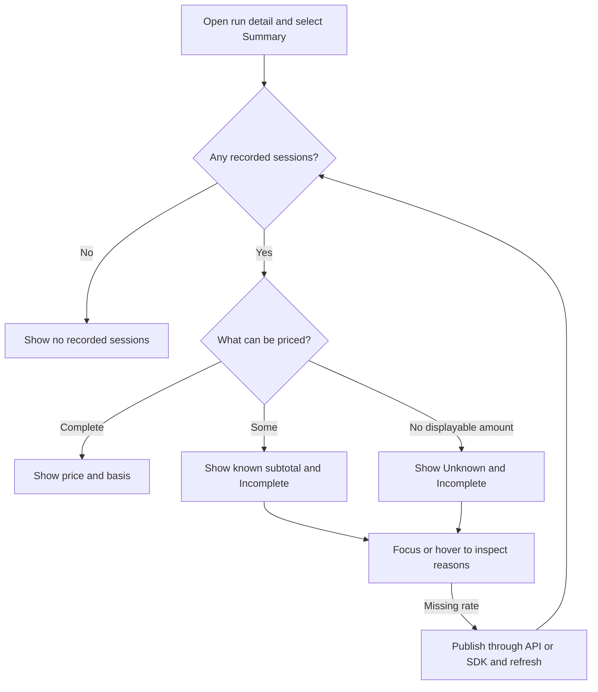
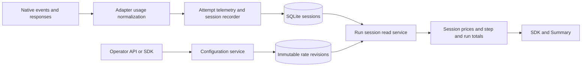
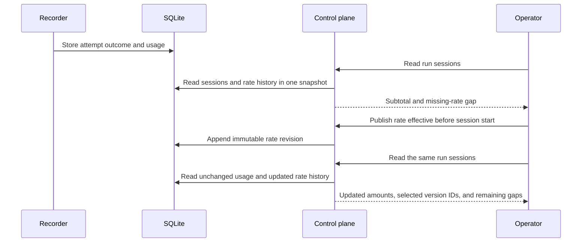

# Cache-aware token usage and session cost

## What

Autocatalyst records fresh input, cache reads, cache writes, and output for each recorded model session. Operators can see what the recorded work would cost at configured API list prices, including work done through a subscription. When only part can be priced, Autocatalyst shows the known subtotal and explains what it excludes.

## Why

Current totals can hide most of a session's usage. One Claude session showed 40 ordinary input tokens while its native records showed about 993,000 cache reads and 115,000 cache writes. Codex reported millions of cumulative input tokens in #169 without a cache split. A comparable token breakdown and a labeled price let operators compare runs without mistaking list prices for a bill.

## Personas

- **Enzo: Engineer** — configures rates and compares usage and price coverage across runs.
- **Phoebe: PM** — checks run progress and wants to see its cost so far without inspecting individual sessions.

## Narratives

### Compare two runs

Enzo opens a completed bug run and sees how much input came from cache. He compares it with a feature run on the same pricing basis. The feature run shows a subtotal. Its tooltip identifies one model with no rate and another group without enough information to choose a long-context rate.

Enzo publishes the missing rate, effective before the session started. On refresh, that session contributes to the subtotal without rerunning any work. The long-context gap remains visible. Both runs still say “API list price.”

### Check a run in progress

Phoebe opens a running feature run. Summary shows its cost so far and explains that it covers recorded sessions only. Before the first session was recorded, Summary said no sessions had been recorded so far rather than showing a zero-dollar charge.

A timed-out attempt contributes the usage it already reported. Phoebe focuses the Cost tooltip and sees that some usage from the attempt may be missing. The Tokens tooltip distinguishes reported counts from unknown counts and classes that do not apply.

## User stories

**Compare two runs**

- Enzo can compare token classes without counting cached input or reasoning twice.
- Enzo can publish, read, correct, and retract rates through the API or SDK.
- Enzo can price earlier sessions by publishing a rate without rewriting stored usage.
- Enzo can retrieve session, step, and run prices and see why any work was excluded.
- Enzo can record the immutable rate versions used for a comparison.

**Check a run in progress**

- Phoebe can see cost so far and tell that it is not a subscription charge.
- Phoebe can distinguish a complete amount, an incomplete subtotal, unknown cost, and no recorded sessions.
- Phoebe can inspect actual gap reasons with a pointer or keyboard.
- Phoebe can distinguish known, unknown, not-applicable, and legacy token data.
- Phoebe can see newly recorded sessions on refresh, including usage from unsuccessful attempts.

## Goals

- Every new recorded session contains normalized usage or explicit missing states, independent of rate availability and attempt outcome.
- Each charge uses disjoint stored token counts and a session-effective rate. Missing request size never causes the service to guess a price.
- Session reads return exact integer nano-dollar amounts with coverage metadata, plus logical step and run totals. A backdated publication takes effect on the next read without a backfill job.
- Summary displays the basis, the four token classes, and the reasons and known sizes of price gaps. A representative bug run and feature run cover both adapters and establish the baseline for #195.

## Non-goals

- A rate management UI, bundled rates, or automatic retrieval of provider prices.
- Rollups above the run, extra role or phase totals, or the tuning analytics in `cost.md`.
- Reconstructing legacy cache splits or tracking launches interrupted before their sessions are recorded.
- Recording or pricing failed direct calls before #122 records them. Successful direct calls that already produce sessions are in scope.
- Subscription charges, allowances, forecasts, budgets, or alerts.

## Design spec

### User flow



### Summary rows

Use the existing description list and keyboard-focusable tooltips in `run-detail-summary.tsx`. Keep Time, navigation, loading and fetch errors, and the existing refresh path. Use API totals for Cost; do not reprice or sum session prices in the browser. Use the running column for `in_progress` and the non-running column otherwise. Format nano-dollars exactly, with at least two decimal places and no cent rounding.

| Cost state | Non-running | Running |
| --- | --- | --- |
| Complete with a numeric amount | `$0.42 · API list price` | `$0.42 so far · API list price` |
| Incomplete with a numeric subtotal | `At least $0.42 · API list price · Incomplete` | `At least $0.42 so far · API list price · Incomplete` |
| Recorded sessions but no displayable amount, including aggregate overflow | `Unknown · API list price · Incomplete` | `Unknown so far · API list price · Incomplete` |
| No recorded sessions | `—` (accessible detail: `No recorded sessions`) | `—` (accessible detail: `No recorded sessions so far`) |
| Nonempty response from an older server without `costTotals` | `Pricing unavailable` | `Pricing unavailable so far` |

A priced zero displays `$0.00`; an incomplete numeric zero uses the incomplete row. Cost details say `Recorded sessions only` and explain that API list price is not a subscription charge. Show **Incomplete** without relying on color or interaction. The tooltip names actual gap reasons, billing keys when known, affected sessions, and known token counts. For example: “1.2M tokens with no rate for openai/gpt-6.2-sol (2 sessions)” or “80K tokens without request-size evidence for long-context pricing (1 session).” Say when the affected count is unknown or additional tokens may be affected. Explain representation overflow separately; it does not imply missing usage. There is no estimated-band state.

The Tokens row sums known disjoint Fresh input, Cache reads, Cache writes, and Output counts. Show all four classes in the tooltip. A class is `Not applicable` only when every recorded session establishes that state, and `Unknown` if it has no known count and is not ruled out. Mark known subtotals **Incomplete** when applicable counts or invocation coverage are missing. With no known normalized count, show `Unknown · Incomplete`; with no sessions, show `—`. Reasoning and reported retention breakdowns may appear beneath their parent classes but do not add to totals. Sum known counts exactly from groups, including when a session total cannot fit in a safe JSON integer.

For an all-legacy run, retain the old compact sum, including a reported zero, with a **Legacy** label. List normalized classes as unknown and explain that the old sum (`tokens.input + tokens.output + tokens.cacheRead + tokens.cacheWrite`) may overlap or contain placeholders. For mixed runs, show only normalized counts in the compact subtotal and mark it incomplete. Show the separate legacy sum and number of excluded sessions in the tooltip. Never combine those sums.

## Tech spec

### Introduction and overview

This work completes pricing deferred by [durable session telemetry](feature-durable-session-run-step-telemetry.md) (#89) and extends the [run detail pane](feature-run-detail-pane.md). It follows SQLite/Drizzle (ADR-004/019), contract-first `/v1` (ADR-005–007), service-owned configuration (ADR-008), tenant authorization (ADR-009), and existing web conventions (ADR-031/032). It amends the [cost concept](../concepts/cost.md) and [run lifecycle decision](../adrs/adr-015-run-lifecycle.md).

A **nano-dollar** is one billionth of a US dollar. **Request size** is one provider request's input, counting each applicable fresh, read, and write token once. A **band** maps request sizes to a rate schedule. A **billing key** is the provider and exact served model ID. A **gap** identifies an unpriced portion or an amount that cannot be represented. Exact pricing means exact arithmetic with supported usage and configured rates, not invoice reconciliation.

### System design and architecture



Adapters interpret native usage. The agent runner, direct orchestrator, and execution unit of work carry observations independently of structured-result parsing. `execution-session-recorder.ts` writes usage, not computed prices. The control plane authorizes reads, selects rates, and prices sessions. The client formats those prices.



### Detailed design

#### Usage and persistence

Add optional `usage` to stored and read session shapes and `CreateSessionInput`. Add nullable `sessions.usage_json TEXT`; serialize validated JSON and omit `usage` on reads of rows with a null column. The runtime recorder always supplies `usage` for new sessions. Leave old rows, legacy JSON, session identity, ordering, and sequence allocation unchanged. Groups are embedded accounting evidence, not new sessions or a durable log of native requests.

- `usage` has `coverage: complete | partial | unavailable`, `totals`, and `groups`. Coverage describes whether native accounting spans the invocation, separately from whether every class is known. `partial` means some work may be missing; `unavailable` means no validated owned normalized counts remain. An unsuccessful attempt can have complete coverage if native accounting closes it.
- `totals` and each group's `tokens` carry `freshInput`, `cacheRead`, `cacheWrite`, and `output`. Values are nonnegative safe integers (including reported or proven zero), `null` for unknown, or `not_applicable` when the provider does not use the class. Optional `cacheWriteByRetention` preserves reported buckets (`5m`, `1h`, and recognized native labels without a supported rate). Optional `reasoningOutput` is a subset of output. Bucket and reasoning counts are nonnegative safe integers. Validate subsets independently so a bad subset does not discard a valid parent count.
- A group has `model: {provider, model} | null`, `requestInputTokens: nonnegative safe integer | null`, and `tokens`. A Codex group can carry a validated `contextWindowTokens` upper bound (positive safe integer); it is never a measured request size. Combine disjoint observations only when their billing identity, size or bound evidence, and counter treatment agree. Keep an unpartitionable remainder once, with null model if attribution is unknown. Never use a multi-request total as a request size.
- `Session.model` and `cost.model` still describe dispatch. Confirmed Codex `modelProvider: 'openai'`, native OpenAI agent usage, and OpenAI direct usage use billing provider `openai`. Claude agent and Anthropic direct use `anthropic`. Match exact served IDs, without aliases or dispatch fallback except when the transport guarantees the requested identity for that work. Do not assign an unidentified child or remainder to the parent model.
- Compute totals from disjoint groups. For a class with known counts, sum those counts; groups and coverage signal any missing portion. If none are known, report `not_applicable` only when native evidence establishes non-applicability for the invocation, otherwise `null`. If a known sum exceeds the safe integer range, use `null` for the total and keep the groups. Subsets never inflate their parents. Totals are for reporting and never generate a second charge. Validate supplied totals against groups and the allowed coverage and applicability states; normalize inconsistent native evidence before create, not on a later read.

**Compatibility projection.** New `tokens` and `cost.tokens` contain identical numeric projections. `input` remains provider-native inclusive input for Codex and OpenAI, and fresh input for Claude and Anthropic direct. Keep valid native inclusive input even if its cache split is unknown. Project output including reasoning, cache reads, and cache writes. Use zero for unknown, non-applicable, or unrepresentable counts only in the compatibility projection; a projection zero is not pricing evidence. `usageAvailable` means at least one validated count is available, not complete usage. Legacy rows keep their stored compatibility values. Their computed read prices are null with `legacy_cache_detail` and, when `usageAvailable` was false, `missing_usage`. Neither reason claims a known token count. Document projections and units in OpenAPI and SDK docs.

**Create, stored, and read costs.** Keep distinct schemas. The strict create cost accepts only `{model, tokens, usd?: null}` and still requires `cost.tokens` to match session `tokens`. Omission of `usd` is accepted and the repository writes `null`; explicit `null` is accepted. Any non-null amount, including zero, or any computed field (`basis`, `complete`, `rateVersionIds`, `gaps`) fails create validation, even when a computed field is empty. Do not strip these fields silently. There is no public session-create route to add. The stored `cost_json` keeps its original three-field shape; the stored-row decoder still tolerates legacy omission or an old numeric `usd`, neither of which is trusted as a computed price. Keep computed metadata out of the repository create result and stored JSON. Only the run-session read service constructs the priced response schema.

#### Native capture and attempt boundaries

Accumulate observations across turns owned by one invocation and attempt. A retry is a separate attempt. Deduplicate by native request identity or cumulative counter position within its scope, not by equal counts. On success, native failure, cancellation, timeout, or structured-result failure, retain observations already received. Do not wait for a success payload after termination or let accounting change the outcome. A negative or unsafe count, unexplained reset, or invalid subset invalidates only dependent accounting. A request-boundary fallback may fill a gap only when scope and counter meaning agree; never add it to native counts for the same work.

**Codex app-server 0.160.1.** Decode `thread/tokenUsage/updated` for owned threads and accepted turn IDs. From `tokenUsage.total`, take inclusive input, cached input, output, and the reasoning subset. Compute fresh input as inclusive minus cached input when both validate. Writes do not apply. Account for growth in comparable totals once. `tokenUsage.last` and `modelContextWindow` provide evidence, not additional tokens.

- **Fresh thread.** Start at zero. Confirm the billing key from `thread/start` when it confirms the exact requested model and OpenAI provider, fallback is disabled, and no override or reroute applies. An owned final-turn usage update followed by matching native completion closes coverage, including native error completion with the same evidence. A later application parse failure does not undo closure.
- **Resume.** Subtract a pre-turn baseline only if native evidence binds it to the same counter scope before invocation work begins. Neither a stored previous attempt nor the first post-start total proves a baseline. Without one, keep independently identified owned requests or valid deltas between owned observations. Never charge the initial resumed total. Mark coverage partial if counts remain and unavailable otherwise.
- **Interruption or reset.** Keep attributable counts. Without closure use partial coverage, or unavailable if nothing remains. Do not treat a reset as a new scope without evidence that it is disjoint.
- **Reroute and child work.** Attribute ranges only when native boundaries isolate them and identify the served model. Require native child ownership and evidence of inclusion in parent totals or disjoint child counts. Completion alone does not prove inclusion. A failed spawn without a child ID or work does not show execution. Keep an unpartitionable inclusive count once, under a null billing key; mark unaccounted work partial and ignore unrelated threads.

Treat validated `last.inputTokens` as the last request's inclusive size, not as the size of a turn or cumulative delta. Use it for a positive owned delta when `last`'s normalized pricing counters match that delta. If they differ, split out `last` only when native evidence identifies a distinct owned request inside the delta and class-by-class subtraction is valid. The remaining delta has null size. A replay or unchanged observation adds neither counts nor size evidence. Retain a native context ceiling only when it bounds every request represented by the group. Never use cumulative input, a neighboring sample, or the largest observed `last` as a request-size bound.

**Claude Agent SDK 0.3.177.** Read `message.model` and `message.usage`. Deduplicate by native `request_id` where available, otherwise stable `message.id` within the SDK session and parent-tool scope. Join streamed frames to the final assistant record; repeated frames and content blocks add nothing. Distinct native requests count even if their output is superseded. Use `parent_tool_use_id` and linked sub-agent metadata to prove ownership, not model identity. Normalize `input_tokens` as fresh, `cache_read_input_tokens` as reads, and `cache_creation_input_tokens` as writes. Preserve validated `cache_creation.ephemeral_5m_input_tokens` and `ephemeral_1h_input_tokens`. Derive size only from a final single-request record with all applicable input counts. `modelUsage` is a keyed aggregate, not request-size or retention evidence. Do not price from SDK `contextWindow`, `total_cost_usd`, or `modelUsage.costUSD`.

- **Keyed result without child work.** Use each active-invocation keyed aggregate once, including a usable native error result. Subtract reconciled final requests by exact model key. Keep any supported positive remainder under that key with unknown size and retention unless reported independently. If overlap is unresolved or contradictory, retain the authoritative scoped aggregate once and mark coverage partial for potentially omitted work.
- **Keyed result with child work.** To close coverage, prove child ownership and closure and reconcile child usage with the keyed totals. Without a scoped native child total, require a closed child lifecycle, linked final requests, and exact per-model equality between deduplicated requests and keyed totals for applicable counters. Keep reconciled request groups, not a second copy of the aggregates. A positive aggregate, completion marker, or unexplained remainder alone does not prove inclusion. If reconciliation fails, keep only proven non-overlapping counts and mark uncovered work partial.
- **Unkeyed terminal usage.** Compare or fill counters only for a matching scope: the active invocation without child evidence. Keep exact request attribution where final requests account for the summary. Otherwise keep an uncovered count once with null model. Do not use an unkeyed summary to close child coverage.
- **Missing result, resume, or parse failure.** Exclude earlier and unowned work. Retain valid owned observations without summing ambiguous overlap. A matched native result remains usable if application parsing fails later. Without closure use partial coverage, or unavailable if no owned counts remain.

**Other recorded calls.** Normalize existing OpenAI agent sessions and successful OpenAI and Anthropic direct calls from native usage and served identity. OpenAI cached input is a subset of inclusive input; writes do not apply. Anthropic direct uses the Claude split. Apply the same ownership and deduplication rules if a stream covers multiple requests. Make no extra inference calls for accounting.

#### Effective-dated rate configuration

Add configuration kind `model_rate_table`. One record is one immutable revision of a slot keyed by `(tenant, provider, model, effectiveAt)`. Store settings in `configuration_records.settings_json`; leave profile-only columns null. Rates are independent of provider profiles. The service ships no rates. The only supported basis is `api_list_price`, displayed as `API list price`.

Strict shapes below use `?` for an omitted optional field, not a nullable field. Unlisted fields are rejected. A correction replaces the whole schedule. A retraction repeats the slot key; the server does not infer it from the ID.

```text
Slot = { provider, model, effectiveAt }
Schedule = { basis?: 'api_list_price', contextLimitTokens?, bands: Band[] }
InitialSet = Slot & Schedule & { action: 'set' }
Correction = Slot & Schedule & { action: 'set', correctsId }
Retraction = Slot & { action: 'retract', correctsId }
CreateRequest = { tenant, kind: 'model_rate_table', settings: InitialSet | Correction | Retraction }
SetRead = Slot & { action: 'set', correctsId?, revision, basis: 'api_list_price', contextLimitTokens?, bands: Band[] }
RetractionRead = Slot & { action: 'retract', correctsId, revision }
Record = { id, tenant, kind: 'model_rate_table', settings: SetRead | RetractionRead, createdAt, updatedAt }
List = { records: ConfigurationRecord[] }  // existing union gains Record
Band = { minRequestInputTokens, rates: { freshInput, cacheRead, output, cacheWrite } }
cacheWrite = 'not_applicable' | rate | { '5m': rate, '1h': rate }
```

- `provider` and `model` are case-sensitive nonempty strings without padding or control characters. `effectiveAt` is a valid UTC instant in canonical millisecond form (`YYYY-MM-DDTHH:mm:ss.sssZ`). `correctsId` is a nonempty configuration record ID. `contextLimitTokens`, when present, is a positive safe integer: an operator assertion of a model-wide upper bound on the input measure used by the bands, across all transports sharing that key. Do not set it to a transport-specific cap or when the bound is not known. Default omitted basis to `api_list_price` before storage and comparison. Retractions have no pricing fields. The service assigns `revision`, `id`, `createdAt`, and `updatedAt`; each revision has `updatedAt === createdAt`, its own publication time.
- Each set has one or more bands. Minimums are nonnegative safe integers, start at zero, and strictly increase. A band includes its minimum and excludes the next; the last band has no upper bound. A tier that applies to **more than** `T` tokens starts at `T + 1`. All rates are nonnegative safe integers in nano-dollars per token, and every shown class is required. Convert decimal USD quotes per million tokens by exact multiplication by 1,000 (`$3.00` becomes `3000`). Reject unrepresentable rates rather than rounding.
- Initial publication requires no revisions in the slot, including retracted ones. A correction or retraction names the current head of the tenant and slot. Retraction requires an active set; a set can correct a retraction to restore the slot. Missing, stale, foreign, wrong-kind, and wrong-slot targets yield the same sanitized conflict.
- Reject a no-op correction with `409` only when it corrects an active head and the canonical schedules match: same normalized basis, optional context limit (including absence), and ordered bounds, rates, and write treatments. Key order does not matter. Identical schedules at different effective instants are allowed. Restoration can reuse the retracted schedule.
- Validate the head, assign the one-based revision, and insert in one SQLite writer transaction. Add a partial unique index for `kind = 'model_rate_table'` over `tenant` and the JSON-extracted provider, model, effective instant, and revision. Serialize contenders or re-read after a write conflict; only one publication against a given head can succeed. Leave other kinds unchanged. Keep all revisions readable. Guard PATCH and DELETE by stored kind, not the request kind.

Retraction hides only its slot and may expose an earlier active slot. It is not a zero rate. Correct a mistyped date or model by retracting the old slot and publishing the intended one as separate publications. Normal reads use current history. For offline comparison, retain the selected record IDs and session set. Old slot heads can be reconstructed from immutable `createdAt` and per-slot revision order; retain the selected IDs rather than relying on timestamps alone when publications share a tick. There is no historical-read API or rate snapshot stored on sessions.

#### Read-time pricing and rollups

**1. Select the session-effective schedule.** Authorize the run, then read its sessions and relevant rate history in one committed snapshot. For each key use the highest revision of each slot, ignore retracted heads, and choose the latest active `effectiveAt <= Session.startedAt`. Use that start for every group. Do not fall back to an earlier slot because the selected one cannot price a class. This feature ships no computed-price cache; any subsequent cache must equal a fresh computation.

**2. Resolve bands without guessing.**

- With exact request size, choose its band. Exact evidence wins over ceilings.
- Without exact size, start with every band. Apply the selected slot's `contextLimitTokens` to **every** group that resolves to that slot, regardless of transport. A native ceiling is additional evidence only when validated for the group's entire scope. Ignore a configured ceiling if an exact size for that billing key in the session exceeds it; ignore a native ceiling if exact evidence within its scope contradicts it. With two valid ceilings use the smaller one. Exclude only bands whose inclusive minimum is **greater than** the resulting ceiling. No ceiling means no exclusion. Do not use aggregate counts as bounds.
- With one possible band, apply it. With several, compare the treatment for each independent term. For a reported retention bucket, compare the rates for that bucket, not the whole schedule. Price invariant terms; leave band-dependent positive terms unpriced with `missing_request_size`. A known zero never causes a band gap: count it as a priced zero if all possible treatments charge that term numerically, otherwise it adds neither a charge nor a gap. Non-applicable usage never needs a band. For an unknown count, use `missing_usage` if every possible treatment needs that count and no band choice can recover it; if the band would determine whether the count is needed, use `missing_request_size`. Never estimate or choose a fallback band.

**3. Apply treatments once.** Usage describes what happened; the rate describes what is charged. `not_applicable` differs from numeric zero.

| Usage | Resolved treatment | Result |
| --- | --- | --- |
| Known positive count | `not_applicable` | Sized `incompatible_rate`; no charge for those tokens. |
| Known zero | `not_applicable` | No charge and no gap. |
| `not_applicable` | Any | No charge and no gap. |
| `null` | `not_applicable` | No charge and no gap. |
| `null` | Numeric or retention schedule | `missing_usage` for the unknown portion, even at a zero rate; independently price eligible known buckets. |
| Known count | Numeric or compatible retention schedule | Charge eligible known counts once, including a reported zero with numeric treatment. |

For flat writes use the total, not the buckets again. For tiered writes, price validated supported buckets independently. A known zero total against a retention schedule contributes a priced zero. A positive unallocated remainder gets `missing_cache_retention`; when the total is missing and a remainder cannot be ruled out, use `missing_usage` with unknown count. A known unsupported bucket gets `incompatible_rate`, not a second gap as an unallocated remainder. If bucket counts exceed a valid total, discard the split; retain the total for flat rates and treat its retention as unresolved for tiered rates. With a choice of bands, compare the treatment of each disjoint write portion; if a flat and a tiered band both remain possible, a reported bucket can still price at a common applicable rate. An unallocated remainder is not priced unless its treatment is conclusive without assigning it a bucket. Reasoning stays in output.

**Gap priority.** For each affected portion, stop at the first blocking reason: (1) unknown billing identity → `missing_model`; (2) no effective schedule → `missing_rate`; (3) unresolved band-dependent treatment → `missing_request_size`; (4) missing count, missing retention, or incompatible treatment → the corresponding treatment gap. Do not repeat the portion under downstream reasons. Exclude non-applicable and known-zero counts from sized gaps. A coverage gap describes different work: add `partial_usage` with unknown count for work outside retained observations. If no usable normalized observations remain, report `missing_usage` without inventing group-level blockers. Use the separate legacy rules for rows without `usage`.

**4. Compute the session amount.** Multiply and sum with `bigint`. Return `cost.usd` as a safe JSON integer in nano-dollars if at least one supported term has a known count and numeric charge and the sum fits. Return null when nothing is priceable or the amount overflows; add `amount_overflow` only for the latter. `cost.complete` requires closed coverage, no gaps, and a representable amount. For example, 100 inclusive input, 60 reads, and 10 output (including 4 reasoning), at rates 3000 fresh, 300 read, and 15000 output, yield `288000`. Adding 25 known writes against `not_applicable` leaves the subtotal at `288000` and adds a sized incompatibility gap. There is no second price field.

**5. Roll up returned session amounts.** Sum numeric `cost.usd` values with `bigint` for each logical `(phase, step)` and once for the run. Logical steps span occurrences, roles, and rounds; direct-call phase can be null. An empty run has a zero empty sum, no gaps, and is complete. A nonempty collection with no numeric prices has a null subtotal. An overflowing sum is null with `complete: false` and an aggregate `amount_overflow` gap. A numeric subtotal is complete only if every included session is complete. Included charges use established rates and excluded charges cannot be negative, so a numeric subtotal is a lower bound for recorded sessions at the configured basis.

#### API, SDK, and errors

| Route | Contract |
| --- | --- |
| `POST /v1/configuration-records` | Accept `CreateRequest`, return `201` and `Record`. Invalid shape or data returns `400 validation_error`; publication conflicts return sanitized `409`. |
| `GET /v1/configuration-records`, `GET /v1/configuration-records/:id` | Return existing list and item shapes with the new union variant, including old revisions and retractions. Unknown or other-tenant IDs return `404`. |
| `PATCH` or `DELETE /v1/configuration-records/:id` | Valid mutation of an in-tenant rate record returns `409`; malformed requests return `400`; valid requests for unknown or other-tenant IDs return `404`. There is no mutable rate PATCH variant. |
| `GET /v1/runs/:id/sessions` | Preserve ordered `sessions`; add `costTotals: {run, steps}` from the same snapshot. Keep existing missing and other-tenant behavior. No new query options or endpoint. |

Extend shared Zod schemas, generated OpenAPI, and SDK configuration and session types. Additive read fields are optional in new client decoders for older servers; upgraded HTTP session reads always populate pricing metadata and omit `usage` only for rows without normalized evidence stored. Older clients with strict decoders may need an SDK upgrade. Keep existing auth and sanitized errors. Gaps are successful read results.

- Session `cost` keeps `model`, `tokens`, and `usd`; add `basis: 'api_list_price'`, `complete: boolean`, `rateVersionIds: string[]` (sorted distinct selected set IDs, including sets that charge nothing), and `gaps`. Each gap has `code`, optional billing `provider` and `model` when known, optional zero-based `groupIndex` when group-specific, and `tokenCount`. Codes: `legacy_cache_detail`, `missing_usage`, `partial_usage`, `missing_model`, `missing_rate`, `missing_request_size`, `missing_cache_retention`, `incompatible_rate`, `amount_overflow`.
- `tokenCount` is a nonnegative decimal integer string, or null for unquantifiable usage or amount-only gaps. Count only disjoint known tokens blocked by that gap, not guessed counts, legacy inclusive totals, or overlapping subsets. Keep sized and unknown gaps separate. Amount overflow is not a second token assignment.
- Each total contains `knownSubtotalUsd: safe integer | null` in nano-dollars, `basis`, `complete`, `pricedSessionCount`, `unpricedSessionCount`, and `gaps`. Step entries also carry `phase: string | null` and `step: string`. Priced and unpriced counts distinguish numeric amounts from null, not complete amounts from incomplete ones. Group gaps by `(code, provider, model)`; return the keys, sum of known affected tokens as `tokenCount` (decimal string or null if none known), `hasUnknownTokenCount: boolean`, and distinct affected `sessionCount`. Amount-only gaps set the flag false. Aggregate-only overflow has `sessionCount: 0` and `tokenCount: null`. Sort steps by `(phase, step)` and grouped gaps by `(code, provider, model)`, null or missing keys first. Pass the run total through `use-run-detail.ts` to Summary.

### Security, privacy, and compliance

Use existing configuration and session policy actions and principal-derived tenant scope. Validate the create envelope against that scope. Authorize runs before pricing and tenant-scope history, head, and correction queries. Do not reveal whether a rejected correction target exists in another tenant. Keep raw events, prompts, outputs, secrets, subscription identifiers, and native correlation IDs out of durable usage and diagnostics. Render model identifiers as text.

### Observability

Durable sessions remain the usage source of truth. Log sanitized warnings for invalid native accounting and persistence failures with stable reason codes and local run or session context where available. Ordinary price gaps are not API failures. Execution does not depend on rate availability. Add no metrics backend or alerts.

### Testing plan

#### Worked fixtures

For the table, `F/R/W/O` means fresh input, cache reads, cache writes, and output; `NA` means `not_applicable`. Group sizes are `requestInputTokens`; omitted optional evidence is absent. Use uniform illustrative rates `3000/300/15000` for `F/R/O`, Codex writes `not_applicable`, and Claude retention rates `5m:4000`, `1h:6000`. The banded OpenAI schedule adds a band at 101 input tokens with fresh rate `6000`; all other treatments stay the same. Use `openai/gpt-5.4` for the confirmed Codex key and distinct confirmed Anthropic keys for the Claude parent and child. Both Anthropic keys use the same illustrative schedule. Each input below is attributed to one invocation; no additional observations arrive.

| Case and fixture input | Expected `usage` | Expected read `cost.usd`, `complete`, and `gaps` |
| --- | --- | --- |
| Resumed Codex with proven same-scope baseline `(inclusive, read, output) = (1000,600,100)`. Owned final total `(1100,660,110)`, aligned `last` `(100,60,10)`, reasoning subset 4, then matching completion. Uniform rates. | Complete; one group, size 100, `40/60/NA/10`, reasoning 4. Totals match the group. | `288000`, true, `[]`. |
| Same resumed counters without a proven pre-turn baseline or independently attributable request. Only the final cumulative total arrives after start; `last` has no independent ownership evidence. | Unavailable; no groups; totals `null/null/NA/null`. | `null`, false; only `missing_usage` with `tokenCount: null`, no group or billing key. |
| Fresh, closed Codex thread grows from zero to `(100,60,10)` in one owned update. `last` is `(20,10,2)` with no evidence to isolate it; no native or configured ceiling. Banded rates. | Complete; one confirmed-model group, size null, `40/60/NA/10`. Totals match. Do not split out or add `last`. | `168000` (`60 × 300 + 10 × 15000`), false; only `missing_request_size` on group 0 for the OpenAI key, `tokenCount: '40'`. |
| Claude parent final record `40/60/20/10` (20 at `5m`); linked, closed child final record `10/20/5/4` (5 at `1h`). Keyed terminal counts exactly match each model's request. | Complete; parent group size 120, child group size 35, each with its model and reported bucket. Totals `50/80/25/14`; buckets `5m:20`, `1h:5`. Do not add terminal totals again. | `494000` (`368000 + 126000`), true, `[]`. |
| Claude single final record `40/60/25/10`, only 20 writes reported in `5m`, with matching keyed result. | Complete; one group, size 125, `40/60/25/10`; retained bucket `5m:20`. Totals match. Do not invent a bucket for the other 5. | `368000`, false; only `missing_cache_retention` on group 0 for the parent key, `tokenCount: '5'`. |
| Same active OpenAI slot for a Codex and an OpenAI direct session. Both have one confirmed group `40/60/NA/10` without exact size or native ceiling. Banded schedule with `contextLimitTokens: 100`. | Both preserve complete coverage, the same billing key and counts, and null request size. Dispatch differs. The configured limit is not written into either usage record. | Each returns `288000`, true, `[]`, and the same selected version ID. With limit 101 instead, each returns `168000`, false, with the sized `missing_request_size` gap from the unmatched-delta fixture. |

#### Automated coverage

- Run the native worked cases through pinned event decoding, production dispatch, attempt telemetry, SQLite, and `GET /v1/runs/:id/sessions`. Assert the worked `usage`, price, completeness, and gaps. Use seeded normalized groups for the paired Codex/direct HTTP test so neither side has exact size evidence. Separately run native OpenAI agent and direct fixtures to prove shared billing keys. No automated test makes a model call.
- Cover multi-turn growth, replay, resumed deltas after an untrusted initial total, reset, reroute, linked and unaccounted child work, and failure, cancellation, timeout, and application parse failure. Assert closure independently of result success. Test exact band crossings without repricing earlier work, isolated `last`, native ceiling below and equal to a band boundary, native and configured ceilings together, and exact evidence that contradicts a ceiling. No unresolved term receives an estimated charge.
- Test every applicability case, unknown and invalid counters, unsupported buckets, retention overflow beyond a valid total, missing model and rate, priced zero, wholly unpriced and partial sessions, and session and aggregate amount overflow. Check disjoint gap sizes, mixed known and unknown counts, and distinct session counts. Assert legacy rows are unchanged after migration and on disk after reads.
- At the session create contract and repository, accept omitted and null `usd`, then inspect `cost_json` for only `model`, `tokens`, and `usd: null`. Reject non-null `usd`, including zero, and each computed field individually, including `gaps: []`. Assert no insert for invalid input and prove that HTTP reads compute fields without writing them back.
- Test strict rate shapes in HTTP, SDK, and OpenAPI. Cover timestamps, stale/foreign/wrong-slot targets, concurrent publishers, invalid schedules, stored-kind mutation guards, same-slot no-ops with a defaulted basis, and identical schedules at different effective instants. Prove that a backdated rate prices unchanged stored usage on the next read, a future slot does not, and a retraction works with or without an earlier active slot. Test tenant isolation and snapshot consistency for session prices and totals.
- Test every Cost table row in both run states, priced zero, overflow details, reason counts, keyboard focus, refresh, and old-server responses. Test normalized, legacy, and mixed Tokens states and preservation of loading and errors. Exercise opening Summary and refreshing after a rate publication with scripted data.

#### Operator baseline for #195

After implementation, enter real API list rates and record one representative bug run and one feature run in `docs/operators/cache-aware-run-cost-baseline.md`. Cover Codex and Claude across the two runs, with at least one normally recorded numeric price from each. An all-unpriced result does not qualify. Use exact billing keys and accurate schedules; choose models or runs with enough evidence for at least a numeric subtotal. Do not flatten real bands or retention tiers, or assign a request to a band without evidence. Fixture rates are not defaults.

Record run and session IDs, billing keys, usage by class and reported retention, session and run amounts and basis, effective dates, immutable selected version IDs, and gaps with token and session counts. For each adapter, report priced and unpriced shares of known disjoint tokens, with unpriced counts by reason. Disclose unquantifiable and legacy usage separately with no invented size or percentage. Explain how to publish matching rates, refresh and repeat the comparison, and use the recorded session set and selected revisions to reproduce the figures offline. Do not call the figures subscription charges.

### Alternatives considered

- **Freeze prices on write.** Late rates would require rewriting records. Read-time pricing uses unchanged usage immediately.
- **Estimate bands or add a second price field.** A nearby sample does not establish a request's band. Keep one amount, price invariant terms, and report `missing_request_size` rather than guessing.
- **Price all work at the dispatched model.** This misprices reroutes and child work. Use supported billing attribution instead.
- **Drop all charges when one term is unknown.** This hides measured work with a supported rate. Keep independent charges and describe exclusions.

### Risks and contract updates

Streams may omit model, retention, or band evidence. Pin transport fixtures and use gaps rather than guessing ownership or size. A correction or retraction can change the next read for an old run; report selected versions. An incorrect operator-supplied model-wide context limit can exclude a valid band. Document the operator assertion and ignore contradicted ceilings as specified. Scope indexed history reads to the tenant and relevant keys; defer caching until read volume warrants it.

In the implementation PR, amend `context-human/concepts/cost.md` to replace completion-time frozen prices and the one-model premise with invocation-grain usage groups, separate dispatch and billing identities, and pricing on read at the session start's effective rates. Replace alongside-profile rates and the `(provider, model, token-type)` key with independent tenant-scoped configuration keyed by provider, model, and effective instant within the tenant. Describe immutable slot revisions, corrections and retractions, disjoint token-class treatments, request-size bands, the shared model-wide ceiling, exact evidence and invariant terms, the list-price basis, and known subtotals with sized and unknown gaps. Explain offline reproduction using retained revisions and selected IDs, not frozen prices, backfill jobs, or a historical-read endpoint.

Update the `cost.md` API relationship: session `cost.usd` and logical step/run `costTotals` use integer **nano-dollars** and appear with gap metadata on `GET /v1/runs/:id/sessions`. Distinguish stored usage and compatibility cost fields from read-only pricing. Leave higher rollups and tuning analytics as future intent. Clarify in ADR-008 that the API enables editing through a UX where one exists; rate management is API/SDK only. Service ownership, tenant scope, and validation policy are unchanged.

Amend ADR-015's session definition, cost decision, rollups, consequences, and alternatives where they assume one model, one rate, or SQL-only sums. Keep session grain and step, role, and round attribution. Align affected `domain-model`, `observability`, `agent-runners`, `settings`, `api`, and `run-detail` concepts. Update the concept and ADR indexes, agent telemetry standard, affected agent wiki contracts, and `context-agent/wiki/code-map.md`. Approval at the spec gate covers the intended contract changes; implementation PR review covers the exact wording of human-owned docs.

## Task list

This list is planning output for the spec gate. It does not authorize implementation.

- [ ] **Story: Record disjoint usage for every session**
  - [ ] **Task: Persist normalized usage and separate cost schemas**
    - **Description**: Add the usage schemas and nullable migration, and separate strict create cost, stored cost, and HTTP read cost.
    - **Acceptance criteria**:
      - [ ] New rows store explicit coverage and counts, disjoint groups, matching compatibility projections, and stored `cost.usd: null`. Old rows are not rewritten.
      - [ ] Contract and repository tests accept omitted or null `usd`, reject non-null amounts and all computed fields, and verify the persisted JSON shape.
    - **Dependencies**: None
  - [ ] **Task: Carry usage through attempt recording**
    - **Description**: Pass observations through execution and the recorder separately from structured results.
    - **Acceptance criteria**:
      - [ ] Failed, cancelled, timed-out, and parse-failed agent attempts retain available observations without changing the attempt outcome.
      - [ ] Failed direct-call recording is unchanged.
    - **Dependencies**: Task: Persist normalized usage and separate cost schemas
  - [ ] **Task: Capture Codex counters and attribution**
    - **Description**: Normalize owned thread and turn counters, including resume, reset, and child attribution.
    - **Acceptance criteria**:
      - [ ] Fresh, resumed, multi-turn, duplicate, reset, rerouted, child, and interrupted fixtures retain only owned usage.
      - [ ] Billing identity differs from dispatch; writes do not apply and reasoning is counted once.
    - **Dependencies**: Task: Carry usage through attempt recording
  - [ ] **Task: Preserve Codex request-size evidence**
    - **Description**: Store exact request sizes and validated native ceilings from pinned wire fixtures.
    - **Acceptance criteria**:
      - [ ] Aligned and independently isolated `last` observations retain exact size; unmatched deltas keep null size.
      - [ ] Replays add neither counts nor evidence, and ceilings are not stored as sizes.
    - **Dependencies**: Task: Capture Codex counters and attribution
  - [ ] **Task: Reconcile Claude usage and retention**
    - **Description**: Deduplicate owned final requests and reconcile keyed results, residuals, and child work.
    - **Acceptance criteria**:
      - [ ] Fixtures preserve buckets and request sizes and distinguish reconciled from unaccounted child work.
      - [ ] Interrupted and resumed invocations retain owned usage without claiming unsupported closure.
    - **Dependencies**: Task: Carry usage through attempt recording
  - [ ] **Task: Normalize other recorded calls**
    - **Description**: Map native OpenAI agent and successful OpenAI and Anthropic direct usage.
    - **Acceptance criteria**:
      - [ ] Native fixtures preserve cache data and missing states and share confirmed OpenAI billing keys with Codex.
    - **Dependencies**: Task: Carry usage through attempt recording
- [ ] **Story: Publish rates and return session, step, and run prices**
  - [ ] **Task: Store immutable rate revisions**
    - **Description**: Add strict rate schemas, the partial unique index, and transactional publication.
    - **Acceptance criteria**:
      - [ ] Sets, corrections, retractions, and restorations append revisions. Same-slot no-ops fail; identical schedules in different slots succeed.
      - [ ] Invalid schedules, competing replacements, and stale, foreign, or wrong-slot targets fail as specified.
    - **Dependencies**: None
  - [ ] **Task: Expose rate publication and history**
    - **Description**: Add the configuration kind to API and SDK contracts and OpenAPI. Guard mutations by stored kind.
    - **Acceptance criteria**:
      - [ ] Strict create and read shapes match the spec, retractions repeat the slot key, and `updatedAt === createdAt` per revision.
      - [ ] Old revisions remain readable and immutable; other tenants cannot read or reference them successfully.
    - **Dependencies**: Task: Store immutable rate revisions
  - [ ] **Task: Resolve schedules and eligible bands**
    - **Description**: Select session-effective rates and resolve bands from exact sizes, valid ceilings, or invariant treatments.
    - **Acceptance criteria**:
      - [ ] Uniform schedules, exact crossings, and inclusive ceiling boundaries select correctly, without estimates.
      - [ ] The shared-slot Codex and OpenAI direct cases match for both configured limits; native ceilings and contradictory exact evidence follow the same precedence rules in tests.
    - **Dependencies**: Task: Persist normalized usage and separate cost schemas; Task: Store immutable rate revisions
  - [ ] **Task: Compute session charges and gaps**
    - **Description**: Apply disjoint rate treatments with integer arithmetic and return the read-side cost object.
    - **Acceptance criteria**:
      - [ ] Tests cover applicability, retention residuals, sized and unknown gaps, partial prices, known zero, and overflow without duplicate charges or gap counts.
    - **Dependencies**: Task: Resolve schedules and eligible bands
  - [ ] **Task: Expose priced session reads and rollups**
    - **Description**: Compose priced sessions and logical step and run totals in the existing route and client contract.
    - **Acceptance criteria**:
      - [ ] HTTP reads sum numeric partial prices and expose sized and unknown gaps plus distinct affected sessions. Empty, wholly unpriced, and overflowing totals remain distinct.
      - [ ] Backdated rates price unchanged rows on the next read. Future slots, corrections, and retractions behave as specified. Reads are tenant-consistent and do not write computed prices back.
    - **Dependencies**: Task: Compute session charges and gaps; Task: Expose rate publication and history
- [ ] **Story: Show and verify recorded run costs**
  - [ ] **Task: Render Summary cost and token coverage**
    - **Description**: Display the API cost total and normalized counts in the existing Summary rows, with separate legacy evidence.
    - **Acceptance criteria**:
      - [ ] Running and non-running Cost strings match the design. Pointer and keyboard users can inspect reasons, counts, and unknown portions.
      - [ ] Normalized, legacy, mixed, zero, empty, loading, error, older-server, and refresh states follow the design without double counting.
    - **Dependencies**: Task: Expose priced session reads and rollups
  - [ ] **Task: Verify native dispatch through HTTP reads**
    - **Description**: Drive pinned native fixtures through production dispatch, recording, and API reads without inference calls.
    - **Acceptance criteria**:
      - [ ] Resume with and without a baseline and the unmatched `last` delta match the worked usage, amount, and gap assertions.
      - [ ] Claude parent/child reconciliation and the retention remainder match the worked assertions; other recorded paths and unsuccessful agent attempts preserve attributable evidence.
      - [ ] The paired Codex and OpenAI direct HTTP test proves one shared slot narrows bands identically without exact size evidence.
    - **Dependencies**: Task: Preserve Codex request-size evidence; Task: Reconcile Claude usage and retention; Task: Normalize other recorded calls; Task: Expose priced session reads and rollups
  - [ ] **Task: Update cost contracts and operator guidance**
    - **Description**: Document cost and configuration, stored versus read fields, and offline comparison.
    - **Acceptance criteria**:
      - [ ] The same implementation PR updates `cost.md`, ADR-015, the ADR-008 clarification, affected concepts, indexes, agent contracts, and code map as specified.
      - [ ] API and operator guidance explain publication, nano-dollar totals, shared ceilings, effective dates, version IDs, and the distinction from a subscription bill.
    - **Dependencies**: Task: Expose priced session reads and rollups; Task: Render Summary cost and token coverage
  - [ ] **Task: Record the operator baseline**
    - **Description**: Enter real rates and document representative bug and feature runs for #195.
    - **Acceptance criteria**:
      - [ ] The baseline contains a numeric amount from each adapter, usage by class, basis and selected versions, and priced and unpriced shares with unknown counts disclosed.
      - [ ] A reader can repeat the comparison without guessing bands or mistaking the amount for a subscription charge.
    - **Dependencies**: Task: Verify native dispatch through HTTP reads; Task: Update cost contracts and operator guidance
