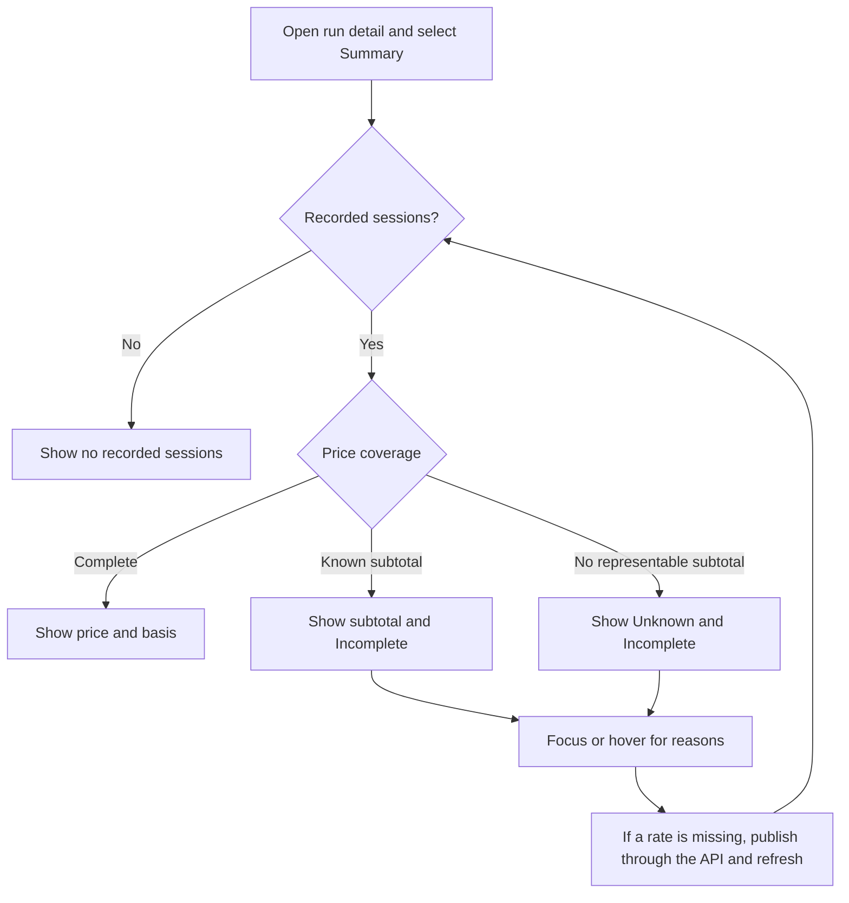
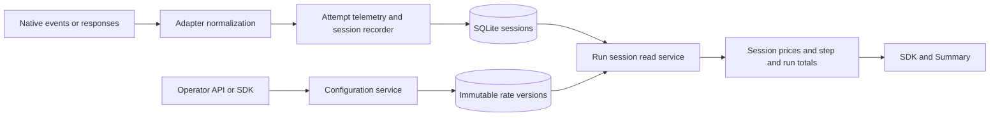
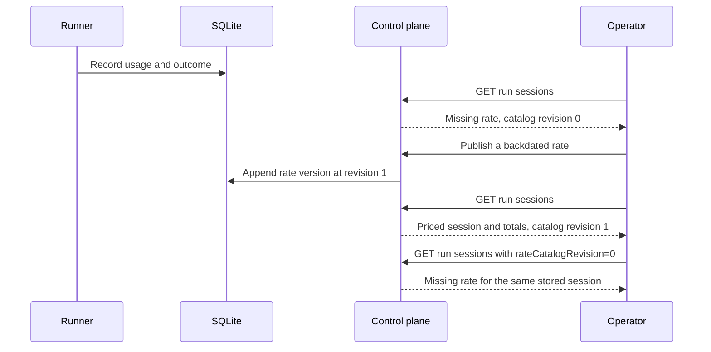

# Cache-aware token usage and session cost

## What

Autocatalyst records the tokens each model invocation uses, separating fresh input, cache reads, cache writes, and output. Operators can see what recorded sessions would cost at configured API list prices, including sessions run through a subscription. When some sessions cannot be priced, Autocatalyst shows the known subtotal and explains what it leaves out.

## Why

Today's totals can hide most of a session's usage. One Claude session showed 40 ordinary input tokens while its native records showed about 993,000 cache reads and 115,000 cache writes. Codex reported millions of cumulative input tokens in #169 without a cache split, and run cost is always unknown. A comparable token breakdown and a labeled price let operators evaluate runs without mistaking the result for a bill.

## Personas

- **Enzo: Engineer** — configures model rates and compares usage across runs and providers.
- **Phoebe: PM** — checks a run's progress and wants to see its cost so far without inspecting individual sessions.

## Narratives

### Compare two runs

Enzo opens a completed bug run and checks how much input was fresh and how much came from cache. The cost says “API list price,” so he can compare it to a feature run without reading it as a subscription charge.

The feature run has an incomplete subtotal. Enzo finds the missing model rate in the explanation and publishes a rate effective before the session started. The next read includes the session without rerunning anything. When he later corrects a rate, he can reproduce the earlier comparison using the rate catalog from that read.

### Check a run in progress

Phoebe opens a running feature run. The Summary labels the cost “so far” and explains that it covers recorded sessions only. She can tell the difference between a run with no recorded sessions and one with recorded usage that cannot be priced.

A timed-out attempt contributes the tokens it already reported. Phoebe focuses the Cost tooltip and learns that the provider did not report complete usage for that attempt. She can use the subtotal without guessing what it leaves out.

## User stories

**Compare two runs**

- Enzo can compare token classes without counting cached input twice.
- Enzo can publish, inspect, correct, and withdraw effective-dated rates through the API or SDK.
- Enzo can apply a new rate to older sessions without rerunning them or changing their recorded usage.
- Enzo can retrieve run and step subtotals and identify why individual sessions are unpriced.
- Enzo can reproduce prices against an earlier rate catalog without saving every selected rate ID.

**Check a run in progress**

- Phoebe can see a run's cost so far and tell that it is not a bill.
- Phoebe can distinguish a complete price, an incomplete subtotal, a wholly unpriced run, and a run with no recorded sessions.
- Phoebe can inspect actual gap reasons with a pointer or keyboard.
- Phoebe can distinguish known token counts from unknown, not-applicable, and legacy data.
- Phoebe can see newly recorded sessions when Summary refreshes.

## Goals

- Every new recorded session carries normalized usage or explicit missing-data states, including observations received before failure, cancellation, or timeout.
- A normal single-model Codex or Claude invocation with complete counters and a compatible uniform rate returns an exact price. Mixed-model and banded prices use attributed usage, not the dispatched model as a substitute.
- The API returns integer nano-dollar session prices and step and run subtotals with gaps. A backdated publication takes effect on the next default read, without a backfill.
- Summary shows the pricing basis, price coverage, and disjoint token classes. A bug run and a feature run using real list prices cover both adapters and provide the baseline for #195.

## Non-goals

- Rate management UI, bundled rates, or automatic retrieval of provider rates.
- Cost rollups above a run or the tuning analytics in `cost.md`.
- Reconstructing legacy cache splits or tracking launches interrupted before a session can be recorded.
- Recording or pricing failed direct calls before #122 records them. Successful direct calls that already produce sessions are in scope.
- Subscription charges, allowance tracking, forecasts, budgets, or alerts.

## Design spec

### User flow

### Summary rows

Use the existing DescriptionList and Tooltip patterns. Keep navigation, Time, loading and fetch-error treatments, and the run-detail refresh path. No rate-publication push event or live meter for unrecorded work ships.

| State | Example Cost value |
| --- | --- |
| Complete | `$0.42 · API list price` |
| Running, partly priced | `$0.42 so far · API list price · Incomplete` |
| Recorded sessions, no representable subtotal | `Unknown · API list price · Incomplete` |
| No recorded sessions | `—` with “No recorded sessions” |

A priced zero displays `$0.00`. Add “so far” to every running Cost state, including unknown or empty, and make “recorded sessions only” available with the value. The keyboard-focusable tooltip names actual reasons and affected session counts, with the billing provider and model where applicable. For example: “No rate in effect for openai/gpt-5.4 (2 sessions); older session lacks cache detail (1 session).” An older server without price metadata shows pricing unavailable for nonempty runs, not a fabricated gap or zero. The incomplete marker does not depend on color or on opening the tooltip.

| Recorded Tokens state | Compact value | Hover and keyboard-focus breakdown |
| --- | --- | --- |
| No sessions | `—` | No recorded sessions. |
| Complete normalized coverage | e.g. `340` | Fresh input, Cache reads, Cache writes, and Output. |
| Some counts or attempts not fully covered | e.g. `340 · Incomplete`, or `Unknown · Incomplete` if no normalized count is known | The four classes with their coverage. Explain missing counts or incomplete attempt reports. |
| All legacy (all sessions lack `usage`) | e.g. `1.2K · Legacy` | All four normalized classes show `Unknown`. Show “Legacy reported total: 1,200 (3 sessions). Cache breakdown unavailable; the raw total uses older counting rules.” Retain even a zero raw value as `0 · Legacy`, and explain that it can include placeholders. |
| Mixed legacy and normalized | e.g. `340 · Incomplete`, or `Unknown · Incomplete` if no normalized count is known | Show the four classes from normalized sessions and “Excludes 3 older sessions without normalized cache detail.” Show their separately labeled legacy reported total using the same explanation as for all-legacy runs. |

The legacy reported total is exactly the previous Summary sum of `tokens.input + tokens.output + tokens.cacheRead + tokens.cacheWrite`, over legacy sessions only. It can overlap cached input or include zero placeholders and is not a comparable token count. Never add it to the normalized subtotal. Older server responses with no normalized usage use the all-legacy presentation.

For normalized display, sum known numeric class counts only, including explicit zero. Mark a class with a known subtotal incomplete if any normalized session has that class unknown or has incomplete coverage without ruling the class out, or if any legacy session is excluded. A class with no numeric count is `Not applicable` only if every recorded session marks it so; otherwise it is `Unknown`. Show one compact normalized subtotal over the four classes, excluding retention sub-buckets and reasoning detail because those are already included. The tooltip may show retention detail under Cache writes.

## Tech spec

### Introduction and overview

This work completes pricing deferred by [durable session telemetry](feature-durable-session-run-step-telemetry.md) (#89) and extends the [run detail pane](feature-run-detail-pane.md). It amends the [cost concept](../concepts/cost.md) and [run lifecycle decision](../adrs/adr-015-run-lifecycle.md), and follows the [configuration model](../adrs/adr-008-config-model.md), SQLite/Drizzle (ADR-004/019), contract-first `/v1` API (ADR-005–007), tenant boundary (ADR-009), and web patterns (ADR-031/032).

A **nano-dollar** is one billionth of a US dollar. **Request size** is the total input for one provider request, counting fresh input, cache reads, and cache writes once where applicable. A **band** maps a range of request sizes to a rate schedule. A **gap** explains why usage or its price is incomplete or unavailable.

### System design and architecture

Adapters interpret native usage. The execution runner, direct orchestrator, and execution unit of work carry it independently of structured-result parsing. `execution-session-recorder.ts` stores the usage, not calculated prices. The control-plane read service prices sessions once per response against a single tenant catalog snapshot; the web client formats API amounts rather than pricing tokens.

### Detailed design

#### Usage and persistence

Add optional `Session.usage` to the shared contract and `sessions.usage_json` as a nullable SQLite `TEXT` column containing schema-validated JSON. All new production recorder writes supply normalized usage, including when unavailable. Leave old rows null without rewriting `tokens_json` or `cost_json`. Keep session identity, outcome, sequence, and ordering. Usage groups are embedded evidence, not separate sessions or request rows.

- `usage` contains `coverage: complete | partial | unavailable`, `totals`, and `groups`. `complete` means the report spans the invocation under the adapter rules below, not that every field is populated. `partial` means the available observations may omit work. `unavailable` means there are no validated token counts for this invocation. Only literal reported counts or results of the defined arithmetic qualify; no inference from an empty accumulator.
- `totals` and each group's `tokens` have `freshInput`, `cacheRead`, `cacheWrite`, and `output`. Each is a nonnegative safe integer, `null` for unknown, or `not_applicable` for a class the provider does not use. A zero must be reported or derived from comparable counts. Optional `cacheWriteByRetention` preserves reported buckets, including `5m` and `1h`; known bucket sums must not exceed known total writes. Optional `reasoningOutput` is a subset of output, never a second charge. An invalid counter or a normalized sum outside the safe range becomes unknown; keep independent valid counts.
- A group has `model: {provider, model} | null`, `requestInputTokens: integer | null`, and its counters. The billing provider is not the adapter or dispatch ID. Codex with a confirmed native `modelProvider: 'openai'`, OpenAI agent, and OpenAI direct groups all write `provider: openai`. Claude agent and Anthropic direct groups write `provider: anthropic`. Use the exact native model ID with this provider key; the same exact OpenAI model through Codex and the OpenAI API shares one rate slot per effective instant. Different native IDs require different slots even if they have the same display name or price. Unverified identity is null, never a dispatch-ID rate lookup. `Session.model` and `cost.model` still describe dispatch; for example, Codex dispatch retains `codex` even when an attributed group uses `openai`.
- Groups represent disjoint portions of work. Merge only if model, exact request size (or both unknown), and counter detail are compatible; never turn a multi-request sum into a request size. Keep any known non-overlapping residual once, using a null model if attribution is unknown. For a fully priced session numeric class counts in groups account for the corresponding totals exactly; the totals are never priced again. A fully reported zero still needs an attributed group and an effective rate.

**Compatibility projection:** Preserve provider-specific `tokens.input` and `cost.tokens.input`: inclusive input for Codex and OpenAI, native fresh input for Claude and Anthropic direct. Keep a known native inclusive count even when its split is unknown. Other legacy fields project reported output (including reasoning), cache reads, and cache writes. Project unknown and not-applicable values to `0` only in these legacy numeric fields. `usageAvailable` means at least one validated count is available, not complete usage. Write the same token projection to both legacy fields and persist `cost.usd: null`. Legacy rows keep their raw model, tokens, and availability on read; add `legacy_cache_detail` and, if usage was unavailable, `missing_usage`. OpenAPI and SDK docs explain that compatibility input is not cross-provider fresh input, caches may already be included, and old rows could project omitted cache counters to zero. New normalized consumers never infer cache detail from legacy zeros.

#### Native capture and attempt boundaries

Accumulate as events arrive, scoped to one invocation and attempt; all its turns share that accumulator. Retries record separate attempts. Deduplicate replays by native scope and counters or request identity. Only add disjoint requests or deltas. Record on native success or error, cancellation, timeout, and structured-result failure without extending the attempt deadline or waiting for a success payload. Usage does not change the execution outcome. Failure can have a full price when native accounting closes the invocation; partial observations alone cannot. A negative or unsafe counter, cache reads above inclusive input, or an unexplained counter reset invalidates the affected split or delta, not independent valid observations.

**Codex app-server 0.160.1.** Decode `thread/tokenUsage/updated` by owned thread and accepted turn IDs. Use `tokenUsage.total` for inclusive `inputTokens`, `cachedInputTokens`, `outputTokens`, and the `reasoningOutputTokens` subset. Fresh input is inclusive input minus cache reads when both values validate and reads do not exceed input. Writes are `not_applicable`. Do not add `last` to `total` or sum successive totals. Do not infer request size from `last`, a cumulative delta, or `modelContextWindow`; only use a native count identified as covering exactly one provider request.

| Codex evidence | Accounting and pricing result |
| --- | --- |
| Fresh owned thread; `thread/start` requested `allowProviderModelFallback: false` and confirmed thread ID, `modelProvider: 'openai'`, and the requested exact `model`; owned `turn/start` calls do not override it; no reroute or unaccounted child work | Bind the thread's cumulative usage to `openai/<confirmed model>`. Replace totals with the latest valid comparable totals. At the final native turn completion for the invocation, a usage update for that last turn on the same stream before completion closes the thread scope. A native error completion can close it too; structured-output failure after closure does not reopen it. Unknown applicable counters still give `missing_usage`. |
| Resume with a pre-turn baseline | Subtract a baseline only if the same stream identifies it as the same thread's cumulative total before issuing any turn for this invocation, with no intervening work, the same counter definitions, and monotonic comparable values. A validated fresh-thread scope starts from zero; a resumed one does not. The first post-start total, a previous attempt's stored total, and an unlabeled counter snapshot are not baselines. If the transport supplies no pre-turn baseline, do not manufacture one. |
| Resume without that baseline, a reset without a comparable delta, or an attempt interrupted before closure | Keep only work assignable to the attempt, such as separately identified request counts or valid post-start deltas between comparable observations on its owned turns. Do not count the initial resumed total. With retained counts mark `partial`/`partial_usage`; without any mark `unavailable`/`missing_usage`. |
| Native `model/rerouted` for an owned turn, or a turn model override | Attribute separate counter ranges only when native boundaries isolate each range and confirm its resolved identity. Otherwise keep the affected cumulative work once with null model and `missing_model`; do not price it as the parent. |
| Native `collabAgentToolCall` reports a spawned or activated child, or an owned child emits work; no disjoint child usage or explicit native accounting for inclusion | Mark coverage partial (`partial_usage` when any counts exist); a parent total or a child completion status alone does not account for the child. Failed spawn with no child ID or work is not evidence of child execution. Count separately observed closed child scopes only with native ownership, exact model, and evidence that their counters are not also in the parent. If an inclusive total is known but attribution cannot be partitioned, retain it once with null model (`missing_model`). Ignore unrelated threads. |

The normal Codex path uses the confirmed app-server identity, not an audit of the provider deployment. Without exact request sizes it can price when the applicable rates do not vary by band.

**Claude Agent SDK 0.3.177.** Take `message.model` and `message.usage` together. Deduplicate by native `request_id` when present, otherwise by stable `message.id` in the SDK session and parent-tool scope. Join streamed frames to their final assistant record; repeated content blocks or partial frames do not add counts. Keep superseded output if it belongs to a distinct request. `parent_tool_use_id` and sub-agent metadata link child work to the invocation, not to the parent's model. Normalize `input_tokens` as fresh, `cache_read_input_tokens` as reads, and `cache_creation_input_tokens` as writes; preserve `cache_creation.ephemeral_5m_input_tokens` and `ephemeral_1h_input_tokens` where validated. Derive request size only from a final single-request record with all applicable input counts. A result's `modelUsage` keys supply exact Anthropic model IDs and its `inputTokens`, `cacheReadInputTokens`, `cacheCreationInputTokens`, and `outputTokens` provide aggregate counts, not request size or retention. Never use `contextWindow`, `total_cost_usd`, or `modelUsage.costUSD` for pricing.

| Claude evidence | Accounting and pricing result |
| --- | --- |
| Success or error `result` for the active invocation, valid keyed `modelUsage`, no observed child execution | Use each keyed aggregate once for its model. Preserve deduplicated final requests and subtract them from a key only when they have that exact model, are owned by the invocation, and their known class subtotals fit the corresponding aggregate counters. A nonzero remainder stays with that key, with no request size or retention inferred for the remainder. If detail and aggregate cannot be reconciled, retain the aggregate once, drop overlapping detail for that key, and mark coverage partial if there is contradictory or unmatched work. |
| Active `result` and observed child execution | A started sub-agent or linked child assistant record is evidence of execution. To close coverage, every such child must have completed usage for its linked scope, and the parent and child model counts must reconcile with the final keyed totals. Without a native scope-specific total, require closed child lifecycle evidence, final linked request records, and exact per-model equality for all applicable counters between deduplicated requests and `modelUsage`. A positive aggregate by itself, a child finish marker alone, or an unexplained residual does not prove that the child is included. Retain non-overlapping keyed totals and request detail where reconciliation allows; otherwise retain one count for the overlap and report `partial_usage` for unaccounted work. |
| Terminal `usage` without usable keys, or a terminal counter absent from `modelUsage` | Treat `usage` as an unkeyed summary, not another charge. Compare or fill counters only within a matching scope: for this delivery, a final result for the active invocation with no child evidence. If deduplicated final requests exactly account for the summary's applicable counters, retain the request attribution; otherwise keep the unsplit count or non-overlapping residual with null model and `missing_model`. Do not assign a residual to the requested model. Never use terminal `usage` to close child coverage. |
| Missing terminal result, reports belonging to a previous invocation on resume, or unresolved overlap | Exclude prior or unowned records. Keep the valid owned observations once, preferring valid terminal keyed counts for ambiguous overlap within their scope. Report `partial_usage` or `missing_usage` according to whether any invocation-owned counts remain. A matched native terminal result remains usable even if application result parsing fails. |

A missing applicable count in a closed Claude report still produces `missing_usage`. An attributed aggregate can have complete coverage but lack request size or cache retention; it prices only if those missing dimensions do not affect the calculation. Use the same no-double-counting rules for interrupted and completed attempts.

**Other recorded calls.** Normalize successful OpenAI and Anthropic direct calls and existing OpenAI agent sessions. Use a native response model, or a model from the request only when the transport guarantees it is the resolved identity for that scope. OpenAI cached input is a subset of inclusive input; writes are not applicable. Anthropic direct follows the Claude disjoint classes. On multi-request streams, apply request ownership and deduplication before summing. Do not invent unsupported counts or send extra inference requests for accounting.

#### Effective-dated rate configuration

Add `model_rate_table` to the configuration API. Each configuration record is an immutable revision of a slot keyed by `(tenant, provider, model, effectiveAt)`. Reuse `configuration_records.settings_json` and its envelope (`id`, `tenant`, `kind`, `settings`, `createdAt`, `updatedAt`); leave profile-only columns null. Settings contain `provider`, `model`, and `effectiveAt` as a canonical millisecond UTC instant. Provider and model match exactly and case-sensitively; reject blank or padded IDs and control characters. Rates are independent of provider profiles and survive profile removal. `basis` defaults to `api_list_price` (“API list price”), the only supported basis. Seed no rates.

- `action: set` requires a nonempty `bands` array; `action: retract` forbids `bands` and requires an active head. Omit `correctsId` for a new slot; otherwise it must name that exact tenant and slot's current head, including when restoring a withdrawn slot. Read settings add service-owned `revision` (one-based within the slot) and `catalogRevision` (one-based across a tenant's publications).
- Each band has `{minRequestInputTokens, rates}`. Bounds are nonnegative safe integers, start at zero, and increase strictly. Each band includes its lower bound and excludes the next; the final one is unbounded. Rates include fresh input, cache reads, output, and one cache-write schedule: `not_applicable`, a flat `nanoUsdPerToken`, or distinct `5m` and `1h` rates. All rates are nonnegative safe integers in nano-dollars per token. Multiply an exact decimal USD-per-million quote by 1,000; reject values not representable in that unit. Reject unknown basis, malformed dates or counts, unsorted bounds, extra or conflicting fields, and client-written revision fields.
- In one SQLite writer transaction validate the head, allocate both revisions, and insert. Add partial unique indexes for `model_rate_table` on tenant plus the extracted settings keys `(provider, model, effectiveAt, revision)` and `(catalogRevision)`, respectively. Serialize writers or retry with fresh head validation. Reject duplicate initial publications, stale or foreign targets, withdrawal of an empty or withdrawn slot, and a set identical to the active head. Older rows stay readable and immutable, even if a mutation presents another configuration kind. Other kinds are unchanged. Apply the schema changes through Drizzle with no seed or backfill.

A retraction hides its slot from selection from that catalog revision onward. It does not create a zero rate or suppress an earlier slot. To re-date an incorrect slot or correct its model ID, retract it and publish at the intended key. These are separate publications; every intermediate catalog is valid. To restore a slot, publish a set naming its retraction head. For example, retracting an accidental February slot restores the earlier January rate for February sessions. A replacement active from March does not affect those February sessions.

#### Read-time pricing and rollups

1. Read the authorized run's recorded sessions and tenant rate history from one consistent storage snapshot. By default use the latest committed tenant catalog revision (or `0` when empty). For replay with `rateCatalogRevision=N`, consider only publications with revision `<= N`; `0` means the empty catalog. Return the revision used even when no rate matches. The effective clock (`Session.startedAt`) is independent of catalog publication order.
2. For each attributed group, take the highest visible revision of each exact provider/model slot, discard slots with a retraction head, and select the latest remaining `effectiveAt <= Session.startedAt`. All groups use the same session start. Never substitute a different key or fall back because the selected active schedule cannot price the group.
3. Select the band for the exact request size. With unknown size, proceed only if all bands agree on the rates and write treatment needed for positive counts; otherwise report `missing_request_size`. Unknown applicable counts remain gaps even if a rate is zero. Skip not-applicable classes and known zeros. Flat writes charge only the total. Retention schedules charge buckets only, with `missing_cache_retention` for a positive unallocated remainder and `incompatible_rate` for known positive writes that cannot fit the schedule, such as a reported unsupported retention bucket. Reasoning is included in output. Do not invent downstream gaps when a prerequisite is missing; report independent gaps where they can be established.
4. Use `bigint` for products and sums. Return a JSON safe integer `cost.usd` only for a fully priced session with complete coverage; otherwise return `null` and gaps. For example, 100 inclusive input, 60 cache reads, and 10 output including 4 reasoning tokens, at 3,000 fresh, 300 read, and 15,000 output nano-dollars per token, cost `288000` nano-dollars. No second price field or stored price ships.
5. Sum fully priced sessions only for each logical `(phase, step)` and the run, counting every recorded session once in the run. A step key spans occurrences, roles, and rounds, not a `RunStep.id`; direct call keys can have `phase: null`. Zero sessions give a zero empty sum, with zero session counts; a nonempty set with no priced sessions gives `null`. An unrepresentable subtotal gives `null`, `complete: false`, and `amount_overflow`. No partial group charges enter the subtotal.

Replay reproduces prices for the same stored sessions, not an earlier session set for a changing run. For a changing run, retain the session IDs in the original response and sum that set on replay. No rate snapshots per session, historical rollup tables, or price cache ship. Any later cache must equal a fresh read for the same catalog revision and session set.

#### API, SDK, and errors

| Endpoint | Contract |
| --- | --- |
| `POST /v1/configuration-records` | Accept `model_rate_table` create settings for initial versions, corrections, and retractions. Return `201` with the new record. Invalid fields return `400 validation_error`; duplicate/conflicting publications and invalid correction targets return a sanitized `409` that does not identify foreign records. |
| `GET /v1/configuration-records`, `GET /v1/configuration-records/:id` | Return the existing list or record envelope with the new kind, including older versions and retractions. Unknown or other-tenant IDs return `404`. |
| `PATCH` or `DELETE /v1/configuration-records/:id` | A valid mutation targeting an existing tenant rate version returns `409`; malformed requests return `400`; unknown or other-tenant IDs return `404`. Check immutability by stored kind; add no mutable rate patch variant. |
| `GET /v1/runs/:id/sessions` | Keep ordered `sessions`; add `rateCatalogRevision` and `costTotals: {run, steps}`. Accept an optional single nonnegative safe decimal integer query parameter `rateCatalogRevision`. For an authorized run, malformed, repeated, or future revisions return `400 validation_error`. Preserve existing missing and cross-tenant run responses; add no pagination or separate total route. |

Keep existing authentication and policy responses (`401`/`403`) and sanitized infrastructure failures (`5xx`). Missing rates are normal results. Extend shared Zod schemas, generated OpenAPI, SDK configuration methods, and `listRunSessions(id)` with optional replay options. Additive response fields are optional for older servers in client schemas but always populated by the upgraded route, except `usage` on legacy rows. Document units, basis, the billing key versus dispatch, the legacy projection, replay scope, and gap semantics. Strict older decoders may need an SDK update.

- Session `cost` keeps `model`, `tokens`, and `usd`; add `basis`, `rateVersionIds` (sorted distinct selected active rate record IDs), and `gaps`. A gap has `code`, optional zero-based `groupIndex`, and billing provider/model when known and relevant. Codes: `legacy_cache_detail`, `missing_usage`, `partial_usage`, `missing_model`, `missing_rate`, `missing_request_size`, `missing_cache_retention`, `incompatible_rate`, `amount_overflow`. `missing_usage` also covers unknown applicable counts. A priced session has no gaps.
- Each total contains `knownSubtotalUsd` in nano-dollars, `basis`, `pricedSessionCount`, `unpricedSessionCount`, `complete`, and `gaps`; step entries also have `phase` and `step`. Group gaps by `(code, provider, model)` and count distinct affected sessions, not groups. Aggregate-only overflow has no affected-session count. Sort steps by `(phase, step)` with null phase first, and gaps by code, provider, and model with missing keys first. `complete` means all recorded sessions are priced and the sum is representable, not that every launch was recorded. Pass the API run total through `use-run-detail.ts` to Summary, using exact arithmetic before display formatting.

### Security, privacy, and compliance

Use the existing policy actions for configuration and session reads. Derive tenant scope from the authenticated principal, validate the create envelope against that scope, and authorize the run before looking up rates or checking replay bounds. Scope lookups, conflicts, correction targets, indexes, and replay to that tenant. Keep raw native events, prompts, response text, subscription identifiers, secrets, and native correlation IDs out of durable usage and diagnostics. Validate requests on the server and render model IDs as text.

### Observability

Use durable sessions as the source of truth. Log sanitized warnings for invalid native accounting and persistence failures with a stable reason and local run/session context where available. Do not log routine gaps as read errors. Add no metrics backend or alerts; execution never depends on configured pricing.

### Testing plan

- Unit-test reported zero, missing and not-applicable states, invalid counts, reasoning and retention subsets, deduplication, multi-turn totals, reset, resume with and without a valid pre-turn baseline, and interruption. For Claude test exact reconciliation, residual, contradictory counters, unkeyed terminal counts, and observed child work both with and without matching scoped usage. Assert coverage, model assignment, and resulting gaps for each adapter decision-table branch. Test numeric band boundaries, unknown-size agreement and disagreement, retention remainders, incompatibility, and session and subtotal overflow.
- Drive pinned native events through production decoding, dispatch, attempt metadata, SQLite recording, and HTTP reads. A normal Codex fixture sends a checked `thread/start` reply with `modelProvider: 'openai'` and `model: 'gpt-5.4'`, then owned-turn counters from the `288000` example. Publish only the illustrative uniform `openai/gpt-5.4` slot, not a `codex/gpt-5.4` slot; assert normalized `openai/gpt-5.4`, original `codex` dispatch, `288000`, and no `missing_model` or `missing_rate`. Verify that OpenAI agent and direct fixtures with this exact native model also use that slot. A normal Claude fixture prices from native model evidence; a linked parent/child fixture charges separate models once. A child marker with no linked usage and a rerouted unpartitioned Codex scope cannot silently price as the parent. Automated tests make no model calls.
- Test migrations, legacy projections, and request validation; exercise tenant isolation, concurrent writers, and immutable mutation paths. Through HTTP, show that backdating prices the same stored row on the next read without altering it and that a future effective rate leaves it unchanged. Test correction, retraction with and without a preceding slot, re-dating, and restoration. Replay catalog revisions including `0`, before and after changes, without supplying selected version IDs; assert that prices, gaps, and totals reproduce for unchanged session sets.
- Test OpenAPI and SDK contracts and the Summary refresh path. Cover complete, partly priced, wholly unpriced, overflow, zero, empty, running, loading, error, and older-server Cost states. Assert Tokens for all-legacy, mixed legacy/new with a known subtotal, mixed with no known normalized count, and normalized-only partial and complete cases. Verify separate raw legacy totals are never added to normalized counts, markers are visible without interaction, and both tooltips work from the keyboard.

#### Operator baseline for #195

After implementation, record one representative bug run and one feature run in `docs/operators/cache-aware-run-cost-baseline.md`, covering Codex and Claude between them with real configured list prices. Include a normal priced session from each adapter; an all-gap result does not satisfy that adapter's baseline. Record run and session IDs, model attribution, usage by class and retention where known, prices and basis, effective instants, selected version IDs, catalog revisions, and gap codes and counts. Explain how to publish the slots, refresh the read, and replay against the same session set. Use `openai/<exact native model>` for Codex (e.g. `openai/gpt-5.4` if that is the confirmed model), never `codex/<model>`; use `anthropic/<exact native model>` for Claude. Fixture rates are not operator defaults.

Expect `missing_cache_retention` whenever a Claude group has positive writes reported only as an aggregate or residual and the applicable list prices distinguish retention buckets. Expect `missing_request_size` whenever size is missing and band choice can change the group's price. Aggregate-only evidence is common enough to check explicitly, particularly for child work; no fixed frequency is assumed. Report actual affected session counts and which native detail was absent. A flat rate under `api_list_price` is valid only if it reflects a genuinely uniform applicable list price, not as an approximation to bypass missing retention or band data. Choose baseline examples whose native evidence supports the real schedule for at least one session per adapter; retain and explain other gaps rather than flattening rates or treating the result as a subscription charge.

### Alternatives considered

- **Freeze prices on write.** Cheaper reads, but late rates require rewriting sessions. Effective-time lookup with catalog replay reproduces earlier prices without a backfill or price snapshots.
- **Add a second estimate field.** Consumers would have to choose between two figures. `cost.usd` with a basis on new reads is enough.
- **Price all work as the dispatched model.** Simpler, but wrong when child work or rerouting changes the model. Keep native attribution or report a gap.
- **Keep a raw total alongside normalized totals.** Keep it as a labeled fallback for all-legacy runs and as separate tooltip evidence for mixed runs. Do not combine the two or show two competing compact totals; the legacy count can overlap cached input and use placeholders.

### Risks and contract updates

Native events may lack evidence for complete attribution, request size, or retention. Pin fixtures to the supported transports, assert the evidence rules, and report gaps rather than guessing. Corrections and retractions deliberately change default reads; replay controls the catalog independently of session membership. Read work grows with sessions and groups, so read one indexed rate snapshot and defer caching until measured need.

In the same implementation PR, amend `context-human/concepts/cost.md` to replace completion-time frozen cost and the single-model premise with invocation-grain sessions, separate dispatch and billing identities, disjoint attributed usage, and read-time prices effective at session start. Document API list price, independent tenant configuration, effective slots, immutable revisions and retractions, request-size bands, retention prices, late publication, and the replay membership limit. Replace dedicated SQL `GROUP BY` pricing with read-service rollups and gaps; expose logical step and run totals only. Retain higher rollups and analytics as future intent and distinguish session dimensions from group dimensions. Correct “integer minor units” and repeated old constraints to integer nano-dollars and the new read semantics.

Amend ADR-015's session definition, cost decision, rollup language, consequences, and alternatives that assume one model, one rate, or SQL-only sums. Retain session grain and step/role/round attribution. Align affected `domain-model`, `observability`, `agent-runners`, `settings`, `api`, and `run-detail` concepts and the concept and ADR indexes. Record the data and route contracts, adapter limitations, and module locations in `context-agent/`, including the telemetry standard and `wiki/code-map.md`. Spec approval covers these intended contract changes; the implementation PR reviews exact wording in the human-owned docs.

## Task list

This list is planning output for the spec gate and does not authorize implementation.

- [ ] **Story: Capture cache-aware usage**
  - [ ] **Task: Persist usage and preserve legacy projections**
    - **Description**: Add the usage schema and nullable JSON migration. Carry observations through attempt metadata to the recorder independently of structured results.
    - **Acceptance criteria**:
      - [ ] New rows contain explicit usage states and groups, equal legacy token projections with provider-specific input, and persisted `cost.usd: null`.
      - [ ] Legacy rows are not rewritten, and recording succeeds with unavailable usage or a failed attempt outcome.
    - **Dependencies**: None
  - [ ] **Task: Capture Codex native accounting**
    - **Description**: Normalize the pinned app-server counters and apply the thread, turn, resume, and model evidence rules.
    - **Acceptance criteria**:
      - [ ] No-fallback wire fixtures bind the normal thread to its exact `openai` billing key while keeping `codex` dispatch; writes are not applicable and reasoning is not added twice.
      - [ ] Replay, multi-turn, resume, reset, reroute, child, and interruption fixtures assert disjoint counts or the specified gaps.
    - **Dependencies**: Task: Persist usage and preserve legacy projections
  - [ ] **Task: Capture Claude native accounting**
    - **Description**: Deduplicate assistant observations and reconcile terminal counters and keyed model totals using the Claude decision table.
    - **Acceptance criteria**:
      - [ ] Fixtures preserve reported retention and exact request sizes, reconcile residuals, and distinguish covered child work from a child marker with no accounted usage.
      - [ ] Abort, error, and timeout retain owned observations without importing earlier work or assuming incomplete usage is complete.
    - **Dependencies**: Task: Persist usage and preserve legacy projections
  - [ ] **Task: Normalize other recorded calls**
    - **Description**: Carry native usage for OpenAI agents and successful OpenAI and Anthropic direct calls.
    - **Acceptance criteria**:
      - [ ] Fixtures preserve reported cache detail and unknown applicable fields, use the shared OpenAI billing namespace, and do not change failed direct-call recording.
    - **Dependencies**: Task: Persist usage and preserve legacy projections
- [ ] **Story: Publish rates and price recorded sessions**
  - [ ] **Task: Store immutable rate publications**
    - **Description**: Add rate settings, Drizzle indexes, transactional version publication, and configuration API and SDK support.
    - **Acceptance criteria**:
      - [ ] Valid sets, corrections, retractions, and restorations append versions; invalid schedules, duplicates, stale targets, and concurrent competing replacements are rejected as specified.
      - [ ] Older versions remain readable and cannot be patched or deleted. No tenant can read, use, or correct another tenant's rates.
    - **Dependencies**: None
  - [ ] **Task: Price usage against a catalog revision**
    - **Description**: Select effective schedules for exact billing keys, apply bands and retention rules, and compute prices with exact arithmetic.
    - **Acceptance criteria**:
      - [ ] Expected sums cover disjoint models, band boundaries, uniform rates with unknown size, known zeros, flat writes, and retained writes without overlap.
      - [ ] Missing applicable detail, missing rates, legacy data, unaccounted usage, and overflow produce null with the specified gaps. Retraction falls back only to an earlier active slot or reports `missing_rate`.
    - **Dependencies**: Task: Persist usage and preserve legacy projections; Task: Store immutable rate publications
  - [ ] **Task: Expose priced reads and rollups**
    - **Description**: Add the session read projection, logical step and run totals, replay query, and shared API and SDK schemas.
    - **Acceptance criteria**:
      - [ ] HTTP totals sum fully priced sessions only, deduplicate affected sessions per gap, and distinguish empty, mixed, wholly unpriced, and overflowing sets.
      - [ ] A backdated publication prices the same rows on the next read without changing them. Replays before and after corrections and retractions reproduce earlier results for the same stored sessions, including an earlier missing rate.
    - **Dependencies**: Task: Price usage against a catalog revision
- [ ] **Story: Show and verify run cost**
  - [ ] **Task: Render Summary cost and token coverage**
    - **Description**: Format the API run total and render normalized counts and legacy evidence in the existing rows.
    - **Acceptance criteria**:
      - [ ] Cost shows basis, “so far,” and the specified coverage states, with actual gap reasons accessible by pointer and keyboard.
      - [ ] All-legacy runs keep their labeled old count. Mixed runs visibly mark incomplete normalized coverage and show a separate raw count in the tooltip. No placeholders or retention subsets are added to normalized totals.
      - [ ] Loading, fetch errors, and refresh remain distinct.
    - **Dependencies**: Task: Expose priced reads and rollups
  - [ ] **Task: Verify native-to-API dispatch**
    - **Description**: Exercise native fixtures through production dispatch, recording, and HTTP without live inference.
    - **Acceptance criteria**:
      - [ ] The normal Codex fixture returns `288000` from only the illustrative `openai/gpt-5.4` slot. OpenAI agent and direct fixtures with the same model use that slot, and no path requires a duplicate Codex slot.
      - [ ] Normal Claude prices from native evidence; accounted child work charges once and unaccounted child work gives a gap. Structured-result failure and interruption fixtures preserve the usage seen by the attempt.
    - **Dependencies**: Task: Capture Codex native accounting; Task: Capture Claude native accounting; Task: Normalize other recorded calls; Task: Expose priced reads and rollups
  - [ ] **Task: Update cost contracts and operator instructions**
    - **Description**: Document approved concept and ADR changes, billing keys, rate publication and replay, and compatibility limits.
    - **Acceptance criteria**:
      - [ ] `cost.md`, ADR-015, related concepts, and indexes reflect the specified changes in the same implementation PR; the agent telemetry standard and code map reflect the new contracts and module locations.
      - [ ] OpenAPI, SDK, and operator guidance distinguish billing from dispatch and legacy counts from normalized usage; operator guidance explains units, re-dating, replay limits, and why incomplete retention or band evidence does not justify approximate list rates.
    - **Dependencies**: Task: Expose priced reads and rollups; Task: Render Summary cost and token coverage
  - [ ] **Task: Record the operator baseline**
    - **Description**: Enter real list prices and record a representative bug run and feature run for #195.
    - **Acceptance criteria**:
      - [ ] The baseline covers both adapters with at least one priced session per adapter, and records keys, classes, rates and versions, catalog revisions, prices, and actual gap counts and causes.
      - [ ] A reader can repeat the comparison using the exact billing slots and distinguish the prices from subscription charges.
    - **Dependencies**: Task: Verify native-to-API dispatch; Task: Update cost contracts and operator instructions
