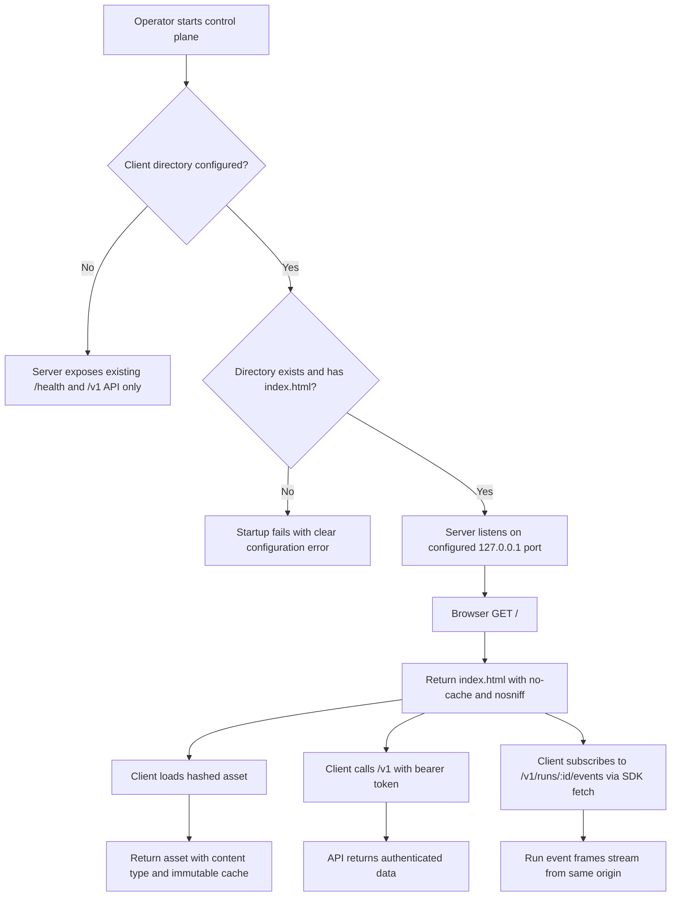
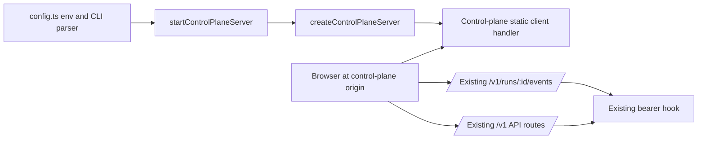
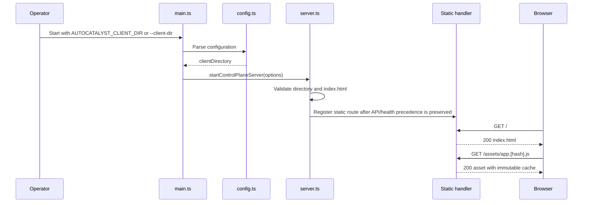
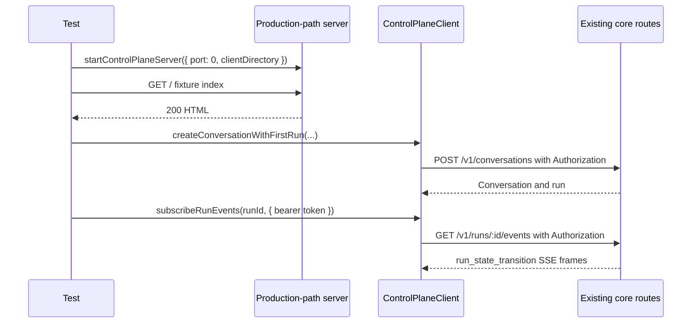

# Control plane serves built client and same-origin run event stream

## What

The control plane can optionally serve a built web client from its own HTTP origin. When an operator starts the server with a client directory, opening the control plane address in a browser loads the client at `/`, serves static assets from that directory, and falls back to the client shell for browser-routed pages. When the client directory is not configured, the server keeps its current API-only behavior.

This feature also proves that the browser client can call the authenticated API and read a run event stream from that same origin without a proxy or CORS. The stream proof uses the SDK's `fetch`-based subscription path with the bearer token in the `Authorization` header, matching the existing SSE route's authentication contract.

## Why

The web client needs a deployment shape that works locally and avoids splitting the UI and API across origins. Serving the built client from the control plane lets operators open one address, enter their API token in the client, and use normal authenticated API calls without introducing CORS, a development proxy, cookies, or token-in-URL behavior.

The event stream is central to the run detail experience: it keeps active runs from looking stalled. A production-path wiring test gives confidence that the eventual real client can load from the server and stream run events in the browser-compatible way that the SDK already supports.

## Personas

- **Olivia: Operator** - Starts the control plane locally, opens the web client from the same address, enters the bearer token, and monitors live runs.
- **Dina: Developer** - Builds and verifies the control-plane serving path and event-stream client contract without relying on the not-yet-built real client.
- **Riley: Reviewer** - Reviews the implementation for security invariants: no CORS, no unauthenticated API access, no directory traversal, and no new token transport.

## Narratives

### Same-origin client startup

Olivia starts the control plane with the usual database, master secret, bearer token, and a directory containing a built client. She opens the server's `127.0.0.1` address in a browser and sees the client load from `/` instead of a JSON API response or a 404. When she refreshes a deep link such as `/runs/123`, the server returns the same `index.html` so the client router can handle the page.

The static files are public because they contain no secret. Olivia still needs the bearer token for API calls, and a direct unauthenticated request to `/v1/runs` returns the existing 401 JSON response. No cross-origin headers appear, even if a request includes a foreign `Origin` header, because the supported deployment shape is one origin.

### Browser-compatible event stream

Dina runs the automated wiring test with a fixture client directory rather than the real client. The test starts the same `startControlPlaneServer` path used by production, creates a run through `POST /v1/conversations`, and uses the SDK's `subscribeRunEvents` from the loaded origin to read the run's events with an `Authorization` header.

The test receives retained `run_state_transition` frames, reconnects with a known `Last-Event-ID` and sees only later frames, then reconnects with an unknown cursor and sees the documented 409. It also proves that no-header, query-token, and cookie-token attempts still fail with 401, so the event route and bearer hook remain unchanged.

## User stories

**Same-origin client startup**

- Olivia can start the control plane with an optional client directory.
- Olivia can open `/` on the control plane and receive the built client's `index.html`.
- Olivia can refresh browser-routed HTML paths and still load the client shell.
- Olivia can request hashed assets and receive them with browser-friendly immutable caching.
- Riley can verify that API routes remain protected and API 404 behavior is not replaced by the client shell.
- Riley can verify that static serving cannot read files outside the configured directory.

**Browser-compatible event stream**

- Dina can prove the production server entrypoint passes the configured client directory into static serving.
- Dina can prove the browser-compatible SDK stream path reads events with `fetch` and an `Authorization` header.
- Dina can prove stream resume behavior for known and unknown `Last-Event-ID` values.
- Riley can prove unsupported token transports for the stream remain rejected.
- Riley can verify the server adds no CORS headers and does not change the core event route or bearer hook.

## Goals

- Starting without a client directory preserves current behavior and registers no static route.
- Starting with a valid client directory serves `/`, hashed assets, and HTML fallback paths from the same origin.
- Startup fails clearly when the configured directory is missing or lacks `index.html`.
- Static serving remains public while all `/v1` routes retain bearer-token protection.
- Automated tests prove same-origin static loading and SDK-based event streaming without any model calls.
- Documentation records the new setting, static-serving module, and stream test location.

## Non-goals

- Do not add CORS support or support a separate browser origin.
- Do not add cookie authentication or query-string token authentication for SSE.
- Do not make `EventSource` work with the existing authenticated stream route.
- Do not build the real client or add the Nx target that builds the client and starts the server.
- Do not serve the client under a path prefix.
- Do not add a real-browser test; fixture HTTP tests are sufficient here.
- Do not modify `packages/core/src/routes.ts` or `packages/core/src/auth.ts`.

## Design spec

### User flow

### Server response behavior

- `/` returns the configured `index.html` with `cache-control: no-cache` and `x-content-type-options: nosniff`.
- Existing API and health routes keep precedence over static serving.
- Static asset requests under the configured directory return files with correct content types.
- Files whose names include a content hash receive a long immutable cache lifetime.
- HTML-accepting `GET` requests for unknown non-API, non-health paths return `index.html` so client-side routes can refresh.
- Unknown `/v1` paths keep the existing JSON 404 behavior.
- Unknown non-GET paths keep today's response rather than falling back to `index.html`.

### Client-stream behavior under test

- The fixture client is intentionally minimal: one `index.html` and one hashed asset. It is not the real client.
- The stream proof uses the SDK's `subscribeRunEvents`, which uses `fetch` and can send `Authorization`.
- `EventSource` is explicitly unsupported because it cannot send the required header and the route accepts the token nowhere else.

## Tech spec

### Introduction and overview

#### Prerequisites and assumptions

- The server is Fastify-based and currently exposes `/health` plus authenticated `/v1` routes.
- The event stream route already supports `Last-Event-ID` resume and bearer-header authentication.
- The SDK `subscribeRunEvents` already reads the SSE response with `fetch` and an `Authorization` header.
- The real client build is owned by issue #131; tests here use a fixture client directory.
- Browser tooling is owned by issue #130; this feature uses HTTP/fetch integration tests, not a real-browser harness.

#### Technical goals

- Add optional client-directory configuration via `AUTOCATALYST_CLIENT_DIR` and `--client-dir`.
- Pass the client directory through `ControlPlaneServerOptions`, `startControlPlaneServer`, and `createControlPlaneServer` on the production path.
- Serve static files only when the directory is configured and validated.
- Keep all `/v1` authentication and event-stream code unchanged.
- Add tests that start production-path server wiring on port 0 and make no model calls.

#### Non-goals

- No API schema changes.
- No persistence changes or database migrations.
- No new auth mode.
- No hosted-operation host/TLS changes.

#### Glossary

- **Client directory**: Filesystem directory containing the built web client, including `index.html`.
- **SPA fallback**: Returning `index.html` for unknown HTML `GET` paths so the client router handles them.
- **Hashed asset**: A static file whose filename includes a content hash and can be cached immutably.
- **SSE**: Server-Sent Events over an HTTP response body.

### System design and architecture

#### Components

- `apps/control-plane/src/config.ts`: add optional client-directory parsing from `AUTOCATALYST_CLIENT_DIR` and `--client-dir`; validate presence only when configured.
- `apps/control-plane/src/server.ts`: extend `ControlPlaneServerOptions` with an optional client directory; pass it from `startControlPlaneServer` into `createControlPlaneServer`; register static serving only when set.
- Static-serving module in `apps/control-plane/src/`: implement with either a Fastify static-file plugin or a small in-repo handler. The implementation must record this choice in the final spec/docs. A new dependency is acceptable only if it passes module-boundary and lint checks and updates the lockfile.
- `packages/sdk/src/client.ts`: update the `subscribeRunEvents` doc comment to state that browsers use `fetch` with `Authorization`, and that `EventSource` is unsupported because the route accepts the token nowhere else.
- `context-agent/wiki/code-map.md`: record the setting, static-serving module, and stream test.

#### Primary static-serving sequence

#### Primary event-stream proof sequence

### Detailed design

#### Configuration

- Add `clientDirectory?: string` to `ControlPlaneAppConfig`.
- Parse `AUTOCATALYST_CLIENT_DIR` and `--client-dir` with the existing config parsing style.
- Treat an unset value as disabled. Disabled mode must not register static serving.
- When set, verify the path exists, is a directory, and contains `index.html`; failures should name the setting and the missing/invalid condition without dumping unrelated internals.

#### Static-serving rules

- Serve only resolved paths contained within the configured client directory. Encoded traversal attempts such as `%2e%2e` must return 404 and must not read outside the directory.
- Serve `index.html` for `GET /`.
- Serve existing files under the directory for `GET` file requests.
- Serve SPA fallback only when all are true:
  - method is `GET`;
  - no prior route handled the request;
  - path is not `/health` and is not under `/v1`;
  - request accepts `text/html`;
  - `index.html` exists in the configured directory.
- Do not fallback for unknown API paths or non-GET requests.
- Set `x-content-type-options: nosniff` on static responses.
- Set `cache-control: no-cache` on `index.html`.
- Set a long immutable cache lifetime for content-hashed filenames.
- Return suitable content types for common web assets used by a built client.

#### API contracts

No API endpoint contract changes are required. Existing API routes, error shapes, and auth behavior remain authoritative.

#### Data model and schema

No data model, database schema, or migration changes are required.

### Security, privacy, and compliance

- Static files and `index.html` are public and require no bearer token.
- All `/v1` routes remain behind the existing bearer hook.
- The SSE route continues to accept the token only in the `Authorization` header.
- Query-string tokens and cookies are rejected because the route and bearer hook are unchanged.
- No CORS headers are added; same-origin serving is the supported browser deployment.
- Path containment must be enforced after decoding and resolving request paths.
- Static responses include `x-content-type-options: nosniff`.

### Observability

- Startup validation errors should be clear enough for operators to fix the client-directory setting.
- No new metrics or alerts are required.
- Logs must not include bearer tokens or request authorization values.

### Testing plan

- Config unit tests for env and CLI parsing of the optional client directory, including disabled behavior.
- Startup validation tests for missing directory and missing `index.html`.
- Static serving tests for `/`, hashed assets, content types, cache headers, `nosniff`, SPA fallback, API 404 preservation, non-GET preservation, traversal rejection, public static access, API auth retention, and absence of CORS headers.
- Production-path wiring test through `startControlPlaneServer` on port 0 with a fixture client directory.
- Same-server stream tests that create a run through `POST /v1/conversations`, subscribe through SDK `subscribeRunEvents`, verify retained transition frames, verify known-cursor resume without repeats, verify unknown-cursor 409, and verify no-header/query-token/cookie-token 401 responses.
- Diff guard or review assertion that `packages/core/src/routes.ts` and `packages/core/src/auth.ts` are untouched.
- No test should make a model call; use deterministic fake or injected seams where run creation/transition requires execution.

### Alternatives considered

- **Separate client origin with CORS**: rejected because the UX concept chooses same-origin serving and this would add proxy/CORS complexity.
- **Token in query string for `EventSource`**: rejected because URLs leak through history, proxy logs, and server logs.
- **Cookie authentication for SSE**: rejected because it adds session state and a second authentication path not present in the API today.
- **Fastify static plugin versus in-repo handler**: either is acceptable. A plugin reduces bespoke file-serving code but adds a dependency and lockfile change. An in-repo handler avoids dependency risk but must carefully implement content types, caching, and containment. The implementation must record the chosen option.

### Risks

- Static route ordering could accidentally mask API 404s; tests must lock API precedence.
- Path decoding mistakes could allow directory traversal; containment tests must include encoded `..` segments.
- Cache detection for hashed filenames could over-cache `index.html`; index handling must be explicit.
- Stream tests could become flaky if they wait for live events incorrectly; they should rely on retained frames and existing resume semantics.

## Task list

- [ ] **Story: Configure optional client-directory serving**
  - [ ] **Task: Add client directory to control-plane configuration**
    - **Description**: Extend `apps/control-plane/src/config.ts` so `AUTOCATALYST_CLIENT_DIR` and `--client-dir` populate an optional `clientDirectory` field on `ControlPlaneAppConfig`. Preserve current behavior when unset.
    - **Acceptance criteria**:
      - [ ] Env var parsing accepts a non-empty client directory path.
      - [ ] CLI flag parsing accepts `--client-dir`.
      - [ ] CLI value takes precedence according to existing config conventions.
      - [ ] Unset config leaves `clientDirectory` undefined and does not require filesystem validation.
      - [ ] Config tests cover env, CLI, and unset cases.
    - **Dependencies**: None
  - [ ] **Task: Validate configured client directory at startup**
    - **Description**: Add startup validation for configured directories before the server begins serving static files. Fail clearly when the path does not exist, is not a directory, or lacks `index.html`.
    - **Acceptance criteria**:
      - [ ] Missing directory startup fails with a clear message naming the client directory setting.
      - [ ] Directory without `index.html` startup fails with a clear message.
      - [ ] Valid directory with `index.html` starts successfully.
      - [ ] Unset directory starts exactly as today.
    - **Dependencies**: "Task: Add client directory to control-plane configuration"
  - [ ] **Task: Thread client directory through server options**
    - **Description**: Add the optional client directory to `ControlPlaneServerOptions`; pass it from `startControlPlaneServer` to `createControlPlaneServer` on the production path used by `main.ts`.
    - **Acceptance criteria**:
      - [ ] `ControlPlaneServerOptions` exposes the optional client directory.
      - [ ] `startControlPlaneServer` forwards the value to `createControlPlaneServer`.
      - [ ] Existing callers without the option continue to compile and behave unchanged.
      - [ ] A production-path test can start the server with `port: 0` and a fixture directory.
    - **Dependencies**: "Task: Add client directory to control-plane configuration"

- [ ] **Story: Serve the built client safely from the control plane**
  - [ ] **Task: Implement static-serving module**
    - **Description**: Add a static-serving module under `apps/control-plane/src/` using either a static-file plugin or a small in-repo handler. Register it only when a client directory is configured.
    - **Acceptance criteria**:
      - [ ] Disabled mode registers no static route and preserves current API-only behavior.
      - [ ] `GET /` returns `index.html` with status 200.
      - [ ] `GET` for a file under the directory returns the file body.
      - [ ] Common web asset content types are correct for the fixture files.
      - [ ] The chosen implementation approach is recorded in the spec/docs.
      - [ ] Any new dependency passes module-boundary and lint checks and updates the lockfile.
    - **Dependencies**: "Task: Validate configured client directory at startup", "Task: Thread client directory through server options"
  - [ ] **Task: Add static caching and security headers**
    - **Description**: Set response headers for served static files, including `no-cache` for `index.html`, immutable long-lived caching for hashed filenames, and `x-content-type-options: nosniff` for static responses.
    - **Acceptance criteria**:
      - [ ] `index.html` responses include `cache-control: no-cache`.
      - [ ] Hashed asset responses include a long immutable cache lifetime.
      - [ ] Static responses include `x-content-type-options: nosniff`.
      - [ ] Header behavior is covered by tests.
    - **Dependencies**: "Task: Implement static-serving module"
  - [ ] **Task: Implement SPA fallback without masking API behavior**
    - **Description**: Return `index.html` for unknown HTML-accepting `GET` requests outside `/v1` and `/health`, while preserving existing unknown API and non-GET behavior.
    - **Acceptance criteria**:
      - [ ] Unknown non-API `GET` path accepting `text/html` returns `index.html` with status 200.
      - [ ] Unknown `/v1` path returns the existing JSON 404, not `index.html`.
      - [ ] Unknown `/health`-adjacent behavior remains unchanged.
      - [ ] Unknown non-GET request keeps today's response and does not return `index.html`.
      - [ ] Tests cover each branch.
    - **Dependencies**: "Task: Implement static-serving module"
  - [ ] **Task: Enforce static path containment**
    - **Description**: Ensure all static file requests resolve inside the configured directory after decoding and normalization, and return 404 for traversal attempts.
    - **Acceptance criteria**:
      - [ ] Encoded `..` traversal attempts return 404.
      - [ ] No file outside the configured directory is read.
      - [ ] Containment checks handle resolved absolute paths.
      - [ ] Tests include at least one encoded traversal example.
    - **Dependencies**: "Task: Implement static-serving module"

- [ ] **Story: Preserve authentication and no-CORS invariants**
  - [ ] **Task: Prove static files are public and API routes remain protected**
    - **Description**: Add tests showing `GET /` succeeds without a bearer token while an unauthenticated API request still receives the existing 401 response.
    - **Acceptance criteria**:
      - [ ] `GET /` returns 200 without `Authorization`.
      - [ ] `GET /v1/runs` returns 401 without `Authorization`.
      - [ ] Test assertions use the existing API error behavior.
    - **Dependencies**: "Task: Implement static-serving module"
  - [ ] **Task: Prove no CORS headers are added**
    - **Description**: Add a test that sends a foreign `Origin` header to a served response and verifies no `access-control-allow-origin` header is present.
    - **Acceptance criteria**:
      - [ ] Foreign-origin request succeeds or fails according to the target route's normal behavior.
      - [ ] Response does not include `access-control-allow-origin`.
      - [ ] No CORS dependency or middleware is introduced.
    - **Dependencies**: "Task: Implement static-serving module"
  - [ ] **Task: Guard core event route and bearer hook from changes**
    - **Description**: Keep `packages/core/src/routes.ts` and `packages/core/src/auth.ts` untouched by this issue; use existing behavior for all stream auth tests.
    - **Acceptance criteria**:
      - [ ] Final diff touches neither `packages/core/src/routes.ts` nor `packages/core/src/auth.ts`.
      - [ ] Stream auth tests pass through existing route behavior.
      - [ ] Review notes call out this invariant.
    - **Dependencies**: None

- [ ] **Story: Prove same-origin static loading through production wiring**
  - [ ] **Task: Add fixture client directory for tests**
    - **Description**: Create test setup that writes a temporary fixture client directory containing `index.html` and one hashed asset; do not use the real client.
    - **Acceptance criteria**:
      - [ ] Fixture includes `index.html`.
      - [ ] Fixture includes at least one hashed asset filename.
      - [ ] Test setup cleans up temporary files.
      - [ ] No real client build is invoked.
    - **Dependencies**: None
  - [ ] **Task: Add production-path static wiring test**
    - **Description**: Start the server through `startControlPlaneServer` on port 0 with the fixture client directory and load both the HTML file and hashed asset over HTTP.
    - **Acceptance criteria**:
      - [ ] Test uses the same entrypoint path that `main.ts` calls.
      - [ ] Test starts on port 0.
      - [ ] `GET /` returns the fixture HTML.
      - [ ] `GET` for the hashed asset returns the fixture asset body and content type.
      - [ ] Test makes no model call.
    - **Dependencies**: "Task: Add fixture client directory for tests", "Task: Implement static-serving module", "Task: Add static caching and security headers"

- [ ] **Story: Prove browser-compatible run event streaming**
  - [ ] **Task: Add same-server SDK stream test for run transitions**
    - **Description**: On the same running production-path server, create a run via `POST /v1/conversations`, then read `GET /v1/runs/:id/events` through SDK `subscribeRunEvents` with the bearer header and receive `run_state_transition` frames.
    - **Acceptance criteria**:
      - [ ] Test creates a run through the HTTP API.
      - [ ] Test subscribes through `packages/sdk/src/client.ts` `subscribeRunEvents`.
      - [ ] Request carries the bearer token in `Authorization`.
      - [ ] Test receives at least the expected `run_state_transition` frames.
      - [ ] Test makes no model call.
    - **Dependencies**: "Task: Add production-path static wiring test"
  - [ ] **Task: Add known-cursor resume stream test**
    - **Description**: Create a run, read retained frames, reconnect with `lastEventId` set to the id of a frame already received, and verify only later frames are delivered.
    - **Acceptance criteria**:
      - [ ] Initial stream receives retained frames with ids.
      - [ ] Reconnect sends a known `lastEventId`.
      - [ ] Reconnect receives only frames after that id.
      - [ ] No repeated frame ids are observed.
    - **Dependencies**: "Task: Add same-server SDK stream test for run transitions"
  - [ ] **Task: Add unknown-cursor resume stream test**
    - **Description**: Reconnect to a run event stream with a made-up `lastEventId` and assert the documented 409 response.
    - **Acceptance criteria**:
      - [ ] Reconnect uses a cursor id that no frame has.
      - [ ] Response status is 409.
      - [ ] Response body matches the existing documented cursor error shape.
    - **Dependencies**: "Task: Add same-server SDK stream test for run transitions"
  - [ ] **Task: Add unsupported stream token transport tests**
    - **Description**: Verify the stream endpoint rejects requests with no `Authorization` header, token only in query string, and token only in cookie.
    - **Acceptance criteria**:
      - [ ] Missing `Authorization` stream request returns 401.
      - [ ] Query-string token only returns 401.
      - [ ] Cookie token only returns 401.
      - [ ] Tests do not require changes to the event route or bearer hook.
    - **Dependencies**: "Task: Add same-server SDK stream test for run transitions", "Task: Guard core event route and bearer hook from changes"

- [ ] **Story: Document the supported client-serving and stream contract**
  - [ ] **Task: Update SDK stream documentation comment**
    - **Description**: Update the doc comment on `subscribeRunEvents` to explain that browser clients read the stream with `fetch` and the `Authorization` header, and that `EventSource` is unsupported because it cannot send that header and the route accepts the token nowhere else.
    - **Acceptance criteria**:
      - [ ] Comment explicitly names `fetch` and `Authorization`.
      - [ ] Comment explicitly says `EventSource` is not supported.
      - [ ] Comment does not suggest query-string or cookie token alternatives.
    - **Dependencies**: None
  - [ ] **Task: Update agent code map**
    - **Description**: Update `context-agent/wiki/code-map.md` with the new client-directory setting, the static-serving module, and the stream test location.
    - **Acceptance criteria**:
      - [ ] Code map mentions `AUTOCATALYST_CLIENT_DIR` and `--client-dir`.
      - [ ] Code map points to the static-serving module.
      - [ ] Code map points to the same-origin stream/static wiring test.
    - **Dependencies**: "Task: Implement static-serving module", "Task: Add same-server SDK stream test for run transitions"
  - [ ] **Task: Run targeted and boundary validation**
    - **Description**: Run the relevant control-plane, SDK, lint, and module-boundary checks for the changed packages and document any skipped broader validation.
    - **Acceptance criteria**:
      - [ ] Targeted control-plane tests pass.
      - [ ] SDK tests touching `subscribeRunEvents` pass if changed.
      - [ ] Lint passes for changed projects.
      - [ ] `pnpm test:boundaries` passes, especially if a new dependency is added.
      - [ ] No test makes a model call.
    - **Dependencies**: "Task: Add production-path static wiring test", "Task: Add unsupported stream token transport tests", "Task: Update SDK stream documentation comment", "Task: Update agent code map"
