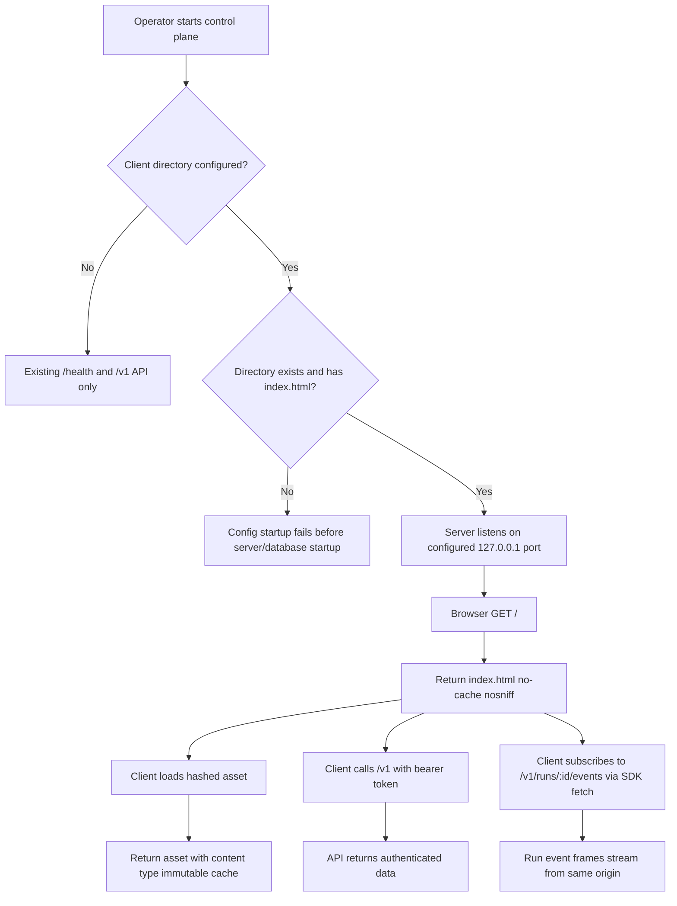
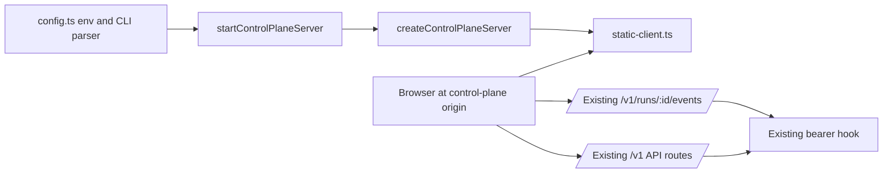
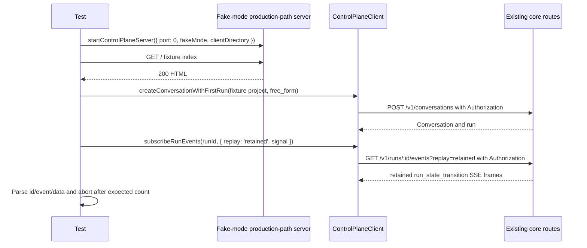

# Control plane serves built client and same-origin run event stream

## What

The control plane can optionally serve a built web client from its own HTTP origin. When an operator starts the server with a client directory, opening the control plane address in a browser loads the client at `/`, serves static assets from that directory, and falls back to the client shell for browser-routed pages. When the client directory is not configured, the server keeps its current API-only behavior and registers no static route.

This feature also proves that the browser client can call the authenticated API and read a run event stream from that same origin without a proxy or CORS. The stream proof uses the SDK's `fetch`-based subscription path with the bearer token in the `Authorization` header, matching the existing SSE route's authentication contract.

## Why

The web client needs a deployment shape that works locally and avoids splitting the UI and API across origins. Serving the built client from the control plane lets operators open one address, enter the bearer token in the client, and use normal authenticated API calls without introducing CORS, a development proxy, cookies, or token-in-URL behavior.

The event stream is central to the run detail experience: it keeps active runs from looking stalled. A production-path wiring test gives confidence that the eventual real client can load from the server and stream run events in the browser-compatible way that the SDK already supports.

## Personas

- **Olivia: Operator** - Starts the control plane locally, opens the web client from the same address, enters the bearer token, and monitors live runs.
- **Dina: Developer** - Builds and verifies the control-plane serving path and event-stream client contract without relying on the not-yet-built real client.
- **Riley: Reviewer** - Reviews the implementation for security invariants: no CORS, no unauthenticated API access, no directory traversal, and no new token transport.

## Narratives

### Same-origin client startup

Olivia starts the control plane with the usual database, master secret, bearer token, and a directory containing a built client. She opens the server's `127.0.0.1` address in a browser and sees the client load from `/` instead of a JSON API response or a 404. When she refreshes a deep link such as `/runs/123`, the server returns the same `index.html` so the client router can handle the page.

The static files are public because they contain no secret. Olivia still needs the bearer token for API calls, and a direct unauthenticated request to `/v1/runs` returns the existing 401 response. No cross-origin headers appear, even if a request includes a foreign `Origin` header, because the supported deployment shape is one origin.

### Browser-compatible event stream

Dina runs the automated wiring test with a fixture client directory rather than the real client. The test starts the same `startControlPlaneServer` path used by production, creates a run through `POST /v1/conversations`, and uses the SDK's `subscribeRunEvents` to open the run event stream with an `Authorization` header.

The test explicitly asks for retained replay, parses SSE frames from the raw `Response` body, and closes the stream after the expected frame count so it cannot hang. It then reconnects with a known non-last event id and sees only later frames, reconnects with an unknown cursor and sees the documented 409, and proves no-header, query-token, and cookie-token attempts still fail with 401.

## User stories

**Same-origin client startup**

- Olivia can start the control plane with an optional client directory.
- Olivia can open `/` on the control plane and receive the built client's `index.html`.
- Olivia can refresh browser-routed HTML paths and still load the client shell.
- Olivia can request hashed assets and receive them with browser-friendly immutable caching.
- Riley can verify that API routes and unknown-route responses keep their existing behavior.
- Riley can verify that static serving cannot read files outside the configured directory.

**Browser-compatible event stream**

- Dina can prove the production server entrypoint passes the configured client directory into static serving.
- Dina can prove the browser-compatible SDK stream path reads events with `fetch` and an `Authorization` header.
- Dina can prove retained replay and `Last-Event-ID` resume behavior.
- Riley can prove unsupported token transports for the stream remain rejected.
- Riley can verify the server adds no CORS headers and does not change the core event route or bearer hook.

## Goals

- Starting without a client directory preserves current behavior and registers no static route.
- Starting with a valid client directory serves `/`, hashed assets, and browser-routed HTML fallback paths from the same origin.
- Startup fails clearly when the configured directory is missing or lacks `index.html`.
- Static serving remains public while all `/v1` routes retain bearer-token protection.
- Automated tests prove same-origin static loading and SDK-based event streaming without any model calls.
- Documentation records the new setting, fake-mode behavior, static-serving module, and stream test location.

## Non-goals

- Do not add CORS support or support a separate browser origin.
- Do not add cookie authentication or query-string token authentication for SSE.
- Do not make `EventSource` work with the existing authenticated stream route.
- Do not build the real client or add the Nx target that builds the client and starts the server.
- Do not serve the client under a path prefix.
- Do not add a real-browser test; fixture HTTP tests are sufficient here.
- Do not modify `packages/core/src/routes.ts` or `packages/core/src/auth.ts`.

## Design spec

### User flow



### Server response behavior

- `/` returns the configured `index.html` with `cache-control: no-cache` and `x-content-type-options: nosniff`.
- Existing API and health routes keep precedence over static serving.
- Static asset requests under the configured directory return files with correct content types.
- SPA fallback returns `index.html` only when all are true: method is `GET`; no prior route handled the request; path is not `/health` and is not under `/v1`; the `Accept` header explicitly names `text/html`; and the final path segment has no file extension. `*/*` alone is not enough.
- `/runs`, `/runs/123`, and deeper extensionless paths return `index.html` when `Accept` includes `text/html,application/xhtml+xml,*/*;q=0.8`.
- Missing files with extensions return 404 even when `Accept` is `*/*` or explicitly includes `text/html`. This avoids returning HTML for missing script, style, image, or manifest assets.
- Unknown `/v1` paths, unknown `/health` subpaths, and unknown non-GET paths keep Fastify's current default 404 status and body. Unknown `/v1` paths currently return 404 even without a token because the bearer hook is scoped to registered API routes.

### Serving choice

Use a small in-repo handler rather than adding a static-file plugin. The control plane currently has only `fastify` and `zod` as third-party dependencies, and this feature needs a constrained subset of static behavior plus exact fallback and containment rules; an in-repo handler avoids a new dependency and makes every security rule explicit in tests.

The handler lives in `apps/control-plane/src/static-client.ts` and exports `registerStaticClientRoutes(app, { clientDirectory })`. It registers `GET /` and `GET /*` for static files plus a server-level `setNotFoundHandler` in `apps/control-plane/src/server.ts` for SPA fallback/default 404 preservation; it does not support `HEAD`.

### Client-stream behavior under test

- The fixture client is intentionally minimal: one `index.html` and one hashed asset. It is not the real client.
- The stream proof uses fake mode from issue #128 so the test has deterministic tracker and scripted-run behavior without model calls. The test must first create the fake secret and fake fixture project the same way `ensureSecretAndProject` does in `apps/control-plane/src/fake/seed-fake.ts`, either by importing a shared helper or by using the same SDK calls and `FAKE_FIXTURE_PROJECT` constants.
- The test submits `free_form` work to `POST /v1/conversations` with an explicit `workKind: 'feature'` and the seeded fixture project id, so intake does not need an issue number and does not throw `work_kind_unresolved`. The scripted adapter accepts this no-issue run as `fixture-spec`; the test waits until the second retained `run_state_transition` frame arrives rather than assuming both frames exist at subscription time.
- The first subscription calls SDK `subscribeRunEvents(runId, { replay: 'retained', signal })`. The SDK returns a raw `Response`, so the test parses the SSE body with a local helper such as `readSseFrames(response, { maxFrames, signal })` that extracts `id`, `event`, and parsed JSON `data` fields.
- Stream reads must end deterministically by using both an `AbortSignal` and a frame-count target. Tests must fail rather than hang if the expected frames do not arrive.
- The deterministic run setup must produce at least two retained `run_state_transition` frames. The known-cursor resume test uses the first frame's id, not the last frame's id, and expects only later ids with no repeats.

## Tech spec

### Introduction and overview

#### Prerequisites and assumptions

- The server is Fastify-based and currently exposes `/health` plus authenticated `/v1` routes.
- Unknown routes currently use Fastify's default 404 because the core routes register an error handler but no not-found handler. Tests should snapshot today's exact status and response body before enabling the static not-found fallback.
- The event stream route already supports retained replay through `?replay=retained` and cursor resume through `Last-Event-ID`.
- The SDK `subscribeRunEvents` already reads the SSE response with `fetch`, can set `Authorization`, and can pass replay and cursor options, but it does not parse SSE frames for callers.
- The real client build is owned by issue #131; tests here use a fixture client directory.
- Browser tooling is owned by issue #130; this feature uses HTTP/fetch integration tests, not a real-browser harness.

#### Technical goals

- Add optional client-directory configuration via `AUTOCATALYST_CLIENT_DIR` and `--client-dir`.
- Resolve relative client-directory values against the process current working directory, matching fake-state behavior; store the resolved absolute path in app config.
- Validate configured client-directory paths in `apps/control-plane/src/config.ts` before server startup continues, so failures happen before database startup.
- Pass the resolved client directory through `ControlPlaneServerOptions`, `startControlPlaneServer`, and `createControlPlaneServer` on the production and fake-mode paths.
- Serve static files only when the directory is configured and validated.
- Keep all `/v1` authentication and event-stream code unchanged.
- Add tests that start production-path server wiring on port 0 and make no model calls.

#### Non-goals

- No API schema changes.
- No persistence changes or database migrations.
- No new auth mode.
- No hosted-operation host/TLS changes.

#### Glossary

- **Client directory**: Filesystem directory containing the built web client, including `index.html`.
- **SPA fallback**: Returning `index.html` for unknown extensionless HTML `GET` paths so the client router handles them.
- **Hashed asset**: A static asset whose filename contains a Vite-style content hash segment and can be cached immutably.
- **SSE**: Server-Sent Events over an HTTP response body.

### System design and architecture



#### Components

- `apps/control-plane/src/config.ts`: add optional client-directory parsing from `AUTOCATALYST_CLIENT_DIR` and `--client-dir`; resolve relative paths with `resolve(value)` from the current working directory; validate existence, directory type, and `index.html`; add the field explicitly to `readControlPlaneAppConfig` so fake mode and normal mode both receive it.
- `apps/control-plane/src/server.ts`: extend `ControlPlaneServerOptions` with an optional resolved client directory; pass it from `startControlPlaneServer` into `createControlPlaneServer`; register `static-client.ts` only when set; install the server-level not-found handler there so `packages/core/src/routes.ts` remains untouched.
- `apps/control-plane/src/static-client.ts`: implement the in-repo static client handler, path containment, cache headers, content types, fallback eligibility, and default-404 passthrough helper.
- `packages/sdk/src/client.ts`: update the `subscribeRunEvents` doc comment to state that browsers use `fetch` with `Authorization`, and that `EventSource` is unsupported because the route accepts the token nowhere else.
- `context-agent/wiki/code-map.md` and `docs/operators/fake-mode.md`: record the new setting, fake-mode use, static-serving module, and stream test.

#### Primary static-serving sequence

```mermaid
sequenceDiagram
    participant Op as Operator
    participant Config as config.ts
    participant Server as server.ts
    participant Static as static-client.ts
    participant Browser

    Op->>Config: Start with AUTOCATALYST_CLIENT_DIR or --client-dir
    Config->>Config: Resolve relative path and validate index.html
    Config-->>Server: clientDirectory absolute path
    Server->>Static: registerStaticClientRoutes
    Browser->>Static: GET /
    Static-->>Browser: 200 index.html
    Browser->>Static: GET /assets/index-Bx3k9aZq.js
    Static-->>Browser: 200 asset with immutable cache
    Browser->>Server: GET /runs Accept: text/html,application/xhtml+xml,*/*;q=0.8
    Server-->>Browser: 200 index.html fallback
```

#### Primary event-stream proof sequence



### Detailed design

#### Configuration and validation

- `AUTOCATALYST_CLIENT_DIR` and `--client-dir` accept absolute or relative paths. Relative paths resolve against `process.cwd()` using the same pattern as fake-state directory resolution.
- The resolved absolute path is held in config and may be included in startup diagnostics only as a normal path, never alongside secrets.
- Filesystem validation happens in `config.ts` during config loading. If set, the value must name an existing directory containing `index.html`; otherwise startup fails before server/database initialization.
- Unset config leaves `clientDirectory` undefined and requires no filesystem validation.
- Fake mode must support the same setting: `pnpm nx run control-plane:serve-fake` with `AUTOCATALYST_CLIENT_DIR` serves the fixture page.

#### Static file handling

- `static-client.ts` decodes request paths exactly once for routing decisions and rejects malformed encodings. Doubly encoded traversal such as `%252e%252e` does not get a second decode and therefore must not escape; if it maps to no real file it returns 404.
- Reject with 404 for path inputs containing NUL bytes or backslashes.
- Reject with 404 for dotfiles such as `/.env`.
- Reject with 404 for directory requests such as `/assets/`; do not list directories and do not serve nested `index.html` files.
- Reject with 404 for symlinks whose real target is outside the client directory. Containment checks use `realpath` for existing files and the configured directory.
- Query strings do not affect file resolution: `/assets/index-Bx3k9aZq.js?v=1` serves the same file as `/assets/index-Bx3k9aZq.js` when the file is otherwise allowed.
- `HEAD` is not supported by this feature. `HEAD` requests to static or fallback paths keep Fastify's default not-found behavior.
- `GET /` maps only to the root `index.html`; nested `index.html` files are not special and receive ordinary file handling only when requested directly and allowed.

#### SPA fallback and default 404 preservation

- Register the fallback in `apps/control-plane/src/server.ts` as a server-level not-found handler after core routes are registered. This keeps the static/fallback behavior outside `packages/core/src/routes.ts`.
- Before adding the fallback, capture today's exact Fastify default responses in tests for at least: unknown `GET /v1/x`, unknown `POST /anything`, and unknown `GET /health/x`. After adding the fallback, assert those statuses and bodies byte-for-byte.
- Fallback to `index.html` only for extensionless `GET` paths whose `Accept` header explicitly includes `text/html`, excluding `/v1`, `/v1/...`, `/health`, and `/health/...`.
- Missing extensioned assets return 404 for `Accept: */*` and for `Accept: text/html`.

#### Cache and content-type rules

- `index.html` always receives `cache-control: no-cache`, including if requested as `/index.html`. Nested files named `index.html` also receive `no-cache` if served as ordinary files.
- Hashed assets receive `cache-control: public, max-age=31536000, immutable`.
- A hashed asset is a file under `/assets/` whose basename contains a final dash-separated or dot-separated segment immediately before the extension with at least 8 characters from `[A-Za-z0-9_-]`; examples: `index-Bx3k9aZq.js`, `style.1a2b3c4d.css`. Unhashed lookalikes such as `vendor-chunk.js` are not hashed.
- Unhashed files other than `index.html`, such as `favicon.ico` and `manifest.webmanifest`, receive `cache-control: no-cache`.
- Static responses set `x-content-type-options: nosniff`.
- Implement a small extension-to-content-type table for common built-client assets: `.html`, `.js`, `.mjs`, `.css`, `.json`, `.webmanifest`, `.svg`, `.png`, `.jpg`, `.jpeg`, `.gif`, `.ico`, `.txt`, `.map`, `.woff`, and `.woff2`; default to `application/octet-stream` for unknown extensions.

#### API contracts

No API endpoint contract changes are required. Existing API routes, error shapes, and auth behavior remain authoritative.

#### Data model and schema

No data model, database schema, or migration changes are required.

### Security, privacy, and compliance

- Static files and `index.html` are public and require no bearer token.
- All registered `/v1` routes remain behind the existing bearer hook.
- Unknown `/v1` routes keep today's 404 behavior, including without a token.
- The SSE route continues to accept the token only in the `Authorization` header.
- Query-string tokens and cookies are rejected because the route and bearer hook are unchanged.
- No CORS headers are added; same-origin serving is the supported browser deployment.
- Path containment must be enforced with realpath for existing files so symlink escapes are rejected.

### Observability

- Startup validation errors should be clear enough for operators to fix the client-directory setting.
- No new metrics or alerts are required.
- Logs must not include bearer tokens or request authorization values.

### Testing plan

- Config unit tests cover env, CLI, unset behavior, relative path resolution against cwd, invalid directory, and missing `index.html`.
- Static serving tests cover root HTML, hashed and unhashed assets, cache headers, content types, `nosniff`, public static access, API auth retention, no CORS header, SPA fallback, missing extensioned asset 404, preserved default 404 bodies, traversal and other escape cases, and unsupported `HEAD`.
- Wiring tests include both `startControlPlaneServer` and `main(argv, env)` coverage. At least one normal-mode test and one fake-mode test call `main(['--port', '0', ...], { AUTOCATALYST_CLIENT_DIR: <fixture>, ... })`, load the fixture over HTTP, and close the returned server handle.
- Fake-mode stream setup starts the server, creates the fake secret and project using the same behavior as `ensureSecretAndProject` from `seed-fake.ts`, then creates a `free_form` run with explicit `workKind: 'feature'` for that project without real tracker or model calls.
- Stream tests call `subscribeRunEvents` with `replay: 'retained'`, parse SSE frames from the raw `Response`, use an abort signal and frame-count limit, wait for at least two retained `run_state_transition` frame ids, use the first id as the known cursor, assert only later ids are returned, assert a made-up cursor returns JSON 409 with `error.code: 'run_event_replay_cursor_unknown'`, a `message`, and `lastEventId` echoing the sent cursor with no preceding SSE bytes, and assert no-header/query-token/cookie-token stream requests return 401.
- SDK tests or type checks cover the updated `subscribeRunEvents` doc-adjacent behavior if touched.
- Validation runs targeted control-plane tests, SDK tests if changed, lint for changed projects, and `pnpm test:boundaries`.

### Alternatives considered

- **Separate client origin with CORS**: rejected because the UX concept chooses same-origin serving and this would add proxy/CORS complexity.
- **Token in query string for `EventSource`**: rejected because URLs leak through history, proxy logs, and server logs.
- **Cookie authentication for SSE**: rejected because it adds session state and a second authentication path not present in the API today.
- **Fastify static plugin**: rejected for this issue because it introduces a new dependency and lockfile change for a narrow serving need, while this feature requires exact fallback, dotfile, symlink, directory, HEAD, and default-404 preservation behavior that should be explicit in the control-plane code and tests.

### Risks

- Static route ordering could accidentally mask API 404s; byte-for-byte default 404 tests must lock API and non-GET behavior.
- Path decoding or realpath mistakes could allow directory traversal or symlink escape; containment tests cover encoded, double-encoded, backslash, NUL, dotfile, directory, and symlink cases.
- Cache hash detection could over-cache unhashed files; tests cover a real hashed name and an unhashed lookalike.
- Stream tests could hang if they wait for live events incorrectly; they must request retained replay and close by abort signal or frame count.

## Task list

- [ ] **Story: Configure and validate optional client directory**
  - [ ] **Task: Parse and validate client directory configuration**
    - **Description**: Extend `apps/control-plane/src/config.ts` so `AUTOCATALYST_CLIENT_DIR` and `--client-dir` populate a resolved absolute `clientDirectory` on `ControlPlaneAppConfig`; validate configured paths before startup continues.
    - **Acceptance criteria**:
      - [ ] Env, CLI, unset, and fake-mode config paths are covered, with relative values resolved against `process.cwd()` and `--client-dir` taking precedence over `AUTOCATALYST_CLIENT_DIR` when both are set.
      - [ ] Missing directory, non-directory, and missing root `index.html` fail with clear client-directory errors before server/database startup.
      - [ ] Unset config preserves current behavior and requires no filesystem validation.
    - **Dependencies**: None
  - [ ] **Task: Thread client directory through production server options**
    - **Description**: Add `clientDirectory` to `ControlPlaneServerOptions` and pass it from `startControlPlaneServer` to `createControlPlaneServer` on the same path used by `main.ts` and fake mode.
    - **Acceptance criteria**:
      - [ ] Existing callers without a client directory keep compiling and behaving unchanged.
      - [ ] Production-path and fake-mode startup can receive the resolved directory and register static serving only when set; tests cover `main(['--port', '0', ...], env)` in normal mode and fake mode, load the fixture over HTTP, and close the returned handle.
    - **Dependencies**: "Task: Parse and validate client directory configuration"

- [ ] **Story: Serve client files with explicit in-repo rules**
  - [ ] **Task: Add `static-client.ts` in-repo handler**
    - **Description**: Implement `apps/control-plane/src/static-client.ts` with `registerStaticClientRoutes(app, { clientDirectory })`, serving `GET /` and `GET /*` files from the validated directory without adding a static-serving dependency.
    - **Acceptance criteria**:
      - [ ] `GET /` and allowed file requests return expected bodies and content types; disabled mode registers no static route.
      - [ ] Static responses set `x-content-type-options: nosniff`; root or nested `index.html` uses `cache-control: no-cache`; hashed `/assets/` files use `public, max-age=31536000, immutable`; unhashed lookalikes and other files use `no-cache`.
      - [ ] Tests cover one Vite-style hashed asset, one unhashed lookalike such as `vendor-chunk.js`, `favicon` or manifest behavior, and nested `index.html` caching.
    - **Dependencies**: "Task: Thread client directory through production server options"
  - [ ] **Task: Enforce containment and blocked static paths**
    - **Description**: Add path validation for static requests, using realpath containment for existing files and returning 404 for disallowed escape or unsafe cases.
    - **Acceptance criteria**:
      - [ ] Encoded `..`, double-encoded traversal, NUL byte, backslash, dotfile, directory path, and symlink-to-outside requests return 404.
      - [ ] Query strings do not affect allowed file resolution.
      - [ ] `HEAD` requests keep default not-found behavior.
    - **Dependencies**: "Task: Add `static-client.ts` in-repo handler"
  - [ ] **Task: Add exact SPA fallback and preserve default 404 responses**
    - **Description**: Register the server-level not-found handler in `apps/control-plane/src/server.ts` so extensionless HTML `GET` paths fall back to `index.html` while API, health, extensioned, and non-GET misses keep today's Fastify default response.
    - **Acceptance criteria**:
      - [ ] `/runs`, `/runs/123`, and a deeper extensionless path return `index.html` when `Accept` explicitly includes `text/html`.
      - [ ] Missing extensioned files return 404 for both `Accept: */*` and `Accept: text/html`.
      - [ ] Unknown `GET /v1/x`, unknown `POST /anything`, and unknown `GET /health/x` preserve today's exact status and body byte-for-byte.
    - **Dependencies**: "Task: Add `static-client.ts` in-repo handler", "Task: Enforce containment and blocked static paths"

- [ ] **Story: Prove same-origin auth and static wiring**
  - [ ] **Task: Add fixture-client production wiring tests**
    - **Description**: Start the server through `startControlPlaneServer` on port 0 with a temporary fixture client directory containing `index.html` and one hashed asset; exercise both normal and fake-mode startup paths without using the real client.
    - **Acceptance criteria**:
      - [ ] The test loads fixture HTML and hashed asset over HTTP through the production entrypoint path and removes temporary fixture directories and closes server handles in cleanup even when assertions fail.
      - [ ] Static `GET /` succeeds without a token, while unauthenticated `GET /v1/runs` returns 401.
      - [ ] A request with a foreign `Origin` header receives no `access-control-allow-origin` header.
      - [ ] No real client build, real tracker call, or model call occurs.
    - **Dependencies**: "Task: Add exact SPA fallback and preserve default 404 responses"

- [ ] **Story: Prove retained SSE streaming and resume from the same server**
  - [ ] **Task: Add deterministic same-server stream fixture**
    - **Description**: Use fake mode from issue #128, create the fake secret and fixture project the same way `ensureSecretAndProject` does, then create a `free_form` conversation submission with explicit `workKind: 'feature'` to produce a run with at least two retained `run_state_transition` frames on the same server that serves the fixture client.
    - **Acceptance criteria**:
      - [ ] Test setup creates the required secret and project using the `seed-fake.ts` `ensureSecretAndProject` behavior or shared helper.
      - [ ] Run creation uses HTTP `POST /v1/conversations` with the fixture project, `free_form` submission, and explicit `workKind: 'feature'`, avoiding real `gh` and model calls.
      - [ ] The test waits for at least two retained `run_state_transition` frames with distinct ids before running resume assertions.
    - **Dependencies**: "Task: Add fixture-client production wiring tests"
  - [ ] **Task: Add retained replay and resume stream tests**
    - **Description**: Use SDK `subscribeRunEvents` with `replay: 'retained'`, parse the raw SSE `Response` body with a helper that extracts `id`, `event`, and JSON `data`, and bound reads with an `AbortSignal` plus expected frame count.
    - **Acceptance criteria**:
      - [ ] Initial retained replay receives the expected transition frames and ends deterministically.
      - [ ] Known-cursor resume uses the first frame id, not the last, and receives only later ids with none repeated.
      - [ ] Made-up cursor resume returns JSON before any SSE bytes with status 409, `error.code: 'run_event_replay_cursor_unknown'`, a `message`, and `lastEventId` echoing the cursor sent.
    - **Dependencies**: "Task: Add deterministic same-server stream fixture"
  - [ ] **Task: Add unsupported stream token transport tests**
    - **Description**: Verify the existing stream auth behavior rejects missing bearer headers and unsupported token locations.
    - **Acceptance criteria**:
      - [ ] Stream requests with no `Authorization`, token only in the query string, and token only in a cookie each return 401.
      - [ ] Tests use the existing event route and bearer behavior without adding query-string or cookie auth support.
    - **Dependencies**: "Task: Add deterministic same-server stream fixture"

- [ ] **Story: Document client serving and SDK stream contract**
  - [ ] **Task: Update SDK and operator documentation**
    - **Description**: Update the `subscribeRunEvents` doc comment, `context-agent/wiki/code-map.md`, and `docs/operators/fake-mode.md` for the new serving and stream behavior.
    - **Acceptance criteria**:
      - [ ] `subscribeRunEvents` says browser clients use `fetch` with `Authorization` and that `EventSource` is unsupported because the route accepts the token nowhere else.
      - [ ] Code map records `AUTOCATALYST_CLIENT_DIR`, `--client-dir`, `static-client.ts`, and the stream/static wiring test.
      - [ ] Fake-mode docs explain serving a fixture/client directory with `serve-fake`.
    - **Dependencies**: "Task: Add retained replay and resume stream tests"
  - [ ] **Task: Run targeted validation**
    - **Description**: Run focused validation for changed control-plane, SDK, lint, and boundary checks; document any broader validation skipped.
    - **Acceptance criteria**:
      - [ ] Targeted control-plane tests, SDK tests if touched, lint for changed projects, and `pnpm test:boundaries` pass.
      - [ ] Validation confirms no test makes a model call.
    - **Dependencies**: "Task: Update SDK and operator documentation"
