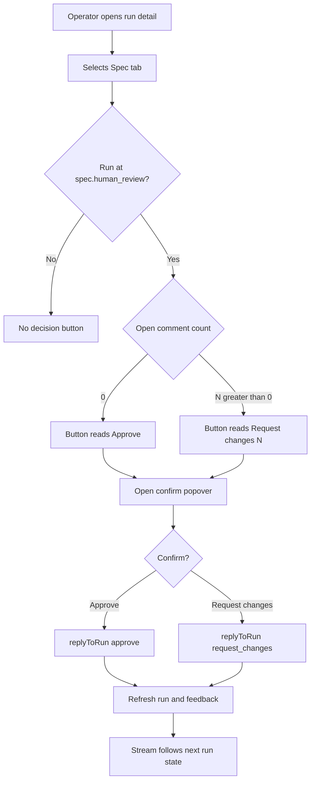
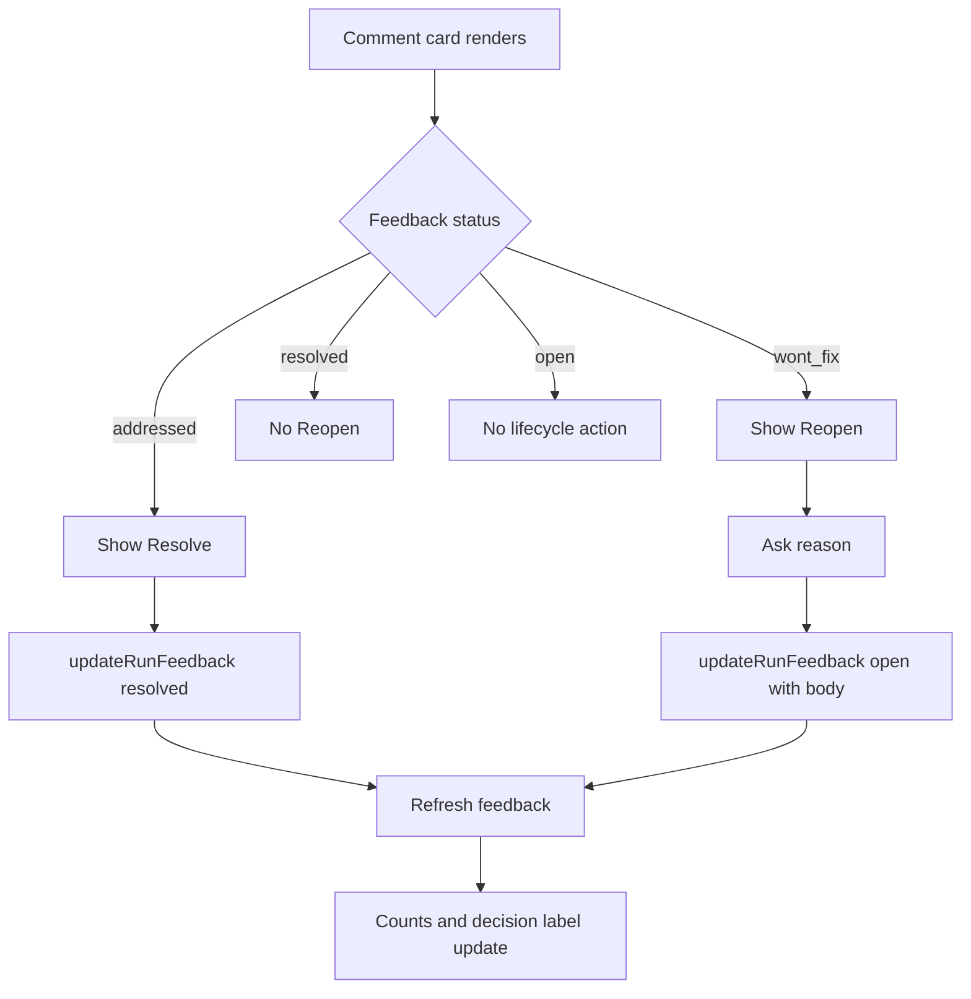
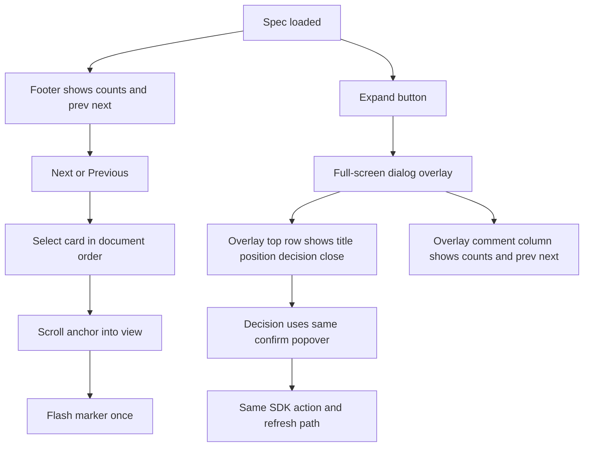
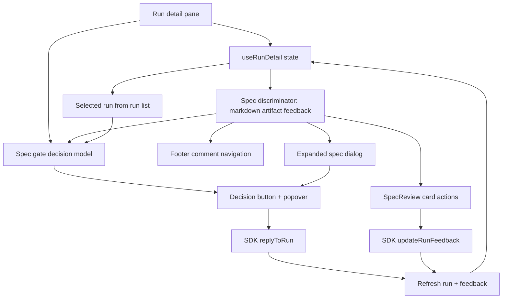
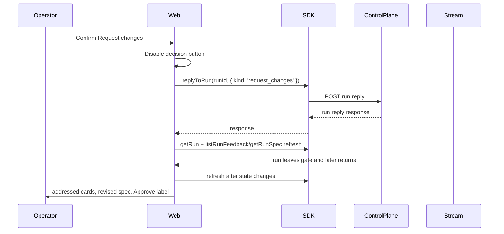
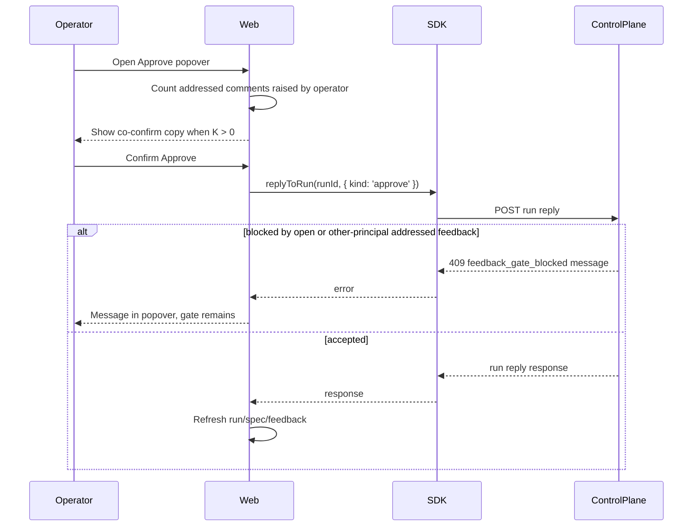

# Decide a spec gate and track comments

## What

Operators can decide the spec review gate from the run detail pane and from the expanded spec view. A run waiting at `spec.human_review` shows one decision button: `Approve` when no comment is open, or `Request changes (N)` when N spec comments are open. The same review surface lets operators resolve addressed comments, reopen declined comments with a reason, and move through comments in document order.

The feature completes the web client experience for the spec gate built by the run detail pane and anchored spec comments work. The operator can seed fake mode, comment on a spec, request changes, watch the scripted agent revise the spec, decide whether addressed comments are resolved, and approve the gate without leaving the production web path.

## Why

Spec review is only useful when the operator can turn comments into a gate decision without guessing what blocks the run. Today the review surface can show and create comments, but the operator still needs a clear single action for the gate and a reliable way to distinguish comments that still block approval from comments the agent has addressed.

After this feature, the run detail pane communicates the gate state directly: open comments drive `Request changes`, addressed comments are visible but do not block the originating operator's approval, and the footer keeps the operator oriented while reading a long spec. Fake mode proves the full loop end to end without model calls.

## Personas

- **Phoebe: Product operator** - Reviews specs at the human gate, raises comments, requests revisions, and approves when the spec is ready.
- **Enzo: Engineer** - Reads technical sections, navigates between anchored comments, and verifies revised content before approving or resolving addressed feedback.
- **Opal: Operations maintainer** - Checks fake-mode wiring and geometry so the production client exposes gate decisions consistently.

## Narratives

### Request changes and approve after revision

Phoebe opens the seeded `spec-review` run and selects the Spec tab. The pane bar shows `Approve` because the run is paused at `spec.human_review` and no comment is open. She selects a sentence, submits an anchored comment, and sees the decision button change in place to `Request changes (1)` while the footer reads `1 open, 0 resolved`.

Phoebe activates the button, confirms in the popover, and the client calls the existing run reply operation with `request_changes` without creating another feedback item. The run leaves the gate, the decision button disappears, and the scripted fake agent revises the spec. When the run returns to `spec.human_review`, her card is `addressed`, the footer reads `0 open, 1 resolved`, and the button reads `Approve`. The approval popover tells her that approval also confirms her addressed comment, then the run moves to the implementation gate.

### Review several comments while reading

Enzo opens a spec with two open comments. The footer's detail-pane zone reads `2 open, 0 resolved` and includes previous and next comment actions. He steps through comments in document order; each action selects the next card, scrolls the spec to its anchor, flashes the marker once, and disables at the first or last comment.

One comment becomes addressed after a revision, so Enzo can optionally press `Resolve` on that card before approving. Another comment is declined as `wont_fix`, so its card is dimmed as resolved-style history but includes `Reopen`; when Enzo reopens it, he must provide a reason and the run returns to revise.

### Decide from the larger spec view

Opal expands the loaded Spec tab into the full-screen overlay. The overlay covers the viewport including the footer, keeps the reading and comment column widths from the design system, and moves comment counts plus previous/next actions into the overlay because the footer is hidden.

Opal makes the same gate decision from the overlay. If a confirm popover is open, `Escape` closes the popover first; the next `Escape` closes the overlay. Comments added or changed in either view appear in the other view after the overlay closes.

## User stories

**Request changes and approve after revision**

- Phoebe can see whether the spec gate is approvable from one button in the pane bar.
- Phoebe can request changes over open comments without creating duplicate feedback.
- Phoebe can approve a spec when no comments remain open.
- Phoebe can see that her addressed comments will be confirmed by approval.
- Phoebe can recover from control-plane conflicts without losing the current gate view.

**Review several comments while reading**

- Enzo can distinguish open comments from resolved-style comments in the footer count and cards.
- Enzo can resolve an addressed comment early.
- Enzo can reopen a declined comment with a reason.
- Enzo can navigate comments in document order and see the matching anchor.
- Enzo can work with stale and no-range comments using the same resolve and reopen actions.

**Decide from the larger spec view**

- Opal can expand the loaded spec into a full-screen reading view.
- Opal can decide the spec gate from the overlay with the same behavior as the pane.
- Opal can see counts and comment navigation inside the overlay while the footer is covered.
- Opal can use registered shortcuts and tooltips without shortcuts firing inside inputs, menus, or dialogs.

## Goals

- Show the correct spec-gate decision label for every relevant run state and update it whenever feedback status changes.
- Send only the existing SDK operations: `replyToRun(...approve)`, `replyToRun(...request_changes)`, and `updateRunFeedback` for resolve or reopen.
- Keep comments, counts, and decision state fresh after stream-reported run state changes and after each local action.
- Provide production-path fake-mode Playwright coverage for request changes, revision, approval, comment navigation, overlay decisions, and geometry.
- Update the agent code map and design system rules for the new decision button, footer counts, overlay counts, and addressed/declined comment behavior.

## Non-goals

- Anchoring, composer behavior, markers, and base comment-column rendering from issue #137.
- Any control plane or API contract change.
- Comments on implementation, docs, pull request, the Acceptance tab, or the testing guide.
- Withdrawing an open comment or reopening a resolved comment.
- Replies in a comment thread beyond what the existing anchored-comment view shows.
- The implementation gate decision button, which issue #140 adds.

## Design spec

### User flows

#### Decide the spec gate from the pane

#### Resolve or reopen a comment

#### Navigate comments and use the larger view

### Key UI components

#### Spec gate decision button

- Lives at the far right of the run detail pane bar, one pane padding from the pane's right edge, vertically centered with the pane bar.
- Appears only for a run waiting at `spec.human_review`. It does not appear for in-progress, pull-request-gate, done, failed, or `implementation.human_review` runs.
- Label is `Approve` when the count of `open` comments is zero and `Request changes (N)` when one or more comments are `open`. The label updates in place when comments change; any open confirm popover resets when the label changes.
- Uses the design-system `Gate decision` visual rules. Disabled state covers the in-flight operation and prevents duplicate requests.

#### Confirm popover

- Built on a new shared `Popover` wrapper around the chosen Base UI primitive, matching existing shared UI wrapper patterns.
- Opens below the decision button and names the action. For request changes, it names the number of open comments that will be sent. For approval with K addressed comments raised by the current operator, it says `Approving also confirms K of your addressed comments`.
- `Enter` confirms and `Escape` cancels while focus is in the popover. Control-plane errors remain in the popover with the returned message; non-blocking errors include a way to try again.

#### Comment card lifecycle actions

- An `addressed` card shows `Resolve` only while the run is at `spec.human_review` and the loaded current operator principal id matches the card originator (`thread[0].author.id`). This is an optional early confirmation and is not required before the same operator approves.
- A `wont_fix` card shows `Reopen` only while the run is at `spec.human_review` and the loaded current operator principal id matches the card originator. Activating it asks for a reason and sends that reason as the reopen body.
- A `resolved` card shows no `Reopen`, because the control plane only reopens declined comments. No lifecycle buttons show after the spec gate advances, while the run revises, at implementation review, when done, or when current operator identity is unknown.
- `resolved`, `wont_fix`, and `addressed` count as resolved-style for the footer. `resolved` and `wont_fix` cards are dimmed as the design system states for resolved cards. The status chip still shows the actual status string drawn by issue #137.

#### Footer comment zone

- On the Spec tab only, when a spec exists, the detail pane zone of the footer shows `N open, M resolved`. N counts only `open`; M counts `addressed`, `resolved`, and `wont_fix`.
- Previous and next icon buttons sit in the same zone. They move selection through all comments in document order, including stale and no-range groups after anchored comments. Buttons disable at bounds and disable with a tooltip when there are no comments.
- Icon-only tooltips read `Label (key)` where a key is active and use the action registry names/keys. In the expanded dialog, shortcut keys are suppressed by the dialog guard, so overlay tooltips omit key hints. Other tabs and runs without a spec show no comment counts.

#### Larger spec view

- The pane bar includes an expand button only after the spec has loaded.
- The expanded view is a `Dialog` overlay with `role="dialog"` that covers the entire viewport including the footer. The top row contains the run title, comment position, decision button, and close button.
- The document column is at most `--width-reading-column`; the comment column keeps `--width-comment-column`. Because the footer is covered, the overlay comment column shows the open/resolved counts and previous/next buttons.
- Comments and decisions use the same state and callbacks as the pane, so changes made in either surface are visible in the other.

### Visual references

- Follow `context-agent/wiki/design-system.md` sections `Gate decision`, `Spec reading column`, `Detail pane`, `Overlays, menus, and buttons`, and `Playwright geometry assertions`.
- Update the design system to replace the resolved-card reopen rule with the control-plane-compatible rule: `wont_fix` may reopen with a reason; `resolved` may not reopen; `addressed` may resolve.

## Tech spec

### Introduction and overview

#### Prerequisites and assumptions

- Depends on issue #135 for the run detail pane, pane bar, tab model, action registry, footer zones, run event stream, and selected-run refresh model.
- Depends on issue #137 for the Spec tab document, anchored comments, marker/card rendering, stale and no-range groups, feedback loading, and fake-mode seeded `spec-review` surface.
- Depends through #137 on issue #136 for `replyToRun({ kind: 'request_changes' })`, `replyToRun({ kind: 'approve' })`, `updateRunFeedback`, feedback statuses, and fake-mode revision behavior.
- Uses the SDK public interface only for existing control-plane routes. This feature adds an SDK wrapper for the existing diagnostic `GET /v1/principal` route so the client can learn the current operator principal id; no control-plane route, schema, or persistence change is planned.
- ADR-031 keeps the web client stateless. ADR-032 requires app screens to import shared UI wrappers rather than Base UI directly. ADR-033 defines spec anchor behavior used by navigation.

#### Technical goals

- Derive decision availability and label from selected run step/status plus current feedback list with no duplicate source of truth.
- Refresh feedback after every local feedback/decision action and after every stream-reported run state change.
- Share decision, counts, navigation, and lifecycle action state between pane and overlay.
- Keep keyboard shortcuts centralized in the existing action registry and suppressed in composers, inputs, menus, dialogs, and modifier combinations.

#### Non-goals

- Backend lifecycle changes, new statuses, or new policy rules.
- Local anchor reconciliation beyond what the existing feedback reads return.
- Model calls in tests.

#### Glossary

- **Open count**: Number of spec feedback items with status `open`; only these drive the request-changes label and block approval for the current issue's visible count.
- **Resolved count**: Number of spec feedback items with status `addressed`, `resolved`, or `wont_fix`.
- **Addressed confirmation**: Moving an addressed comment to resolved, either by explicit `Resolve` or by approval when the current operator raised it.
- **Decision button**: The single pane-bar or overlay-top-row action that approves or requests changes for the spec gate.

### System design and architecture

#### High-level architecture

#### Component breakdown

- Shared `Popover` UI wrapper: wraps Base UI popover behavior, styling, focus management, keyboard close, and test ids consistent with `Dialog` and other shared wrappers.
- Principal identity SDK and connection state: add `getPrincipal()` to `packages/sdk/src` for the existing `GET /v1/principal` route, load it once after connection/token validation, and expose `currentPrincipalId | unknown` to run-detail components. Unknown identity is non-fatal: the client omits the approve popover's addressed-confirmation copy and hides originator-only lifecycle actions, while server-side 403/409 remains authoritative.
- Dialog full-screen variant: extend the existing shared `Dialog` wrapper with a first-class full-screen variant prop instead of overriding centered-modal classes. The variant provides viewport coverage, background fill, focus trap, and Base UI Escape handling for the expanded spec overlay.
- Spec decision helpers: pure functions classify gate availability, count statuses, compute button label, compute approval addressed-confirmation copy, and map control-plane errors for display.
- Run detail pane bar additions: place decision button and expand button in the existing pane bar without changing tab semantics.
- Spec feedback actions: add resolve/reopen callbacks to the existing Spec review card surface and use `updateRunFeedback` through `useRunDetail`. Show `Resolve` only when the run is currently waiting at `spec.human_review`, the card status is `addressed`, and `feedback.thread[0].author.id` equals the loaded current principal id. Show `Reopen` only when the run is currently waiting at `spec.human_review`, the card status is `wont_fix`, and `feedback.thread[0].author.id` equals the loaded current principal id. Hide both actions after approval, while the run revises, at implementation review, when done, and when current identity is unknown. Keep 403/409 card errors as race fallbacks.
- Pane-level spec review controller: lift selection and navigation state above `SpecReview`. The controller owns selected feedback id, document-order list, previous/next availability, scroll requests, marker flash requests, counts, and callbacks. `SpecReview` becomes controlled for selected id and navigation commands rather than owning local `selectedId` for cross-surface behavior.
- Footer bridge: expose the pane-level controller to the shell footer detail-pane zone through a small run-detail footer context/slot owned by the runs page layout. This keeps the client stateless per ADR-031 while allowing the footer to render counts and previous/next controls from the selected pane.
- Comment navigation state: tracks selected feedback id, document-order list, previous/next availability, marker flash trigger, and scroll request.
- Expanded spec dialog: renders one `SpecReview` instance at a time. When the overlay is open, unmount the pane's `SpecReview` and mount the overlay instance using the same pane-level controller. This avoids duplicate `spec-document`/composer test ids and duplicate `selectionchange` listeners. Preserving an unsent composer draft across expand/collapse is out of scope.
- Action registry entries: one dynamic Spec gate decision action, Resolve, Previous comment, Next comment, and Expand spec. Use handler-level run/spec guards in addition to focus-context guards rather than expanding `appliesWhen` for run state; registry tests cover the guard helpers and handler no-ops. Keys: decision has no single-key shortcut and no key hint because it opens a destructive confirm popover; Resolve uses `r`; Previous comment uses `Shift+C`; Next comment uses `c`; Expand spec uses `x`. Tooltips include `Label (key)` only where a key is active. Inside the expanded dialog, shortcuts remain suppressed by the dialog guard, so overlay tooltips omit key hints rather than advertising inactive keys.

#### Sequence: request changes and revision

#### Sequence: approve with addressed comments

### Detailed design

#### Data model and schema

No new persisted data model or API schema is required. The client consumes existing SDK types:

- `Feedback.status`: `open`, `addressed`, `resolved`, `wont_fix`.
- `replyToRun(id, { kind: 'approve' })`.
- `replyToRun(id, { kind: 'request_changes' })`.
- `updateRunFeedback(id, feedbackId, { status: 'resolved' })`.
- `updateRunFeedback(id, feedbackId, { status: 'open', body })`.

#### Decision and count logic

- Decision button visibility is true only when the selected run is waiting at `spec.human_review`. It is false for all other run states and gates, including `implementation.human_review`.
- `openCount = feedback.filter(status === 'open').length`.
- `resolvedCount = feedback.filter(status in ['addressed', 'resolved', 'wont_fix']).length`.
- Button label is `Approve` when `openCount === 0`; otherwise `Request changes (${openCount})`.
- The request-changes confirmation uses `openCount`. It never calls `createRunFeedback`.
- The approve confirmation counts addressed feedback whose originator is the current operator, comparing `feedback.thread[0].author.id` to the loaded current principal id from `getPrincipal()`. If current principal id is unknown, omit the `Approving also confirms K of your addressed comments` copy entirely. If the control plane rejects because another principal's addressed feedback blocks approval, show the returned message.

#### Refresh behavior

- After every local action (`replyToRun`, `updateRunFeedback`, comment creation from #137), the hook triggers a feedback/spec refresh and reconciles with the selected run refresh.
- After every stream-reported run state change from #135, the hook rereads the run's spec and feedback when the run is spec-capable. This keeps counts and cards correct when the agent returns from revision.
- Stale response guards from #135 remain in force; a refresh for an old selected run must not overwrite the current run.

#### Error handling

- Decision `feedback_gate_blocked` errors keep the popover open and render the control-plane message.
- Other decision errors render the control-plane message and a retry affordance in the popover.
- Resolve/reopen `403` or `409` errors render the control-plane message on the relevant card and leave the local card state unchanged. These are fallback race/error paths; normally the actions are hidden unless the run is at `spec.human_review` and the loaded current principal id matches `feedback.thread[0].author.id`.
- In-flight actions disable only the relevant action and prevent duplicate requests.

#### Comment navigation

- Build one ordered list from anchored comments sorted by document order, followed by stale comments, followed by no-range comments as rendered by #137.
- Previous/next updates selected feedback id. For anchored comments, scroll the spec anchor into view and fire a one-shot marker flash. For stale or no-range comments, scroll/select the card group.
- Disable previous at the first item and next at the last. Disable both with a tooltip when the list is empty.

#### Overlay behavior

- Use the existing shared `Dialog` wrapper with a new full-screen variant prop. The overlay is full viewport and closes on `Escape` only when no nested confirm popover is open.
- The overlay receives the same run, spec, feedback, callbacks, selected comment id, and action state as the pane through the pane-level controller. No parallel data loader is introduced. The pane `SpecReview` is unmounted while the overlay is open.
- The overlay top row includes the decision button and close button; the comment column includes counts and previous/next controls.

### Security, privacy, and compliance

- The client performs no authorization decisions beyond hiding inapplicable controls. The control plane remains authoritative for approval, request changes, resolve, and reopen.
- Reopen reason input is user-provided text sent to an existing endpoint. It must use existing textarea/input escaping patterns and must not render as raw HTML.
- Error messages are displayed from the control plane's safe public response envelope; do not log bearer tokens or raw request bodies.
- Keyboard shortcuts must not fire while focus is in text entry controls, including the comment composer and reopen reason input. Overlay and popover Escape handling is owned by those layers' Base UI handlers; the shell `close-layer` binding must not also act. Tests cover pressing Escape once closes the confirm popover and leaves the overlay open, then pressing Escape again closes the overlay.

### Observability

- No new backend telemetry is required.
- Client-side tests should assert duplicate-submit guards by observing SDK calls.
- Existing user-visible error surfaces are sufficient; console logging should be limited to established client error patterns and avoid secrets.

### Testing plan

- Playwright production-path fake-mode test: seed `spec-review`, open run, see `Approve`, add anchored comment, see `Request changes (1)`, confirm, see button disappear, wait for scripted revision, see addressed card and `Approve`, see addressed-confirm copy, approve, and see implementation gate.
- Playwright comment navigation test: seed two comments, verify `Request changes (2)` and `2 open, 0 resolved`, walk previous/next, verify selection and anchor scroll.
- Playwright overlay test: open larger view, make a decision from it, and assert overlay box equals viewport.
- Playwright geometry test: decision button right edge/vertical center and footer detail zone start with sidebar open/closed and light/dark themes.
- Component tests with SDK faked at public interface cover count labels, addressed approval copy, other-principal `409`, `wont_fix` and `resolved` card actions, resolve/reopen errors, decision errors, and duplicate-submit prevention.
- No test makes a model call.

### Alternatives considered

- **Always show separate Approve and Request changes buttons.** Rejected because the concept requires one decision at a time and the button label communicates the current gate state.
- **Count addressed comments as open until explicitly resolved.** Rejected because request changes acts only on `open` comments and the operator's own addressed comments can be confirmed by approval.
- **Allow reopening resolved comments in the client to match the old design-system wording.** Rejected because the control plane only reopens declined (`wont_fix`) comments. The design system should change to match the backend lifecycle.
- **Build a separate data loader for the overlay.** Rejected because it would create stale-state and duplicate-refresh risks; the overlay should compose the same state as the pane.

### Risks

- Current-operator identity can be unavailable if the existing principal route fails or the SDK call is unauthorized. Mitigate by loading it once on connect, treating it as unknown on failure, omitting the addressed-confirmation copy when unknown, hiding originator-only Resolve/Reopen actions when unknown, and leaving the control plane authoritative for races.
- Stream and action refreshes can race. Mitigate with existing stale guards and targeted tests that change feedback status while the selected run updates.
- Geometry regressions are likely because the pane bar, footer, and overlay all share constrained space. Mitigate with Playwright geometry tests across sidebar and theme states.
- Fake-mode timing can make end-to-end tests flaky. Mitigate by waiting on observable run state and UI changes rather than fixed sleeps.

## Task list

- [ ] **Story: Add shared popover and spec decision model**
  - [ ] **Task: Create the shared `Popover` wrapper**
    - **Description**: Add an `apps/web` shared UI wrapper around the Base UI popover primitive, following the existing `Dialog`, `Tooltip`, and button wrapper conventions for imports, styling hooks, focus behavior, keyboard close, and tests.
    - **Acceptance criteria**:
      - [ ] Screens import the local `Popover` wrapper, not Base UI directly.
      - [ ] The wrapper supports anchored trigger/content rendering, focus return, `Escape` close, and testable roles/labels.
      - [ ] Unit tests cover open/close, keyboard cancellation, focus return, and className/style composition.
    - **Dependencies**: None
  - [ ] **Task: Implement pure spec decision helpers**
    - **Description**: Add pure helpers that classify decision visibility, count open/resolved feedback, build the decision label, detect label changes, and compute addressed-confirmation copy for the current operator.
    - **Acceptance criteria**:
      - [ ] Helpers return no decision for in-progress, pull-request-gate, done, failed, and `implementation.human_review` runs.
      - [ ] `open` feedback is the only open count; `addressed`, `resolved`, and `wont_fix` are the resolved count.
      - [ ] Labels are exactly `Approve` and `Request changes (N)`.
      - [ ] Tests cover zero, one, and many open comments plus addressed comments from current and other principals.
    - **Dependencies**: None
  - [ ] **Task: Add SDK principal lookup and connected-operator state**
    - **Description**: Add `getPrincipal()` to `packages/sdk/src` for the existing `GET /v1/principal` route, load it once after the web client connects, and expose the loaded current principal id to run-detail decision and feedback components. Treat lookup failure as unknown identity rather than blocking the app.
    - **Acceptance criteria**:
      - [ ] The SDK wraps the existing principal route without adding a control-plane route or schema.
      - [ ] The web client loads the principal once on connect/token validation and stores `currentPrincipalId` for the session.
      - [ ] On lookup failure, approval still works but omits the addressed-confirmation copy, and Resolve/Reopen actions are hidden.
      - [ ] SDK tests cover successful parsing and public error handling for the principal route.
      - [ ] Component tests cover known-current-operator and unknown-operator behavior.
    - **Dependencies**: None

- [ ] **Story: Wire the spec gate decision button**
  - [ ] **Task: Add the pane-bar decision button and confirm popover**
    - **Description**: Place the decision button at the far right of the run detail pane bar for `spec.human_review` only, open a confirm popover under it, and reset the popover whenever the computed label changes.
    - **Acceptance criteria**:
      - [ ] A spec-review run with no open comments shows `Approve`.
      - [ ] A spec-review run with N open comments shows `Request changes (N)`.
      - [ ] A non-gate run, pull-request-gate run, done run, failed run, and implementation-review run show no decision button.
      - [ ] `Enter` confirms and `Escape` cancels the popover.
      - [ ] The button matches design-system visual rules and geometry.
    - **Dependencies**: `Task: Create the shared Popover wrapper`, `Task: Implement pure spec decision helpers`, `Task: Add SDK principal lookup and connected-operator state`
  - [ ] **Task: Call `replyToRun` for approve and request changes**
    - **Description**: Wire confirmation to `replyToRun` with `approve` or `request_changes`, disable the button while in flight, prevent duplicate requests, and avoid creating feedback when requesting changes.
    - **Acceptance criteria**:
      - [ ] Approve sends exactly `replyToRun(runId, { kind: 'approve' })`.
      - [ ] Request changes sends exactly `replyToRun(runId, { kind: 'request_changes' })`.
      - [ ] A second activation while in flight sends no second request.
      - [ ] Request changes does not call `createRunFeedback`.
      - [ ] Success triggers run/spec/feedback refresh and follows the existing stream path.
    - **Dependencies**: `Task: Add the pane-bar decision button and confirm popover`
  - [ ] **Task: Render decision errors in the popover**
    - **Description**: Handle `feedback_gate_blocked` and other control-plane errors by showing the returned message in the confirm popover and keeping the run state unchanged.
    - **Acceptance criteria**:
      - [ ] `feedback_gate_blocked` shows the control-plane message in the popover.
      - [ ] Other errors show the control-plane message and a retry affordance.
      - [ ] Failed decisions leave the decision label and run state unchanged until refreshed by the server.
      - [ ] Component tests cover open-comment and other-principal addressed conflicts.
    - **Dependencies**: `Task: Call replyToRun for approve and request changes`

- [ ] **Story: Add resolve and reopen actions to comment cards**
  - [ ] **Task: Wire addressed comment resolution**
    - **Description**: Add a `Resolve` action for `addressed` cards that calls `updateRunFeedback` with `status: 'resolved'`, refreshes feedback, and moves the card into the resolved visual style.
    - **Acceptance criteria**:
      - [ ] Only `addressed` cards raised by the loaded current operator show `Resolve`, and only while the run is at `spec.human_review`.
      - [ ] Resolve sends exactly `updateRunFeedback(runId, feedbackId, { status: 'resolved' })`.
      - [ ] Success updates the card style and footer counts.
      - [ ] `403` and `409` errors show the control-plane message on the card and leave the card unchanged.
      - [ ] Component tests cover hidden Resolve for other-originator comments, unknown current operator, revising runs, implementation-gate runs, and approved/done runs.
    - **Dependencies**: `Task: Implement pure spec decision helpers`
  - [ ] **Task: Wire declined comment reopening**
    - **Description**: Add a `Reopen` action for `wont_fix` cards, prompt for a reason, call `updateRunFeedback` with `status: 'open'` and the reason body, and refresh the run/feedback state after the run returns to revise.
    - **Acceptance criteria**:
      - [ ] Only `wont_fix` cards raised by the loaded current operator show `Reopen`, and only while the run is at `spec.human_review`; `resolved` cards do not.
      - [ ] Reopen requires a non-empty reason.
      - [ ] Reopen sends exactly `updateRunFeedback(runId, feedbackId, { status: 'open', body: reason })`.
      - [ ] Success returns the run to revise and updates counts after refresh.
      - [ ] `403` and `409` errors show the control-plane message on the card and leave the card unchanged.
      - [ ] Component tests cover hidden Reopen for other-originator comments, unknown current operator, revising runs, implementation-gate runs, approved/done runs, and resolved comments.
    - **Dependencies**: `Task: Wire addressed comment resolution`
  - [ ] **Task: Update card styles for addressed, resolved, and declined statuses**
    - **Description**: Align card and marker rendering with this issue's lifecycle mapping while preserving issue #137 status chips and grouping behavior.
    - **Acceptance criteria**:
      - [ ] `resolved` and `wont_fix` cards are dimmed as resolved-style cards.
      - [ ] `addressed`, `resolved`, and `wont_fix` use the resolved marker style; a resolved marker has no underline.
      - [ ] Status chips continue to display the actual feedback status.
      - [ ] Stale and no-range cards support resolve/reopen when their status allows it.
    - **Dependencies**: `Task: Wire declined comment reopening`

- [ ] **Story: Add footer counts and comment navigation**
  - [ ] **Task: Render Spec-tab footer counts**
    - **Description**: Fill the detail-pane footer zone on the Spec tab with `N open, M resolved` when a spec exists, using the decision count rules and updating as feedback changes.
    - **Acceptance criteria**:
      - [ ] Counts appear only on the Spec tab for runs with a spec.
      - [ ] Open and resolved counts match the defined status mapping.
      - [ ] Counts update after comment creation, request changes, revision, resolve, reopen, and approval refreshes.
      - [ ] Other tabs and runs without specs show no comment counts.
    - **Dependencies**: `Task: Implement pure spec decision helpers`
  - [ ] **Task: Lift spec selection state and implement previous/next actions**
    - **Description**: Move selected comment id, navigation list, scroll requests, and marker flash requests into a pane-level controller above `SpecReview`, then add footer previous/next buttons that use the controller to move through comments in document order.

    - **Acceptance criteria**:
      - [ ] Buttons move through anchored comments in document order, then stale and no-range groups.
      - [ ] The selected card and marker are visibly selected after navigation.
      - [ ] Anchored navigation scrolls the spec to the anchor and flashes the marker once.
      - [ ] Previous disables at the first comment and next disables at the last.
      - [ ] Both buttons disable with a tooltip when there are no comments.
    - **Dependencies**: `Task: Render Spec-tab footer counts`
  - [ ] **Task: Bridge pane comment controls into the shell footer**
    - **Description**: Add a small run-detail footer context or slot so the shell footer detail-pane zone can render the selected pane's counts and navigation callbacks without duplicating run state.
    - **Acceptance criteria**:
      - [ ] The footer receives counts, disabled states, tooltips, and previous/next callbacks from the selected run detail pane.
      - [ ] The bridge clears its content when the Spec tab is not active, the selected run has no spec, or the pane unmounts.
      - [ ] The bridge does not persist server data and remains consistent with the stateless-client ADR.
      - [ ] Tests cover footer cleanup when changing tabs, changing runs, and opening/closing the overlay.
    - **Dependencies**: `Task: Lift spec selection state and implement previous/next actions`
  - [ ] **Task: Register footer and comment navigation actions**
    - **Description**: Register previous and next comment actions in the #134 action registry with names, keys, applicability rules, and `Label (key)` tooltips.
    - **Acceptance criteria**:
      - [ ] Action registry entries exist for previous comment and next comment.
      - [ ] Tooltips include the label and key.
      - [ ] Single-key shortcuts do not fire in the composer, reopen reason input, any input, menus, dialogs, or with modifiers held.
      - [ ] Component tests cover applicability and shortcut suppression.
    - **Dependencies**: `Task: Bridge pane comment controls into the shell footer`

- [ ] **Story: Add the expanded spec view**
  - [ ] **Task: Add the pane-bar expand action and full-screen dialog**
    - **Description**: Add a full-screen variant prop to the shared `Dialog` wrapper, then show an expand button when the spec has loaded and open a full-screen dialog overlay that covers the viewport including the footer.
    - **Acceptance criteria**:
      - [ ] Expand is hidden until the spec is ready.
      - [ ] The shared `Dialog` wrapper has a tested full-screen variant rather than class overrides fighting centered-modal defaults.
      - [ ] The overlay has `role="dialog"` and covers the viewport including the footer.
      - [ ] The top row shows run title, position, decision button, and close button.
      - [ ] `Escape` closes the overlay when no confirm popover is open.
      - [ ] The document column and comment column obey the design-system width tokens.
    - **Dependencies**: `Task: Add the pane-bar decision button and confirm popover`, `Task: Lift spec selection state and implement previous/next actions`
  - [ ] **Task: Share decision, counts, and comments between pane and overlay**
    - **Description**: Compose the overlay from the same spec, feedback, selection, and action callbacks as the pane so decisions and comments made in either place are reflected in the other.
    - **Acceptance criteria**:
      - [ ] The overlay comment column shows open/resolved counts and previous/next buttons.
      - [ ] A decision made from the overlay has the same effect as one made from the pane.
      - [ ] `Escape` closes a confirm popover first and the overlay second, with no extra shell `close-layer` action firing.
      - [ ] Comments made in the overlay appear in the pane after close, and pane comments appear in the overlay.
      - [ ] Only one `SpecReview` instance is mounted at a time; tests do not find duplicate `spec-document` or composer test ids while the overlay is open.
    - **Dependencies**: `Task: Add the pane-bar expand action and full-screen dialog`
  - [ ] **Task: Register the decision, resolve, and expand actions**
    - **Description**: Add action registry entries for the one dynamic spec gate decision action (its label follows the open count, so Approve and Request changes are not separate entries), Resolve, and Expand with names, applicability rules, and tooltips. Resolve acts on the selected comment and does nothing when none is selected or the selected comment cannot be resolved.
    - **Acceptance criteria**:
      - [ ] Each action has a stable registry name and applicability rule. Resolve uses `r` and Expand uses `x`; the decision action has no key.
      - [ ] Tooltips read `Label (key)` where a key is active; the decision action and overlay controls omit inactive key hints.
      - [ ] Shortcuts are suppressed in text inputs, composers, menus, dialogs, and modifier combinations; overlay tooltips omit key hints while dialog suppression makes keys inactive.
      - [ ] Registry/handler tests cover spec-gate and non-spec-gate applicability through handler-level guards.
    - **Dependencies**: `Task: Share decision, counts, and comments between pane and overlay`

- [ ] **Story: Keep run, spec, and feedback state fresh**
  - [ ] **Task: Refresh feedback after local actions and stream state changes**
    - **Description**: Extend the existing selected-run detail hook so every local decision/comment lifecycle action and every stream-reported run state change rereads the spec feedback and, when needed, the spec body.
    - **Acceptance criteria**:
      - [ ] After Request changes, the decision button disappears and the status shows the run working.
      - [ ] When the fake agent returns to `spec.human_review`, addressed cards, revised spec text, counts, and `Approve` label are fresh.
      - [ ] After Approve, the run advances and no spec decision button remains.
      - [ ] Stale response guards prevent an old refresh from overwriting a newly selected run.
    - **Dependencies**: `Task: Call replyToRun for approve and request changes`, `Task: Wire declined comment reopening`
  - [ ] **Task: Preserve read-only comments after the spec gate advances**
    - **Description**: Ensure the Spec tab remains readable after approval while comment creation and spec-gate decisions are unavailable for the completed spec gate.
    - **Acceptance criteria**:
      - [ ] After Approve, the Spec tab keeps comments read-only.
      - [ ] No spec decision button shows once the run is at the implementation gate.
      - [ ] Existing cards, stale group, and no-range group remain visible and counted only where applicable.
    - **Dependencies**: `Task: Refresh feedback after local actions and stream state changes`

- [ ] **Story: Verify fake-mode wiring and update documentation**
  - [ ] **Task: Add Playwright production-path gate decision tests**
    - **Description**: Add end-to-end tests against fake mode on the production client path and seed command, with no SDK fakes or test-only hooks.
    - **Acceptance criteria**:
      - [ ] Test 1 covers seed, `Approve`, add anchored comment, `Request changes (1)`, confirm, revision, addressed card, approval co-confirm copy, approve, and implementation gate.
      - [ ] Test 2 covers two comments, `Request changes (2)`, `2 open, 0 resolved`, previous/next navigation, selection, and anchor scroll.
      - [ ] Test 3 covers larger view decision and viewport-sized overlay.
      - [ ] No Playwright test makes a model call.
    - **Dependencies**: `Story: Wire the spec gate decision button`, `Story: Add footer counts and comment navigation`, `Story: Add the expanded spec view`, `Story: Keep run, spec, and feedback state fresh`
  - [ ] **Task: Add Playwright geometry coverage**
    - **Description**: Add geometry assertions for the decision button and footer detail-pane zone across sidebar and theme states.
    - **Acceptance criteria**:
      - [ ] The decision button right edge is one pane padding from the pane's right edge.
      - [ ] The decision button vertical center aligns with the pane bar vertical center.
      - [ ] The footer detail-pane zone starts at the pane's left edge.
      - [ ] Assertions pass with sidebar open and closed, in light and dark themes.
    - **Dependencies**: `Task: Add Playwright production-path gate decision tests`
  - [ ] **Task: Add component tests for SDK-facing behavior**
    - **Description**: Add component tests using SDK fakes only at the public interface for labels, popover copy, lifecycle card actions, and errors.
    - **Acceptance criteria**:
      - [ ] Tests cover each decision label count.
      - [ ] Tests cover addressed-count approval copy and other-principal `409`.
      - [ ] Tests cover `wont_fix` and `resolved` cards.
      - [ ] Tests cover each decision, resolve, and reopen error response.
      - [ ] Tests prove duplicate decision submits are prevented.
    - **Dependencies**: `Story: Wire the spec gate decision button`, `Story: Add resolve and reopen actions to comment cards`
  - [ ] **Task: Update code map and design system docs**
    - **Description**: Record the new decision button, comment footer, larger view, and lifecycle visual rules in agent documentation.
    - **Acceptance criteria**:
      - [ ] `context-agent/wiki/code-map.md` records the decision button, comment footer, and larger view modules.
      - [ ] `context-agent/wiki/design-system.md` records addressed, declined, and resolved card actions and overlay counts.
      - [ ] The design system no longer says a resolved card has a Reopen button.
      - [ ] No unrelated design-system content changes are included.
    - **Dependencies**: `Task: Add component tests for SDK-facing behavior`

## References

- `context-human/concepts/run-detail.md`, especially `Gate decisions` and `Spec`.
- `context-human/concepts/ux.md`, `context-human/concepts/feedback.md`, and `context-human/concepts/hitl.md`.
- `context-agent/wiki/design-system.md`, especially `Gate decision`, `Spec reading column`, `Detail pane`, and `Playwright geometry assertions`.
- `context-human/adrs/adr-031-web-client-architecture.md`, `context-human/adrs/adr-032-web-client-stack.md`, and `context-human/adrs/adr-033-spec-comment-anchors.md`.
- `context-human/specs/feature-run-detail-pane.md`, `context-human/specs/feature-review-spec-anchored-comments.md`, and `context-human/specs/feature-spec-artifact-feedback-gate.md`.
- `packages/api-contract/src/feedback.ts` and `packages/api-contract/src/run-replies.ts`.
