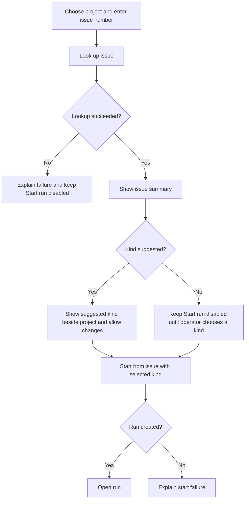
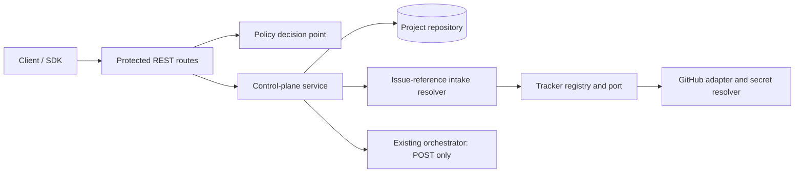
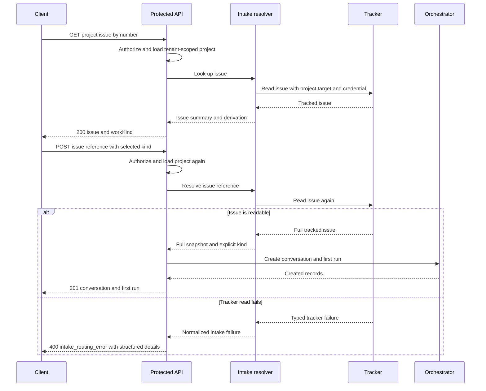

# Issue lookup and explicit work kind

## What

An operator can find a tracked issue by project and issue number, confirm it is the right issue, and see the work kind its labels or title suggest. The operator can keep that suggestion or name a different work kind when starting a run. When the issue has no usable suggestion, the operator can still start a run by making an explicit choice.

## Why

Today, an operator has to try to start a run to find out whether intake recognizes the issue's work kind. An issue with missing or conflicting metadata can block the run even when the operator knows which workflow to use. Looking up the issue first separates finding the right issue from choosing the workflow. Consistent errors let the operator understand what went wrong even if the tracker was reachable during lookup but fails when the run starts.

## Personas

- **Phoebe: PM** — confirms she has the right issue before starting work from a brief.
- **Enzo: Engineer** — chooses the workflow when an issue's labels or title do not reflect the work.

## Narratives

### Confirm a suggestion

Phoebe looks up issue #27 in the project where it was filed. She recognizes the title and follows the issue link to check the full brief. The issue's `feature` label gives her a suggested work kind.

Phoebe keeps the suggestion and starts a feature run. If the brief instead describes a fix, she can choose `bug` without editing the issue.

### Choose a kind without a suggestion

Enzo looks up a regression with no recognized label or title prefix. He can see that the issue exists and that no kind was suggested. He chooses `bug` and starts the run, even if the issue is already closed.

On another attempt, the tracker credential is removed after Enzo looks up the issue. The start request fails without creating a run. The client can explain that the credential is missing using the same error code it would receive if the credential had been missing during lookup.

## User stories

**Confirm a suggestion**

- Phoebe can find a tracked issue by project and number.
- Phoebe can verify the issue from its number, title, link, labels, and state.
- Phoebe can tell whether the suggestion came from a label or the title prefix.
- Phoebe can keep or replace the suggestion when starting a run.
- Phoebe can tell whether an unsuccessful lookup means the project is inaccessible or the issue is missing.

**Choose a kind without a suggestion**

- Enzo can distinguish missing kind metadata from conflicting work-kind labels.
- Enzo can start a run with any of the four supported issue work kinds when the issue has no suggestion.
- Enzo can look up and start a run on a closed issue without reopening it.
- Enzo can tell the difference between missing tracker setup, missing credentials, rejected credentials, and tracker unavailability.
- Enzo can receive the same explanation for a tracker failure at lookup or at start without relying on error message text.

## Goals

- Return one issue summary and one derivation result for each successful lookup, with no issue body.
- Keep lookup and implicit intake in agreement for label, title-prefix, no-match, and ambiguous-label cases.
- Honor all four explicit issue work kinds; create no run when an implicit kind cannot be settled.
- Use one machine-readable `intake_routing_error` details contract across lookup and conversation creation.
- Use the same tracker read and credential resolution for both paths, with no model call at intake.

## Non-goals

- Implement the start-a-run client or design-system changes in #142 or #143. Neither is a prerequisite.
- Classify free-form text, add a classify-preview endpoint, or change how free-form references are extracted and routed.
- Create issues or add a description or question path to start a run.
- List or search tracker issues, or report whether an issue already has a run.
- Add tracker providers or change persistence, workflow selection rules, or run deduplication beyond accepting the explicit kind.

## Design spec

### Operator flow enabled by the API

#141 ships the API and SDK, not UI changes. This flow defines what the downstream client must be able to do using the contract.



### Client states supported by the contract

- **Looking up:** A result applies only to the project and issue number that produced it. Changing either invalidates the displayed result and selection.
- **Found:** Show issue metadata and preselect the suggested kind when present. Let the operator change it. A closed issue is informational, not a blocker.
- **Found without a suggestion:** Keep the issue visible and require a choice. Both `no_match` and `ambiguous_labels` take this path. #143 owns the missing-kind copy and design-system changes.
- **Lookup or start fails:** Use `error.details.code` for `intake_routing_error` on either route. For lookup `404`, use `error.details.resource` to distinguish an inaccessible project from a missing issue. Keep Start run disabled without a successful lookup and a selected kind. A successful lookup does not guarantee the POST will succeed.

See [UX](../concepts/ux.md), [Collection](../concepts/collection.md), and the [existing design system](../../context-agent/wiki/design-system.md). No new visual components or mockups are needed for #141.

## Tech spec

### Introduction and overview

Extend the [project API](feature-project-management-api.md), [issue-reference intake](feature-start-run-from-issue-reference.md), and existing [fake mode](feature-scripted-fake-mode-seed-command.md). Reuse contract-first REST and shared Zod schemas (ADR-005 through ADR-007), the principal and policy seam (ADR-009), and the [tracker port](../concepts/trackers.md). A **derived kind** comes from issue metadata. An **explicit kind** is the value the caller submits on a structured issue reference. This change needs no new storage, migration, or provider integration.

### System design and architecture



Register the new GET with the protected project routes in `packages/core/src/routes.ts`. The service loads the tenant-scoped project and uses the resolver already wired for conversation ingress. The API contract owns the path, parameters, narrow work-kind enum, response, and error details. The resolver owns tracker reads and derivation. Only the existing POST orchestration path writes a run.



### Detailed design

#### Lookup contract

`GET /v1/projects/:id/issues/:number` requires bearer authentication and has no request body. Validate `id` as a non-empty project ID under the existing convention. Accept decimal digits for `number` and parse them as a positive safe integer. Reject zero, negative, fractional, nonnumeric, and unsafe values before project or tracker access. Describe `number` as an integer path parameter in OpenAPI.

A `200` contains exactly `issue` and `workKind`:

```json
{
  "issue": {
    "number": 5,
    "title": "Improve startup feedback",
    "url": "https://github.com/autocatalyst-fixtures/demo-app/issues/5",
    "labels": [],
    "state": "open"
  },
  "workKind": { "kind": null, "source": "none", "reason": "no_match" }
}
```

Project the five issue fields explicitly into a strict summary schema. Require a title, URL, label array, number, and the existing tracked-issue state (`open`, `closed`, `merged`, or `unknown`). Never include the issue body. Define a strict derivation union: `{ kind: IssueWorkKind, source: 'label' | 'title_prefix' }` or `{ kind: null, source: 'none', reason: 'no_match' | 'ambiguous_labels' }`. Resolved results omit `reason`. `IssueWorkKind` is `feature | enhancement | bug | chore`; it does not include the other create-run kinds.

| Status and code | Condition and response details |
| --- | --- |
| `400 validation_error` | Invalid path parameters. |
| `400 intake_routing_error` | No tracker configured: exactly `{ code: 'tracker_not_configured' }`. Unsupported provider or invalid target uses its corresponding shared code. |
| `400 intake_routing_error` | Missing or unusable credential, rejected credential, unavailable provider, or invalid provider response: `details.code` is respectively `tracker_credential_missing`, `tracker_auth_failed`, `tracker_provider_unavailable`, or `tracker_response_invalid`. Include `trackerCode` and allowlisted context only as defined below. An unclassified adapter read failure uses `tracker_read_failed` and a generic message. |
| `401 unauthorized` | Missing or invalid bearer token, per existing auth behavior. |
| `403 forbidden` | Policy denies access, or a model principal requests the lookup even if policy allows it. |
| `404 not_found` | Missing or cross-tenant project: identical response with `details: { resource: 'project' }`. The accessible project's tracker reports `issue_not_found`: `details: { resource: 'issue' }`. Do not include tracker metadata in either `404`. |
| `500 internal_error` | Unexpected server fault outside known intake failures. Return the standard sanitized response. |

#### Shared intake routing error details

Use the existing envelope `{ error: { code: 'intake_routing_error', message, details } }` with one shared, strict `details` schema for GET and POST. The top-level code and HTTP status still identify the error family; clients branch on `error.details.code` for the cause. Do not expose `details.reason`; `reason` remains a field only on a successful lookup with an unresolved derivation.

- Require `details.code` on every `intake_routing_error` from either route. For resolver-originated failures use the `IssueReferenceIntakeErrorCode`, including `tracker_not_configured`, `unsupported_tracker_provider`, `tracker_target_invalid`, `tracker_credential_missing`, `tracker_read_failed`, `issue_reference_ambiguous`, and `work_kind_unresolved`. For a typed adapter failure, map the internal `tracker_read_failed` wrapper to the concrete `IssueTrackerErrorCode` on the wire. For example, a missing credential has `code: 'tracker_credential_missing'` regardless of which layer detected it.
- Include `details.trackerCode` only when the failure came from a typed `IssueTrackerError`. Its value is that adapter code and equals the public `details.code` in that case. A non-typed read exception gets only `{ code: 'tracker_read_failed' }`.
- Preserve existing safe adapter context only for `provider`, `repository`, and `issueNumber`, and only when the field is present in the adapter's details and exactly matches the configured provider, configured `owner/name`, or requested issue number, respectively. Copy the value from trusted read context after the match. These fields are optional, only for typed adapter failures, and are not needed to classify errors. Drop all other keys. Never spread `error.safeDetails` or serialize the adapter message, raw output, credential or credential reference, cause, or stack. Use a service-owned message for adapter failures.
- Centralize the normalization and use it from both service paths. Preserve the POST status and established intake messages for known failures. If the issue disappears between lookup and start, keep POST `400 intake_routing_error` with `details.code` and `trackerCode` both `issue_not_found`; GET represents that same tracker result as `404 not_found` with `resource: 'issue'`. Do not change unrelated `not_found` responses.
- For POST paths outside the resolver that already produce `intake_routing_error`, use `{ code: 'project_not_accessible' }` when the project is missing or out of tenant, and `{ code: 'unknown_work_kind' }` or `{ code: 'invalid_transition' }` for the corresponding existing orchestrator errors. Keep their status and routing behavior. Leave validation, authorization, active-run conflicts, and other error families on their existing contracts.

For example, exact `error.details` for both routes with project target `acme/demo` and issue `27`:

| Failure | Exact details |
| --- | --- |
| No tracker configured | `{ "code": "tracker_not_configured" }` |
| Credential missing during project target resolution | `{ "code": "tracker_credential_missing" }` |
| GitHub adapter cannot resolve its credential | `{ "code": "tracker_credential_missing", "trackerCode": "tracker_credential_missing", "provider": "github" }` |
| GitHub rejects the credential during the read | `{ "code": "tracker_auth_failed", "trackerCode": "tracker_auth_failed", "provider": "github", "repository": "acme/demo", "issueNumber": 27 }` |

#### Shared resolver behavior

In `packages/core/src/issue-reference-intake.ts`, extract a common issue read used by the lookup operation and `resolve`. Select the provider from `Project.issueTrackerSetting`, use the existing tracker registry and project repository owner/name, and prefer the setting's `credentialRef`. If the setting does not name one, require exactly one credential with purpose `issue_tracker`, as today. The adapter resolves the secret. Do not filter out closed issues.

Derive the kind in one pure function. Lowercase and trim labels, then count matches against the four supported kinds. One matching label wins even if the title disagrees. More than one matching label returns `ambiguous_labels` without consulting the title; preserve the existing match count rather than deduplicating normalized labels. With zero matches, lowercase and trim the title and check the literal prefixes `feat:`, `fix:`, and `chore:`, mapping to `feature`, `bug`, and `chore`. Otherwise return `no_match`. The lookup returns this derivation as data without checking workflow availability. Implicit intake consumes the same result, preserves the existing workflow check, and raises `work_kind_unresolved` with the existing explanatory message for unresolved metadata or a missing workflow. Retain the normalized matched labels internally as needed for the existing ambiguity message; do not add them to the derivation response.

#### Conversation ingress delta

Add optional `workKind` to the strict `issueReferenceSubmissionSchema` alongside `kind`, `body`, and `issue`. Any value outside the four-kind enum, including `null`, `question`, and `file_issue`, returns `400 validation_error`. For `kind: 'issue_reference'`, still read the issue and pass the full snapshot and message through existing intake. If an explicit kind is present, use it as given without settling from labels or prefixes, including when labels conflict. Keep the existing orchestrator workflow and run guards. On success, the existing `201` response reports the selected `run.workKind`.

If the kind is omitted, keep metadata settlement and failure behavior: an unresolved issue returns `400 intake_routing_error` with the existing `work_kind_unresolved` message and `details.code: 'work_kind_unresolved'`, before creating a run. A free-form submission with one extracted `#N` still derives the kind from the issue and ignores `submission.workKind`. Its extraction, precedence, outcome, status, and messages stay the same; only the shared error details are added or normalized. Leave other submission schemas and routing unchanged.

#### SDK and OpenAPI

Add `lookupProjectIssue(projectId, number)` to `packages/sdk/src/client.ts`. Use the shared path, encode the project ID as one path segment, send an authenticated GET, parse `200` with the shared response schema, and preserve structured errors through existing SDK handling. Register `/v1/projects/{id}/issues/{number}` in generated OpenAPI. Document the GET `400`, `403`, and `404` responses, including the two GET `404` resource values. Document the optional POST request field and shared `intake_routing_error` schema for both operations' `400` entries alongside `validation_error`. Keep the generic error schema for unrelated routes.

### Security, privacy, and compliance

Add a `project_issue` resource descriptor with project ID, raw issue-number path parameter, and route pattern, plus a `project_issue.read` action in `packages/core/src/policy.ts`. Invoke the policy decision point in the protected pre-handler, after authentication and before application parameter validation, project reads, or tracker reads. Explicitly deny model principals even under permissive policy. Use the authenticated principal's tenant for project lookup and never accept a caller-provided tracker target. Use the same message and details for absent and cross-tenant projects so the lookup does not reveal another tenant's projects.

Lookup returns only the summary and derivation. Error handling must not expose issue bodies, credentials, credential references, or raw provider output. POST continues to use the full tracked-issue snapshot internally as it does today.

### Observability

Reuse request tracing and sanitized route-fault logging. Where the existing logging conventions support it, record the route pattern, status, and stable error code. Do not log tracker bodies, credentials, or provider output. No new metrics or alerts are needed.

### Testing plan

- **Contract and SDK:** Test the narrow optional enum, strict summary and derivation shapes, path validation, and shared error schema. In `openapi.spec.ts`, assert the GET operation and its `400`, `403`, and `404` responses, the shared intake error details, and the optional POST field. Use injected fetch for SDK URL, auth, success parsing, and structured error propagation.
- **Resolver:** Table-test lookup/implicit-intake parity for label priority, normalization, all three prefixes, no match, and ambiguity even when a prefix matches. Check that a valid override skips settlement but not the read. Check that a single free-form `#N` still ignores a supplied kind.
- **Paired route errors:** Use matching project and tracker fixtures to exercise both GET and POST for not configured, resolver-level missing credential, and adapter auth failure. Assert `400`, `error.code: 'intake_routing_error'`, and deep equality of the entire `error.details` against the three exact objects above, not a partial match. Also cover adapter-level missing credentials and outage, and assert `details.code` remains the classifier. Inject sentinel secrets and raw output into the adapter message, cause, unknown details keys, and spoofed context values; verify no sentinel is returned and disallowed keys cannot overwrite the normalized codes. Assert exact GET `404` details for missing and cross-tenant projects and a missing issue; check that POST retains `400` with code `issue_not_found` if the issue is missing at start. Assert policy denial and model denial happen before repository or tracker I/O. Confirm failed POST requests create no run.
- **Production wiring:** Use `createControlPlaneServer` with temporary SQLite, seeded projects and credentials, auto-dispatch disabled, and a fake `gh` shell script passed through `githubIssueTracker.executablePath`, following `apps/control-plane/src/issue-reference-create.integration.spec.ts`. Exercise the actual GET and POST routes with Fastify injection. Look up labeled, unlabeled, ambiguous, and closed fixtures. Verify the label suggestion, `no_match`, and `ambiguous_labels` with no issue body. For the unlabeled fixture, first omit `workKind` and verify rejection with no run, then submit `bug` and verify the stored and returned run kind. Verify a different explicit kind wins on the labeled fixture, an invalid kind returns `400`, and both lookup and start succeed for the closed fixture. Use separate issues or isolated setup for successful creates to avoid existing deduplication. No automated test makes network or model calls.
- **Manual check after implementation:** Run `pnpm nx run control-plane:serve-fake` and `pnpm nx run control-plane:seed-fake -- --scenario spec-review`. With `Authorization: Bearer fake-mode-token`, find the project via `GET /v1/projects` and look up `GET /v1/projects/<project-id>/issues/5`. Expect an issue summary and `{ kind: null, source: 'none', reason: 'no_match' }`. Send `POST /v1/conversations` with that project ID, an unused `identity`, a topic title, and `submission: { kind: 'issue_reference', body: 'Work on issue #5', issue: { number: 5 } }`. Expect `400 intake_routing_error` with `details.code: 'work_kind_unresolved'`. Repeat with `workKind: 'bug'` inside `submission`; expect `201` and `run.workKind: 'bug'`. See [fake-mode fixtures](../../docs/operators/fake-mode.md).

### Alternatives considered

- **Derive the kind in the client.** This duplicates intake rules and can drift. Return the shared derivation instead.
- **Use lookup as a create token.** This saves a tracker read but introduces caching and freshness rules. Read again at POST so intake sees the latest issue while respecting the explicit choice.
- **Keep separate GET and POST error details.** This limits changes to POST but requires the client to parse messages or maintain two classifiers for the same failure. Normalize both routes and preserve the existing POST statuses and safe context.

### Risks

- **Tracker state changes between requests.** Read again at start, preserve the operator's explicit kind, and give clients the same cause code for tracker failures that can happen on either route.
- **Shared resolver code changes legacy routing.** Keep the override in the structured branch and regression-test both implicit and free-form behavior.
- **Adapter diagnostics leak on the wire.** Validate context against the read target, build details from allowlisted fields, and test with sentinel values rather than trusting a field named `safeDetails`.

## Task list

These tasks are planning output for human review. They do not authorize implementation.

- [ ] **Story: Define and publish the issue lookup contract**
  - [ ] **Task: Add shared lookup and intake schemas**
    - **Description**: Define the route path, parameters, strict issue summary, derivation union, and four-value work-kind enum in `packages/api-contract`. Add optional `workKind` to the structured issue-reference schema and define the shared intake error details and lookup `404` details.
    - **Acceptance criteria**:
      - [ ] Lookup requires exactly the five summary fields and rejects issue bodies and inconsistent kind/source/reason combinations.
      - [ ] Path parsing rejects invalid or unsafe issue numbers. Issue-reference validation accepts omission or one of the four kinds, and rejects other values including `null`.
      - [ ] The shared error schema requires a stable `details.code`, constrains adapter codes and allowlisted context, and has no `details.reason`. Free-form and other submission schemas remain unchanged.
    - **Dependencies**: None
  - [ ] **Task: Publish OpenAPI and add the SDK method**
    - **Description**: Register the GET and updated POST contracts in generated OpenAPI. Add `lookupProjectIssue(projectId, number)` using shared path and response definitions and existing SDK error handling.
    - **Acceptance criteria**:
      - [ ] `openapi.spec.ts` asserts GET parameters, response schema, and `400`, `403`, and `404` responses. Both `400` entries document shared intake details and POST documents the optional enum.
      - [ ] Injected-fetch tests verify URL encoding, auth, success validation, and preservation of structured errors.
    - **Dependencies**: Task: Add shared lookup and intake schemas
- [ ] **Story: Look up an issue and start with the chosen kind**
  - [ ] **Task: Share tracker reads and kind derivation**
    - **Description**: Extract the project tracker read and pure derivation in `issue-reference-intake.ts`. Add lookup behavior and scope the explicit override to structured issue references.
    - **Acceptance criteria**:
      - [ ] Parity tests cover label precedence, normalization, all three prefixes, no match, and ambiguity without prefix fallback. Implicit intake retains the workflow check and unresolved messages.
      - [ ] An explicit choice bypasses settlement, including ambiguous labels, but still requires a successful tracker read and passes the tracked snapshot to intake.
      - [ ] A single free-form issue reference ignores the supplied kind and keeps its existing routing behavior.
    - **Dependencies**: Task: Add shared lookup and intake schemas
  - [ ] **Task: Normalize intake errors at the service boundary**
    - **Description**: Implement one safe normalization path for lookup and conversation service operations. Map typed adapter failures to concrete public cause codes and populate existing POST intake errors with required details.
    - **Acceptance criteria**:
      - [ ] Resolver and adapter credential failures share `details.code`; only adapter failures include `trackerCode`. Existing POST statuses and messages for established failures remain intact.
      - [ ] Context keys are copied only when allowlisted and matched to the read inputs. Unknown keys, spoofed context, credentials, and raw provider output never reach the response.
      - [ ] POST project access, unresolved work kind, ambiguous reference, and existing orchestrator intake errors have the specified details without changing their routing.
    - **Dependencies**: Task: Share tracker reads and kind derivation
  - [ ] **Task: Serve the protected tenant-scoped issue lookup**
    - **Description**: Wire the service operation and resolver into the protected GET route. Add the resource descriptor and action, validate the path, scope the project to the tenant, and project the summary.
    - **Acceptance criteria**:
      - [ ] The policy point receives the new descriptor and action; denied and model principals get `403` before repository or tracker work.
      - [ ] Unknown and cross-tenant projects get the same `404` with `resource: 'project'`; a tracker missing the issue gives `404` with `resource: 'issue'`.
      - [ ] Known tracker failures have the documented safe details; lookup returns only summary and derivation, accepts closed issues, and creates no run.
    - **Dependencies**: Task: Normalize intake errors at the service boundary
- [ ] **Story: Verify and document production wiring**
  - [ ] **Task: Verify exact error parity across GET and POST**
    - **Description**: Add paired route tests with deterministic tracker and project fixtures; check the complete details object and verify no run starts on failure.
    - **Acceptance criteria**:
      - [ ] Both GET and POST have exact `error.details` equality against the documented not-configured, resolver-level missing-credential, and adapter auth-failure objects, and respond `400 intake_routing_error`.
      - [ ] Adapter credential and outage cases use the documented codes. Spoofed details and sentinel secrets/raw provider output stay out of the response.
      - [ ] Lookup distinguishes the two `404` resources, while a vanished issue on POST retains `400` and `details.code: 'issue_not_found'`. Missing and cross-tenant projects are indistinguishable on lookup.
    - **Dependencies**: Task: Serve the protected tenant-scoped issue lookup
  - [ ] **Task: Exercise lookup and start through the production server**
    - **Description**: Use production-server injection, temporary SQLite, dispatch disabled, and a fake `gh` shell script configured via `githubIssueTracker.executablePath`.
    - **Acceptance criteria**:
      - [ ] Labeled, unlabeled, and ambiguous fixtures return the expected derivation, without issue bodies.
      - [ ] Omission on the unlabeled fixture returns `400` and creates no run; explicit `bug` succeeds. A differing explicit kind wins on a labeled issue.
      - [ ] A closed issue can be looked up and used to start a run. An invalid explicit kind is rejected and a single free-form reference still ignores its supplied kind. Tests make no network or model calls.
    - **Dependencies**: Task: Serve the protected tenant-scoped issue lookup
  - [ ] **Task: Record the issue lookup code paths**
    - **Description**: Update `context-agent/wiki/code-map.md` with the route, resolver and error normalization, explicit override boundary, SDK method, and test locations.
    - **Acceptance criteria**:
      - [ ] The code map points to GET and POST's shared tracker read and error contract, identifies the structured-only override, and locates the SDK and production wiring tests.
    - **Dependencies**: Task: Publish OpenAPI and add the SDK method; Task: Verify exact error parity across GET and POST; Task: Exercise lookup and start through the production server
