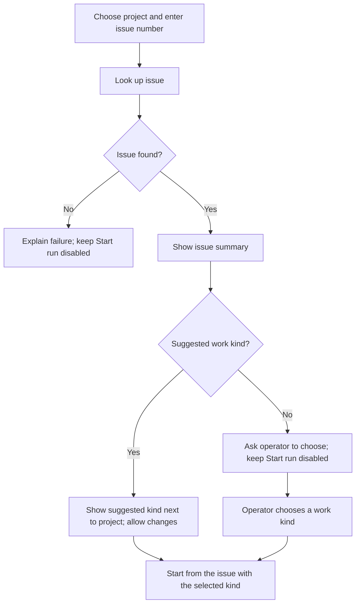
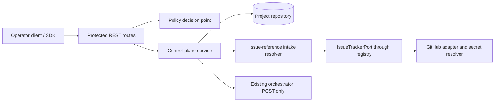
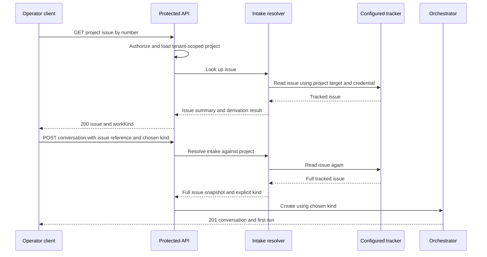

# Issue lookup and explicit work kind

## What

An operator can look up a tracked issue by project and issue number, confirm they found the right issue, and see the work kind its labels or title suggest. When starting a run from that issue, the operator can name a work kind instead of relying on the suggestion. If the issue has no usable suggestion, an explicit choice lets the operator proceed without editing the issue.

## Why

Today the operator finds out what intake inferred only after asking it to start a run. Issues with no matching label or title prefix, or with conflicting work-kind labels, cannot start a run through issue-reference intake. Looking up the issue first separates finding the right issue from choosing the workflow, while leaving existing callers that omit a choice on the same routing path.

## Personas

- **Phoebe: PM** — confirms that she has the right tracked issue before starting work from a brief.
- **Enzo: Engineer** — chooses the workflow when issue metadata is missing, conflicting, or out of date.

## Narratives

### Confirm a suggested kind

Phoebe looks up issue #27 in the project where it was filed. She recognizes the title and can follow the issue link if she needs to read the full brief. Its `feature` label gives her a suggested work kind.

Phoebe keeps the suggestion and starts a feature run. If the label no longer reflects the work, she can choose a different kind without changing the tracker issue.

### Choose a kind when metadata is inconclusive

Enzo looks up a regression that has neither a recognized label nor a recognized title prefix. The issue is still found, but the lookup reports that there is no suggested kind. Enzo chooses `bug` and starts the run.

The same choice is available when an issue has conflicting work-kind labels. If an existing caller submits an unresolved issue reference without choosing a kind, intake still rejects the request before it creates a run.

## User stories

**Confirm a suggested kind**

- Phoebe can find a tracked issue by project and number.
- Phoebe can confirm the issue by its number, title, link, labels, and state.
- Phoebe can see whether the suggestion came from a label or the title prefix.
- Phoebe can keep or replace the suggestion when starting a run.

**Choose a kind when metadata is inconclusive**

- Enzo can distinguish a found issue with no suggestion from an issue the tracker could not find.
- Enzo can distinguish no matching metadata from conflicting work-kind labels.
- Enzo can start an issue-reference run with one of the four supported work kinds even when that issue has no usable suggestion.
- Enzo can look up and start a run on a closed issue without reopening it.

## Goals

- Return one issue summary and one derivation result per successful project-and-number lookup; never include the issue body in that response.
- Keep lookup and implicit issue-reference intake in agreement for label, title-prefix, no-match, and ambiguous-label cases.
- Honor all four allowed explicit kinds on issue-reference submissions, even when metadata conflicts. Create no run when implicit settlement fails.
- Read tracker data through the same provider and credential path as intake, without a model call.

## Non-goals

- Implement the web start-a-run flow or design-system changes in #142 or #143. Neither is a prerequisite for #141.
- Classify free-form text, add a classify-preview endpoint, or change existing free-form reference behavior.
- Create issues or add a description or question path to the start-a-run flow.
- List or search tracker issues, or show whether an issue already has a run.
- Add tracker providers or change workflow, persistence, or deduplication rules.

## Design spec

### Operator flow enabled by the API

#141 ships the server and SDK behavior only. This flow describes the downstream client interaction that the contract must support. It does not authorize UI work in this issue.



### Client states supported by the contract

- **Looking up:** Do not enable Start run against stale data. A result belongs to the project and issue number that produced it; changing either invalidates the displayed result and choice.
- **Found:** Show the issue and its state. Preselect a derived kind when present, but let the operator change it. A closed issue is informational, not a blocker.
- **Found without a suggested kind:** Keep the issue visible and require an explicit choice. Both `no_match` and `ambiguous_labels` take this path. The missing-kind line and its placement in the design system belong to #143.
- **Lookup failed:** Distinguish a missing project or issue from tracker setup, credential, and availability problems using the error envelope. No successful lookup means no Start run action in this client flow.

See [UX](../concepts/ux.md), [Collection](../concepts/collection.md), and the [existing design system](../../context-agent/wiki/design-system.md). No new visual components or mockups are required for the API-only delivery.

## Tech spec

### Introduction and overview

This feature extends the [project API](feature-project-management-api.md), [issue-reference intake](feature-start-run-from-issue-reference.md), and [fake mode](feature-scripted-fake-mode-seed-command.md). Reuse contract-first REST and shared Zod schemas (ADR-005 through ADR-007), the principal and policy seam (ADR-009), and the provider-neutral tracker port. A **derived kind** is a suggestion based on issue metadata; an **explicit kind** is the value in a structured issue-reference submission. Neither the lookup nor issue intake adds a model call. Workflow execution after intake remains unchanged.

### System design and architecture



Add a project issue lookup operation to the existing service and wire it to the resolver instance used by conversation ingress. Register the GET route with the protected project routes. The API contract owns the path, parameters, response schemas, and narrow work-kind enum; the SDK uses the same contract. The resolver owns tracker reads and metadata derivation. The orchestrator remains the only path that creates a run.



### Detailed design

**Lookup contract.** `GET /v1/projects/:id/issues/:number` requires bearer authentication and has no request body. Validate `id` as a non-empty project ID using the existing convention. Treat `number` as decimal digits in the URL and parse it as a positive safe integer; reject zero, negative, fractional, nonnumeric, and out-of-range values before tracker access. OpenAPI describes the number as an integer path parameter. A `200` contains exactly `issue` and `workKind`:

```json
{
  "issue": {
    "number": 5,
    "title": "Improve startup feedback",
    "url": "https://github.com/autocatalyst-fixtures/demo-app/issues/5",
    "labels": [],
    "state": "open"
  },
  "workKind": { "kind": null, "source": "none", "reason": "no_match" }
}
```

Use a dedicated strict issue-summary schema: `number`, `title`, `url`, `labels` (required string array), and `state` (the existing tracked-issue states `open`, `closed`, `merged`, `unknown`). Project those five fields explicitly; do not spread the full tracker object into the response. Define `workKind` as a union: `{ kind: IssueWorkKind, source: 'label' | 'title_prefix' }` or `{ kind: null, source: 'none', reason: 'no_match' | 'ambiguous_labels' }`. Resolved results omit `reason`. `IssueWorkKind` is `feature | enhancement | bug | chore`, not the broader create-run enum that also accepts `file_issue` and `question`.

| Status and code | Condition and details |
| --- | --- |
| `400 validation_error` | Invalid path parameters. |
| `400 intake_routing_error` | No tracker configured: `details.reason = 'tracker_not_configured'`. |
| `400 intake_routing_error` | Missing or unusable credential, rejected credential, or provider unavailable: `details.trackerCode` is `tracker_credential_missing`, `tracker_auth_failed`, or `tracker_provider_unavailable`, respectively. Use the same safe code for missing credentials whether detected during target resolution or by the adapter. |
| `400 intake_routing_error` | Other known tracker/configuration failures use the same envelope and only an allowlisted reason or tracker code, such as `unsupported_tracker_provider`, `tracker_target_invalid`, or `tracker_response_invalid`. Unclassified tracker read failures use a generic message. |
| `401` | Missing or invalid bearer token, per existing auth behavior. |
| `403 forbidden` | Policy denies access, or the principal is a model even when policy allows the request. |
| `404 not_found` | Project is missing or outside the caller's tenant, or a read of an accessible project's tracker reports `issue_not_found`. Use the same response for missing and cross-tenant projects. |
| `500 internal_error` | Unexpected server fault outside the known intake failures; return the standard sanitized response. |

**Shared resolver behavior.** Extract the common read from `packages/core/src/issue-reference-intake.ts` and use it for both lookup and intake. Select the provider from `Project.issueTrackerSetting`, reuse the registry and repository owner/name target, and prefer the setting's `credentialRef`; otherwise use exactly one credential with purpose `issue_tracker`. The existing adapter resolves the secret. Preserve the established POST translation of tracker errors; translate the allowlisted typed codes into the GET outcomes at the new boundary.

Extract metadata derivation into one pure function. Lowercase and trim labels, then count matches against the narrow enum, preserving current match-count behavior. One matching label wins even if the title disagrees. Multiple matching labels return `ambiguous_labels` without trying the prefix. When no label matches, lowercase and trim the title and match only the current literal prefixes `feat:`, `fix:`, and `chore:`. They map to `feature`, `bug`, and `chore`. Otherwise return `no_match`. Lookup returns this result as data and does not check workflow availability. Implicit intake consumes the same result, preserves its existing workflow check, and turns unresolved results into the existing `work_kind_unresolved` error and explanatory message. Neither path filters out closed issues.

**Conversation ingress delta.** Add an optional top-level `workKind` within the strict `issueReferenceSubmissionSchema`, alongside `kind`, `body`, and `issue`. Any other value, including `null`, `question`, and `file_issue`, returns `400 validation_error`. For `kind: 'issue_reference'`, still read the issue and pass the full snapshot and message through existing intake. If `workKind` is supplied, forward it to the existing orchestrator without settling from labels or prefixes; the usual workflow and run guards still apply. If omitted, keep existing settlement and HTTP behavior: an unresolved issue returns `400 intake_routing_error` with the existing message from `work_kind_unresolved`, before any run is created. When `kind: 'free_form'` has one extracted issue reference, still settle from metadata and ignore `submission.workKind`. Leave all other submission cases unchanged.

**SDK and documentation.** Add `lookupProjectIssue(projectId, number)` to `packages/sdk/src/client.ts`. Send an authenticated GET using the shared path, encode the project ID as one path segment, use the existing SDK error handling, and parse the `200` with the shared response schema. Publish `/v1/projects/{id}/issues/{number}` and the updated POST request schema in generated OpenAPI. No database change, migration, or stored preview is needed.

### Security, privacy, and compliance

Add a `project_issue` descriptor (project ID, issue number path parameter, and route pattern) and `project_issue.read` action in `packages/core/src/policy.ts`. Call the policy point in the protected pre-handler before project or tracker work. Reject model principals even under permissive policy, before parameter parsing or resource reads. Resolve the project using the principal's tenant and project ID, following the existing tenant-scoped `getProject` read; never accept a caller-supplied tracker target. Allowlist response fields and error details. Never serialize a secret or handle, raw provider output, the underlying exception, or the issue body from lookup.

### Observability

Reuse request tracing and sanitized route-fault logging. Record the route, status, and safe error code where existing conventions support them; do not log issue payloads, credentials, or provider output. No new metrics or alerts are required.

### Testing plan

- **Contract and SDK:** Test supported and rejected issue-reference kinds, strict summary and derivation shapes, and path validation. Assert the generated GET operation and its `400`, `403`, and `404` responses in `openapi.spec.ts`. Use an injected fetch stub to test SDK URL, bearer auth, response parsing, and propagation of structured API errors.
- **Resolver and route:** Table-test parity for label precedence, normalization, each title prefix, no match, and ambiguity. Verify explicit choices bypass settlement, including conflicts, without bypassing the tracker read. Test free-form with one `#N` and an explicit kind it must ignore. Cover invalid parameters, model and policy denial before I/O, missing and cross-tenant projects, missing tracker settings, and typed tracker failures. Check errors for sentinel credentials and raw output leaks.
- **Production wiring:** Use `createControlPlaneServer` with temporary SQLite, seeded credentials and projects, `githubIssueTracker.executablePath` pointing to a fake `gh` shell script, and auto-dispatch disabled. Follow the script pattern in `issue-reference-create.integration.spec.ts`, but exercise the real HTTP routes with Fastify injection. Assert lookup metadata for labeled, no-match, ambiguous, and closed fixtures; assert closed-issue start, explicit `bug` on the unresolved issue, and a different explicit kind on the labeled issue. Verify omission on the unresolved issue fails and creates no run. Do not use live tracker tests, network calls, or model calls.
- **Manual check after implementation:** Run `pnpm nx run control-plane:serve-fake` and `pnpm nx run control-plane:seed-fake -- --scenario spec-review`. Use `Authorization: Bearer fake-mode-token` on `GET /v1/projects` to find the fixture project and then on `GET /v1/projects/<project-id>/issues/5`. Expect `200` with `workKind.kind: null`, `source: none`, and `reason: no_match`. Send `POST /v1/conversations` with the project ID, an unused `identity`, a topic title, and `submission: { kind: 'issue_reference', body: 'Work on issue #5', issue: { number: 5 } }`. Expect `400 intake_routing_error`. Add `workKind: 'bug'` to the submission and expect `201` with `run.workKind: 'bug'`. See [fake-mode fixtures](../../docs/operators/fake-mode.md).

### Alternatives considered

- **Derive the kind in the client:** This avoids returning derivation metadata but duplicates the server's routing rules and misses the shared credential and tracker failure path. Keep one server rule and return its result.
- **Reuse the lookup as a create token:** This avoids a second tracker read but introduces freshness and caching rules. Read again on POST so the issue snapshot reflects the tracker at intake; use the operator's explicit kind unchanged.

### Risks

- **Metadata changes after lookup.** An implicit POST derives from the latest tracker read. An explicit POST preserves the operator's selection, but still fails if the issue can no longer be read.
- **Shared code changes legacy routing.** Keep the override scoped to `issue_reference` and regression-test free-form and unresolved POST behavior before relying on the new lookup.
- **Tracker output leaks through error handling.** Map stable typed codes only, project response fields explicitly, and test representative failures with sentinel values.

## Task list

- [ ] **Story: Define the issue lookup and submission contracts**
  - [ ] **Task: Add shared issue lookup schemas**
    - **Description**: Define and export the route path, path parameters, success status, strict summary, derivation union, and narrow issue work-kind enum in `packages/api-contract`. Extend the strict issue-reference submission with the optional enum.
    - **Acceptance criteria**:
      - [ ] The lookup success schema requires the five summary fields and rejects an issue body or an inconsistent kind/source/reason combination.
      - [ ] Path validation rejects non-positive or unsafe issue numbers. Submission validation accepts omission or one of the four kinds and rejects every other value, including `null`, `file_issue`, and `question`.
      - [ ] Free-form and other submission schemas stay unchanged.
    - **Dependencies**: None
  - [ ] **Task: Publish OpenAPI and add the SDK method**
    - **Description**: Register the GET operation and optional POST field in OpenAPI. Implement `lookupProjectIssue(projectId, number)` using the shared response contract and existing SDK fetch and error handling.
    - **Acceptance criteria**:
      - [ ] `openapi.spec.ts` asserts the bearer-protected GET path, path parameters, success schema, and `400`, `403`, and `404` responses; the POST schema shows the optional four-value field.
      - [ ] SDK tests use injected fetch to verify the request URL, authentication, schema validation, and preservation of structured errors.
    - **Dependencies**: "Task: Add shared issue lookup schemas"
- [ ] **Story: Look up a tracked issue and honor the chosen workflow**
  - [ ] **Task: Share tracker reads and kind derivation**
    - **Description**: Extract the shared tracker read and derivation rule in `issue-reference-intake.ts`. Use both for lookup and implicit intake. Use the explicit kind only in the structured issue-reference branch after reading the issue.
    - **Acceptance criteria**:
      - [ ] Parity tests cover label priority, normalization, all existing title prefixes, no match, and ambiguity without prefix fallback. Implicit intake keeps its workflow check and unresolved error.
      - [ ] A valid explicit kind bypasses metadata settlement for unlabeled, conflicting, and ambiguous issues, but tracker failures still prevent creation.
      - [ ] A single free-form `#N` ignores `workKind`; all other free-form routing remains unchanged.
    - **Dependencies**: "Task: Add shared issue lookup schemas"
  - [ ] **Task: Serve the tenant-scoped issue lookup**
    - **Description**: Wire the resolver through the existing service into a protected GET route. Add the policy resource and action, validate parameters, load the tenant-scoped project, and map safe tracker errors per the contract.
    - **Acceptance criteria**:
      - [ ] A policy denial or model principal gets `403` before repository or tracker access; the policy point receives the new descriptor and action.
      - [ ] Unknown and cross-tenant projects get the same `404` without a tracker read. Tracker `issue_not_found` also maps to `404 not_found`.
      - [ ] Missing configuration, missing or rejected credentials, and provider outage get the specified `400 intake_routing_error` details. No raw provider output or credential appears in a response.
      - [ ] The handler returns only summary and derivation data, including `state: closed` when the tracker reports it. Lookup creates no run.
    - **Dependencies**: "Task: Share tracker reads and kind derivation"
- [ ] **Story: Verify and document production wiring**
  - [ ] **Task: Exercise issue lookup and run start through the production server**
    - **Description**: Add production-server injection tests with temporary SQLite, dispatch disabled, and a fake `gh` shell script configured via `githubIssueTracker.executablePath`. Run lookups and create requests against distinct labeled, unlabeled, ambiguous, and closed fixtures.
    - **Acceptance criteria**:
      - [ ] Lookups return a derived kind for the labeled fixture, `no_match` for the unlabeled fixture, and `ambiguous_labels` for the two-label fixture, without returning issue bodies.
      - [ ] The unlabeled fixture returns `400 intake_routing_error` on POST without `workKind` and no run is created. The same issue starts a `bug` run with an explicit choice.
      - [ ] A different explicit kind wins on the labeled fixture. The closed fixture returns `state: closed` on GET and starts a run on POST.
      - [ ] An invalid explicit kind returns `400`, and the single-reference free-form regression confirms it still ignores the supplied kind. Tests make no network or model calls.
    - **Dependencies**: "Task: Serve the tenant-scoped issue lookup"
  - [ ] **Task: Record the issue lookup code paths**
    - **Description**: Update `context-agent/wiki/code-map.md` with the route, resolver read and derivation split, explicit override boundary, and SDK method.
    - **Acceptance criteria**:
      - [ ] The code map points to the route, resolver, SDK, and production wiring tests and notes that free-form issue references do not use the override.
    - **Dependencies**: "Task: Exercise issue lookup and run start through the production server", "Task: Publish OpenAPI and add the SDK method"
