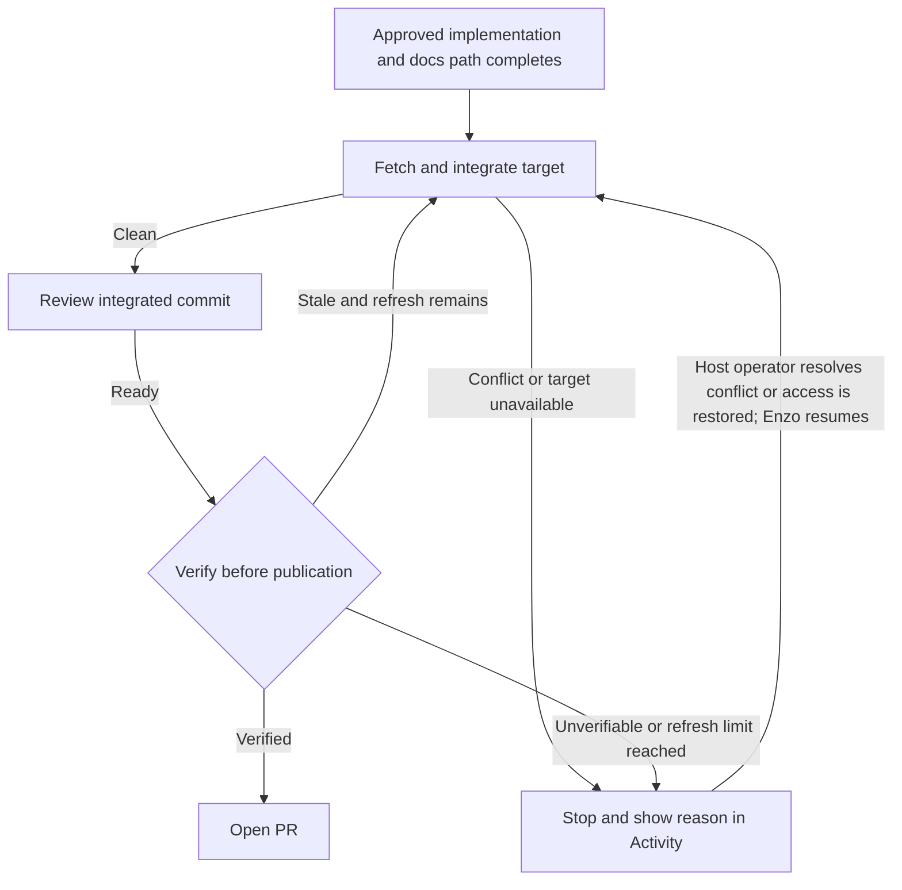
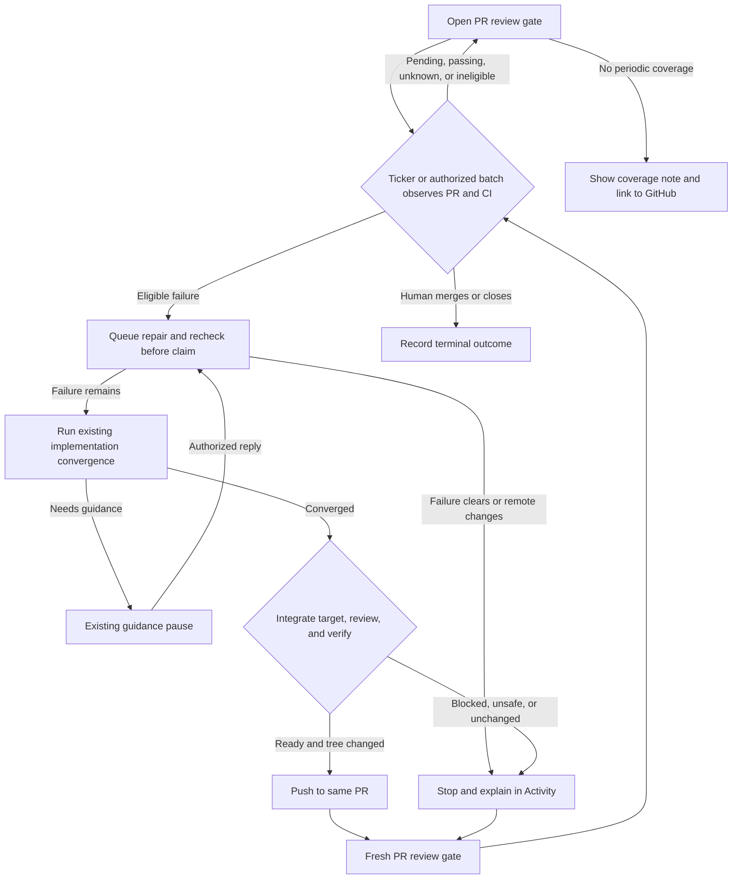
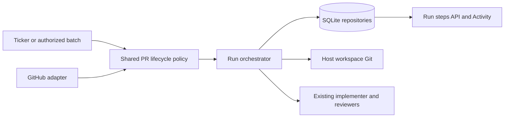
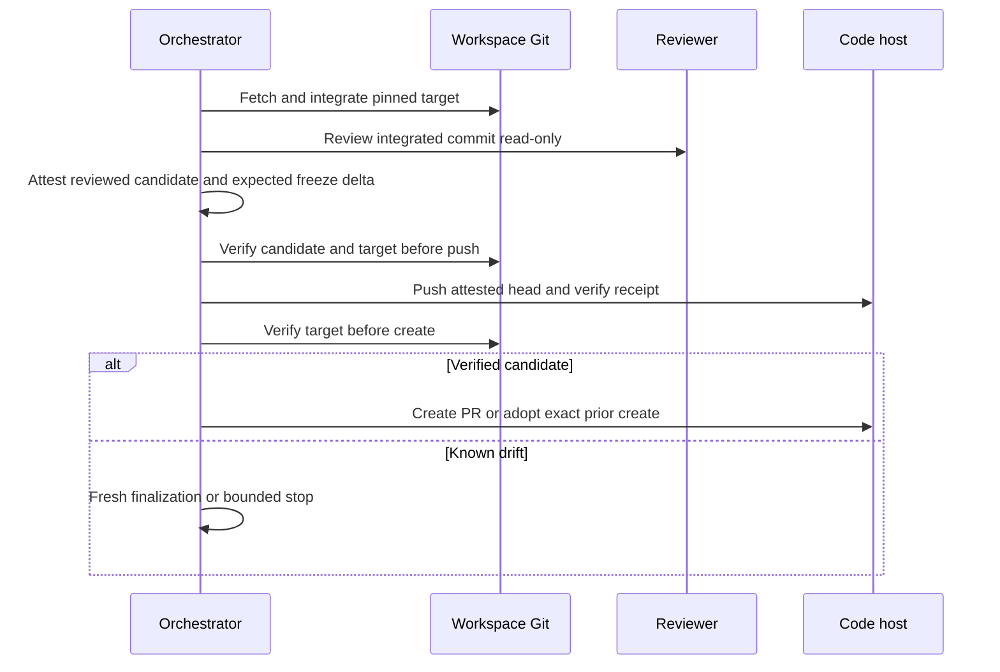
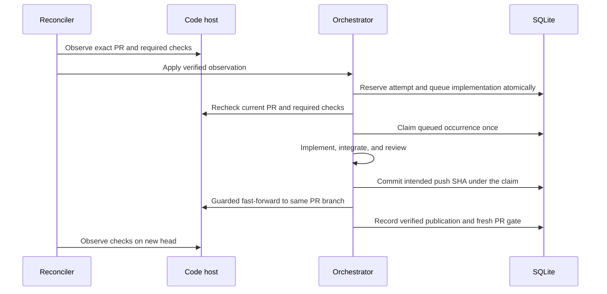

# Check PR integration and repair failed CI

## What

Before opening a pull request (PR), Autocatalyst integrates the current target branch and reviews the combined result. If integration conflicts, it keeps the run’s work, lists the conflicting files in Activity, and stops before opening a PR.

Automatic CI watching applies only on deployments that enable periodic PR reconciliation, and only for the configured, authorized tenant. The watcher is off by default: without it, CI repair can be admitted only through an authorized batch reconciliation. An observed required failure on the current commit published by Autocatalyst can trigger a bounded repair on the same run and PR. A person still decides whether to merge.

## Why

When #141 merged before #142 opened PR #189, finalization missed two conflicts and the operator had to arrange a manual repair. Failed checks on PRs #193 and #197 also needed manual intervention. Catching these problems earlier gives engineers a reviewed integration result and a clear point to take over when automation stops. See friction log items 21 and 23, PR publication in #73, and reconciliation in #85.

## Personas

- **Enzo: Engineer** — Reviews implementation, investigates integration and CI failures, and decides when to merge.
- **Operator** — Configures periodic reconciliation and, with authorized host access, helps recover local work that may not exist on GitHub.

## Narratives

### Two runs finish close together

Enzo approves the second of two runs that started from the same target. The first PR has already merged, so Autocatalyst integrates the updated target before reviewing the second run. When another merge lands before publication, Autocatalyst detects the change and reviews the new combined result before opening the PR.

If integration conflicts, Enzo sees the paths and branch details in Activity. An authorized host operator locates the retained branch by run ID and commits a resolution there with Enzo. After the operator leaves the workspace ready, Enzo uses Resume and the same run goes through final review again.

### A required check fails after opening

The operator has enabled periodic reconciliation for Enzo’s tenant. A required check fails on the commit Autocatalyst published, and the next complete observation queues a repair. The branch was missing a fix already merged into the target. The repair integrates that fix, passes final review, and pushes to the same PR; Activity shows the new commit, and the watcher checks that commit next.

If repair needs guidance, Enzo can answer the same question after a restart. If review blocks the repair or the budget runs out, Activity explains why and links to the existing PR. On a deployment without periodic coverage, Enzo follows the PR link to see CI on GitHub; Autocatalyst does not claim to have seen an unobserved failure.

## User stories

**Two runs finish close together**

- Enzo can review the run change combined with the fetched PR target.
- Enzo can rely on detected target drift before publication to invalidate the older review.
- Enzo can identify conflicting paths and give an authorized host operator the run and branch identifiers without looking for an unpublished PR.
- Enzo can use Resume after the operator resolves the conflict on the retained branch; Enzo cannot resolve a host-only conflict through the product alone.
- Enzo can distinguish a conflict from an unavailable target and retry when target access is restored.
- Enzo can approve a run parked at spec review before the upgrade and get the new checks without recreating the run.

**A required check fails after opening**

- Enzo can tell whether periodic watching covers the PR and where to see CI if it does not.
- Enzo can see which observed required checks failed and which commit they ran on.
- Enzo can follow a repair, including a fix brought in by target integration alone, to the same PR and distinguish its checks from results on earlier commits.
- Enzo can answer a repair question after restart without spending another attempt.
- Enzo can see why automation stopped, take over the PR branch, and see the run reflect a later merge or close.

## Goals

- Review the integrated result and verify it again before publication. Never create a PR from a candidate known to be stale or conflicting.
- Preserve committed run work on conflict and show conflicting paths, branch and commit identifiers, and recovery instructions in Activity.
- For each covered open PR, admit at most one automatic repair per failed head across polls, concurrent observations, and restarts. Default to two admitted attempts per PR.
- Repair only verified required failures on the current Autocatalyst-published head. Keep the same run and PR, human-controlled merge, and existing terminal reconciliation.

## Non-goals

- Webhook delivery, registration, or signature verification.
- Automatic merge, merge queues, or weakening checks or protections to make a repair pass.
- Automatic conflict resolution, remote history rewrites, replacement PRs, or remote recovery branches for unpublished work.
- Automatic repair for fork PRs or providers other than GitHub, default-on or all-tenant periodic watching, new recovery screens, or product-issued shell access.
- General dispatcher fencing, changes to supported startup or deployment modes, or new process supervisors and OS lock dependencies.

## Design spec

### Before publication

### After publication

A verified merge or close also ends an active repair, without a fresh gate. The coverage note describes periodic watching, not whether a batch ran or whether CI passed.

### Run detail and recovery guidance

Reuse the existing PR link, Activity layout, and live refresh. Add no controls. Follow the [design system](../../context-agent/wiki/design-system.md) and name the state in text, not color alone. Record initial stops on the occurrence that encountered them, CI decisions on the original PR gate, and repair outcomes on the closing occurrence. Preserve both failure and outcome after reload.

| State | Activity and next action |
| --- | --- |
| Initial conflict | **PR not opened: integration conflict with `main`.** Use the actual target. Show repository, run ID, source branch, source and target commits, conflicting paths, cleanup result, and whether a source ref was already pushed. Ask Enzo to work with an authorized host operator, then use Resume. |
| Initial verification failure or refresh exhaustion | **PR not opened: target could not be verified** or **PR not opened: publication candidate could not be verified after 2 refreshes.** Show the step, safe reason, relevant known commits and whether the source ref was already pushed. Restore access or wait for the target to stabilize, then use Resume. |
| No periodic coverage | **Periodic CI watching is off for this run. Check CI on GitHub or ask an operator to enable watching for this tenant.** Show this when the ticker is off or configured for another tenant. Do not show a failed check without an observation. An authorized batch can record a failure alongside the note. |
| Queued or awaiting guidance | **CI repair 1 of 2 queued** or **CI repair 1 of 2 needs guidance.** Show the attempt, failed head, check names and conclusions, and safe diagnostics or links if available. Reuse the existing guidance prompt. |
| Failure clears before claim | **Automatic repair stopped: no required failure remains on `abc1234`.** Say if a rerun is pending. Explain that admission counted against the cap and this head will not be queued again. |
| Repair stopped | Name the reason and show the attempt, failed head and existing PR link. Include safe review findings or conflict paths and cleanup when applicable. Say if the push outcome cannot be verified instead of claiming nothing was pushed. Direct Enzo to the PR or to an authorized operator for local work; do not offer failed-run Resume. If ownership was interrupted, tell the operator to confirm old workers have exited before touching the retained workspace. |
| Fix pushed | **Repair pushed; waiting for checks on `abc1234`.** Show the new commit on the same PR. A target-only repair uses the same outcome. |
| Provenance unverified | **Required CI failed on `abc1234`; Autocatalyst has no verified publication record for this commit. No repair queued.** Show the failed checks and PR link. Do not attribute the push to a person. |
| Budget reached or disabled | **Required CI failed; automatic repair limit reached (limit 2)** or **Required CI failed; automatic repair is disabled (limit 0).** Show the head, checks and PR link. For exhaustion show the admitted count, which may exceed a lowered cap. Zero is not exhaustion. |

## Tech spec

### Introduction and overview

Build on [PR publication](feature-review-open-merge-pull-request.md), [bounded reconciliation](enhancement-merged-pr-reconciliation-trigger.md), [targeted refresh](feature-refresh-one-pull-request.md), [failed-run recovery](feature-recover-failed-run.md), and [durable Activity](enhancement-durable-run-activity-pr-observability.md). Follow the [domain model](../concepts/domain-model.md), [API](../concepts/api.md), [run](../concepts/run.md), [workflow](../concepts/workflow.md), [workspace](../concepts/workspace.md), and [human pause](../concepts/hitl.md) contracts. Use SQLite, the existing versioned REST and authorization conventions, and the current single-dispatcher operating model (ADRs 004–007, 009, and 019). Retain lifecycle and verification boundaries (ADRs 015, 021, and 025–027). This feature proposes a post-publication exception to the docs phase in ADR-029.

The **target** is the PR destination branch. The **head** is the exact source commit. A **repair attempt** is a durably admitted implementation pass. Convergence rounds, guidance replies, refreshes and CI reruns do not add attempts. Keep the existing 50-PR and 30-second reconciliation limits.

### System design and architecture

Keep PR observation validation and terminal handling in shared `pr-lifecycle.ts` policy. A future webhook can request a fresh observation and feed that policy without implementing its own lifecycle rules. Only the ticker and authorized batch `POST /v1/pull-requests/reconcile` admit new attempts. Targeted refresh keeps its existing eligibility and response and cannot admit. `orchestrator.ts` owns run mutations and dispatch; repository methods commit related PR, repair and step transitions atomically. Extend the workspace Git port with typed fetch, integration and guarded push. Integrate in `pr.finalize`, guard initial publication in `pr-open-handler.ts`, and use a separate existing-PR push path for repair.

### Detailed design

#### Configure periodic observation and the repair cap

Keep the existing off-by-default ticker in `apps/control-plane/src/config.ts`. Enable it with `AUTOCATALYST_PR_RECONCILE_TICKER=true` or `--pr-reconcile-ticker`. Set a positive `AUTOCATALYST_PR_RECONCILE_INTERVAL_MS` or `--pr-reconcile-interval-ms` and one `AUTOCATALYST_PR_RECONCILE_TENANT` or `--pr-reconcile-tenant`. Authorize the existing reconciliation system principal for that tenant. Other tenants and installations with the ticker off can use authorized batch reconciliation. Neither startup nor dispatch recovery admits a new attempt.

`AUTOCATALYST_PR_CI_REPAIR_LIMIT` applies independently to each PR. Accept a nonnegative safe integer, default `2`, and reject invalid values at configuration validation. `0` prevents new admissions, not CI observation, terminal reconciliation, or completion of an admitted attempt. The coverage note reflects current periodic configuration, independently of the cap or historical observations.

#### Integrate and verify initial publication

1. Resolve the target through the bound project repository and the `pr.open` base policy (`main` today), not `provisionedBaseRef`. For repair use the bound open PR’s actual base. Verify workspace containment, expected source branch, clean index and worktree, and no existing Git operation. Do not stash, reset, discard or commit unexpected changes.
2. In `pr.finalize`, fetch and pin the exact target ref. If it is already an ancestor of the source head, keep the head; otherwise merge the pinned commit without rewriting history or changing the target. On conflict, capture sorted repository-relative unmerged paths and abort only the merge Autocatalyst started. Verify the original head and clean state. If cleanup fails, retain the workspace for inspection and report that fact. An initial conflict fails that `pr.finalize` occurrence with host-authored `pr_integration_conflict`. `pr.open` never merges. If post-push drift leads to a conflict, it belongs to the fresh `pr.finalize` occurrence; retain the earlier pushed ref.
3. Run the read-only reviewer on the integrated head. Attest repository, target ref and SHA, reviewed head and publishable head. Keep the initial spec freeze: allow only the expected host-owned frontmatter delta after review, attest its resulting SHA, and make repeated freeze a no-op. Any other change invalidates the candidate. Build the PR summary diff from the pinned target. Initial final-review revise still takes the normal implementation route.
4. In `pr.open`, verify target, attestation and exact local head before push. Never overwrite divergent remote work. Verify the target again after push and before create. Recover an already-effective create by matching the run’s exact existing PR. Adoption recovers a side effect; it does not permit a new create from a stale candidate. These checks narrow the race, not lock the remote target.
5. Verified drift, a changed candidate, or a legacy checkpoint missing attestation invalidates the candidate. The first two publication invalidations atomically increment a durable count and enter fresh `pr.finalize` occurrences. The next fails at `pr.open` with `pr_publication_refresh_exhausted`. Preserve local and pushed refs; do not push or create again on that occurrence.
6. A missing, inaccessible, or otherwise unverifiable target fails the run with host-authored `pr_target_verification_failed` on `pr.finalize` if the integration fetch cannot pin the target, or `pr.open` if either publication guard cannot verify it. Spend no refresh, preserve any prior push, and perform no further push or create. A successful read returning a different SHA is drift.
7. Apply the guards to feature, enhancement, bug, and chore workflows through compatible system-only edges and checkpoint readers. Keep pinned workflow IDs and existing human directives. A run parked at spec review before upgrade keeps its original spec, gate and branch and uses the new guards when it reaches finalization.

#### Recover only the named initial-publication stops

Add an exception to failed-run recovery keyed by both failed step and persisted host-authored code:

| Failed step | Code | Omitted mode or explicit `resume` |
| --- | --- | --- |
| `pr.finalize` | `pr_integration_conflict` | Enter fresh `pr.finalize`. |
| `pr.open` | `pr_publication_refresh_exhausted` | Enter fresh `pr.finalize`. |
| `pr.finalize` | `pr_target_verification_failed` | Enter fresh `pr.finalize`. |
| `pr.open` | `pr_target_verification_failed` | Enter fresh `pr.finalize`, even if a push already happened. |

Keep the original run, branch and history, clear reusable publication attestations, and reset the two-refresh budget. Do not recover automatically or change explicit `start_over`. An unrelated provider create error at `pr.open` with committed checkpoints still resumes at `pr.open` under both Resume forms and passes the publication guards.

For a conflict, an authorized operator uses the project and run ID to locate the retained workspace under configured roots. Verify containment, branch and recorded commit; investigate mismatches rather than resetting. If retention removed the workspace but kept the branch, use existing run-branch materialization. If the branch expired, normal Resume cannot recover it. Resolve any incomplete cleanup or conflict on the stopped branch, commit the resolution, and leave a clean worktree. Enzo then uses the existing Resume action or authorized `POST /v1/runs/:id/recover` with mode `resume`. Product credentials do not grant host access.

#### Observe exact-head required checks

Read provider PR identity and state, source repository, ref and SHA, and base ref. A terminal PR needs no CI read. For an open GitHub PR, paginate check runs and legacy status contexts for the exact SHA. Determine requiredness from GitHub’s PR-scoped `isRequired`, not names, workflow files, or the overall badge. Keep provider identities when names collide and use effective results rather than superseded reruns. Re-read the PR identity, head and base after collecting evidence. Incomplete, unauthorized, unsupported, ambiguous or changed evidence is unknown and cannot admit work. A CI read failure cannot hide an independently verified merge or close.

Qualifying results are required completed check runs with `failure`, `timed_out` or `action_required`, or required legacy statuses with `failure` or `error`. Pending, passing, canceled, neutral, skipped, missing and optional results do not trigger a repair. One qualifying failure suffices even if another required check is pending. Keep bounded check IDs, names and conclusions plus safe diagnostics or links when available. Missing diagnostics alone do not prevent admission.

Pass the remaining batch deadline through provider reads, pagination, and admission checks; defer incomplete observations. Rotate the starting position per tenant across partial passes so later PRs are not starved. Include open PRs with active repairs in terminal reconciliation even outside the PR gate. Keep public batch counts and targeted refresh behavior. Do not wait for model work in a pass.

#### Persist exact publication provenance

Add nullable `pull_requests.autocatalyst_head_sha` by additive migration. Only trust a durable, host-authored push receipt that names the run, bound source repository, ref and exact full pushed SHA. Record the receipt after successful host push evidence and verification of the remote SHA, before proceeding to create or completing a repair. Commit the marker with the corresponding PR/gate transition. Recover an already-effective create using that receipt and a matching provider PR and head. Git authorship, a local branch, a provider head by itself, and push intent alone do not prove publication.

The legacy `pull_request_open` checkpoint records provider, PR number, URL, branch, idempotency and completion time, but not the pushed SHA. Do not use it to backfill. A legacy open PR without an equivalent receipt does not receive automatic repair: show observed failures as unverified provenance and still reconcile terminal state. A pre-upgrade run that has not published can earn provenance through normal guarded publication after upgrade.

#### Persist and admit one decision per PR and head

Add `pr_ci_repair_heads` without backfill. Use existing repository ID types for foreign keys, text for hashes, reason codes, timestamps and bounded validated JSON, and integers for ordinals and limits.

| Fields | Constraints and meaning |
| --- | --- |
| `pull_request_id`, `head_sha` | Non-null composite primary key; PR foreign key and validated full SHA. |
| `gate_step_id`, `repair_step_id`, `current_step_id`, `outcome_step_id` | Step foreign keys. Admission gate is required and immutable. Initial repair occurrence is unique and required for admitted attempts. Current occurrence is required while active. Retain the closing occurrence for admitted outcomes. Non-admissions have no repair, current or outcome reference. |
| `ordinal`, `limit_at_decision` | Nullable positive ordinal, unique per PR when present; required nonnegative cap at decision. Every assigned ordinal spends budget, including stops and supersession. |
| `state` | `external`, `exhausted`, `queued`, `running`, `awaiting_human`, `publishing`, `pushed`, `stopped`, or `superseded`. Only `external` and `exhausted` lack an ordinal. |
| `base_ref`, `failure_details_json` | Required verified base and bounded original failure evidence. |
| `owner_epoch`, `publish_head_sha`, `stop_code` | Nullable. `running` and `publishing` require an owner epoch. `queued` and `awaiting_human` have no live owner. Store the intended full SHA before push and retain it for audit. |
| `workspace_hold`, `created_at`, `updated_at` | Required boolean hold, initially false, and required ISO timestamps. A hold protects only the affected run workspace when a repair writer might still be active. |

Use a partial unique index for at most one `queued`, `running`, `awaiting_human` or `publishing` row per PR. Check same-run and same-tenant relationships in transaction predicates. The cap is a total admitted count across heads; a cap change does not reconsider decided heads or cancel admitted attempts.

Read verified open PR evidence outside the in-process tenant/run mutation lock. Under the lock and in a single transaction, recheck binding, PR, run and exact open `pr.human_review` occurrence. Require a same-repository run-owned source branch. Skip stale observations, decided heads and PRs with an active attempt. For other verified failures apply these rules in order:

1. Cap zero: record `exhausted` with `repair_disabled`, limit zero, and no ordinal or repair occurrence.
2. Unverified or different head: record `external` without ordinal or repair occurrence.
3. Positive cap met: record `exhausted` with `repair_budget_exhausted` without ordinal or repair occurrence.
4. Otherwise allocate the next ordinal, insert `queued`, close the original gate and create `implementation.build`. Wake dispatch only after commit. A lost conditional write or uniqueness race adds neither dispatch nor duplicate Activity.

#### Claim, park, and recover repair work

The queued row and its current occurrence are the durable dispatch intent. Before claiming, re-read the exact PR binding, open state, head, base and effective required checks. Apply verified terminal observations first. Stop on verified head, base or binding change with `repair_remote_changed`. Unknown evidence defers without starting a model. If no qualifying failure remains, including when the only failed check is rerunning and pending, stop with `repair_failure_cleared`; keep the debit and do not reopen that head’s decision. A same-head rerun after claim does not cancel the live segment.

Assign a fresh process epoch to the existing dispatcher. Conditionally claim `queued → running` for the exact current occurrence and stamp the epoch before starting the segment. Only the successful claimant may start it. Use existing run serialization and dispatch limits. All repair worker results, transitions and the authorization to start a guarded push compare the row, expected state, current occurrence and owner epoch. Authorize at most one host push per attempt by the conditional `running → publishing` transition; neither polling nor startup can invoke it again. Workers cannot publish directly. Epochs fence host work and persistence; they do not prove an old child has stopped writing locally.

When convergence needs guidance, retire the writer before making a continuation runnable. Atomically bind the same attempt to `implementation.awaiting_input`, persist the existing escalation checkpoint and expected candidate, clear live ownership and set `awaiting_human`. An authorized reply to the exact pause records guidance and creates one queued continuation in the same transaction. Reject duplicate or stale replies. Claim again using fresh CI evidence, the retained candidate and the convergence checkpoint. Keep the same ordinal. Cancellation retains the debit and uses the existing run outcome.

Use SQLite for repair ownership, not a process-wide lock. Startup for the successor of the existing single dispatcher can wake durable unclaimed work and recover prior-epoch claims before admitting work for the affected PR. Never transfer or replay a claimed segment, even when it may have crashed before launching. A newer epoch, timeout, or missed poll alone does not authorize a second launch. Do not change startup, dispatch or platform requirements for non-repair workflows, fake mode or test servers. General supervision and multi-dispatcher deployment guarantees are outside #201.

On interrupted claims, compare the old epoch and occurrence in the recovery transaction. Honor verified terminal state first. Otherwise apply the following rules:

- `running`: stop with `repair_interrupted`; keep the candidate and ordinal. Do not dispatch the claimed occurrence again.
- `publishing`: verify the exact open binding, base and intended SHA. A matching verified host receipt and provider head allow `pushed` and provenance advance. If the head is still the failed SHA and no push could still be in flight, stop with `repair_interrupted`. A verified changed binding, base, or head other than the intended SHA stops with `repair_remote_changed`. If the read is inconclusive, the intent lacks a receipt for the observed intended SHA, or the old push might still be in flight, stop with `repair_push_unverified` without advancing provenance. Never resend a push on recovery.
- `queued` and `awaiting_human`: leave intent or pause intact; wake queued work through normal dispatch. Never infer that an `awaiting_human` row is orphaned.

If a retired claim might still have a workspace writer or an in-flight host push, persist `workspace_hold` with its stop or terminal supersession. For a live cancellation or terminal observation set the hold before releasing the active slot if work has not drained; clear it only when the owning process confirms drain of the writer and host operation. A crash with no confirmation leaves the hold in place. A hold blocks new repair admission and any operation that would dispatch to, re-materialize, or clean up that run workspace, including privileged step changes that would dispatch there. It does not block reads, human pushes on GitHub, or terminal reconciliation. With an unconfirmed hold after restart, hand the PR back to the engineer: an authorized operator verifies old work has exited before salvaging the workspace, and Enzo can continue from an authorized clone. No product action clears an unconfirmed hold or reuses that workspace in this feature. Show this narrow restriction in Activity. Do not block unrelated runs, require a new supervisor, or add a startup lock.

#### Implement, integrate, review, and update the same PR

- Verify a clean local source branch at the failed SHA or checkpointed guidance candidate. Do not reset or discard local work. Pass the approved spec, bounded failed-check evidence, failed SHA and implementation context to existing convergence. Scope work to the failure. Do not rerun intake or spec authoring.
- On clean convergence take a system-only edge from `implementation.build` to `pr.finalize`, including when convergence proposes no new edits. This repair path skips `implementation.human_review`, `docs.update` and `docs.human_review` and produces no `DocDiffProposal`. Initial publication still uses the normal docs and review path. Keep directly affected agent-owned context current within the repair. Stop if the repair needs human-owned doc or frozen spec edits; integrating target commits is not a repair-authored edit.
- Integrate the pinned target before the no-op decision. Compare the integrated candidate tree with the failed head’s tree. An identical tree stops with `repair_no_change` and no push, even if the commit SHA changed. If target integration alone changes the tree, allow it as the fix candidate; require the same read-only final review, attestation, and guarded publication as for any other repair. Repeat the tree comparison if drift requires fresh finalization. Do not create empty commits to rerun CI.
- Bind review and attestation to the attempt and current occurrence. Do not freeze the spec again. A repair final review returning `revise` or requiring human re-decision stops with `repair_final_review_blocked`, retains the candidate, debit and sanitized findings, and does not push, create an implementation gate or park for guidance. Invalid reviewer results and runtime failures are technical stops. Initial final-review revise keeps its regular route.
- Reuse target integration and the two-refresh budget per attempt. Stop conflicts in `pr.finalize` with `repair_integration_conflict` and evidence; stop excess drift with `repair_publication_refresh_exhausted`. An unverifiable target at integration or at the pre-push guard stops on the current `pr.finalize` occurrence with `repair_target_verification_failed`, no refresh spent and no push. Preserve local commits. These outcomes never enter `pr.open` or failed-run Resume.
- Before pushing, verify exact open PR identity, source branch, base, expected remote head, pinned target SHA and attested local candidate. Persist `publishing` and intended SHA before the external write. Use an expected-old-head guard and require fast-forward ancestry; do not overwrite external work, create or merge a PR, or edit PR metadata. Verify the resulting provider head and record the receipt before marking `pushed` and advancing provenance. Handle a lost push response with verification, never blind retry. Observe the new head normally; results on earlier commits cannot admit repairs on it.
- Every admitted attempt that ends while the run remains nonterminal closes its current occurrence and creates exactly one fresh `pr.human_review` occurrence in the outcome transaction. Release the active slot, retain the ordinal and keep the original admission gate immutable. Non-admissions and in-flight guidance pauses create no replacement gate. A stale observation tied to the original gate does nothing.
- Verified terminal state takes precedence in every active repair state. Commit the PR and run outcomes with attempt supersession, close the current occurrence, invalidate dispatch and guidance, and create no replacement gate. Reject late replies and results. Human merge completes the run; close without merge retains `pull_request_closed_without_merge`. The final host read and expected-head guard cannot atomically prevent a remote close between verification and push. Never reopen terminal runs for CI.

#### API and Activity data

Add no routes, mutations or SSE event types. Extend `GET /v1/runs/:id/steps` additively: in `200`, each affected step can have `systemActivity`, a list of typed entries with `key` (stable string), `timestamp` (ISO date-time), `code` (status enum), and validated fields for the variant. Integration variants carry target, commits, safe reason, refresh count, paths and cleanup as applicable. CI variants carry head, bounded check evidence, attempt, cap and relevant stop, review or push outcome fields. Add an optional current coverage indicator on the open PR gate: `enabled`, `ticker_disabled`, or `tenant_not_covered`. Do not expose the configured tenant’s identity to another tenant. Keep existing request validation, authorization, and error envelopes, including `404` for missing and `403` for cross-tenant access.

Project integration Activity from host checkpoints and repair Activity from durable decisions and step history. Key CI decisions by original gate, PR/head and decision. Key outcome entries by the closing occurrence and outcome code, not the fresh gate. Keep that occurrence after clearing the current-step reference. Use existing live invalidation and step refetch; durable reads remain authoritative after reconnect. Repeated reads and polls do not create duplicates.

### Security, privacy, and compliance

Resolve repositories and credentials through the tenant-checked project binding. Validate provider identities, refs, full SHAs and responses. Use structured subprocess arguments and existing credential injection, keeping integration commits, pushes and PR operations host-owned. Do not interpolate provider text in commands or give models new token or tool permissions. Final review stays read-only. Inadequate CI verification permissions make the evidence unknown.

Treat paths, findings and check evidence as untrusted text, not instructions. Bound and encode fields, redact secrets, omit unsafe excerpts, and never ingest raw job logs. Link only to validated HTTPS check URLs on the bound host without credentials or signed query strings. Do not expose absolute workspace paths, raw tool output or credentials. Host recovery requires separate authorization.

### Observability

Log periodic watching state at startup, with interval and tenant scope when enabled, and whether the configured cap permits admissions. If the ticker is off, say that only authorized batches can observe CI for admission. Report integration, drift, verification failures, unknown CI, admission and deduplication, guidance, review blocks, interruptions, workspace holds, budget decisions, push verification and terminal outcomes. Correlate by run, internal PR ID, head, ordinal and reason. Record conflicts and diagnostics in authorized Activity, not telemetry. Count outcomes and measure poll duration and provider errors; distinguish unavailable evidence from a failed check. Do not add startup ownership events for the general dispatcher.

### Testing plan

- **Initial publication:** Use real Git histories where the first PR merges before the second run finalizes. Verify a clean integration is reviewed; on conflict, preserve the old local head, list paths and create neither PR nor source ref. Test post-push drift followed by conflict: failure belongs to fresh `pr.finalize`, the earlier source ref remains, and no further push or create occurs. Also cover pre-push drift, dirty or busy workspaces, freeze-only changes, unexpected edits, unattested checkpoints, exact create adoption and the durable third-invalidation stop.
- **Recovery and upgrade:** Verify target failures at integration, pre-push and post-push/pre-create persist the named step/code, spend no refresh and stop publication. Both Resume forms enter fresh finalization for every table row with the original branch, history and reset budget. Unrelated create errors still resume at `pr.open`; `start_over` is unchanged. Resume a pre-upgrade run from spec review with the original spec, gate, IDs and branch and verify guarded publication with provenance. Exercise the host operator’s conflict-resolution path using only the authorized recovery identifiers shown in Activity.
- **Provider and coverage:** Cover required and optional results, legacy statuses, shared names, reruns, pending, success, older SHAs, permissions, incomplete pages, changed snapshots and deadlines. Check fairness, bounds, independent terminal reads, and no targeted-refresh admission. On a default deployment show no periodic admission or fabricated failure. Prove authorized batches can admit with the ticker off and periodic admission applies only to the configured authorized tenant. Test invalid, zero, default and positive caps and legacy PRs without exact receipt evidence.
- **SQLite and restart:** Race duplicate observations, concurrent claims and the last budget slot using separate repository connections. Restart before claim, after claim, during guidance, after reply, after publish intent and after verified push but before outcome commit. Assert one launch per claimable occurrence, no replay of a claimed occurrence, one continuation per exact reply, no provenance advance from bare intent, and no duplicate push. Deliver a stale owner result after recovery: no transition or new push is authorized. Simulate an unconfirmed writer or push and verify the hold blocks only the affected workspace’s dispatch, materialization and cleanup, while terminal observations and unrelated dispatch continue. Confirm ordinary real and fake startup do not acquire new locks or change deployment behavior.
- **Repair workflow:** Test no-op, final-review revise and human re-decision, conflict, target verification failure during integration and at pre-push, and refresh exhaustion. Verify repair bypasses both docs steps and implementation approval and produces no `DocDiffProposal`; initial paths remain intact. For stale-base CI, script a failure whose fix is on the target, with no implementation edits. A changed integrated tree that passes final review must push to the same PR, and the next observation must use its new SHA. Block that push when review rejects it or the remote head changes. Verify an identical tree does not push, even with a different SHA.
- **End to end and Activity:** One failed head admits one repair, a pushed fix is checked on its new head, and automatic admissions stop at the cap. A human-pushed head without provenance is shown but not repaired. Race a human push against publication and verify no overwrite. Exercise merge/close during queued, paused, running and publishing states; reject late replies and results and create no replacement gate. Every admitted nonterminal exit creates exactly one fresh gate. Non-admissions create none. Verify reload preserves original failure, findings, budget and outcome without duplicates or cross-tenant data.

### Alternatives considered

- **Check mergeability without integrating.** This detects conflicts but reviews the old tree. Integrate the pinned target instead.
- **Enable the ticker by default.** This gives immediate watching but changes polling cost and requires tenant selection on every deployment. Keep explicit opt-in and make no-coverage behavior visible; review this rollout scope explicitly before approval.
- **Retry CI by pushing an unchanged tree.** This spends an attempt without repairing the branch. Allow a changed tree from target-only integration, but stop when the integrated tree is unchanged.
- **Assume GitHub’s head proves Autocatalyst pushed it.** That could make a repair compete with engineers. Require exact host evidence.
- **Repeat full implementation and docs approval on every repair.** Keep repairs scoped, stop for human-owned edits, and leave merge with the engineer.
- **Lock the whole dispatcher or replay stale claims.** A process-wide lock would change how every run starts and survives failures. SQLite uniqueness, conditional claims and owner epochs prevent duplicate repair dispatch without it. Refuse to replay any claimed segment, verify external writes, and hold only an affected workspace if old mutation work cannot be ruled out. Broader dispatcher fencing can be evaluated separately.

### Risks

- **Remote races and provider visibility:** GitHub, Git and SQLite do not share a transaction. Use pinned commits, fresh reads and guarded writes. Incomplete evidence can delay repair but cannot admit it or hide independently verified terminal state.
- **Interrupted repairs:** An attempt can consume budget without executing or publishing. After an uncertain interruption, the affected local workspace may need operator salvage; Enzo can still update or merge the existing PR under normal protections. General dispatcher startup and other runs are unaffected.
- **Unpublished work and retention:** Enzo needs an authorized host operator on host-only conflicts. Show durable identifiers and explain when branch retention prevents Resume.
- **Coverage and flakiness:** Default installs and unconfigured tenants are not watched periodically. A rerun can clear a real failure before claim; keep the original evidence and explain why the stopped attempt still counts.

## Task list

- [ ] **Story: Review the integrated branch before publication**
  - [ ] **Task: Add guarded workspace integration**
    - **Description**: Fetch and merge the pinned target through the host Git port and return typed conflict, verification and cleanup evidence.
    - **Acceptance criteria**:
      - [ ] Real Git tests cover unchanged target, clean advance and conflict with work preserved and paths recorded on `pr.finalize`.
      - [ ] Dirty or busy workspaces are not modified; an unavailable target fails at `pr.finalize` with `pr_target_verification_failed` and no refresh spent.
    - **Dependencies**: None
  - [ ] **Task: Attest and verify the publication candidate**
    - **Description**: Bind review and the expected freeze delta to the publishable SHA; guard push and create with durable refreshes.
    - **Acceptance criteria**:
      - [ ] Drift before push or create triggers fresh finalization; the third invalidation stops at `pr.open` without another push or create.
      - [ ] Post-push drift followed by conflict fails at fresh `pr.finalize` and retains the earlier ref.
      - [ ] Verification failure at either `pr.open` guard spends no refresh and does no further push or create; exact adoption does not duplicate create, and legacy unattested candidates need fresh review before create.
    - **Dependencies**: Task: Add guarded workspace integration
  - [ ] **Task: Add the scoped Resume exception**
    - **Description**: Route recovery by persisted failed step and code, preserving the original branch and history.
    - **Acceptance criteria**:
      - [ ] Both Resume forms enter fresh `pr.finalize` for every table pair, with a new budget and no old attestation.
      - [ ] Both forms still resume unrelated committed create failures at `pr.open`; explicit `start_over` is unchanged.
    - **Dependencies**: Task: Attest and verify the publication candidate
- [ ] **Story: Admit one bounded repair for a verified failure**
  - [ ] **Task: Observe exact-head required checks**
    - **Description**: Extend the code-host port and GitHub adapter with verified PR state and effective required check evidence.
    - **Acceptance criteria**:
      - [ ] Tests distinguish qualifying failures from pending, passing, optional, superseded, stale and ambiguous results.
      - [ ] Partial or unauthorized evidence cannot admit work or hide verified terminal state.
    - **Dependencies**: None
  - [ ] **Task: Persist provenance and repair admission**
    - **Description**: Add the schema, verified push receipt, cap setting, and atomic gate comparison, decision and queue transaction.
    - **Acceptance criteria**:
      - [ ] Concurrent decisions respect one row per head, one active slot per PR and the per-PR budget.
      - [ ] Legacy PR-open checkpoints and push intents alone do not supply provenance or earn ordinals.
      - [ ] Zero cap records `repair_disabled` without a repair occurrence; cap changes do not reconsider decided heads.
    - **Dependencies**: Task: Attest and verify the publication candidate
  - [ ] **Task: Extend bounded PR reconciliation**
    - **Description**: Feed ticker and authorized batch observations into shared lifecycle policy.
    - **Acceptance criteria**:
      - [ ] Bounded passes rotate candidates, preserve terminal reconciliation for active repairs and do not wait for model work.
      - [ ] With ticker off and no batch, no automatic admission occurs. With ticker on, periodic admission applies only to its authorized tenant. Authorized batch works with the ticker off; targeted refresh cannot admit.
    - **Dependencies**: Task: Observe exact-head required checks; Task: Persist provenance and repair admission
- [ ] **Story: Repair the same PR without replaying work**
  - [ ] **Task: Claim repairs and recover interrupted ownership**
    - **Description**: Use SQLite conditional claims and owner epochs for repair dispatch and recovery without introducing any general dispatcher lock.
    - **Acceptance criteria**:
      - [ ] Unknown evidence defers; a cleared failure spends the ordinal but launches nothing. Queued work after restart claims once; interrupted claimed work is never replayed.
      - [ ] Late owner results cannot advance the run or authorize a push. Recovery never resends an outstanding push and advances provenance only on verified host evidence.
      - [ ] Unconfirmed writers hold only the affected run workspace; remaining dispatch, startup and fake mode behavior stay unchanged.
    - **Dependencies**: Task: Extend bounded PR reconciliation
  - [ ] **Task: Persist repair guidance and continuation**
    - **Description**: Bind the existing pause and convergence checkpoint to the attempt and queue a continuation only on an authorized reply to that pause.
    - **Acceptance criteria**:
      - [ ] Restart preserves the pause, candidate, ordinal and active slot without dispatch.
      - [ ] Duplicate replies cannot queue another continuation; terminal state supersedes the pause and rejects later replies.
    - **Dependencies**: Task: Claim repairs and recover interrupted ownership
  - [ ] **Task: Finalize and publish an existing-PR repair**
    - **Description**: Add the repair-only edge to integrated final review and guarded fast-forward publication.
    - **Acceptance criteria**:
      - [ ] Repair skips implementation approval and both docs steps and produces no `DocDiffProposal`; initial workflows retain their normal path.
      - [ ] Target-only integration with a different tree can pass review and update the same PR; an identical tree or blocked review does not push.
      - [ ] Review blocks, conflicts, drift exhaustion and unverifiable target use distinct stop codes. Repair target verification failure spends no refresh, does not push and does not use failed-run Resume.
      - [ ] Guarded push preserves external work and updates exact provenance. Each admitted nonterminal exit yields one fresh PR gate; terminal exits yield none.
    - **Dependencies**: Task: Attest and verify the publication candidate; Task: Persist repair guidance and continuation
- [ ] **Story: Show outcomes and document how to take over**
  - [ ] **Task: Expose durable Activity and coverage**
    - **Description**: Add typed step Activity and periodic coverage using occurrence-based identity and state-specific recovery guidance.
    - **Acceptance criteria**:
      - [ ] Initial conflict text names the authorized host operator dependency before Resume; repair stops link to the existing PR and disclose any unconfirmed workspace hold.
      - [ ] Uncovered runs show where to see CI, without fabricating a failure. A batch observation can appear alongside the note.
      - [ ] Reload preserves history without duplicate entries; stale gate observations are inert. No absolute paths, raw diagnostics or cross-tenant data are exposed.
    - **Dependencies**: Task: Add the scoped Resume exception; Task: Finalize and publish an existing-PR repair
  - [ ] **Task: Verify upgrade and repair end to end**
    - **Description**: Exercise real Git histories, migrated SQLite state and deterministic provider observations through production workflow seams.
    - **Acceptance criteria**:
      - [ ] Parallel runs cover clean integration and conflict after another PR merges; a run started before upgrade proceeds from human spec review under the new guards without changing its branch or spec.
      - [ ] One failed head queues one repair, the same PR is checked on the fixed head, admission stops at the cap, and human merge or close ends repairs.
    - **Dependencies**: Task: Expose durable Activity and coverage
  - [ ] **Task: Align recovery, workflow and operator contracts**
    - **Description**: Propose human-owned contract changes through the implementation’s `docs.human_review`. Align `context-human/concepts/run.md`, `context-human/concepts/hitl.md`, `context-human/specs/feature-recover-failed-run.md` and ADR-015 on the step/code recovery rule. Align ADR-025 and `context-human/concepts/workflow.md` on repair-only edges, review stops and fresh gates; align ADR-029 and `context-human/concepts/docs-model.md` on bypassing compaction and human docs review for a repair.
    - **Acceptance criteria**:
      - [ ] Named contracts agree on recovery, unchanged unrelated Resume, and the repair-only review and docs exceptions.
      - [ ] Operator guidance explains opt-in coverage, authorization and tenant scope, the cap, host-assisted recovery and interrupted workspace holds without new deployment prerequisites.
      - [ ] Domain, persistence and API notes, `context-agent/wiki/code-map.md`, relevant agent decisions and affected index entries are updated with the same change.
    - **Dependencies**: Task: Verify upgrade and repair end to end
