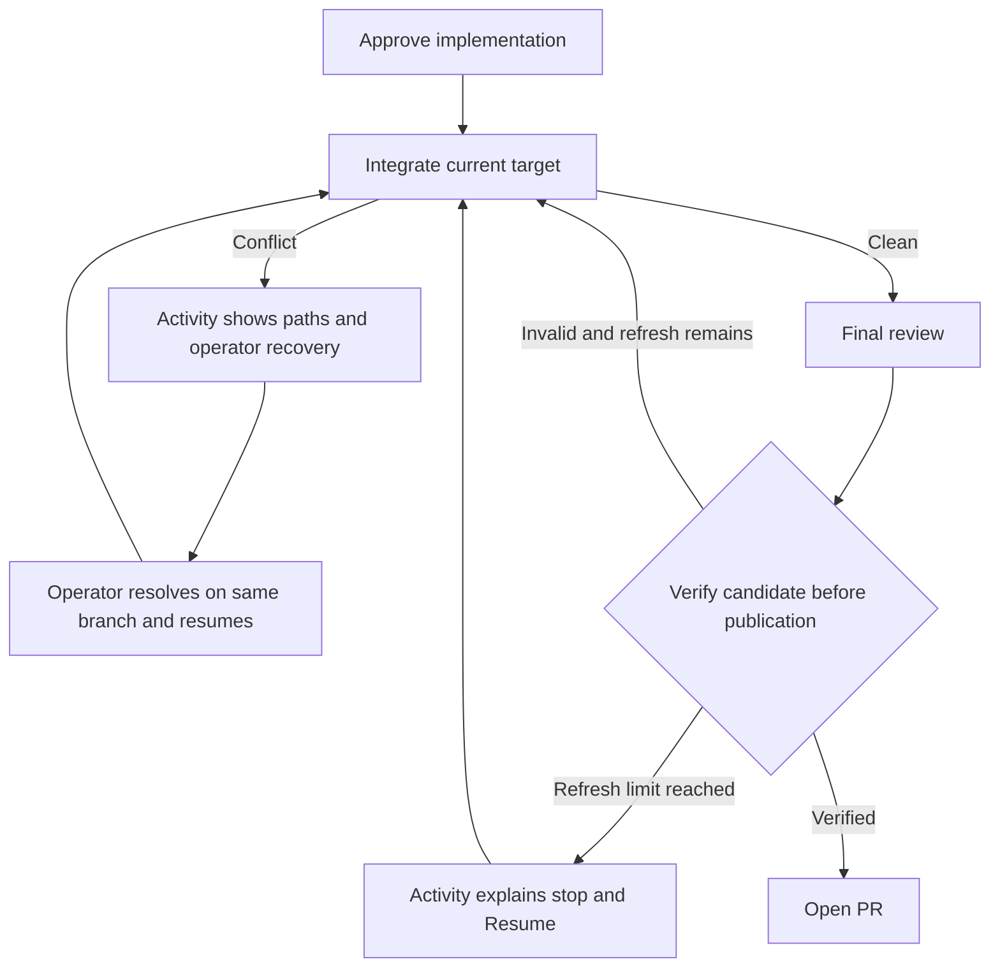
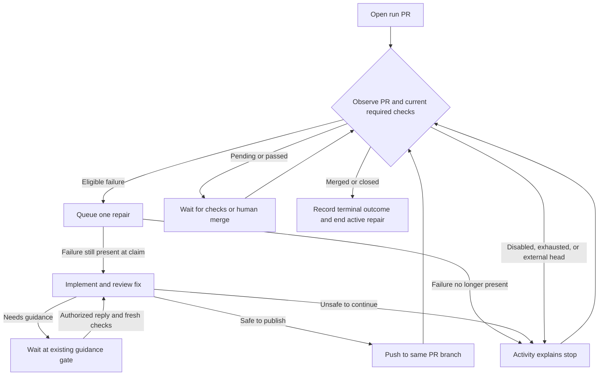
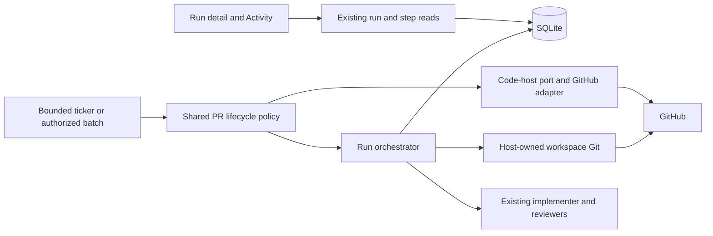
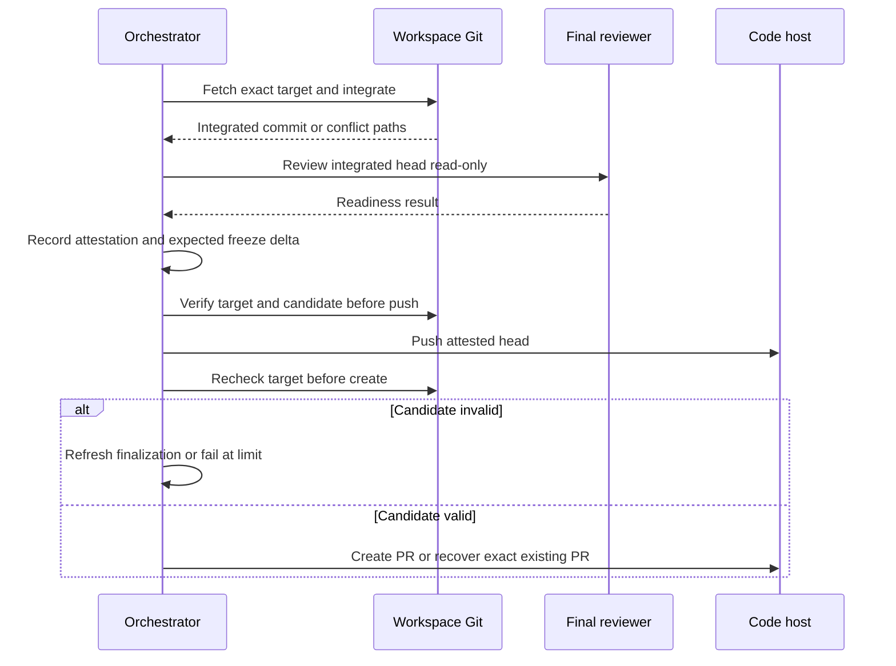
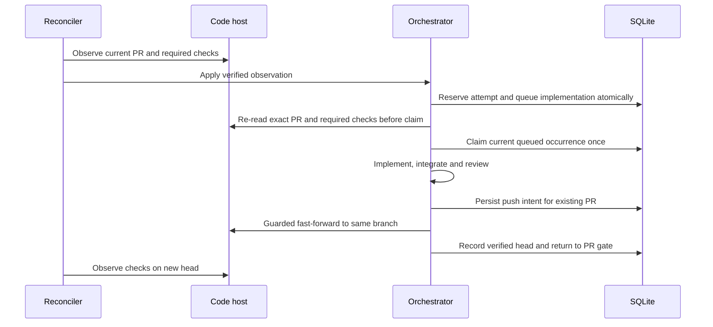

# Check PR integration and repair failed CI

## What

Autocatalyst checks a run’s branch against the current pull request (PR) target before final review and again before publication. When the target has advanced and the changes fit together, the reviewer sees the combined result. When they conflict, the run preserves its work, names the conflicting files, and stops before opening a PR.

After the PR opens, Autocatalyst watches required continuous integration (CI) checks. A confirmed failure on a commit Autocatalyst published can send the same run back through implementation to fix the problem and update the same PR. Automatic repairs have a per-PR limit. A person still decides whether to merge.

## Why

When #141 merged before #142 opened PR #189, finalization missed two conflicts and the operator had to arrange a manual repair. Failed checks on PRs #193 and #197 also needed manual intervention. This feature catches both problems sooner and tells engineers how to take over when automation stops. See friction log items 21 and 23 and the existing reconciliation and publication work in #85 and #73.

## Personas

- **Enzo: Engineer** — Reviews implementation, investigates conflicts and CI failures, and decides when to merge.
- **Operator** — Has authorized access to the Autocatalyst host and helps Enzo recover unpublished work that is not available on GitHub.

## Narratives

### Two runs finish close together

Enzo approves the second of two runs that started from the same target. The first PR merges before the second run’s final review, so Autocatalyst integrates the updated target before review. When another merge lands before publication, Autocatalyst checks again and reviews the new result before opening the PR.

If integration conflicts, Enzo sees the paths and branch details in Activity. He gives the run ID to an authorized operator, who locates the retained workspace, resolves the overlap with Enzo, and commits on the same branch. Enzo resumes the same run through final review. If the target keeps moving instead, he can wait for it to settle and resume without losing work.

### A required check fails after opening

A required check fails on the commit Autocatalyst published. The next reconciliation pass records the failure and queues one repair. The repair goes through implementation and review, then pushes to the same PR branch. Activity names the new commit so Enzo knows which checks to watch.

If the repair needs guidance, Enzo can answer the same request even after the server restarts. If automation runs out of attempts or cannot safely continue, Activity explains why and directs him to the existing PR. He can push a fix himself without Autocatalyst starting another repair on top of his commit, then merge when ready.

## User stories

**Two runs finish close together**

- Enzo can review the change combined with the fetched PR target.
- Enzo can rely on detected target drift before publication to invalidate an older review.
- Enzo can identify the conflicting paths, branch, and commits without looking for an unpublished PR.
- Enzo can work with an authorized operator to resolve a conflict on the original branch and resume the same run.
- Enzo can approve a run parked at spec review before the upgrade and get the new integration checks without starting over.

**A required check fails after opening**

- Enzo can see which required checks failed and which commit they ran on.
- Enzo can follow a repair to a push on the same PR and distinguish new checks from old results.
- Enzo can answer a pending repair escalation after a restart without spending another attempt.
- Enzo can distinguish a cleared failure from a stopped, disabled, or exhausted repair and know what to do next.
- Enzo can take over the PR branch without automation repairing his new commit, then merge or close the PR and see the run reflect the outcome.

## Goals

- Review every new PR candidate against the fetched target. Verify the target again at publication and never publish from a review known to be stale.
- Open no PR on a detected integration conflict. Preserve the run’s commits and give the operator enough information to recover the branch.
- Admit at most one repair per PR and failed commit across repeated polls, concurrent observations, and restarts. Default to two admitted attempts per PR.
- Start automatic repair only for a verified required failure on the current Autocatalyst-published head of an open run PR. Do not schedule from pending, passing, optional, unknown, historical, or externally pushed results.
- Keep the same run and PR through repair. Preserve human-controlled merge and existing close reconciliation.

## Non-goals

- Webhook delivery, registration, or signature verification.
- Automatic merge, merge queues, or changes to checks or branch protections to make a repair pass.
- Automatic conflict resolution, force pushes, replacement PRs, or publishing a private recovery branch on conflict.
- Automatic CI repair for fork PRs or providers other than GitHub. Existing terminal PR reconciliation still works without CI support.
- New recovery screens, manual repair buttons, or remote shell access for product users.

## Design spec

### Before publication

### After publication

### Run detail and recovery guidance

Keep the current PR link, Activity layout, and status refresh. Use text under the relevant step occurrence, following the existing [design system](../../context-agent/wiki/design-system.md). Do not rely on color or add controls. A fresh final review or repair has its own occurrence. Pending checks are not errors. Repeated polls do not add identical rows. After a reload, durable Activity shows the original failure and latest outcome, even if the client missed live updates.

| State | Activity and next action |
| --- | --- |
| Initial integration conflict | **PR not opened: integration conflict with `main`.** Show the actual target, run ID, project/repository, source branch, run and target commits, repository-relative conflicting paths, and cleanup result. Tell Enzo to give these details to an authorized host operator, commit the resolution on the original run branch, then use Resume. Do not tell Enzo to fetch a branch that may not exist on GitHub. |
| Target could not be verified | **PR not opened: target could not be verified.** Show the actual target and safe reason. Resume when the target is reachable. |
| Initial publication refresh limit reached | **PR not opened: publication candidate could not be verified after 2 refreshes.** For repeated target advances, say **PR not opened: target kept moving after 2 refreshes.** Show the reason, target, last reviewed and observed target commits when known, and whether Autocatalyst already pushed the source branch. The run failed at `pr.open`; ask Enzo to wait for a stable target and use Resume. The branch is retained; an earlier push is neither rolled back nor deleted. |
| Repair queued | **CI repair 1 of 2 queued.** Show failed head, failed check names and conclusions, and safe diagnostics or check links when available. |
| Queued failure clears | **Automatic repair stopped: no required failure remains on `abc1234`.** Show the attempt and indicate whether checks are still pending. Explain that the admitted attempt counts toward the limit and the same head will not be queued again. |
| Waiting for guidance | **CI repair 1 of 2 needs guidance.** Show the existing escalation prompt. A restart leaves the same question open. |
| Fix pushed | **Repair pushed; waiting for checks on `abc1234`.** Keep the same PR link and distinguish the new commit from the failed one. |
| Repair integration conflict | **Automatic repair stopped: integration conflict; no repair pushed.** Show attempt and limit, PR link, failed head, local candidate, target and commit, conflicting paths, and cleanup result. Direct Enzo to resolve from and push to the existing PR source branch, or ask an operator to salvage the local repair commits. Do not direct Enzo to failed-run recovery or PR creation. |
| External or unverified head | **Required CI failed on `abc1234`; Autocatalyst did not confirm publishing this commit. No repair queued.** Show failed checks and direct Enzo to the existing PR. |
| Cap reached | **Required CI failed; automatic repair limit reached (limit 2).** Show the total admitted attempts, failed head, and failed checks. Direct Enzo to the existing PR. Total attempts can exceed the current limit if an operator lowered it. |
| Cap set to zero | **Required CI failed; automatic repair is disabled (limit 0).** Show the failed head and checks. Direct Enzo to the existing PR. Do not call this exhaustion. |
| Other repair stop | **Automatic repair stopped.** Show the safe reason and next action. For repeated target drift, explain the two-refresh limit. If the push outcome cannot be verified, say so instead of claiming the PR was unchanged. |

## Tech spec

### Introduction and overview

Build on [PR finalization and publication](feature-review-open-merge-pull-request.md), [bounded PR reconciliation](enhancement-merged-pr-reconciliation-trigger.md), [targeted refresh](feature-refresh-one-pull-request.md), [run recovery](feature-recover-failed-run.md), and [durable Activity](enhancement-durable-run-activity-pr-observability.md). Follow the [workspace](../concepts/workspace.md), [workflow](../concepts/workflow.md), [human pause](../concepts/hitl.md), [tracker](../concepts/trackers.md), and [API](../concepts/api.md) contracts. ADRs 003–007, 009, 019–021, 025–027, and 031–032 establish the service, persistence, authorization, workspace, workflow, and client boundaries.

The **target** is the PR destination branch. The **head** is the exact current source commit. A **repair attempt** is one durably admitted implementation pass; convergence rounds, human guidance, and CI reruns do not allocate new attempts.

Add `AUTOCATALYST_PR_CI_REPAIR_LIMIT`, a **process-wide** setting applied independently to each PR, not a tenant setting or a shared pool. Accept a nonnegative safe integer, default `2`, and reject invalid values at startup. `0` disables new admissions, not CI observation or terminal reconciliation. `AUTOCATALYST_PR_RECONCILE_TENANT` sets the existing ticker’s tenant, not the scope of the limit. Only the ticker and the authorized batch `POST /v1/pull-requests/reconcile` admit new attempts. A tenant without the ticker receives no periodic automatic repair; an authorized batch invocation for that tenant can still admit work under the same process-wide limit. Startup and dispatch recovery may continue already admitted work without admitting any new attempts.

### System design and architecture

`orchestrator.ts` owns mutations and dispatch. `pr-finalize.ts` owns the final review integration point and `pr-open-handler.ts` owns initial publication. Extend `RunWorkspaceGitPort` with typed Git operations; keep Git subprocesses in host wiring. Extend the code-host port and GitHub adapter with verified PR observations. Keep identity checks and terminal transitions in the shared `pr-lifecycle.ts` policy. Targeted refresh retains its existing eligibility and response contract and never admits repairs. A later webhook can request a fresh observation and feed the same policy.

### Detailed design

#### Integrate, review, and verify the candidate

1. Resolve the target using the same project/code-host binding and base policy as `pr.open` (`main` today). Do not infer the target from `provisionedBaseRef`. For repair use the open PR’s actual base. Verify the workspace belongs to the run, the run branch is checked out, the index and worktree are clean, and no Git operation is in progress. Do not stash, discard, or implicitly commit unexpected changes.
2. Fetch the exact target ref from the bound remote and pin its commit ID. If the target is already an ancestor of the run head, keep the head. Otherwise merge the pinned target into the run branch without rewriting history or changing the target. On conflict, record sorted repository-relative unmerged paths, then abort only the merge Autocatalyst started. Verify restoration of the original head and clean workspace. If cleanup fails, leave the state for operator inspection and report that fact. Never abort a pre-existing merge. Write fetch, workspace, and conflict evidence as host-authored step details, not reviewer findings.
3. Run the existing read-only reviewer on the integrated head. Bind the approved checkpoint to repository, target ref and commit, reviewed head, and publishable head. Keep the existing spec freeze for initial publication: allow only the expected host-owned frontmatter delta after review, attest its resulting head, and make a repeat freeze a no-op. Other changes invalidate the candidate. Build the PR summary diff against the pinned target, not the provisioned base.
4. At `pr.open`, fetch the target and verify the attestation and exact local head just before push. Push only the approved head and never overwrite divergent remote work. Recheck the target after push and before create; if that check detects drift, do not create the PR. This narrows the race but cannot lock the remote target. Preserve create idempotency: if the provider already created the run’s exact PR, verify and adopt it instead of opening another. Adoption recovers a prior side effect; it does not authorize a fresh create from stale review.
5. Detected drift, a changed local candidate, or a legacy checkpoint without attestation invalidates the publication candidate. On the first and second invalidations, persist a refresh count and enter a fresh `pr.finalize` occurrence that fetches, integrates, and reviews again. Commit the increment with the transition and carry the count through restart. On the next invalidation, fail the run at `pr.open` with `pr_publication_refresh_exhausted`; write the reason and the refresh-limit Activity entry on that occurrence. Do not push again or create a PR after the guard stops the run. Preserve the local branch and any earlier pushed branch without resetting, deleting, or rolling back either. Omitted-mode recovery and explicit Resume both reopen the same run at fresh `pr.finalize`, preserve the original branch, and start a new two-refresh budget. A fetch failure is a verification failure, not evidence of drift; stop safely with its own reason.
6. On an initial integration conflict, fail at the active `pr.finalize` or `pr.open` occurrence, with no create or new push after conflict detection. An earlier guarded push may exist if drift was detected between push and create. The original host branch is the recovery authority either way. Omitted-mode recovery and explicit Resume preserve that branch and enter fresh `pr.finalize`.

Use these guards for feature, enhancement, bug, and chore workflows that open PRs. Add backward-compatible system-only transitions and checkpoint readers without changing pinned workflow IDs or accepting new human directives. A run waiting at spec review before upgrade keeps its spec, gate, and branch. An unattested checkpoint cannot authorize publication.

#### Recover an unpublished branch

Under the service’s workspace access policy, an authorized host operator uses Activity’s run ID and project to look up the repository and run workspace through configured roots and existing containment checks. Product credentials alone do not grant host access. Verify the checked-out branch and recorded run commit before editing. Investigate mismatches rather than resetting them. If normal retention removed the workspace but kept the branch, use existing run-branch materialization. If the branch also expired, normal Resume cannot recover it; use the operator backup procedure if available.

With the run stopped, inspect incomplete cleanup, merge the recorded target commit if needed, resolve the paths, and commit on the same branch. Leave a clean index and worktree, then call the existing authorized `POST /v1/runs/:id/recover` with `{"mode":"resume"}` or use the equivalent existing UI. Fresh finalization fetches the latest target; if it conflicts again, Activity reports the new evidence. Do not push a branch just to make recovery possible.

#### Observe current-head required checks

Read provider PR identity, state, source repository/ref/SHA, and base ref. Terminal states need no CI query. For open GitHub PRs, read check runs and legacy status contexts attached to the exact head. Use GitHub’s PR-scoped `isRequired` for each result, not names, workflow files, or an overall badge. Retain provider identity when names collide; select effective current results, not superseded reruns. Follow pagination and re-read PR identity, head, and base after collecting results. Unsupported, unauthorized, incomplete, ambiguous, or changed evidence is unknown and cannot admit a repair. A CI read failure cannot hide a separately verified terminal observation.

An eligible result is a verified required completed check run with failure, timeout, or action-required conclusion, or a required legacy status with `failure` or `error`. Pending, passing, canceled, neutral, skipped, missing, and optional results do not trigger work. One verified failure suffices even when another required check is pending. Store bounded check identities, names, conclusions, and safe excerpts or links when available. A diagnostic excerpt is not required for admission.

Keep the existing 50-PR and 30-second bounded pass. Carry the remaining deadline through provider reads, pagination, and admission verification. Rotate a stable starting position per tenant across partial passes so a fixed first page cannot starve later PRs. Defer incomplete observations. Preserve public batch counts and targeted refresh responses. A pass does not wait for model work.

#### Identify Autocatalyst-published heads

Add nullable `pull_requests.autocatalyst_head_sha` with validated full commit IDs. Initialize it from the exact source head Autocatalyst pushed and verified at initial publication. Advance it only after verifying a repair push. Commit the marker with the PR/gate transition. Recover a lost create response using host-authored push evidence for that exact source branch and candidate, plus a matching provider head. For a legacy open PR, set the marker only if existing host-authored publication evidence proves the exact SHA on the bound branch. Without proof, do not infer it from local state, the provider’s current head, or Git authorship.

A different or unverified head is external for scheduling purposes. Record verified required failures on such a head without spending budget, including when a person pushes after a stopped repair. A human-authored commit included in a later explicitly reviewed and verified Autocatalyst publication is not excluded merely because of its author string.

#### Persist decisions and admit work

Use an additive SQLite migration with no required data backfill. `pr_ci_repair_heads` holds one decision per internal PR and failed head:

| Columns | Type and constraints |
| --- | --- |
| `pull_request_id`, `head_sha` | Non-null TEXT, composite primary key; PR foreign key and validated full SHA. |
| `gate_step_id`, `repair_step_id`, `current_step_id` | TEXT foreign keys to `run_steps.id`. Gate is required. Initial repair occurrence is required and unique for admitted attempts; it does not change on guidance. Current occurrence is required while active and tracks dispatch, pause, or publication. No repair references for unadmitted decisions. |
| `ordinal`, `limit_at_decision` | Nullable positive INTEGER ordinal, unique per PR when present; non-null nonnegative INTEGER limit. Each ordinal consumes one attempt even if stopped or superseded. |
| `state` | Non-null TEXT: `external`, `exhausted`, `queued`, `running`, `awaiting_human`, `publishing`, `pushed`, `stopped`, or `superseded`. Only `external` and `exhausted` have no ordinal. |
| `base_ref`, `failure_details_json` | Non-null TEXT: verified base and validated, bounded original failed-check details. |
| `owner_epoch`, `publish_head_sha`, `stop_code` | Nullable TEXT. `running` and `publishing` have a dispatcher epoch. `queued` and `awaiting_human` have no live owner. Persist intended full SHA before push; retain it even if the attempt stops. Store a stable reason where applicable. |
| `created_at`, `updated_at` | Non-null TEXT ISO timestamps. |

Enforce at most one `queued`, `running`, `awaiting_human`, or `publishing` row per PR with a partial unique index. Use the unique ordinal index for budget lookup. Enforce same-run and same-tenant relationships in repository transaction predicates. A new head gets a new decision, not a new budget. A config change does not reconsider a decided head or cancel an admitted attempt; the new limit applies to unseen heads.

Before admission, verify fresh open state, exact PR/head/base, tenant, repository, run-owned branch, and the matching `pr.human_review` occurrence. Perform provider I/O outside the run mutation lock. Under the lock, revalidate stored binding, run, PR, and occurrence; skip stale results. In one transaction, check for an existing row or active attempt, then apply the first matching decision:

1. For zero cap, insert `exhausted` with `limit_at_decision = 0`, `stop_code = repair_disabled`, and no ordinal or repair step. Leave the run at the gate. This takes precedence over external classification for an otherwise valid current-head failure.
2. For a head not verified as Autocatalyst-published, insert `external` without an ordinal or repair step. Leave the run at the gate.
3. For a positive cap already met, insert `exhausted` with `stop_code = repair_budget_exhausted` and no ordinal or repair step. Leave the run at the gate.
4. Otherwise allocate the next ordinal, insert `queued`, and enter a new `implementation.build` occurrence atomically. Wake normal dispatch after commit. A lost conditional write or uniqueness race neither dispatches work nor appends duplicate Activity.

#### Claim dispatch and handle CI reruns

The committed `queued` row and current occurrence form the durable dispatch intent. Startup and later bounded passes can wake unclaimed intents. Before claiming, re-read the exact PR binding, open state, head, base, and effective current required checks using the same verification rules as admission. Apply a verified terminal observation first. Stop on verified head or binding change with `repair_remote_changed`. If evidence is unknown or incomplete, leave the intent queued and defer to a later bounded dispatch check without starting a model.

If the verified same-head view no longer contains an eligible failure, stop the queued attempt with `repair_failure_cleared` and return the run to `pr.human_review` atomically. This includes a rerun that passed or is pending when no other current required failure remains. Retain the original failure record and consumed ordinal. A later failure on the same head does not reopen the decision. If another eligible failure remains, use the fresh failed-check evidence for execution while preserving the original admission evidence for Activity.

With valid evidence, conditionally claim `queued → running` and stamp the current `owner_epoch` against the current occurrence before launching. Reuse normal run serialization and concurrency limits. Once claimed, a same-head CI rerun does not cancel the current execution segment. It may complete, including a guarded push of a reviewed fix, or stop as a no-op or for safety. A continuation after human guidance is a new claim and rechecks CI again; it is not a new attempt. Remote head changes and terminal states still prevent unsafe publication.

#### Preserve human escalation and recover dispatcher ownership

Use the supported single-host deployment model. Take a nonblocking OS-backed exclusive dispatcher lock scoped to the canonical local state directory before dispatch or orphan recovery. Hold ownership until all supervised children that can still mutate the workspace or push have exited or been terminated and reaped; process failure must not release ownership while such a child can still act. A competing dispatcher refuses startup while the lock is busy; unsupported lock semantics fail closed. An upgrade must stop the old dispatcher before opening the same state. Generate a new epoch on each acquisition. A missed poll or a long model call never proves ownership loss.

When convergence requests input, atomically park `running → awaiting_human`, clear live ownership, persist the existing escalation checkpoint and expected local candidate, and bind `current_step_id` to `implementation.awaiting_input`. Finish or retire the dispatched segment before allowing a continuation to run. The parked row holds the active slot and ordinal, but not a worker. Startup must not orphan, stop, or dispatch it. An authorized guidance reply for the exact current pause occurrence uses the existing reply path and pause identifier. In one transaction it records guidance and a new continuation occurrence, then moves the same attempt to `queued`. A duplicate or stale reply cannot create another continuation. The current dispatcher claims that occurrence under its epoch, including after a restart between reply and claim. Verify the retained local candidate against the pause checkpoint rather than requiring it to still equal the failed SHA. Use the saved convergence context and guidance, not a fresh attempt. Cancellation retains the ordinal and releases the slot using the existing run outcome.

After acquiring the dispatcher lock and before new admissions, scan prior-epoch `running` and `publishing` rows. Check verified terminal PR state first. For a nonterminal run:

- **Orphaned `running`:** Stop with `repair_interrupted`. Close the interrupted occurrence, preserve local work and the consumed ordinal, and return to `pr.human_review`. Do not relaunch a claimed segment.
- **Orphaned `publishing`:** Verify the bound open PR and exact persisted intended SHA. An exact head match on the same repository, branch, and base marks `pushed`, advances the marker, and returns to the PR gate. If it is still at the failed head, stop with `repair_interrupted`; if binding, base, or head changed, stop with `repair_remote_changed`. A bounded read that cannot verify the result stops with `repair_push_unverified` and leaves the marker unchanged. Preserve local work. Do not resend the push or relaunch implementation.

Write each outcome and run transition together, conditional on the persisted row and occurrence. Stop outcomes release the active slot. Never reclaim a live segment in the current epoch. Ordinary reconciliation continues to handle terminal observations, including for attempts parked across restarts.

#### Execute and publish to the same PR

- Verify the expected clean PR source branch at the failed SHA for an initial claim, or at the checkpointed candidate for a guided continuation. Preserve dirty or divergent work. Feed bounded failure evidence, original spec and implementation context, and failed SHA into existing convergence. Treat provider text as data, not instructions. Scope the repair to the failure and do not weaken checks. Do not rerun intake or spec authoring.
- Clean convergence uses a system-only edge to finalization, without a second implementation approval. Bind outputs to the attempt and current occurrence so late results cannot advance it. A no-op stops without pushing a commit to rerun CI. Target-only integration changes do not count as a fix.
- Reuse integration, read-only review, and the bounded target rechecks. Use an explicit existing-PR publication path, never `pr.open`. On repeated drift beyond two refreshes, stop with `repair_publication_refresh_exhausted`, preserve the candidate and ordinal, and return to `pr.human_review` without pushing from stale review. Before pushing, verify exact open PR identity, source branch, base, expected remote head, and attested local head. Persist `publishing` and the intended SHA before the external write. Require both an expected-old-head guard and a fast-forward; do not create, force-push, merge, or edit PR metadata. Verify the resulting provider head before marking `pushed`, advancing the marker, and returning to a new `pr.human_review` occurrence atomically. For a lost push response, use the same verification outcomes as startup, never a blind retry. Observe checks on the new head.
- **Repair integration conflict:** Capture paths and cleanup evidence as for initial integration, but atomically mark `stopped` with `repair_integration_conflict`, retain the ordinal and local commits, close the current occurrence, and return to `pr.human_review`. Do not use failed-run recovery, call `pr.open`, or push a partial repair. An engineer with source-branch write access can resolve in an authorized clone and push a fast-forward to the same branch under normal protections. An authorized operator can first salvage the repair candidate from the retained workspace by run ID and candidate SHA. The reconciler observes the engineer’s head without automatically repairing it.
- Record other technical stops with safe reasons, preserve local work, and return to the PR gate. Neither a stop nor a human pause re-admits the failed head.
- A verified terminal observation takes precedence during any active state, including `awaiting_human`. Write terminal PR state, the run outcome, and active attempt `superseded` together; release the slot, close the current occurrence and invalidate its dispatch or pause. Reject stale guidance or results and suppress subsequent publication. Human merge completes the run; close without merge retains `pull_request_closed_without_merge`. CI never reopens a terminal run. The host recheck and expected-head guard cannot atomically prevent a remote close after the last check.

#### API and Activity data

No new route, mutation, or SSE event type. Extend `GET /v1/runs/:id/steps` with an optional `systemActivity` list per affected step in the `200` response. Each entry has a stable key, ISO timestamp, and typed status code. Validate variant fields for target and commit IDs, reason codes and refresh count, conflict paths and cleanup, failed checks, or attempt and cap. Keep current validation, auth, and error behavior, including `404` for missing runs and `403` for cross-tenant reads. Do not expose internal tables or raw provider output.

Project integration Activity from host-authored checkpoints and repair Activity from decision records and their gate and repair occurrences. Use stable keys tied to the occurrence and outcome so repeated observations without a transition add nothing. Show the original failure, latest outcome, and prior attempts. Reuse existing safe live invalidations and step refetch; durable reads remain authoritative after reconnect or reload.

### Security, privacy, and compliance

Resolve repository and credentials through the tenant-checked project binding. Validate provider identities, refs, full commit IDs and responses. Keep commits, pushes, and PR operations host-owned and final review read-only. Use structured subprocess arguments and existing credential injection; do not interpolate provider text into commands or expand token or runner permissions. Insufficient CI permission means unknown evidence.

Treat paths, check metadata, and excerpts as untrusted text. Bound and encode them for display, redact secrets, and omit diagnostics that cannot be safely redacted. Never ingest raw job logs. Link only to validated HTTPS check URLs on the bound code host with no embedded credentials or signed query strings. Do not expose absolute workspace paths, raw tool output, or credentials in Activity or logs. Host recovery requires separate authorization.

### Observability

Log structured outcomes for integration, drift, refresh exhaustion, unknown CI, admission and deduplication, cleared failures, human pauses and continuations, ownership recovery, disabled or exhausted budgets, push outcomes, and terminal reconciliation. Correlate by run and internal PR ID, head, ordinal, and reason code. Keep paths and check diagnostics in authorized Activity rather than telemetry. Count outcomes and measure poll duration and provider errors. Distinguish CI lookup failures from failed checks.

### Testing plan

- **Workspace and publication:** Use real Git histories with two runs. Merge the first PR before the second finalizes and verify clean integration and conflicting edits. Test drift after review and between push and create. Consume both refreshes, restart with a persisted count, trigger another drift, and assert failure at `pr.open`, `pr_publication_refresh_exhausted`, the target-moving Activity text, no additional push or create, and unchanged local and previously pushed refs. Exercise omitted-mode and explicit Resume, each entering fresh `pr.finalize` with a new two-refresh budget. Cover dirty workspaces, fetch failure, the spec-freeze delta, unattested legacy checkpoints, and idempotent create adoption.
- **Recovery and upgrade:** For pre-push conflict, assert no PR and no remote source branch, with the original local head and listed paths preserved. Starting from Activity, locate the retained workspace using authorized host access, commit a resolution, and resume the same run through review before publication. Assert no absolute paths in Activity. Migrate a run waiting at pre-upgrade spec review and verify the original IDs, branch, and spec with fresh target checks. For legacy open PRs, test exact host publication evidence and its absence.
- **Provider and policy:** Test required and optional check runs and status contexts, duplicate names, effective reruns, pending, passing, non-triggering and stale results, changed head/base, permissions, partial pages, and deadlines. Verify terminal reconciliation without CI, fair bounded paging, and unchanged targeted refresh. With the ticker set to tenant A, verify it admits only for A; an authorized tenant B batch can admit under the same limit and B receives no periodic admissions. Validate default, positive, zero, and invalid limits. At zero, assert `exhausted`, `repair_disabled`, limit zero, no ordinal or step, and exact disabled Activity text.
- **Persistence and dispatch:** Race same-head observers and different heads at the final budget slot. Restart before claim, after claim, after push intent, and after a push with lost acknowledgment. Verify unclaimed work dispatches once, claimed orphaned work stops, and recovered push outcomes distinguish exact match, changed head, and unavailable evidence without replay. Prove a competing dispatcher cannot take over while a mutation-capable worker is live.
- **Escalation and reruns:** Restart at `implementation.awaiting_input`; assert the same pause, `awaiting_human` row, ordinal, and active slot survive without dispatch or `repair_interrupted`. Race duplicate guidance and restart after the accepted reply but before claim. Verify one continuation under the new epoch with retained local commits and guidance. Test merge and close while parked, including after restart, and reject a late reply. If the sole failed check passes or becomes pending before claim, assert `repair_failure_cleared`, no model dispatch or push, retained budget debit and no same-head readmission. Test another still-failing required check, unknown evidence deferral, and a pass after claim that does not cancel the running segment.
- **Run and Activity:** Drive one repair and a verified push to the same PR, observe checks on the new head, and stop retries at the configured cap. After a no-op or interrupted attempt with budget remaining, push a human fix and fail CI; show the failure without budget spend. Race an external push against a repair and verify no overwrite. Trigger a repair conflict, verify the stop code, consumed ordinal, preserved local candidate, return to PR gate, no push or create, and durable recovery text after reload. Resolve manually and fast-forward the existing PR, observe the engineer’s head without admission, then merge and verify completion. Exercise close and merge during queued, running, and publishing work and verify no late state advancement. Assert durable Activity deduplicates and respects tenant boundaries.

### Alternatives considered

- **Check mergeability without integrating.** The reviewer would still see the old tree. A host-owned merge lets review cover the combined result without rewriting run commits.
- **Push an unpublished recovery branch.** This improves access but publishes work on a path designed to stop before publication. Use authorized host recovery instead.
- **Repair every current failing head.** This handles more failures automatically but competes with an engineer’s own fixes. Require evidence that Autocatalyst published the head.
- **Replay claimed work after a timeout or restart.** An old worker may still mutate the workspace, and a push may already have succeeded. Use exclusive ownership and verify side effects; resume only durable unclaimed work or a continuation explicitly requested by a human.

### Risks

- **Remote races:** Git, the provider, and SQLite do not share a transaction. Use pinned commits, fresh rechecks, conditional writes, guarded pushes, and reconciliation without promising an immutable remote target.
- **Incomplete provider views:** Permissions, unsupported sources, or rate limits can hide requiredness. Fail closed for repair and verify terminal states independently.
- **Unpublished branch access and retention:** Enzo may need an operator, and normal retention still applies. Show recovery identifiers and document when normal recovery is no longer possible.
- **Flaky CI and exhausted attempts:** A real failure may clear on rerun or the fix may not help. Recheck before claim, explain when a stopped attempt counts, and cap the cost per PR.

## Task list

- [ ] **Story: Review the integrated branch before publication**
  - [ ] **Task: Add guarded target integration to workspace Git**
    - **Description**: Fetch and merge the exact target commit through the host-owned workspace port and return typed conflict and cleanup evidence.
    - **Acceptance criteria**:
      - [ ] Real Git fixtures cover unchanged target, clean advance, and conflicts with the original work restored.
      - [ ] Dirty workspaces, failed fetches, and pre-existing Git operations stop without discarding changes.
    - **Dependencies**: None
  - [ ] **Task: Bind final review to the publication candidate**
    - **Description**: Attest the reviewed head and expected freeze delta, recheck at both publication boundaries, and wire refreshes and Resume to fresh finalization.
    - **Acceptance criteria**:
      - [ ] Drift after review or push prevents stale creation. A third invalidation fails at `pr.open` with `pr_publication_refresh_exhausted`, persists the reason, and retains both branch refs when already pushed.
      - [ ] Omitted-mode and explicit Resume re-enter `pr.finalize` with a new budget on the same branch. A legacy unattested checkpoint is reviewed again and an exact previously created PR is adopted without duplication.
    - **Dependencies**: Task: Add guarded target integration to workspace Git
- [ ] **Story: Admit one bounded repair for an eligible failed head**
  - [ ] **Task: Read required checks for a verified PR head**
    - **Description**: Add provider-neutral observation and GitHub mapping for exact PR identity, required check runs and legacy statuses, deadlines, and safe diagnostics.
    - **Acceptance criteria**:
      - [ ] Adapter tests distinguish eligible failures from pending, passing, optional, superseded, stale, and ambiguous results.
      - [ ] Incomplete CI reads do not admit work and cannot hide verified terminal PR state.
    - **Dependencies**: None
  - [ ] **Task: Persist publication provenance and repair decisions**
    - **Description**: Add the head marker, additive decision migration, global cap configuration, and atomic gate comparison, ordinal allocation, and workflow entry.
    - **Acceptance criteria**:
      - [ ] Concurrent writers admit at most one attempt per head and respect the PR’s budget and active slot, including `awaiting_human`.
      - [ ] Unverified or external heads spend no budget. A legacy marker requires exact publication evidence.
      - [ ] Zero cap writes `exhausted` with `repair_disabled`, zero limit, and no ordinal or repair step. A config change does not reconsider a decided head.
    - **Dependencies**: Task: Bind final review to the publication candidate
  - [ ] **Task: Wire shared PR observations into bounded reconciliation**
    - **Description**: Apply terminal state and verified evidence via the orchestrator, rotate bounded passes, and wake dispatch only after durable admission.
    - **Acceptance criteria**:
      - [ ] Overlapping passes do not double-dispatch or wait for implementation; later PRs receive observations across bounded passes.
      - [ ] Ticker and authorized batch can admit for their respective tenants under the same cap; targeted refresh cannot. Terminal PR and run transitions supersede active repairs atomically.
    - **Dependencies**: Task: Read required checks for a verified PR head; Task: Persist publication provenance and repair decisions
  - [ ] **Task: Claim dispatch and recover interrupted work**
    - **Description**: Add dispatcher lock and epoch ownership, verify current checks before claim, and recover prior-epoch running and publishing attempts without replay.
    - **Acceptance criteria**:
      - [ ] Unknown claim evidence defers; a verified cleared failure stops with `repair_failure_cleared`, spends the admitted ordinal, and dispatches no model. A same-head pass after claim does not cancel the segment.
      - [ ] An unclaimed intent dispatches once after restart. Orphaned running work stops, orphaned publishing work verifies the intended push or records a safe stop, and a competing dispatcher cannot reclaim a live worker.
    - **Dependencies**: Task: Read required checks for a verified PR head; Task: Persist publication provenance and repair decisions
  - [ ] **Task: Persist and resume repair escalation**
    - **Description**: Bind the existing human pause and guidance checkpoint to the attempt and enqueue a continuation only for an authorized reply to the current pause.
    - **Acceptance criteria**:
      - [ ] Restart while parked preserves the same pause, active slot, local candidate, and ordinal with no dispatch. Accepted guidance resumes once under the current epoch, including after restart between reply and claim.
      - [ ] Merge or close while parked supersedes the attempt and makes late guidance inert. Duplicate replies do not create a second continuation.
    - **Dependencies**: Task: Wire shared PR observations into bounded reconciliation; Task: Claim dispatch and recover interrupted work
- [ ] **Story: Repair the same PR and make the outcome recoverable**
  - [ ] **Task: Converge and publish fixes to the existing PR branch**
    - **Description**: Reuse implementation and final review, then publish only an attested, guarded fast-forward for the bound repair attempt.
    - **Acceptance criteria**:
      - [ ] An eligible failure causes one repair, a verified push to the same PR, and checks on the new head.
      - [ ] No-op, unsafe local state, external pushes, and superseded work do not publish. No repair calls create or merge.
      - [ ] A repair conflict stops with `repair_integration_conflict`, preserves its ordinal and local commits, and returns to the PR gate without pushing. Repeat drift stops with `repair_publication_refresh_exhausted`.
    - **Dependencies**: Task: Bind final review to the publication candidate; Task: Persist and resume repair escalation
  - [ ] **Task: Show durable status and recovery guidance in Activity**
    - **Description**: Project validated outcomes into existing step reads and run detail, including initial conflicts, refresh-limit stops, escalation, cleared failures, external heads, and disabled or exhausted repair.
    - **Acceptance criteria**:
      - [ ] Initial conflict guidance identifies the unpublished branch; refresh-limit guidance names Resume and any earlier push. Repair conflict guidance directs Enzo to the existing PR branch.
      - [ ] Reload after restart shows preserved escalation, stable outcome text, and budget details without duplicate rows, raw diagnostics, absolute paths, or cross-tenant disclosure.
    - **Dependencies**: Task: Converge and publish fixes to the existing PR branch; Task: Persist publication provenance and repair decisions
  - [ ] **Task: Verify upgrade and human recovery end to end**
    - **Description**: Exercise production workflow seams with real local Git and deterministic provider fixtures. Document configuration, dispatcher ownership, and recovery in operator guidance, and update the agent code map and affected domain and API notes.
    - **Acceptance criteria**:
      - [ ] Parallel-run finalization covers clean and conflicting histories and a pre-upgrade run resumed from human spec review. An operator starts from Activity, finds the unpublished branch, resolves the conflict, and resumes the same run.
      - [ ] A manual fast-forward after a repair conflict updates the same PR without admitting work on the engineer’s head. A verified automatic fix is checked on its new head, retries stop at the cap, a human merge completes the run, and terminal PRs admit no further repairs.
    - **Dependencies**: Task: Show durable status and recovery guidance in Activity
