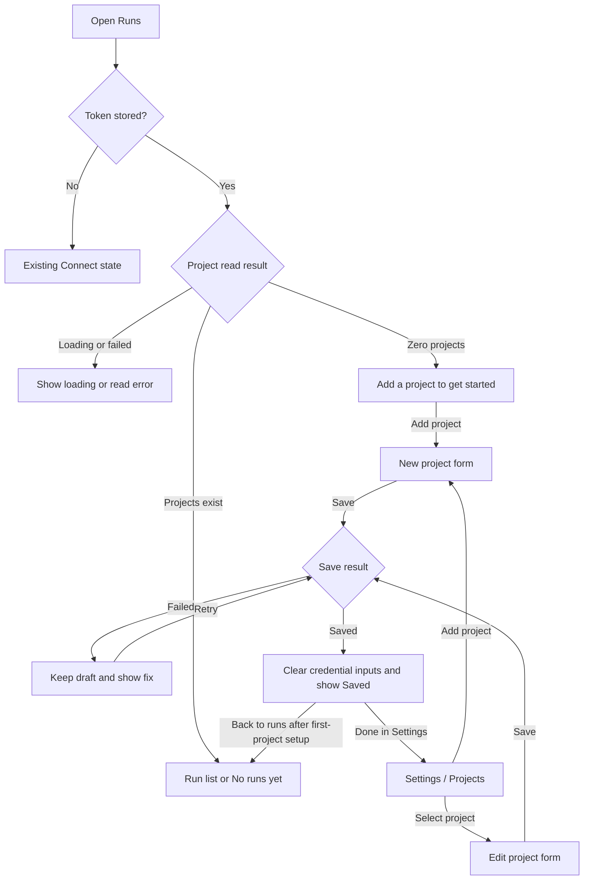
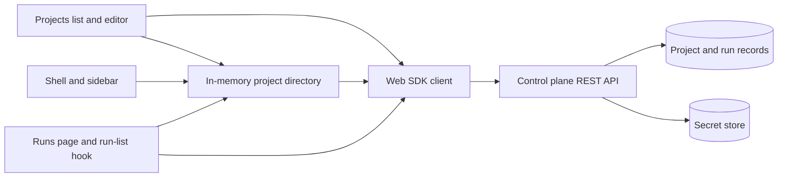
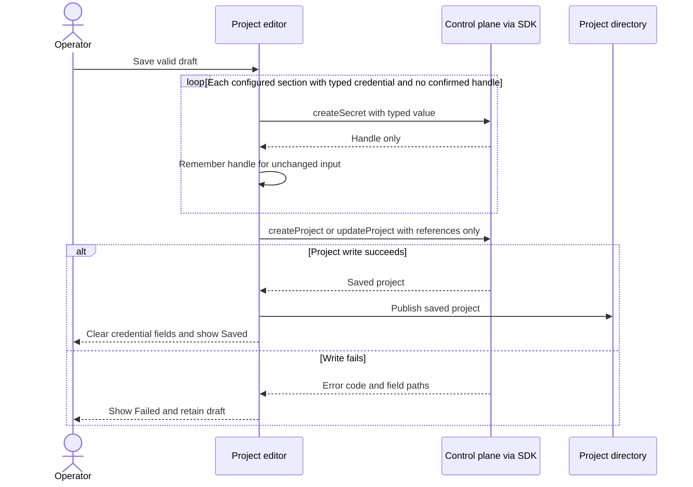

# Project and credential setup

## What

Operators can add and edit their tenant’s projects in the web client. They can configure or unconfigure the issue tracker and code host independently. For a configured integration, they can keep an existing credential by leaving its field blank or replace it by typing a new value. The client reports whether the project was saved, not whether the credentials work.

When the tenant has no projects, Settings and Runs guide the operator to add one. Once a project exists, the operator can open its runs from the sidebar.

## Why

Operators should be able to set up their first repository and maintain its credentials without leaving the client. Clear save results tell them what to fix without exposing secrets or implying that a provider accepted them.

## Personas

- **Enzo: Engineer** — sets up repositories and their integrations, then uses project views to find and review runs.

## Narratives

### Set up the first project

Enzo connects to a new control plane. Runs says “Add a project to get started.” He chooses Add project and enters the repository binding. Both integrations start as “Not configured,” so he can save the repository without entering either credential. For this project he configures both integrations and enters their credentials.

The form says “Saved” and empties both credential fields. Enzo chooses Back to runs and sees “No runs yet.” His project appears in Settings and in the main sidebar, where he can open the run list for just that project.

### Maintain a project’s settings

Enzo opens a project’s edit link. The repository binding is read-only. He renames the project and leaves both credential fields blank. The rename appears in Settings and the sidebar without a reload, and the credentials stay in place.

Later he types a replacement code-host credential. A failed save keeps the draft and explains what to do next. When the save succeeds, the field empties. If Enzo no longer wants an integration on that project, he chooses “Not configured” for it and saves; the project stops using that setting, but the secret is not deleted.

## User stories

**Set up the first project**

- Enzo can distinguish a missing connection, an empty project list, and an empty run list.
- Enzo can enter the create form from either Settings or Runs.
- Enzo can correct an invalid repository URL before the client sends a write request.
- Enzo can save a repository without either provider setting and understand what its runs cannot do.
- Enzo can see the new project without reloading and open its scoped run list from the sidebar.

**Maintain a project’s settings**

- Enzo can open the edit form directly and see which fields cannot change.
- Enzo can cancel an edit and reopen the form with the last saved values.
- Enzo can edit ordinary fields without re-entering or losing credentials.
- Enzo can replace either credential without seeing the stored value or handle.
- Enzo can retry a failed save without uploading an unchanged credential again if the first upload succeeded and the returned handle is still usable.
- Enzo can unconfigure either setting without deleting its secret.

## Goals

- Provide separate Settings routes for listing, adding, and editing projects.
- Send one project write per valid attempt after credential uploads succeed; reuse confirmed uploads on retry rather than creating duplicate secrets.
- Send a typed credential only in its own secret creation request body and never show a stored credential or its handle.
- Distinguish Saving, Saved, and Failed with field errors or a suggested fix where applicable.
- Apply the project filter to every run-list request while preserving #134’s selection and paging behavior.

## Non-goals

- Delete projects; delete, revoke, or clean up secrets; or show stored secrets or handles.
- Test connections on save, add an on-demand credential check or “Test credentials” button, or show “Connected” on Projects.
- Edit the workspace root override or top-level `credentialRefs`, or change server contracts, adapters, or storage.
- Expand sidebar projects into run trees, add intake or start-run controls, or build Appearance or General settings.
- Implement #141 or #143. #142 does not depend on #141.

## Design spec

### User flows

### Projects page and form

| Address | Main content |
| --- | --- |
| `/settings/projects` | Tenant projects. Each selectable row shows the display name, repository as `owner/name`, and both providers, with a dash for an unconfigured setting. Add project opens the create form. There is no delete control. |
| `/settings/projects/new` | Add project form in place of the list. |
| `/settings/projects/<id>` | The same form populated from the saved record. A direct link loads that project. A missing or inaccessible record shows an error, not a blank create form. |

Place Projects after Connection in the settings sidebar. On all three routes, the shell header has breadcrumb “Settings” and title “Projects.” Use `SettingsPage` for the scroll region, 24 px padding, and a column capped at `--width-settings-column`. Focus the form heading on entry. On Cancel, return to the list and restore focus to the originating action or row if present. Use visible labels, linked hints and errors, and keyboard-operable controls. The editor is a page, not a dialog.

| Group | Fields and behavior |
| --- | --- |
| Project | Display name and repository URL are required on create. Show an inline HTTPS error before submit. On edit, show the repository URL as read-only text. |
| Host repository | Provider, owner, and name are required on create. On edit, show the repository binding as read-only text with a hint that it cannot change. |
| Issue tracker | Optional setting with provider, project key, HTTPS URL, and credential. |
| Code host | Optional setting with provider, HTTPS URL, and credential. A saved code-host `projectKey` has no editor; preserve it when writing a whole configured setting. |

Use the new shared `Select` wrapper for all provider controls. The issue-tracker and code-host selects each include **Not configured** as a selectable option. Both start on **Not configured** on create; edit selects the saved provider or **Not configured** if the saved setting is `null`. The required host-repository select does not offer this option.

Choosing **Not configured** clears the section’s draft project key, URL, and typed credential, disables those controls, and leaves the provider select enabled. Disabled fields do not affect validity. This choice stages removal of the setting, not deletion or revocation of its secret. Nothing changes on the server until Save succeeds. If the operator reselects the saved provider before saving, restore its saved non-secret fields and keep the existing reference available; never restore discarded typed text. Cancel discards the whole draft. When both selects show **Not configured**, show “Runs cannot read issues or open pull requests for this project.”

For a configured section, require a credential only if the saved setting has no `credentialRef`. Reuse `WriteOnlySecretField`: `type="password"`, `autocomplete="off"`, and empty on every form entry and after success. The label is “Credential” without a saved reference and “Credential (leave blank to keep existing)” with one. A blank password in a configured section does not clear anything. Do not show a stored-value mask, badge, handle, reveal, clear, or delete control. The provider option changes the setting as a whole; it is not a credential-field control.

### Save feedback and navigation

Use one `role="status"` region above the action row. Start with no result, then show an 8 px decorative dot and text. Use muted tokens for Saving, green for Saved, and `--color-red` for Failed with a one-line fix in `--color-subtext`. Place secondary Cancel to the left of primary Save, aligned to the right. Disable Save for invalid drafts and unchanged edits; block edits and repeat submissions while Saving. No test button or credential test state appears.

| Outcome | Operator sees |
| --- | --- |
| Requests in flight | “Saving” |
| Project write succeeds | “Saved” and empty credential inputs. The form shows the saved values. |
| `400 validation_error` | “Failed,” field errors next to the controls, and a suggestion to correct the marked fields. |
| `422 unknown_credential_reference` | “Failed: a credential was not found”; suggest entering it again and mark the credential fields named in `details.fields`. |
| `409 conflict` | “Failed: a project for this repository already exists”; mark the host repository fields and suggest editing the existing project. |
| `400 secret_store_locked` | “Failed: the control plane's secret store is locked”; say the control plane operator must unlock it. |
| `403` or network failure | Failed with the safe control-plane message or “Connection lost,” and a next step. Keep the form open with its values and Save available when locally valid. |
| Other failure | Failed with safe fallback copy and a next step. Do not imply that a project write or a provider connection succeeded. |

Keep the form visible after a successful save so the operator can read “Saved”; do not dismiss it on a timer. After create, replace `/new` with the saved edit address without starting a new draft. Done returns to the updated project list for ordinary Settings entry. For first-project entry from Runs, show Back to runs after Saved; it returns to `/runs` and the no-runs state if no run exists. Cancel when not saving discards unsaved changes and returns to the Projects list. Preserve the shell’s existing Settings Back behavior.

### Empty states and sidebar

Use the centered `EmptyState` pattern: title, one line of guidance, and at most one primary button. In both connected views, zero projects shows “Add a project to get started” and one “Add project” button that opens `/settings/projects/new`. Without a token, Runs shows the existing Connect state, not the project prompt, and Settings directs the operator to Connection. Loading and read failures are not empty states. If projects exist but there are no matching runs, keep #134’s “No runs yet” state without a start-run action in this feature.

Place Projects between Runs and Settings in the primary sidebar. Expanded, show one row per project by display name and mark the active project. Collapsed, a populated Projects section has a focusable icon with a “Projects” tooltip that expands the section. With no projects, show no rows and no inert link or icon. A project row opens `/runs?project=<id>` and the header title is the project name. Run selection keeps #134’s `/runs/<run id>` path while retaining the `project` query. Selecting the unscoped Runs entry clears the filter.

Visual reference: [design system](../../context-agent/wiki/design-system.md), “Settings pages,” “Write-only secret field,” “Empty states,” and “Overlays, menus, and buttons.” Use the existing form pattern with the save result above the action row and no test control on the left.

## Tech spec

### Introduction and overview

This is a web-client feature. #132 provides the shell, settings frame, token handling, and write-only field. #134 provides run-list polling, paging, and URL-based selection. #133 provides the `projectId` run filter. The project and secret APIs already exist; no database migration or new endpoint is needed.

Follow [ADR-031](../adrs/adr-031-web-client-architecture.md) and [ADR-032](../adrs/adr-032-web-client-stack.md). The [Settings](../concepts/settings.md) concept owns the project record and secret references; [UX](../concepts/ux.md), [Trackers](../concepts/trackers.md), and [Collection](../concepts/collection.md) own navigation, provider roles, and run-list behavior. A credential reference is the setting’s `{ id, purpose, label? }` object; `id` holds the `sec_` handle, not the credential value.

`packages/core/src/project.ts:101-125` checks that submitted handles exist. It does not test provider connectivity. This feature intentionally deviates from the Settings and UX concepts and the Projects test-button pattern in the design system. Record the deviation in the agent design system; do not change human-owned concepts or claim that the existence check validates a credential. The separate on-demand check owns the future button.

### System design and architecture

- **Routing and shell:** Extend `apps/web/src/app.tsx` and the existing `shell/navigation.ts`, `shell/shell-layout.tsx`, and `shell/sidebar.tsx` seams. Preserve the Connection-check navigation guard. Carry only a first-project origin flag in route state; a pasted `/new` link defaults to Settings behavior.
- **Project directory:** Share one in-memory directory beneath the shell per active SDK client. It supplies Settings rows, sidebar and header names, and run-row name lookup. Upsert successful project responses immediately, then reconcile with the server. A refresh failure cannot turn Saved into Failed or erase the published record. Ignore reads started before a write or client change when they return stale data. Retain unknown-project name refresh through the directory without fetching on each poll for the same missing ID.
- **Project editor:** Read `getProject(id)` on edit entry. Keep drafts, retry bookkeeping, errors, and the last saved baseline local to the editor. Put Base UI imports in `ui/select.tsx` and provide accessible labels, errors, disabled state, and keyboard behavior through the wrapper. Offer GitHub (`github`) on all three provider controls; preserve a saved provider ID not in the offered set. On the two optional controls, represent **Not configured** as a distinct UI-only value, never as an empty or fake API provider ID. On selection, reset and disable dependent draft fields, clear their errors, and discard the section’s staged upload entry without changing its saved baseline. Forward linked errors and disabled state to the shared write-only field without changing Connection behavior.
- **Run filtering:** Read the optional `project` query in `routes/runs-page.tsx` and pass it to the existing request-argument seam in `runs/use-run-list.ts`. Retain it during selection navigation without changing #134’s user-push and automatic-replace rules. Scope rows, cursors, selection, and in-flight responses to the active client and filter. Changing scope begins at page one and ignores old responses. An unknown project ID does not fall back to all runs; use the filtered result and a generic header if the name is unavailable.

### Detailed design

Use the existing SDK methods: `listProjects()` and `createProject(request)` on `/v1/projects`; `getProject(id)` and `updateProject(id, patch)` on `/v1/projects/:id`; `createSecret({ value })` on `POST /v1/secrets`; and `listRuns({ projectId, limit, cursor })` on `/v1/runs`. Request and response schemas in `packages/api-contract/src/project.ts` and `secret.ts` remain authoritative. The SDK handles serialization and response parsing.

1. **Validate before writing.** Check the non-secret draft against the create or update constraints, including HTTPS for all submitted URLs. Omit empty optional properties. A configured section requires a provider and either a saved reference or non-empty typed credential. Disabled fields in unconfigured sections are ignored. Do not revalidate immutable fields during edit. Show inline errors without any write for invalid drafts; an unchanged edit also makes no write.
2. **Compare the draft with the saved baseline.** Create sends display name, repository binding, and both settings, using explicit `null` for each unconfigured setting. Update includes only changed top-level fields: a configured-to-unconfigured transition sends `issueTrackerSetting: null` or `codeHostSetting: null`, while an already-null setting is omitted. Neither transition uploads a secret for the unconfigured section. Changing a configured setting sends the whole setting with its existing `credentialRef` unchanged if the password field is blank; a rename-only patch omits both settings. Preserve saved code-host `projectKey` when writing a configured code-host setting. Never send top-level `credentialRefs`, `workspaceRootOverride`, owner, or tenant. Edit does not send `repoUrl` or `hostRepository`.
3. **Upload and attach.** Snapshot the valid draft at Save and allow one attempt at a time. For each typed credential in a configured section, reuse a confirmed handle or call `createSecret` once. Record each returned handle immediately, even if another upload or the project write later fails. Treat the credential as an opaque string without trimming. Place the handle in the matching setting’s `credentialRef.id`, with purpose `issue_tracker` or `code_host`. Validate the assembled request against the contract and send exactly one project mutation once all required uploads succeed.
4. **Retry without duplicate uploads.** Keep confirmed handles in form memory, keyed by section and input revision. Changing the credential input or unconfiguring its section discards the corresponding staged entry; unrelated edits do not. For `422`, allowlist `issueTrackerSetting.credentialRef` and `codeHostSetting.credentialRef`, mark those controls, and discard only the staged handles the server rejected. Do not retry automatically. A failure preserves the draft and the saved baseline; it does not publish a new reference. Clear typed values and staged entries on success, Cancel, route exit, or client change. Confirmed uploads can remain unreferenced after failed or abandoned writes; a lost upload response cannot be deduplicated without server support.
5. **Map errors and publish success.** Use `ControlPlaneClientError.status` and `response.error.code`. Map `400` validation `details.issues[].path` to known controls, `422` `details.fields` to credential controls, and `409` to the host repository group. Use fixed copy for known codes and safe fallbacks for unrecognized details. Render a `403` control-plane message only if safe to display; otherwise show a fixed access-denied message. Use “Connection lost” for transport errors and preserve existing `401` reauthorization. On success use the project response to rebase the editor and update the directory before any secondary read or navigation.
6. **Resolve collection states from successful reads.** Runs gives Connect priority without a token and only shows no-projects after a successful `listProjects` returns zero records. A failed project read does not replace run rows with a false empty state. When there are no rows, wait for the reads needed to distinguish no projects from no runs. Pass the active `projectId` on initial load, every poll (including reread pages), and explicit paging.

### Security, privacy, and compliance

Use the same-origin bearer-authenticated SDK and existing tenant and principal checks. The browser’s preflight validation improves feedback; the control plane remains the validation and authorization boundary. Do not call providers directly. The control plane is the only durable store for project credentials.

Keep newly typed credentials only in the live form and their in-flight `createSecret` bodies. Do not put them into request paths or queries, route state, browser storage, shared app state, logs, toasts, DOM text, or accessible names. Only pass the password control its current draft value and a boolean for the saved reference. Do not render handles, raw error details, or exceptions. Use allowlisted paths and safe text for errors. Do not add a retention or cleanup policy for old secrets.

### Observability

Use the save status and inline errors for operator feedback. Add no client logging, analytics, metrics, or alerts. Preserve existing control-plane observability without adding draft data, request bodies, or handles to diagnostics.

### Testing plan

- **Component and unit tests:** Fake only the public SDK interface. Cover direct edit, loading and read errors, immutable fields, Cancel, local validation, whole-setting updates, credential retention and replacement, all save results, in-flight duplicate prevention, and retry after a partial upload or failed project write. Test selective retry invalidation for a rejected handle. Check run-list filter changes, history, every load/poll/page argument, and rejection of late results from the old filter.
- **Optional-setting component tests:** On create, assert both selects default to **Not configured**, dependent controls are disabled, and saving a valid repository sends both settings as `null` without uploading secrets. On edit, with one saved setting and the other already `null`, choose **Not configured** in the saved section’s Select. Assert its dependent fields clear and disable, the form shows “Runs cannot read issues or open pull requests for this project,” and Save sends exactly the changed setting as `null` with no `createSecret` call. Run this case for both setting types. Verify Cancel restores the saved setting and that unconfiguring after typing a replacement does not upload the discarded draft value.
- **Playwright wiring:** Use the built client and real SDK against fake mode, with no test-only hooks. Start without seed data. Verify no-token Connect precedence and both connected no-projects states. Create through the Runs entry point, see Saved, return to Runs and see no runs, and observe the project in Settings and the sidebar without reload. Read it through the SDK to verify the configured settings hold handles and no response contains the typed values. Rename with credentials blank and confirm both handles and labels are retained; replace a credential and confirm only its handle changes. Check duplicate repository failure and invalid repository URL feedback before a write. Update #134’s separate no-runs test to create a project through the SDK before making its assertion.
- **Write-only checks:** Use distinctive synthetic values and observe requests and responses without altering them. Assert that each value appears only in its one `createSecret` request body, never in URLs, paths or queries, API responses, console messages, toasts, element text or accessible names, or `localStorage` or `sessionStorage`. Assert no secret call for blank input and no handle anywhere in the rendered page. Verify password type, autocomplete, and clearing after success. Do not print the synthetic values in diagnostics.
- **Geometry:** In light and dark themes, compare measured content width with `--width-settings-column`. Check that the status is above the action row and Cancel is left of Save, right-aligned within the column without overlap. Follow the design-system geometry conventions.
- **Manual check:** Build with `pnpm nx build web`. Run `AUTOCATALYST_CLIENT_DIR=apps/web/dist pnpm nx run control-plane:serve-fake` without seeding, open `http://127.0.0.1:4010`, and connect with `fake-mode-token`. From Runs, add `Fixture app` with repository URL `https://github.com/autocatalyst-fixtures/demo-app`, host repository `github` / `autocatalyst-fixtures` / `demo-app`, and GitHub tracker and code host settings using `fake-token` for each. Verify Saved, the Runs return, Settings and sidebar rows, a rename with credentials blank, replacement of one credential, and the duplicate repository error. No test makes a model call or calls a real provider.

### Alternatives considered

- **Modal editor:** Keeps the list visible but complicates direct links and differs from the focused Settings form pattern. Use route-backed forms.
- **Separate enable toggles:** Make configuration state visible but add controls that can disagree with provider selection. Use a selectable **Not configured** option as the single control for each optional setting.
- **Re-upload every credential on retry:** Simpler state, but creates duplicates after confirmed uploads. Reuse confirmed handles for unchanged inputs in the same form session. A combined server transaction is outside scope.
- **Label an existing handle as Connected:** Handle existence does not prove the provider accepted the credential. Show only save outcomes.

### Risks

- **Whole-setting updates can lose saved references.** Compare against the saved baseline, carry the reference in replacement settings when the password is blank, and use explicit `null` only when the operator unconfigures the setting. Test all three cases: omit, replace, and unconfigure.
- **Separate API calls are not atomic.** Reuse confirmed uploads on retry, publish only successful writes, and leave superseded or unreferenced secrets in the store.
- **Stale reads can undo a rename or mix rows between project views.** Scope reads to the active client and filter, ignore obsolete responses, and publish a mutation result before reconciling reads.

## Task list

- [ ] **Story: Find and edit projects in Settings**
  - [ ] **Task: Add the shared Select and credential field wiring**
    - **Description**: Wrap Base UI Select in `ui/` and let the shared write-only field accept disabled state and linked inline errors.
    - **Acceptance criteria**:
      - [ ] Select supports labels, keyboard selection, disabled and error states, and design tokens without Base UI imports in feature code.
      - [ ] Password type and `autocomplete="off"` remain unchanged, and Connection behavior is unaffected.
    - **Dependencies**: #132.
  - [ ] **Task: Wire project reads and Settings routes**
    - **Description**: Share project reads beneath the shell and add the Projects list, create, and edit routes.
    - **Acceptance criteria**:
      - [ ] Projects follows Connection; all three addresses show breadcrumb “Settings” and title “Projects.”
      - [ ] `listProjects` supplies selectable display names, `owner/name`, and both providers with no delete control.
      - [ ] Direct edit uses `getProject` and handles loading, errors, and unavailable records without opening a blank create form.
    - **Dependencies**: #132; existing project SDK methods.
  - [ ] **Task: Build the focused project form**
    - **Description**: Build one route-backed editor for create and edit with provider selects, contract-based preflight validation, and explicit optional-setting state.
    - **Acceptance criteria**:
      - [ ] The specified fields render; the repository binding is editable only on create. Invalid HTTPS input is marked before any write.
      - [ ] Both optional provider selects default to **Not configured** on create and reflect saved settings on edit. Choosing it clears and disables dependent fields, discards any staged upload for that section, and stages `null` without deleting a secret.
      - [ ] With both sections unconfigured, the form shows “Runs cannot read issues or open pull requests for this project.” A configured section requires a credential only when it lacks a saved reference.
      - [ ] Credential fields open empty, use the specified labels, and show no stored value, handle, mask, badge, reveal, or clear control. Save is disabled for invalid or unchanged input; Cancel returns to the list and discards the draft.
    - **Dependencies**: Task: Add the shared Select and credential field wiring; Task: Wire project reads and Settings routes.
- [ ] **Story: Save credentials without exposing them**
  - [ ] **Task: Implement project writes and secret retry bookkeeping**
    - **Description**: Upload typed credentials before project writes, build contract-valid requests against the saved baseline, and keep confirmed handles for retry.
    - **Acceptance criteria**:
      - [ ] A valid attempt makes one project write after necessary uploads; blank inputs and unconfigured sections make no secret call.
      - [ ] Create sends explicit `null` for unconfigured settings. Update writes only changed fields, includes `null` when an operator unconfigures a saved setting, retains references in whole configured settings when left blank, and omits top-level `credentialRefs`.
      - [ ] Replacement sends the new handle with the matching purpose. Failed writes preserve the draft and saved baseline; a retry reuses unchanged confirmed handles unless the server rejected them.
      - [ ] Component tests drive each optional Select from a saved provider to **Not configured**, verify cleared and disabled fields and the both-unconfigured message, and assert the patch is the corresponding setting set to `null` with zero `createSecret` calls. Also cover both create defaults and Cancel restoring saved settings.
    - **Dependencies**: Task: Build the focused project form; existing secret SDK method.
  - [ ] **Task: Show save results and publish successful writes**
    - **Description**: Map save results to the status region and fields, update the shared directory on success, and wire acknowledgement navigation.
    - **Acceptance criteria**:
      - [ ] The status region shows Saving, Saved, and Failed with the specified dot, copy, and fixes. It never shows Connected or a test control.
      - [ ] Validation, missing reference, duplicate repository, and locked store errors map to the specified copy and controls. `403` and network failures keep the draft and allow retry.
      - [ ] Success clears passwords, rebases the editor, and updates Settings and sidebar or header names without reload. A failed refresh does not change Saved to Failed.
      - [ ] Tests at the public SDK boundary cover every save result and retry without duplicate creation after a confirmed upload.
    - **Dependencies**: Task: Implement project writes and secret retry bookkeeping.
- [ ] **Story: Set up an empty tenant and navigate by project**
  - [ ] **Task: Wire first-project empty states and return flow**
    - **Description**: Use confirmed project reads in Settings and Runs and carry the first-project origin through create.
    - **Acceptance criteria**:
      - [ ] Both connected empty views show “Add a project to get started” and one Add project button opening `/settings/projects/new`.
      - [ ] No token keeps Runs in Connect. Project loading and failure are not treated as empty. When projects exist, zero runs still shows #134’s no-runs state.
      - [ ] Back to runs after the first save returns to `/runs` and shows the no-runs state on an otherwise empty tenant.
    - **Dependencies**: Task: Show save results and publish successful writes; #134.
  - [ ] **Task: Add project navigation and scope run-list requests**
    - **Description**: Render project links in the main sidebar and bind the run-list request scope to the `project` query.
    - **Acceptance criteria**:
      - [ ] Projects sits between Runs and Settings, shows the active project and display names, has a collapsed tooltip icon when populated, and has no dead entry when empty.
      - [ ] `/runs?project=<id>` shows the project’s title. Selecting a run preserves `/runs/<run id>`, the filter query, and #134’s history rules.
      - [ ] Every load, poll, and paged call uses the active `projectId`. Tests prove that a scope change starts at page one and ignores stale rows, cursors, and responses.
    - **Dependencies**: Task: Wire project reads and Settings routes; #133; #134.
- [ ] **Story: Verify the production path and document the feature**
  - [ ] **Task: Cover project setup and credential privacy in Playwright**
    - **Description**: Use the built client and actual SDK against fake mode to test setup, edit, replacement, validation, and privacy.
    - **Acceptance criteria**:
      - [ ] From an unseeded start, both empty states lead to setup. Creating from Runs shows Saved, returns to no runs, and publishes the project in Settings, the sidebar, and SDK reads.
      - [ ] SDK reads verify stored handles and no returned credential. Rename with blank inputs keeps handles and labels; replacement changes only the intended handle.
      - [ ] Duplicate repository shows the conflict; invalid repository URL shows an inline error before any write. Write-only checks cover every sink and exact secret call counts in the testing plan.
      - [ ] The #134 no-runs Playwright case creates a project through the SDK first. Playwright uses no fake SDK or test-only app hook; no test calls a real provider or model.
    - **Dependencies**: Task: Wire first-project empty states and return flow; Task: Add project navigation and scope run-list requests.
  - [ ] **Task: Verify form geometry and update agent documentation**
    - **Description**: Check token-based form geometry and document the project wiring and save-status deviation.
    - **Acceptance criteria**:
      - [ ] Settings content width and the status/action-row layout meet the design in light and dark themes.
      - [ ] `context-agent/wiki/design-system.md` records Saving, Saved, Failed, the absence of a test button or save-time connection test, and the separate on-demand check. It cites `packages/core/src/project.ts:101-125` for handle existence checks.
      - [ ] `context-agent/wiki/code-map.md` records the Projects page, sidebar section, shared directory, and empty-state wiring.
    - **Dependencies**: Task: Wire first-project empty states and return flow; Task: Add project navigation and scope run-list requests.
