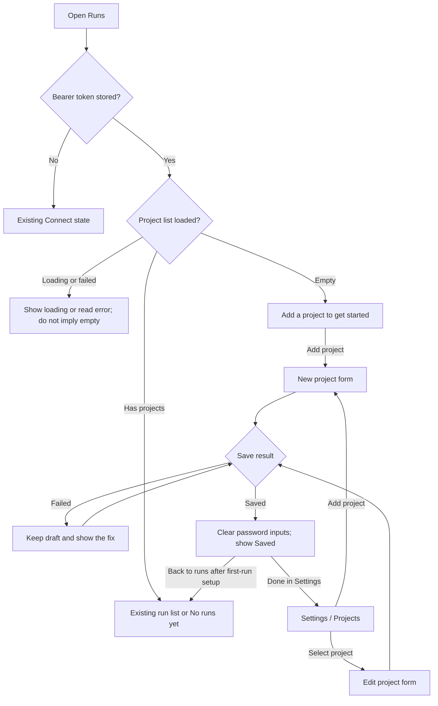
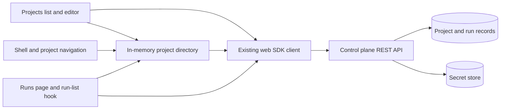
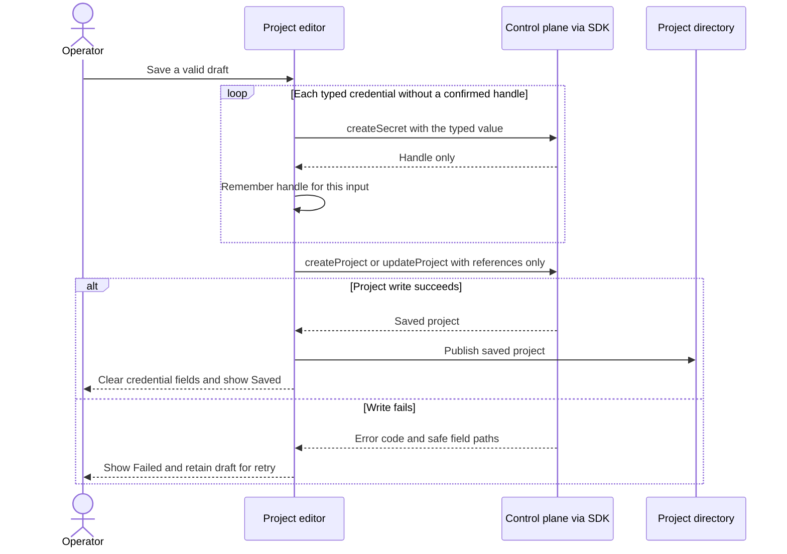

# Project and credential setup

## What

Operators can add and edit their tenant’s projects in the web client. They can enter separate credentials for the issue tracker and code host, keep an existing credential by leaving its field blank, or replace it by typing a new value. The client reports whether the project was saved without claiming that either credential works.

When the tenant has no projects, Settings and Runs guide the operator to create one. Once projects exist, the operator can open a project’s runs from the sidebar.

## Why

An operator should be able to set up the first repository and maintain its credentials without leaving the client. Clear save results tell the operator what to fix without exposing credentials or giving false confidence that a provider accepted them.

## Personas

- **Enzo: Engineer** — configures repositories and credentials, then uses project views to find and review runs.

## Narratives

### Set up the first project

Enzo connects to a new control plane. Runs says “Add a project to get started.” He chooses Add project, enters the repository binding and the two optional provider settings, and saves. The form says “Saved” and empties both credential fields.

Enzo returns to Runs and sees “No runs yet.” He opens Settings > Projects and sees his saved project. Back in the main sidebar, he can select it to see a run list scoped to that repository.

### Rename a project and replace a credential

Enzo opens an edit link for an existing project. The repository binding is read-only. He renames the project and leaves both credential fields blank. The rename appears in Settings and the sidebar without a reload, and the credentials stay in place.

Later he types a replacement code-host credential. If the save fails, the form keeps his input and explains what to do next. When the save succeeds, the field becomes blank again and still says “Credential (leave blank to keep existing).”

## User stories

**Set up the first project**

- Enzo can distinguish a missing connection, an empty project list, and an empty run list.
- Enzo can open Add project from either Settings or Runs.
- Enzo can correct an invalid repository URL before sending a request.
- Enzo can save a repository without either optional provider setting and understand what its runs cannot do.
- Enzo can see the project immediately and open its scoped run list from the sidebar.

**Rename a project and replace a credential**

- Enzo can open the edit form directly and see which fields cannot change.
- Enzo can cancel an edit and reopen it with the last saved values.
- Enzo can edit ordinary fields without re-entering or losing credentials.
- Enzo can replace either credential without seeing the stored value or handle.
- Enzo can recover from a failed save without retyping the credential or uploading it again if its first upload succeeded.

## Goals

- Provide three addressable Settings routes for listing, adding, and editing projects.
- Send one project mutation per valid save attempt, and one secret creation per newly entered credential, reusing confirmed uploads on retry.
- Keep credential values out of all client output and persistence. Send a typed value only in its own secret creation request body.
- Distinguish Saving, Saved, and Failed, with field errors or a next step where applicable.
- Preserve run selection and paging while applying the project filter to every run-list request.

## Non-goals

- Delete projects; delete, revoke, or clean up secrets; or show stored values or handles.
- Test a provider connection at save time, add an on-demand check or “Test credentials” button, or show a “Connected” result on Projects.
- Edit the workspace root override or the top-level `credentialRefs`.
- Expand sidebar projects into run trees, add intake or start-run controls, or build Appearance or General settings.
- Implement #141 or #143, or change server contracts, provider adapters, or storage.

## Design spec

### User flows

### Projects page and form

| Address | Main content |
| --- | --- |
| `/settings/projects` | Tenant project list. Each selectable row shows display name, `owner/name`, and the issue-tracker and code-host providers, with a dash for a missing provider. Add project opens the create form; there is no delete control. |
| `/settings/projects/new` | Add project form in place of the list. |
| `/settings/projects/<id>` | Same form populated from the saved project. A direct link loads the record; a missing or inaccessible record never opens a blank create form. |

Add Projects after Connection in the settings sidebar. The shell header reads `Settings / Projects` on all three routes. Use `SettingsPage` for the scroll region, 24 px padding, and column capped at `--width-settings-column`. Move focus to the form heading on route entry; on Cancel, restore focus to the originating list action or row when present. Use visible labels, linked hints and inline errors, and keyboard-operable controls. Do not use a dialog or render the list behind the form.

| Group | Fields and behavior |
| --- | --- |
| Project | Display name and repository URL. Both are required at create. Show an HTTPS field error before submit if the URL is invalid. |
| Host repository | Provider, owner, and name are required at create. On edit, show these fields and the repository URL as read-only text with a hint that the repository binding cannot change. |
| Issue tracker | Optional section: provider, project key, HTTPS URL, and credential. |
| Code host | Optional section: provider, HTTPS URL, and credential. Preserve an existing code-host `projectKey` if the API record has one; it has no editor here. |

Use the client’s new `Select` wrapper for all provider fields. An optional section can be unconfigured. If the operator fills a section, require a provider and, if there is no saved reference, a credential. An entirely blank section creates a `null` setting; an edit that makes a section entirely blank writes `null`, not a secret deletion. Leaving only the password blank does not clear a setting. When both sections are blank, say “Runs cannot read issues or open pull requests for this project.”

Use the shared `WriteOnlySecretField` inside each named section. It is a password input with `autocomplete="off"`, empty on entry to the form and after a successful save. The label is “Credential” without a saved reference and “Credential (leave blank to keep existing)” with one. Do not render a stored-value mask, badge, reveal, clear, or delete control. Normal password input masking applies only to what the operator just typed.

### Save feedback and navigation

Use one `role="status"` region above the action row. It starts quiet and announces the last save outcome with an 8 px dot and text. Use muted tokens for Saving, green for Saved, and `--color-red` for Failed with a one-line fix in `--color-subtext`. The dot is decorative; text conveys the state. Put secondary Cancel to the left of primary Save, aligned to the right. There is no test button or test status. Disable Save until locally valid, and block repeat submission and editing while Saving. An unchanged edit also disables Save because the API does not accept an empty patch.

| Outcome | Operator sees |
| --- | --- |
| Requests in flight | “Saving” |
| Project write succeeds | “Saved”; credential inputs empty; future edits start from the server response. |
| `400 validation_error` | “Failed” and a suggestion to correct the marked fields, with field errors next to the controls. |
| `422 unknown_credential_reference` | “Failed: a credential was not found”; suggest entering the credential again and mark the credential fields named by the server. |
| `409 conflict` | “Failed: a project for this repository already exists”; mark the host repository fields and suggest editing the existing project. |
| `400 secret_store_locked` | “Failed: the control plane's secret store is locked”; say that the control plane operator must unlock it. |
| `403` or network failure | Failed with the safe control-plane message or “Connection lost,” plus a one-line next step. Keep the form open and allow retry if locally valid. |
| Other failures | Failed with a safe fallback and a next step; never imply the project or provider connection succeeded. |

Keep the form visible on success so the operator can read “Saved”; do not dismiss it on a timer. After create, replace the `/new` address with the saved edit address without starting a new draft. For ordinary Settings entry, Done returns to the refreshed project list. For first-run entry, offer “Back to runs” after Saved, returning to `/runs` and the no-runs state if no run exists. Keep Cancel available while not saving; it discards unsaved changes and returns to the Projects list. The existing Settings Back path continues to return to the prior main view.

### Empty states and sidebar

Reuse the centered `EmptyState` pattern: title, one line of guidance, and at most one primary button. Both connected views use “Add a project to get started” with “Add project,” opening `/settings/projects/new`. Runs without a token keeps the existing Connect state, with no project reads. Settings without a token directs the operator to Connection before setup; a failed project read is not an empty result. If projects exist and there are no matching runs, preserve #134’s “No runs yet” state with no start-run action in this feature.

Place Projects between Runs and Settings in the primary sidebar. Expanded, it lists projects by display name and marks the active project. Collapsed, a populated section uses a focusable icon with a “Projects” tooltip that expands the section. With zero projects, show no rows or inert icon/link. A project row opens `/runs?project=<id>`; the header uses the project display name. As #134 selects runs, the path becomes `/runs/<run id>` while retaining the `project` query. Selecting Runs without a project clears the filter.

Visual references: [Settings pages, Empty states, and Overlays, menus, and buttons](../../context-agent/wiki/design-system.md). Projects uses the existing form pattern with the save result above the action row and no left-side test control.

## Tech spec

### Introduction and overview

This is a web-client feature. #132 supplies the shell, settings frame, token handling, and shared password field. #134 supplies run-list polling, pagination, and URL-based selection; #133 supplies the SDK and server project filter. Project and secret APIs already exist. #141 is not a dependency.

Follow [ADR-031](../adrs/adr-031-web-client-architecture.md) and [ADR-032](../adrs/adr-032-web-client-stack.md). [Settings](../concepts/settings.md) owns the project record and reference model; [UX](../concepts/ux.md) owns navigation, [Trackers](../concepts/trackers.md) owns the two provider axes, and [Collection](../concepts/collection.md) owns run-list behavior. A *credential reference* is the setting’s `{ id, purpose, label? }` object. Its `id` is the `sec_` handle returned by the secret API, not the credential itself.

The server checks that each submitted handle exists. It does not test provider connectivity when writing a project. This is a deliberate deviation from the Settings and UX concepts and the Projects test-button pattern in the design system. Document it in the agent design system; do not revise the human-owned concepts or claim to satisfy their test requirement.

### System design and architecture

- **Routing and shell:** extend `apps/web/src/app.tsx`, `shell/navigation.ts`, `shell/shell-layout.tsx`, and `shell/sidebar.tsx`. Preserve the existing Connection-check guard when navigating within or leaving Settings. Carry first-run origin as route state containing no form data; a pasted `/new` link defaults to Settings behavior.
- **Project directory:** scope one in-memory directory to the active SDK client beneath the shell. Share project-list load state and records between Settings, the sidebar, the header, and run-row name lookup. Upsert the returned project after a successful mutation, then reconcile with the server; a failed refresh must not turn a successful save into Failed or erase the returned row. Ignore stale responses from before a write or client change. Retain the run list’s unknown-project refresh behavior through the shared directory without fetching on every poll for the same missing ID.
- **Project editor:** keep drafts, inline errors, save state, and retry bookkeeping local to the editor. Use `getProject(id)` on edit entry and the server’s saved response as the baseline after each successful mutation. Put Base UI imports inside `ui/select.tsx`, following the existing shared component boundary. Offer GitHub (`github`) on the three provider fields for the existing integration; preserve a saved provider ID as an option if it is not in the offered set. Add error forwarding to `WriteOnlySecretField` without changing Connection behavior.
- **Run filtering:** `routes/runs-page.tsx` reads the optional `project` query and passes it through `runs/use-run-list.ts`’s existing request-argument seam. Selection navigation retains this query; do not change #134’s user-push and automatic-replace rules. Scope rows, cursors, selection, and in-flight responses to the client and project filter. Changing scope starts at page one and cannot merge old rows or reuse old cursors. An unknown filter does not fall back to all runs; it uses the filtered empty result and a generic title if the name is unavailable.

### Detailed design

No model, migration, or endpoint changes are needed. Reuse `listProjects()` and `createProject()` on `/v1/projects`, `getProject(id)` and `updateProject(id, patch)` on `/v1/projects/:id`, `createSecret({ value })` on `POST /v1/secrets`, and `listRuns({ projectId, limit, cursor })` on `/v1/runs`. `packages/api-contract/src/project.ts` and `secret.ts` are authoritative for shapes; the SDK handles serialization and response parsing.

1. **Validate before secret creation.** Validate the non-secret draft against the create or update schema constraints, including HTTPS for every URL written. Omit empty optional properties and validate section completeness. Do not revalidate or send immutable fields when editing. Display errors before submit and make no write call on invalid or unchanged input.
2. **Build the patch against the saved baseline.** Create sends the repository binding, display name, and settings (explicit `null` for unconfigured sections). Update includes only changed top-level fields. When a setting changes, send the whole setting, carrying its existing `credentialRef` unchanged if that password is blank. If the setting itself did not change, omit it entirely; a rename-only patch, for example, contains only `displayName`. Never send the top-level `credentialRefs`, `workspaceRootOverride`, owner, or tenant.
3. **Upload and attach.** On explicit Save, snapshot the validated draft and allow only one attempt at a time. For each non-empty credential input, use its confirmed handle or call `createSecret` once and remember the returned handle immediately, even if the next upload fails. Place the handle only in the matching setting’s `credentialRef.id`, with purpose `issue_tracker` or `code_host`. Treat the credential as an opaque string without trimming. Validate the assembled request through the contract, then make exactly one project write after all required uploads succeed.
4. **Retry safely.** Keep successfully returned handles in form-local memory, per credential field and unchanged input revision. Editing that input invalidates its retry entry; changing another field does not. For `422`, allowlist `issueTrackerSetting.credentialRef` and `codeHostSetting.credentialRef`, mark those fields, and discard only rejected staged handles so the next attempt can upload again. Do not silently cycle requests. On failure preserve the draft and do not change the saved baseline or publish new references. Clear the typed values and retry entries on success, Cancel, route exit, or client change. A confirmed upload can remain unreferenced after a failed write or abandoned draft; a lost upload response cannot be deduplicated without server support.
5. **Map errors and commit.** Use `ControlPlaneClientError.status` and `response.error.code`. For `400 validation_error`, map `details.issues[].path` to known controls; do not render raw details. For `422`, use `details.fields`; for `409`, mark the repository group. Use fixed copy for known codes and safe fallbacks for unrecognized details. For `403`, use the control plane’s message only if safe to display; for transport errors use “Connection lost.” Preserve the existing 401 reauthorization path. On success, update the baseline and shared directory from the project response before secondary reads or navigation.
6. **Resolve empty states from authoritative reads.** Runs gives Connect priority when no token is stored and shows no-projects only after a successful project list read with zero records. Do not replace run rows with a false empty state on a project lookup failure. For zero run rows, defer the empty-state decision until the necessary reads resolve; with projects and a successful empty run result, render #134’s no-runs state. Use the project filter on initial load, all poll requests (including reread pages), and explicit pagination.

### Security, privacy, and compliance

Use the existing same-origin bearer-authenticated SDK and the control plane’s tenant and principal checks. The browser’s validation improves feedback; it is not an authorization or validation boundary. Do not call providers directly. The control plane remains the only durable store for project credentials.

Keep newly typed credentials only in the live form and the in-flight `createSecret` body. Do not copy them to route state, URL paths or queries, browser storage, general app state, logs, toasts, DOM text, or accessible names. Do not interpolate handles into any UI output. Only pass the password input its current draft value and a boolean indicating whether the setting has a saved reference. Render errors as text, with allowlisted field paths and safe copy; never print raw response or exception payloads. No new compliance policy or data retention is introduced.

### Observability

Use the save status and inline errors for operator feedback. Add no client logging, analytics, metrics, or alerts. Keep existing control-plane observability and avoid emitting draft data, request bodies, or handles in diagnostics.

### Testing plan

- **Component and unit tests:** fake the SDK at its public interface. Cover loading, valid and invalid forms, direct edit, Cancel, immutable fields, optional settings, request order and shapes, blank and replaced references, all save-result branches, in-flight duplicate prevention, retry after a partial upload and after a project failure, and selective invalidation on a rejected handle. Cover filter changes, URL/history behavior, and same-filter initial, polling, and paging requests, including late responses from the old filter.
- **Playwright wiring:** use the existing production-build fake-mode harness with no test-only app hooks or fake SDK. Start without seed data. Check both first-project empty states and the no-token Connect precedence. Create through the UI, see Saved, return to Runs and see no runs, then verify Settings, sidebar, and `listProjects` without a reload. Read via the real SDK to verify each configured setting has a handle and API responses contain no typed credential. Edit the name with blank passwords, retain the handles, then replace a credential and verify a new handle. Confirm duplicate repository yields the `409` copy and invalid HTTPS input produces a field error before any write. Seed a project through the SDK before #134’s separate no-runs assertion.
- **Write-only checks:** use a distinct synthetic value for each tested field. Observe requests and responses without changing them. Assert that the value appears only in its one `createSecret` request body, never in URLs, request paths or queries, response bodies, console messages, toasts, element text or accessible names, or `localStorage` or `sessionStorage`. Assert there is no `createSecret` request for a blank input and no handle in the rendered page. Verify password type, autocomplete, and clearing after success. Do not print the sentinel in test diagnostics.
- **Geometry:** in light and dark themes, read `--width-settings-column` and compare the measured content width. Check status above the action row and Cancel left of Save, aligned within the column without overlap. Follow the design-system geometry conventions.
- **Manual check:** build with `pnpm nx build web`; run `AUTOCATALYST_CLIENT_DIR=apps/web/dist pnpm nx run control-plane:serve-fake` without seeding. At `http://127.0.0.1:4010`, connect using `fake-mode-token`. Use Add project from Runs and enter the GitHub fixture repository from `docs/operators/fake-mode.md`, `Fixture app`, and `fake-token` for each configured setting. Check Saved, return to Runs, inspect the list and sidebar, rename while keeping the credentials, replace one credential, and try a duplicate repository. No test makes a model call or calls a real provider.

### Alternatives considered

- **A modal editor:** keeps the list visible, but complicates deep links and disagrees with the existing focused Settings form pattern. Use route-backed forms instead.
- **Resend credentials on every retry:** simple in the browser, but creates duplicate secrets after a confirmed upload. Reuse the returned handle for an unchanged input within the form session. A combined server transaction could improve atomicity later, but requires a new contract and is out of scope.
- **Label an existing handle as connected:** the existence check proves only that the reference resolves. Show save results and defer credential checking to its separate issue.

### Risks

- **Saved references can be lost on a partial update.** Compare with the saved baseline and include the old reference in every replacement setting that keeps it. Test both a rename-only patch and a change inside a setting.
- **Separate API calls are not atomic.** Keep confirmed uploads for retry, do not update the project view on a failed write, and leave superseded or unreferenced secrets in the store. Do not add a delete path.
- **Stale reads can undo a rename or leak rows across filtered views.** Scope reads to the active client and filter, ignore obsolete responses, and reconcile project reads after the mutation result is published.

## Task list

- [ ] **Story: Find and edit projects in Settings**
  - [ ] **Task: Add the shared Select and credential field errors**
    - **Description**: Wrap Base UI Select in the client’s `ui/` layer and let the shared write-only field report inline errors.
    - **Acceptance criteria**:
      - [ ] Select supports visible labels, keyboard selection, disabled and error states, and design-system tokens without Base UI imports in feature code.
      - [ ] The password input keeps `autocomplete="off"`, receives linked inline errors, and preserves all Connection behaviors.
    - **Dependencies**: #132.
  - [ ] **Task: Wire project reads and Settings routes**
    - **Description**: Add a shared tenant project directory and route the Projects list, create entry, and edit entry through the settings shell.
    - **Acceptance criteria**:
      - [ ] Projects follows Connection and all three routes show `Settings / Projects` in the header.
      - [ ] `listProjects` populates selectable rows with name, `owner/name`, and both providers, with no delete control.
      - [ ] Direct edit reads `getProject`; loading, read failure, and unavailable project states do not render an empty create form.
    - **Dependencies**: #132; existing project SDK methods.
  - [ ] **Task: Build the focused project form**
    - **Description**: Use one editor for create and edit, with provider selects, optional sections, and contract-based preflight validation.
    - **Acceptance criteria**:
      - [ ] All specified fields render and the repository binding is editable only on create. Invalid HTTPS URLs are marked before any write.
      - [ ] Blank sections save as `null`; the form explains the limitations when both are blank. An enabled section requires a credential only when none is stored.
      - [ ] Credential fields open empty with the correct labels and no stored value, handle, mask, badge, reveal, or clear control.
      - [ ] Save is disabled for invalid or unchanged input; Cancel returns to the list and discards the draft.
    - **Dependencies**: Task: Add the shared Select and credential field errors; Task: Wire project reads and Settings routes.
- [ ] **Story: Save credentials without exposing them**
  - [ ] **Task: Implement project writes and secret retry bookkeeping**
    - **Description**: Sequence secret creation before the project write and preserve confirmed handles for retry within the form session.
    - **Acceptance criteria**:
      - [ ] A valid attempt makes one project write after required uploads; a blank credential makes no secret call.
      - [ ] Create contains the repository binding; update contains only changed fields, carries references in changed whole settings, and omits top-level `credentialRefs`.
      - [ ] Replacement writes the new handle with the matching purpose. Failure leaves the saved baseline unchanged and preserves the typed inputs.
      - [ ] If a later upload or the project write fails, retry reuses each confirmed handle for the unchanged input. A rejected handle invalidates only its own retry entry.
    - **Dependencies**: Task: Build the focused project form; existing secret SDK method.
  - [ ] **Task: Show save results and publish successful writes**
    - **Description**: Add the status region and error mapping, publish successful writes to the shared directory, and route the operator after acknowledgement.
    - **Acceptance criteria**:
      - [ ] The region shows Saving, Saved, or Failed with the specified dot, error text, and suggested fixes. It never shows Connected or a test control.
      - [ ] `400` validation, `422` missing reference, `409` duplicate, and `400` locked store map to the specified fields and copy; `403` and network errors retain the form and allow retry.
      - [ ] Success clears credential inputs, rebases the editor, and updates the project list, sidebar names, and header names without a page reload. A follow-up read failure does not change Saved to Failed.
      - [ ] Component tests fake the public SDK and cover all save states, payload shapes, and retry without duplicate creation.
    - **Dependencies**: Task: Implement project writes and secret retry bookkeeping.
- [ ] **Story: Start with an empty tenant and navigate by project**
  - [ ] **Task: Wire the first-project empty states and return flow**
    - **Description**: Use confirmed project-list results in Settings and Runs and carry first-run origin through the create flow.
    - **Acceptance criteria**:
      - [ ] Both connected empty views show “Add a project to get started” and one Add project button. The run-list button opens `/settings/projects/new`.
      - [ ] No token keeps Runs in Connect; project loading or failure is not no-projects. Projects with no runs still show #134’s no-runs state.
      - [ ] After Save from the first-run flow, Back to runs returns to `/runs` and shows no runs on an otherwise empty tenant.
    - **Dependencies**: Task: Show save results and publish successful writes; #134.
  - [ ] **Task: Add project navigation and scope the run list**
    - **Description**: Render project links between Runs and Settings and bind the run-list request scope to the project query.
    - **Acceptance criteria**:
      - [ ] Rows show display names, the current project is selected, and the collapsed section has a tooltip icon. An empty section has no dead entry.
      - [ ] `/runs?project=<id>` opens the filtered view with the project name as title. Selection keeps `/runs/<run id>` and retains the query and history behavior.
      - [ ] Every load, poll, and paged call receives the same active `projectId`. Tests prove that a scope change starts on page one and discards old rows, cursors, and late responses.
    - **Dependencies**: Task: Wire project reads and Settings routes; #133; #134.
- [ ] **Story: Verify the production path and document the feature**
  - [ ] **Task: Cover project setup and credential privacy in Playwright**
    - **Description**: Use the built client and real SDK against fake mode to cover first-run setup, edit, replacement, navigation, validation, and write-only behavior.
    - **Acceptance criteria**:
      - [ ] Starting with no project, the test sees both empty states, creates through the UI, verifies Saved and the Runs return, and sees the project in Settings, the sidebar, and an SDK read.
      - [ ] SDK reads verify handles and no returned plaintext. Rename with blank input keeps the handle and label; replacement changes only the intended handle.
      - [ ] The duplicate case shows the specified conflict; invalid repository URL shows a field error with no write call. The write-only assertions cover every sink in the testing plan and exact secret request counts.
      - [ ] #134’s no-runs Playwright case creates a project via SDK before its assertion. No test uses test-only app hooks, a fake SDK in Playwright, real providers, or model calls.
    - **Dependencies**: Task: Wire the first-project empty states and return flow; Task: Add project navigation and scope the run list.
  - [ ] **Task: Verify form geometry and update agent documentation**
    - **Description**: Add light and dark geometry assertions and record the project wiring and save-status deviation with the feature.
    - **Acceptance criteria**:
      - [ ] The settings content width and status/action-row layout satisfy the design in both themes using token-based bounds.
      - [ ] `context-agent/wiki/design-system.md` records Saving, Saved, and Failed, no Test credentials button, and no save-time connection test. It cites `packages/core/src/project.ts:101-125` for handle existence and identifies the separate on-demand check as future work.
      - [ ] `context-agent/wiki/code-map.md` records the Projects page, sidebar section, shared directory, and empty-state wiring.
    - **Dependencies**: Task: Wire the first-project empty states and return flow; Task: Add project navigation and scope the run list.
