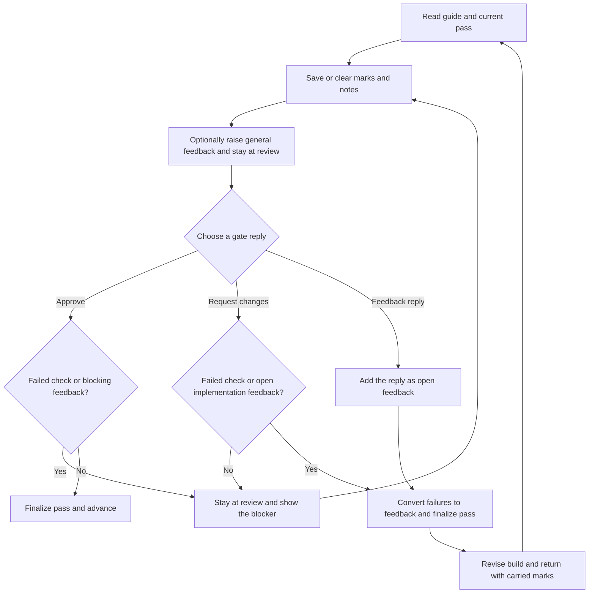
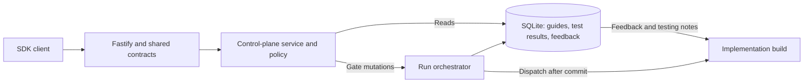
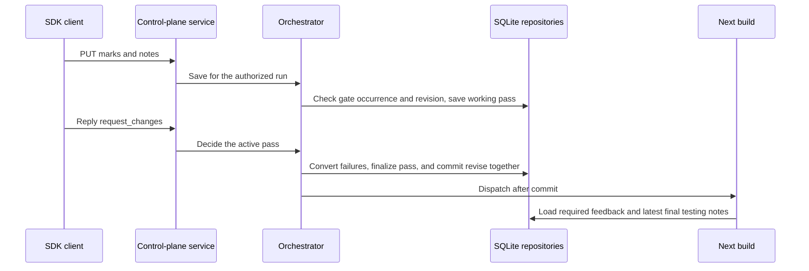

# Record per-item test results and general feedback

## What

At implementation review, the operator can mark each testing-guide check passed or failed, leave it unanswered, and add a note. The operator can also raise general implementation feedback without attaching it to a check. Autocatalyst keeps one final result for each guide-backed review pass the operator decides.

A failed check prevents approval. When the operator sends the build back, failed checks become feedback to address, while notes on other checks go to the next build as context. On the next pass, the operator can see which checks already passed and which need to be tried again.

## Why

A single verdict does not tell the operator what they tried or tell the implementer what to fix. Keeping marks and notes by check lets the operator keep useful observations without turning every observation into a blocker, retyping failures as feedback, or reconstructing earlier passes from memory.

## Personas

- **Enzo: Engineer** ([app.md](../app.md)). He tests the implementation, reports problems, and decides when it is ready to advance.

## Narratives

### Send a build back with clear feedback

Enzo opens the guide for a finished build. A passes quickly, C produces the wrong output, and D passes too. He records the results and his observations. He also raises a typo in the help text separately because it does not belong to any check.

When he tries to approve, Autocatalyst identifies C as failed and leaves the run at review. Enzo requests changes. The implementer receives two items to address: C's failure and the typo. The notes on the passed checks are available as context, with no response required.

### Retest and approve

When the revised build returns, A is still passed and its note is present. C is unanswered so Enzo can test the fix. The rewritten D starts unanswered with no note, even though the previous D passed. The newly added E starts empty too.

Enzo checks the fixes and approves without having to answer every guide item. Autocatalyst confirms the addressed feedback he raised. He can later inspect two separate final results to see what happened on each pass.

## User stories

**Send a build back with clear feedback**

- Enzo can read every check's mark and note in guide order before making any edits.
- Enzo can save or clear a mark or note without changing other checks.
- Enzo can raise a general implementation issue without leaving review.
- Enzo can see which failed checks prevent approval.
- Enzo can request changes based on failed checks, open feedback, or both, without retyping a failure.

**Retest and approve**

- Enzo can distinguish previous final passes from the current draft.
- Enzo can keep passing marks and notes on checks that did not change.
- Enzo can distinguish a check he must retest from one that already passed.
- Enzo can approve with unanswered checks or notes when no failed check or feedback blocker remains.
- Enzo can inspect a final result for each decided pass, including distinct passes against the same guide revision.

## Goals

- Save a passed, failed, or unanswered mark and a note of up to 2,000 characters for each guide item.
- Refuse approval while a current item is failed, identify every failed item, and make no writes on that refusal.
- Create one feedback item per failed check on send-back, with no duplicates on retry. Deliver general feedback through the existing implementation feedback lifecycle and other notes as context only.
- Keep one final result per decided guide-backed review occurrence and carry eligible marks and notes by stable item ID, even on same-revision returns.

## Non-goals

- Author or edit guides (#163), build the Acceptance tab (#165), run checks automatically, or capture evidence.
- Change or use the run-level `Run.testingGuideResult` summary for this feature.
- Add feedback withdrawal, implementation anchors, or changes to the spec, docs, or pull request gates beyond #136.

## Design spec

This feature defines the control-plane and SDK interaction. It adds no screens, components, or visual assets; #165 owns the Acceptance tab.

A general feedback submission leaves the run at review; a feedback reply sends it back. A stale save never applies edits to a different guide revision. The client reads the latest guide and pass before submitting again. Without a guide, the existing gate reply behavior still applies.

## Tech spec

### Introduction and overview

Build on [acceptance testing](../concepts/acceptance-testing.md), [the domain model](../concepts/domain-model.md), [feedback](../concepts/feedback.md), and [human pauses](../concepts/hitl.md). ADRs 004–007, 009, 015, 018, and 019 establish the persistence, REST, identity, transition, and feedback boundaries. [#136](enhancement-spec-feedback-anchors-request-changes-resolve-reopen.md) supplies `request_changes`, the feedback lifecycle, and the 422 mapping. [#163](feature-testing-guide-after-build.md) supplies stored guide revisions and stable item IDs. #128 supplies the production fake-mode entrypoint.

A **pass** is one occurrence of `implementation.human_review` with a stored guide, identified internally by the gate's `RunStep.id`, not the guide revision. A **seeded view** is the unsaved current pass. A decision finalizes a guide-backed pass even if no marks were saved. The final `tester` is the decision-maker, not necessarily the person who last saved an edit.

### System design and architecture

`packages/api-contract` defines the shared HTTP schemas. `packages/core/src/testing-guide-results.ts` owns the pure outcome and carry rules. The service authorizes requests and scopes them to the tenant. The orchestrator serializes saves, implementation feedback creation, and decisions with other run mutations. Persistence owns the occurrence checks, transaction, and uniqueness constraints. `apps/control-plane/src/server.ts` wires the repositories and loads notes for the build context.

### Detailed design

#### Records and storage

- Extend `TestResult` in `packages/api-contract/src/test-result.ts` with `guideRevision` (positive integer; absent only on legacy records), `state: 'working' | 'final'`, and `items: [{ id, outcome?, note?, feedbackId? }]`. Item outcomes are `passed` and `failed`; omission means unanswered. Only the server sets `feedbackId` and the overall outcome. Keep `id`, `runId`, `tester`, optional evidence, `feedbackRefs`, and timestamps. Legacy records parse as final with empty items and no guide revision; preserve their original outcome, including `blocked`, and their existing evidence and refs.
- `deriveTestResultOutcome` returns `failed` if any item failed, `passed` if at least one passed and none failed, and `inconclusive` if none is marked. A working row uses the saving principal as `tester` and has empty `feedbackRefs`. Finalization records the decision-maker as `tester`.
- Add `guide_revision INTEGER` (nullable for legacy rows), `state TEXT NOT NULL DEFAULT 'final'` constrained to the two values, and `items_json TEXT NOT NULL DEFAULT '[]'` to `test_results`. Add a partial unique index on `run_id` where `state = 'working'`. Add internal `gate_step_id TEXT REFERENCES run_steps(id)` with a unique index for non-null values. For new guide-backed rows require both a guide revision and a gate ID from the same run; do not invent either for legacy rows or expose the gate ID on the wire. Use the next free migration number after #163 and any intervening changes: inspect `packages/persistence/drizzle` and `meta/_journal.json` when implementation starts and register the migration in the journal.
- Add `findWorkingByRun`, `saveWorking`, and `finalize` to `TestResultRepository`. Update the same occurrence's working row in place and refuse a second working row or changes to a final row. An identical save preserves the ID and timestamps. `finalize` promotes the working row or inserts a final row for an unsaved pass; finalizing the same occurrence again returns the stored row unchanged. Preserve legacy `create`, `findById`, and `listByRun` behavior where compatible. List legacy rows first in `createdAt, id` order, then guide-backed finals in `RunStep.occurrence.index` order, then the working row if present.
- Add a tenant-scoped guide lookup by run and revision. Resolve historical records and build-note text against their recorded revision, never by position in the newest guide. A missing recorded guide revision is a data fault, not a reason to substitute another guide.

#### Read, seed, and save a pass

1. At the gate, use the latest stored guide and the working row for the active occurrence and revision, if present. Otherwise `seedTestingGuidePass` uses the newest prior guide-backed final. Match by item ID: copy a passed mark and its note, copy an unanswered item's note, and reset a failed item to unanswered without its note. Never carry `feedbackId`. New IDs start empty and removed IDs appear only in history. Apply the same rule when `pr.finalize` sends the run back on the same revision.
2. A seeded read writes nothing and omits `testResultId`. Away from the gate, return the latest guide-backed final at its own revision, even if a newer guide has been stored. Legacy rows without a revision are available in history but do not stand in for a guide-backed result.
3. On save, check the active gate occurrence and latest revision inside the mutation boundary. Validate all submitted IDs before writing. Replace only named items' outcome and note; `null` unsets the corresponding property. Save a complete ordered snapshot, including unanswered items. A valid first save, including an empty patch, creates the working row. A blank note is valid data but does not provide a feedback body.
4. Guard saves and decisions with the active `RunStep.id` so an in-flight request cannot mutate an occurrence that has closed. The v1 save body identifies a revision, not a client-side occurrence. A new request received at a later gate on the same revision applies to that later pass.

#### Close an undecided pass

At the transition commit boundary, treat **every committed transition that closes the source `RunStep.id` for `implementation.human_review`** as a pass exit, even if a future transition opens another occurrence of the same named step. Only a successful guide-backed `approve`, `request_changes`, or `feedback` reply supplies a trusted decision to that commit. A directive name or human origin alone does not identify a decision.

Extend the occurrence-checked transaction behind `RunRepository.recordRunStepTransition` in `packages/persistence/src/domain-repositories.ts`. For a decision, finalize the pass in that transaction. For any other exit, delete only the `working` row matching the run and closing gate ID in the same transaction that closes the source and opens the destination. Do not finalize it, generate feedback from its marks, or delete final rows. If the transition fails or the expected occurrence does not match, neither the exit nor the deletion commits. Route any future operation that closes this gate through the same invariant.

This covers `cancel` to `canceled`, a successful `set_step` rewind, and `fail` to `failed`, as well as any other committed non-decision exit. `invalid_transition` by itself is a rejection and closes nothing: keep the draft. Recovery acts on a run already at `failed`; the preceding `fail` commit has removed the draft. A resume that reopens the gate, or a rewind that later reaches it again, seeds from the preceding final and can save a new working row. Canceled runs cannot recover; verify their draft and working slot are gone at cancellation rather than adding a re-entry path.

#### HTTP and SDK contracts

Paths below are relative to `/v1/runs/:id`. Define the results schemas and `TEST_RESULT_NOTE_MAX_LENGTH = 2_000` in `packages/api-contract/src/test-result.ts`. Use strict write schemas and the existing error envelope.

| Method and path | Request and success | Feature-specific errors |
| --- | --- | --- |
| `GET /testing-guide/results` | `200 { guideRevision, state, outcome, items, testResultId? }`. State is `working` at the gate, including a seeded view, and `final` away from it. Include all items of the returned revision in guide order; include `testResultId` only for a stored row. | `404 not_found` without a guide. Away from the gate, `404 not_found` with a message that no test result is recorded if there is no guide-backed final. |
| `PUT /testing-guide/results` | Strict `{ guideRevision, items: [{ id, outcome, note }] }`. Require a nonempty ID, `outcome` of `passed`, `failed`, or `null`, and `note` of at most 2,000 characters or `null`. `200` with the same shape as GET and a `testResultId`. | `400 validation_error` for unknown keys, repeated IDs, invalid fields or values, or overlong notes. `409 conflict` outside the gate; `404 not_found` at the gate without a guide. `409 conflict` with `details: { code: 'stale_guide_revision', latestGuideRevision }` on revision mismatch. `422 unknown_test_items` with `details: { unknownItemIds }` for IDs outside the current revision. Rejected saves write nothing. |
| `GET /test-results` | `200 { testResults: TestResult[] }` in stored pass order, with the working row last. An existing run with no results returns an empty list. | No guide prerequisite. |
| `POST /feedback` | Extend `createRunFeedbackRequestSchema` to a strict union on `target`. Preserve #136's `artifact` branch. The `implementation` branch accepts `title` and `body`, no anchor, and returns the existing `201` feedback response. | `400 validation_error` for an anchor on an implementation request or other invalid fields. `409 conflict` outside `implementation.human_review` for the implementation branch. Preserve artifact errors, including `422 invalid_feedback_anchor`. |
| `POST /replies` | Keep request and success shapes. Extend decisions only at the guide-backed implementation gate. | `409 conflict` with `details: { code: 'failed_test_items', failedItemIds }` on failed-check approval. Preserve `feedback_gate_blocked`; use `request_changes_conflict` when neither open implementation feedback nor failed checks exist. |

Reuse the `handleControlPlaneServiceError` 422 branch for `unknown_test_items` and `invalid_feedback_anchor`, preserving each code and details. Map `failed_test_items` to `conflict` alongside `feedback_gate_blocked` in `control-plane-service.ts`. Follow existing validation, authentication, and error conventions; unexpected failures return the standard `500 internal_error` without private data. Document the routes, feedback union, two new conflict details, and 422 in OpenAPI. Add SDK methods `getTestingGuideResults(id)`, `saveTestingGuideResults(id, request)`, and `listRunTestResults(id)`; extend `createRunFeedback` and parse responses through the shared schemas.

#### Gate decisions and retry safety

- **Approve.** For a guide-backed pass, check for failed marks before any feedback or test-result write. Return the failed IDs in guide order. Otherwise preserve the existing rule: confirm the approver's own addressed implementation feedback, then refuse if any open implementation feedback or another principal's addressed implementation feedback remains. After that check succeeds, finalize with the approver, the derived outcome, and empty `feedbackRefs`, then advance. Unanswered checks and notes never block.
- **Request changes.** Require an open implementation feedback item or a failed check. If neither exists, return a conflict saying there is no open feedback and no failed check, without writing. Otherwise create one open implementation feedback item per failed check without a `feedbackId`, in guide order. Use `createGateFeedback` semantics: author it as the decision-maker, use the guide item's text as the title and its nonblank note as the body. If the note is absent or blank, use the item text and append the expected result when present. Write each generated ID on its item **inside the decision transaction** before processing the next failure. Finalize with the operator as `tester`, the derived outcome, and the deduplicated union of the failed checks' feedback IDs and all open implementation feedback IDs, then apply `revise`. Passed and unanswered notes never become feedback.
- **Feedback reply.** Create the reply's own open implementation feedback item, then use the same conversion, finalization, and `revise` path. Include the reply's item in `feedbackRefs`; `createdFeedbackId` still identifies only that item. Standalone `POST /feedback` uses `createGateFeedback` at the implementation gate even without a guide, but makes no test-result write and does not transition the run.
- **Compatibility.** Without a stored guide, all three replies behave as under #136 and write no test result. Spec-gate `request_changes` and artifact feedback, including anchor validation, remain unchanged.

Keep guide-backed decisions under the run lock and check the expected source `RunStep.id` at commit. For send-back, use one transaction for the reply's own feedback insert if present, all failed-check feedback inserts and per-item links, the final result, and the step transition. There are no commits between items. If any write or the transition fails before commit, roll back the inserts and links together; retry recreates the rolled-back work for the still-open occurrence. For approval, commit the final result with the transition after the existing feedback checks. Repository finalization of an already-final occurrence is a no-op; an already-closed gate is not decided again. Reuse lifecycle rules and publish transition events and admit subsequent work only after commit.

#### Build context

General feedback and generated failed-check feedback follow the existing required-disposition path in `layered-convergence-engine.ts`; the engine marks feedback addressed on convergence as it does today. In the `implementation.build` context loader in `apps/control-plane/src/server.ts`, read the latest guide-backed final and its recorded guide revision. Pass `testingNotes` to `buildImplementationBuildContext` with the text, outcome (display `unanswered` when absent), and note for each passed or unanswered item with a note and no `feedbackId`. Render an implementer-only **Testing notes** section in guide order and label it context requiring no disposition. Exclude failed and linked items, never read drafts or look past the latest guide-backed final for notes, and omit the section when empty.

### Security, privacy, and compliance

Authorize the three result routes before any repository call. Add resource kinds `run_testing_guide_results` and `run_test_results` to `packages/core/src/policy.ts` and actions `run_testing_guide_results.read`, `run_testing_guide_results.write`, and `run_test_results.list`. Use `requireTenantRun` so missing and cross-tenant runs return `404` to an otherwise eligible caller. Use `requireNonModelPrincipal` for saves and preserve existing feedback and reply mutation authorization; a model save returns `403`. Validate inputs on the server and recheck the run and occurrence on mutations. Treat notes as run-scoped operator observations, not prompt instructions. Do not put note text or feedback bodies in logs or telemetry.

### Observability

Keep the existing transition events for committed decisions. Use standard request and fault logging with operation, authorized run ID where applicable, and error code. Expected `409` and `422` responses are operator outcomes, not alerts. Use existing monitoring for unexpected failures; add no metrics or alerts.

### Testing plan

- Unit-test strict contracts, outcome derivation, carry by ID, and prompt rendering. Include stable, removed, added, and rewritten IDs, plus a same-revision return.
- Test fresh and populated SQLite migrations, uniqueness, idempotent saves and finalization, and transactional rollback. Exercise rejected and stale operations, exit cleanup, and successful saves on fresh occurrences after supported re-entry paths.
- Capture the revise build prompt using the scripted harness from `apps/control-plane/src/spec-author.integration.spec.ts`. Assert that a generated failure is a required disposition and that a passed item's note appears separately under Testing notes.
- Spawn the production entrypoint in fake mode and drive a feature run through the SDK, including both guide revisions and final history. No test calls a model.

### Alternatives considered

- **Store marks in `Run.testingGuideResult`.** A run-level summary cannot retain per-pass history. Extend `test_results` instead.
- **Create feedback when a check is marked failed.** Correcting a mark could then leave a blocker that needs withdrawal. Convert the failure only on send-back.
- **Key results by guide revision.** A same-revision return would overwrite or merge a decided pass. Key by gate occurrence and store the revision as a reference.

### Risks

- **A closing gate leaves its working slot occupied.** Enforce cleanup at the occurrence-checked transition commit and verify decision, non-decision, and rejected exits.
- **A fault duplicates feedback or loses a result.** Commit send-back side effects and the transition together. Inject a fault between inserts and finalization and assert both rollback and successful retry.
- **A rewritten check inherits an old mark or note.** Match by ID, not position, and exercise a previously marked rewritten check in the SDK wiring test. Read historical text only from the recorded revision.

### How to try it

Run `pnpm nx run control-plane:serve-fake` and `pnpm nx run control-plane:seed-fake -- --scenario implementation-review` from the repository root as described in the [fake-mode guide](../../docs/operators/fake-mode.md). With the printed run ID, call `http://127.0.0.1:4010` with `Authorization: Bearer fake-mode-token`. The paths below start at `/v1/runs/<id>`.

1. Read `GET /testing-guide` for the IDs and `GET /testing-guide/results` for the seeded pass. A–D are unanswered, with no result ID.
2. `PUT /testing-guide/results` for revision 1: mark A passed with `Fast.`, C failed with `Lowercase output.`, and D passed with `Original D worked.`. Leave B unanswered.
3. `POST /feedback` with `{"target":"implementation","title":"Help text","body":"The help text has a typo."}`. Expect `201` and no step move.
4. `POST /replies` with `{"kind":"approve"}`. Expect `409 conflict` with `details.code: failed_test_items` and C's ID. Then post `{"kind":"request_changes"}` and check that C and the typo are the two implementation feedback items.
5. Wait for the next `implementation.human_review`. Read revision 2 and its pass. A still has its mark and note. C is unanswered without its old note. Rewritten D has a different ID from the marked D and is unanswered with no note; new E is also empty. Both feedback items are addressed.
6. Approve. `GET /test-results` shows two final rows: revision 1 failed with two feedback refs, and revision 2 passed with none.

## Task list

This task list is planning output for human review. It does not authorize implementation.

- [ ] **Story: Persist and seed a test pass**
  - [ ] **Task: Define test-result contracts**
    - **Description**: Add record fields, the note length limit, and current-pass, save, and history schemas to `test-result.ts`.
    - **Acceptance criteria**:
      - [ ] Legacy records parse as final with no revision and empty items, preserving their original data.
      - [ ] Schemas distinguish null on write from absence on read, reject server-owned fields on write, and accept 2,000 characters but reject 2,001.
    - **Dependencies**: #163 guide contract.
  - [ ] **Task: Add persistence and occurrence constraints**
    - **Description**: Add the next numbered Drizzle migration and journal entry, extend `TestResultRepository`, and add guide lookup by revision.
    - **Acceptance criteria**:
      - [ ] The full migration chain applies to fresh and populated databases without losing legacy test results.
      - [ ] `findWorkingByRun` finds only the draft, `saveWorking` reuses it and refuses a second working row, and `finalize` returns an already-final occurrence unchanged.
      - [ ] Two final rows for the same guide revision appear in occurrence order even when timestamps tie.
    - **Dependencies**: Task: Define test-result contracts; #163 guide persistence.
  - [ ] **Task: Implement outcome and seed rules**
    - **Description**: Add `deriveTestResultOutcome` and `seedTestingGuidePass` to `testing-guide-results.ts`.
    - **Acceptance criteria**:
      - [ ] Unit tests cover all unanswered, one or more passes with no failure, and a failure mixed with other marks.
      - [ ] Carry tests cover a passed mark and note, an unanswered note, reset of a failed check and note, no carried feedback IDs, removed IDs, new and rewritten IDs, guide order, and return on the same revision.
    - **Dependencies**: Task: Define test-result contracts.
- [ ] **Story: Read, save, and list results**
  - [ ] **Task: Wire authorized result reads**
    - **Description**: Add the two GET routes through policy, tenant lookup, and production composition.
    - **Acceptance criteria**:
      - [ ] Current-pass reads at the gate include every check in order; the seeded view has no ID and the stored view does. Away from the gate the route returns the latest final at its recorded revision, or `404` when there is no guide or no guide-backed final.
      - [ ] History returns an empty list or all stored records in order with the working row last.
      - [ ] Both routes return `404` for missing or cross-tenant runs; each denied policy returns `403` and makes no repository call.
    - **Dependencies**: Task: Add persistence and occurrence constraints; Task: Implement outcome and seed rules.
  - [ ] **Task: Wire partial pass saves**
    - **Description**: Register PUT, validate and replace fields only on named items under the run mutation boundary, and reuse the shared 422 handler.
    - **Acceptance criteria**:
      - [ ] PUT changes only named items; null clears each field; an identical save returns the same row. A save racing with a decision or other exit cannot mutate the closed occurrence.
      - [ ] Outside the gate returns `409`; stale revision returns `409 stale_guide_revision` with the latest revision; unknown IDs return `422 unknown_test_items` with the IDs and no write. Both semantic error codes, `unknown_test_items` and `invalid_feedback_anchor`, map to `422` through the same case body.
      - [ ] Unknown keys, repeated IDs, invalid outcomes, and a 2,001-character note return `400 validation_error`. Missing and cross-tenant runs return `404`, a model save returns `403`, and denied policy returns `403` without calling a repository.
    - **Dependencies**: Task: Wire authorized result reads; #136 422 mapping.
- [ ] **Story: Decide or leave the implementation gate**
  - [ ] **Task: Accept standalone implementation feedback**
    - **Description**: Add the strict implementation branch to feedback creation and call `createGateFeedback` without applying a directive.
    - **Acceptance criteria**:
      - [ ] At the gate, submission returns `201`, creates one open item visible through feedback reads, holds approval, and does not move the run. Outside the gate it returns `409`; an implementation anchor returns `400`.
      - [ ] Artifact behavior is unchanged, and a subsequent revise delivers general feedback as a required disposition.
    - **Dependencies**: #136 feedback contract and lifecycle.
  - [ ] **Task: Finalize passes on approval**
    - **Description**: Check failures before feedback confirmation and commit the final result with the successful, occurrence-checked advance.
    - **Acceptance criteria**:
      - [ ] Approval with failures returns `409 conflict` with `details.code: failed_test_items` and the failed IDs, writes nothing, and leaves the run at the gate. Changing the mark to passed or clearing it allows approval when nothing else blocks.
      - [ ] Passed and unanswered notes do not block. Approval records the approver, derived outcome, and empty refs even without a prior save, and advances once.
      - [ ] Existing tests for open and other-principal addressed blockers and for confirming the approver's own addressed items pass unchanged.
    - **Dependencies**: Task: Wire partial pass saves.
  - [ ] **Task: Convert failed checks on send-back**
    - **Description**: Share one occurrence-checked decision transaction between `request_changes` and the feedback reply. Inside it, write each generated feedback ID on its check before processing the next failure, then finalize and commit `revise` with the feedback writes. Retry after rollback recreates the rolled-back items and links; no per-item write commits separately.
    - **Acceptance criteria**:
      - [ ] Failed-only, general-feedback-only, and combined requests commit the correct tester, outcome, item links, and feedback refs. No open feedback and no failed check returns `409` with no writes.
      - [ ] A feedback reply adds its own item and the failed checks' items. Tests verify the title and note body, fallback with and without an expected result, and no generated feedback for passed or unanswered notes.
      - [ ] Inject a fault after the first failed-check insert and link but before finalization. The inserts and links, including any reply item, roll back; the gate stays open. Retry commits one item per failed check, at most one reply item, one final result, and one revise transition.
      - [ ] Spec-gate behavior and all three no-guide implementation reply paths remain unchanged and write no test result.
    - **Dependencies**: Task: Finalize passes on approval; Task: Accept standalone implementation feedback; #136 `request_changes`.
  - [ ] **Task: Discard undecided drafts at the transition boundary**
    - **Description**: Delete the matching working row in the commit that closes an implementation review occurrence without a decision. Use the actual source `RunStep.id`, not a list of handler names or a comparison of step names.
    - **Acceptance criteria**:
      - [ ] Tests exercise `set_step`, `fail`, and `cancel` from a gate with a draft. Each committed exit removes that occurrence's working row, leaves earlier finals intact, and creates no final or generated feedback from the discarded draft.
      - [ ] After rewind and after failed-run recovery, return to review, verify the new view is seeded from the preceding final rather than the discarded edits, and save successfully with a new result ID. For cancel, verify no working row remains and recovery stays unsupported.
      - [ ] A rejected or stale exit and a rolled-back transition keep the live draft intact. A transition-boundary test verifies the rule uses the closed occurrence ID even if the destination has the same step name.
    - **Dependencies**: Task: Add persistence and occurrence constraints; Task: Convert failed checks on send-back.
- [ ] **Story: Deliver testing to the next build and to clients**
  - [ ] **Task: Render testing notes in build context**
    - **Description**: Load notes from the latest guide-backed final at its recorded revision and pass them to `buildImplementationBuildContext` as `testingNotes`.
    - **Acceptance criteria**:
      - [ ] Prompt tests show the Testing notes heading, guide text, outcome, and notes for passed and unanswered items, label them context only, and exclude failed or linked items.
      - [ ] The scripted control-plane harness captures the failed check among required feedback dispositions and the passed note under Testing notes in the next build.
    - **Dependencies**: Task: Convert failed checks on send-back.
  - [ ] **Task: Publish SDK and OpenAPI changes**
    - **Description**: Add the three SDK methods, extend feedback creation, and register the HTTP contracts in OpenAPI.
    - **Acceptance criteria**:
      - [ ] Client tests cover paths, request payloads where applicable, and shared response parsing for all three result methods and implementation feedback creation.
      - [ ] `openapi.spec.ts` asserts the three result routes, feedback target union, `failed_test_items` and `stale_guide_revision` conflicts, and `422` response.
    - **Dependencies**: Task: Wire partial pass saves; Task: Convert failed checks on send-back.
  - [ ] **Task: Verify production fake-mode wiring**
    - **Description**: Spawn the production entrypoint in fake mode and use only the SDK to drive the review loop with #163's deterministic guide revisions.
    - **Acceptance criteria**:
      - [ ] Revision 1 shows A–D unanswered with no result ID. Save A and D as passed with distinct notes and C as failed with a note. Add general feedback. Approval returns `failed_test_items`; requesting changes creates C's feedback and leaves exactly two open implementation items, C and the general item.
      - [ ] At revision 2 both feedback items are addressed. A retains its mark and note; C is unanswered without its old note. Rewritten D has a different ID from the marked D and starts unanswered with no note. New E also starts unanswered with no note.
      - [ ] Approval moves the run out of the gate and confirms the operator's addressed items. History shows exactly two final records: revision 1 failed with two feedback refs, then revision 2 passed with none. The test makes no model call or direct database writes to drive the run.
    - **Dependencies**: Task: Render testing notes in build context; Task: Publish SDK and OpenAPI changes; Task: Discard undecided drafts at the transition boundary; #128 fake-mode entrypoint.
  - [ ] **Task: Record the behavior and code map**
    - **Description**: Prepare narrow concept changes for docs review and update agent-owned navigation in the same implementation change.
    - **Acceptance criteria**:
      - [ ] A proposed `acceptance-testing.md` diff records when failed checks become feedback, how they hold approval, how unanswered items and other notes behave, and how marks carry by ID. A proposed `run-detail.md` diff removes the Recording test results open edge. Route the diffs through `docs.human_review` under `doc-maintenance.md` and follow `editorial-guidelines.md`.
      - [ ] `context-agent/wiki/code-map.md` points to the routes, repository and table, carry and outcome helpers, gate commit and draft cleanup, build notes, and verification. Record durable implementation decisions in agent context.
    - **Dependencies**: Task: Verify production fake-mode wiring.
