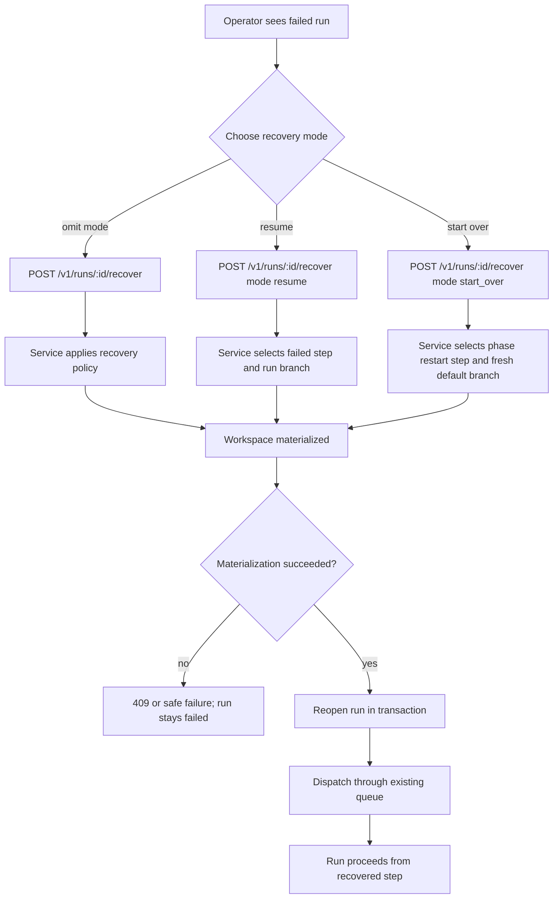
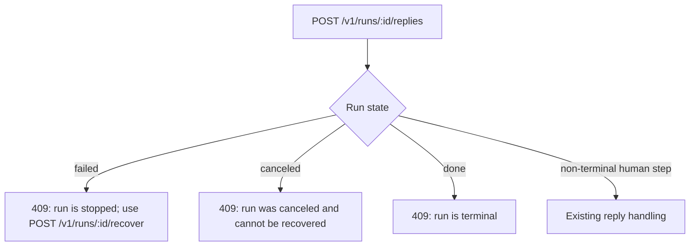
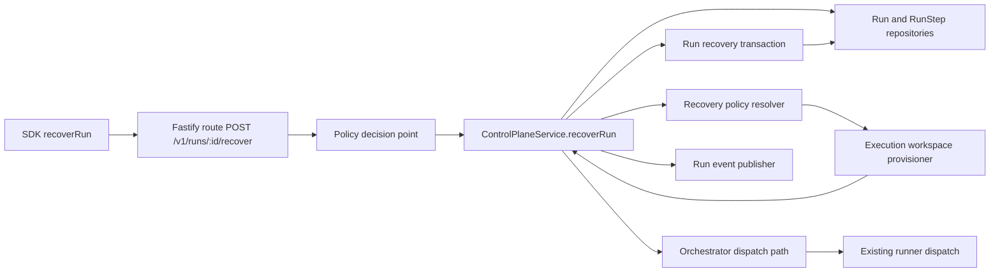

# Recover a failed run from the stopped step

## What

Autocatalyst will let an operator recover a run that stopped in `failed` state. The operator calls `POST /v1/runs/:id/recover` to reopen the same run instead of filing the work again or salvaging partial commits by hand.

Recovery uses the run's durable history to choose where work resumes. By default, failures in the specification phase start over from `spec.author` on a freshly fetched default branch, while failures later in the workflow resume at the failed step on the existing run branch when committed work is present. The operator can override the default with `mode: resume` or `mode: start_over`.

The feature is backend-only. It adds an API action, service/orchestrator recovery behavior, workspace provisioning options, SDK support, OpenAPI coverage, tests, and narrow concept/code-map documentation updates.

## Why

A failed run is terminal today. Operators cannot reply to it, dispatch it, or ask Autocatalyst to continue from the saved step, so partial work can be lost or must be recovered manually.

This feature makes recovery explicit and safe. Operators get a clear action when a run has stopped, the system preserves earlier `RunStep` history, and recovery reuses the same dispatch path and concurrency controls as normal work.

## Personas

- **Olivia: Operator** — Watches Autocatalyst runs, responds to failures, and decides whether to resume partial work or restart from a clean base.
- **Devon: Developer** — Benefits when a failed implementation run keeps committed progress and can continue without hand-copying files.
- **Rina: Reviewer** — Reads run steps and events after recovery to understand what failed, what was recovered, and what ran again.

## Narratives

### Recovering an implementation failure

Olivia sees that a feature run failed during `implementation.build` after the agent had already committed changes on the run branch. The run is terminal, and a reply to the run says it is stopped and names `POST /v1/runs/:id/recover` as the action to take.

Olivia calls recovery without a mode. Autocatalyst reads the stopped step from the run's `RunStep` rows, applies the recovery policy, materializes the existing run branch, reopens the run at `implementation.build`, records a recovery event, and admits the run through the normal dispatch queue.

Devon can still find the earlier committed file in the workspace. Rina can read `GET /v1/runs/:id/steps` and see both the earlier failed rows and the new reopened step.

### Restarting a spec failure

A run fails while authoring the specification. Olivia wants a clean attempt because the spec phase had little durable work worth keeping. She calls `POST /v1/runs/:id/recover` with no body.

Autocatalyst applies the spec-phase default. It asks the provisioner to replace the run workspace, remove only the run's own derived branch and run root, fetch the default branch, update `provisionedBaseRef`, create a fresh scratch root, and reopen the run at `spec.author`. Earlier scratch files and partial spec commits are gone from the fresh workspace, but the run history still records the failed attempt.

### Overriding the policy

Olivia has a spec failure where the workspace contains useful local files. She calls recovery with `{ "mode": "resume" }` instead of accepting the default start-over behavior.

Autocatalyst keeps the existing workspace, verifies the run branch exists, reopens the run at the failed step, and dispatches it normally. If the branch is missing, recovery fails with `run_branch_missing`, the run remains `failed`, and no other state changes.

## User stories

- Olivia can recover a failed run with `POST /v1/runs/:id/recover`.
- Olivia can omit `mode` and let the recovery policy choose resume or start-over.
- Olivia can set `mode: resume` to continue from the failed step on the run branch.
- Olivia can set `mode: start_over` to restart the phase on a freshly fetched default branch.
- Olivia receives clear `409` responses when a run cannot be recovered.
- Olivia receives clear reply errors that name recovery for failed runs and reject recovery for canceled runs.
- Devon can rely on resume preserving committed workspace files.
- Devon can rely on start-over replacing only the failed run's own workspace and derived branch.
- Rina can inspect run events and step history to see the recovery, the mode, the base, and earlier failed rows.
- SDK callers can invoke recovery with a typed `recoverRun` helper.

## Goals

- Add a strict `POST /v1/runs/:id/recover` contract with typed request and response schemas.
- Reopen only `failed` runs, with safe no-mutation failure behavior for missing branches, materialization errors, and active-run conflicts.
- Preserve existing dispatch ordering and concurrency by admitting recovered runs through the orchestrator's existing dispatch path.
- Keep recovery auditable through run events, durable `RunStep` history, and API/SDK/OpenAPI tests.
- Cover the behavior with real production-server end-to-end tests and narrow documentation updates.

## Non-goals

- Automatic recovery after failure or startup.
- Recovery of canceled runs.
- A `set-step` operator action that forces an arbitrary step.
- Resuming the interrupted agent session itself; recovered work re-invokes from the checkpoint.
- Bringing back interrupted non-terminal runs; startup workspace reconciliation already preserves those.
- Any user interface for recovery.

## Design spec

No user interface changes are included. The operator experience is API-first.

### Operator flow



### Reply-to-stopped-run flow



### API behavior

- `POST /v1/runs/:id/recover` is the operator confirmation.
- The request body is strict. It accepts only optional `mode`.
- `mode` values are `resume` and `start_over`.
- An empty or omitted body applies the recovery policy table from `context-human/concepts/run.md`.
- The response returns the reopened run and the mode that actually ran.

### States and messages

- A failed run can be recovered.
- A canceled run returns `409 conflict` with a message that says the run was canceled and cannot be recovered.
- A done run returns `409 conflict` with a message that says it is done and cannot be recovered.
- A non-terminal run returns `409 conflict` because recovery is only for stopped failed runs.
- A reply to a failed run returns `409 conflict` naming `POST /v1/runs/:id/recover`.
- A reply to a canceled run returns `409 conflict` saying cancellation cannot be recovered.

## Tech spec

### Introduction and overview

#### Dependencies and assumptions

- The route follows `context-agent/standards/api-conventions.md`: an action on a run is a `POST` to a run sub-path.
- Run lifecycle terms, phases, steps, and the recovery policy come from `context-human/concepts/run.md`.
- Pause/reply semantics come from `context-human/concepts/hitl.md`.
- Workspace re-materialization and deletion boundaries come from `context-human/concepts/workspace.md`, ADR-015, ADR-021, issue #120, and PR #125.
- Current implementation already stores `Run.failureReason`, `RunStep` rows, `run_workspace_metadata.provisionedBaseRef`, and active-run uniqueness per topic.
- `RunStep` history is authoritative for the step where the run stopped.

#### Technical goals

- Recover in one explicit operator call with no automatic re-dispatch.
- Materialize the workspace before reopening the run.
- Reopen the run atomically after materialization succeeds.
- Keep failed rows as history and create a new open `RunStep` row for the recovered step.
- Route dispatch through the existing orchestrator queue and concurrency controls.
- Keep error reasons public-safe and stable.

#### Glossary

- **Recover** — Reopen a failed run and dispatch it again from a policy-selected step.
- **Resume** — Keep the existing run branch/workspace and re-dispatch the failed step.
- **Start over** — Replace this run's workspace and derived branch, then restart at the policy-selected phase entry step on the freshly fetched default branch.
- **Failed step** — The non-terminal workflow step recorded in `RunStep` history immediately before the terminal `failed` row.
- **Re-dispatch step** — The step assigned to `Run.currentStep` when the run is reopened.

### System design and architecture



#### Modified components

- `packages/api-contract/src/run-recovery.ts` or equivalent: route path, request schema, response schema, mode enum, status constants, and inferred types.
- `packages/api-contract/src/openapi.ts`: OpenAPI path for recovery and documented `403`, `404`, `409`, and `400` responses.
- `packages/core/src/policy.ts`: `run_recovery` resource descriptor and `run_recovery.create` action.
- `packages/core/src/routes.ts`: route registration, strict body validation, policy pre-handler, and error mapping.
- `packages/core/src/control-plane-service.ts`: `recoverRun` use case, tenant lookup, policy-first call, mode/policy resolution, materialization, transaction, event, and dispatch admission.
- `packages/core/src/orchestrator.ts`: expose or reuse dispatch admission without bypassing queue/concurrency. Avoid adding a recovery path that directly invokes the runner.
- `packages/core/src/domain-repositories.ts` and `packages/persistence/src/domain-repositories.ts`: repository method for atomic recovery update and new `RunStep` row creation.
- `packages/execution/src/internal/workspace-provisioner.ts` and public execution workspace types: separate base selection from keep/replace behavior.
- `packages/sdk/src/client.ts`: `recoverRun(id, request?)`.
- Concept docs and `context-agent/wiki/code-map.md`: narrow additive updates.

### Detailed design

#### API contract

`POST /v1/runs/:id/recover`

Request schema:

```ts
{
  mode?: 'resume' | 'start_over'
}
```

Validation:

- Strict object.
- Unknown fields return `400 validation_error`.
- Missing body is treated as `{}`.

Success response schema:

```ts
{
  run: Run,
  mode: 'resume' | 'start_over'
}
```

Errors:

- `400 validation_error` for invalid body or unknown fields.
- `403 forbidden` for a model principal or denied policy decision.
- `404 not_found` for a missing run or run outside the caller's tenant.
- `409 conflict` for non-failed runs, canceled/done terminal runs, active-run conflicts, and recovery materialization conflicts such as `run_branch_missing`.

#### Recovery policy resolution

Inputs:

- Current `Run`.
- Ordered `RunStep` rows for the run.
- Optional explicit mode.
- Workspace metadata including `provisionedBaseRef` when present.
- Run branch existence/materialization result.

Algorithm:

1. Load the run by id scoped to the principal tenant. Return `404` for missing or cross-tenant.
2. Reject a model principal through policy before mutation.
3. Require `run.currentStep === 'failed'` and `run.terminal === true`.
4. Read `RunStep` rows and find the stopped step:
   - Prefer the most recent non-terminal step whose occurrence ended when the run transitioned to `failed`.
   - Ignore the terminal `failed` row for policy decisions.
   - If no stopped step exists, return `409 conflict` with a safe message and leave the run failed.
5. If explicit `mode` is present, use it.
6. If mode is omitted, apply the policy table:
   - Stopped step phase `spec`: `start_over`, re-dispatch `spec.author`, base `current_default_branch`, replace existing workspace.
   - Stopped step phase `implementation`, `docs`, or `pr` with committed checkpoints: `resume`, re-dispatch stopped step, base `run_branch`, keep existing workspace.
   - Failure before any meaningful commit: `start_over`, re-dispatch the first step of the phase, base `current_default_branch`, replace existing workspace.
7. For explicit `resume`, re-dispatch the stopped step for any phase, base `run_branch`, keep existing workspace.
8. For explicit `start_over`, re-dispatch `spec.author` for spec-phase failures and the first step of the failed phase otherwise, base `current_default_branch`, replace existing workspace.

Commit detection:

- Use the host-controlled run workspace git port or a small repository seam rather than shelling directly from the service.
- Compare the run branch head to `run_workspace_metadata.provisionedBaseRef`.
- If the branch head differs from `provisionedBaseRef`, the run has committed checkpoints.
- If metadata is missing or the branch does not differ, treat it as no meaningful commit for omitted-mode policy.

Phase first-step mapping:

- `spec` → `spec.author`.
- `implementation` → `implementation.plan`.
- `docs` → `docs.update`.
- `pr` → `pr.finalize`.

#### Workspace provisioning changes

Current materialization base choices remain:

```ts
type WorkspaceMaterializationBase =
  | { kind: 'run_branch' }
  | { kind: 'current_default_branch' }
```

Add an independent existing-workspace behavior option, for example:

```ts
type ExistingWorkspaceBehavior = 'keep' | 'replace'
```

Behavior:

- `resume` calls provision with `{ materializationBase: { kind: 'run_branch' }, existingWorkspaceBehavior: 'keep' }`.
- `start_over` calls provision with `{ materializationBase: { kind: 'current_default_branch' }, existingWorkspaceBehavior: 'replace' }`.
- All existing callers default to `keep` and keep #125 present-workspace behavior.
- `replace` is only used by recovery start-over.
- Replacement deletes only this run's own canonical run root and own derived branch through the existing containment-checked pruner.
- Replacement creates a fresh scratch root and updates `provisionedBaseRef`.
- If `run_branch` is missing, provisioning returns/throws typed `run_branch_missing`; service maps it to `409` and leaves the run failed.

#### Atomic reopen transaction

After workspace materialization succeeds, recovery performs one persistence transaction that:

- Verifies the topic has no active run other than this failed run becoming active.
- Sets `Run.currentStep` to the re-dispatch step.
- Sets `Run.terminal` to `false`.
- Clears `Run.failureReason`.
- Creates a new open `RunStep` row for the re-dispatch step.
- Leaves all earlier `RunStep` rows unchanged.

If the active-run partial unique constraint reports another active run on the topic, map it to `409 active_run_conflict` and leave the failed run unchanged. The implementation should prefer a repository method such as `recoverFailedRun(input)` so the invariant is enforced in the persistence package, not assembled from separate service writes.

#### Dispatch and events

After the reopen transaction commits:

- Publish a durable/live run event for recovery with: `runId`, `mode`, `base.kind`, `reDispatchStep`, and workspace provisioning outcome.
- Admit the run through the orchestrator's existing dispatch path.
- Do not call the runner directly.
- Respect the existing run dispatch queue, per-run serialization, ordering, and concurrency limit.

#### Reply changes

Update `replyToRun` service/route error handling so replies are never applied to stopped runs:

- `failed`: `409 conflict`, message says the run is stopped and names `POST /v1/runs/:id/recover`.
- `canceled`: `409 conflict`, message says the run was canceled and cannot be recovered.
- Other terminal states keep a clear terminal conflict.

### Security, privacy, and compliance

- The route calls the policy decision point before service mutation.
- `core/src/policy.ts` adds a resource descriptor, likely `{ kind: 'run_recovery', id, path: '/v1/runs/:id/recover' }`, and action `run_recovery.create`.
- Model principals receive `403 forbidden`.
- Missing and cross-tenant runs both resolve as `404` from the service to avoid tenant disclosure.
- Error messages and persisted failure reasons use stable public-safe codes. Raw git, filesystem, provider, or workspace error messages must not leak.
- Replacement deletion must stay behind the workspace pruner and must be containment-checked. Only this run's own root and derived branch may be removed.

### Observability

- Emit a run event when recovery succeeds. Include mode, base kind, re-dispatch step, and provisioning outcome.
- Log sanitized recovery failures with code, run id, and tenant; do not log raw provider/git stderr or filesystem paths beyond safe structured identifiers.
- Keep `RunStep` history visible through `GET /v1/runs/:id/steps` so earlier failed rows remain auditable.

### Testing plan

Unit and contract tests:

- API contract schemas accept `{}`, missing body, `resume`, and `start_over`; reject unknown fields and invalid modes.
- OpenAPI includes `POST /v1/runs/:id/recover` and `403`, `404`, `409`, and `400` responses.
- Policy tests cover `run_recovery.create` and model-principal denial.
- Service tests cover state checks, policy-first behavior, missing/cross-tenant `404`, default policy choices, explicit overrides, `run_branch_missing`, active-run conflict, and no-mutation failures.
- Repository tests cover atomic reopen and preservation of earlier `RunStep` rows.
- Workspace provisioner tests cover independent `materializationBase` and `existingWorkspaceBehavior`, replacement deletion scope, fresh scratch root, and default keep behavior for existing callers.
- SDK tests cover `recoverRun` request/response parsing and error propagation.
- Reply tests cover failed and canceled stopped-run messages.

End-to-end tests with production server and no direct repository writes:

1. Fail once on an implementation step after a commit; recover with no mode; assert the run reopens at the same step, the committed file remains in the workspace, the run reaches the next step, and earlier failed rows remain in `GET /v1/runs/:id/steps`.
2. Fail a spec step with its workspace still on disk; recover with no mode; assert restart at `spec.author` on a fresh branch with earlier files and commits gone.
3. Fail the same kind of spec step; recover with `mode: resume`; assert existing files survive.
4. Fail an implementation step; recover with `mode: start_over`; assert earlier commits are gone.
5. Recover a canceled run; assert `409 conflict`.

### Alternatives considered

- **Allow replies to failed runs to trigger recovery.** Rejected because recovery must be an explicit operator action and replies have different semantics.
- **Automatically recover on startup.** Rejected as out of scope and contrary to the explicit recovery concept.
- **Always start over.** Rejected because implementation/docs/pr failures often have committed checkpoints that should be preserved.
- **Always resume.** Rejected because spec-phase failures and pre-commit failures are safer and clearer from a fresh default branch.

### Risks

- **Incorrect stopped-step selection** could reopen at `failed` or the wrong phase. Mitigate with repository/service tests using repeated steps and failed terminal rows.
- **Unsafe deletion during start-over** could remove more than the run owns. Mitigate by keeping deletion behind the pruner and adding containment tests.
- **Race with another active run** could violate topic invariants. Mitigate with a single transaction and existing active-run conflict mapping.
- **Provider session continuity loss** is expected. Recovery re-invokes from checkpoint; it does not resume the interrupted provider session.

## Task list

- [ ] **Story: Define the recovery API contract**
  - [ ] **Task: Add recovery contract schemas and exports**
    - **Description**: Add the route path, strict request schema, response schema, mode enum, status constants, and public TypeScript exports for `POST /v1/runs/:id/recover`.
    - **Acceptance criteria**:
      - [ ] Request schema accepts missing body, `{}`, `{ "mode": "resume" }`, and `{ "mode": "start_over" }`.
      - [ ] Request schema rejects unknown fields with validation failure.
      - [ ] Response schema returns `{ run, mode }` and parses `Run` with existing run schema.
      - [ ] New exports are available from `@autocatalyst/api-contract`.
    - **Dependencies**: None
  - [ ] **Task: Document the OpenAPI route**
    - **Description**: Add `POST /v1/runs/:id/recover` to the generated OpenAPI document with request/response schemas and documented `400`, `403`, `404`, and `409` responses.
    - **Acceptance criteria**:
      - [ ] OpenAPI includes the route under the run resource.
      - [ ] OpenAPI lists success, validation, forbidden, not found, and conflict responses.
      - [ ] `openapi.spec.ts` asserts the path and response codes.
    - **Dependencies**: "Task: Add recovery contract schemas and exports"

- [ ] **Story: Authorize and route recovery requests**
  - [ ] **Task: Add recovery policy descriptors**
    - **Description**: Extend core policy types with the `run_recovery` resource descriptor and `run_recovery.create` action.
    - **Acceptance criteria**:
      - [ ] `PolicyResourceDescriptor` includes the recover route path and run id.
      - [ ] `PolicyAction` includes `run_recovery.create`.
      - [ ] Model principals are denied before service mutation.
      - [ ] Policy tests cover allow and deny paths.
    - **Dependencies**: "Task: Add recovery contract schemas and exports"
  - [ ] **Task: Register the Fastify recovery route**
    - **Description**: Add the `POST /v1/runs/:id/recover` route, parse the strict request body, call the policy pre-handler first, delegate to the service, and map service errors to the API envelope.
    - **Acceptance criteria**:
      - [ ] Route calls policy before service mutation.
      - [ ] Unknown request fields return `400`.
      - [ ] Missing and cross-tenant runs return `404`.
      - [ ] Conflict cases return `409` with stable codes/messages.
      - [ ] Route unit tests cover success and error mappings.
    - **Dependencies**: "Task: Add recovery policy descriptors"

- [ ] **Story: Resolve recovery policy from run history**
  - [ ] **Task: Implement stopped-step discovery**
    - **Description**: Add service logic that reads ordered `RunStep` rows and identifies the non-terminal step where the failed run stopped, excluding the terminal `failed` row.
    - **Acceptance criteria**:
      - [ ] Finds the latest ended non-terminal step before `failed`.
      - [ ] Handles repeated steps and prior failed history rows.
      - [ ] Returns a safe `409` when no stopped step can be determined.
      - [ ] Unit tests cover spec, implementation, docs, pr, and malformed history cases.
    - **Dependencies**: "Task: Register the Fastify recovery route"
  - [ ] **Task: Implement default policy and explicit mode override**
    - **Description**: Convert the stopped step, phase, commit status, and optional `mode` into a recovery plan containing mode, re-dispatch step, materialization base, and keep/replace behavior.
    - **Acceptance criteria**:
      - [ ] Omitted mode starts spec failures over at `spec.author` on freshly fetched default branch.
      - [ ] Omitted mode resumes implementation/docs/pr failures at the failed step when branch head differs from `provisionedBaseRef`.
      - [ ] Omitted mode starts pre-commit failures over at the first step of their phase.
      - [ ] Explicit `resume` uses the failed step and run branch for any phase.
      - [ ] Explicit `start_over` uses `spec.author` for spec and first phase step otherwise.
      - [ ] Tests cover every policy row and override.
    - **Dependencies**: "Task: Implement stopped-step discovery"

- [ ] **Story: Separate workspace base from replacement behavior**
  - [ ] **Task: Add existing-workspace behavior to provisioning types**
    - **Description**: Extend workspace provisioning inputs so materialization base selection and existing-workspace keep/replace behavior are independent options, defaulting existing callers to keep.
    - **Acceptance criteria**:
      - [ ] Type definitions expose a keep/replace option.
      - [ ] Existing callers compile without behavior changes.
      - [ ] Existing present-workspace behavior from #125 remains default.
      - [ ] Unit tests prove default keep behavior.
    - **Dependencies**: "Task: Implement default policy and explicit mode override"
  - [ ] **Task: Implement start-over replacement provisioning**
    - **Description**: Teach the provisioner to replace an existing workspace only when asked, deleting this run's own derived branch and run root, fetching the default branch, rebuilding the workspace, updating `provisionedBaseRef`, and creating a fresh scratch root.
    - **Acceptance criteria**:
      - [ ] Replacement removes only the canonical run root and own derived branch.
      - [ ] Replacement uses containment-checked pruner paths.
      - [ ] Replacement updates `provisionedBaseRef`.
      - [ ] Replacement creates a fresh scratch root.
      - [ ] Resume/run-branch materialization keeps existing workspace when present.
      - [ ] Provisioner tests cover present, replace, missing branch, and rollback cases.
    - **Dependencies**: "Task: Add existing-workspace behavior to provisioning types"

- [ ] **Story: Reopen failed runs atomically**
  - [ ] **Task: Add repository transaction for recovery reopen**
    - **Description**: Add a persistence method that atomically changes a failed terminal run back to the selected step, clears terminal/failure fields, creates a new open `RunStep`, and preserves prior history.
    - **Acceptance criteria**:
      - [ ] Transaction sets `currentStep` to the selected step.
      - [ ] Transaction sets `terminal` to `false`.
      - [ ] Transaction clears `failureReason`.
      - [ ] Transaction creates a new open `RunStep` row.
      - [ ] Prior failed rows remain unchanged and listable.
      - [ ] Active-run conflict maps to typed `active_run_conflict`.
      - [ ] Persistence tests cover success, conflict, and rollback.
    - **Dependencies**: "Task: Implement start-over replacement provisioning"
  - [ ] **Task: Implement the service recovery use case**
    - **Description**: Add `ControlPlaneService.recoverRun` to authorize, validate state, resolve policy, materialize the workspace, call the atomic reopen repository method, emit recovery events, and admit dispatch.
    - **Acceptance criteria**:
      - [ ] Only `failed` terminal runs recover.
      - [ ] `canceled`, `done`, and non-terminal runs return `409` with clear messages.
      - [ ] Workspace materialization happens before the reopen transaction.
      - [ ] Materialization failure leaves the run failed and unchanged.
      - [ ] Successful recovery returns the reopened API run and mode.
      - [ ] Dispatch uses the existing orchestrator queue/path.
      - [ ] A recovery run event records mode, base, and re-dispatch step.
    - **Dependencies**: "Task: Add repository transaction for recovery reopen"

- [ ] **Story: Improve stopped-run reply behavior**
  - [ ] **Task: Return actionable reply conflicts for stopped runs**
    - **Description**: Update reply service/route handling so failed and canceled terminal runs return distinct, actionable `409` messages and no reply is applied.
    - **Acceptance criteria**:
      - [ ] Reply to `failed` returns `409` saying the run is stopped and naming `POST /v1/runs/:id/recover`.
      - [ ] Reply to `canceled` returns `409` saying cancellation cannot be recovered.
      - [ ] Reply is never applied to a stopped run.
      - [ ] Existing paused-run reply behavior remains unchanged.
      - [ ] Route/service tests cover failed, canceled, done, and paused states.
    - **Dependencies**: "Task: Implement the service recovery use case"

- [ ] **Story: Add SDK support**
  - [ ] **Task: Implement `recoverRun` in the SDK**
    - **Description**: Add a typed SDK helper that posts to the recovery route, sends the optional request body, and parses the response with the contract schema.
    - **Acceptance criteria**:
      - [ ] SDK exposes `recoverRun(id, request?)`.
      - [ ] SDK omits or sends an empty body safely when request is undefined.
      - [ ] SDK parses `{ run, mode }` with the contract schema.
      - [ ] SDK tests cover resume, start_over, omitted mode, and conflict errors.
    - **Dependencies**: "Task: Register the Fastify recovery route"

- [ ] **Story: Prove recovery end to end**
  - [ ] **Task: Add production-server E2E recovery tests**
    - **Description**: Drive the real control-plane server without direct repository writes through implementation resume, spec default start-over, spec explicit resume, implementation explicit start-over, and canceled-run conflict cases.
    - **Acceptance criteria**:
      - [ ] Implementation failure after commit recovers with omitted mode at the same step and keeps the committed file.
      - [ ] The recovered implementation run reaches the next step.
      - [ ] `GET /v1/runs/:id/steps` includes earlier failed rows after recovery.
      - [ ] Spec failure with omitted mode restarts at `spec.author` on a fresh branch and removes earlier files/commits.
      - [ ] Spec failure with `mode: resume` keeps existing files.
      - [ ] Implementation failure with `mode: start_over` removes earlier commits.
      - [ ] Canceled run recovery returns `409`.
    - **Dependencies**: "Task: Implement `recoverRun` in the SDK", "Task: Return actionable reply conflicts for stopped runs"

- [ ] **Story: Update documentation and agent navigation**
  - [ ] **Task: Update recovery concept docs narrowly**
    - **Description**: Make additive edits to `run`, `hitl`, and `workspace` concept docs describing mode overrides and start-over replacement behavior, following the editorial guidelines.
    - **Acceptance criteria**:
      - [ ] `run` states that the policy table is the default and operator mode can override it.
      - [ ] `run` operator confirmation points to the mode choice.
      - [ ] `hitl` states that recovery can resume or start over by choice.
      - [ ] `workspace` states that explicit start-over replaces an existing workspace and every other base keeps present workspaces.
      - [ ] Edits change no unrelated decisions, tradeoffs, or cross-references.
      - [ ] `context-human/concepts/index.md` is unchanged unless an entry description changes.
    - **Dependencies**: "Task: Implement the service recovery use case"
  - [ ] **Task: Update code map for recovery**
    - **Description**: Record the recovery route, service method, repository method, and workspace provisioning option in `context-agent/wiki/code-map.md`.
    - **Acceptance criteria**:
      - [ ] Code map names the route module and path.
      - [ ] Code map names the service method.
      - [ ] Code map names the repository transaction method.
      - [ ] Code map names the workspace provisioning replacement option.
    - **Dependencies**: "Task: Update recovery concept docs narrowly"
