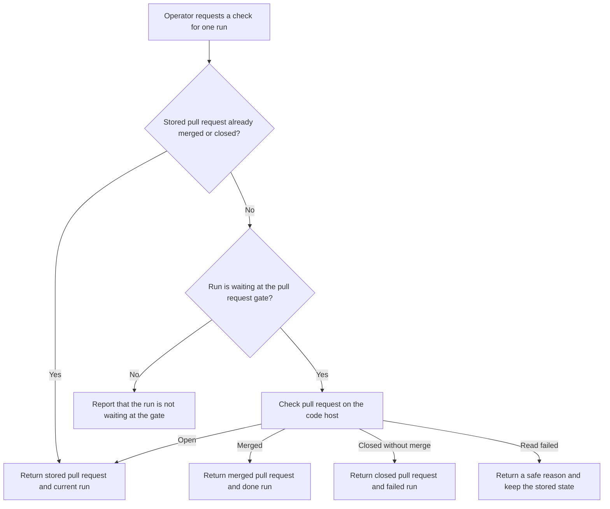
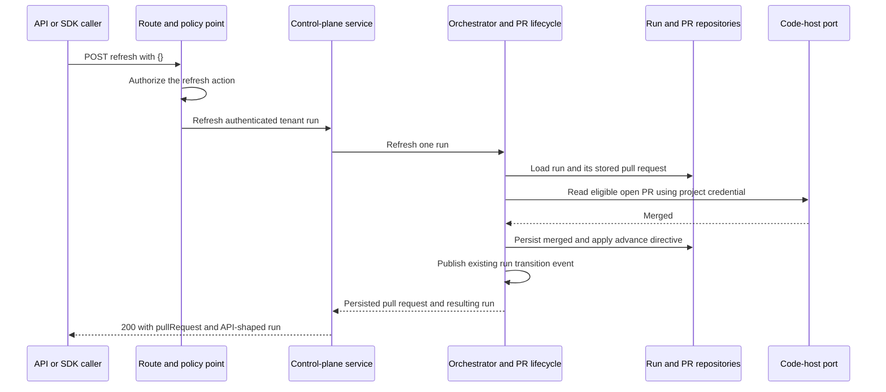

# Refresh one pull request

## What

An operator can check the current state of one run’s pull request. The check returns the stored pull request and the resulting run together. An open pull request leaves the run waiting. A merge completes the run, and a close without merge fails it with a specific reason. If the check cannot read the pull request, it explains why without changing the run.

## Why

Today the control plane learns about a merge through a tenant-wide reconciliation or the optional ticker, which is off by default. An operator looking at one run should not have to check every open pull request to find out whether that run is finished. The operator also needs to distinguish a pull request that is still open from a check that could not reach the code host.

## Personas

- **Enzo: Engineer** — Reviews a run’s changes on the code host and checks whether the run has finished.

## Narratives

### Check after a review

Enzo checks a run waiting at the pull request gate. The pull request is still open, so Autocatalyst shows the same pull request and leaves the run waiting.

Enzo merges the pull request on the code host and checks again. The result shows the pull request as merged and the run as done. A later check returns the same result without contacting the host again.

### Tell a closed pull request from a failed check

Enzo checks another run, but the code host rejects the project credential. The result identifies the authentication problem without treating it as a failure of the run. The last stored pull request state remains available.

After the credential is restored, Enzo checks again. The code host now reports that the pull request was closed without merging. Autocatalyst records the close and shows why the run failed.

## User stories

**Check after a review**

- Enzo can check a single run without checking other runs in the tenant.
- Enzo can see an open pull request and its unchanged run together.
- Enzo can confirm that a merge completed the run and check the recorded result again.

**Tell a closed pull request from a failed check**

- Enzo can distinguish a missing credential, rejected credential, missing upstream pull request, and unavailable provider.
- Enzo can retry a failed check without undoing a run transition because the failed read did not make one.
- Enzo can see that a close without merge failed the run, rather than mistaking it for a temporary check failure.

## Goals

- Read at most one code-host pull request per refresh, and none for a stored `merged` or `closed` pull request or an ineligible run.
- Return the stored pull request and the API-shaped run in one successful response. Record the existing run transition when the check detects a merge or close at the gate.
- Give clients four stable read-failure reasons without exposing credentials or provider output, and leave stored state unchanged on those failures.
- Preserve the stored-state `GET` and the existing batch reconciliation contract and behavior.

## Non-goals

- Web client changes, browser polling, server polling, webhooks, or enabling the ticker by default.
- Pull request checks, review state, or mergeability.
- Merging a pull request from the control plane.
- Changing recovery for a run whose pull request closed; #121 owns recovery. Issues #140–#143 are separate work.

## Design spec

### Operator flow

This is an API and SDK feature. The flow describes the result a caller can use, not a new UI. The [run detail concept](../concepts/run-detail.md#the-pull-request) describes a client checking on selection at the gate or when the operator asks. The client decides when to call; the control plane does not start a check on its own for this feature.



A caller can show the `502` reason alongside the last known state. A `200` with a closed pull request and a failed run is a successful check, not an API error. No components, visual states, or mockups are needed for this issue.

## Tech spec

### Introduction and overview

Issue [#139](https://github.com/markdstafford/autocatalyst/issues/139) adds a scoped trigger for the lifecycle in [Review, open, and merge a pull request](feature-review-open-merge-pull-request.md). The existing `GET` only reads stored state. The batch `POST` and optional ticker already detect merges through `reconcileSinglePullRequest`; refresh reuses that logic for one run, with a gate check and a safe failure reason.

This work follows the existing [REST](../adrs/adr-005-api-style-transport.md), [shared schema](../adrs/adr-007-shared-types.md), [identity and policy](../adrs/adr-009-auth-rbac-envelope.md), [persistence](../adrs/adr-004-persistence-state-store.md), and [run lifecycle](../adrs/adr-015-run-lifecycle.md) decisions. The [domain model](../concepts/domain-model.md), [trackers](../concepts/trackers.md), and [human-gate](../concepts/hitl.md) concepts define the existing records and their relationships. The **pull request gate** is `pr.human_review`. There are no new entities, schema changes, migrations, provider methods, or deployment settings.

### System design and architecture

- `packages/api-contract/src/pull-request.ts` defines the path, strict request and response schemas, and the stable check-failure reason set. Export the contract from the package and register it in `openapi.ts`.
- `packages/core/src/routes.ts` authenticates and authorizes the request, validates inputs, and maps service results and errors onto the HTTP contract. `control-plane-service.ts` delegates the refresh and maps the resulting run with the existing `mapRunToApiRun` and project resolution used by run reads.
- `packages/core/src/orchestrator.ts` provides a per-run entry point backed by the same lifecycle dependencies as `detectMerges`. `pr-lifecycle.ts` owns the targeted lookup, eligibility checks, provider read, and shared merged/closed handling. Only the orchestrator applies run directives and publishes transition events.
- `packages/sdk/src/client.ts` exposes `refreshRunPullRequest(id)`. It sends `{}` as authenticated JSON, uses the existing client error path so callers retain `error.details.reason`, and validates a `200` with the shared response schema.



### Detailed design

#### API contract

`POST /v1/runs/:id/pull-request/refresh` (`/v1/runs/{id}/pull-request/refresh` in OpenAPI) is a bearer-authenticated run action. Use `runIdParamsSchema` and require an `application/json` body containing exactly `{}`. The request schema is a strict empty object; reject missing bodies, non-objects, and unknown keys rather than accepting options. The strict success envelope is `{ pullRequest: pullRequestSchema, run: runSchema }`, using the stored pull request, not provider facts. The run uses the same projection as a run read, including derived `waitingOn` and `status`, resolved `projectId`, and `failureReason` when present.

| Status | Response |
| --- | --- |
| `200` | Stored pull request plus current run. Includes open/no-change, newly merged, newly closed, and already recorded `merged` or `closed`. |
| `400` | Standard validation error for invalid parameters or body, including malformed JSON. Keep request-parse handling scoped so existing endpoints do not change. |
| `401` | Existing bearer-authentication error. |
| `403` | `forbidden` for policy denial or a model principal. |
| `404` | `not_found` for a missing or other-tenant run, or a run without a tenant-owned pull request. Match the stored pull request `GET` rather than the general run read. |
| `409` | `conflict` when the stored pull request is `open` but the run is terminal or not at `pr.human_review`. Use the message “Run is not waiting at the pull request gate.” |
| `502` | `pull_request_check_failed` with a fixed safe message and `error.details.reason` from the enum below. No run or pull request mutation. |
| `500` | Existing sanitized `internal_error` for unexpected internal, persistence, or directive failures. Do not report a write failure as a failed provider read. |

Example `502` body:

```json
{"error":{"code":"pull_request_check_failed","message":"Could not check the pull request.","details":{"reason":"authentication_failed"}}}
```

Document the `502` reason enum in OpenAPI and assert the new path, request, and responses in `openapi.spec.ts`, including `403`, `404`, `409`, and `502`.

#### Eligibility, read, and transition order

1. Look up only the requested run and its pull request by run ID. Check both against the authenticated tenant. Treat missing or out-of-tenant records as `404` before resolving any project credential.
2. If the stored pull request is `merged` or `closed`, return it and the current run immediately. This comes **before** the gate check, including for terminal runs. Do not contact the host or apply a directive.
3. For a stored `open` pull request, require a nonterminal run at `pr.human_review`. Otherwise return `409` without a host read or write. Apply this gate rule only to the single-run entry point; the batch keeps its current eligibility and count semantics.
4. Reuse the `reconcileSinglePullRequest` read path through run → topic → conversation → project. Resolve the project’s code-host binding and credential, then call the registered `CodeHostPort.read` with its repository target and the stored pull request number. Classify failures before the shared write logic. Keep local record/wiring faults and write or directive failures separate from upstream read failures.
5. For `open`, return the stored record and current run without changing timestamps, steps, or events. For `merged`, use the shared guarded `open` → `merged` update and the existing system `advance` directive with the `pull_request_merged` checkpoint. The run advances from `pr.human_review` to `done`. For `closed`, use the shared guarded `open` → `closed` update and system `fail` directive with `pull_request_closed_without_merge`. The response includes `run.failureReason` with that exact value. Return persisted values after the directive has completed.
6. Use the orchestrator’s per-run serialization for refresh and its gate decision, so it cannot advance an unrelated step after a queued human revise or duplicate another refresh’s transition. Revalidate the run and stored pull request before a post-read write; if the run has left the gate and the PR is still open, return `409`. Keep `expectedState: 'open'` on the write to arbitrate an overlapping batch check. On a lost state update, re-read the stored records instead of applying a second directive; only treat an actual state change as a lost update, not an arbitrary persistence error.

| `details.reason` | Classification |
| --- | --- |
| `credential_missing` | The project has no credential reference, the reference is invalid, or the referenced credential is absent or empty. Use typed resolution outcomes where needed; do not match raw messages. |
| `authentication_failed` | The code-host port reports a rejected credential (`authentication_failed`). |
| `not_found` | The code-host port reports `resource_not_found` for the upstream pull request; this is not a local `404`. |
| `provider_unavailable` | The provider cannot be selected or reached, the read times out, or the resolver/port fails without a more specific public reason. Unrecognized provider facts or errors also map here. |

Extend the internal per-PR outcome with the bounded read-failure reason and distinguish internal failures from read failures. `detectPullRequestMerges` still counts either failure as `failed` and returns only the existing `{ checked, merged, closed, failed, timedOut }` summary. Do not change batch selection, deadline, or ticker defaults.

### Security, privacy, and compliance

Use the protected route and its policy pre-handler before the service performs any lookup, credential resolution, provider read, or mutation. Add action `run_pull_request.refresh` and resource `{ kind: 'run_pull_request_refresh', id, path: '/v1/runs/:id/pull-request/refresh' }`. Reject model principals even if policy allows them. Derive the tenant from the authenticated principal, not route input or the request body, and enforce tenant scope before touching provider wiring. Keep the service entry point’s principal and tenant checks for direct callers. Use backend schema validation and server-resolved repository coordinates. Neither HTTP responses, logs, nor public run failure reasons include credential values, secret handles, raw provider output, or exception text from the adapter.

### Observability

Reuse the orchestrator’s existing durable run transition event after the directive persists. An open check, a denied request, a failed read, or an already recorded state does not create a transition event. Use existing request and safe error logging with status and stable codes only; no new alerts or metrics are required.

### Testing plan

- **Contract, route, and SDK:** Test strict request/response schemas, authorization order and the exact policy descriptor/action, model denial, tenant isolation, all error statuses, and safe error serialization. Use a fake fetch for the SDK to assert the authenticated `POST`, `{}` body, response parsing, and preserved typed error details. Assert the operation in OpenAPI.
- **Service and lifecycle:** Verify no provider call or write for not-found, terminal/open, off-gate/open, and already recorded states. Verify that an open response is unchanged, all four failure reasons leave both records unchanged, and persistence faults are not mislabeled as `502`. Exercise gate revalidation and retain the existing batch tests unchanged.
- **Production wiring:** In `apps/control-plane/src/pr-lifecycle.integration.spec.ts`, use `createControlPlaneServer`, the scripted `gh` executor, real test persistence, and Fastify injection. Disable background reconciliation in these cases and avoid invoking batch or tick to detect the simulated merge. Drive a run to `pr.human_review`; refresh while open, flip the script to merged, refresh to `done`, and refresh again. Assert the stored state, API projection, one transition event, and no further provider read on replay. Cover a second run with a scripted `gh` authentication failure and a separate case where an unmerged close fails the run. All tests use scripted or in-process dependencies; no model or network calls.

#### Manual acceptance in fake mode

Start the server and seed a run in separate terminals:

```bash
pnpm nx run control-plane:serve-fake
pnpm nx run control-plane:seed-fake -- --scenario pr-open
```

Use the run ID printed by the seed command:

```bash
curl -sS -X POST -H 'Authorization: Bearer fake-mode-token' -H 'content-type: application/json' -d '{}' \
  'http://127.0.0.1:4010/v1/runs/<run-id>/pull-request/refresh'
```

Expect `open` and `pr.human_review`. Write `merged` to the seed’s `pullRequestStateFile` (see [fake mode](../../docs/operators/fake-mode.md#pull-request-state-files)), then repeat the request and expect `merged` and `done`. To check the closed path, seed a fresh `pr-open` run on another fixture issue using `--issue`, write `closed` to that run’s state file, and expect `closed`, `failed`, and `pull_request_closed_without_merge`.

### Alternatives considered

- **Trigger the batch endpoint and then read the selected run.** Uses existing endpoints but checks unrelated runs and returns no failure reason for the selected pull request.
- **Add provider I/O to the stored-state `GET`.** Avoids a new path but makes a read action perform run transitions and removes the ability to read stored state without contacting the provider.
- **Handle merge and close in the route or service.** Makes the single call easier to wire locally, but duplicates lifecycle behavior and risks bypassing directive and event handling.

### Risks

- **The run moves while a check is in flight.** Use per-run serialization with human replies, recheck the gate before writing, and retain the guarded PR update so the same PR state is not written twice.
- **A write or directive fails after a successful host read.** The existing batch flow writes PR state and applies the run directive separately. This issue does not make those writes atomic or add repair behavior; use a sanitized internal error rather than claiming the read failed or that the run advanced.
- **Error translation could leak provider details or change batch behavior.** Use an allowlisted reason enum, test with sensitive sentinel text, and leave the batch response and existing tests unchanged.

## Task list

- [ ] **Story: Check a single run through the control plane**
  - [ ] **Task: Define the refresh wire contract**
    - **Description**: Add and export the path, strict empty request, strict `{ pullRequest, run }` response, and typed check-failure reason contract in `packages/api-contract`.
    - **Acceptance criteria**:
      - [ ] Contract tests accept `{}` and reject missing, non-object, and unknown-key request bodies.
      - [ ] The success contract uses the existing pull request and run schemas; the check-failure contract accepts only the four documented reasons.
    - **Dependencies**: None
  - [ ] **Task: Classify provider reads in the shared lifecycle**
    - **Description**: Extend `reconcileSinglePullRequest` to return safe read-failure reasons, separate from internal failures, and keep one implementation of the stored merge/close updates and directives.
    - **Acceptance criteria**:
      - [ ] Lifecycle tests prove each of the four reason mappings, with no writes or directives on failure and no provider text in the result.
      - [ ] `detectPullRequestMerges` preserves its eligibility, counters, deadline, and response; existing batch tests pass unchanged.
    - **Dependencies**: Task: Define the refresh wire contract
  - [ ] **Task: Add the targeted refresh service operation**
    - **Description**: Wire `refreshRunPullRequest` through the control-plane service and orchestrator to the shared lifecycle. Scope lookups to the caller’s tenant, enforce the gate and short-circuit order, and project the resulting run for the API.
    - **Acceptance criteria**:
      - [ ] Missing and other-tenant runs and missing pull requests return `not_found` without a provider read.
      - [ ] Stored `merged` and `closed` return their current run without provider I/O or writes, including for terminal runs.
      - [ ] Stored `open` at `pr.finalize` or on a terminal run returns conflict without a provider read or a change to either record; a stale eligible check cannot apply a directive at a different step.
      - [ ] A provider `open` result changes nothing. Successful terminal results return persisted records, and read failures and internal faults remain distinct.
    - **Dependencies**: Task: Classify provider reads in the shared lifecycle
  - [ ] **Task: Mount and authorize the refresh route**
    - **Description**: Register the protected route and new policy descriptor/action, validate input, and serialize success and errors using the shared contracts.
    - **Acceptance criteria**:
      - [ ] Route tests show authorization occurs before service work and no service call occurs for either a policy denial or a model principal.
      - [ ] Route tests cover invalid input, defensive `404`, gate `409`, and the exact sanitized `502` envelope. No response includes a credential or provider output.
    - **Dependencies**: Task: Add the targeted refresh service operation
- [ ] **Story: Make the refresh callable and verifiable**
  - [ ] **Task: Publish the SDK method and OpenAPI operation**
    - **Description**: Add `refreshRunPullRequest(id)` and register the route in OpenAPI with the shared schemas and documented statuses.
    - **Acceptance criteria**:
      - [ ] SDK tests assert the authenticated JSON `POST` with `{}`, parsed success, and preserved `502` reason through the existing client error path.
      - [ ] `openapi.spec.ts` asserts the operation and its request and response contracts, including `403`, `404`, `409`, and `502`.
    - **Dependencies**: Task: Define the refresh wire contract
  - [ ] **Task: Verify production wiring for open, merged, and failed reads**
    - **Description**: Use the production server and the existing scripted `gh` harness to check an open pull request through merge and replay, then exercise an authentication failure on another run.
    - **Acceptance criteria**:
      - [ ] A run driven to `pr.human_review` stays unchanged on `open`, reaches `done` on `merged`, and returns the same state on replay without an additional provider read or transition event.
      - [ ] A scripted authentication failure returns `502` with `authentication_failed`; both records and the run’s transition history are unchanged.
      - [ ] The tests use injection and scripted dependencies only, with no network or model calls.
    - **Dependencies**: Task: Mount and authorize the refresh route
  - [ ] **Task: Verify production wiring for close without merge**
    - **Description**: Use a separate gated run and script a provider `closed` result without merge.
    - **Acceptance criteria**:
      - [ ] Refresh returns `200`, the stored pull request is `closed`, and the run is `failed` with `failureReason: pull_request_closed_without_merge`.
      - [ ] A repeat check returns the recorded result without reading the host again; the test uses no network or model calls.
    - **Dependencies**: Task: Mount and authorize the refresh route
  - [ ] **Task: Update the agent code map**
    - **Description**: Record the refresh route, service method, orchestrator entry point, shared lifecycle changes, and SDK method in `context-agent/wiki/code-map.md`.
    - **Acceptance criteria**:
      - [ ] The code map points to the implementation and distinguishes the refresh gate and typed failures from the unchanged batch summary and stored-state `GET`.
    - **Dependencies**: Task: Mount and authorize the refresh route; Task: Publish the SDK method and OpenAPI operation
