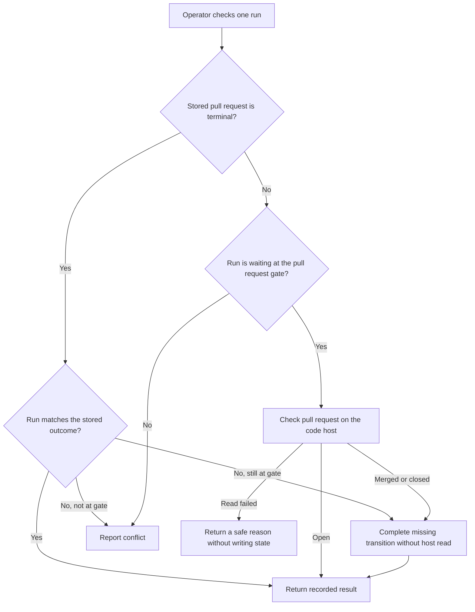
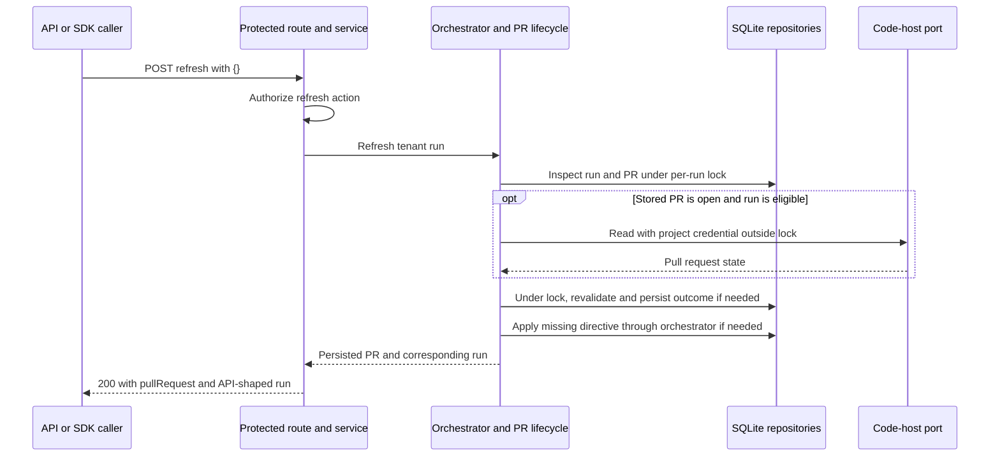

# Refresh one pull request

## What

An operator can check one run’s pull request and get the stored pull request and resulting run together. An open pull request leaves the run waiting. A merge completes the run, and a close without merge fails it with a specific reason. If the check cannot read the pull request, it explains why without changing either record.

## Why

Today the control plane sees a merge through a tenant-wide reconciliation or the optional ticker, which is off by default. An operator looking at one run should not have to check every open pull request. The operator also needs to distinguish a pull request that is still open from a check that could not read it.

## Personas

- **Enzo: Engineer** — Reviews a run’s changes on the code host and checks whether the run has finished.

## Narratives

### Check after a review

Enzo checks a run waiting at the pull request gate. The pull request is still open, so the check returns the same pull request and leaves the run waiting.

Enzo merges the pull request on the code host and checks again. The result shows the pull request as merged and the run as done. If an earlier check saved the merge but stopped before completing the run, this check completes the missing transition without contacting the host again.

### Tell a closed pull request from a failed check

Enzo checks another run, but the code host rejects the project credential. The check identifies the credential problem without failing the run or replacing the last known pull request state.

After the credential is restored, Enzo checks again. The host now reports that the pull request was closed without merge. The check succeeds and returns a failed run with the specific reason for the failure.

## User stories

**Check after a review**

- Enzo can check one run without checking other runs in the tenant.
- Enzo can see an open pull request and its unchanged run together.
- Enzo can confirm that a merge completed the run, including after an interrupted check, and retrieve the recorded result again without a host read.

**Tell a closed pull request from a failed check**

- Enzo can distinguish a missing credential, a rejected credential, a missing upstream pull request, and an unavailable provider.
- Enzo can retry a failed check without undoing any state changes from that check.
- Enzo can tell that a close without merge failed the run, rather than mistaking it for a temporary check failure.

## Goals

- Read at most one code-host pull request per refresh. Read none for a stored `merged` or `closed` pull request, or for a run already ineligible when the check starts.
- Return the stored pull request and the API-shaped run together. A successful `merged` result always includes a `done` run; a successful `closed` result always includes a `failed` run with `failureReason: pull_request_closed_without_merge`.
- Return four stable check-failure reasons without exposing credentials or provider output. A failed read makes no writes.
- Keep the stored-state `GET`, batch reconciliation contract, and ticker defaults unchanged. Refresh must not wait for or consume a runner dispatch slot.

## Non-goals

- Web client changes, browser or server polling, webhooks, or enabling the ticker by default.
- Pull request checks, review state, or mergeability.
- Merging a pull request from the control plane.
- Changing recovery for a run that has already failed because its pull request closed; #121 owns that decision. Issues #140–#143 are separate work.

## Design spec

This is an API and SDK feature. The [run detail concept](../concepts/run-detail.md) describes a client checking on selection at the gate or when the operator asks. This issue defines what a caller receives, not new UI components or a schedule for checks.



A caller can show the `502` reason alongside the last known state. A `200` with a closed pull request and a failed run means the check succeeded. A `409` for a mismatched stored outcome means the caller cannot treat the check as completion.

## Tech spec

### Introduction and overview

[#139](https://github.com/markdstafford/autocatalyst/issues/139) adds a targeted trigger for the lifecycle in [Review, open, and merge a pull request](feature-review-open-merge-pull-request.md). The existing `GET` only reads stored state. The batch `POST` and optional ticker use `reconcileSinglePullRequest` to read the code host and apply run transitions. Refresh shares that implementation but checks eligibility at `pr.human_review` and can finish an interrupted transition from the stored pull request.

Follow the existing [REST](../adrs/adr-005-api-style-transport.md), [shared schema](../adrs/adr-007-shared-types.md), [identity and policy](../adrs/adr-009-auth-rbac-envelope.md), [persistence](../adrs/adr-004-persistence-state-store.md), and [run lifecycle](../adrs/adr-015-run-lifecycle.md) decisions. The [domain model](../concepts/domain-model.md) and [trackers](../concepts/trackers.md) define the records and code-host binding; [run](../concepts/run.md) and [HITL](../concepts/hitl.md) define the gate. This adds wire schemas and typed internal error contracts, but no database migration, new provider operation, or deployment setting.

### System design and architecture

- `packages/api-contract/src/pull-request.ts` defines and exports the refresh path, request, success response, and check-failure schemas. Register the operation in `openapi.ts`.
- `packages/core/src/routes.ts` validates and authorizes the request and handles HTTP errors. `control-plane-service.ts` delegates to the orchestrator and uses the existing run-read mapping (`mapRunToApiRun` and project resolution) for the response.
- `orchestrator.ts` wires targeted refresh and batch reconciliation to the same dependencies and per-run mutation lock. `pr-lifecycle.ts` shares the code-host read, guarded PR write, and directive construction. The orchestrator remains the authority that applies run directives and emits transition events.
- The persistence adapter implements the typed PR state-conflict contract. `apps/control-plane/src/server.ts` implements the typed credential-resolution contract for the default resolver and exposes the same contract for injected resolvers.
- `packages/sdk/src/client.ts` adds `refreshRunPullRequest(id)`. It sends authenticated JSON `{}`, parses success with the shared schema, and retains the API error details through the existing SDK error path.



### Detailed design

#### API contract

`POST /v1/runs/:id/pull-request/refresh` (`/v1/runs/{id}/pull-request/refresh` in OpenAPI) is a bearer-authenticated run action. Use `runIdParamsSchema`. Require an `application/json` body containing exactly `{}`; do not default missing input to an empty body. Success uses a strict `{ pullRequest: pullRequestSchema, run: runSchema }` envelope. Return the persisted PR, not raw provider facts, and the run-read projection, including derived `waitingOn` and `status`, resolved `projectId`, and `failureReason` when present.

| Status | Response |
| --- | --- |
| `200` | A stored open PR and an eligible run, or a stored terminal PR and its matching terminal run as defined below. |
| `400` | `validation_error` for invalid params, missing or invalid body, unknown keys, or malformed JSON. Keep parse-error handling scoped to this route. |
| `401` | Existing bearer-authentication error. |
| `403` | `forbidden` for policy denial or a model principal. |
| `404` | `not_found` for a missing or other-tenant run or when it has no tenant-owned PR. Reuse the stored-state `GET` missing-PR behavior; refresh explicitly masks a cross-tenant run with `404`. |
| `409` | `conflict` for an open PR whose run is not waiting at the gate: “Run is not waiting at the pull request gate.” Also use `conflict` for an incompatible terminal PR/run pair that cannot be completed at the gate: “The stored pull request outcome does not match the run state.” |
| `415` | Reject unsupported request media types using a sanitized error response. |
| `502` | `pull_request_check_failed` with a fixed message and `error.details.reason` from the table below. This refresh makes no writes. |
| `500` | Sanitized `internal_error` for local store, persistence, wiring, or directive faults. Do not classify a local write failure as a failed provider read. |

Example `502` body:

```json
{"error":{"code":"pull_request_check_failed","message":"Could not check the pull request.","details":{"reason":"authentication_failed"}}}
```

Document the strict request, success envelope, and error statuses in OpenAPI, including the `502` reason enum. Assert the operation and its `403`, `404`, `409`, and `502` responses in `openapi.spec.ts`.

#### Eligibility, read, and transition order

1. **Load the records.** Under the per-run lock, load the run and PR by run ID and check both against the authenticated tenant. Return `404` for absent or out-of-tenant records before resolving the project credential.
2. **Handle a stored terminal PR before considering a host read.** A stored `merged` PR paired with a terminal `done` run, or a stored `closed` PR paired with a terminal `failed` run whose reason is `pull_request_closed_without_merge`, returns `200` with no writes. If the run is nonterminal at `pr.human_review`, complete the missing directive under the same lock without touching the PR row or contacting the host. For a repaired merge, build the existing `pull_request_merged` checkpoint from the stored `provider`, `number`, and `url`, using the PR’s `updatedAt` as the recorded merge-detection time. For a repaired close, apply the normal `fail` directive with the exact failure reason. For any other pairing, do not overwrite a terminal run or advance another step; return the mismatch `409`. This deliberately limits the issue’s terminal-state `200` shortcut to matching pairs so the API never reports a partial transition as success.
3. **Check an open PR’s eligibility.** Require a nonterminal run at `pr.human_review`. A run at `pr.finalize`, a failed or canceled run with an open PR, or any other off-gate run returns `409` with no provider read or write. Capture the PR ID and current gate occurrence (the open `RunStep` ID), then release the lock. A missing gate occurrence on an otherwise eligible run is a local persistence fault, not a provider failure.
4. **Read outside the lock.** Share the existing run → topic → conversation → project lookup and code-host binding. Resolve the project credential, then call `CodeHostPort.read` with the project’s repository coordinates and the stored PR number. Classify resolution and read failures before any write. A failed read returns its error without applying any directive, even if another independent operation made progress while this read was in flight.
5. **Revalidate and apply.** Reacquire the same lock and reload the records. If another writer stored a terminal PR, use step 2; do not apply the stale observation. If the PR is still open, require the same PR and gate occurrence; a replaced PR or a run that left and re-entered the gate makes this observation stale and returns `409` without a write. An `open` observation changes neither record, timestamp, nor event history. For `merged` or `closed`, use the shared `expectedState: 'open'` write and the existing system directive: `advance` with `pull_request_merged` to reach `done`, or `fail` with `pull_request_closed_without_merge`. Re-read persisted state under the lock and return it only if it meets the step 2 invariant.
6. **Arbitrate concurrent changes and distinguish faults.** Use an in-process lock keyed by tenant and run ID, separate from `RunDispatchQueue`. Batch and ticker use that same lock around their per-PR state write and directive, but not their host read. Public orchestrator directives, including `cancel` and any direct workflow `revise` from `pr.human_review` to `pr.finalize`, take the same lock before reading the source run. `replyToRun` does not accept replies at this gate and is not the race being addressed. Recovery cannot move a live run off the gate; it only reopens a failed run. Put its existing atomic, failed-only reopen under the same lock, leaving workspace preparation and dispatch admission outside and leaving recovery decisions unchanged. Use an internal lock-held directive path for PR commits and repair so they do not reacquire the non-reentrant lock. Release the lock on success or error; do not acquire a dispatch slot or wait for dispatch inside it.

`PullRequestRepository.updateState` throws a core-defined `PullRequestStateConflictError` **only** when an existing tenant-owned PR fails the `expectedState` check. The Drizzle adapter throws that type from the existing transaction. Refresh handles that typed conflict by re-reading and applying step 2 if the stored PR is now terminal. If the row disappeared, return `404`; if the state still contradicts the reported conflict, return `500`. Missing rows and ordinary database errors from the write are not state-conflict errors and map to `500`; do not match exception text. A directive that returns `terminal_run` or `invalid_transition` also triggers a re-read: return `200` only for a matching persisted pair, `409` if the run has left the gate without matching, or `500` if the records still show an eligible run and the directive could not complete. Do not retry the directive in that request. Other directive faults return `500`; a later refresh can finish the missing directive if the run is still at the gate.

Batch and ticker retain their existing eligibility rules and do not repair stored terminal rows. They still select open PRs, skip runs already missing or terminal at their pre-check, keep the same deadline and `maxCount`, and return `{ checked, merged, closed, failed, timedOut }` with the current counting semantics. A lost guarded write remains a per-item `failed` result for batch. The lock prevents refresh from mistaking the interval between the batch’s two writes for an interrupted transition.

#### Check-failure classification

Use a named core `ResolveCodeHostCredential` contract with the existing success signature `(ref: unknown) => Promise<CodeHostCredential>` and a documented typed failure: `CodeHostCredentialMissingError` is the only resolver error refresh maps to `credential_missing`. Use this contract for production wiring, `options.resolveCredential`, and test overrides. The production resolver validates the reference and secret handle, translates `SecretResolutionError` with code `missing_secret` into that typed error, and also throws it for an absent or empty value. A locked or undecryptable store, unavailable store, SQL fault, or unrecognized resolver exception maps to `500`; never copy the underlying error details into a public error. Existing PR-open and batch callers still treat resolver rejection as failure.

| `details.reason` | Classification |
| --- | --- |
| `credential_missing` | `codeHostSetting` is `null`, its `credentialRef` is missing, or the resolver throws `CodeHostCredentialMissingError` for an invalid ref or absent/empty secret. No provider call. |
| `authentication_failed` | The code-host port reports `authentication_failed`. |
| `not_found` | The port reports `resource_not_found` for the upstream PR. This is not a local `404`. |
| `provider_unavailable` | The configured provider is unsupported or unreachable, the read times out, or the port returns an unrecognized failure or invalid PR facts. This does not include credential resolver infrastructure failures or local data/wiring faults. |

Give the shared per-PR lifecycle outcomes distinct read-failure and internal-failure variants. The batch maps both to its existing `failed` counter. A missing local topic, conversation, or project is an internal fault, not an upstream `not_found`.

### Security, privacy, and compliance

Use the protected route and call the policy point with action `run_pull_request.refresh` and resource `{ kind: 'run_pull_request_refresh', id, path: '/v1/runs/:id/pull-request/refresh' }` before any run lookup, secret resolution, provider call, or mutation. Deny model principals even when policy allows the action. Guard direct service calls as well; derive tenant scope from the authenticated principal, never from the request body. Use server-owned repository coordinates. Do not include credentials, secret handles, provider output, or raw exception messages in responses, run failure reasons, or refresh logs.

### Observability

Use the existing orchestrator `run_state_transition` event path after persistence. A successful new or repaired transition emits the normal event once; a matching replay, an open result, a denied request, or a failed read emits none. Keep the existing post-commit event append behavior; replay does not backfill events. Use existing safe request logs with status and stable error codes. No new metrics or alerts are required.

### Testing plan

- **Contract, route, and SDK:** Assert strict input and output schemas, authorization before service work, exact action and descriptor, model denial even under permissive policy, tenant-masked `404`, both conflicts, and sanitized `500`/`502` bodies. Use fake fetch to verify SDK request, response parsing, and retained `error.details.reason`. Assert the operation in OpenAPI.
- **Lifecycle error matrix:** Use one case per mapping: null setting, missing ref, malformed ref, missing secret, empty secret, injected typed resolver rejection, and resolver infrastructure fault; port auth rejection, upstream not found, unsupported provider, timeout or unavailable provider, and invalid facts. Exercise the default resolver’s translation of typed `missing_secret` separately from locked, undecryptable, and generic store failures. Assert no writes or directives on read failures. Inject a typed PR state conflict and verify re-read; inject a non-mismatch `updateState` failure and assert `500`, not `502` or a success replay. Use sensitive sentinel text to test redaction.
- **Service and concurrency:** Assert open no-change, both off-gate and terminal/open conflicts, matching terminal replay, and nonmatching terminal conflict. Seed stored `merged` and `closed` PRs with runs still at the gate and verify the missing directive completes without a host read or PR write; repeat and verify no duplicate event. Inject a directive fault after the PR write, assert `500`, and prove retry completes from stored state. Exercise re-read after `terminal_run` and `invalid_transition`. With deferred promises, move a run out of the gate during the host read and assert the refresh does not write or advance it. Occupy every dispatch slot with blocked work on other runs and assert refresh completes before those slots are released. Overlap refresh and batch for the same PR, including holding batch between its PR write and directive; assert the refresh returns the matching terminal pair and exactly one transition event exists. Existing batch tests pass unchanged.
- **Production wiring:** Extend `apps/control-plane/src/pr-lifecycle.integration.spec.ts` through `createControlPlaneServer`, Fastify injection, real test persistence, and the scripted `gh` executor. Disable background reconciliation for the targeted-flow tests. Drive a run to `pr.human_review`, check `open` with no changes, switch to `merged`, and check that the run reaches `done`. Replay with no further `gh pr view` or transition event. Cover another run with a scripted authentication failure and a separate run closed without merge. In a separate case, seed `merged` in persistence while the run is still at the gate; set the scripted read to fail if called and verify the route repairs the run to `done`, emits one event, and replays without a read. No test makes a network or model call.

#### Manual acceptance in fake mode

Start fake mode with `pnpm nx run control-plane:serve-fake`. In another terminal run `pnpm nx run control-plane:seed-fake -- --scenario pr-open` and use the run ID it prints:

```bash
curl -sS -X POST -H 'Authorization: Bearer fake-mode-token' -H 'content-type: application/json' -d '{}' \
  'http://127.0.0.1:4010/v1/runs/<run-id>/pull-request/refresh'
```

Expect `open` and `pr.human_review`. Write `merged` to the printed `pullRequestStateFile` (see [fake mode](../../docs/operators/fake-mode.md#pull-request-state-files)) and expect `merged` and `done` on refresh. Seed a fresh `pr-open` run on a different fixture issue with `--issue`, write `closed` to its state file, and expect `closed`, `failed`, and `pull_request_closed_without_merge`.

### Alternatives considered

- **Trigger the batch endpoint and then read the run.** Reuses existing routes, but reads unrelated PRs and cannot explain a failed check for the selected run.
- **Add provider I/O to the stored-state `GET`.** Avoids a new route but makes an ordinary read perform mutations and removes the way to read stored state without a host call.
- **Use `RunDispatchQueue.enqueueForRun`.** Reuses a per-run chain but takes a global runner slot and can stall behind unrelated builds. A separate, short lock lets refresh proceed under full dispatch load.

### Risks

- **A run moves during provider I/O.** Keep I/O outside the lock, revalidate the PR and gate occurrence before any targeted write, and share the mutation lock with batch, ticker, and competing run transitions. The lock protects the current single control-plane process; it is not a distributed lock.
- **A crash or directive fault leaves a terminal PR with a run still at the gate.** The writes remain separate. A later refresh completes the missing directive from the stored PR under the lock, with no provider read. If the run moved away without reaching the matching result, return conflict rather than silently claiming success or changing that run.
- **Loose error handling hides database faults or leaks provider data.** Use typed conflict and credential errors, a bounded reason enum, and redaction tests. Keep batch’s public response unchanged.

## Task list

- [ ] **Story: Reconcile one run safely**
  - [ ] **Task: Type credential and PR write failures**
    - **Description**: Define the core resolver and state-conflict error contracts. Implement them in production server wiring, resolver overrides, and the Drizzle PR repository.
    - **Acceptance criteria**:
      - [ ] Invalid refs and missing or empty secrets produce the typed missing-credential error; local secret-store faults do not.
      - [ ] Only an `expectedState` mismatch on an existing PR produces the typed state-conflict error; test missing rows and unrelated failures separately.
    - **Dependencies**: None
  - [ ] **Task: Share lifecycle reads and terminal directives**
    - **Description**: Separate the provider read from the guarded PR write and shared directive construction in `pr-lifecycle.ts`. Classify safe read outcomes without changing batch selection or counting.
    - **Acceptance criteria**:
      - [ ] The lifecycle error matrix passes, with no provider data leaked, no writes on read failure, and no `502` on an ordinary write fault.
      - [ ] Existing batch tests pass unchanged and the ticker uses the same lifecycle code.
    - **Dependencies**: Task: Type credential and PR write failures
  - [ ] **Task: Serialize PR commits without dispatch slots**
    - **Description**: Add the shared per-run mutation lock for PR commits, public directives, and the existing atomic recovery reopen. Keep project and provider reads outside it and avoid nested acquisition on the directive path.
    - **Acceptance criteria**:
      - [ ] Refresh completes with every dispatch slot occupied; the lock is released after failure.
      - [ ] An overlapping batch and refresh for one PR produce exactly one transition event and no partial `200` response.
    - **Dependencies**: Task: Share lifecycle reads and terminal directives; Task: Add the targeted refresh operation (overlap and saturation tests only)
  - [ ] **Task: Add the targeted refresh operation**
    - **Description**: Add the orchestrator and service entry points, implementing tenant and gate checks, post-read revalidation, repair, and the run-read projection. Use the mutation lock for all production paths.
    - **Acceptance criteria**:
      - [ ] Missing or cross-tenant records return `404`; ineligible open PRs return `409`, without provider I/O or writes in either case.
      - [ ] Open is a no-op. Merge and close use the shared directive path. A matching replay does not read or write; a stored terminal PR repairs an eligible gated run without reading the host or rewriting the PR.
      - [ ] Service tests cover both terminal mismatches, a stale gate occurrence, a typed lost update, and directive failure followed by successful repair.
    - **Dependencies**: Task: Share lifecycle reads and terminal directives; Task: Serialize PR commits without dispatch slots (lock implementation, before overlap and saturation tests)
- [ ] **Story: Expose and verify refresh**
  - [ ] **Task: Define the refresh contract and route**
    - **Description**: Add the shared schemas and protected route, authorize with the new action and descriptor, and map service results to the documented statuses.
    - **Acceptance criteria**:
      - [ ] Tests reject invalid requests and demonstrate policy-first behavior, model denial, tenant masking, and exact sanitized error envelopes.
      - [ ] The success response validates both persisted resources against the shared schemas.
    - **Dependencies**: Task: Add the targeted refresh operation
  - [ ] **Task: Publish the SDK method and OpenAPI operation**
    - **Description**: Add `refreshRunPullRequest(id)` and register the operation using the shared contract.
    - **Acceptance criteria**:
      - [ ] SDK tests verify authenticated JSON `{}`, parsed success, and preserved error details.
      - [ ] `openapi.spec.ts` asserts the path and the request and response schemas, including `403`, `404`, `409`, and `502`.
    - **Dependencies**: Task: Define the refresh contract and route
  - [ ] **Task: Verify refresh through the production server**
    - **Description**: Extend the existing scripted `gh` wiring suite with open, merge, replay, authentication failure, close, and stored-merge repair cases.
    - **Acceptance criteria**:
      - [ ] Open and authentication failure leave both records and transition history unchanged. Merge yields `done`; close yields `failed` with `pull_request_closed_without_merge`.
      - [ ] Merge replay and stored-merge repair make no further host read. Repair emits exactly one transition event and the subsequent replay emits none.
      - [ ] The tests use local persistence and scripted dependencies only; no network or model calls.
    - **Dependencies**: Task: Define the refresh contract and route; Task: Serialize PR commits without dispatch slots
  - [ ] **Task: Update the agent code map**
    - **Description**: Record the route, service and orchestrator entry points, lifecycle repair and lock, and SDK method in `context-agent/wiki/code-map.md`.
    - **Acceptance criteria**:
      - [ ] The map points to the implementation and distinguishes targeted refresh from stored-state `GET` and unchanged batch reconciliation.
    - **Dependencies**: Task: Verify refresh through the production server; Task: Publish the SDK method and OpenAPI operation
