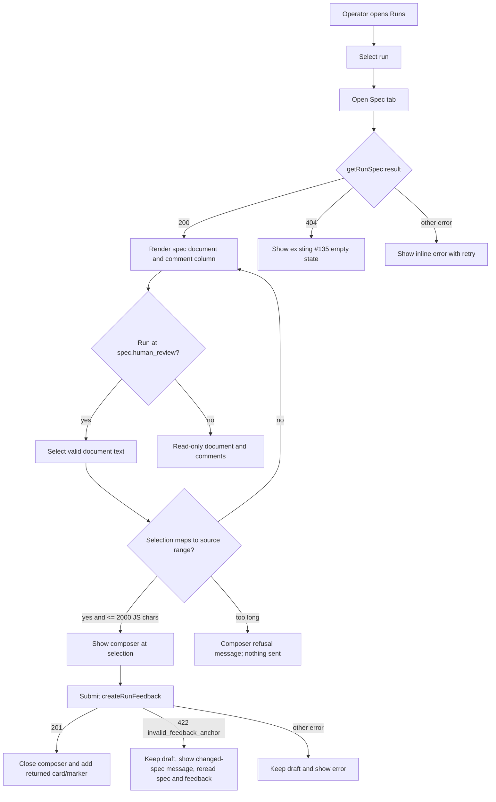
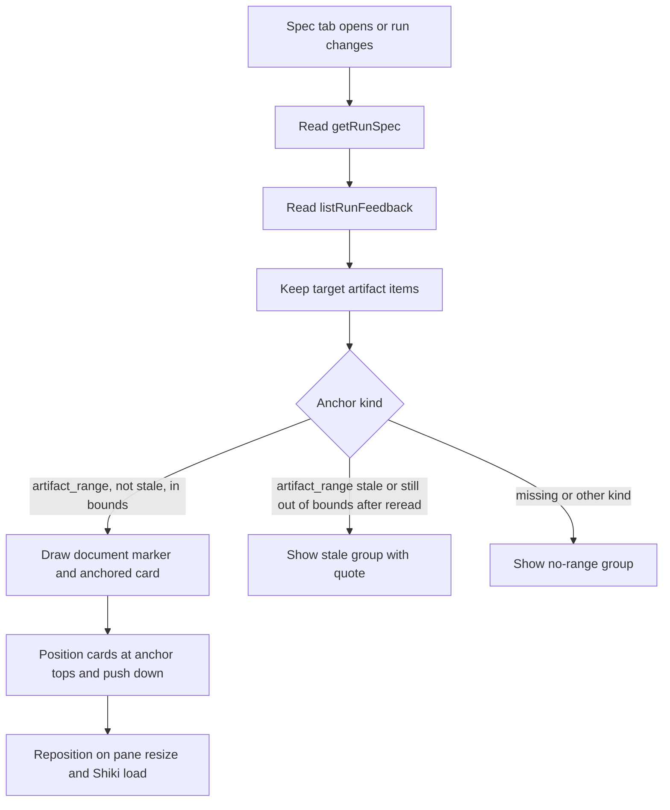
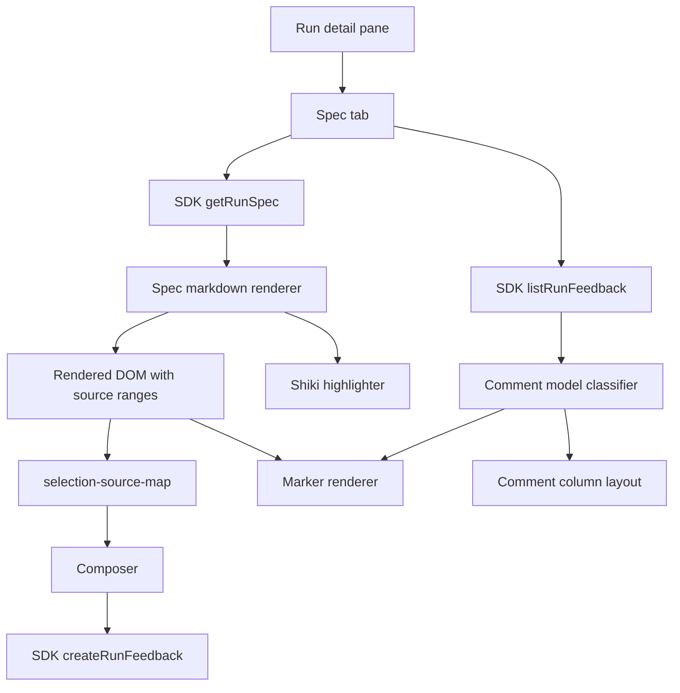
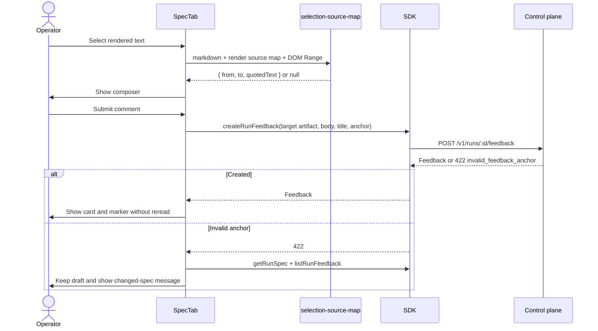

# Review a spec with anchored comments

## What

Operators can review a run's spec in the web client's Spec tab as a rendered document and leave comments on the text they select. The selected passage becomes an anchored spec comment that appears beside the relevant text, stays attached across server-reconciled spec revisions when the quote moves, and remains visible as stale when the quote disappears.

This feature turns the Spec tab from a readiness placeholder into the review surface for the spec gate. It renders Markdown safely, highlights code blocks, maps rendered text selections back to source Markdown code-point offsets, creates artifact feedback with source-range anchors, and displays anchored, stale, and unanchored feedback in the comment column.

## Why

Spec review is the first major human judgment point in the Autocatalyst loop. Without anchored comments, an operator must describe locations indirectly, and the run cannot reliably carry review intent into a revision. Anchored comments let the operator point at the exact passage that needs work while preserving enough quote context for the control plane to validate, repair, or mark the anchor stale.

This also completes the client side of the spec feedback contracts from issues #135 and #136: the pane and live updates exist, the API validates/reconciles anchors, and the web client now provides the readable document and precise anchor creation needed for a real spec review.

## Personas

- **Phoebe: PM** - Reads generated specs for product correctness and comments on passages that need clarification or changed scope.
- **Enzo: Engineer** - Reviews technical details in the spec, including code snippets, tables, and edge cases, and leaves precise feedback before implementation starts.
- **Dani: Designer** - Reviews user-facing flows and wording in the spec, commenting on exact sentences or list items that need UX refinement.

## Narratives

### Comment on a selected passage

Phoebe opens the seeded spec-review run and switches to the Spec tab. The spec appears as a readable document with headings, lists, tables, and highlighted code blocks, while the comment column is empty except for a short hint that selecting text starts a comment.

She drags over a sentence in a bullet after an emoji. A compact composer appears at the selection with the quoted passage, a text area, Comment, and Cancel. She types her concern and submits with Cmd+Enter. The composer closes, the selected text gets an open marker, and a card appears beside that passage with Phoebe's comment and the exact quote.

### Review comments after a revision

Enzo has several open comments on a spec. He requests changes, and the run revises the spec. When the run returns to spec review, the client reloads the spec and feedback through the SDK instead of trying to repair anchors locally.

The comment on a moved bullet appears beside the same quote at its new offsets. The comment whose text was removed appears in the stale group with its quote and no document marker. Other comments remain anchored, and addressed comments use the resolved marker style while their cards still show the actual addressed status.

### Read comments away from the gate

Dani opens a run that is no longer at spec.human_review. The Spec tab still renders the document and existing comment cards, so she can understand the review history and click between cards and markers.

When she selects text, no composer appears. The tab is read-only outside the spec gate, and there is no general comment box, reply field, Resolve/Reopen control, decision button, footer tally, previous/next comment control, or full-screen overlay in this issue.

## User stories

**Comment on a selected passage**

- Phoebe can read the run's spec as rendered Markdown in the Spec tab.
- Phoebe can select rendered text and create a comment anchored to the corresponding source Markdown range.
- Phoebe can see an open marker on the selected text and a card beside that text.
- Phoebe can submit from the keyboard and recover from anchor-validation errors without losing her draft text.

**Review comments after a revision**

- Enzo can reopen the Spec tab after a run revision and see moved comments at the offsets returned by the control plane.
- Enzo can see stale comments grouped with their quote when the commented text no longer exists.
- Enzo can distinguish open markers from addressed, resolved, and wont_fix markers while cards show the exact status.
- Enzo can see unanchored or non-range artifact feedback in a separate no-range group.

**Read comments away from the gate**

- Dani can view the spec and existing comments even when the run is not waiting at spec.human_review.
- Dani can select marker text or cards to pair and scroll the corresponding item into view.
- Dani cannot create new spec comments outside the spec gate.

## Goals

- Render the full markdown returned by getRunSpec, including front matter in source offsets but not in the visible document.
- Map valid rendered selections to source Markdown Unicode code-point offsets and quotedText with test coverage for the Markdown constructs and Unicode cases in issue #137.
- Require every client-created spec comment to use an artifact_range anchor and never send anchorless spec comments from the web client.
- Display anchored, stale, and no-range feedback in the Spec tab with design-system marker, card, grouping, and geometry rules.
- Prove the production path in fake mode by creating comments on text, table cells, and code blocks; reading stored anchors through the SDK; reloading; and verifying server-reconciled moved and stale comments after request_changes.

## Non-goals

- Resolve, reopen, replies, decision buttons, comment counts, footer tallies, previous/next navigation, and full-screen spec view.
- Searching the spec in the client for moved comments; the client trusts returned offsets and stale flags.
- Editing the spec or creating comments that are not anchored to selected text from the web client.
- Rendering diagrams in specs.
- Backend anchor validation or reconciliation changes beyond using the API delivered by #136.

## Design spec

### User flows

### Key UI components

#### Rendered spec document

- Uses the existing Spec tab region from #135 and replaces only the ready-spec placeholder state.
- Shows front matter nowhere in the rendered document, but source offsets still count the full markdown string returned by getRunSpec.
- Renders Markdown as literal content only: raw HTML is escaped as text, links are safe, and unsupported link schemes are plain text.
- Headings, paragraphs, lists, tables, inline code, fenced code, and block quotes follow the design-system Spec reading column rules.
- Code blocks are selectable before and after Shiki loads; highlighting must not change source mapping.

#### Comment composer

- Appears only after a valid in-document selection while the selected run's current step is spec.human_review.
- Shows a quote line, textarea, Comment button, and Cancel button.
- Comment is disabled while body text is empty and busy while submission is in flight.
- Ctrl+Enter and Cmd+Enter submit; Escape cancels.
- A selection longer than the 2000-character quotedText contract is refused with a message asking for a shorter passage and sends nothing.

#### Markers and cards

- Open artifact-range feedback draws the open marker style; addressed, resolved, and wont_fix draw the resolved marker style. The card chip uses the actual status string.
- Open and resolved markers differ by underline and color, so color is not the only signal.
- Clicking a marker selects its card. Clicking a card selects its marker and scrolls it into view. Only one pair is selected at a time.
- Overlapping markers both render; clicking overlapped text selects the shorter range.
- Cards show author display name or id, age, status chip, quoted text, body, and read-only thread entries after the first.
- Cards have no reply field and no Resolve/Reopen controls in this feature.

#### Comment column groups

- Anchored cards come first in document order and are positioned beside their anchor tops with no overlap.
- A stale group appears after anchored cards only when stale comments exist. Each stale item shows its quote and a stale chip with no marker.
- A no-range group appears after stale comments only when feedback lacks an artifact_range anchor. Items show body and omit the quote line when no quoted text exists.
- A spec with no comments shows an empty comment column with a short hint that selecting text starts a comment.

### Visual references

- Use context-agent/wiki/design-system.md, Spec reading column, as the visual source of truth for the reading column, comment column width, markers, cards, composer, tables, code block outline/radius, and geometry assertions.
- Add the design-system note that stale comments and comments with no range sit in groups at the end of the column.

## Tech spec

### Introduction and overview

#### Prerequisites and assumptions

- Depends on #135 for the run detail pane, Spec tab shell, live run updates, tab empty states, and detail-pane data refresh infrastructure.
- Depends on #136 for getRunSpec markdown/artifact/frontmatter, createRunFeedback anchor validation, listRunFeedback reconciled anchors, request_changes behavior, status values, and response-only stale anchors.
- Depends on ADR-033 for source Markdown code-point anchor semantics and control-plane reconciliation ownership.
- Depends on ADR-032 for the web client stack, Shiki loading model, React/Vite/Tailwind, Vitest, and Playwright.
- The client must not compare quote text for reconciliation or search for moved text. It may only guard obviously out-of-bounds returned offsets.

#### Technical goals

- Keep source-range math isolated to apps/web/src/features/spec/code-points.ts and selection mapping isolated to apps/web/src/features/spec/selection-source-map.ts.
- Choose a Markdown parser/render pipeline that exposes source positions for CommonMark, GFM tables, task lists, strikethrough, fenced code, and front matter.
- Carry source ranges onto every rendered text run needed for selection mapping and marker placement.
- Preserve SDK-only communication; no test-only hooks, no direct state injection around the API.
- Keep Shiki lazy and language/theme scoped to the languages and resolved theme in the rendered spec.

#### Non-goals

- No API-contract changes are required unless implementation discovers a missing exported type; this feature consumes the #136 contracts.
- No persistence schema changes.
- No feedback status mutation UI.

#### Glossary

- **Source Markdown**: The exact markdown string returned by getRunSpec, including front matter.
- **Code-point offset**: Zero-based offset counted by Unicode code points, not JavaScript UTF-16 code units.
- **Rendered selection**: A DOM Range selected in the rendered Spec document.
- **Artifact range anchor**: Feedback anchor of kind artifact_range with artifactId, from, to, and quotedText.
- **Stale comment**: A response with artifact_range anchor carrying stale: true because the quote no longer appears in the current spec.

### System design and architecture

#### Component breakdown

- apps/web/src/features/spec/code-points.ts: pure helpers for code-point length, code-point slicing, and conversions between UTF-16 indexes and code-point offsets. Other web code must not use string.length as an offset into spec markdown.
- apps/web/src/features/spec/selection-source-map.ts: pure-ish selection mapper that takes markdown, render source map, and DOM Range and returns an anchor candidate or null.
- Spec render module: parses markdown/front matter, produces React render data, records source ranges for text runs, and exposes the render source map consumed by selection and marker code.
- Spec tab integration: loads spec and feedback, handles loading/error/404 states, composes document, composer, markers, and comment column.
- Comment state/classification: filters target artifact feedback, groups anchored/stale/no-range comments, guards out-of-bounds ranges with one reread, and maps status to marker style.
- Shiki integration: lazy-loads highlighter on first code block, loads only languages present in the spec, chooses theme from resolved light/dark theme, and re-highlights on theme change.
- Tests and fakes: scripted SDK client for component tests; production fake-mode Playwright path for E2E.

### Detailed design

#### Markdown parsing and rendering

- Use a parser pipeline that reports source positions for every relevant node, including GFM table, task list, strikethrough, fenced code, block quote, inline code, links, escapes, entities, hard breaks, and front matter.
- The implementation must record the chosen parser in this spec's implementation notes or docs update. Candidate approaches should prefer the unified/remark/micromark ecosystem if it provides stable positional data for GFM and front matter.
- Parse front matter as source-only metadata: include its characters in source offsets, exclude it from the rendered document, and make selection mapping return null for any range that would map into front matter.
- Render raw HTML as escaped literal text, never through dangerouslySetInnerHTML.
- Render links as anchors only for http, https, and mailto. Use target=_blank and rel="noopener noreferrer". Other schemes render as plain text.

#### Source range model

- Every rendered text run receives data attributes or equivalent references that tie its rendered DOM text to source Markdown ranges.
- For identity text, a selected DOM character maps directly to the corresponding source code-point range.
- For text transformed by Markdown rendering, such as heading markers removed, emphasis markers hidden, link target syntax hidden, table delimiters hidden, escapes, entities, and hard breaks, the mapper snaps outward where needed so quotedText is always the markdown slice in [from, to) and contains the selected rendered characters.
- Selections spanning multiple rendered nodes produce the minimal source range from the first selected character's mapped source boundary to the last selected character's mapped source boundary, including source syntax between them.
- Empty, whitespace-only, outside-document, comment-column, pane-header, and front-matter selections return null.

#### Code-point helper rules

- codePointLength(text): counts Array.from(text).length or equivalent.
- sliceByCodePoints(text, from, to): returns the source slice by code-point offsets without splitting surrogate pairs.
- utf16IndexToCodePointOffset(text, index) and codePointOffsetToUtf16Index(text, offset): convert at safe boundaries and clamp or reject mid-surrogate indexes according to tests.
- quotedText must equal sliceByCodePoints(markdown, from, to).
- The composer title uses the first line of body cut to 80 code points.
- The 2000-character quotedText maximum follows the API contract counted as JavaScript string length; a mapped result over that limit is refused by the composer before createRunFeedback.

#### Comment creation

- The composer is enabled only when the run's current step is spec.human_review.
- Submitting sends createRunFeedback(runId, { target: 'artifact', title, body, anchor: { kind: 'artifact_range', artifactId, from, to, quotedText } }).
- The web client never sends a spec comment with no anchor. If mapping returns null, no composer is created.
- On success, insert the returned feedback into local comment state immediately and render marker/card without waiting for another read.
- On 422 invalid_feedback_anchor, preserve composer text, show a changed-spec/match-failed message, and reread getRunSpec plus listRunFeedback.
- On other errors, preserve composer text and show the error message.

#### Showing comments

- listRunFeedback runs when the Spec tab opens, when the run's currentStep or updatedAt changes through #135 live updates, and after a comment is created or a 422 requires reload.
- Keep only feedback items with target artifact for this tab.
- For artifact_range anchors without stale: true, render at the returned from/to offsets without quote comparison or search.
- If returned from/to do not fit within the held markdown code-point length, reread spec and feedback once. If still out of bounds, show the comment in the stale group.
- Stale artifact_range comments render only in the stale group with their quote and stale chip.
- Missing anchors or non-artifact_range anchors render in the no-range group.
- Card positioning reads marker/anchor top positions and pushes later cards down to avoid overlap. Recompute on pane resize, content reflow, and Shiki completion.

#### Security, privacy, and compliance

- Raw HTML is escaped; no Markdown content is inserted as markup.
- Links are limited to http, https, and mailto when clickable, with noopener/noreferrer.
- Feedback body and title are sent as user input through existing SDK/API validation; frontend checks are UX and do not replace control-plane validation.
- Error display must not expose raw stack traces or secrets; use SDK error messages already surfaced for clients.
- No model calls are made by client tests or Playwright tests.

#### Observability

- No new telemetry surface is required for this feature.
- Client-side recoverable failures should be visible through test assertions and user-facing inline messages: spec load failures, feedback load failures, comment submit failures, and invalid anchors.
- Avoid logging selected text or comment bodies unless existing client test diagnostics already capture DOM state.

#### Testing plan

- Unit tests for code-points.ts cover BMP, astral symbols, mathematical letters, flag sequences, CRLF, tabs, UTF-16/code-point conversion, slicing, and surrogate boundaries.
- Unit tests for selection-source-map.ts use the production render function in a DOM test environment and DOM Selection/Range APIs. They cover every mapping case listed in issue #137.
- Component tests with a scripted SDK client cover rendering, loading/error states, composing, request body after emoji, duplicate-submit prevention, 422 reread path, marker/card pairing, stale/no-range groups, open/resolved marker styles, read-only state away from the gate, and Shiki pre/post load selection stability.
- Playwright fake-mode production-path test starts fake mode on a free port with fresh state, seeds spec-review, builds/serves the client, creates comments on passages A-D, verifies stored anchors through SDK getRunSpec/listRunFeedback, reloads and rechecks markers, creates a no-anchor SDK comment, sends request_changes, and verifies moved/stale/addressed behavior.
- Playwright geometry assertions cover table cell borders, code block outline/radius, comment column width, and non-overlapping card layout.

#### Alternatives considered

- **Anchor to rendered DOM paths:** Rejected because ADR-033 defines source Markdown offsets and rendered DOM paths are unstable across renderer changes.
- **Search in the client for moved quotes:** Rejected because #136 makes reconciliation a control-plane responsibility so every client sees the same result.
- **Plain textarea markdown view:** Rejected because the outcome requires rendered Markdown, safe links, Shiki-highlighted code, and comments beside the text they concern.
- **Require anchors at the API for all artifact feedback:** Rejected because #136 intentionally allows channel-originated or target-level feedback without anchors; the stricter rule belongs only to the web composer.

#### Risks

- Mapping rendered selections to source ranges is the highest-risk area because Markdown syntax can hide, transform, or reorder source characters. Mitigation: isolate mapping logic, carry source ranges on text runs, and use fixture plus generated round-trip tests.
- Parser position data may not be precise enough for every GFM construct. Mitigation: prove parser choice early with unit tests for all required constructs and switch before UI integration if positions are insufficient.
- Shiki may change DOM structure after async highlighting. Mitigation: keep selectable source-range wrappers stable around code text and assert identical mapping before and after Shiki load.
- Card layout can drift with pane width, font loading, or code highlighting. Mitigation: recompute on resize/highlight completion and cover geometry in Playwright.

## Task list

- [ ] **Story: Render the spec document with source positions**
  - [ ] **Task: Choose and wire the Markdown parser/render pipeline**
    - **Description**: Select a parser that reports source positions for CommonMark, GFM tables, task lists, strikethrough, fenced code, block quotes, and front matter. Build the production render function that returns React render data plus the source map used by selection and markers.
    - **Acceptance criteria**:
      - [ ] The Spec tab renders markdown from getRunSpec when a spec exists.
      - [ ] The parser choice is recorded in the spec implementation notes or code-map update.
      - [ ] Front matter is parsed and excluded from the rendered document while still counted in source offsets.
      - [ ] Raw HTML renders as literal text, not markup.
      - [ ] Links are clickable only for http, https, and mailto and use rel="noopener noreferrer".
    - **Dependencies**: None
  - [ ] **Task: Carry source ranges on rendered text runs**
    - **Description**: Ensure every selectable text run in headings, paragraphs, emphasis, inline code, links, lists, tables, task lists, block quotes, and code blocks carries enough source-range metadata for mapping and marker placement.
    - **Acceptance criteria**:
      - [ ] Rendered text nodes or wrappers expose stable source-range data to the mapping module.
      - [ ] Code, inline code, table cells, list items, headings, and block quotes are included.
      - [ ] Hidden Markdown syntax can be included in source ranges when a selection spans across it.
    - **Dependencies**: "Task: Choose and wire the Markdown parser/render pipeline"
  - [ ] **Task: Add lazy Shiki code highlighting**
    - **Description**: Render fenced code blocks as selectable plain text immediately, then highlight with Shiki after first use using the JavaScript regex engine, languages used by the spec, and the theme matching the resolved theme.
    - **Acceptance criteria**:
      - [ ] Unknown or missing code languages render as plain text.
      - [ ] Theme changes re-highlight code blocks.
      - [ ] Selection mapping is identical before and after Shiki loads.
      - [ ] Shiki is lazy-loaded and not part of the initial route load.
    - **Dependencies**: "Task: Carry source ranges on rendered text runs"

- [ ] **Story: Map rendered selections to source anchors**
  - [ ] **Task: Implement code-point helpers**
    - **Description**: Add apps/web/src/features/spec/code-points.ts with helpers for code-point length, code-point slicing, and UTF-16/code-point offset conversion. Use these helpers wherever the web client handles spec source offsets.
    - **Acceptance criteria**:
      - [ ] Helpers handle astral characters, mathematical letters, flag sequences, CRLF, and tabs.
      - [ ] Helpers never split a surrogate pair.
      - [ ] No other apps/web file counts source Markdown offsets with string.length.
      - [ ] Unit tests cover the helper edge cases.
    - **Dependencies**: None
  - [ ] **Task: Implement selection-source-map.ts**
    - **Description**: Add apps/web/src/features/spec/selection-source-map.ts exporting a function that maps markdown, render source map, and DOM Range to { from, to, quotedText } in Unicode code points, or null for invalid selections.
    - **Acceptance criteria**:
      - [ ] Empty, whitespace-only, outside-document, pane-header/comment-column, and front-matter selections return null.
      - [ ] For every non-null result, quotedText equals the markdown slice [from, to) by code points and from < to.
      - [ ] Selections over transformed renderer text snap outward to source that contains the selected text.
      - [ ] The mapper does not depend on browser-only APIs beyond DOM Range/Selection available in the unit test environment.
    - **Dependencies**: "Task: Implement code-point helpers", "Task: Carry source ranges on rendered text runs"
  - [ ] **Task: Add comprehensive mapping unit tests**
    - **Description**: Create apps/web/src/features/spec/selection-source-map.spec.ts using the production render function and DOM selection API. Cover the issue #137 mapping matrix, including paragraphs, full document selection, headings, emphasis/strong/strikethrough, inline code, links, lists/task lists, tables, fenced code in lists and block quotes, block-spanning ranges, Unicode outside the BMP, front matter, CRLF/tabs, entities/escapes/hard breaks, raw HTML, long selections, and generated round trips.
    - **Acceptance criteria**:
      - [ ] Tests run under pnpm nx test web without a browser.
      - [ ] Each mapped selection verifies quotedText equals the source slice.
      - [ ] Generated round-trip tests prove markers for [from, to) highlight selected rendered text and nothing outside the slice.
      - [ ] The long-selection test proves the composer refuses >2000 JavaScript string length and sends nothing.
    - **Dependencies**: "Task: Implement selection-source-map.ts"

- [ ] **Story: Create anchored spec comments**
  - [ ] **Task: Build the selection composer**
    - **Description**: Add the composer UI to the Spec tab. It appears at a valid selection only while the run waits at spec.human_review and shows quote, textarea, Comment, and Cancel controls with keyboard shortcuts.
    - **Acceptance criteria**:
      - [ ] Composer appears only for valid document selections at spec.human_review.
      - [ ] Comment is disabled while the textarea is empty and shows busy state while submitting.
      - [ ] Ctrl+Enter and Cmd+Enter submit; Escape and Cancel close.
      - [ ] Selection outside the document or in front matter creates no composer.
      - [ ] There is no general comment box or other way to create a spec comment.
    - **Dependencies**: "Task: Implement selection-source-map.ts"
  - [ ] **Task: Submit createRunFeedback with artifact_range anchors**
    - **Description**: Wire composer submission to the SDK using target artifact, body text, an 80-code-point title from the first body line, and an artifact_range anchor with artifact id, from, to, and quotedText.
    - **Acceptance criteria**:
      - [ ] Every web-created spec comment sends an anchor.
      - [ ] A unit test checks the request body for a selection after an emoji.
      - [ ] Duplicate submit is prevented while the request is in flight.
      - [ ] On success, the returned feedback appears immediately as a card and marker without waiting for a reread.
    - **Dependencies**: "Task: Build the selection composer", "Task: Implement code-point helpers"
  - [ ] **Task: Handle create failures and long selections**
    - **Description**: Add UX for selections whose quotedText exceeds 2000 JavaScript string length and for createRunFeedback errors, including invalid_feedback_anchor.
    - **Acceptance criteria**:
      - [ ] Overlong selections show a shorter-passage message and send nothing.
      - [ ] 422 invalid_feedback_anchor keeps composer text, shows a changed-spec/match-failed message, and rereads spec plus feedback.
      - [ ] Other errors keep composer text and show the error message.
    - **Dependencies**: "Task: Submit createRunFeedback with artifact_range anchors"

- [ ] **Story: Display anchored, stale, and no-range comments**
  - [ ] **Task: Load and classify artifact feedback**
    - **Description**: Read listRunFeedback when the Spec tab opens, after comment creation, on invalid-anchor recovery, and when #135 live updates report currentStep or updatedAt changes. Keep target artifact items and group them as anchored, stale, or no range.
    - **Acceptance criteria**:
      - [ ] Only target artifact feedback appears in the Spec tab.
      - [ ] Artifact_range anchors without stale render at returned offsets without client quote comparison or search.
      - [ ] Out-of-bounds returned ranges trigger one spec+feedback reread and then fall back to the stale group if still invalid.
      - [ ] Missing anchors and non-artifact_range anchors render in the no-range group.
    - **Dependencies**: "Task: Choose and wire the Markdown parser/render pipeline"
  - [ ] **Task: Render document markers and card pairing**
    - **Description**: Draw markers over anchored ranges and implement marker/card selection, overlapping-marker behavior, and status-based open/resolved visual states.
    - **Acceptance criteria**:
      - [ ] open comments draw open markers; addressed, resolved, and wont_fix draw resolved markers.
      - [ ] Open and resolved markers differ by underline as well as color.
      - [ ] Overlapping comments both show, and clicking overlapped text selects the shorter range.
      - [ ] Clicking a marker selects and scrolls its card; clicking a card selects and scrolls its marker.
      - [ ] Only one marker/card pair is selected at a time.
    - **Dependencies**: "Task: Load and classify artifact feedback", "Task: Carry source ranges on rendered text runs"
  - [ ] **Task: Implement comment column layout and groups**
    - **Description**: Render cards in the comment column at anchor tops with push-down overlap avoidance, followed by stale and no-range groups when present.
    - **Acceptance criteria**:
      - [ ] Anchored cards are in document order and each top is at or below its anchor and below the previous card.
      - [ ] Positions update on pane resize and Shiki completion.
      - [ ] Stale comments show quote plus stale chip and no marker.
      - [ ] No-range comments show body and no marker, omitting quote when absent.
      - [ ] Empty comment column says selecting text starts a comment.
    - **Dependencies**: "Task: Render document markers and card pairing"

- [ ] **Story: Integrate Spec tab states and visual rules**
  - [ ] **Task: Replace the ready-spec placeholder in the Spec tab**
    - **Description**: Integrate the renderer, feedback loading, composer, markers, and comment column into the existing Spec tab while preserving #135 loading and empty states.
    - **Acceptance criteria**:
      - [ ] Spec tab shows a loading state while spec loads.
      - [ ] 404 from getRunSpec uses the existing #135 empty state.
      - [ ] Non-404 failures show an inline retry message.
      - [ ] Existing tabs, pane layout, and live update behavior remain intact.
    - **Dependencies**: "Task: Load and classify artifact feedback", "Task: Build the selection composer"
  - [ ] **Task: Apply design-system styling and docs updates**
    - **Description**: Style the reading column, tables, code blocks, markers, cards, composer, and comment column according to context-agent/wiki/design-system.md, and update docs that implementation changes require.
    - **Acceptance criteria**:
      - [ ] Headings, text, lists, tables, and code blocks follow Spec reading column rules.
      - [ ] Playwright checks table borders, code outline/radius, and comment column width against tokens.
      - [ ] context-agent/wiki/code-map.md records the mapping module, code-point helpers, render function, anchor placement rule, and tests.
      - [ ] context-agent/wiki/design-system.md gains the stale/no-range group rule.
    - **Dependencies**: "Task: Replace the ready-spec placeholder in the Spec tab", "Task: Implement comment column layout and groups"

- [ ] **Story: Prove behavior with component and production-path tests**
  - [ ] **Task: Add component tests with scripted SDK client**
    - **Description**: Cover rendering, composing, request bodies, 422 recovery, marker states, selection pairing, stale/no-range groups, moved offsets, and read-only behavior away from the gate using a scripted SDK client.
    - **Acceptance criteria**:
      - [ ] Tests cover open and resolved marker states.
      - [ ] Tests cover stale: true from scripted feedback and moved offsets returned by listRunFeedback.
      - [ ] Tests cover read-only state outside spec.human_review.
      - [ ] Tests make no model calls and use no test-only production hooks.
    - **Dependencies**: "Task: Replace the ready-spec placeholder in the Spec tab"
  - [ ] **Task: Add fake-mode Playwright spec review test**
    - **Description**: Add a production-path Playwright test that starts fake mode on a free port with fresh state, seeds spec-review, builds/serves the client, opens the Spec tab, creates comments on passages A-D, verifies SDK-stored anchors, reloads, adds a no-anchor SDK comment, sends request_changes, and verifies moved/stale/addressed behavior.
    - **Acceptance criteria**:
      - [ ] Test sees rendered heading, table, bullet list, and highlighted code block from the scripted spec.
      - [ ] Test creates comments on passage A after an emoji, passage B, table-cell passage C, and code-line passage D.
      - [ ] Stored from, to, and quotedText match code points of getRunSpec markdown; passage A offsets differ from UTF-16 indexes.
      - [ ] Reload preserves all four anchored comments.
      - [ ] SDK-created no-anchor feedback appears in the no-range group with no marker.
      - [ ] request_changes revision moves A, marks B stale, leaves C/D anchored, and shows addressed chips/resolved marker style.
      - [ ] A cross-block comment proves card order and no overlap.
    - **Dependencies**: "Task: Add component tests with scripted SDK client", "Task: Apply design-system styling and docs updates"
