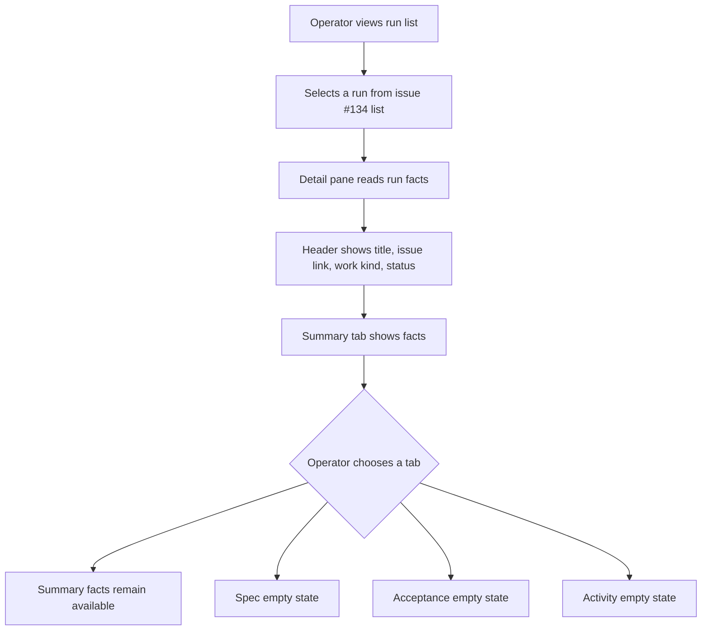
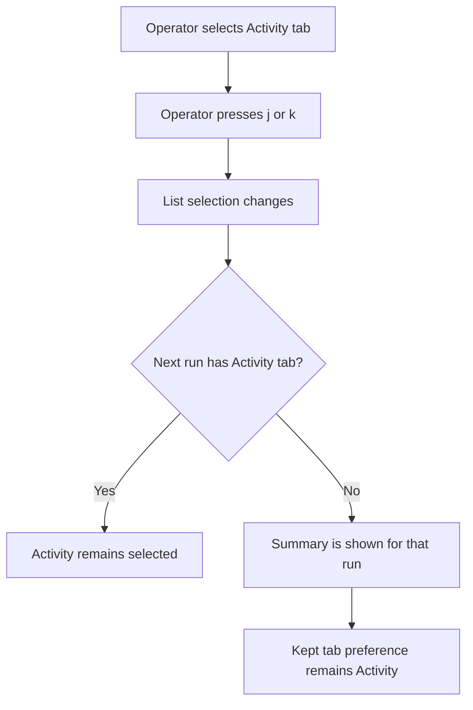
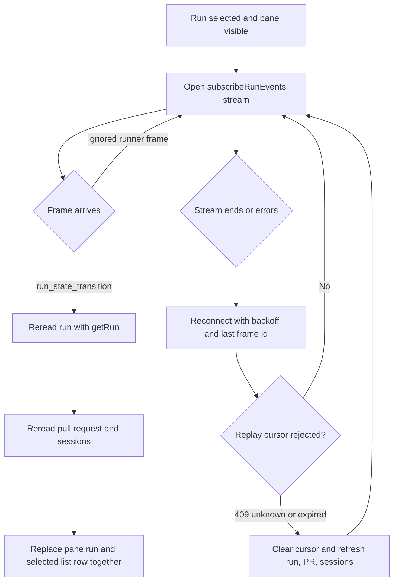
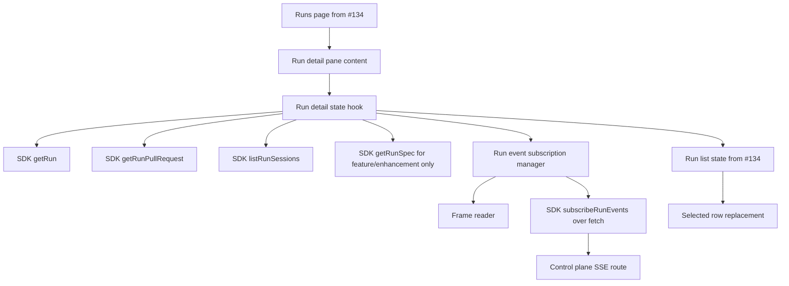
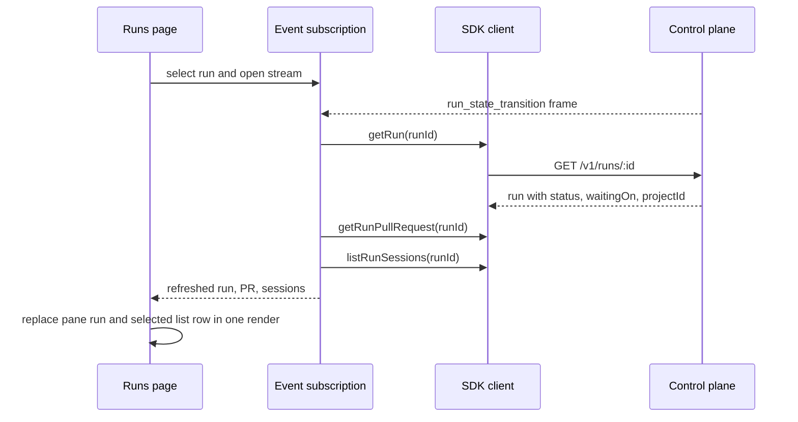
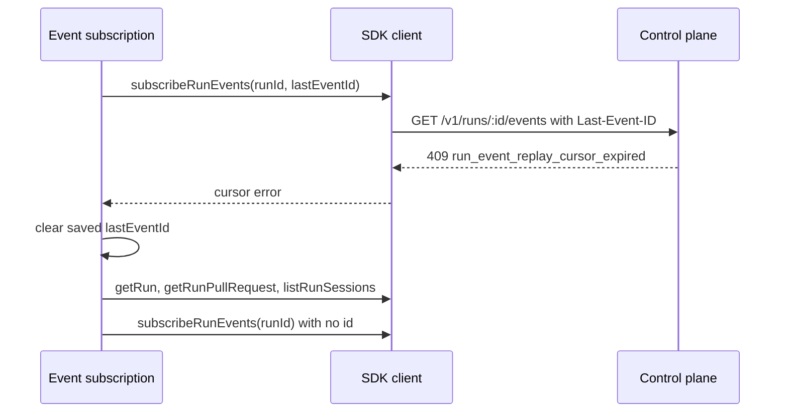

# Run detail pane

## What

Autocatalyst will fill the existing run detail pane with the selected run's current standing. When an operator selects a run, the pane shows a run header, a stable four-tab model, Summary facts, and live status changes from the control plane event stream.

The header identifies the run by its tracked issue when one exists, or by run id when it does not. The Summary tab answers where the run stands now: issue, work kind, state, pull request, elapsed completed-session time, tokens, and cost. The Spec, Acceptance, and Activity tabs are present for every run and show clear empty states until later features render those artifacts.

This feature is content-only for the pane. It depends on issue #134 for the pane region, toggle, resize handle, row selection, and list updates.

## Why

Operators need a selected run to explain itself without leaving the run list. Today the list can show that a run exists and is selected, but it does not give enough context to decide whether the run is waiting on the operator, still working, failed, or tied to a pull request.

A predictable pane with the same tabs on every run lets operators move through runs quickly. Live updates keep the pane and selected row trustworthy while a run advances, without forcing a reload or waiting for list polling.

## Personas

- **Phoebe: PM** - Reviews the run's status and spec readiness, especially when the run waits for human approval.
- **Enzo: Engineer** - Checks state, failures, pull requests, cost, and activity placeholders while validating implementation progress.
- **Dani: Designer** - Uses consistent pane structure and empty-state explanations to understand whether a review artifact is ready.

## Narratives

### Reviewing a run waiting at spec review

Phoebe opens the run list and selects the seeded spec-review run. The detail pane shows the issue title, issue link, feature work kind, and a status chip that says the run is waiting on her. She reads the Summary to confirm the current step and sees the time, token, and cost totals without a progress bar distracting from the facts.

She clicks Spec and sees a short empty state explaining that the spec is ready but this view does not render it yet. She clicks Acceptance and Activity and sees equally short explanations for why those tabs are empty and what will happen later. When she selects Activity and moves to the next run with the keyboard, Activity stays selected.

### Following a run while it advances

Enzo selects a running feature run and leaves the pane open while the control plane moves it forward. The browser keeps one event stream open for that selected run. When a run_state_transition frame arrives, the client treats it as a trigger, rereads the run, pull request, and sessions, and updates both the pane and the selected list row together.

If the stream disconnects, Enzo does not see stale data presented as current. The client reconnects with backoff and resumes from the last received frame. If the server cannot replay from that cursor, the client clears the cursor, refreshes the run facts with ordinary reads, and opens a fresh stream.

### Checking pull request and failure facts

Enzo selects the pr-open and merged fake-mode scenarios. The Summary tab shows the pull request number, state, and link when the run has one, and a dash when it does not. Then he selects a failed run and sees the failure reason on the state line.

The totals are computed from durable sessions. Completed-session durations contribute to time, all token classes contribute to a compact token total, and cost remains exact by summing integer nano-dollar values before display. When any session lacks a priced cost, the cost line says unknown instead of showing a misleading partial total.

## User stories

**Reviewing a run waiting at spec review**

- Phoebe can see the selected run's title, issue link, work kind, and status in the pane header.
- Phoebe can open the same four tabs on every run: Summary, Spec, Acceptance, and Activity.
- Phoebe can keep her selected tab while moving through the run list.
- Phoebe can understand why a non-Summary tab is empty and what happens next.

**Following a run while it advances**

- Enzo can select a run and see its state update from the event stream without reloading.
- Enzo can trust that transition events trigger a fresh run read instead of replacing the run with incomplete event payloads.
- Enzo can recover from event-stream replay loss without stale pane data.
- Enzo can hide the pane knowing the selected run stream closes and show it again knowing the facts refresh.

**Checking pull request and failure facts**

- Enzo can see a run's pull request link and state when one exists.
- Enzo can see a dash when the run has no pull request and an inline error when the pull request read fails.
- Enzo can see completed-session time, token totals, and cost status.
- Enzo can see a failed run's failure reason.

## Goals

- The detail pane renders a non-blank header and tab body for every selected run scenario.
- Summary facts load independently, so one failed read does not blank unrelated facts.
- State changes from run_state_transition events appear in the pane and selected list row within one render after the client rereads the run.
- The client maintains at most one selected-run event stream and aborts it on selection change, pane hide, and unmount.
- Component, unit, and Playwright coverage verifies header, tabs, Summary facts, empty states, live update recovery, keyboard persistence, and pane geometry.

## Non-goals

- Rendering the full spec document, comments, decision button, or full-screen spec overlay.
- Showing the phase progress bar.
- Implementing the Acceptance testing guide, test results, or Activity event list.
- Refreshing pull request state on selection or by operator action beyond the reads required here.
- Renaming runs, pane action menus, previous/next buttons, or position controls.
- Building the pane region, toggle, resize handle, or list selection from issue #134.

## Design spec

### User flows

#### Select and inspect a run

#### Keep tab while navigating runs

Every run in this feature has all four tabs, but the tab model must accept a per-run tab list and preserve the fallback rule for future item types.

#### Live update selected run

### Key UI components

#### Run detail header

- Shows the tracked issue title as the title when present; otherwise shows the run id.
- Shows the issue number as an external link only when trackedIssue exists. The link opens in a new tab with `rel="noopener noreferrer"`.
- Shows the work kind chip and status on the meta line. It never shows the project name.
- Uses the design-system Detail pane header rules: title in `--text-lg`, meta in `--text-sm`, work kind chip in the established chip style, and status as either the waiting chip for in-progress runs or status word for terminal runs.

#### Tabs wrapper

- Add the web client's own `Tabs` wrapper around the Base UI primitive, following the wrapper convention from issue #131. Screens import this wrapper, not `@base-ui/react` directly.
- Render tabs in this order: Summary, Spec, Acceptance, Activity.
- Tabs carry no counts and are enabled for every run.
- Selected tab uses the design-system selected underline and exposes `aria-selected="true"`. Arrow-key movement is provided by the wrapper.

#### Summary facts

- Summary is a compact fact list, not a progress view. It shows issue, work kind, state, pull request, time, tokens, and cost.
- Each fact has its own loading, success, and error rendering so one failed read does not hide other facts.
- The state fact combines status, human-readable waiting text, current step, and failure reason when failed.
- The pull request fact links to the pull request when `getRunPullRequest` returns one, shows a dash on `404`, and shows an inline error on other failures.
- Token breakdown appears in a tooltip on the compact token total. Cost unknown reasoning appears in a tooltip when any session has `cost.usd: null`.

#### Empty tab states

- Empty states follow the design system: centered, title in `--text-md`, one explanatory line in `--text-sm` and `--color-subtext`, no button, and no illustration.
- Empty-state titles and lines live in one module so component tests assert against that module instead of duplicating wording.
- Spec has three variants: work kind has no spec, spec is being drafted, and spec is ready but not rendered in this view yet.
- Acceptance and Activity each have one run-independent empty state.

### Visual references

No external mockup is required. The feature composes the existing run list and detail pane from issue #134 with the rules in `context-agent/wiki/design-system.md` under Detail pane, Status and waiting indicators, Empty states, and Playwright geometry assertions.

## Tech spec

### Introduction and overview

#### Prerequisites and assumptions

- Issue #134 provides the pane region, pane toggle and `]` shortcut, resize handle, run selection, selected list row update path, and geometry baseline.
- Issue #132 provides connection settings and the connection page used on authorization failure.
- Issue #129 proves browser stream reading with `fetch` and SDK `subscribeRunEvents`.
- Issue #133 adds `status`, `waitingOn`, and `projectId` to list/get/reply run responses. Run events still do not carry `status` or `projectId`.
- The feature uses the typed SDK only: `getRun`, `getRunPullRequest`, `listRunSessions`, `getRunSpec`, and `subscribeRunEvents`.
- The Spec tab calls `getRunSpec` only for `feature` and `enhancement` runs. The work kinds with specs are declared in one `apps/web` table with a comment citing `specArtifactKindForRun` in `packages/core/src/control-plane-service.ts:262-266`.
- ADR-031 requires the web client to be stateless for run state. ADR-032 requires React, Tailwind, Base UI behind wrappers, Vitest, and Playwright.

#### Goals and objectives

- Provide run detail content with no backend contract changes.
- Keep the pane and list row in sync after transition frames by replacing data from `getRun`, never from raw event payloads.
- Avoid stale-current presentation after replay cursor loss by refreshing run, pull request, and sessions before resubscribing without a cursor.
- Keep cost and token totals exact by summing integer fields.

#### Non-goals

- No database migrations, new API endpoints, or SDK method additions.
- No rendering of spec Markdown, comments, acceptance tests, or activity timelines.
- No global connection-lost indicator for selected-run event stream outages.

#### Glossary

- **Detail pane**: The complementary region named "Run detail" built by issue #134.
- **Frame**: One parsed server-sent event with optional `id`, event name, and data.
- **Replay cursor**: The last event id sent back on reconnect so the server can replay missed events.
- **Terminal run**: A run whose `terminal` field is true.

### System design and architecture

#### High-level architecture

The pane content should be split into pure helpers, data hooks, and display components. Pure helpers handle tab fallback, waiting labels, summary totals, cost formatting, spec-work-kind checks, empty-state copy selection, and SSE frame parsing. React hooks own side effects: initial reads, independent fact states, and the event subscription lifecycle.

#### Component breakdown

- `ui/tabs` wrapper: Thin wrapper around Base UI Tabs using design-system styles and keeping primitive imports centralized.
- Run detail header component: Receives a run-like view model and renders title/meta/status.
- Run detail tab model: Defines the four tab ids, labels, per-run availability, kept selected tab, and fallback to Summary.
- Summary component: Renders fact rows and delegates totals to pure helper functions.
- Empty states module: Exports copy descriptors for Spec variants, Acceptance, and Activity.
- Spec tab component: Chooses the correct empty state and conditionally probes `getRunSpec` for feature/enhancement only.
- Run events frame reader: Parses `ReadableStream` chunks into SSE frames and validates frame data with `clientRunEventSchema`.
- Run events reconnect module: Opens, aborts, reconnects, handles cursor errors, and emits transition triggers.
- Detail-pane data hook: Coordinates selected-run reads, fact states, event triggers, and callbacks into the list state.

#### Sequence: transition frame updates pane and row

#### Sequence: replay cursor lost

### Detailed design

#### Data model and schema

No database or API schema changes are required. The feature consumes existing SDK response shapes.

#### API contracts consumed

- `GET /v1/runs/:id` through `getRun`: authoritative run read. Used on selection, pane show, and every transition trigger.
- `GET /v1/runs/:id/pull-request` through `getRunPullRequest`: Summary pull request fact. A `404` is a normal no-PR state. Other errors render inline for that fact.
- `GET /v1/runs/:id/sessions` through `listRunSessions`: Summary totals.
- `GET /v1/runs/:id/spec` through `getRunSpec`: Spec empty-state discriminator for `feature` and `enhancement` only. A `404` means the spec is still being drafted or no spec artifact exists yet. A success means the spec is ready but not rendered here yet.
- `GET /v1/runs/:id/events` through `subscribeRunEvents`: Selected-run stream. Reads frames with bearer-auth `fetch`, not browser `EventSource`.

#### Summary calculations

- Time total: Sum `durationMs` for sessions where `durationMs` is not null. Exclude running sessions. If the run has no sessions, show a dash.
- Token total: Sum `input`, `output`, `cacheRead`, and `cacheWrite` across sessions. Show compact total with tooltip breakdown. If the run has no sessions, show a dash.
- Cost total: If no sessions, show a dash. If any session has `cost.usd: null`, show `unknown` and a tooltip explaining a model has no configured rate. Otherwise sum `usd` as integers and convert nano-dollars to dollars only for display.
- Floating point is not used for sums. Tests include a value that would drift under floating-point addition.

#### Event frame reader

The reader accepts a `ReadableStream<Uint8Array>` and yields parsed frames:

1. Decode chunks incrementally.
2. Normalize CRLF and LF line endings.
3. Buffer partial frames across chunks.
4. Ignore comment lines beginning with `:`.
5. Support `id:`, `event:`, and multi-line `data:` fields.
6. Emit a final buffered frame even when the stream ends without a trailing blank line.
7. Parse data with `clientRunEventSchema`. If parsing fails, drop the frame, log once for that failure mode, and keep reading.

Runner frames are ignored by this feature. `run_state_transition` frames trigger a full refresh.

#### Reconnect behavior

- A selected visible run opens exactly one stream. Selection changes, pane hide, and unmount abort the existing stream.
- Reconnect on stream end or non-terminal error. Delay starts at `RUN_EVENTS_RECONNECT_DELAY_MS` and doubles up to `RUN_EVENTS_RECONNECT_MAX_DELAY_MS`. Both are named constants.
- Reset the backoff after any valid frame arrives.
- Resume with the last received frame id.
- On `409` with `run_event_replay_cursor_unknown` or `run_event_replay_cursor_expired`, clear the saved id, refresh run, pull request, and sessions through ordinary reads, then subscribe again with no id.
- On `401`, stop reconnecting and navigate to the connection page from issue #132.
- On `404` for the run, stop reconnecting and show that the run is no longer available.
- Once the refreshed run is terminal, show its final state and stop reconnecting.
- While the selected-run stream is down and reconnecting, the pane shows no extra warning. The footer connection indicator remains driven only by health/list failures from issues #132/#134.

### Security, privacy, and compliance

- All reads go through the typed SDK and existing bearer-token client provider. No token appears in a URL, DOM text, accessible name, log, or test fixture output.
- External issue and pull request links open with `target="_blank"` and `rel="noopener noreferrer"`.
- Event parse errors are logged without frame data that could contain run content. Log only safe metadata such as frame event type when known and validation failure category.
- The feature performs no writes and adds no new authorization decisions. Existing control-plane policies apply to each read.

### Observability

- Client-side logs are limited to dropped malformed frames and reconnect failures that are not expected cursor-loss cases.
- Logs must not include bearer tokens, raw SSE data, issue bodies, spec content, or provider details.
- No new server metrics are required.

### Testing plan

- Unit tests for tab fallback and kept-tab behavior, including a synthetic run that lacks a tab.
- Unit tests for Summary calculations: completed-session time, token breakdown, all-priced cost, one-unpriced cost, no sessions, and integer-exact cost sum.
- Unit tests for spec-work-kind table covering `bug`, `chore`, `file_issue`, and `question`, and proving `getRunSpec` is not called for those kinds.
- Component tests with a scripted SDK client for the header, each Summary fact, empty states, loading states, failed fact reads, kept tab, and vanished-tab fallback.
- Unit tests for frame reader chunks, comments, CRLF, final frame without trailing blank, schema rejection, and log-once behavior.
- Unit tests for stream lifecycle: abort previous selection, abort on unmount, reconnect backoff, reset after frame, resume id, 409 unknown/expired recovery, 401 connection navigation, 404 run gone, and terminal stop.
- Playwright tests against fake mode for seeded scenarios `spec-review`, `implementation-review`, `pr-open`, `merged`, and `failed`, using production paths and no test-only hooks.
- Playwright live-update test approving spec with `replyToRun` and observing state-line change without reload or list-poll wait.
- Playwright restart test stopping fake-mode control plane and restarting on the same port and state directory without `serve-fake`, then verifying pane catch-up.
- Playwright geometry tests for header, meta line, tabs, and pane body scrolling at default, minimum, and maximum widths.
- No test makes a model call.

### Alternatives considered

- **Use event payloads as authoritative state.** Rejected because transition frames carry the orchestrator's raw run and omit `status`, `waitingOn`, and `projectId`. Rereading the run preserves list row fields and keeps client state aligned with the API.
- **Use browser `EventSource`.** Rejected because the event route requires a bearer header and `EventSource` cannot send it. The SDK `subscribeRunEvents` with `fetch` is the supported browser path.
- **Show a stream-down warning in the pane/footer.** Rejected for this issue because the footer connection indicator represents health/list connectivity, not the selected-run event stream. The pane refresh and reconnect logic prevents stale-current display without adding a second connection signal.

### Risks

- SSE parsing and reconnect logic is easy to get subtly wrong; mitigate with focused reader and fake-timer tests.
- Pull request and session reads can fail independently; mitigate by fact-level error rendering and tests that one failed read does not blank other facts.
- The Spec tab has workflow edge cases because bugs have a `spec.author` step but no API-served spec; mitigate with the explicit work-kind table and citation comment.
- Fake-mode restart Playwright coverage can be flaky if state directories are cleared accidentally; mitigate by starting the production entrypoint directly on the same state directory and not using the `serve-fake` target for restart.

## Task list

- [ ] **Story: Establish run detail tab and header structure**
  - [ ] **Task: Add the client Tabs wrapper**
    - **Description**: Create the web client's `Tabs` wrapper around the Base UI primitive, style it with the design-system tab rules, and keep direct primitive imports inside the wrapper module only.
    - **Acceptance criteria**:
      - [ ] Screens import the client wrapper instead of `@base-ui/react` directly.
      - [ ] Selected tabs expose `aria-selected="true"` and the selected underline style.
      - [ ] Arrow-key tab movement works through the wrapper.
      - [ ] Wrapper tests cover selection and keyboard movement.
    - **Dependencies**: None
  - [ ] **Task: Implement the run detail header**
    - **Description**: Render title, issue link, work kind chip, and status for the selected run, using tracked issue data when present and run id fallback when absent.
    - **Acceptance criteria**:
      - [ ] Tracked runs show issue title, linked issue number, work kind, and status.
      - [ ] Issue links open in a new tab with `rel="noopener noreferrer"`.
      - [ ] Runs without `trackedIssue` show run id as the title and no issue link.
      - [ ] The header shows no project name.
      - [ ] Header component tests cover tracked and untracked runs.
    - **Dependencies**: None
  - [ ] **Task: Implement the four-tab model with kept selection**
    - **Description**: Define Summary, Spec, Acceptance, and Activity tabs in order; preserve the selected tab across run selection changes; fall back to Summary for runs missing the kept tab without changing the kept choice.
    - **Acceptance criteria**:
      - [ ] All four tabs render in order, enabled, and without counts for every run in this feature.
      - [ ] Selected tab persists when the selected run changes.
      - [ ] A unit test covers a synthetic run missing the kept tab and verifies Summary fallback without losing the kept choice.
      - [ ] A Playwright test selects Activity, presses `j`, and sees Activity selected on the next run.
    - **Dependencies**: "Task: Add the client Tabs wrapper"

- [ ] **Story: Render Summary facts**
  - [ ] **Task: Build Summary fact layout and independent loading states**
    - **Description**: Add the Summary tab fact list for issue, work kind, state, pull request, time, tokens, and cost, with per-fact loading and error states.
    - **Acceptance criteria**:
      - [ ] Summary shows all required facts and no progress bar.
      - [ ] While facts load, each affected fact shows a loading state.
      - [ ] A failed read shows an inline message on that fact and does not blank the others.
      - [ ] Component tests cover loading, success, and failure combinations.
    - **Dependencies**: "Task: Implement the four-tab model with kept selection"
  - [ ] **Task: Implement state and pull request facts**
    - **Description**: Render status, waiting text, current step, failure reason, and pull request number/state/link using `getRunPullRequest` and normal 404 handling.
    - **Acceptance criteria**:
      - [ ] In-progress runs show status plus "Waiting on you" for `human` and "Working" for `ai` or `system`, with current step.
      - [ ] Failed runs show `failureReason`.
      - [ ] Pull request row links to number and state when one exists.
      - [ ] Pull request row shows a dash on `404` and an inline error on other failures.
      - [ ] Component or Playwright coverage includes `pr-open`, `merged`, no-PR, and failed scenarios.
    - **Dependencies**: "Task: Build Summary fact layout and independent loading states"
  - [ ] **Task: Implement time, token, and cost totals**
    - **Description**: Add pure integer-based helpers and UI rendering for completed-session duration, token totals with breakdown tooltip, and nano-dollar cost totals.
    - **Acceptance criteria**:
      - [ ] Time sums only non-null `durationMs` values and shows a dash for no sessions.
      - [ ] Tokens sum all four token classes and show compact total plus breakdown tooltip.
      - [ ] Cost sums integer nano-dollar `usd` values and converts to dollars only for display.
      - [ ] Any null `usd` makes cost read `unknown` with the missing-rate tooltip and no partial sum.
      - [ ] Unit tests cover all-priced, one-unpriced, no sessions, and a floating-point drift sentinel.
    - **Dependencies**: "Task: Build Summary fact layout and independent loading states"

- [ ] **Story: Render Spec, Acceptance, and Activity empty states**
  - [ ] **Task: Centralize empty-state copy and component rendering**
    - **Description**: Create one module for empty-state descriptors and one reusable tab empty-state component that follows the design-system pattern.
    - **Acceptance criteria**:
      - [ ] Empty states use title `--text-md`, one explanatory line `--text-sm` in `--color-subtext`, no button, and no illustration.
      - [ ] Spec variants, Acceptance copy, and Activity copy live in one module.
      - [ ] Component tests assert rendered copy through exported descriptors instead of duplicated strings.
    - **Dependencies**: "Task: Implement the four-tab model with kept selection"
  - [ ] **Task: Implement Spec tab empty-state selection**
    - **Description**: Add the `apps/web` work-kind table for spec-capable runs, skip `getRunSpec` for all other work kinds, and choose the correct Spec empty state based on work kind and `getRunSpec` result.
    - **Acceptance criteria**:
      - [ ] The spec-capable work-kind table includes only `feature` and `enhancement` and has a comment citing `specArtifactKindForRun` in `packages/core/src/control-plane-service.ts:262-266`.
      - [ ] `bug`, `chore`, `file_issue`, and `question` show the no-spec empty state without calling `getRunSpec`.
      - [ ] Feature/enhancement `404` shows the spec-being-drafted empty state.
      - [ ] Feature/enhancement success shows the spec-ready-but-not-rendered empty state.
      - [ ] Unit tests cover all listed work kinds and both feature/enhancement outcomes.
    - **Dependencies**: "Task: Centralize empty-state copy and component rendering"
  - [ ] **Task: Implement Acceptance and Activity empty states**
    - **Description**: Render run-independent empty states for Acceptance and Activity.
    - **Acceptance criteria**:
      - [ ] Acceptance says the testing guide is not available for this run and points the operator to review the pull request instead.
      - [ ] Activity says this view does not list steps and events yet and that they will appear there later.
      - [ ] A component test renders every tab for each fake-mode scenario's run and asserts each tab has content or an empty state.
    - **Dependencies**: "Task: Centralize empty-state copy and component rendering"

- [ ] **Story: Subscribe to selected-run live updates**
  - [ ] **Task: Implement the SSE frame reader**
    - **Description**: Build a pure frame reader for `ReadableStream` input that handles split chunks, comments, CRLF, final frames, data parsing, and schema validation with `clientRunEventSchema`.
    - **Acceptance criteria**:
      - [ ] Frames include id, event name, and parsed data.
      - [ ] Frames split across chunks parse correctly.
      - [ ] Comment lines and CRLF line endings are handled.
      - [ ] A final frame without trailing blank line is emitted.
      - [ ] Invalid frames are dropped and logged once without closing the stream.
    - **Dependencies**: None
  - [ ] **Task: Implement selected-run event subscription lifecycle**
    - **Description**: Open one `subscribeRunEvents` stream for the selected visible run, abort previous streams on selection change, pane hide, and unmount, and ignore non-transition frames for this feature.
    - **Acceptance criteria**:
      - [ ] Selecting a run opens exactly one stream for that run.
      - [ ] Changing selection aborts the prior stream's `AbortSignal`.
      - [ ] Hiding the pane closes the stream; showing it rereads the run and opens one new stream.
      - [ ] Unit tests with a scripted SDK client cover selection change, hide/show, and unmount.
    - **Dependencies**: "Task: Implement the SSE frame reader"
  - [ ] **Task: Refresh pane facts and list row on transition frames**
    - **Description**: Treat `run_state_transition` as an invalidation trigger that rereads the run, pull request, and sessions, then replaces the pane run and selected list row together.
    - **Acceptance criteria**:
      - [ ] The client never copies `status`, `waitingOn`, or `projectId` from the transition frame payload.
      - [ ] A transition refresh updates the pane and selected list row within one render.
      - [ ] The selected list row keeps `status`, `waitingOn`, and `projectId` from the `getRun` response.
      - [ ] A unit test feeds a frame without `status` and verifies the pane shows the reread run's status.
    - **Dependencies**: "Task: Implement selected-run event subscription lifecycle"
  - [ ] **Task: Implement reconnect, cursor loss, and terminal handling**
    - **Description**: Add reconnect backoff constants and behavior, resume ids, cursor-loss recovery, authorization/not-found stops, and terminal-run stop logic.
    - **Acceptance criteria**:
      - [ ] `RUN_EVENTS_RECONNECT_DELAY_MS` and `RUN_EVENTS_RECONNECT_MAX_DELAY_MS` control exponential backoff.
      - [ ] Reconnect resumes with the last received frame id.
      - [ ] Backoff resets after a valid frame arrives.
      - [ ] `409` cursor unknown and expired both clear the saved id, refresh run/PR/sessions, and resubscribe without an id.
      - [ ] `401` stops reconnecting and goes to the connection page.
      - [ ] `404` stops reconnecting and shows that the run is no longer available.
      - [ ] Terminal refreshed runs stop reconnecting and show final state.
      - [ ] Fake-timer tests cover delays, reset, resume id, both 409 codes, 401, 404, and terminal stop.
    - **Dependencies**: "Task: Refresh pane facts and list row on transition frames"

- [ ] **Story: Cover fake-mode scenarios, geometry, and docs map**
  - [ ] **Task: Add component and unit coverage for pane content**
    - **Description**: Expand Vitest coverage for header, tabs, Summary facts, empty states, tab persistence, stream lifecycle, and pure helpers with a scripted SDK client.
    - **Acceptance criteria**:
      - [ ] Header tests cover tracked and untracked runs.
      - [ ] Summary tests cover every fact and the three cost cases.
      - [ ] Empty-state tests cover every variant.
      - [ ] Kept-tab and vanished-tab rules are covered.
      - [ ] No component or unit test makes a model call.
    - **Dependencies**: "Story: Establish run detail tab and header structure", "Story: Render Summary facts", "Story: Render Spec, Acceptance, and Activity empty states", "Story: Subscribe to selected-run live updates"
  - [ ] **Task: Add Playwright scenario and live-update coverage**
    - **Description**: Add production-path Playwright tests against fake mode for seeded scenarios, keyboard persistence, stream-driven state changes, and control-plane restart recovery.
    - **Acceptance criteria**:
      - [ ] Scenario test opens `spec-review`, `implementation-review`, `pr-open`, `merged`, and `failed` without test-only hooks or API data injection around the app.
      - [ ] Scenario assertions cover header, state line, PR row, and failed failure reason.
      - [ ] A live-update test starts fake mode on a free port with fresh state, seeds `spec-review`, approves with `replyToRun`, and sees the state line change without reload or poll wait.
      - [ ] A restart test stops the fake-mode control plane and starts it again on the same port and state directory without `serve-fake`, then sees the pane catch up.
      - [ ] No Playwright test makes a model call.
    - **Dependencies**: "Task: Add component and unit coverage for pane content"
  - [ ] **Task: Extend pane geometry assertions**
    - **Description**: Add or update Playwright geometry assertions for pane header, meta line, tabs, and body scrolling under the pane bar at default, minimum, and maximum pane widths.
    - **Acceptance criteria**:
      - [ ] Header title, meta line, and tabs follow Detail pane alignment rules.
      - [ ] Pane body scrolls under the pane bar.
      - [ ] Assertions pass at default, minimum, and maximum widths.
      - [ ] Existing #134 geometry assertions remain green.
    - **Dependencies**: "Task: Add Playwright scenario and live-update coverage"
  - [ ] **Task: Update agent navigation docs for new modules**
    - **Description**: Update `context-agent/wiki/code-map.md` with the pane content modules, Summary fact helpers, frame reader, reconnect module, and reconnect constants. Update the design-system Empty states section only if implementation adds a new rule.
    - **Acceptance criteria**:
      - [ ] Code map records the new pane, Summary facts, frame reader, reconnect module, and constants.
      - [ ] Design system is unchanged unless a new reusable empty-state rule is introduced.
      - [ ] Documentation changes describe navigation, not implementation prose beyond what future agents need.
    - **Dependencies**: "Task: Extend pane geometry assertions"
