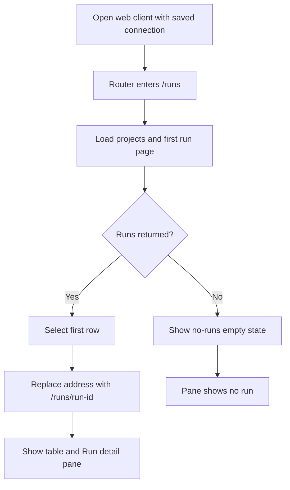
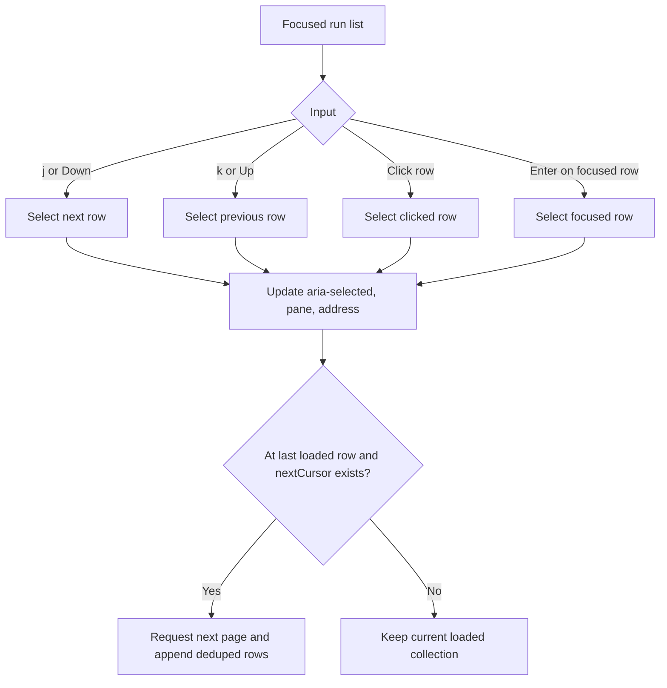
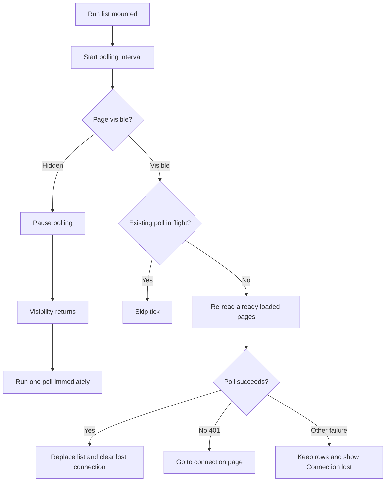
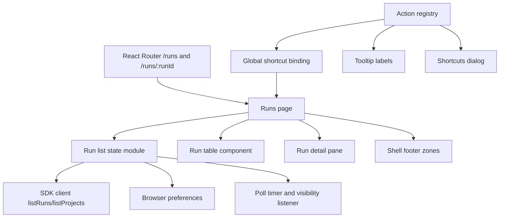
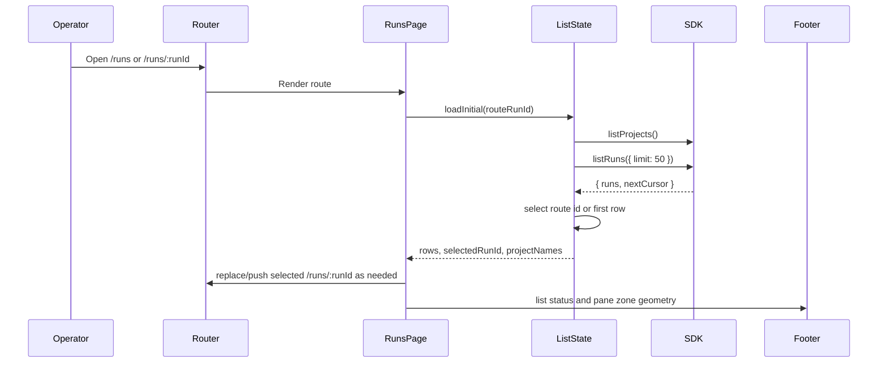

# Run list and selection

## What

The web client will give operators the first complete runs collection screen. When an operator opens the client with a saved connection, they see every run returned by the control plane in one table, with exactly one run selected whenever rows exist. The selected run is reflected in the address as `/runs/<run id>`, can be moved with the keyboard or pointer, and drives a detail pane beside the list that shows the selected run id and title.

The feature also turns the shell prepared by earlier work into a usable run-navigation surface. It enables the detail pane region and toggle, introduces the shared action registry and shortcuts overlay, keeps the run list current by polling, and pages in more runs as the operator reaches the end. The list remains the one implicit all-runs view: no named views, grouping, sorting, filters, To do, pinned views, row action menu, or density switch are included.

## Why

Operators need a dependable place to orient themselves before they can review or manage work. Without a live all-runs view, the web client shell exists but does not answer the first operational question: what is running, what needs me, and which run am I looking at?

This feature makes the collection navigable and current while keeping the scope narrow. It preserves the collection model of one array of runs, gives keyboard-first movement, and creates the pane and action infrastructure later run-detail work will build on.

## Personas

- **Phoebe (PM)** - Opens the client to see which feature or enhancement runs need attention and moves through runs quickly from the keyboard.
- **Enzo (Engineer)** - Monitors implementation and review runs, checks status and waiting state, and uses stable URLs to return to a specific run.
- **Dani (Designer)** - Reviews the current shape of UI-related runs and relies on clear list and pane geometry when comparing several runs.

## Narratives

### Start the day from the runs table

Phoebe opens Autocatalyst after saving her connection. The Runs screen loads the newest runs first and selects the first row, so the detail pane immediately shows the selected run id and issue title. She can see the issue title and number, work kind, status, waiting state, project, and age without opening anything else.

A run waiting on her stands out with the design system's primary-filled signal, while completed and failed runs use status words and dots rather than color alone. Phoebe presses `j` to move down the table and sees the selection, address, and pane change together. Pressing the browser back button returns to the prior selected run.

### Keep watching while work changes

Enzo leaves the runs screen open while fake mode or the control plane advances runs. The list polls every five seconds because there is no change feed, recomputes ages during those polls, and updates changed status, waiting state, and titles without a page reload. If the selected run is still present, the list does not move his selection or scroll position.

When another run appears at the top, Enzo sees it on the next poll. If the server becomes unavailable, the previous rows stay visible and the footer's list zone shows Connection lost. When a later poll succeeds, the connection indicator clears.

### Navigate the collection and pane

Dani uses the table as one tab stop. The selected row is the list's roving tab stop, and `j`, `k`, Down, and Up move selection only while focus is inside the list; moving selection by key moves focus with it. Initial load, polls, and paging never steal focus, so browser tests focus the list first with Tab or a row click before pressing navigation keys. The single-key registry guards still apply, so `j` and `k` do nothing from text entry, editable content, outside the list, or while a menu or dialog is open.

When she needs more room, she presses `]` to hide the detail pane, presses it again to show the pane, and drags or keyboard-resizes the separator. The footer detail-pane zone follows the pane edge, and the pane, handle, table header, and footer geometry continue to align in light and dark themes with the sidebar open or closed.

## User stories

**Start the day from the runs table**

- Phoebe can open the client and see the first page of all runs in newest-first order.
- Phoebe can identify each row by issue title and number, or by run id when no tracked issue exists.
- Phoebe can see work kind, status, waiting state, project name, and age for each run.
- Phoebe can rely on exactly one selected row when runs exist.
- Phoebe can use the browser address and back button to move between selected runs.

**Keep watching while work changes**

- Enzo can leave the screen open and see changed run fields after polling.
- Enzo can keep his current selection and scroll position when the selected run remains in the list.
- Enzo can see newly created runs appear at the top after a poll.
- Enzo can keep working from stale rows when a poll fails and see the footer report lost connection.
- Enzo can load more runs without a button by reaching the end of the loaded list.

**Navigate the collection and pane**

- Dani can move selection with `j`, `k`, Down, and Up under the documented focus and guard rules.
- Dani can click or press Enter on a focused row to select it.
- Dani can open a shortcuts overlay that reads the same registry as tooltips.
- Dani can show, hide, and resize the side detail pane and have those preferences persist safely.
- Dani can rely on the pane showing only the selected run id and issue title for this feature.

## Goals

- Load the first run page with `listRuns({ limit: RUN_LIST_PAGE_SIZE })`, where `RUN_LIST_PAGE_SIZE` is 50, and render one row per returned run in server order.
- Maintain exactly one selected row for every non-empty list across initial render, keyboard and pointer selection, address changes, polling updates, and paging.
- Poll loaded pages on `RUN_LIST_POLL_INTERVAL_MS` of 5000 ms without overlapping requests, with hidden-page pause and visible-page refresh behavior covered by fake-timer tests.
- Page additional results only when the operator reaches the end and `nextCursor` exists, with duplicate run ids deduplicated.
- Deliver component and Playwright coverage for table cells, selection, polling, paging, empty/loading/error states, shortcuts, pane behavior, and geometry, without model calls.

## Non-goals

- Named views, saved views, view chips, grouping, sorting, filters, To do, Pinned, or row density controls.
- Detail pane tabs, header content, decision controls, expanded/full-page mode, bottom pane, or live selected-run event content.
- Row action menus or run actions.
- Start-run controls, no-projects empty state, or a Start a run button in the no-runs state.
- A change feed or server-side changes beyond using the SDK APIs provided by dependent issues.

## Design spec

### User flows







```mermaid
graph TD
    A[Operator presses ?] --> B[Open shortcuts dialog]
    B --> C[Read actions from registry]
    C --> D[List key caps and names]
    D --> E[Escape closes top layer]
    A2[Operator presses ]] --> F[Toggle detail pane]
    F --> G[Persist shown or hidden preference]
    H[Operator drags or arrow-resizes separator] --> I[Clamp pane width to design-system limits]
    I --> J[Persist width preference]
    J --> K[Footer detail-pane zone follows pane edge]
```

### Key UI components

#### Runs table

- Purpose: The single implicit all-runs collection view. It renders the loaded run array in the order returned by `listRuns`, newest first.
- Columns, in order: title, work kind, status, waiting on, project, age. The header row is sticky and has the same height as the pane bar.
- Title cell: Shows a status dot, tracked issue title, and issue number. If `trackedIssue` is absent, it uses the run id in place of both title and number and does not assume an issue exists.
- Status and waiting cells: Use design-system status indicators and text labels. Waiting on human is the only primary-filled signal in the list. Ended runs show a dash in the waiting column.
- Rows: Regular density only, `--height-row-regular` high. Hover, selected, and focus styles follow the design system. No row action ellipsis appears.
- Accessibility: The list is one tab stop. Exactly one row has `aria-selected="true"` when rows exist. Rows are focusable; Enter selects the focused row.

#### Run detail pane region

- Purpose: A side region that reflects the selected row and establishes the detail pane layout for later run-detail work.
- Semantics: `role="complementary"` with accessible name "Run detail".
- Content in this feature: selected run id and issue title only; no tabs; no empty state while the list has a run. With no runs, the pane shows no run.
- Pane bar: Empty, `--height-pane-bar` high, 12 px horizontal padding, and a `--color-border` line below. Its top and bottom align with the table column header row.

#### Detail pane toggle and separator

- On the runs route, the footer right control zone's detail pane toggle is enabled. Its tooltip reads "Detail pane (])". Off the runs route, the footer detail pane zone is zero width, the toggle keeps its final position but is `aria-disabled` as in #132, and `]` is a no-op that does not write preferences.
- On the runs route, the toggle and `]` hide and show the pane. With the pane hidden, the footer detail pane zone is zero width and the toggle stays enabled. Shown/hidden state and width are stored in preferences, and every storage access is guarded with try/catch.
- The resize handle has `role="separator"` and `aria-orientation="vertical"`. Arrow keys resize by 16 px; dragging resizes continuously; width clamps to design-system min, max, and maximum share of the main area.
- The handle uses `--color-border-subtle` by default and `--color-primary` on hover, focus, and drag.

#### Action registry and shortcuts overlay

- A client registry owns each action once: name, key, applies-when rule, and tooltip text. Components do not declare their own keys.
- Registered shell actions: `[`, `]`, `Cmd+,` or `Ctrl+,`, and Escape. Registered selection actions: `j` and `k`, with applies-when rules requiring focus inside the run list plus the shared single-key guards. The overlay-opening `?` action also reads from the registry so the overlay can list all registered actions and no hard-coded extras.
- The shortcuts overlay is built on a new client `Dialog` wrapper around Base UI following the wrapper convention. It opens with `?`, closes with Escape, and displays platform-appropriate key caps.
- Single-key action guard rules block actions in input, textarea, select, editable elements, while a menu or dialog is open, and with modifiers held. The settings toggle remains available everywhere.

#### Loading, empty, and error states

- Without a stored bearer token, the runs page shows the existing connect empty state, makes no `listRuns` or `listProjects` request, and starts no poll timer; existing no-token tests keep passing. With a saved connection, first-page loading shows a loading state in the list region and not the empty state.
- No runs shows the design-system no-runs empty state with a title and one line saying a run starts from a tracked issue. It omits a Start a run button.
- First-page failure shows that runs could not be loaded and that the client will try again on the next poll, alongside the connection-lost indicator.

## Tech spec

### 1. Introduction and overview

#### Prerequisites and assumptions

- Depends on #128 fake mode and seeded scenarios, #132 shell/footer/settings/connection, and #133 enriched run list responses and paging.
- Uses the web-client architecture and stack decisions in ADR-031 and ADR-032.
- Uses `context-human/concepts/collection.md` for the one-array collection and selection rule, and `context-human/concepts/ux.md` for keyboard-first shell and action-registry direction.
- Uses `context-agent/wiki/design-system.md` for row height, pane dimensions, footer zones, focus, keyboard, status, empty-state, and geometry assertions.
- Reads runs through `@autocatalyst/sdk` `listRuns({ limit, cursor, ...filters })` and projects through `listProjects()`. It does not read `projectId` or `status` from run events.
- #142 will add `projectId` filtering, so the list module must accept optional request arguments and pass them through to `listRuns`.

#### Technical goals

- Keep list state in one run collection module that owns initial load, polling, paging, deduplication, project-name joining, and selection reconciliation.
- Keep browser preferences limited to UI preferences: detail pane visibility and width, using the existing guarded preference pattern.
- Avoid overlapping network work for polls and page loads.
- Keep SDK interaction injectable through a scripted SDK client in component tests.
- Preserve #132 shell behavior while replacing temporary shortcut hooks with the action registry, including disabled off-route detail-pane behavior.

#### Non-goals

- No new API endpoints or database schema changes.
- No event-stream use for list updates. The selected run's live event stream belongs to later detail-pane work.
- No virtualized table unless needed by existing project conventions; page size is 50 and regular rows are acceptable for this feature.
- No server-side filtering except request-argument pass-through needed for #142.

#### Glossary

- **Loaded pages**: The first page plus any appended pages the operator has loaded in the current session.
- **Selection reconciliation**: The rule that keeps selection on an existing row after list replacement, or moves it to the following row, or previous row if the removed row was last.
- **Action registry**: The client module that describes all shortcut-driven actions once and feeds handlers, tooltips, and the overlay.
- **Top layer**: An open menu, popover, or dialog that should block ordinary single-key shortcuts.

### 2. System design and architecture



#### Component breakdown

- `runs` route/page: Owns layout composition for table, pane, separator, and empty/loading/error states. Extends routing to `/runs/:runId`; `/runs` selects the first loaded row and replaces the address.
- Run list state module: Exports `RUN_LIST_PAGE_SIZE = 50` and `RUN_LIST_POLL_INTERVAL_MS = 5000` from one module, with a comment explaining polling is used because the API has no change feed. Provides loading, polling, paging, project-name cache, selection reconciliation, and request pass-through.
- Run table components: Render cells, row focus/selection behavior, sticky header, and intersection/end-of-list paging trigger.
- Project-name joiner: Fetches `listProjects` once during load and refetches when a poll or page returns a defined `projectId` not in the known map and not already looked up since the last project fetch. Missing project ids render a dash; undefined `projectId` never triggers refetch.
- Action registry: Replaces #132's temporary shell key hooks. Defines action descriptors and guard predicates; `j`/`k` handlers bind only when focus is inside the run list, while shell handlers bind at the shell scope.
- `Dialog` wrapper: Thin client-owned wrapper around Base UI Dialog, used by shortcuts overlay and future dialogs.
- Detail pane components: Pane region, empty bar, toggle wiring, separator, width clamping, and footer zone alignment on the runs route; off the runs route the footer detail pane zone is zero width and the toggle/`]` remain inert.

#### Primary data-flow sequence



#### Polling sequence

```mermaid
sequenceDiagram
    participant Timer
    participant ListState
    participant SDK
    participant Footer

    Timer->>ListState: interval fires
    alt page hidden
        ListState-->>Timer: pause
    else request in flight
        ListState-->>Timer: skip tick
    else visible and idle
        ListState->>SDK: listRuns({ limit: 50 })
        loop already loaded page count
            SDK-->>ListState: page with nextCursor
            ListState->>SDK: listRuns({ limit: 50, cursor })
        end
        alt success
            ListState->>ListState: replace rows, dedupe, reconcile selection
            ListState->>Footer: clear connection lost
        else 401
            ListState->>RunsPage: authorization becomes unauthorized; navigate to CONNECTION_PATH
        else failure
            ListState->>Footer: show connection lost
        end
    end
```

### 3. Detailed design

#### Data model and schema

No database schema changes are required. The client consumes `Run` fields provided by #133: optional `projectId` and `status`, plus existing `trackedIssue`, `workKind`, `waitingOn`, `currentStep`, `terminal`, and `createdAt`. Client types must keep `projectId` and `status` optional because the contract marks them optional, even though the list route supplies them.

#### API contracts

No new API endpoints are required. The client uses existing SDK methods:

- `listRuns(options?: { limit?: number; cursor?: string; projectId?: string; ...future pass-through filters }) -> { runs: Run[]; nextCursor?: string }`
  - First load calls `listRuns({ limit: RUN_LIST_PAGE_SIZE })`.
  - Page load calls `listRuns({ limit: RUN_LIST_PAGE_SIZE, cursor: nextCursor, ...passThroughArgs })`.
  - Poll re-reads the number of pages already loaded, following returned `nextCursor` values.
  - `400 validation_error` for invalid cursors is treated as a page/poll failure that keeps existing rows and surfaces connection-lost status, except initial load shows first-page failure.
  - `401` routes to the connection page and is not shown as lost connection.
- `listProjects() -> { projects: Project[] }`
  - Called once when the list loads and again when a returned `projectId` is absent from the known project map.

#### Key logic

Connection and no-token behavior:

1. If there is no stored bearer token, `RunsPage` shows the existing connect empty state, makes no `listRuns` or `listProjects` request, and starts no poll timer.
2. If `listRuns` or `listProjects` returns 401, the observing client/provider marks authorization as `unauthorized`; `RunsPage` or the provider navigates to `CONNECTION_PATH`. Polling stops when the route unmounts.
3. A 401 never sets `listLost`; it is an authorization state, not a connection-lost state.

Selection resolution:

1. After first load, if route is `/runs/:runId` and the id exists in loaded rows, select it.
2. If route id is absent, or the route is `/runs`, select the first row if present and replace the address with `/runs/<first id>`. The selected row is the list's roving tab stop.
3. When a user selects a different row, push a new `/runs/<id>` address so browser back returns to the prior selection.
4. When rows are replaced by a poll, keep selected id if it remains. If it vanished, select the row at the removed row's prior index, or the previous row if the removed row was last. If the list is now empty, clear selection and show the no-runs state.
5. Selection state must never refer to a run not present in `rows`. Initial load, polls, and paging never steal focus; when key navigation changes selection, focus moves with the selected row.

Paging:

1. Keep `nextCursor` for the last loaded page and a loaded-page count.
2. Trigger `loadNextPage` when selection moves to the last loaded row or an end sentinel intersects the viewport.
3. Do nothing when `nextCursor` is absent.
4. If a page request is already in flight, do not send another.
5. Append returned rows after deduping by run id against existing rows and within the page.
6. On page failure, keep existing rows, show connection lost, and leave `nextCursor` so the next poll or end trigger can retry.

Connection-lost indicator:

1. Add shell-level connection state, exposed by a small context read by the footer, with two independent booleans: `healthLost` and `listLost`.
2. Refactor `HealthIndicator` so health checks only write `healthLost`.
3. The run list module writes only `listLost`: set it on non-401 initial/page/poll failures that should show stale or unavailable list data, and clear it only after a successful list request/poll/page retry as appropriate.
4. The list module clears `listLost` when the runs page unmounts, because no list source is running off the runs route to maintain that flag. While the operator is off the runs route, the footer follows `healthLost` alone.
5. The footer shows the red dot and "Connection lost" when `healthLost || listLost`. Health success must not clear `listLost`; list success must not clear `healthLost`; runs-route unmount clears only `listLost`.
6. Existing #132 health indicator tests continue to pass, and new tests cover health ok plus poll failing, poll ok plus health failing, each source clearing only its own flag, and navigating from Runs to Settings clearing `listLost` so the indicator follows `healthLost` alone.

Polling:

1. Use one exported interval constant. The module comment states polling is used because the control plane has no change feed for the collection.
2. Start polling after initial load. Use fake-timer-friendly scheduling.
3. Pause while `document.visibilityState === 'hidden'`; when visible again, run one poll immediately.
4. Skip ticks while a poll is in flight.
5. Re-read every page already loaded by following `nextCursor` from page one until the loaded-page count is reached or there are no more pages.
6. Replace the row array with the deduped poll result, update project names for unknown `projectId`s, recompute age strings as part of render from the new poll timestamp, and reconcile selection.

Waiting/status mapping:

- Centralize waiting label mapping in one table in `apps/web`.
- For `status !== 'in_progress'`, waiting cell is a dash.
- For `in_progress`: `human` -> "Waiting on you"; `ai` and `system` -> "Working"; `none` -> dash with tooltip saying nothing is waiting on it.
- Unit tests cover every `waitingOn` value with `in_progress` and with each ended status.

Project-name refetch rule:

- Refetch projects only for a defined `projectId` that is not in the known project map and has not already been looked up since the last project fetch.
- Keep a missing-project id set for ids still absent after a fetch; those rows show a dash and do not trigger another fetch on every poll.
- Clear/rebuild the missing-project id set after a successful project fetch so genuinely new ids can trigger one future refetch.
- Never refetch for `projectId === undefined`; those rows show a dash.

Age formatting:

- Compute from `createdAt` to the latest list timestamp.
- Use shortest unit: minutes, hours, days.
- Use `tabular-nums`.
- Do not create a separate timer; recompute when polls update the timestamp.

Preferences:

- Extend existing preferences with detail pane visibility and side-pane width.
- Every storage read/write remains guarded by try/catch and falls back to defaults on invalid values.
- Width clamps to design-system limits on read and during resize.

Documentation updates:

- Update `context-agent/wiki/code-map.md` with the run list module, constants, and test files.
- Edit `context-agent/wiki/design-system.md` directly: replace the Collection line currently reading "The project column is off by default." with "The project column shows until a view can choose its properties, and is off by default after that."

### 4. Security, privacy, and compliance

- Authentication stays in the existing SDK/client provider. A `401` from list or project calls sends the operator to the connection page and does not expose token details.
- No secrets are displayed. Project names and run metadata are already visible through authenticated APIs.
- All route parameters and cursor values are supplied to the SDK; server-side validation remains authoritative. Client-side handling is for UX only.
- Shortcut handlers must not capture keystrokes from text entry or editable contexts, and `j`/`k` must not move selection unless focus is inside the run list, preventing accidental navigation while entering credentials or settings.
- Dialog and menu top-layer detection prevents background actions from firing while an overlay is active.

### 5. Observability

- No telemetry pipeline changes are required.
- Component state should expose user-visible status through the footer: current list count/loading state and a shell-level connection state context with independent `healthLost` and `listLost` flags. The footer indicator is shown when either flag is set; each source only clears its own flag.
- Errors shown to the operator are generic and safe: runs could not be loaded, connection lost, or connection page for unauthorized.
- Tests should assert no model calls are made; fake mode and scripted SDK clients are the only test data sources.

### 6. Testing plan

- Unit/component tests with a scripted SDK client cover table cells, missing tracked issue fallback, status and waiting mappings, project name joining and bounded refetch, no-token connect state, selection rules, keyboard focus/guard rules, action registry overlay/tooltips, polling timers, hidden-page pause, no-overlap polling, paging triggers, dedupe, vanished-selection rules, loading/empty/error states, shell connection-state flags including runs-page unmount clearing `listLost`, and preference try/catch behavior.
- Playwright tests run against fake mode on the production path with the built client served by the control plane. They seed scenarios, assert rows and exactly one selection, drive `j`, `k`, arrows, click/Enter selection, reload, poll in a new run, check no-runs state after creating a project, and verify geometry in light/dark with sidebar open/closed.
- Existing #132 shell tests must still pass with shortcuts moved into the registry.
- Targeted validation for implementation should include `pnpm nx test web`, `pnpm nx lint web`, `pnpm nx build web`, and `pnpm nx run web:e2e` where local Playwright browser support is available.

### 7. Alternatives considered

- **Use the selected run event stream to update the list.** Rejected because events do not carry `projectId` or `status`, and the collection concept leaves change-feed support as an open edge. Polling the list keeps row data consistent with the list API.
- **Add a Load more button.** Rejected because the issue requires paging when selection reaches the last row or the end sentinel enters view, and no button.
- **Put shortcut handlers in individual components.** Rejected because the UX concept requires actions to be registered once so handlers, tooltips, and overlays do not drift.
- **Select nothing until the operator chooses a run.** Rejected because the collection rule and acceptance criteria require exactly one selected row whenever rows exist.

### 8. Risks

- **Dependency timing risk:** This feature depends on #128, #132, and #133 behavior and on #131 routing foundations. Mitigation: keep SDK calls and route integration narrow and update tests to the actual landed module names.
- **Polling race risk:** Poll, page, and route changes can conflict. Mitigation: centralize list state transitions and add fake-timer and scripted-client tests for overlap, selection preservation, and vanished rows.
- **Geometry fragility:** Pane, handle, footer zones, sticky header, and sidebar states must align across themes. Mitigation: Playwright geometry assertions should be explicit and run in both light and dark modes.
- **Shortcut regressions:** Replacing #132 hooks could break shell shortcuts. Mitigation: port existing shell tests and add registry guard tests for every single-key action.

## Task list

- [ ] **Story: Run list data loading and table rendering**
  - [ ] **Task: Create the run list state module and constants**
    - **Description**: Add the run list module under the web client, export `RUN_LIST_PAGE_SIZE = 50` and `RUN_LIST_POLL_INTERVAL_MS = 5000` from one place, and include a comment explaining polling is used because the API has no collection change feed. The module should accept pass-through list arguments for future `projectId` filtering and call the SDK rather than raw fetch. It must expose a no-token path that renders the existing connect empty state without requests or timers.
    - **Acceptance criteria**:
      - [ ] The first page loads with `listRuns({ limit: RUN_LIST_PAGE_SIZE })` when a saved connection exists.
      - [ ] Request arguments are merged and passed through to `listRuns` for future filters.
      - [ ] Both constants are exported from one module and imported by consumers/tests.
      - [ ] Without a stored bearer token, the page makes no list/project request, starts no timer, and existing no-token tests keep passing.
      - [ ] The polling constant has a nearby comment stating why polling is used.
    - **Dependencies**: None
  - [ ] **Task: Render the all-runs table columns and cells**
    - **Description**: Build the runs table with sticky header and columns in the required order: title, work kind, status, waiting on, project, age. Implement title fallback for missing `trackedIssue`, status dot/word rendering, centralized waiting-state mapping, project-name display, and age formatting from `createdAt`.
    - **Acceptance criteria**:
      - [ ] Rows appear in the exact order returned by `listRuns`.
      - [ ] The title cell uses issue title/number when present and run id for both when absent.
      - [ ] Status dot and word cover `in_progress`, `done`, `failed`, and `canceled` without color-only meaning.
      - [ ] Waiting-on labels match the spec and the mapping table is defined once in `apps/web`.
      - [ ] Age uses shortest minutes/hours/days unit and `tabular-nums`.
      - [ ] Header row is sticky and row height is `--height-row-regular`.
    - **Dependencies**: "Task: Create the run list state module and constants"
  - [ ] **Task: Join project names into run rows**
    - **Description**: Fetch projects with `listProjects`, maintain a project id to name map, show project names in rows, and show a dash when a run's project is absent from the project list. Refetch projects when a poll or page returns a defined unknown `projectId`, but only once per still-missing id since the last project fetch; never refetch for undefined `projectId`.
    - **Acceptance criteria**:
      - [ ] `listProjects` runs once during initial list load.
      - [ ] The project column shows the matching project name for known ids.
      - [ ] Missing or unknown project ids render a dash.
      - [ ] A poll or page containing a defined unknown `projectId` triggers one bounded project refetch rather than per-row requests.
      - [ ] A run whose project is absent from `listProjects` causes one refetch across several polls, not one refetch per poll.
      - [ ] A run with `projectId === undefined` causes no project refetch and shows a dash.
    - **Dependencies**: "Task: Create the run list state module and constants"
  - [ ] **Task: Cover list cells and empty/loading/error states with component tests**
    - **Description**: Add scripted-SDK component tests for table cells, missing tracked issue fallback, status and waiting mapping combinations, project-name joining/refetch, loading state, no-runs empty state, and first-page failure state.
    - **Acceptance criteria**:
      - [ ] Tests cover every `waitingOn` value with `in_progress` and with each ended status.
      - [ ] Tests assert loading appears before empty state during first load.
      - [ ] Tests assert the no-runs empty state omits a Start a run button.
      - [ ] Tests assert first-page failure messaging and connection-lost indicator while preserving retry semantics.
      - [ ] The scripted client implements the SDK interface and no other client internals are mocked.
    - **Dependencies**: "Task: Render the all-runs table columns and cells", "Task: Join project names into run rows"

- [ ] **Story: Selection, routing, and keyboard navigation**
  - [ ] **Task: Extend routing for selected run addresses**
    - **Description**: Extend the React router to support `/runs/:runId`. Implement `/runs` first-row selection with address replacement, direct `/runs/:runId` loading, route fallback when the id is not in loaded rows, and browser back behavior for selection changes.
    - **Acceptance criteria**:
      - [ ] `/runs` selects the first row when rows exist and replaces the address with `/runs/<run id>`.
      - [ ] `/runs/<run id>` selects the matching loaded row.
      - [ ] A missing loaded id selects the first row and replaces the address.
      - [ ] Selecting another row pushes an address change, and browser back returns to the previous selection.
      - [ ] Tests cover matching and missing route ids.
    - **Dependencies**: "Task: Create the run list state module and constants"
  - [ ] **Task: Implement row selection semantics**
    - **Description**: Ensure exactly one row is selected whenever the list has rows. Add row click and focused-row Enter selection. Reconcile selection after list replacement so it never points outside the current rows.
    - **Acceptance criteria**:
      - [ ] Exactly one row has `aria-selected="true"` when rows exist.
      - [ ] Clicking a row selects it.
      - [ ] A row is focusable and Enter on a focused row selects it.
      - [ ] When the selected run disappears, the following row is selected or the previous row if it was last.
      - [ ] Unit tests cover both vanished-selection cases.
    - **Dependencies**: "Task: Extend routing for selected run addresses", "Task: Render the all-runs table columns and cells"
  - [ ] **Task: Implement list keyboard movement**
    - **Description**: Add `j`, `k`, Down, and Up movement. `j` and Down select next row; `k` and Up select previous row. All four keys act only while focus is inside the list, and list navigation is bounded at first/last row. The selected row is the roving tab stop; key movement moves focus with selection, and initial load, polls, and paging never steal focus.
    - **Acceptance criteria**:
      - [ ] `j` and Down select the next row while focus is inside the list and guards allow.
      - [ ] `k` and Up select the previous row while focus is inside the list and guards allow.
      - [ ] `k` on the first row and `j` on the last row with no next page do nothing else.
      - [ ] The selected row is the list's one roving tab stop according to the design-system rule.
      - [ ] `j`/`k` with focus outside the list do nothing and are covered by registry unit tests.
      - [ ] No selection shortcut beyond `j`, `k`, and arrow keys is added.
    - **Dependencies**: "Task: Implement row selection semantics"
  - [ ] **Task: Add selection tests and Playwright assertions**
    - **Description**: Add component tests for selection, keyboard movement, focus scope, route selection, and vanished rows. Add Playwright assertions that focus the list first, then count exactly one selected row on first render, after each key press, and after a poll.
    - **Acceptance criteria**:
      - [ ] Component tests cover `j`, `k`, arrows, focus outside list doing nothing, click, Enter, route matching, route fallback, and vanished-selection rules.
      - [ ] Playwright asserts selected row count after first render, key presses, and poll update.
      - [ ] Tests assert pane id/title and address change with selection.
      - [ ] Reloading `/runs/<id>` preserves selection when the row is loaded.
    - **Dependencies**: "Task: Implement list keyboard movement"

- [ ] **Story: Action registry, Dialog wrapper, shortcuts overlay, and tooltips**
  - [ ] **Task: Replace shell key hooks with the action registry**
    - **Description**: Create a registry module that holds every action once with name, key, applies-when rule, and tooltip text. Move `[`, `]`, `Cmd+,`/`Ctrl+,`, Escape, `j`, and `k` into the registry and remove #132's temporary shortcut hooks without changing existing shell behavior. `j` and `k` require focus inside the run list in addition to shared single-key guards.
    - **Acceptance criteria**:
      - [ ] No component declares a shortcut key outside the registry.
      - [ ] Sidebar toggle, settings toggle, Escape top-layer close, and detail-pane toggle are registry actions.
      - [ ] `j` and `k` are registry actions with applies-when rules requiring focus inside the run list.
      - [ ] Existing #132 shortcut behavior remains unchanged and its tests still pass.
    - **Dependencies**: "Task: Implement list keyboard movement"
  - [ ] **Task: Implement shortcut guard rules**
    - **Description**: Implement reusable guard predicates for single-key actions. Block them in inputs, textareas, selects, editable elements, with modifiers held, and while a menu or dialog is open. Preserve settings toggle availability everywhere.
    - **Acceptance criteria**:
      - [ ] Every single-key action uses the shared guard.
      - [ ] Guard tests cover input, textarea, select, editable element, open menu, open dialog, modifier-held cases, and `j` with focus outside the list doing nothing.
      - [ ] Settings toggle works from guarded contexts as required.
      - [ ] Arrow keys move selection only while focus is in the list.
    - **Dependencies**: "Task: Replace shell key hooks with the action registry"
  - [ ] **Task: Create the Dialog wrapper and shortcuts overlay**
    - **Description**: Add the client-owned `Dialog` wrapper on Base UI following existing wrapper conventions. Build the shortcuts overlay that opens with `?`, reads all actions from the registry, displays platform-appropriate key caps, and closes with Escape.
    - **Acceptance criteria**:
      - [ ] App code imports Base UI Dialog only through the wrapper.
      - [ ] `?` opens a dialog listing every registered action and no unregistered keys.
      - [ ] Key caps use glyphs on macOS and spelled keys elsewhere.
      - [ ] Escape closes the overlay through the registry/top-layer behavior.
      - [ ] A unit test shows registering an action adds it to the overlay and tooltip text.
    - **Dependencies**: "Task: Replace shell key hooks with the action registry", "Task: Implement shortcut guard rules"
  - [ ] **Task: Wire registry-backed tooltips**
    - **Description**: Update tooltips for shell controls and run-list actions to read display text from registry descriptors rather than hard-coded component strings.
    - **Acceptance criteria**:
      - [ ] Detail pane toggle tooltip reads "Detail pane (])" from registry data.
      - [ ] Sidebar and settings shortcut hints come from registry data.
      - [ ] Unit tests fail if tooltip text diverges from registered action keys.
    - **Dependencies**: "Task: Create the Dialog wrapper and shortcuts overlay"

- [ ] **Story: Polling, paging, and connection state**
  - [ ] **Task: Implement non-overlapping polling**
    - **Description**: Start a fake-timer-testable poll loop after initial load. Poll every loaded page at the exported interval, skip ticks while in flight, pause while hidden, run once when visible, and update rows without moving selection or scroll when the selected run remains.
    - **Acceptance criteria**:
      - [ ] Fake-timer test shows no request before the interval, one after it, and one more after each further interval.
      - [ ] Poll re-reads every loaded page by following `nextCursor` up to loaded-page count.
      - [ ] Changed status, waiting state, and title appear without reload; a new top row appears.
      - [ ] Polling pauses while hidden and runs once on visible.
      - [ ] Only one poll runs at a time; overlapping ticks are skipped.
      - [ ] Selection and scroll do not move when selected run remains.
    - **Dependencies**: "Task: Implement row selection semantics", "Task: Render the all-runs table columns and cells"
  - [ ] **Task: Handle poll failures and authorization**
    - **Description**: Integrate poll results with the shell-level connection context and connection page routing. Keep previous rows on non-401 failures and set only `listLost`; clear only `listLost` after list success. Treat 401 as unauthorized navigation to `CONNECTION_PATH` rather than lost connection.
    - **Acceptance criteria**:
      - [ ] Non-401 poll failures keep previous rows on screen.
      - [ ] Footer list zone shows red dot and "Connection lost" when `healthLost || listLost`.
      - [ ] Health success does not clear `listLost`, and list success does not clear `healthLost`.
      - [ ] The list module clears `listLost` when the runs page unmounts, so Settings and other non-runs routes follow `healthLost` alone.
      - [ ] Tests cover health ok plus poll failing, poll ok plus health failing, each source clearing only its own flag, and navigating from Runs to Settings with `listLost` set clearing the list flag.
      - [ ] Next successful list poll clears the poll-driven `listLost` state while the runs page remains mounted.
      - [ ] 401 navigates to `CONNECTION_PATH`, stops polling on unmount, and is not shown as connection lost.
    - **Dependencies**: "Task: Implement non-overlapping polling"
  - [ ] **Task: Implement automatic paging and deduplication**
    - **Description**: Load the next page when selection reaches the last loaded row or the end sentinel intersects, append rows, show a loading row while loading, dedupe repeated run ids, and prevent duplicate concurrent page requests.
    - **Acceptance criteria**:
      - [ ] There is no load-more button.
      - [ ] Selection-at-end and end-sentinel triggers both request the next page when `nextCursor` exists.
      - [ ] A scripted SDK unit test covers both triggers with two pages.
      - [ ] A run appearing in two pages renders once.
      - [ ] Loading row appears while a next page loads.
      - [ ] Failed page request shows connection lost and can retry on next poll or end trigger.
      - [ ] No page request is sent twice at once.
    - **Dependencies**: "Task: Implement non-overlapping polling"
  - [ ] **Task: Add no-next-page browser coverage**
    - **Description**: Add Playwright coverage against fake mode that presses `j` through every seeded run when no `nextCursor` exists and asserts no request with a cursor query is sent.
    - **Acceptance criteria**:
      - [ ] The test uses fake mode and the production client path.
      - [ ] It observes all seeded rows while moving through them.
      - [ ] It records network requests and confirms no `cursor` query is sent without `nextCursor`.
    - **Dependencies**: "Task: Implement automatic paging and deduplication"

- [ ] **Story: Detail pane area and resizable layout**
  - [ ] **Task: Build the Run detail complementary region**
    - **Description**: Add the side detail pane region beside the list with the required semantics, empty pane bar, and minimal selected-run content. Ensure it shows only selected run id and issue title, no tabs, and no empty state while a run exists.
    - **Acceptance criteria**:
      - [ ] Region has `role="complementary"` and accessible name "Run detail".
      - [ ] Pane shows selected run id and issue title and nothing else.
      - [ ] Pane has no tabs.
      - [ ] Pane bar is empty, `--height-pane-bar` high, padded 12 px horizontally, and has a `--color-border` line below.
      - [ ] Pane shows no run for no-runs state.
    - **Dependencies**: "Task: Implement row selection semantics"
  - [ ] **Task: Enable detail pane toggle and preferences**
    - **Description**: Enable the footer right control zone detail pane toggle and `]` action on the runs route. Off the runs route, keep the toggle in its final position but `aria-disabled`, keep the detail pane zone zero width, and make `]` a no-op that does not write preferences. Persist shown/hidden state through guarded preferences on the runs route and keep the toggle's bounding box stable when shown, hidden, and resized.
    - **Acceptance criteria**:
      - [ ] Toggle is enabled on the runs route and its tooltip reads "Detail pane (])".
      - [ ] Toggle click and `]` hide/show the pane.
      - [ ] Shown/hidden state persists through preferences with every storage access in try/catch.
      - [ ] Off the runs route, the footer detail pane zone is zero width, the toggle is `aria-disabled`, and `]` does not write preferences.
      - [ ] The toggle keeps its bounding box with pane shown, hidden, and resized.
    - **Dependencies**: "Task: Build the Run detail complementary region", "Task: Wire registry-backed tooltips"
  - [ ] **Task: Implement separator drag and keyboard resizing**
    - **Description**: Build the vertical resize separator between list and pane. Support focused arrow-key resizing by 16 px, continuous drag resizing, width clamping to design-system limits, persisted width, and footer detail-pane zone alignment.
    - **Acceptance criteria**:
      - [ ] Handle has `role="separator"` and `aria-orientation="vertical"`.
      - [ ] Arrow keys resize by 16 px.
      - [ ] Dragging resizes continuously.
      - [ ] Width clamps to design-system minimum, maximum, and max share of main area.
      - [ ] Width persists through guarded preferences.
      - [ ] Handle colors match default and hover/focus/drag token requirements.
      - [ ] Footer detail-pane zone follows every pane width or visibility change.
    - **Dependencies**: "Task: Enable detail pane toggle and preferences"
  - [ ] **Task: Add pane geometry Playwright assertions**
    - **Description**: Add geometry tests for pane, handle, footer zones, table header alignment, pane bar alignment, and toggle stability across shown, hidden, dragged, and arrow-resized states.
    - **Acceptance criteria**:
      - [ ] Pane, handle, and footer detail-pane zone geometry hold with pane shown, hidden, dragged, and keyboard-resized.
      - [ ] Settings-page geometry asserts the footer detail pane zone is zero width and the disabled toggle remains in its final position.
      - [ ] Pane bar top equals table column header top and the header bottom edge; the rows have equal heights.
      - [ ] Pane body starts at the bar bottom edge.
      - [ ] Geometry tests run with sidebar open and closed, in light and dark themes, regular density.
    - **Dependencies**: "Task: Implement separator drag and keyboard resizing"

- [ ] **Story: End-to-end fake-mode validation and documentation**
  - [ ] **Task: Add fake-mode run list Playwright coverage**
    - **Description**: Add an e2e test that starts fake mode with the built client served, seeds the five scenarios, and drives the production route without test-only hooks or API bypasses.
    - **Acceptance criteria**:
      - [ ] Test sees one row each for `spec-review`, `implementation-review`, `pr-open`, `merged`, and `failed`.
      - [ ] Rows show issue title, work kind, status, and waiting-on values produced by the scenarios.
      - [ ] Exactly one selected row exists.
      - [ ] The test focuses the list first with Tab or row click, then presses `j`, `k`, and arrow keys and sees selection, pane id/title, and address change.
      - [ ] Reloading the page preserves the same selected run.
      - [ ] No test makes a model call.
    - **Dependencies**: "Task: Add selection tests and Playwright assertions", "Task: Build the Run detail complementary region", "Task: Handle poll failures and authorization"
  - [ ] **Task: Add fake-mode polling and no-runs Playwright coverage**
    - **Description**: Extend e2e coverage to seed a second run through the SDK while the page is open and to verify the no-runs empty state on a fresh fake-mode server after creating a project through the SDK.
    - **Acceptance criteria**:
      - [ ] The page sees a newly seeded run within `RUN_LIST_POLL_INTERVAL_MS` plus a small margin.
      - [ ] A second fake-mode server starts with no seeded scenarios.
      - [ ] The test creates a secret and project through the SDK using fixture project values before asserting no-runs empty state.
      - [ ] The test remains compatible with #142 adding a no-projects empty state ahead of no-runs.
      - [ ] No data is injected around the API and no test-only hooks are used.
    - **Dependencies**: "Task: Add fake-mode run list Playwright coverage", "Task: Implement non-overlapping polling"
  - [ ] **Task: Update agent and design documentation**
    - **Description**: Update `context-agent/wiki/code-map.md` with the run list module, poll/page constants, action registry, dialog wrapper, pane components, and test files. Edit `context-agent/wiki/design-system.md` directly so the Collection line reads: "The project column shows until a view can choose its properties, and is off by default after that."
    - **Acceptance criteria**:
      - [ ] Code map records the run list module, constants, and relevant test files.
      - [ ] Code map records the action registry and Dialog wrapper locations.
      - [ ] `context-agent/wiki/design-system.md` Collection section contains the exact line: "The project column shows until a view can choose its properties, and is off by default after that."
    - **Dependencies**: "Task: Add fake-mode polling and no-runs Playwright coverage"
  - [ ] **Task: Run targeted validation**
    - **Description**: Run the relevant web build, lint, unit/component tests, and Playwright e2e target when available. Document skipped checks and reasons if the sandbox lacks browsers or other prerequisites.
    - **Acceptance criteria**:
      - [ ] `pnpm nx build web` passes.
      - [ ] `pnpm nx lint web` passes.
      - [ ] `pnpm nx test web` passes.
      - [ ] `pnpm nx run web:e2e` passes or is explicitly skipped with the browser/prerequisite reason.
      - [ ] Validation results are recorded in the implementation handoff/PR summary, not as authorization to implement from this planning task.
    - **Dependencies**: "Task: Update agent and design documentation"
