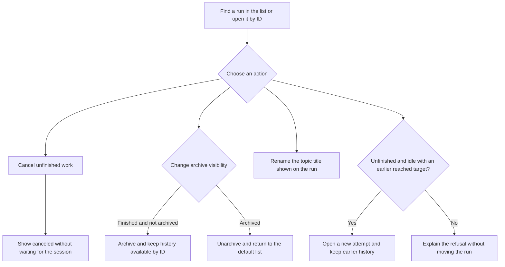
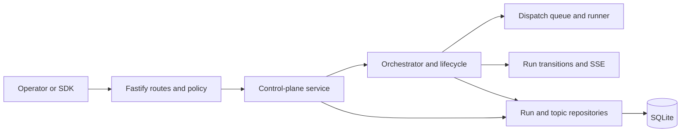
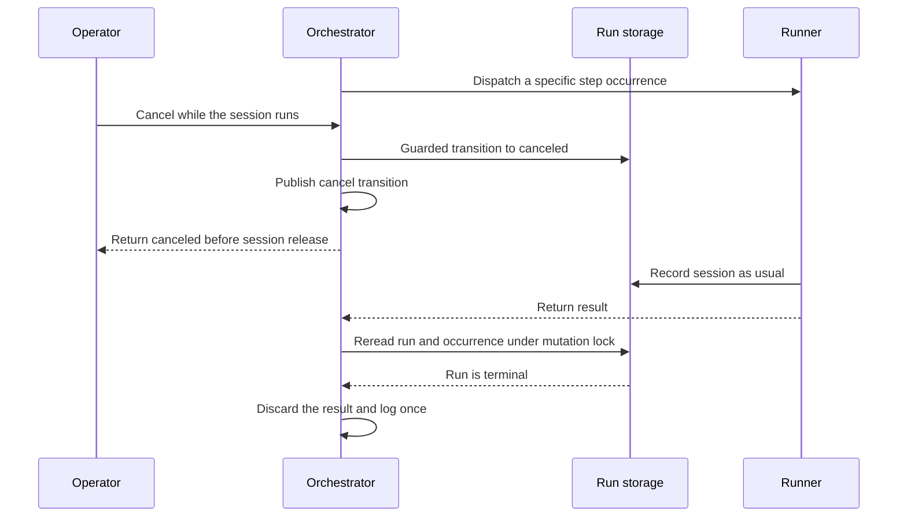

# Run operator actions

## What

Operators can cancel an unfinished run, archive or unarchive a finished run, rename a run, and send an idle, unfinished run back to an earlier step it already reached. Archive hides a run from the default list without removing its history. Cancel ends a run without waiting for an active session. The session can finish and appear in history, but if cancel commits first, its result cannot change the run.

## Why

Operators need to stop unwanted work without counting it as a failure and clear finished work from their lists without losing the record. A meaningful title makes a run easier to find. When a step needs another pass, operators can repeat it without starting over or losing previous attempts.

## Personas

- **Phoebe: PM** — Cancels work that is no longer needed, renames runs so she can find them, and archives finished work.
- **Enzo: Engineer** — Sends unfinished work back for another pass and compares the new attempt with earlier ones.

## Narratives

### Clear finished work without losing the record

Phoebe cancels a run while a session is working. The run shows `canceled` before the session finishes. The session later appears in history, but its result does not advance the run or change its review records.

Phoebe archives the canceled run. It disappears from the default list, but she can still open it by ID or find it in the archived list. She renames it and unarchives it. The run returns to the default list with her chosen title, and the linked issue keeps its own title.

### Repeat an earlier step

Enzo is reviewing an implementation and wants another build attempt. He sends the run from `implementation.human_review` back to `implementation.build`, which it already reached. The build runs again and the run returns to review.

Enzo compares the new attempt with earlier ones in the step and session history. If the run had failed, he would use recovery instead of set step.

## User stories

**Clear finished work without losing the record**

- Phoebe can cancel a run during work or while it waits for input.
- Phoebe can distinguish canceled work from failed work.
- Phoebe can hide a finished run from the default list and still find it and its history.
- Phoebe can unarchive a run without reopening it.
- Phoebe can rename a run without changing the linked issue's title.

**Repeat an earlier step**

- Enzo can return an idle, unfinished run to an eligible earlier step it reached.
- Enzo can distinguish an invalid target from a busy run.
- Enzo can return to an automatic step and get another attempt.
- Enzo can return to a human gate and have the run wait there.
- Enzo can inspect the new attempt alongside earlier steps and sessions.

## Goals

- Expose all five actions in the authenticated `/v1` API, SDK, and OpenAPI document.
- Return `canceled` before a blocked session is released. Record the session normally and apply none of its result if cancel commits first.
- Filter archived runs before paging without hiding direct or child reads.
- Show the updated topic title in list and detail without adding per-row queries or changing the tracker issue.
- Record one new attempt and one transition for each successful backward move. Preserve earlier attempts and refuse replies to input abandoned by the move.

## Non-goals

- Stopping sessions or remaining convergence rounds (#154), closing an open pull request, or reclaiming a workspace on cancel.
- Changing recovery (#144) beyond the archived-run restriction, adding destructive purge, or adding pause and resume commands.
- Moving forward, moving a terminal run, or undoing effects already committed by earlier steps, such as spec approval.
- Adding a public intake route for an existing topic or changing how issue-reference intake chooses a topic.
- Building client menus, shortcuts, dialogs, or archived views (#134 defines the action registry; #157 owns client wiring). Archive, unarchive, and rename emit no run event; #167 does not carry these changes.

## Design spec

### Operator flow

### List, detail, and action results

- **List:** Hide archived runs by default. `include` shows both archived and unarchived runs; `only` shows archived runs. Changing visibility does not change lifecycle status.
- **Detail:** Show the topic title as text. Rename changes the title shown by every run associated with the topic, including archived runs. The linked issue keeps its title.
- **Actions:** Use the returned run on success and refresh affected reads after archive, unarchive, or rename. Cancel and set step also produce transition events. Show the reason when a request is refused. An operator can retry a busy move after work settles; the service validates the target again.
- **Input:** A question abandoned by set step stays in history but cannot be answered. If another question opens, refresh and answer that occurrence instead of retrying an old answer.

This design describes what the existing surfaces can read and display. It adds no visual components or client wiring, so no mockups are needed.

## Tech spec

### Introduction and overview

This feature depends on [run-list filtering and mapping](enhancement-filter-page-run-list.md) (#133). It uses the topic title initialized by [issue-reference intake](feature-start-run-from-issue-reference.md) (#143) and retains [failed-run recovery](feature-recover-failed-run.md) (#144). Follow ADR-004 and ADR-019 for persistence, ADR-005 through ADR-007 for REST and shared contracts, ADR-009 for policy, ADR-014 for the active topic slot, and ADR-015 and ADR-025 for lifecycle and workflow. See [commands](../concepts/commands.md), [run](../concepts/run.md), [workflow](../concepts/workflow.md), [HITL](../concepts/hitl.md), and [orchestrator](../concepts/orchestrator.md).

A **terminal run** is `done`, `failed`, or `canceled`. A **step occurrence** is one visit to a step, identified by its `RunStep` row ID. A **busy run** has reserved, queued, or executing dispatch work, including auto-dispatch work reserved before it reaches the queue. Archive is visibility metadata, not a lifecycle state.

**Scope additions for human review:** This draft adds a conditional change to the existing replies route: once set step abandons an implementation pause, later implementation guidance on that run needs the current `pauseStepId`. This prevents an old ID-less answer from attaching to a new pause. The request schema and SDK signature stay unchanged; document the new condition in OpenAPI and the SDK. Documentation scope includes reconciling the old `cleanup` name within `commands.md` and its one index entry, and updating the existing agent lock decision to distinguish reservation from enqueue. These edits are limited to this feature and do not authorize an unrelated concept or architecture rewrite.

### System design and architecture

`packages/api-contract` owns schemas, route definitions, and OpenAPI. `packages/core` owns policy calls, workflow checks, transition publication, and dispatch admission. `packages/persistence` owns conditional writes and paged reads. `packages/sdk` sends typed requests and parses responses. The orchestrator remains the lifecycle mutation authority and publishes transitions only after persistence succeeds.

### Detailed design

#### HTTP contract and SDK

Use `runIdParamsSchema`. Each mutation returns `200` with a strict `{ run: Run }` response using #133's mapper. Keep existing response envelopes, including recovery's `mode`, unchanged.

| Method and path | Strict JSON body | SDK method |
| --- | --- | --- |
| `POST /v1/runs/:id/cancel` | `{}` or omitted | `cancelRun(id)` |
| `POST /v1/runs/:id/archive` | `{}` or omitted | `archiveRun(id)` |
| `POST /v1/runs/:id/unarchive` | `{}` or omitted | `unarchiveRun(id)` |
| `POST /v1/runs/:id/set-step` | Required `{ step: string }` | `setRunStep(id, { step })` |
| `PATCH /v1/runs/:id` | Required `{ title: string }` | `renameRun(id, { title })` |

Normalize an absent body to `{}` for cancel, archive, and unarchive, like recover's omission handling. A supplied body must be an empty object, not `null`, an array, or an object with extra keys. The SDK sends `{}` for these three actions.

- `400 validation_error`: invalid parameters or body, including missing set-step or rename body, unknown keys, wrong types, an empty step string, or an invalid title. Trim the title first and require 1–200 characters after trimming.
- `400 invalid_transition`: a well-formed set-step target fails a target rule. Include a specific `details.reason`.
- `403 forbidden`: policy denies the action or the caller is a model principal. Apply both checks before route schema validation.
- `404 not_found`: absent and foreign-tenant runs are indistinguishable, as in recover.
- `409 conflict`: lifecycle, busy, or guarded-write conflict as specified below. Include `details.reason`. Repeated archive and unarchive no-ops return `200`; rename has no lifecycle restriction.
- `500`: use the existing internal-error envelope for unexpected failures or inconsistent stored workflow state. Do not report those failures as client validation errors.

Document `400`, `403`, `404`, and `409` for all five actions in OpenAPI. Mark only the three empty bodies optional. Keep standard authentication and transport error handling. Each SDK method sends its listed body and parses the shared response.

#### Archive, list, and recover

- Add nullable `runs.archived_at TEXT` (`archivedAt` in Drizzle) holding an ISO timestamp. Use the next free numbered change in `packages/persistence/drizzle` and update its journal. Existing rows start `NULL`. Do not backfill, change the active topic slot index, or rewrite events. Add optional `archivedAt` to `runSchema`. Every route returning a run includes it when present and omits it when `NULL`.
- Archive sets the timestamp only on a terminal, unarchived run. An unfinished run gets `409`. An already archived run returns `200` unchanged, including its original timestamp. Unarchive clears the marker or returns `200` unchanged if it was absent. Enforce write conditions in storage. Neither action changes lifecycle, deletes child records, or emits an event.
- Add `archived=exclude|include|only` to the strict list query, OpenAPI, and SDK list options. Omission means `exclude` (`IS NULL`); `include` adds no predicate; `only` uses `IS NOT NULL`. Apply the filter in SQL with #133's filters and cursor conditions before limit and lookahead. Keep `createdAt DESC, id DESC`, the cursor format, and `nextCursor` behavior. A fixed matching set pages without duplicates or omissions; the cursor does not snapshot intervening writes.
- Keep archived runs readable by ID, including steps, sessions, spec, feedback, pull request, and event replay. Preserve read authorization, retention, and missing-child behavior. A terminal run already releases its topic's active slot. Verify a new run on that topic after archive through `Orchestrator.createRun` with the existing `topicId`, not public intake.
- Refuse recovery of an archived failed run with `409` naming unarchive before workspace preparation. Require `failed` and `archived_at IS NULL` in the conditional reopen. If archive wins after the precheck, the reopen still fails with the unarchive conflict and does not dispatch; this does not roll back workspace preparation already started. If reopen wins, archive refuses the now unfinished run. After unarchive, use the existing recovery path. Preserve the canceled-run reply conflict and canceled/done recovery conflicts.

#### Rename and project the topic title

Add optional `title` to `runSchema` as read metadata, not a column on `runs`. Select `topics.title` alongside `projectId` in #133's list projection and single-run context lookup. Use the shared mapper for list, get, reply, recover, and the new mutations. Keep the query count constant as page size grows and preserve missing-context behavior. Historical payloads without optional metadata still parse.

Add a tenant-scoped `TopicRepository` title update using the topic ID from the authorized run. Return the run with the persisted, trimmed title. Rename works on unfinished, terminal, and archived runs. It makes no tracker call, changes neither lifecycle nor `trackedIssue.title`, and emits no event. Leave #143 intake unchanged. Verify shared-title projection using two runs on one topic created through `Orchestrator.createRun`.

#### Guard lifecycle transitions and cancel without waiting for dispatch

1. Pass the expected source step to `recordRunStepTransition`. In its transaction, update only if the stored run is nonterminal and still at that step. For dispatch-originated writes, also require the captured open source occurrence. A guard miss changes no row or checkpoint, emits no event, and surfaces as a typed conflict through `applyRunDirective`. Do not rebase a directive on a newer source. On success, close the source and record the destination in the same transaction. Publish after commit. Recovery retains its separate conditional reopen.
2. Apply `cancel` with origin `human` and the authenticated caller as principal under the existing tenant/run mutation lock in `DefaultOrchestrator`. Take the lock independently of `RunDispatchQueue`; do not wait for the queue, runner capacity, or an active session. Every nonterminal step accepts cancel, including human gates and input pauses. Publish one `run_state_transition` with `directive: cancel`. A terminal run returns a reasoned `409` and stays unchanged.
3. Retry only cancel's own source-step mismatch. Reread and try the new step, up to three write attempts in all. If the run is now terminal, return the terminal conflict. Three consecutive mismatches return `409` saying the run kept moving. Do not retry unrelated failures.

The retry is defensive. Supported in-process step writers, including normal directives, ordinary and convergence result commits, set step, and recovery reopen, share the same lock. The storage guard protects against a competing write outside it. Use a repository fake to inject that write in retry tests rather than weakening production locking. This feature does not introduce distributed dispatch coordination.

#### Commit or drop dispatch results

Bind each dispatch to its source step and occurrence. Keep runner execution and normal session recording outside the mutation lock. After a session returns, reread the run before using its result. A terminal run, different step, or different occurrence makes the result stale. Recheck under the lock before the first result-dependent write. A stale result does not trigger failure directives.

**Ordinary results:** Hold the same lock as cancel from the final source check through applicable result effects, the guarded directive, and transition publication. Use the lock-held directive path. This covers `pr.finalize` feedback and spec freeze, spec artifact persistence, the bug `bug_triage` artifact, and checkpoints. If cancel commits first, discard the result. If result application enters the section first, cancel waits for the local commit section and checks the new state. This serializes local commits against cancel; it does not roll back separate stores on unrelated failures. Keep runner waits, queue waits, and remote reads outside the lock.

**Convergence results:** Layered spec convergence can persist feedback, dispositions, and checkpoints before the engine returns. Apply the same source check and lock at each durable result commit or batch, including the canonical spec completion callback, build convergence effects, and both final directives. Keep effects committed before cancel and refuse all later commits for the stale occurrence. Do not hold the lock across rounds or send a stop signal. Remaining rounds can finish and their sessions are recorded. Apply the source check to system dispatch result commits too. External work already performed is not undone.

Log one info line per discarded dispatch with the run ID and dispatched step, including an expected dispatch-source guard miss. Do not log once per skipped round or write. A stale dispatch emits no transition and no warning or error for the drop. Keep diagnostics for unrelated failures.

#### Validate and commit set step

1. Under the tenant/run mutation lock, load the authorized run and check terminal status first. Terminal runs get `409`; for `failed`, name `POST /v1/runs/:id/recover`. Resolve the workflow as `applyRunDirective` does. For a regular source, use its index in `workflow.steps`. For an input pause, use the index of the step its `advance` edge returns to. The pause itself need not be listed.
2. Return an internal `500` if the stored workflow cannot be resolved, a non-pause source has no index (even if owned through an edge), or the current pause has no usable `advance` edge. An absent edge or an edge to an unknown, unlisted, terminal, or pause step is unusable. Log the inconsistency without mutating the run. Do not compare a missing index as `-1`.
3. Before checking dispatch occupancy, validate that the target is owned by the resolved workflow, is neither terminal nor an input pause, has a phase, differs from the current step, has an index in `workflow.steps`, appears in this run's `RunStep` history, and is strictly earlier than the source position. Check terminal and pause status before phase so each can produce its own reason. Each failure gets `400 invalid_transition` with a specific `details.reason`, including an edge-owned target missing from `workflow.steps` (`Target has no position in workflow.steps`). A pause's `advance` destination is not earlier than the pause. After a revise moves `implementation.human_review` back to `implementation.build`, review is a forward target even though it is in history.
4. For a valid target, return `409` with a busy reason if the run has dispatch work. Hold the lock from the occupancy check through the guarded write. If admission reserves first, the move is busy even before enqueue. If the move commits first, admission cannot reserve the old occurrence. Return `409` on a storage guard miss without retrying or rebasing.
5. Use the guarded lifecycle transaction for the override; do not add `set_step` edges to workflows. Close the source, update `currentStep`, and create a target row with the next attempt and no reused checkpoint. Preserve closed steps, sessions, feedback, and artifacts. Add `set_step` to `runStateTransitionKindSchema` and the OpenAPI event schema. Publish one `run_state_transition` with the committed source and destination. Reserve AI or system work after publication through the path shared with `admitForDispatch`; enqueue outside the lock. A human gate waits. Return the committed move snapshot even if work advances before the next read.

#### Close input abandoned by set step

When set step leaves an input pause, close that occurrence and its request as abandoned, not answered. In the same guarded transaction, add `abandonedBySetStep: true` to the closed pause row's checkpoint metadata. Preserve its question and other checkpoint fields. Do not copy the question or guidance into the destination checkpoint. Use existing checkpoint JSON, with no extra column or event. A failed move leaves the input request open.

On a nonterminal run, a guidance reply carrying an abandoned `pauseStepId` returns `409 conflict` with `details.code: stale_pause`, whether the run is at a gate, an automatic step, or a different pause. Existing terminal reply conflicts take precedence. Spec guidance still requires the current pause ID. The existing replies route continues to accept legacy ID-less implementation guidance when no implementation pause was abandoned. Once the new set-step operation abandons an implementation pause, ID-less implementation guidance gets `409` with `details.code: stale_pause` and instructions to refresh and supply the current ID. This condition applies only to runs that enter the new abandoned-implementation-pause state. Do not make `pauseStepId` universally required or change the SDK signature. Describe the conditional requirement, refresh behavior, and `409` in the replies OpenAPI operation and the SDK's `replyToRun` documentation.

Validate guidance against the current occurrence under the same mutation lock as set step, before writing guidance or applying `advance`. Route guidance through that check even if the service's early read sees a non-human step. Use the lock-held directive path so a reply and a move cannot both commit against the same pause occurrence. A rejected reply writes no guidance, checkpoint, or transition.

#### Reserve dispatch work

Expose dispatch occupancy from the orchestrator, including reservations, the auto-dispatch marker, and the per-run queue. Coordinate reservations under the tenant/run mutation lock for initial scheduling, automatic chaining, `admitForDispatch`, and explicit dispatch through `tick`. Reserve the source occurrence before deferring preparation or enqueue. Keep occupancy through queued and running work and release it on completion, error, or stale admission. Transfer occupancy to an eligible automatic continuation without a false-idle gap. Keep enqueue and execution outside the lock. Before queued work starts, recheck its reserved source so it cannot start stale work after cancel.

### Security, privacy, and compliance

| Mutation | Policy action | Resource kind |
| --- | --- | --- |
| Cancel | `run_cancel.create` | `run_cancel` |
| Archive | `run_archive.create` | `run_archive` |
| Unarchive | `run_unarchive.create` | `run_unarchive` |
| Set step | `run_set_step.create` | `run_set_step` |
| Rename | `run_rename.update` | `run_rename` |

Declare the actions and descriptors in `packages/core/src/policy.ts`. Use `authorizePreHandler` as recover does, passing the route template and the raw route ID without validating it or loading the run. After authentication, call policy first, then `requireNonModelPrincipal` in the pre-handler chain or immediately on entering the handler, before parsing params or body with route schemas or calling the service. Scope in-process service mutations to the same policy and principal checks before any lookup or write. A denied caller or policy-allowed model principal sending a schema-invalid body gets `403`, not `400`. Fastify's transport decoding, including rejection of undecodable JSON, is separate from route schema validation and retains its existing behavior.

Scope run and topic operations to the caller's tenant. Return identical `404` responses for absent and foreign-tenant IDs on authorized, valid mutations. Leave read authorization unchanged. Use bound database parameters, render titles as text, and keep titles and guidance out of operational logs.

### Observability

Use the existing transition and replay path for cancel and set step. Keep `canceled` distinct from `failed` in status and failure counts. Continue recording sessions and their telemetry. Log stale results once at info as specified above. No new metric or alert is required.

### Testing plan

Use contract, repository, service, and production-server tests. Use deterministic barriers for cancel versus result commits, set step versus admission, and set step versus guidance replies. Inject cancel retry mismatches at the repository boundary. Test missing stored workflow positions separately from invalid targets. Check histories, result effects, and event order as well as final state. The production wiring test uses `createControlPlaneServer`, SQLite, and scripted sessions. No test makes a model call.

#### Manual check

Start `pnpm nx run control-plane:serve-fake`. In another shell, seed with `pnpm nx run control-plane:seed-fake -- --scenario spec-review` and `pnpm nx run control-plane:seed-fake -- --scenario implementation-review`. Use the printed IDs at `http://127.0.0.1:4010` with `Authorization: Bearer fake-mode-token`. Send JSON mutations with `Content-Type: application/json`.

Cancel and archive the spec-review run with `{}`. The default `GET /v1/runs` omits it; `?archived=include` and `?archived=only` show it. Unarchive with `{}` and PATCH with `{"title":"Renamed run"}`. The default list shows the new title. On the implementation-review run, POST `{"step":"implementation.build"}` to `set-step`. The scripted build runs, the run returns to review, and `/steps` shows a new attempt. Setting the step to unreached `pr.open` returns `400 invalid_transition`.

### Alternatives considered

- **Queue cancel behind dispatch:** Serializes work but makes cancel wait for the session. Use the independent mutation lock and a guarded write.
- **Guard only the directive or lock ordinary effects individually:** The first allows stale artifacts; the second allows cancel to split ordinary effects from their directive. Hold one lock across ordinary result application and guard each durable convergence commit because convergence spans sessions.
- **Read queue state without reserving:** Admission could enqueue after the busy check. Reserve under the same lock used by set step.
- **Filter after paging or use history alone for set step:** Filtering after paging can omit matches. History alone permits a forward move after revise. Filter before paging and require both history and workflow order.
- **Keep accepting ID-less guidance after an implementation pause is abandoned:** The service cannot distinguish a delayed answer from an answer to a new pause. Require an occurrence ID only after this feature creates that ambiguity.

### Risks

- **Hidden convergence writes:** A check only at engine return is too late. Test intermediate commits, canonical spec persistence, and the final directive.
- **Same name, different visit:** Match the source occurrence as well as the step for dispatch results and pause replies. The lock is process-local; storage independently guards transition writes.
- **Local commits can delay cancel:** Cancel can wait for an already-started local result commit, including a freeze write, but never for a session or remote provider read.
- **Earlier effects remain after set step:** A repeated attempt uses normal checks at its next gate. Set step does not restore workspace, tracker, pull request, or spec state.

## Task list

- [ ] **Story: Publish the operator API and SDK**
  - [ ] **Task: Define mutation and event contracts**
    - **Description**: Define the five strict requests, shared run response, optional metadata, and `set_step` event value.
    - **Acceptance criteria**:
      - [ ] The three empty requests accept omission or `{}` and reject `null`, extra keys, and non-objects. Set step and rename reject missing bodies, extra keys, and wrong types. A title of 200 characters after trimming passes; a blank or longer title fails.
      - [ ] `openapi.spec.ts` asserts the five operations, body requiredness, the `400`, `403`, `404`, and `409` responses, and `set_step` in the event schema.
    - **Dependencies**: #133 run contract.
  - [ ] **Task: Add typed SDK actions**
    - **Description**: Add `cancelRun`, `archiveRun`, `unarchiveRun`, `setRunStep`, and `renameRun` using the shared contracts.
    - **Acceptance criteria**:
      - [ ] Tests assert each HTTP method, path, and body, including `{}` for the three empty requests. Each method parses the mapped success response and rejects a malformed response.
    - **Dependencies**: Define mutation and event contracts.
  - [ ] **Task: Wire routes and policy checks**
    - **Description**: Register the Fastify routes and connect their service methods.
    - **Acceptance criteria**:
      - [ ] Each route calls policy with its exact descriptor in `authorizePreHandler` before route parameter and body schema validation, then rejects model principals before that validation. For each action, a policy-denied caller and a policy-allowed model sending schema-invalid JSON both get `403`; no service work runs. A policy-allowed non-model caller sending the same body gets `400 validation_error`.
      - [ ] Authorized calls with valid inputs return identical `404`s for missing and foreign runs. Business errors preserve status, code, and reason. Success returns the mapped `{ run }`; omitting the three empty bodies works end to end.
    - **Dependencies**: Define mutation and event contracts; Project run metadata; Write archive and unarchive; Persist the shared topic title; Implement cancel and bounded retry; Commit and dispatch set step.
- [ ] **Story: Archive finished runs and preserve topic titles**
  - [ ] **Task: Store the archive marker**
    - **Description**: Add nullable `archived_at`, the next numbered Drizzle change and journal entry, and repository mapping.
    - **Acceptance criteria**:
      - [ ] Existing rows start unarchived, a timestamp round-trips, and `NULL` maps to omission. The active-run index is unchanged.
    - **Dependencies**: Define mutation and event contracts.
  - [ ] **Task: Project run metadata**
    - **Description**: Extend #133's mapper and context queries to read the topic title alongside `projectId` and preserve `archivedAt`.
    - **Acceptance criteria**:
      - [ ] Every run-returning route includes `archivedAt` when present. List, get, reply, recover, and the new mutations agree on the topic title. Payloads without optional metadata still parse.
      - [ ] The query count for project and title projection does not grow with page size.
    - **Dependencies**: Store the archive marker; #133 run mapping.
  - [ ] **Task: Write archive and unarchive**
    - **Description**: Add conditional archive-marker writes and service methods.
    - **Acceptance criteria**:
      - [ ] Archive succeeds for `done`, `failed`, and `canceled` and returns `409` for unfinished runs. Repeat archive preserves the original timestamp; repeat unarchive returns an unchanged run.
      - [ ] Neither operation changes lifecycle, deletes records, or emits an event. A direct `Orchestrator.createRun` call with the same `topicId` starts a new run after archive without an active-slot conflict.
    - **Dependencies**: Store the archive marker.
  - [ ] **Task: Filter archives before paging**
    - **Description**: Add `archived` to SQL list predicates, the list query, OpenAPI, and SDK list options.
    - **Acceptance criteria**:
      - [ ] Omission behaves as `exclude`; `include` and `only` return expected rows; an invalid value returns `400`. The filter composes with #133's filters, page size, and cursor. Paging a fixed mix with tied timestamps returns each match exactly once.
      - [ ] Archive does not filter direct get, steps, sessions, spec, feedback, pull request, or event replay.
    - **Dependencies**: Store the archive marker; #133 filtering and paging.
  - [ ] **Task: Guard recovery while archived**
    - **Description**: Check the archive marker before preparation and in the conditional failed-run reopen.
    - **Acceptance criteria**:
      - [ ] An already archived failed run gets `409` naming unarchive without preparing, reopening, or dispatching. It recovers after unarchive. Neither ordering of archive and reopen produces an archived active run. Existing canceled and done refusals remain.
    - **Dependencies**: Write archive and unarchive; #144 recovery.
  - [ ] **Task: Persist the shared topic title**
    - **Description**: Add a tenant-scoped `TopicRepository` title update and leave issue-reference intake unchanged.
    - **Acceptance criteria**:
      - [ ] Unfinished, terminal, and archived runs can be renamed. List and get show the trimmed title. Rename makes no tracker call, preserves `trackedIssue.title`, and emits no event.
      - [ ] Arrange two runs on one topic through `Orchestrator.createRun`, with the first terminal and archived before creating the second. Renaming one updates both direct reads and an archive-inclusive list.
    - **Dependencies**: Project run metadata; Write archive and unarchive; #143 topic title initialization.
- [ ] **Story: Cancel promptly and discard late results**
  - [ ] **Task: Guard lifecycle transitions in storage**
    - **Description**: Require the expected step in `recordRunStepTransition` and the open source occurrence for dispatch writes. Surface guard misses as typed conflicts.
    - **Acceptance criteria**:
      - [ ] Terminal, wrong-step, and wrong-occurrence writes change no row or checkpoint and emit no event. Success closes the source and records the destination in one transaction.
    - **Dependencies**: None.
  - [ ] **Task: Implement cancel and bounded retry**
    - **Description**: Apply the human-origin cancel directive with the caller under the mutation lock and outside the dispatch queue. Retry only source-step mismatches.
    - **Acceptance criteria**:
      - [ ] Every nonterminal step, including gates and input pauses, accepts cancel and emits one cancel transition. A terminal run returns a reasoned `409` and stays unchanged.
      - [ ] A repository fake moves the step between read and first write; cancel succeeds on its second attempt. A run that becomes terminal returns the terminal conflict. Three injected mismatches return `409` saying the run kept moving. No production writer bypasses the lock to exercise retry.
    - **Dependencies**: Guard lifecycle transitions in storage.
  - [ ] **Task: Guard ordinary dispatch result commits**
    - **Description**: Hold one lock across the final source check, ordinary result effects, and guarded directive. Leave session execution and recording outside it.
    - **Acceptance criteria**:
      - [ ] Cancel returns before a blocked session is released. After release the session appears in `/sessions` and the run stays canceled. A stale bug `spec.author` writes no `bug_triage` artifact; stale `pr.finalize` writes no feedback or spec freeze.
      - [ ] Interleave a runner's old read with cancel; the result cannot overwrite `canceled`. A result from an earlier visit to the same step is stale even though the name matches. A discarded dispatch emits no transition and logs once at info with run ID and step, without a warning or error.
      - [ ] A barrier after the first ordinary result effect proves cancel cannot split that result from its directive. On a nonterminal destination the result event precedes cancel. In reverse order neither effect nor directive applies. A stale system result cannot commit a directive either.
    - **Dependencies**: Implement cancel and bounded retry.
  - [ ] **Task: Guard layered spec result commits**
    - **Description**: Guard feedback, dispositions, checkpoints, canonical spec completion, and the final directive at durable boundaries.
    - **Acceptance criteria**:
      - [ ] In blocked feature and enhancement `spec.author` scenarios, cancel returns before release. The session appears in `/sessions`; the run stays canceled with no late spec artifact, canonical spec commit, feedback or disposition change, or transition.
      - [ ] An effect committed before cancel remains; later guarded effects and the final directive do not apply.
    - **Dependencies**: Guard ordinary dispatch result commits.
  - [ ] **Task: Guard build convergence result commits**
    - **Description**: Guard build effects and the final directive without shortening the loop or stopping a session.
    - **Acceptance criteria**:
      - [ ] Cancel during the first scripted `implementation.build` round and let the loop finish. Sessions remain recorded, no late feedback, checkpoint, or directive applies, and the run stays canceled.
    - **Dependencies**: Guard ordinary dispatch result commits.
- [ ] **Story: Return an unfinished run to an earlier step**
  - [ ] **Task: Validate set-step targets**
    - **Description**: Resolve workflow order and validate terminal status, source position, target eligibility, and history before checking occupancy.
    - **Acceptance criteria**:
      - [ ] Terminal requests get `409`; failed requests name the recovery route. Tests assert specific `400 invalid_transition` reasons for unknown or foreign-workflow targets, no phase, pause, terminal, current step, edge-owned target with no index, missing history, and a target not strictly earlier.
      - [ ] An edge-owned non-pause source with no index, a pause without `advance`, and a pause whose `advance` leads outside `workflow.steps` each return `500` without mutation. A valid pause uses its advance destination's position and rejects that destination as not earlier.
      - [ ] A revise reply from implementation review to blocked build makes implementation review an invalid forward target: `400`, not busy.
    - **Dependencies**: Define mutation and event contracts.
  - [ ] **Task: Serialize dispatch admission and set step**
    - **Description**: Reserve source occurrences under the mutation lock. Keep enqueue and execution outside it.
    - **Acceptance criteria**:
      - [ ] Reserved, queued, and running work each return `409` with a busy reason for valid moves. Terminal refusal precedes target validation, which precedes the busy check.
      - [ ] A barrier after the busy check proves that competing admission cannot reserve or enqueue against the old occurrence. A reservation made before enqueue makes the move busy. Automatic chaining leaves no false-idle gap, and queued work made stale by cancel does not start.
    - **Dependencies**: Validate set-step targets; Guard lifecycle transitions in storage.
  - [ ] **Task: Commit and dispatch set step**
    - **Description**: Persist the override through the guarded transaction and publish `set_step` before admitting automatic work through the shared `admitForDispatch` path. Mark a pause abandoned in the same transaction that leaves it.
    - **Acceptance criteria**:
      - [ ] A move closes the source, opens the next attempt without a reused checkpoint, updates `currentStep`, and emits one event with the committed source and destination. A guard miss returns `409` without an event, dispatch, or input closure.
      - [ ] AI and system targets dispatch; human gates wait. A scripted move from implementation review through build returns to review, preserving earlier closed steps and sessions as verified through `/steps` and `/sessions`.
      - [ ] Moving from a pause preserves the old question in history, adds the abandonment marker, and does not copy guidance into the new attempt.
    - **Dependencies**: Serialize dispatch admission and set step.
  - [ ] **Task: Reject replies to abandoned input**
    - **Description**: Validate guidance under the mutation lock before any reply effect. Implement and document the conditional change to the existing replies operation.
    - **Acceptance criteria**:
      - [ ] Replying with an abandoned `pauseStepId` returns `409` with `details.code: stale_pause` both before and after a new pause opens, including when the run is at a non-human step. The refusal writes no guidance, checkpoint, or transition.
      - [ ] After an implementation pause is abandoned, ID-less guidance gets `409` with `details.code: stale_pause` and refresh instructions. The current ID succeeds at a new pause, and ID-less implementation guidance still works on runs with no abandoned implementation pause.
      - [ ] A deterministic reply-versus-set-step test proves only one operation can commit against the original pause occurrence. The replies OpenAPI operation and SDK docs describe the conditional requirement and `409`; the request schema and SDK signature remain unchanged.
    - **Dependencies**: Commit and dispatch set step.
- [ ] **Story: Verify production wiring and document behavior**
  - [ ] **Task: Test the production server action flow**
    - **Description**: Exercise `createControlPlaneServer` with SQLite and scripted sessions.
    - **Acceptance criteria**:
      - [ ] Cancel before releasing a blocked session. Reply and recover retain their canceled-run `409`s. Archive that run, list with all three modes, read archived detail and children, unarchive it, and rename it.
      - [ ] Move a second run back and observe its new attempt. Replay cancel and set-step transitions through `GET /v1/runs/:id/events?replay=retained`; archive, unarchive, and rename add no event. No test makes a model call.
    - **Dependencies**: Wire routes and policy checks; Filter archives before paging; Guard recovery while archived; Guard layered spec result commits; Guard build convergence result commits; Reject replies to abandoned input.
  - [ ] **Task: Update the code map and lock decision**
    - **Description**: Record the implemented wiring and amend only the parts of the existing decision affected by these actions.
    - **Acceptance criteria**:
      - [ ] `context-agent/wiki/code-map.md` records the routes, service methods, `archivedAt` column, `title` field, `set_step` event kind, guarded transition, cancel retry, reservations, and pause abandonment.
      - [ ] `context-agent/decisions/pr-mutation-lock.md` explains reservation under lock versus enqueue outside it, ordinary and convergence commit boundaries, and storage guards for expected step, dispatch occurrence, and archived recovery. Unrelated PR and provider I/O rules stay unchanged.
    - **Dependencies**: Test the production server action flow.
  - [ ] **Task: Reconcile operator concepts**
    - **Description**: After human approval of the documented scope, update only action names, behavior, and affected references. Follow `context-agent/standards/editorial-guidelines.md` for style.
    - **Acceptance criteria**:
      - [ ] `context-human/concepts/commands.md` names the five shipped actions, replaces references to `cleanup` as an action with `archive`, says undo archive with unarchive rather than recover, and states the late-result and backward-step rules. Keep destructive purge separate and out of scope. Align only the commands summary in `context-human/concepts/index.md`.
      - [ ] `context-human/concepts/hitl.md` limits set step to earlier reached steps on unfinished runs, distinguishes it from failed-only recovery, and explains that leaving an input pause abandons its request. Leave unrelated concept behavior unchanged.
    - **Dependencies**: Test the production server action flow.
