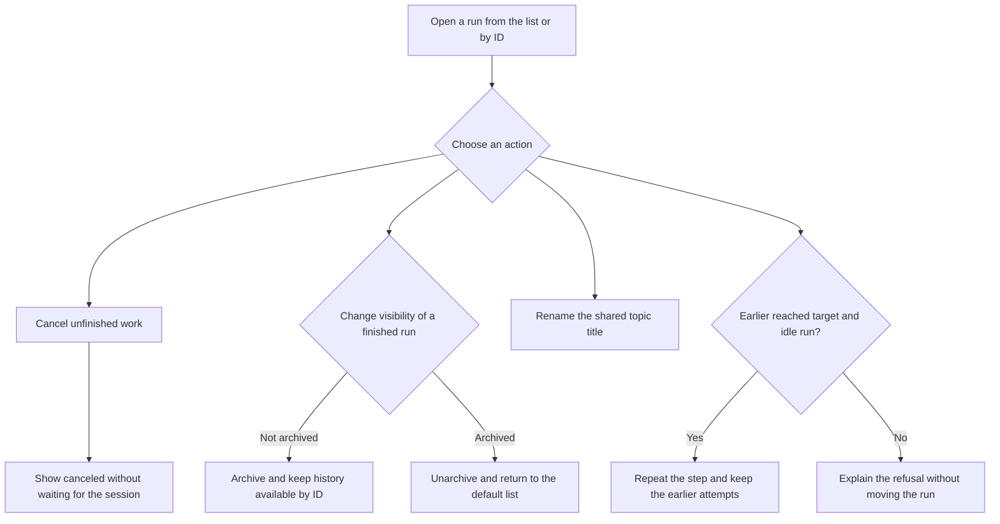
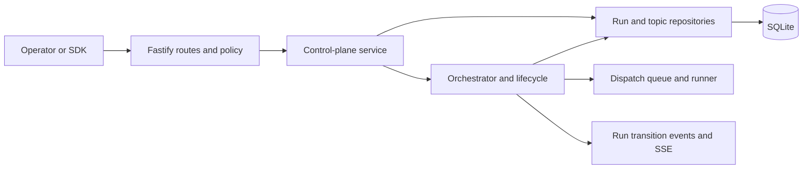
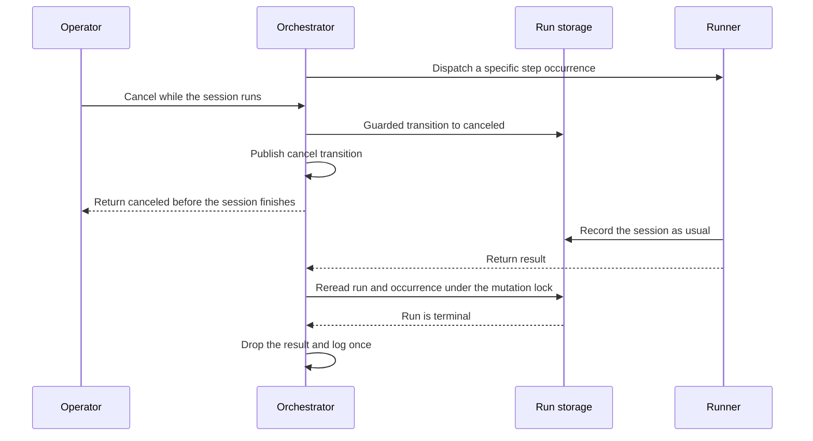

# Run operator actions

## What

Operators can cancel an unfinished run, archive or unarchive a finished run, rename a run, and send an unfinished run back to an earlier step it has already reached. Archive hides a run from the default list without removing its history. Cancel ends a run without waiting for an active session; the session can finish, but its late result cannot change the run.

## Why

Operators need to stop unwanted work without counting it as a failure and hide finished work without losing the record. They also need to find work by a useful title and repeat an earlier step without starting over or losing previous attempts.

## Personas

- **Phoebe: PM** — Cancels work that is no longer needed, names work so she can find it, and archives finished runs.
- **Enzo: Engineer** — Sends unfinished work back for another pass and compares the new attempt with earlier ones.

## Narratives

### Clear finished work without losing the record

Phoebe cancels a run while a session is working. The run shows `canceled` before the session finishes. The session later appears in the history, but its result does not advance the run or change its review records.

Phoebe archives the canceled run. It disappears from her default list, but she can still open it by ID or find it in the archived list. She renames it and returns it to the default list. When she starts another run on the same topic, both runs show her chosen title and the linked issue keeps its own title.

### Repeat an earlier step

Enzo is reviewing an implementation and wants another build attempt. He sends the run from `implementation.human_review` back to `implementation.build`, which it has already reached. The service dispatches another build and the run returns to review.

Enzo compares the new attempt with the previous attempt in the step and session history. Had the run failed, he would use recovery instead of set step.

## User stories

**Clear finished work without losing the record**

- Phoebe can cancel an unfinished run during a session or while it waits for input.
- Phoebe can distinguish a canceled run from a failed run.
- Phoebe can hide a finished run from the default list and still find it and its history.
- Phoebe can unarchive a run without reopening it.
- Phoebe can rename a run without changing the tracker issue and see the same title on later runs on that topic.

**Repeat an earlier step**

- Enzo can return an idle, unfinished run to an eligible earlier step it reached.
- Enzo can distinguish an invalid target from a busy run.
- Enzo can return to an automatic step and have the service dispatch another attempt.
- Enzo can return to a human gate and have the run wait there.
- Enzo can inspect the new attempt alongside prior steps and sessions.

## Goals

- Expose all five actions in the authenticated `/v1` API, SDK, and OpenAPI document.
- Return `canceled` before a blocked session is released. Record the session normally and apply none of its result if cancel wins before the result commit.
- Filter archived runs before paging without hiding direct or child reads.
- Show the shared topic title without adding per-row queries, and preserve it when another run starts on the topic.
- Record one new attempt and one transition per successful backward move, without rewriting prior attempts.

## Non-goals

- Stopping a running session or ending the remaining convergence rounds (#154), closing an open pull request, or reclaiming the workspace on cancel.
- Changing failed-run recovery (#144) except to require unarchive first for an archived failed run. Purge and pause/resume are out of scope.
- Moving a run forward, moving a terminal run with set step, or undoing effects already committed by earlier work, such as spec approval.
- Emitting events for archive, unarchive, or rename. The feed in #167 does not carry those changes.
- Building client menus, shortcuts, dialogs, or archived views. #134 defines the action registry; #157 owns client wiring.

## Design spec

### Operator flow

### List, detail, and action results

- **List:** Hide archived runs by default. `include` shows both archived and unarchived runs; `only` shows archived runs. Changing visibility never changes the run's status.
- **Detail:** Display the topic title as plain text. Rename changes the title for every run on the topic, including archived and future runs. The tracker issue and the run's issue snapshot keep their own titles.
- **Actions:** Use the returned run on success and refresh affected reads after archive, unarchive, or rename. Cancel and set step also produce transition events. On refusal, present the returned reason. A busy set-step request can be retried after the run settles; the service validates the target again.

These behaviors apply to the existing list and detail surfaces. This feature does not prescribe new visual components.

## Tech spec

### Introduction and overview

This feature depends on [run-list filtering and mapping](enhancement-filter-page-run-list.md) (#133), [issue-reference intake](feature-start-run-from-issue-reference.md) (#143) for the initial topic title, and [failed-run recovery](feature-recover-failed-run.md) (#144). It follows ADR-004 and ADR-019 for storage, ADR-005 through ADR-007 for REST and shared contracts, ADR-009 for policy, ADR-014 for the active topic slot, and ADR-015 and ADR-025 for lifecycle and workflow. See [commands](../concepts/commands.md), [run](../concepts/run.md), [HITL](../concepts/hitl.md), [orchestrator](../concepts/orchestrator.md), [run detail](../concepts/run-detail.md), and [collection](../concepts/collection.md).

A **terminal run** is `done`, `failed`, or `canceled`. A **step occurrence** is one visit to a step, identified by its `RunStep` row ID; a later visit to the same step has a different ID. A run is **busy** if dispatch is reserved, queued, or executing for it, including an auto-dispatch reservation not yet visible in the queue. Archive is visibility metadata, not a lifecycle state.

### System design and architecture

`packages/api-contract` owns the schemas, route definitions, and transition enum. `packages/core` owns authorization, scheduling, workflow checks, and transition publication. `packages/persistence` owns conditional writes and paged projections. `packages/sdk` sends typed requests and parses the responses. The orchestrator publishes transitions only after persistence succeeds.

### Detailed design

#### HTTP contract and SDK

Use `runIdParamsSchema` and return `200` with a strict `{ run: Run }` response from #133's mapper. Each SDK method sends the listed body and parses the shared response schema.

| Method and path | Strict JSON body | SDK method |
| --- | --- | --- |
| `POST /v1/runs/:id/cancel` | `{}` | `cancelRun(id)` |
| `POST /v1/runs/:id/archive` | `{}` | `archiveRun(id)` |
| `POST /v1/runs/:id/unarchive` | `{}` | `unarchiveRun(id)` |
| `POST /v1/runs/:id/set-step` | `{ step: string }` | `setRunStep(id, { step })` |
| `PATCH /v1/runs/:id` | `{ title: string }` | `renameRun(id, { title })` |

- `400 validation_error`: Missing or malformed body, non-object body, extra keys, wrong field types, or invalid title. Trim the title first; require 1–200 characters after trimming. Require a nonempty step string.
- `400 invalid_transition`: The target fails a workflow rule below. Include a specific `details.reason`.
- `403`: The policy point denies the action or the caller is a model principal.
- `404 not_found`: The run does not exist in the caller's tenant. Missing and foreign runs get the same response.
- `409 conflict`: A state or guarded-write conflict described below. Include `details.reason`. Rename and unarchive have no terminal-state refusal; an unarchive no-op is `200`.

Document `400`, `403`, `404`, and `409` for each operation in OpenAPI. Preserve existing authentication and unexpected-error handling; internal failures are not state conflicts or validation errors.

#### Archive, list, and recover

- Add `runs.archived_at` as nullable SQLite `TEXT` (`archivedAt` in Drizzle), storing an ISO timestamp. Use the next free numbered change under `packages/persistence/drizzle` and update the journal. Existing rows start `NULL`. Do not backfill, change the active-run partial index, or rewrite historical events. Add optional `archivedAt` to `runSchema`; include it in all run-returning routes when present and omit it for `NULL`.
- Archive conditionally sets the timestamp on a terminal, unarchived row. An unfinished run returns `409`. An already archived run returns `200` with its original timestamp. Unarchive clears the timestamp, or returns the unchanged run with `200` if no timestamp exists. Enforce the write conditions in storage. Neither action changes the step, status, or child records or emits a run event.
- Add `archived=exclude|include|only` to the strict list query, OpenAPI, and SDK `listRuns` options. Omission means `exclude` (`IS NULL`); `include` adds no predicate; `only` uses `IS NOT NULL`. Combine with #133's tenant, project, work kind, status, waiting-on, and cursor predicates in SQL before the page limit and lookahead. Keep `createdAt DESC, id DESC`, the cursor format, and `nextCursor` behavior. A fixed matching set pages without duplicates or omissions; paging does not snapshot changes between requests.
- Do not apply the archive filter to get, steps, sessions, spec, feedback, pull request, event replay, or any other direct run read. Preserve each read's authorization, retention, and missing-resource rules. A terminal run already holds no active slot on its topic; archive deletes nothing and does not change that rule.
- An archived failed run gets `409` naming unarchive before recovery workspace preparation. Require both `failed` and `archived_at IS NULL` in the conditional reopen. If archive wins a race after the precheck, reject the reopen with the unarchive conflict and do not dispatch. If reopen wins, archive refuses the now unfinished run. After unarchive the existing recovery path works. Preserve existing replies to canceled runs and existing canceled and done recovery conflicts.

#### Rename and project the topic title

Add optional `title` to `runSchema` as read metadata, not a `runs` column. Select `topics.title` alongside `projectId` in #133's list projection and single-run context lookup. Use the shared mapper for list, get, reply, recover, and the new mutations. Keep the number of queries constant as page size grows and preserve the existing missing-context behavior. Stored shapes without the optional fields still parse.

Add a tenant-scoped `TopicRepository` title update using the topic ID from the authorized run. Return the run with the persisted, trimmed title. Rename works on unfinished, terminal, and archived runs. It does not change lifecycle state, call the tracker, change `trackedIssue.title`, or emit a run event.

Issue intake seeds the issue title only on topic insert. Starting a run on an existing topic never writes the title, including when the incoming tracker title differs or a rename races with the start. Test this by renaming an archived run, starting another run on the same topic with a different tracker title, and verifying that both runs show the operator's title in direct reads and an archive-inclusive list. The tracker and issue snapshots retain their issue titles.

#### Guard transitions and cancel without waiting for dispatch

1. Pass the source step used to validate the transition to `recordRunStepTransition`. In the existing transaction, update only if the stored run is nonterminal and still at the expected step. For dispatch-originated writes also require the captured open source occurrence. Do not rebase a validated directive on a newer source. A guard miss is a typed conflict reported by `applyRunDirective`; it changes no run, history row, or checkpoint and emits no event. On success, close the source occurrence and open the destination occurrence in the transaction. Publish the transition after commit. Recovery retains its separate conditional reopen.
2. Apply `cancel` with origin `human` and the authenticated caller as principal, using the existing tenant/run mutation lock in `DefaultOrchestrator` independently of `RunDispatchQueue`. Cancel does not check dispatch occupancy or wait for a runner slot or session. Every unfinished step, including a human gate or input pause, can cancel. Publish one `run_state_transition` with `directive: cancel` on success. A terminal run returns a reasoned `409` without a write.
3. Retry only cancel's own source-step mismatch. Reread and attempt the transition against the new step, up to three write attempts total. If a reread shows a terminal run, return the terminal conflict. Three consecutive mismatches return `409` saying the run kept moving. Do not retry unrelated failures.

#### Commit or drop dispatch results

Bind each dispatch to its source step and occurrence. Session execution and normal session recording stay outside the run mutation lock. After the session returns, reread the run before treating its result as current. A terminal run, a different step, or a different occurrence makes the result stale. Read-only preparation can run outside the lock; always recheck under the lock after preparation and before the first effect. Suppress result-dependent warnings and failure directives for a stale result.

**Ordinary dispatch: one commit boundary.** Hold the same tenant/run mutation lock as cancel continuously from the final reread through all applicable result-dependent effects, the guarded directive, and publication of its transition. Use the lock-held directive path. Do not release and reacquire between effects. This covers `pr.finalize` feedback or spec freeze, spec artifact persistence, bug `bug_triage` artifact persistence, checkpoints, and the resulting directive. Do not wait on a session, queue, or provider read inside this section. If cancel commits first, the entire result is dropped. If ordinary result application starts first, cancel waits for that commit section, then evaluates the resulting run; it cannot split the effects from their directive. This is serialization against cancel, not a cross-store rollback guarantee on an unrelated write failure. Existing effect-failure handling still applies.

**Convergence: one commit boundary per durable effect or batch.** Layered spec convergence can commit intermediate feedback, dispositions, and checkpoints before the engine returns. Guard those commits, the completion callback that commits the canonical spec, and the final directive with the same source check and lock. Do the same for durable build convergence effects and its final directive. Effects committed before cancel are retained; no later boundary may commit a result for the canceled occurrence. Do not hold the lock across a convergence round. The remaining rounds finish and their sessions are recorded; this feature adds no stop signal. Guard system dispatch results and directives with the same source rule; external work already performed is not undone.

A stale dispatch, including an expected dispatch-source conflict at the storage guard, must not advance, revise, fail, or otherwise change the canceled run. Keep its session records. Log one info line per discarded dispatch with `runId` and the dispatched step, not one per skipped write or round. Do not emit a warning or error for the drop.

#### Set step and coordinate dispatch admission

1. After policy, principal, request, and tenant checks, take the tenant/run mutation lock and load the run. Refuse a terminal run with `409`; for `failed`, name `POST /v1/runs/:id/recover` in the message. Resolve the workflow as `applyRunDirective` does for an existing run. A missing or invalid stored workflow is an internal error, not an invalid user target.
2. Before checking busy, validate the target. It must be in the resolved workflow, belong to a phase, be neither terminal nor a `*.awaiting_input` pause, differ from the current step, and appear in this run's `RunStep` history. Its index in `workflow.steps` must be strictly less than the current step's index. If the current step is a pause, use the index of the step its `advance` edge returns to; that destination itself is not earlier. History proves the target was reached, not that it comes earlier. For example, after revise takes a run from `implementation.human_review` back to `implementation.build`, review is not a valid target. Give each failed target rule a specific `400 invalid_transition` reason.
3. Register dispatch occupancy under the same tenant/run mutation lock used by set step. Cover automatic scheduling and chaining, `admitForDispatch`, and explicit dispatch through `tick`. Select the source and reserve occupancy before deferring preparation or enqueue. Keep occupancy through queued and running work; clear it on success, error, or stale admission. Recheck the source before queued dispatch starts work so it cannot start stale work after cancel. Use lock-held helpers for callers already inside the lock, and never wait for queue execution, runner capacity, sessions, or provider work while holding it.
4. For an eligible target, check occupancy using the reservation state, auto-dispatch marker, and per-run queue. A busy run returns `409` with a reason saying it is busy. Hold the lock from that final check through the guarded transition. If admission reserves first, the move is busy even before enqueue. If the move gets there first, admission cannot reserve against the pre-move source. A storage guard conflict returns `409` without rebasing or retrying.
5. Record the validated override through the guarded lifecycle transaction; do not add `set_step` edges to every workflow. Close the source row, update `currentStep`, and create a target row with the next attempt number and a fresh checkpoint state. Keep earlier closed steps, sessions, feedback, and artifacts. Add `set_step` to `runStateTransitionKindSchema` and the OpenAPI event schema. Publish one `run_state_transition` with `directive: set_step` and the committed source and destination. After publication reserve dispatch through the lock-held `admitForDispatch` path for `ai` and `system` targets; work starts outside the lock. A human gate waits. Return the committed move snapshot even if automatic work advances again before the next read.

### Security, privacy, and compliance

Declare separate actions and resource kinds in `packages/core/src/policy.ts`:

| Route | Action | Resource kind |
| --- | --- | --- |
| `POST /v1/runs/:id/cancel` | `run_cancel.create` | `run_cancel` |
| `POST /v1/runs/:id/archive` | `run_archive.create` | `run_archive` |
| `POST /v1/runs/:id/unarchive` | `run_unarchive.create` | `run_unarchive` |
| `POST /v1/runs/:id/set-step` | `run_set_step.create` | `run_set_step` |
| `PATCH /v1/runs/:id` | `run_rename.update` | `run_rename` |

Pass the route template and target run ID in each descriptor. Rename has its own kind even though its path matches `GET /v1/runs/:id`, which keeps the `run` descriptor. Follow recovery's policy pattern: call policy before domain work, then call `requireNonModelPrincipal` before the lookup, occupancy check, or write. A model principal gets `403` even if policy allows the action. Scope reads and writes to the caller's tenant and return identical `404` responses for absent and foreign runs. Leave existing read authorization unchanged. Validate server-side, use bound database parameters, and keep titles out of operational logs.

### Observability

Cancel and set step publish durable transition events through the existing run event path. A canceled run does not count as failed. Keep normal session telemetry even when dropping the result, and log the dropped step once at info with no warning or error. Preserve diagnostics for unexpected failures. No new metric or alert is required.

### Testing plan

- **Contracts, policy, and SDK:** Test strict bodies, trimmed title boundaries, archive query values, exact policy actions and kinds, model denial after policy allows, and indistinguishable absent and foreign-run `404`s. Test SDK serialization and response parsing. Assert the five operations and error responses and the `set_step` enum in `openapi.spec.ts`.
- **Storage and service:** Test guard misses, archive idempotency, archive/reopen races, the active topic slot, and a paged archive mixture with tied timestamps. Compare mapped list and single-run fields and query counts. Verify that rename survives starting another run on the same topic.
- **Dispatch races:** Use barriers or repository fakes, not sleeps. Test a cancel during a blocked session, runner movement before cancel's first write, terminal state during retry, and three guard misses. Test both orders at the ordinary commit boundary: when cancel wins, no effects or directive apply; when ordinary result application wins, hold it after its first effect and before its directive, and verify cancel cannot commit inside that interval. Release the barrier and verify the result transition precedes cancel on a nonterminal destination. Test both boundaries in convergence: retain an effect committed before cancel and refuse subsequent effects and the final directive. Inspect recorded sessions, artifacts, feedback, freeze state, transition events, and log level.
- **Set-step races:** Test each target refusal and terminal/target/busy precedence. Establish a reservation before enqueue and verify a valid move gets busy. Pause a valid move after the busy check and verify competing admission cannot reserve or enqueue against the old occurrence. Test automatic and human destinations and history retention.
- **Production wiring:** Use `createControlPlaneServer` with SQLite and scripted sessions. Cancel a blocked run, archive it and list with all three modes, read it and its children, unarchive it, and rename it. Rewind another run and observe it return to review. Replay cancel and set-step events over `GET /v1/runs/:id/events?replay=retained`; archive, unarchive, and rename add no run event. No test makes a model call.

#### Manual check

Start `pnpm nx run control-plane:serve-fake`. Seed runs with `pnpm nx run control-plane:seed-fake -- --scenario spec-review` and `pnpm nx run control-plane:seed-fake -- --scenario implementation-review`. Use the printed IDs at `http://127.0.0.1:4010`, `Authorization: Bearer fake-mode-token`, and `Content-Type: application/json` for the mutations.

Cancel and archive the spec-review run with `{}` bodies. Compare the default list with `?archived=include` and `?archived=only`. Unarchive with `{}` and PATCH `{"title":"Renamed run"}`; the default list shows the new title. On the implementation-review run, POST `{"step":"implementation.build"}` to `set-step`. The scripted build runs, the run returns to review, and `/steps` shows the new attempt. Setting the step to unreached `pr.open` returns `400 invalid_transition`.

### Alternatives considered

- **Queue cancel behind the session.** This serializes mutations but makes cancel wait on the work it is meant to stop advancing. Use the independent mutation lock and a guarded write.
- **Guard only the directive, or lock ordinary effects one at a time.** The first can apply stale feedback or artifacts; the second lets cancel split an ordinary result. Use one lock hold for ordinary result application and guard convergence commits individually because they span multiple sessions.
- **Read queue state without reserving on admission.** A dispatch could enqueue after the check and before the move. Register occupancy under the same lock used by set step.
- **Filter after paging, or use history alone to order moves.** Post-filtering can omit matches, and history alone can permit a forward move after revise. Filter before paging and require both history and workflow order.

### Risks

- **Hidden writes in convergence:** Exercise feedback, dispositions, checkpoints, spec completion, and the final directive directly. A guard only at the outer return is too late.
- **A result returns to the same step name:** Match the source occurrence as well as the step. The mutation lock coordinates the existing in-process orchestrator; it is not a distributed lock. Storage independently guards lifecycle writes.
- **Local commits extend cancel latency:** Cancel can wait for result commits already under the mutation lock, including local freeze writes, but never for the session or a provider read. Keep preparation outside the commit section and do not hold the lock across rounds.
- **Repeated work retains earlier effects:** A backward move preserves records and uses normal checks at the next gate. It does not roll back workspace, tracker, pull request, or spec changes.

## Task list

- [ ] **Story: Publish the operator API and SDK**
  - [ ] **Task: Define mutation and event contracts**
    - **Description**: Add the five route definitions, strict bodies, and shared success schema in `packages/api-contract`. Extend the transition enum and OpenAPI.
    - **Acceptance criteria**:
      - [ ] Requests reject extra keys, missing bodies, and wrong types. A blank trimmed title and a title over 200 characters fail; a trimmed title of 200 characters passes.
      - [ ] `openapi.spec.ts` asserts all five operations, their `400`, `403`, `404`, and `409` responses, and the `set_step` event value.
    - **Dependencies**: #133 run contract.
  - [ ] **Task: Add typed SDK actions**
    - **Description**: Add `cancelRun`, `archiveRun`, `unarchiveRun`, `setRunStep`, and `renameRun` using the shared contracts.
    - **Acceptance criteria**:
      - [ ] Tests assert method, path, and body for each method, including `{}` for the three empty requests. Each method uses the shared schema to parse successes and reject malformed responses.
    - **Dependencies**: Define mutation and event contracts.
  - [ ] **Task: Wire routes and policy checks**
    - **Description**: Register the five Fastify routes and connect them to their control-plane service methods using the recovery-style policy and error pattern.
    - **Acceptance criteria**:
      - [ ] Each route calls policy with its exact action and resource kind before domain work. PATCH uses `run_rename`, not GET's `run`. Model callers get `403` even if policy allows them; absent and foreign runs get identical `404`s.
      - [ ] Malformed requests return `400 validation_error`. Business errors preserve their status, code, and reason. Successes return the mapped `{ run }`.
    - **Dependencies**: Define mutation and event contracts; Project run metadata; Write archive and unarchive; Persist the shared topic title; Implement cancel and bounded retry; Commit and dispatch set step.
- [ ] **Story: Archive finished runs and preserve topic titles**
  - [ ] **Task: Store the archive marker**
    - **Description**: Add nullable `archived_at`, its next numbered Drizzle change and journal entry, and optional `archivedAt` in `runSchema` and repository parsing.
    - **Acceptance criteria**:
      - [ ] Existing rows start unarchived, a timestamp round-trips, and an absent timestamp is omitted. The active-run index is unchanged.
    - **Dependencies**: #133 run contract.
  - [ ] **Task: Project run metadata**
    - **Description**: Extend #133's mapper and existing context queries to return the topic title alongside `projectId` and preserve `archivedAt`.
    - **Acceptance criteria**:
      - [ ] All run-returning routes include `archivedAt` when present. List, get, reply, recover, and the mutations agree on the topic title. Shapes lacking the optional fields still parse.
      - [ ] The number of title and project projection queries does not grow with page size.
    - **Dependencies**: Store the archive marker; #133 run mapping.
  - [ ] **Task: Write archive and unarchive**
    - **Description**: Add conditional repository writes and service methods for the archive marker.
    - **Acceptance criteria**:
      - [ ] Archive succeeds for `done`, `failed`, and `canceled` and returns `409` for unfinished runs. Repeated archive preserves the original timestamp. Unarchive clears the marker and returns an unchanged run if repeated.
      - [ ] Neither write changes lifecycle or child records or emits an event. A new run starts on the same topic after its terminal predecessor is archived.
    - **Dependencies**: Store the archive marker.
  - [ ] **Task: Filter archives before paging**
    - **Description**: Add `archived` to the list query, SQL predicates, OpenAPI, and SDK options.
    - **Acceptance criteria**:
      - [ ] Omission behaves as `exclude`; `include` and `only` return the expected rows and an invalid value returns `400`. The filter composes with existing filters. Paging a stable mixture with tied timestamps returns each matching run exactly once.
      - [ ] Archive does not filter direct get, steps, sessions, spec, feedback, pull request, or event replay.
    - **Dependencies**: Store the archive marker; #133 filtering and paging.
  - [ ] **Task: Guard recovery while archived**
    - **Description**: Check the archive marker before preparation and in the conditional failed-run reopen.
    - **Acceptance criteria**:
      - [ ] An archived failed run gets `409` naming unarchive without reopening or dispatching, and recovers after unarchive. Interleaving archive and reopen cannot produce an archived active run. Existing canceled and done recovery refusals remain.
    - **Dependencies**: Write archive and unarchive; #144 recovery.
  - [ ] **Task: Persist the shared topic title**
    - **Description**: Add a tenant-scoped `TopicRepository` title update. Keep tracker title initialization on topic insert only.
    - **Acceptance criteria**:
      - [ ] Unfinished, terminal, and archived runs can be renamed. List and get show the trimmed title. Rename makes no tracker call, preserves `trackedIssue.title`, and emits no event.
      - [ ] After renaming an archived run and starting a new run on the topic with a different tracker title, direct reads and the archive-inclusive list show the operator's title on both runs. The tracker and issue snapshots keep their issue titles.
    - **Dependencies**: Define mutation and event contracts; Project run metadata; Write archive and unarchive; #143 topic title initialization.
- [ ] **Story: Cancel promptly and discard late results**
  - [ ] **Task: Guard lifecycle transitions in storage**
    - **Description**: Require the expected source step in `recordRunStepTransition`, and the captured occurrence for dispatch writes. Surface guard misses through `applyRunDirective` as typed conflicts.
    - **Acceptance criteria**:
      - [ ] Terminal, wrong-step, and wrong-occurrence writes change no run, history row, or checkpoint and publish no event. A successful write closes the source and opens the destination.
    - **Dependencies**: None.
  - [ ] **Task: Implement cancel and bounded retry**
    - **Description**: Apply the human-origin cancel directive with the caller outside the dispatch queue. Reread and retry only on a source-step mismatch, with at most three write attempts.
    - **Acceptance criteria**:
      - [ ] Each nonterminal step, including gates and pauses, accepts cancel and emits one cancel transition. An initially terminal run returns a reasoned `409` and stays unchanged.
      - [ ] An injected runner move makes the second attempt succeed. Terminalization during retry returns the terminal conflict. Three consecutive mismatches return `409` saying the run kept moving.
    - **Dependencies**: Guard lifecycle transitions in storage.
  - [ ] **Task: Guard ordinary dispatch result commits**
    - **Description**: Capture the source occurrence and keep one mutation lock hold across the final reread, all applicable ordinary result effects, and the guarded directive. Keep session recording outside the lock.
    - **Acceptance criteria**:
      - [ ] Cancel returns before a blocked ordinary session is released. After release the session appears in `/sessions`, the run stays canceled, and bug `spec.author` writes no late `bug_triage` artifact. Stale `pr.finalize` results create no feedback or spec freeze.
      - [ ] A stale result cannot overwrite `canceled`, including when it read the source before cancel won. A result from an older visit to the same step is discarded. A drop emits no transition and produces one info log with run ID and dispatched step, without warning or error.
      - [ ] In a barrier test after an ordinary effect and before its directive, cancel cannot commit until the result commit section ends. On a nonterminal destination the result transition precedes the cancel transition. In the reverse ordering no ordinary effect or result directive applies.
    - **Dependencies**: Implement cancel and bounded retry.
  - [ ] **Task: Guard layered spec result commits**
    - **Description**: Guard intermediate feedback, dispositions, checkpoints, and the canonical spec completion callback at their durable boundaries.
    - **Acceptance criteria**:
      - [ ] In blocked feature and enhancement `spec.author` scenarios, cancel precedes session release. The session is recorded but no late spec artifact, canonical spec commit, feedback change, or transition applies. The drop produces no fail directive or warning.
      - [ ] A convergence effect committed before cancel remains, and later guarded effects and the final directive do not apply.
    - **Dependencies**: Guard ordinary dispatch result commits.
  - [ ] **Task: Guard build convergence result commits**
    - **Description**: Guard durable build convergence effects and the final directive without adding a stop signal or shortening the loop.
    - **Acceptance criteria**:
      - [ ] Cancel during the first scripted `implementation.build` round and let the loop finish. Sessions remain recorded, no late feedback, checkpoint, or directive applies, and the run stays canceled.
    - **Dependencies**: Guard ordinary dispatch result commits.
- [ ] **Story: Return an unfinished run to an earlier step**
  - [ ] **Task: Validate set-step targets**
    - **Description**: Resolve the run's workflow and check terminal state, target eligibility, history, and workflow order before occupancy.
    - **Acceptance criteria**:
      - [ ] Terminal requests return `409`, with the recovery route named for failed runs. Each target rule has a test for its `400 invalid_transition` reason. Include a pause source and a revise to blocked build followed by an attempt to jump forward to implementation review.
    - **Dependencies**: Define mutation and event contracts.
  - [ ] **Task: Serialize dispatch admission and set step**
    - **Description**: Register dispatch reservations under the same lock that protects the final busy check and guarded move. Release occupancy when work settles; keep execution outside the lock.
    - **Acceptance criteria**:
      - [ ] Reserved, queued, and running work returns `409` with a busy reason for a valid move. Terminal and target refusals take precedence.
      - [ ] A barrier after the busy check proves competing admission cannot reserve or enqueue before the guarded write finishes and sees only the committed occurrence. In the reverse ordering, a reservation established before enqueue makes the move busy. A canceled queued occurrence does not start stale work.
    - **Dependencies**: Validate set-step targets; Guard lifecycle transitions in storage.
  - [ ] **Task: Commit and dispatch set step**
    - **Description**: Persist the validated override through the transition transaction. Publish `set_step` before admitting automatic work through `admitForDispatch`.
    - **Acceptance criteria**:
      - [ ] A move closes the source, opens the next target attempt, updates `currentStep`, and emits exactly one event with the committed source and destination. A guard miss returns `409` without an event or dispatch.
      - [ ] AI and system targets dispatch; human gates wait. A scripted rewind from implementation review through build returns to review and preserves earlier closed steps and sessions.
    - **Dependencies**: Serialize dispatch admission and set step.
- [ ] **Story: Verify production wiring and document behavior**
  - [ ] **Task: Test the production server action flow**
    - **Description**: Exercise `createControlPlaneServer` with SQLite and scripted sessions.
    - **Acceptance criteria**:
      - [ ] Cancel one run before releasing its blocked session. Reply and recover keep their canceled-run `409`s. Archive the run, list with all three modes, verify archived direct and child reads, unarchive it, and rename it.
      - [ ] Rewind another run and observe its new attempt. Replay cancel and set-step transitions over `/events`; archive, unarchive, and rename add no run event. No test makes a model call.
    - **Dependencies**: Wire routes and policy checks; Filter archives before paging; Guard recovery while archived; Guard layered spec result commits; Guard build convergence result commits.
  - [ ] **Task: Update the code map and operator concepts**
    - **Description**: Document the implemented wiring and make narrow edits to the operator concepts. Follow `context-agent/standards/editorial-guidelines.md` for style.
    - **Acceptance criteria**:
      - [ ] `context-agent/wiki/code-map.md` records the routes and service methods, `archivedAt` column, `title` field, `set_step` event kind, guarded transition, cancel retry, and dispatch admission lock.
      - [ ] `context-human/concepts/commands.md` lists unarchive and rename, explains the late-result and backward-step rules, and names unarchive rather than recovery as the way to undo archive. `context-human/concepts/hitl.md` limits set step to an unfinished run and an earlier reached step, and distinguishes it from failed-only recovery. Leave purge and unrelated behavior unchanged.
    - **Dependencies**: Test the production server action flow.
