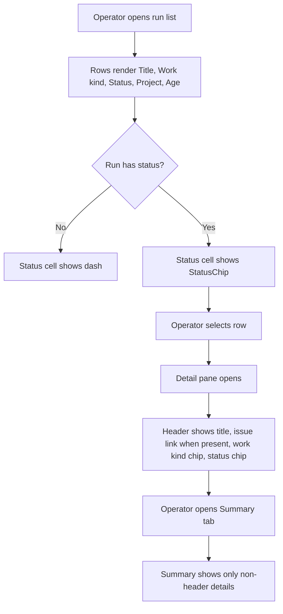
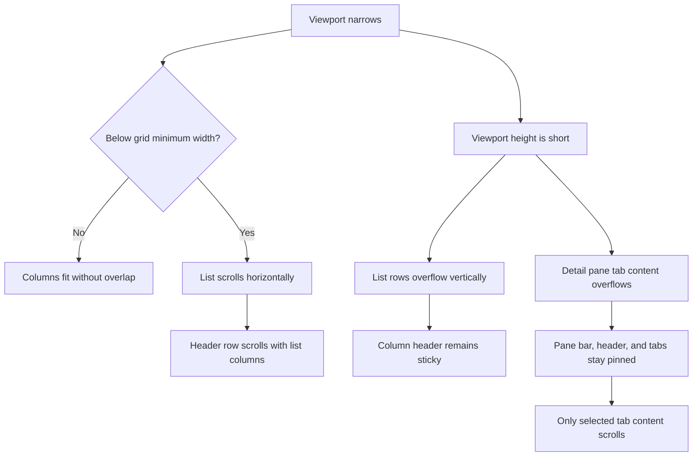
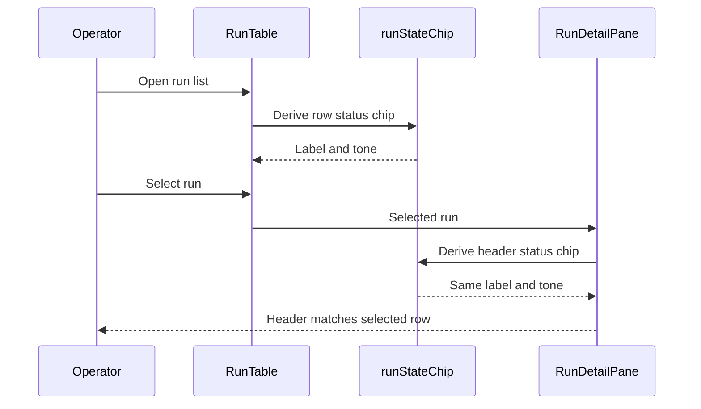

# Run status chip, list, and detail pane tidy

## What

Autocatalyst will show each run's state with one consistent status chip everywhere the run appears. The run list and detail pane will use the same vocabulary: `Needs review`, `Working`, `Paused`, `Done`, `Failed`, and `Canceled`. The list will remove duplicate state signals, show work kind as a chip, and keep cells from overlapping at narrow widths.

The detail pane will present the same header structure for every run: title, issue link when present, work kind chip, and status chip. The Summary tab will avoid repeating fields already present in the header and will use a clearer two-column description layout. The pane bar, header, and tabs will remain in place while tab content scrolls.

## Why

Today, the same run state is expressed through a status dot, a status word, a waiting column, and different pane header behavior. This makes it harder for operators to scan runs and understand whether action is required. One shared chip vocabulary makes the state legible, reduces repeated information, and aligns with the design system rule that the primary filled signal should mean human attention is needed.

The list and pane also need to behave predictably in constrained layouts. Cells must not draw over each other, and the detail pane should keep orientation elements visible while operators scroll through tab content.

## Personas

- **Olive: Operator** - Reviews Autocatalyst runs, identifies which runs need human attention, and inspects details in the pane.
- **Dana: Developer** - Maintains the web client and tests, using one state mapping to keep UI behavior consistent.

## Narratives

### Operator scans the run list

Olive opens the Autocatalyst web client to review active and completed runs. Each row has a title, work kind chip, status chip, project, and age. The row needing input shows a filled `Needs review` chip, rows still executing show `Working`, and completed rows show terminal state chips. `Paused` is kept as a defensive unit-tested mapping for impossible or malformed client input; operators should not see it in fake mode or real control-plane responses.

Olive narrows the browser beside another window. The list keeps its columns separated, clips long content, and scrolls horizontally below its minimum width instead of letting cells overlap. When the list is tall enough to scroll, the column header stays visible.

### Operator inspects a run

Olive selects a run and opens the detail pane. The pane header always shows the run title, issue link when one exists, work kind chip, and the same status chip shown in the selected list row. Long titles are capped at two lines but remain available through the title attribute.

Olive opens Summary and sees only details not already in the header: current step for an in-progress run, failure reason for a failed run, pull request, time, tokens, and cost. While Olive scrolls tab content, the pane bar, header, and tab list stay in place.

## User stories

**Operator scans the run list**

- Olive can identify runs needing human review by finding the only filled `Needs review` chip.
- Olive can compare run states in the list using one status vocabulary.
- Olive can read work kind as a neutral chip separate from status.
- Olive can narrow the browser without list cells overlapping.
- Olive can scroll long lists while the column header remains visible.

**Operator inspects a run**

- Olive can see issue, work kind, and status in the detail pane header for every run state.
- Olive can trust that the pane header status chip matches the selected list row.
- Olive can read Summary details without repeated issue, work kind, or state rows.
- Olive can scroll tab content while the pane bar, header, and tabs stay pinned.

## Goals

- The run list and detail pane use one shared state mapping for all supported `status` and `waitingOn` combinations.
- The list columns are Title, Work kind, Status, Project, and Age, with no status dot and no Waiting on column.
- The detail pane header consistently shows title plus issue, work kind, and status metadata.
- The Summary tab removes duplicated header fields and uses a fixed-width description label column.
- Automated unit, component, and Playwright coverage verifies state mapping, list geometry, sticky headers, pane scrolling, and documentation-relevant scenarios without model calls.

## Non-goals

- Changing row divider weight or the settings button placement.
- Naming the specific gate in the status chip, such as `Needs spec review`.
- Adding renaming, run actions, pane menus, progress bars, or Activity list changes.
- Removing the `Waiting on` concept from unbuilt issue #159 or #160 work if that work has not landed.
- Changing the footer connection indicator, which keeps its red dot.

## Design spec

### User flows





### Key UI components

#### StatusChip

- Renders the shared run state label with the design-system `Chip` component.
- Uses the table below as the complete vocabulary and tone mapping.
- Shows no chip when `status` is absent; callers render the existing dash placeholder.
- Preserves the design-system rule that `Needs review` is the only filled primary chip in the list or pane.

| `status` | `waitingOn` | Chip | Tone |
| --- | --- | --- | --- |
| `in_progress` | `human` | `Needs review` | `primary` filled |
| `in_progress` | `ai` or `system` | `Working` | `muted` |
| `in_progress` | `none` or missing | `Paused` | `muted` |
| `done` | any | `Done` | `green` |
| `failed` | any | `Failed` | `red` |
| `canceled` | any | `Canceled` | `muted` |
| absent | any | dash, no chip | none |

#### Run list

- Columns are Title, Work kind, Status, Project, and Age, in that order.
- The title cell no longer includes a status dot.
- Work kind renders as a neutral `Chip`.
- Status renders `StatusChip` or a dash when status is missing.
- Fixed column widths are named constants; the title column has a minimum width of 10rem.
- Cells clip overflow, title text truncates, and below the total minimum the list scrolls sideways with the header row.
- The column header row remains sticky during vertical list scrolling.

#### Detail pane header

- The header title uses `--text-lg`, weight 500, a maximum of two lines, and a `title` attribute containing the full text.
- The meta line always contains the same three fields where available: issue number as a link, work kind chip, and `StatusChip`.
- A run with no `trackedIssue` uses its run id as the title and omits the issue link.

#### Detail pane Summary

- Summary removes Issue, Work kind, and State rows because the header owns those fields.
- Summary rows are Step for in-progress runs, Failure for failed runs with `failureReason`, Pull request, Time, Tokens, and Cost.
- Step values use `--font-mono`; Failure values use `--color-red`.
- Summary uses the shared `DescriptionList` / `DescriptionItem` row layout with a fixed-width name column token `--width-description-label` set to 7rem. `DescriptionItem` changes from its merged label-above-value block (`flex-col`, `dt` in `--text-xs`, `dd` in `--text-base`) to this row layout because Summary is its only caller. Names use `--text-sm` and `--color-subtext`; values use `--text-sm` and `--color-text`, wrap inside the value column, and do not overlap the name column.
- At the pane minimum width of 320px, with 288px content, the value column still has 176px.

#### Detail pane scrolling

- The pane bar, header, and tab list stay pinned.
- Only the active tab content scrolls below the tab list.
- The fixed header block stays short by clamping long titles to two lines.

### Visual references

No new mockups are required. The implementation should use the design-system `Chip` and `DescriptionList` components from #175 and update the component gallery to show the new status chip states and description list layout.

## Tech spec

### Introduction and overview

#### Prerequisites and assumptions

- Depends on #175 for `Chip`, `DescriptionList`, and gallery support.
- Depends on #135 for the run detail pane structure and fake-mode scenarios.
- Assumes #159 and #160 filtering/grouping work has not landed. If it has landed, this feature merges `Waiting on` into Status in that code and records the change in the implementation PR.
- Replaces #140's waiting chip language with the `Needs review` status chip in the pane header.

#### Goals and objectives

- Centralize status presentation in one `runStateChip(run)` function.
- Remove duplicated status/waiting presentation helpers from `apps/web/src/runs/run-fields.ts`.
- Keep list and detail pane status labels identical for every fake-mode scenario.
- Prevent horizontal overlap at narrow widths and preserve sticky/pinned navigation elements.

#### Non-goals

- No backend API or database changes.
- No model calls in tests.
- No changes to run lifecycle semantics beyond client-side display labels.

#### Glossary

- **Status chip**: The single chip that presents derived run state from `status` and `waitingOn`.
- **Needs review**: The filled primary state for any in-progress run waiting on a human.
- **Paused**: A defensive muted state for impossible or malformed client input where an in-progress run has `waitingOn: none` or missing `waitingOn`. The control plane sets `waitingOn` for non-terminal runs, and terminal derivation treats `waitingOn: none` as terminal, so `Paused` is unit-tested only and is not expected in fake-mode demos or real run data.

### System design and architecture

```mermaid
graph TD
    A[Run data] --> B[runStateChip(run)]
    B --> C[StatusChip]
    C --> D[Run list Status cell]
    C --> E[Detail pane header]
    F[Run work kind] --> G[Neutral Chip]
    G --> H[Run list Work kind cell]
    G --> I[Detail pane meta line]
    J[Run detail data] --> K[Summary DescriptionList]
```

#### Component breakdown

- `apps/web/src/runs/run-state.ts` defines `runStateChip(run)` and the status chip label/tone type.
- `apps/web/src/runs/status-chip.tsx` renders `Chip` for a non-empty state result.
- `apps/web/src/runs/run-fields.ts` removes `STATUS_DOT`, `statusWord`, `WAITING_LABELS`, and `waitingCell`. Remaining field helpers continue only if still needed.
- `apps/web/src/runs/run-table.tsx` removes the status dot and Waiting on column, renders work kind and status chips, clips cells, and uses named grid constants.
- `apps/web/src/runs/run-list-constants.ts` holds grid sizing constants, including `RUN_LIST_TITLE_MIN_REM = 10`.
- `apps/web/src/runs/run-detail-header.tsx` renders title and the issue/work-kind/status meta line.
- `apps/web/src/runs/run-detail-summary.tsx` removes duplicated rows and uses the updated `DescriptionList` layout.
- `apps/web/src/runs/run-detail-pane.tsx` changes scrolling so pane bar, header, and tabs are pinned while tab content scrolls.
- Design-system token documentation adds `--width-description-label`.

#### Sequence: list-to-pane consistency



### Detailed design

#### Data model and schema

No data model, database schema, or API contract changes are required. This feature derives display state from existing run fields.

#### State mapping

`runStateChip(run)` returns either a chip descriptor or `null` for missing status. The descriptor includes the display label, chip tone, and whether the chip is filled when needed by the `Chip` API. Terminal statuses ignore `waitingOn`. In-progress runs map `human` to `Needs review`, `ai` and `system` to `Working`, and `none` or missing `waitingOn` to `Paused`.

#### Layout rules

- The list grid template uses named constants for every fixed column and title minimum.
- The title column uses a non-zero minimum and the title cell sets `min-width: 0`, `overflow: hidden`, and text truncation.
- Every grid cell clips content to its own box.
- The list container provides horizontal scrolling below the grid minimum, with the header inside the same horizontal scroll context.
- The detail pane uses a fixed outer shell for pane bar, header, and tab list, with an inner scroll region per selected tab.

### Security, privacy, and compliance

- No new user input, backend endpoints, authentication, authorization, persistence, or sensitive data handling is introduced.
- Existing issue links, run ids, pull request data, token counts, and cost values remain client-rendered display data.
- Tests must use fake mode and seeded data only; no model calls are allowed.

### Observability

- No new logs, metrics, or alerts are required.
- Existing client error handling remains unchanged.

### Testing plan

- Unit tests cover `runStateChip(run)` for every table row, including missing `status` and missing `waitingOn` on an in-progress run.
- Component tests cover `StatusChip`, list columns, work kind chip, dash behavior, title cell clipping, detail header, title clamp, Summary rows, and the changed `DescriptionList` / `DescriptionItem` row layout, including long value wrapping without overlapping the name column.
- Playwright tests in fake mode cover all scenarios, row-cell non-overlap at specified viewports and pane widths, sticky list header, horizontal list scroll at 600px, matching row/header chip text, pinned pane header/tabs while tab content scrolls, and updated geometry in light/dark with sidebar open/closed. No Playwright test or manual demo step expects a `Paused` chip because it is unreachable from control-plane/fake-mode data.
- Existing tests that assert old waiting text, status dots, Waiting on column, Summary State row, or whole-body pane scrolling are updated with replacement coverage rather than deleted. Updated tests keep their query strength: role-based queries such as `columnheader`, `row`, `heading`, and `link` stay role-based and are never weakened to text-only queries. The pull request description lists each removed assertion next to its replacement, one line each. Every e2e test that does not assert removed behavior passes unchanged, and `pnpm nx run web:e2e` is run and passes before submission.

### Alternatives considered

- Keep separate Status and Waiting on columns: rejected because it preserves duplicate vocabulary and actor-oriented labels.
- Keep the status dot in the title cell: rejected because it creates an extra state signal and competes with the chip.
- Render pane status independently from list status: rejected because it risks drift and fails the consistency goal.

### Risks

- If #175 or #135 changes component APIs before this work starts, chip and pane integration may need small adaptation.
- If #159 or #160 lands first, their waiting filters/grouping must be updated to the merged Status vocabulary.
- Sticky header and pinned pane behavior can be sensitive to scroll-container nesting; Playwright geometry tests are required to prevent regressions.

## Task list

- [ ] **Story: Centralize run state presentation**
  - [ ] **Task: Add shared run state mapping**
    - **Description**: Create `apps/web/src/runs/run-state.ts` with `runStateChip(run)` that derives the complete status chip descriptor from existing `status` and `waitingOn` fields. Return no descriptor when `status` is absent.
    - **Acceptance criteria**:
      - [ ] `in_progress` plus `human` returns `Needs review` with filled primary tone.
      - [ ] `in_progress` plus `ai` or `system` returns `Working` with muted tone.
      - [ ] `in_progress` plus `none` or missing `waitingOn` returns `Paused` with muted tone.
      - [ ] `done`, `failed`, and `canceled` return `Done`, `Failed`, and `Canceled` with green, red, and muted tones respectively.
      - [ ] Missing `status` returns no chip descriptor so callers can render a dash.
      - [ ] Unit tests cover every mapping row and missing-field case.
    - **Dependencies**: None
  - [ ] **Task: Add reusable StatusChip component**
    - **Description**: Create `apps/web/src/runs/status-chip.tsx` that calls `runStateChip(run)` and renders the design-system `Chip` for descriptor results. Ensure `Needs review` is the only filled chip state.
    - **Acceptance criteria**:
      - [ ] `StatusChip` renders the correct label and tone for each run state.
      - [ ] `StatusChip` renders no chip for missing `status`, leaving dash rendering to the caller.
      - [ ] A component test renders all states and asserts only `Needs review` is filled.
      - [ ] The #175 gallery shows `StatusChip` in each state.
    - **Dependencies**: "Task: Add shared run state mapping"
  - [ ] **Task: Remove legacy status and waiting helpers**
    - **Description**: Delete `STATUS_DOT`, `statusWord`, `WAITING_LABELS`, and `waitingCell` from `apps/web/src/runs/run-fields.ts`, move relevant tests to `runStateChip`, and update imports throughout `apps/web/src`.
    - **Acceptance criteria**:
      - [ ] No file in `apps/web/src` imports the removed helpers.
      - [ ] Tests in `run-fields.spec.ts` that previously covered legacy helpers move to `runStateChip` coverage without reducing the set of state combinations.
      - [ ] The web client builds without unused exports or imports from `run-fields.ts`.
    - **Dependencies**: "Task: Add shared run state mapping"; "Task: Add reusable StatusChip component"

- [ ] **Story: Tidy the run list**
  - [ ] **Task: Update run list columns and cells**
    - **Description**: Change `run-table.tsx` so the columns are Title, Work kind, Status, Project, and Age. Remove the title status dot and Waiting on column. Render work kind with a neutral `Chip`, render status with `StatusChip`, and render a dash for missing status.
    - **Acceptance criteria**:
      - [ ] Column headers appear as Title, Work kind, Status, Project, Age in that order.
      - [ ] No title cell contains a status dot.
      - [ ] Work kind cells render neutral chips.
      - [ ] Status cells render `StatusChip` or a dash for missing status.
      - [ ] Existing tests in `run-table.spec.tsx` that asserted the Waiting on column header, old waiting text, or status dot are updated with new status/work-kind chip coverage without weakening `columnheader` or `row` role queries.
    - **Dependencies**: "Task: Add reusable StatusChip component"; "Task: Remove legacy status and waiting helpers"
  - [ ] **Task: Add robust list sizing and clipping**
    - **Description**: Move fixed grid widths into `run-list-constants.ts`, add `RUN_LIST_TITLE_MIN_REM = 10`, give every cell overflow clipping, and ensure the title cell has `min-width: 0` and text truncation.
    - **Acceptance criteria**:
      - [ ] The grid template uses named constants for fixed columns and title minimum width.
      - [ ] Every cell clips content inside its bounding box.
      - [ ] The title cell has `min-width: 0` and `overflow: hidden`.
      - [ ] Component tests assert the title cell clipping styles.
    - **Dependencies**: "Task: Update run list columns and cells"
  - [ ] **Task: Cover list geometry with Playwright**
    - **Description**: Add fake-mode Playwright coverage for list row cell boundaries, sticky vertical header behavior, and horizontal scrolling below the grid minimum.
    - **Acceptance criteria**:
      - [ ] A production-path fake-mode test seeds all scenarios and uses a 1024x700 viewport.
      - [ ] For every row, no cell bounding box intersects the next cell's bounding box.
      - [ ] The non-overlap test repeats with the detail pane at minimum and maximum width.
      - [ ] A short-viewport test scrolls the list down, sees the column header top edge unchanged, and sees the first row scrolled out of view.
      - [ ] A 600px viewport test verifies horizontal list scrolling and header row horizontal alignment.
    - **Dependencies**: "Task: Add robust list sizing and clipping"

- [ ] **Story: Tidy the detail pane**
  - [ ] **Task: Standardize the detail pane header**
    - **Description**: Update `run-detail-header.tsx` so every run state uses the same structure: clamped title over a meta line with issue link when present, neutral work kind chip, and `StatusChip`. Use run id as title and omit the issue link when `trackedIssue` is absent.
    - **Acceptance criteria**:
      - [ ] Header shows title, issue link, work kind chip, and `StatusChip` for `spec-review`, `implementation-review`, `pr-open`, `merged`, and `failed`.
      - [ ] A run with no `trackedIssue` shows its run id as title and no issue link.
      - [ ] A 300-character title clamps to two lines and exposes the full text in the `title` attribute.
      - [ ] Component tests in `run-detail-header.spec.tsx` cover header scenarios and title clamp, preserving role-based `heading` and `link` queries where the old tests used them.
    - **Dependencies**: "Task: Add reusable StatusChip component"
  - [ ] **Task: Update Summary rows and DescriptionList layout**
    - **Description**: Update `run-detail-summary.tsx` to remove Issue, Work kind, and State rows; conditionally show Step and Failure; preserve Pull request, Time, Tokens, and Cost states; and use `DescriptionList` with the new fixed label width token.
    - **Acceptance criteria**:
      - [ ] Summary never renders Issue, Work kind, or State rows.
      - [ ] Step appears only for in-progress runs and uses `--font-mono`.
      - [ ] Failure appears only for failed runs with `failureReason` and uses `--color-red`.
      - [ ] Pull request, Time, Tokens, and Cost behavior remains covered for loading, error, and unknown-cost states from #135.
      - [ ] `--width-description-label` is added with value 7rem and documented in the design-system dimensions table.
      - [ ] The shared `DescriptionItem` component changes from label-above-value (`flex-col`, `dt` `--text-xs`, `dd` `--text-base`) to the row layout because Summary is its only caller.
      - [ ] Existing `DescriptionItem` unit tests that assert label-above-value classes are updated intentionally to assert the row classes, fixed name column, `--text-sm` name/value text, and wrapping value column.
      - [ ] A unit test verifies a long value wraps inside the value column and does not overlap the name column.
      - [ ] The gallery `DescriptionList` entry shows the new name/value layout.
      - [ ] Component tests in `run-detail-summary.spec.tsx` cover each scenario's Summary rows, including removal of the old State row and preserving role/query strength where applicable.
    - **Dependencies**: "Task: Standardize the detail pane header"
  - [ ] **Task: Pin pane chrome and scroll only tab content**
    - **Description**: Update `run-detail-pane.tsx` layout so the pane bar, detail header, and tab list remain fixed while the active tab content scrolls beneath the tab list. Update geometry assertions for the new structure.
    - **Acceptance criteria**:
      - [ ] A short-viewport Playwright test scrolls active tab content and sees the header and tab list top edges unchanged.
      - [ ] The scroll test passes at default, minimum, and maximum pane widths.
      - [ ] The scroll test passes for each selected tab.
      - [ ] Existing geometry assertions for title, meta line, tabs, and body positioning pass in light and dark with sidebar open and closed.
      - [ ] Existing tests that asserted whole-body scrolling in `e2e/run-detail.spec.ts` are updated with pinned-layout coverage without weakening role-based queries.
    - **Dependencies**: "Task: Standardize the detail pane header"; "Task: Update Summary rows and DescriptionList layout"
  - [ ] **Task: Assert list and pane status consistency**
    - **Description**: Add Playwright coverage that selects each seeded scenario and verifies the detail pane header status chip text equals the selected row status chip text.
    - **Acceptance criteria**:
      - [ ] The test covers `spec-review`, `implementation-review`, `pr-open`, `merged`, and `failed`.
      - [ ] Each scenario compares visible list-row chip text with visible pane-header chip text.
      - [ ] The test uses fake mode and makes no model calls.
    - **Dependencies**: "Task: Update run list columns and cells"; "Task: Standardize the detail pane header"

  - [ ] **Task: Preserve test strength while updating removed-behavior assertions**
    - **Description**: Audit changed tests that mention removed behavior and update them to assert the new behavior without weakening query style. Cover at least `run-fields.spec.ts`, `run-table.spec.tsx`, `run-detail-header.spec.tsx`, `run-detail-summary.spec.tsx`, and `e2e/run-detail.spec.ts`.
    - **Acceptance criteria**:
      - [ ] Role-based queries remain role-based; `columnheader`, `row`, `heading`, and `link` assertions are not replaced with weaker text-only queries.
      - [ ] Removed assertions are named and paired with replacements in the pull request description, one line each.
      - [ ] Removed-behavior assertions named in the audit include the Waiting on column header, status dot, Summary State row, and whole-body scrolling.
      - [ ] Every e2e test that does not assert removed behavior passes unchanged.
      - [ ] `pnpm nx run web:e2e` is run and passes before submission.
    - **Dependencies**: "Task: Update run list columns and cells"; "Task: Standardize the detail pane header"; "Task: Update Summary rows and DescriptionList layout"; "Task: Pin pane chrome and scroll only tab content"

- [ ] **Story: Update documentation and navigation context**
  - [ ] **Task: Update design-system and approved concept documentation**
    - **Description**: Update `context-agent/wiki/design-system.md` to describe the new status chip vocabulary, list columns, pane header, pinned scrolling behavior, and `--width-description-label` dimension. Also update one approved sentence in human-owned `context-human/concepts/run-detail.md`: its Summary paragraph must say the header owns issue, work kind, and state, and Summary lists step while in progress, failure reason when failed, pull request, and totals. Approving this spec is the human approval for that single named edit. Leave `context-human/concepts/collection.md` unchanged because it still correctly names status and waiting-on as run item data used by #159 and #160.
    - **Acceptance criteria**:
      - [ ] `context-agent/wiki/design-system.md` updates Status and waiting indicators, Collection, Detail pane, and dimensions sections.
      - [ ] `context-human/concepts/run-detail.md` Summary paragraph is updated to say the header owns issue, work kind, and state, and Summary lists step while in progress, failure reason when failed, pull request, time, tokens, and cost totals.
      - [ ] `context-human/concepts/collection.md` is left unchanged for this issue.
      - [ ] No broad grep-driven edits are made to human-owned concept docs beyond the single approved `run-detail.md` Summary paragraph edit.
    - **Dependencies**: "Task: Update run list columns and cells"; "Task: Update Summary rows and DescriptionList layout"; "Task: Pin pane chrome and scroll only tab content"
  - [ ] **Task: Update code map and verify no model calls**
    - **Description**: Record the new `run-state.ts` and `status-chip.tsx` modules in `context-agent/wiki/code-map.md` and ensure new or updated tests use fake-mode/local fixtures only.
    - **Acceptance criteria**:
      - [ ] `context-agent/wiki/code-map.md` names `run-state.ts` and `status-chip.tsx` with their responsibilities.
      - [ ] No new or updated test calls a model provider.
      - [ ] Documentation and test changes are included with the feature implementation rather than deferred.
    - **Dependencies**: "Task: Add shared run state mapping"; "Task: Add reusable StatusChip component"
