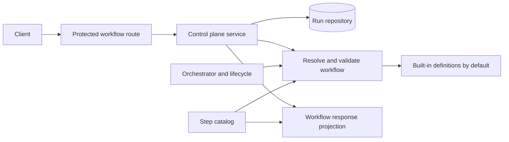
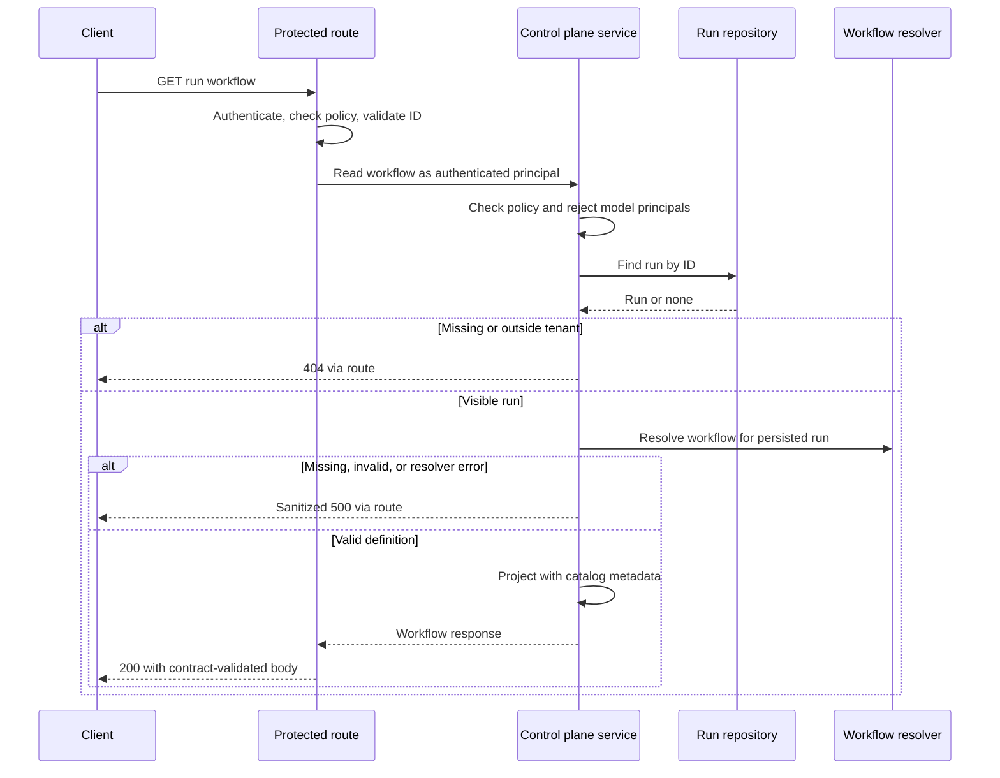

# Run workflow phases and expected path

## What

An authorized client can read a run's phases in order, with their display labels, and see which steps belong to its expected path. The same read describes other steps the workflow can visit and the transitions between steps. Step history remains the record of what happened.

## Why

Step history alone cannot tell an operator what's left or whether the workflow includes a review gate. A client that guesses from history can show a gate the engine never visits or label a bug's Triage phase as Spec. Reading labels and steps from the workflow lets the client display them correctly without a client change when a workflow adds, drops, reorders, or relabels a phase.

## Personas

- **Phoebe: PM** ([product overview](../app.md)). Checks what remains before approving a feature spec.
- **Enzo: Engineer** ([product overview](../app.md)). Checks where a run is waiting and what it can do next.

## Narratives

### See what remains after intake

Phoebe opens a feature run waiting for spec approval. Implementation and Pull request still appear in order, even though neither has a recorded step. She can tell the review gate from a pause for a question.

Phoebe sends the spec back for revision. The workflow still shows the same expected path and the transition back to authoring. History records the new attempt without adding another authoring step to the workflow.

### Tell triage from spec review

Enzo compares a bug run with a feature run. Both include `spec.author`, but the bug's first phase is Triage and it has no spec review gate. The client uses the label supplied for each run instead of assigning a label to `spec`.

Enzo opens a standalone question. The expected path is visible even though the run has no phases. The client doesn't invent a phase or treat its absence as a failed read.

## User stories

**See what remains after intake**

- Phoebe can see the run's phases in order with their display labels.
- Phoebe can see expected steps that the run has not reached.
- Phoebe can distinguish a review gate from a pause for input.
- Phoebe can see where a revision sends the run.
- Phoebe can see repeated attempts in history without duplicate definitions on the expected path.

**Tell triage from spec review**

- Enzo can see Triage as the first phase of a bug run.
- Enzo can tell whether spec review belongs to a run.
- Enzo can distinguish work, gates, pauses, and terminal steps.
- Enzo can match a recorded step to its definition.
- Enzo can distinguish a workflow with no phases from a failed workflow read.

## Goals

- Return the exact ordered expected path and phase labels for all six built-in workflows. A question has no phases; a file-issue run has one.
- Return one definition per included step and one entry per explicit transition. Return the same body at intake and completion for the same run.
- Prove that the production server and engine use the same resolver, including when a run starts on an existing topic.
- Return `403` for policy denial or a model principal and the same `404` for missing and cross-tenant runs after those checks.

## Non-goals

- Store, edit, or select custom workflows through an API or configuration surface. Widening the built-in workflow ID set is out of scope.
- Add a docs phase to a built-in workflow, change any built-in transition table, or change recover or set-step behavior.
- Move all engine behavior into workflow data. The spec review guard, the spec freeze at `pr.finalize` before `pr.open`, and bug-triage artifact recording on `spec.author` advance keep their existing work-kind checks.
- Add step display labels or mark steps as started, skipped, or repeated in the workflow response. History supplies progress and attempts.
- Build the Summary phase bar or Activity path. Those client changes belong to #152.

## Design spec

This feature has no UI changes. A client reads `/workflow` for the phase labels, expected path, and transitions, and `/steps` for recorded occurrences. Join a history row's `step` to a workflow step's `id`; the history row's own `id` identifies the occurrence. An expected step can have zero, one, or multiple occurrences. An empty `phases` array is a successful read. See [Run detail](../concepts/run-detail.md) for the Summary and Activity designs.

Clients use the workflow returned for the requested run. `workflowId` names a built-in workflow family, not a unique definition or version. Two runs with the same `workflowId` can have different phases and paths. Clients must not cache, deduplicate, or compare definitions by `workflowId` alone.

## Tech spec

### Introduction and overview

[ADR-005](../adrs/adr-005-api-style-transport.md) and [ADR-007](../adrs/adr-007-shared-types.md) define contract-first REST with shared Zod schemas. [ADR-009](../adrs/adr-009-auth-rbac-envelope.md) defines the principal and policy point. [ADR-015](../adrs/adr-015-run-lifecycle.md) and [ADR-025](../adrs/adr-025-workflow-step-catalog.md) define lifecycle and workflow composition. The read uses the existing Run, Topic, Conversation, and Project relationships in the [domain model](../concepts/domain-model.md). It requires no persistence or frontend state changes.

The **expected path** is `RunWorkflowDefinition.steps` in declaration order, not a forecast of the transitions a run will take. **Off-path steps** are explicit transition sources or destinations outside that list, plus the global stop destinations `canceled` and `failed`.

### System design and architecture



`createControlPlaneServer` gives the orchestrator and service the same resolver. The engine uses the checked definition for creation, workflow-dependent dispatch, and table directives. The service projects the checked definition with catalog metadata, without reading history. Global stop directives resolve the definition like every other directive, as today.



### Detailed design

#### Workflow and catalog data

Add `phases: readonly { id, label }[]` to `RunWorkflowDefinition` in `packages/core/src/run-workflows.ts`. Each built-in declares its own phases and display labels. The IDs are the distinct non-null phases of the expected steps, in the order they first appear. Each label contains at least one non-whitespace character.

| Work kind | Phase IDs and labels, in order |
| --- | --- |
| `feature`, `enhancement` | `spec`: Spec; `implementation`: Implementation; `pr`: Pull request |
| `bug` | `spec`: Triage; `implementation`: Implementation; `pr`: Pull request |
| `chore` | `implementation`: Implementation; `pr`: Pull request |
| `file_issue` | `spec`: Spec |
| `question` | None |

The bug definition keeps `artifactKind: bug_triage` and omits `spec.human_review`. The orchestrator still records the artifact when `spec.author` advances. No built-in workflow has a docs phase; the catalog's docs steps stay in place.

In `packages/core/src/run-step-catalog.ts`, declare `kind` explicitly on every step: `gate` for `*.human_review`, `pause` for `*.awaiting_input`, `terminal` for `done`, `canceled`, and `failed`, and `work` for all others. Gates and pauses wait on `human`. The engine still uses `waitingOn` for terminality: `kind === 'terminal'` if and only if `waitingOn === 'none'`.

#### One workflow resolver

Define `RunWorkflowResolver` in `packages/core/src/run-workflow-resolver.ts`. It takes a tagged input and returns `RunWorkflowDefinition | null` synchronously or asynchronously. Await it through a shared check at each workflow lookup.

| Input | Caller and required context |
| --- | --- |
| `new_conversation` | `createConversationWithFirstRun` supplies `workKind`, `tenant`, and its already resolved `projectId`. The topic does not exist yet. |
| `existing_topic` | `DefaultOrchestrator.createRun` passes `topicId`, `tenant`, and `workKind` through `startRunLifecycle` before the entry step is written. |
| `existing_run` | Dispatch, table directive application, and the workflow read pass the persisted `Run`, including `id`, `topicId`, `tenant`, and `workKind`. They do not depend on the optional `projectId` in API read models. |

The default resolver reads the static table by work kind and does not look up projects. A project-aware resolver uses the supplied project for `new_conversation`. For both `existing_topic` and `existing_run`, it follows Topic to Conversation to `projectId`, scoped to the supplied tenant. If it cannot establish the project, it returns no definition or reports an internal error; it does not silently fall back to the default. The resolver must select the same definition before and after creation and must not vary it by progress, history, or terminal state. This feature stores neither a definition snapshot nor a workflow ID with the run.

Add an optional `workflowResolver` to `DefaultOrchestrator`, `DefaultControlPlaneService`, and `createControlPlaneServer`. The server selects the supplied function or default once and passes it to both consumers. Independently constructed components and direct lifecycle callers use the same built-in default if none is supplied. Route conversation creation, lifecycle start and table directives, reviewed spec dispatch (including `artifactKind`), reviewed build dispatch, and the runner-result `needs_input` check through the shared resolution path. Intake keeps its separate static lookup for pre-run work-kind validation. Preserve the public `getRunWorkflowForWorkKind` export; no other code uses it to resolve a run.

#### Validate resolved definitions

Use one catalog-aware validation function for definitions supplied by the resolver, including the default. Run it before the engine uses a definition and before the read projects it. The projection takes the requested work kind and a checked definition, or calls that same validation itself if given an unchecked definition. Reject a definition as a whole if any of the following checks fail:

- `workKind` matches the requested or stored work kind. `id` retains the built-in `RunWorkflowId` for that kind (for example, `feature` for all feature definitions). Keep the ID check in `nextWorkflowStep`; the wire ID echoes this family ID.
- The expected path is nonempty and its IDs are distinct known catalog steps. `canceled` and `failed` are reserved for global stops, not expected steps or explicit transition endpoints.
- Phase IDs match the distinct non-null phases of the expected path in first-appearance order, without omissions, duplicates, or extras. Every label is nonblank. Every non-null phase on a transition endpoint must be declared, even if the endpoint is off path.
- Every defined transition has known catalog endpoints, a nonterminal source, and a directive of `advance`, `revise`, or `needs_input`. An optional transition slot with no value is not an edge. The validator does not traverse the graph or reject loops.

The read returns a sanitized `500` for a visible run if resolution returns `null`, throws, or returns an invalid definition. It returns no partial workflow, repairs no metadata, and does not use a fallback. For engine callers, a missing definition uses the existing `unknown_work_kind` path. An invalid definition or resolver exception uses the internal workflow/persistence error path, not an invalid user directive. Creation records no entry step and table directive application records no transition when resolution fails. Dispatch that needs the definition stops on that error rather than choosing a default or a different dispatch path. A valid definition with no requested edge keeps existing invalid-transition handling.

#### Global stops are unchanged

`cancel` and `fail` keep their current lifecycle behavior. `applyRunDirective` resolves the workflow and applies `nextWorkflowStep` for them as for any other directive, including the existing `step_not_in_workflow` guard, and no result shape changes. The built-in resolver cannot fail for a stored run, so stops stay available in this feature. A resolver that can fail, such as a future per-project workflow source, must decide how stops behave when resolution fails; that decision is out of scope here.

#### HTTP and SDK contract

`GET /v1/runs/:id/workflow` uses bearer authentication and the existing `runIdParamsSchema`. It has no request body or endpoint-specific query parameters. Export the path, `200` success status, `runWorkflowResponseSchema`, and inferred `RunWorkflowResponse` from `packages/api-contract`. Register `GET /v1/runs/{id}/workflow` in generated OpenAPI. Add `getRunWorkflow(id)` to `packages/sdk/src/client.ts`; use the shared path and parse the success body with the contract schema.

| Field | Contract |
| --- | --- |
| `workflowId` | Non-empty string from the resolved definition's built-in `id`. Identifies a workflow family, not a unique definition, version, or cache key. |
| `workKind` | The resolved definition's work kind, equal to the run's `workKind`. Reuse `runWorkKindSchema`. |
| `phases` | Ordered array of `{ id, label, steps }`. Each label is nonblank. `steps` lists the IDs of all included steps in that phase, in response step order. |
| `steps` | Ordered array of `{ id, phase, kind, waitingOn, roles, onPath }`. `phase` is a phase ID or `null`; `kind` is `work`, `gate`, `pause`, or `terminal`; `waitingOn` uses `waitingOnSchema`; `roles` lists `implementer` or `reviewer` in catalog order and can be empty; `onPath` is boolean. |
| `transitions` | Array of `{ from, directive, to }`, one per defined table edge. Both endpoints appear in `steps`. Directives are `advance`, `revise`, and `needs_input`. |

Use strict response objects and non-empty ID strings. The contract package does not import the core catalog. Use standard error envelopes: `400` for invalid path parameters, `401` for failed authentication, `403` for policy denial or a model principal, `404` for a missing or cross-tenant run, and sanitized `500` for internal faults.

#### Projection and ordering

1. Enumerate each defined `(source, directive, destination)` in transition table declaration order and collect both endpoints. Include revision loops and edges entering and leaving pauses. Do not infer edges from adjacent steps.
2. Emit expected steps in declaration order with `onPath: true`. Append other transition endpoints in catalog order with `onPath: false`, then append `canceled` and `failed` in that order, also off path. Emit each ID once; get `phase`, `kind`, `waitingOn`, and `roles` from the catalog. `done` ends every built-in expected path.
3. Emit phases in workflow declaration order. For each phase, take its matching step IDs in response step order. Steps with `phase: null`, such as `intake`, `issues.file`, `question.answer`, and the terminal steps, appear only in the top-level `steps` array. Do not add phases or steps because they are present in the catalog.

In OpenAPI, describe `transitions` as the explicit table edges. State that `cancel` and `fail` lead from every nonterminal step to `canceled` and `failed`, respectively, and are not listed. State that recover reopens a failed run using its stopped step and recovery mode, and set step moves a run back to a step it already reached; both moves are outside the table. Document the family ID semantics on `workflowId`. The read does not depend on `currentStep` or occurrence history. Existing run and `/steps` reads stay unchanged.

### Security, privacy, and compliance

Add `run_workflow.read` and `{ kind: 'run_workflow', id, path: '/v1/runs/:id/workflow' }` in `packages/core/src/policy.ts`. Follow recover: authorize in the protected route before handler work, then authorize in the service before the principal kind check or repository access. After policy allows the request, call `requireNonModelPrincipal`. Extend it to take an action-specific message; this read uses "Model principals cannot read run workflows." Existing feedback callers keep their current message. Scope the read to the authenticated principal's tenant. A missing run and a foreign run return the same not-found envelope. Do not call the resolver for denied requests, model principals, missing runs, or foreign runs. The response contains definition metadata only, with no history, run content, identities, or credentials.

### Observability

Use existing HTTP request telemetry and sanitized internal error handling. Do not add route-specific logging of definitions, principal data, or raw errors. No new metrics, events, or alerts are needed.

### Testing plan

- **Catalog and projection:** Test the six exact phase lists and labels and separately compare IDs to first appearance on each expected path. Classify every catalog step, including unused docs steps, and check the terminal kind and waiting class in both directions. Assert exact step order, uniqueness, roles, null phases, off-path phase membership, and exact table edges, including revision and pause return. Assert no synthesized stop or operator edges.
- **Malformed definitions:** Feed the projection separately mutated definitions for a mismatched `workKind`, wrong family ID, bad phase order or membership, a blank label, and a transition-only step whose non-null phase isn't declared. For the last case, keep the expected phase list valid, for example by adding a transition to `spec.awaiting_input` in a definition with no spec phase. Assert rejection before any response object is returned. Exercise a malformed definition, a `null` result, and a thrown resolver error over HTTP for a visible run; assert sanitized `500` responses with no definition details. Check that an invalid definition also prevents lifecycle start and table transition writes.
- **Lifecycle and resolver boundaries:** Assert that `cancel` and `fail` still resolve the definition and follow the existing `nextWorkflowStep` rules, including `step_not_in_workflow` and `terminal_step`, with unchanged results. Assert an `advance` with a `null` resolution reports `unknown_work_kind` without a write. Scan non-test `packages/core/src` for `getRunWorkflowForWorkKind`; permit it only in `run-workflows.ts`, the resolver, intake's import and default lookup, and the `index.ts` export.
- **Project selection and family IDs:** Seed two topics in different projects in one tenant. With the same project-aware resolver, real orchestrator and service, and auto-dispatch disabled, create two feature runs through `DefaultOrchestrator.createRun` using topic context only. Give one project a valid test definition with a distinct entry step and `advance` target. Assert its persisted entry, service read, and next step agree; assert the other project receives the default. Assert the two bodies both report `workflowId: feature` but differ in path, and that creation and stored-run resolution find the project through the same topic relationship.
- **HTTP, policy, and SDK:** Read all six built-ins over HTTP; compare on-path order with the workflow constants and phase labels with explicit expectations. Drive one `question` run with scripted sessions from `intake` through `question.answer` to `done`; read `/workflow` at `intake` and at `done` and assert identical bodies. A feature run cannot reach `done` here because the spec freeze needs a spec. Assert policy action and descriptor, policy and model check ordering, denial and model `403` responses (asserting the model-principal message), and identical missing and foreign `404` bodies. Use spies to prove the repository and resolver calls stop at the appropriate checks. Test SDK parsing of valid and malformed success bodies. In `openapi.spec.ts`, assert the operation, `403`, `404`, and the transition and family ID descriptions.
- **Production wiring:** Use `createControlPlaneServer` with scripted sessions and real orchestrator dispatch. Start a feature and bug through `POST /v1/conversations`. Assert the feature has a `spec.human_review` gate, the bug has none, and the bug's first phase is Triage. Drive the bug past triage so the check covers more than intake. Assert every `/steps` row's `step` is in the workflow for its run.
- **Production override:** In a separate server test, inject a feature definition with the same `feature` ID, the `spec` phase and its steps and edges removed, `implementation` relabeled, and `intake.advance` pointing to `implementation.plan`. Start through `POST /v1/conversations`, and assert the resolver receives the selected project at creation. Assert the read returns the override, then drive the real orchestrator with scripted sessions from `intake` through `implementation.human_review`. Assert that history follows the returned path and never enters `spec.*`. Stop before `pr.finalize`: the unchanged feature spec freeze still requires a spec. No test makes a live model call.

#### Manual check

Start `pnpm nx run control-plane:serve-fake`, then run `pnpm nx run control-plane:seed-fake -- --scenario spec-review` in another shell (#128). Substitute the printed run ID:

```bash
curl -s -H 'Authorization: Bearer fake-mode-token' http://127.0.0.1:4010/v1/runs/<run-id>/workflow
```

Expect Spec, Implementation, and Pull request in order, `spec.human_review` as an on-path gate, `spec.awaiting_input` as an off-path pause, and `done` at the end of the expected path. Compare with `/steps` for the same run, which lists only recorded occurrences.

### Alternatives considered

- **Derive the path from history in the client.** This avoids a new read but omits steps not yet reached and duplicates labels and workflow knowledge.
- **Resolve the definition independently in the route and engine.** This works for static tables but lets selection drift. Sharing resolution and validation keeps the consumers aligned without adding storage.
- **Widen the workflow ID set.** This could distinguish definitions if IDs were assigned and managed as versions. Keep the existing family IDs because this feature does not store or manage custom definitions.
- **Bypass resolution for stop directives.** This would keep stops available if a resolver could fail, but it changes lifecycle behavior, drops the `step_not_in_workflow` guard, and adds a result shape the issue does not ask for. The built-in resolver cannot fail, so stops keep resolving; revisit when a resolver can fail.

### Risks

- **Creation and the read choose different definitions.** Require project context for new conversations and topic context for existing topics; test project selection across creation, read, and advance. Without a snapshot, a resolver implementation is responsible for keeping its selection stable for the run's lifetime.
- **Invalid metadata hides a phase member or disagrees with the engine.** Validate before projection and engine use; reject the whole definition on failure.
- **A client confuses workflow identity with definition identity or history.** Document the family ID and occurrence join key. Test distinct bodies with a shared ID and identical bodies across lifecycle states for a single run.
- **The endpoint reveals a hidden run.** Check policy, principal kind, and tenant before resolution; test the short circuits and identical `404` envelopes.

## Task list

- [ ] **Story: Describe the workflow the engine runs**
  - [ ] **Task: Declare phase labels and catalog kinds**
    - **Description**: Add ordered phases to each built-in and explicit kinds to every catalog entry without changing paths or transition tables.
    - **Acceptance criteria**:
      - [ ] Tests assert the six exact phase lists and labels, first-appearance order, nonblank labels, and no built-in docs phase.
      - [ ] Tests classify every catalog step and assert terminal kind agrees with `waitingOn: none` in both directions.
    - **Dependencies**: None
  - [ ] **Task: Centralize and validate run workflow resolution**
    - **Description**: Add the resolver, its three input forms, and shared validation. Wire both consumers through server composition and migrate engine lookups.
    - **Acceptance criteria**:
      - [ ] New-conversation creation supplies project ID; existing-topic creation supplies topic ID and tenant before the first step is written.
      - [ ] Creation, table directives, reviewed spec and build dispatch, and the runner-result pause check use checked resolution. Work-kind guards and artifact side effects remain in place.
      - [ ] The server gives both consumers one resolver. The source scan permits direct static lookup only in the workflow module, resolver, intake default lookup and import, and public export.
      - [ ] Invalid definitions fail the shared checks; missing or invalid definitions do not produce lifecycle start or table transition writes.
    - **Dependencies**: Task: Declare phase labels and catalog kinds
- [ ] **Story: Read a run's workflow over HTTP**
  - [ ] **Task: Define the contract and SDK read**
    - **Description**: Add the shared response schema, OpenAPI operation, and schema-parsing SDK method.
    - **Acceptance criteria**:
      - [ ] OpenAPI tests assert the operation, `403`, `404`, scope of `workflowId`, and the descriptions of global stops and operator moves outside the table.
      - [ ] SDK tests prove `getRunWorkflow(id)` calls the workflow route and validates the success body.
    - **Dependencies**: None
  - [ ] **Task: Project and serve the tenant-scoped workflow**
    - **Description**: Add the projection, policy descriptor and action, service read, and protected handler.
    - **Acceptance criteria**:
      - [ ] Projection tests assert exact step and edge output, including off-path phase members, null phases, revision and pause edges, and the two appended stop destinations.
      - [ ] Malformed definitions are rejected before projection; visible runs with absent, throwing, or invalid resolution get a sanitized `500` without a partial body or fallback.
      - [ ] Policy runs before data access, model principals get `403` with the workflow-specific message under permissive policy, and missing and foreign runs get identical `404` bodies without resolver calls.
      - [ ] The handler validates the response without reading history or mutating run state.
    - **Dependencies**: Task: Centralize and validate run workflow resolution; Task: Define the contract and SDK read
- [ ] **Story: Verify and document the shared workflow**
  - [ ] **Task: Verify built-in workflow reads**
    - **Description**: Exercise all six HTTP reads and the production feature and bug wiring with deterministic fixtures and scripted sessions.
    - **Acceptance criteria**:
      - [ ] All six reads match expected step order and phase labels. `question` has no phases and `file_issue` has only Spec.
      - [ ] Reads of one scripted `question` run at `intake` and at `done` yield identical bodies.
      - [ ] Feature and bug runs created over HTTP expose the expected gate difference and Triage label. Every recorded step is in the matching workflow. No live model calls occur.
    - **Dependencies**: Task: Project and serve the tenant-scoped workflow
  - [ ] **Task: Verify project selection on existing-topic creation**
    - **Description**: Test `DefaultOrchestrator.createRun` using a project-aware resolver and feature runs on topics in two projects.
    - **Acceptance criteria**:
      - [ ] Creation supplies topic context only; the initial step, service read, and applied directive use the same project-specific definition. The other project gets the default.
      - [ ] The two response bodies differ in path while both report `workflowId: feature`. No live model calls occur.
    - **Dependencies**: Task: Project and serve the tenant-scoped workflow
  - [ ] **Task: Verify the production override**
    - **Description**: Inject the spec-free, relabeled feature definition into the production server and drive the real orchestrator with scripted sessions.
    - **Acceptance criteria**:
      - [ ] The route returns the override's relabeled phase and path, without spec steps or edges.
      - [ ] The run starts over HTTP, follows the override from intake through implementation review, and stops before `pr.finalize`. No live model calls occur.
    - **Dependencies**: Task: Project and serve the tenant-scoped workflow
  - [ ] **Task: Document the workflow read and metadata**
    - **Description**: Record the endpoint and its source of truth in the agent code map. Add the concept sentence covered by spec approval.
    - **Acceptance criteria**:
      - [ ] `context-agent/wiki/code-map.md` records the route, resolver, phase labels, and catalog `kind`.
      - [ ] Add one sentence to `context-human/concepts/workflow.md` (approving this spec at `spec.human_review` approves the sentence; PR review approves its wording): “Each workflow carries its ordered phases with display labels.” Follow `context-agent/standards/editorial-guidelines.md` and leave the docs-phase design unchanged.
    - **Dependencies**: Task: Project and serve the tenant-scoped workflow
