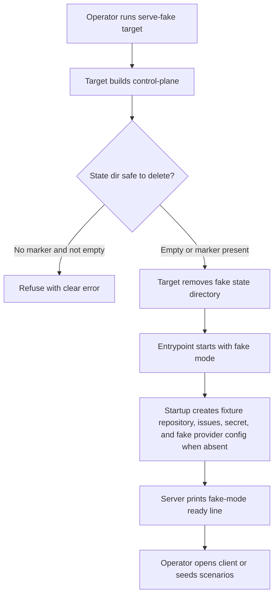
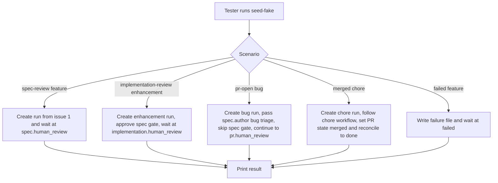

# Scripted fake mode and seed command for the control plane

## What

Autocatalyst needs a local, deterministic fake mode for the control plane that starts through the same entrypoint an operator uses in production. In fake mode, scripted model sessions, a scripted issue tracker, and a scripted code host drive real control-plane runs without model spend or network access.

The feature also adds a seed command that creates named fake scenarios. A person can start the server, seed runs stopped at key lifecycle states, open the client, and inspect a run at every supported lifecycle state for the available fixture work kinds.

## Why

Manual client checks and browser tests need believable control-plane data without live provider credentials, GitHub access, or model cost. Today, tests can inject fakes only through lower-level server options, while the production entrypoint still needs real providers and a real `gh` executable.

After this ships, one command starts fake mode and one command seeds scenarios. The fake exercises production adapter composition, result contracts, convergence, workspace provisioning, persistence, SDK calls, and HTTP routes, so tests cover the real integration path while avoiding external services.

## Personas

- **Opal: Operator** — starts the control plane locally and needs repeatable fixture data for manual checks.
- **Quinn: QA engineer** — runs browser and API tests that must cross human gates without live credentials or model spend.
- **Dana: Developer** — debugs run lifecycle behavior and needs deterministic runs at each state.

## Narratives

### Start fake mode and inspect seeded runs

Opal runs `pnpm nx run control-plane:serve-fake`. The target builds the control plane, verifies the selected state directory is safe to delete, clears `.autocatalyst-fake/`, starts on `http://127.0.0.1:4010`, and prints `fake-mode ready port=4010 stateDir=<absolute path> baseUrl=http://127.0.0.1:4010`. Opal can then call the health route with `Authorization: Bearer fake-mode-token` and gets HTTP 200. In a second terminal, Opal runs `pnpm nx run control-plane:seed-fake -- --scenario all` and sees five runs at the expected states.

### Start a run without seeding

Dana starts fake mode with a fresh state directory and does not run the seed command. Startup creates the fixture repository, fixture issues, fake secret, and a Claude provider profile or routing table that points to the scripted adapter. Dana can create a project manually with the documented fixture values and start a run from issue 5 or another fixture issue without configuring a real model provider.

### Drive a full run over production HTTP

Quinn starts the production entrypoint in fake mode as a child process. The test creates or reuses the fake secret and project through the SDK, starts a run from a fixture issue, waits for the correct work-kind gate, posts anchored feedback, sees a deterministic spec revision when that work kind has a spec gate, approves human gates, writes `merged` to the pull request state file, reconciles, and sees `done`.

### Restart with durable fake state

Dana starts the built entrypoint with `--fake-mode --fake-state-dir .autocatalyst-fake` after a prior fake run. Startup keeps the existing database, fixture repository, fixture issues, pull request files, fake credential/profile records, and pull request counter. A later `pr-open` seed uses the next pull request number.

## User stories

- Opal can start fake mode through the normal control-plane entrypoint with no live provider settings.
- Opal can seed one scenario or all scenarios and see the run id, issue number, stopped step, and pull request number and state-file path when present.
- Quinn can drive seeded and unseeded runs over the SDK and HTTP only.
- Quinn can assert deterministic spec content, revisions, comment addressing, pull request states, and failures.
- Dana can restart the built entrypoint on an existing fake state directory and keep runs and pull request numbering intact.

## Goals

- Fake mode starts with `pnpm nx run control-plane:serve-fake` using documented defaults and no external network or model calls.
- Fresh fake-mode startup creates enough fake provider configuration for AI steps to route to the scripted adapter without running the seed first.
- The seed command creates the five named scenarios and `all` in deterministic order.
- A production-entrypoint wiring test drives one issue to `done` and one forced failure to `failed` over real HTTP.
- The scripted model outputs pass the real step result contracts in `packages/execution/src/result-contracts.ts`.
- Operator documentation contains the commands, defaults, fixture data, state files, and failure controls that client issues cite.

## Non-goals

- Browser tooling, Playwright fixtures, or client-side tests.
- Runtime scripting through new routes or headers; the state directory is the control surface.
- Fakes for providers other than the Claude adapter, GitHub issue tracker, and GitHub code host.
- Scripted paths for the docs gate or the two input pauses.
- Hosted deployment of fake mode.

## Design spec

### User flows





### Operator-facing commands

- `pnpm nx run control-plane:serve-fake` starts fake mode on the default port with the default bearer token and an empty `.autocatalyst-fake/` state directory.
- `pnpm nx run control-plane:seed-fake -- --scenario spec-review` seeds one scenario into a running fake server. The target passes `--fake-state-dir .autocatalyst-fake` when the caller does not provide one.
- `node apps/control-plane/dist/src/main.js --fake-mode --fake-state-dir .autocatalyst-fake` restarts the built entrypoint without wiping state.
- `node apps/control-plane/dist/src/fake/seed-fake.js --scenario pr-open --fake-state-dir .autocatalyst-fake --json` runs the built seed script directly.

### Observable outputs

Startup in fake mode prints exactly one readiness line to stdout after the server is listening:

```text
fake-mode ready port=<port> stateDir=<absolute path> baseUrl=http://127.0.0.1:<port>
```

The seed prints a human-readable line by default:

```text
seeded scenario=<scenario> runId=<run id> issueNumber=<number> step=<step> pullRequestNumber=<number|null> pullRequestStateFile=<path|null>
```

With `--json`, the seed prints exactly one stdout line and no other stdout:

```json
{"runId":"…","issueNumber":3,"step":"pr.human_review","pullRequestNumber":101,"pullRequestStateFile":".autocatalyst-fake/pull-requests/101.state"}
```

`pullRequestNumber` and `pullRequestStateFile` are `null` where they do not apply.

## Tech spec

### Introduction and overview

This feature extends the control-plane entrypoint, server composition, project targets, and fake modules so deterministic fakes can run through the same production seams as real dispatch. The fake sits at the lowest practical boundaries: the Claude adapter's scripted session launch, the GitHub issue tracker's `gh` executor, and the GitHub code host's `gh` executor. `packages/core` must not branch on fake mode.

### System design and architecture

Modified components:

- `apps/control-plane/src/config.ts` parses fake-mode settings and defaults, including `AUTOCATALYST_FAKE_MODE` and `AUTOCATALYST_FAKE_STATE_DIR`.
- `apps/control-plane/src/main.ts` passes fake-mode config into `startControlPlaneServer`.
- `apps/control-plane/src/server.ts` accepts `githubIssueTracker.executeGh`, passes it to `GitHubIssueTracker`, installs scripted provider/tracker/code-host seams in fake mode, and turns dispatch on.
- `apps/control-plane/src/fake/` is the chosen production-included placement for fake modules. The existing scripted Claude launch helper moves there from `apps/control-plane/src/fake-claude-agent-sdk-harness.spec-helper.ts`.
- `apps/control-plane/src/fake/seed-fake.ts` is a Node CLI and Nx target entrypoint that talks to the running server only through `@autocatalyst/sdk`; the control-plane package must declare any missing `@autocatalyst/sdk` dependency needed by this import.
- `docs/operators/fake-mode.md` documents operation and fixtures.
- `context-agent/wiki/code-map.md` records the new modules, settings, and targets.

### Fake provider configuration and adapter registration

Fresh fake mode must route AI steps without a seed command. During startup, after persistence is available and before accepting work, fake mode creates these records only when absent for the development tenant:

- A fake secret whose value is `fake-token`.
- A Claude Agent SDK provider profile, or an equivalent model routing table, whose provider kind, adapter id, credential reference, and model settings resolve to the scripted Claude adapter.

Fake mode registers only the scripted adapter in the agent adapter registry. It does not register real Claude, OpenAI, Codex, Anthropic direct, or OpenAI direct adapters, even if persisted API-created profiles exist from a prior run. This prevents a profile created through the API in fake mode from composing against a real adapter after restart.

Fake mode rejects `AUTOCATALYST_DEFAULT_PROVIDER_PROFILE_ID`, `--default-provider-profile-id`, `AUTOCATALYST_REAL_DISPATCH`, and `--real-dispatch` combinations that would imply real-provider routing. The error must say fake mode owns dispatch and provider adapter selection.

### Scripted adapter key mechanism

The scripted adapter factory accepts the adapter key it should occupy. Startup derives the key with the same helper used by real provider composition for `providerKind='anthropic'` and `adapterId='claude-agent-sdk'`, then calls the scripted factory with that key. The resulting `providerAdapters` map contains that key and no real adapter entry in fake mode.

### Launch context mechanism

The scripted session must know the current step and fixture issue number without parsing prompt text. Server-side fake dispatch records a launch context keyed by run id and launch sequence before invoking the adapter. The context contains at least `runId`, `stepId`, `issueNumber`, `workKind`, `scenarioHint` when known, and the result schema id selected for the launch. The scripted session reads this context from the fake module/state directory and combines it with the result schema id to select the correct scripted response. This keeps behavior deterministic and independent of prompt wording.

### Work-kind scenario sequences

The seed cannot use one uniform gate sequence for all scenarios because workflows differ by work kind. It must use workflow-specific sequences:

- `spec-review` uses issue 1 (`feature`) and stops at `spec.human_review` after the first spec author pass.
- `implementation-review` uses issue 2 (`enhancement`), waits for `spec.human_review`, approves the spec, and stops at `implementation.human_review`.
- `pr-open` uses issue 3 (`bug`). Bug workflow runs `spec.author` but has no `spec.human_review` gate. The scripted `spec.author` returns a valid bug triage result that records a `bug_triage` artifact, then the seed goes straight to implementation, continues through pull request creation, and stops at `pr.human_review`. The seed must not wait for `GET /v1/runs/:id/spec`, because that endpoint returns 404 for bug runs.
- `merged` uses issue 4 (`chore`). Chore workflow has no `spec.author`; the seed follows the chore workflow to pull request creation, writes `merged` to the pull request state file, reconciles, and stops at `done`.
- `failed` uses issue 6 (`feature`), writes the failure file for `spec.author`, starts the run, and stops at `failed`.

### Detailed design

Fake mode is enabled by `--fake-mode` or `AUTOCATALYST_FAKE_MODE`. The state directory comes from `--fake-state-dir`, `AUTOCATALYST_FAKE_STATE_DIR`, or `.autocatalyst-fake/` at the repository root. Defaults in fake mode are port `4010`, bearer token `fake-mode-token`, master secret `fake-mode-master-secret`, database path under the state directory, repos root under the state directory, and workspaces root under the state directory.

`ControlPlaneServerOptions.githubIssueTracker` gains optional `executeGh`. Fake-mode startup composes the scripted Claude adapter under the real Claude adapter key, the scripted issue-tracker executor, and the scripted code-host executor. It enables dispatch through the normal execution unit of work so orchestration, persistence, workspaces, result contracts, and reconciliation all run normally.

Startup creates a local bare fixture remote, host clone, fixture issue file, pull request counter, pull request state directory, failure directory, launch counter, fake secret, and fake provider config only when absent. The fixture project values are: display name `Fixture app`, repository URL `https://github.com/autocatalyst-fixtures/demo-app`, host repository provider `github`, host repository owner `autocatalyst-fixtures`, host repository name `demo-app`, issue tracker provider `github`, code host provider `github`, and credential value `fake-token`.

Fixture issues are fixed: issue 1 feature for `spec-review`, 2 enhancement for `implementation-review`, 3 bug for `pr-open`, 4 chore for `merged`, 5 unlabeled, 6 feature for `failed`, 7-10 spare labeled issues, and 11 spare unlabeled issue.

Scripted `spec.author` responses depend on work kind. For `feature` and `enhancement`, the first scripted spec contains a heading, paragraphs, a table, a bullet list, a fenced code block, an emoji before passage A, and exact passages A through D from issue #128. For `bug`, scripted `spec.author` returns a valid bug triage result and records a `bug_triage` artifact; it does not create a spec readable through `GET /v1/runs/:id/spec`. The revision is triggered by either request-changes at the spec gate or a feedback reply. The revision inserts `- A name is trimmed of leading and trailing spaces.\n` before passage A, removes passage B and its `Open questions` heading, leaves passages C and D in place, and marks every open spec comment `addressed` with a thread response. Each later pass changes only a final line that names the pass number.

The seed CLI accepts `--scenario`, `--issue`, `--base-url`, `--bearer-token`, `--fake-state-dir`, and `--json`. Base URL and token come from flags, `AUTOCATALYST_SEED_URL` / `AUTOCATALYST_SEED_TOKEN`, or fake defaults. `--fake-state-dir` defaults to `.autocatalyst-fake` for the Nx target and for direct CLI use when absent; scenarios that need state files use that default rather than failing solely because the flag is missing.

If a selected issue already has a run, seeding stops with exit code `2`, changes nothing, and prints a clear message to stderr. With `--json`, stdout is still exactly one JSON line:

```json
{"error":"issue_already_has_run","issueNumber":3,"scenario":"pr-open"}
```

### Security, privacy, and observability

Fake mode is local development and test tooling only. Fake tokens are documented test values. The scripted executors must not log credential values, and failure reasons must stay public-safe. File controls stay under the fake state directory and validate numeric issue and pull request identifiers.

`serve-fake` refuses to delete a non-empty state directory unless it contains a fake-mode marker file created by fake-mode startup. Empty directories are safe. This prevents accidental deletion when a caller passes the wrong path.

Startup readiness is observable through the fixed `fake-mode ready ...` stdout line. Seed diagnostics go to stderr in JSON mode. A state-directory launch counter records scripted model launches.

### Testing plan

Tests cover fake config defaults and non-fake regressions, fake/profile/real-dispatch rejection for both flags and env vars, injected `executeGh`, scripted-only adapter registration despite API-created profiles, fake secret/profile creation on fresh state, scripted result contract validation, launch context lookup without prompt parsing, spec revision offsets and comment addressing, fixture issues, PR state files, failure files, launch counters, local repository provisioning, restart persistence, safe state deletion, Nx targets, built seed output, scenario-specific work-kind sequences, duplicate seeding exit code/output, and a full production-entrypoint wiring test over SDK/HTTP only.

### Alternatives considered

- Injecting fakes only in tests was rejected because manual checks and browser fixtures need the normal entrypoint.
- Adding seed-only HTTP routes was rejected because the SDK and state files are enough.
- Mocking core orchestration was rejected because this feature must exercise real production seams.
- Using real GitHub fixtures was rejected because fake mode must run with no network.

### Risks

Scripted results can drift from real contracts; mitigate with contract validation tests. State-file controls can become unsafe if path validation is weak; mitigate with numeric identifiers and containment checks. Restart semantics differ from `serve-fake`; mitigate with documentation and marker-file deletion guard. Fake mode covers only Claude and GitHub seams.

## Task list

- [ ] **Story: Configure and start fake mode through the production entrypoint**
  - [ ] **Task: Add fake-mode config parsing and defaults**
    - **Description**: Extend `apps/control-plane/src/config.ts` to parse `--fake-mode`, `AUTOCATALYST_FAKE_MODE`, `--fake-state-dir`, and `AUTOCATALYST_FAKE_STATE_DIR`; apply documented defaults only when fake mode is enabled and the usual setting is absent. Add `.autocatalyst-fake/` to `.gitignore`.
    - **Acceptance criteria**:
      - [ ] Fake mode enables from the flag or environment variable.
      - [ ] State directory resolves from flag, environment variable, or `.autocatalyst-fake/` at the repository root.
      - [ ] Port, bearer token, master secret, database path, repos root, and workspaces root get fake defaults only when unset.
      - [ ] Usual settings override fake defaults.
      - [ ] With fake mode off, existing config behavior is unchanged and covered by a regression test.
    - **Dependencies**: None
  - [ ] **Task: Reject real-provider dispatch configuration in fake mode**
    - **Description**: Fail startup clearly when fake mode is combined with explicit provider-profile or real-dispatch configuration from flags or environment variables.
    - **Acceptance criteria**:
      - [ ] Fake mode plus `--default-provider-profile-id` fails before serving requests.
      - [ ] Fake mode plus `AUTOCATALYST_DEFAULT_PROVIDER_PROFILE_ID` fails before serving requests.
      - [ ] Fake mode plus `--real-dispatch` or `AUTOCATALYST_REAL_DISPATCH` fails with a message that fake mode owns dispatch and adapter selection.
      - [ ] Non-fake startup passes no scripted adapter, tracker executor, or code-host executor.
    - **Dependencies**: Task: Add fake-mode config parsing and defaults
  - [ ] **Task: Wire fake mode into main entrypoint and startup output**
    - **Description**: Pass fake-mode config from `main.ts` into `startControlPlaneServer` and print the fixed readiness line after fake-mode startup is listening.
    - **Acceptance criteria**:
      - [ ] Entrypoint accepts fake-mode flags.
      - [ ] Startup prints `fake-mode ready port=4010 stateDir=<absolute path> baseUrl=http://127.0.0.1:4010` when using defaults.
      - [ ] Test harness can parse the line and use the port and state directory.
      - [ ] `GET /health` or the existing health route returns HTTP 200 when called with `Authorization: Bearer fake-mode-token` after `serve-fake` starts with defaults.
    - **Dependencies**: Task: Add fake-mode config parsing and defaults
  - [ ] **Task: Guard `serve-fake` state deletion**
    - **Description**: Make the `serve-fake` startup wrapper refuse to delete a non-empty state directory unless it contains a fake-mode marker file created by fake-mode startup.
    - **Acceptance criteria**:
      - [ ] Empty state directory may be deleted.
      - [ ] Directory with fake-mode marker may be deleted.
      - [ ] Non-empty directory without marker is refused with a clear error.
      - [ ] Marker file is created during fake-mode startup.
    - **Dependencies**: Task: Wire fake mode into main entrypoint and startup output

- [ ] **Story: Compose scripted provider, tracker, and code host seams**
  - [ ] **Task: Add github issue tracker executeGh server option**
    - **Description**: Extend `ControlPlaneServerOptions.githubIssueTracker` with an `executeGh` option and pass it to `GitHubIssueTracker` as `executeGhFn`.
    - **Acceptance criteria**:
      - [ ] `server.ts` accepts the new option.
      - [ ] The option reaches `GitHubIssueTracker`.
      - [ ] Existing tracker options still work.
      - [ ] A test proves the injected executor is used.
    - **Dependencies**: None
  - [ ] **Task: Move scripted launch helper into `apps/control-plane/src/fake/`**
    - **Description**: Move the existing scripted Claude launch helper from `apps/control-plane/src/fake-claude-agent-sdk-harness.spec-helper.ts` into production-included fake modules under `apps/control-plane/src/fake/`. Update existing tests to import the new module.
    - **Acceptance criteria**:
      - [ ] Production build includes the fake module intentionally.
      - [ ] Existing scripted-launch tests continue to pass.
      - [ ] No fake-mode runtime dependency remains in a `.spec-helper.ts` file.
      - [ ] The module exposes the scripted adapter factory needed by server startup.
    - **Dependencies**: None
  - [ ] **Task: Compose scripted adapter under the real Claude key**
    - **Description**: Derive the real Claude adapter key with the production helper and pass that key into the scripted adapter factory so fake mode occupies the same routing key without registering real adapters.
    - **Acceptance criteria**:
      - [ ] Startup derives the key for provider kind `anthropic` and adapter id `claude-agent-sdk`.
      - [ ] Scripted adapter factory receives that key and returns a map entry for it.
      - [ ] Fake mode registers only the scripted adapter, even if persisted API-created profiles exist.
      - [ ] A restart test proves a real adapter is not composed in fake mode.
    - **Dependencies**: Task: Move scripted launch helper into `apps/control-plane/src/fake/`
  - [ ] **Task: Compose scripted seams in fake-mode server startup**
    - **Description**: In `startControlPlaneServer`, install the scripted provider adapter, scripted issue-tracker executor, and scripted code-host executor when fake mode is enabled, and turn dispatch on through the normal execution unit of work.
    - **Acceptance criteria**:
      - [ ] Scripted tracker and code-host executors are wired through existing seams.
      - [ ] Dispatch is enabled in fake mode through the normal unit of work.
      - [ ] `packages/core` contains no fake-mode branches.
    - **Dependencies**: Task: Add github issue tracker executeGh server option; Task: Compose scripted adapter under the real Claude key
  - [ ] **Task: Create fake provider config on startup**
    - **Description**: On fresh fake-mode startup, create the fake secret and a Claude profile or routing table that resolves AI steps to the scripted adapter, so runs can start without seeding.
    - **Acceptance criteria**:
      - [ ] Fresh state contains a fake secret with value `fake-token` or an equivalent stored secret handle.
      - [ ] Fresh state contains provider routing that resolves to the scripted Claude adapter.
      - [ ] Startup creates records only when absent and preserves them across restart.
      - [ ] A test starts fake mode with no seed and successfully creates a run that reaches its first AI/human state.
    - **Dependencies**: Task: Compose scripted seams in fake-mode server startup
  - [ ] **Task: Record launch context for scripted sessions**
    - **Description**: Record launch context keyed by run id and launch sequence before invoking the scripted adapter, and make scripted sessions use that context plus result schema id instead of parsing prompts.
    - **Acceptance criteria**:
      - [ ] Context includes run id, step id, issue number, work kind, optional scenario hint, launch sequence, and result schema id.
      - [ ] Scripted sessions select responses from launch context and schema id.
      - [ ] Tests prove changing prompt wording does not change scripted behavior.
    - **Dependencies**: Task: Compose scripted seams in fake-mode server startup

- [ ] **Story: Implement deterministic fake state and scripted integrations**
  - [ ] **Task: Create fake state bootstrap**
    - **Description**: Add startup code that creates the fixture repository, fixture issues file, pull request counter, marker file, and required state subdirectories only when absent.
    - **Acceptance criteria**:
      - [ ] Bare remote exists at `<state directory>/fixture-remote.git` with one commit on `main`.
      - [ ] Host clone exists at `<repos root>/autocatalyst-fixtures/demo-app` with local origin and `origin/HEAD` set to `main`.
      - [ ] Fixture issue file contains issues 1 through 11 with fixed labels, titles, and bodies.
      - [ ] Pull request counter starts at `101` only when absent.
      - [ ] Restarting preserves existing files and counters.
      - [ ] Fake-mode marker file exists for safe cleanup.
    - **Dependencies**: Task: Compose scripted seams in fake-mode server startup
  - [ ] **Task: Implement scripted issue tracker and code-host gh behavior**
    - **Description**: Serve fixture issues and pull request operations through injected `executeGh` seams using state-directory files.
    - **Acceptance criteria**:
      - [ ] Issue reads return the shape expected from `gh issue view`.
      - [ ] Pull request create allocates increasing numbers from 101.
      - [ ] Pull request state files contain `open`, `merged`, or `closed`.
      - [ ] Tests can change PR state with a file write and no route.
    - **Dependencies**: Task: Create fake state bootstrap
  - [ ] **Task: Implement scripted failure and launch counter controls**
    - **Description**: Add failure-file handling and launch counting for scripted model sessions under the fake state directory.
    - **Acceptance criteria**:
      - [ ] Failure files use `<state directory>/failures/issue-<number>.json` with `{"step":"<step id>"}`.
      - [ ] The first matching launch fails and renames the file with `.fired`.
      - [ ] The `failed` scenario writes `{"step":"spec.author"}` for issue 6.
      - [ ] Launch counter records every scripted model launch.
    - **Dependencies**: Task: Record launch context for scripted sessions; Task: Create fake state bootstrap

- [ ] **Story: Produce scripted run results and spec revisions**
  - [ ] **Task: Implement real-contract scripted step results**
    - **Description**: Make each scripted session return output that passes the relevant result contract and advances the real run lifecycle.
    - **Acceptance criteria**:
      - [ ] `spec.author` writes a valid spec author result and spec file.
      - [ ] Reviewer sessions return satisfied reviewer results.
      - [ ] Implementer sessions return valid dispositions and commit a deterministic file.
      - [ ] PR finalization returns a valid PR-finalize result.
      - [ ] Bug `spec.author` returns a valid bug triage result and records a `bug_triage` artifact for issue 3.
      - [ ] Tests validate outputs with the real contract registry.
    - **Dependencies**: Task: Record launch context for scripted sessions
  - [ ] **Task: Implement scripted spec content and revision**
    - **Description**: Add the required first-pass spec literals and deterministic revision behavior for request-changes and feedback replies.
    - **Acceptance criteria**:
      - [ ] First spec includes the table, bullet list, code block, emoji, and passages A-D exactly.
      - [ ] Request-changes at the spec gate triggers the deterministic revision.
      - [ ] A feedback reply that requests changes triggers the deterministic revision.
      - [ ] Revision shifts passage A by the inserted source text length in Unicode code points.
      - [ ] Passage B and its heading are gone.
      - [ ] Passages C and D do not move.
      - [ ] Every open artifact comment becomes `addressed` with a thread response.
      - [ ] Each later pass changes only a final line naming the pass number.
    - **Dependencies**: Task: Implement real-contract scripted step results

- [ ] **Story: Add serve and seed commands**
  - [ ] **Task: Add serve-fake Nx target**
    - **Description**: Add a control-plane Nx target that builds first, safely removes prior fake state, and starts the normal entrypoint in fake mode from the repository root.
    - **Acceptance criteria**:
      - [ ] `pnpm nx run control-plane:serve-fake` works exactly as documented.
      - [ ] Target removes previous state only when the safe-deletion marker rule passes.
      - [ ] Target accepts `--port`, `--bearer-token`, and `--fake-state-dir`.
    - **Dependencies**: Task: Guard `serve-fake` state deletion; Task: Create fake state bootstrap
  - [ ] **Task: Implement seed-fake CLI and target**
    - **Description**: Add `apps/control-plane/src/fake/seed-fake.ts` and a `seed-fake` target that parse flags, connect through `@autocatalyst/sdk`, create or reuse fake secret/project, and drive scenarios. Add the missing `@autocatalyst/sdk` dependency to the control-plane package if required.
    - **Acceptance criteria**:
      - [ ] Built file exists at `apps/control-plane/dist/src/fake/seed-fake.js`.
      - [ ] CLI accepts `--scenario`, `--issue`, `--base-url`, `--bearer-token`, `--fake-state-dir`, and `--json`.
      - [ ] CLI reads `AUTOCATALYST_SEED_URL` and `AUTOCATALYST_SEED_TOKEN` when flags are absent.
      - [ ] `--fake-state-dir` defaults to `.autocatalyst-fake` when absent, including for scenarios that write state files.
      - [ ] `--json` prints exactly one JSON line and nothing else on stdout, including `pullRequestStateFile`.
      - [ ] Human-readable output includes the pull request state-file path when a pull request exists.
      - [ ] `pnpm nx run control-plane:seed-fake -- --scenario spec-review` works without a `--fake-state-dir` flag.
      - [ ] Seed uses only the SDK and exits clearly when no server answers.
    - **Dependencies**: Task: Implement scripted issue tracker and code-host gh behavior; Task: Implement scripted failure and launch counter controls; Task: Create fake provider config on startup
  - [ ] **Task: Implement work-kind-specific seed progression and duplicate handling**
    - **Description**: Drive `spec-review`, `implementation-review`, `pr-open`, `merged`, `failed`, and `all` to their documented stopped states using the correct sequence for each work kind.
    - **Acceptance criteria**:
      - [ ] Feature `spec-review` waits for `spec.human_review`.
      - [ ] Enhancement `implementation-review` approves spec and waits for `implementation.human_review`.
      - [ ] Bug `pr-open` runs through `spec.author`, records a `bug_triage` artifact, does not wait for `spec.human_review`, does not call or wait on `GET /v1/runs/:id/spec`, and stops at `pr.human_review`.
      - [ ] Chore `merged` does not wait for `spec.author`, merges by state file, reconciles, and reaches `done`.
      - [ ] `failed` writes the issue 6 failure file and reaches `failed`.
      - [ ] `all` seeds the five scenarios in documented order.
      - [ ] `--issue` overrides the default issue.
      - [ ] Seed sends no feedback.
      - [ ] Re-seeding the same scenario exits with code `2`, changes nothing, and with `--json` prints one error JSON line to stdout.
    - **Dependencies**: Task: Implement seed-fake CLI and target

- [ ] **Story: Prove production-entrypoint fake mode end to end**
  - [ ] **Task: Add restart persistence and scenario tests**
    - **Description**: Test restart persistence, scenario seeding, unlabeled issue behavior, built seed output, and no real model calls.
    - **Acceptance criteria**:
      - [ ] Existing runs remain listed after built-entrypoint restart.
      - [ ] Next `pr-open` seed uses the next pull request number.
      - [ ] `GET /v1/runs` shows the five expected scenario steps.
      - [ ] The bug scenario test proves the run passed `spec.author` and persisted a `bug_triage` artifact while `GET /v1/runs/:id/spec` returns 404.
      - [ ] Unlabeled issues have no default run.
      - [ ] Built seed output matches `GET /v1/runs/:id` and PR state files.
      - [ ] No test makes a real model call.
    - **Dependencies**: Task: Implement work-kind-specific seed progression and duplicate handling
  - [ ] **Task: Add full wiring test over real HTTP**
    - **Description**: Spawn the production entrypoint in fake mode and drive one run from issue intake to `done` only through SDK calls and filesystem state files, plus a forced failure path.
    - **Acceptance criteria**:
      - [ ] Test creates secret and project through SDK.
      - [ ] Test starts a run with `createConversationWithFirstRun`.
      - [ ] Test sends valid anchored feedback and sees deterministic revision for a feature or enhancement run.
      - [ ] Test approves spec and implementation gates where present for the work kind.
      - [ ] Test writes `merged`, calls reconciliation, and sees `done`.
      - [ ] Separate forced failure shows `failed` with reason.
    - **Dependencies**: Task: Implement scripted spec content and revision; Task: Add restart persistence and scenario tests

- [ ] **Story: Document fake mode and update agent navigation**
  - [ ] **Task: Write operator fake-mode documentation**
    - **Description**: Create `docs/operators/fake-mode.md` next to `docs/operators/real-dispatch.md` with commands, defaults, fixtures, state layout, pull request files, failure files, and scripted spec passages.
    - **Acceptance criteria**:
      - [ ] Documentation includes the two Nx commands and built Node command examples.
      - [ ] Documentation lists settings, defaults, scenarios, work-kind-specific sequences, fixture project values including display name and tracker/code-host providers, fixture issues, scripted spec passages, revision triggers, PR state files, failure files, valid failure step ids, and state layout.
      - [ ] Documentation includes the startup readiness line and seed output formats.
    - **Dependencies**: Task: Implement work-kind-specific seed progression and duplicate handling
  - [ ] **Task: Update context-agent code map**
    - **Description**: Record the new fake-mode settings, fake modules, seed script, Nx targets, provider config bootstrap, launch context, and relevant tests in `context-agent/wiki/code-map.md`.
    - **Acceptance criteria**:
      - [ ] Code map mentions fake-mode config and defaults.
      - [ ] Code map points to `apps/control-plane/src/fake/`.
      - [ ] Code map records `serve-fake` and `seed-fake` targets and tests.
      - [ ] Code map records fake provider config bootstrap and launch-context mechanism.
    - **Dependencies**: Task: Write operator fake-mode documentation
