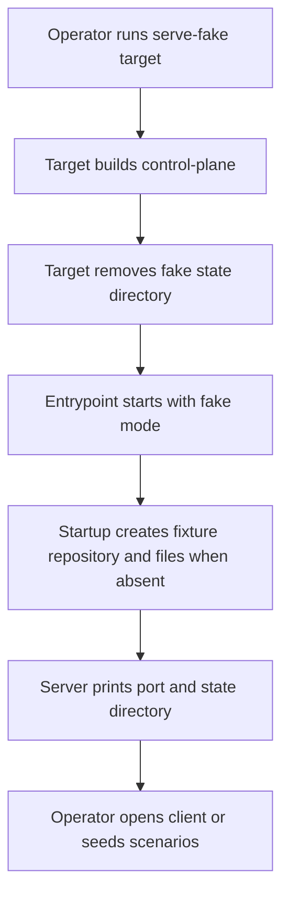
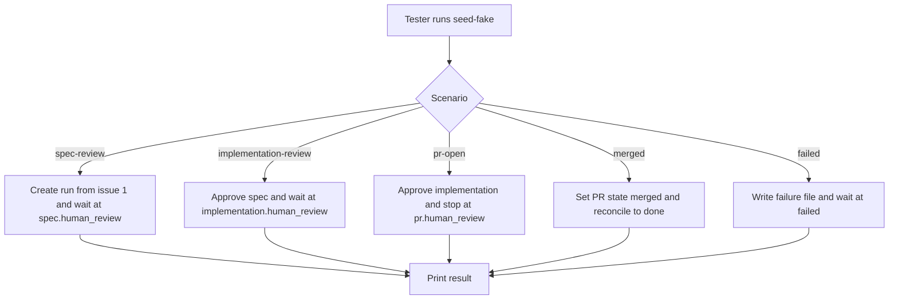

# Scripted fake mode and seed command for the control plane

## What

Autocatalyst needs a local, deterministic fake mode for the control plane that starts through the same entrypoint an operator uses in production. In fake mode, scripted model sessions, a scripted issue tracker, and a scripted code host drive real control-plane runs without model spend or network access.

The feature also adds a seed command that creates named fake scenarios. A person can start the server, seed runs stopped at key lifecycle states, open the client, and inspect a run at `spec.human_review`, `implementation.human_review`, `pr.human_review`, `done`, and `failed`.

## Why

Manual client checks and browser tests need believable control-plane data without live provider credentials, GitHub access, or model cost. Today, tests can inject fakes only through lower-level server options, while the production entrypoint still needs real providers and a real `gh` executable.

After this ships, one command starts fake mode and one command seeds scenarios. The fake exercises production adapter composition, result contracts, convergence, workspace provisioning, persistence, SDK calls, and HTTP routes, so tests cover the real integration path while avoiding external services.

## Personas

- **Opal: Operator** — starts the control plane locally and needs repeatable fixture data for manual checks.
- **Quinn: QA engineer** — runs browser and API tests that must cross human gates without live credentials or model spend.
- **Dana: Developer** — debugs run lifecycle behavior and needs deterministic runs at each state.

## Narratives

### Start fake mode and inspect seeded runs

Opal runs `pnpm nx run control-plane:serve-fake`. The server builds, clears `.autocatalyst-fake/`, starts on `http://127.0.0.1:4010`, and prints one line naming the port and state directory. In a second terminal, Opal runs `pnpm nx run control-plane:seed-fake -- --scenario all` and sees five runs at the expected states.

### Drive a full run over production HTTP

Quinn starts the production entrypoint in fake mode as a child process. The test creates a secret and project through the SDK, starts a run from a fixture issue, waits for the spec gate, posts anchored feedback, sees a deterministic spec revision, approves both human gates, writes `merged` to the pull request state file, reconciles, and sees `done`.

### Restart with durable fake state

Dana starts the built entrypoint with `--fake-mode --fake-state-dir .autocatalyst-fake` after a prior fake run. Startup keeps the existing database, fixture repository, fixture issues, pull request files, and pull request counter. A later `pr-open` seed uses the next pull request number.

## User stories

- Opal can start fake mode through the normal control-plane entrypoint with no live provider settings.
- Opal can seed one scenario or all scenarios and see the run id, issue number, stopped step, and pull request number when present.
- Quinn can drive seeded and unseeded runs over the SDK and HTTP only.
- Quinn can assert deterministic spec content, revisions, comment addressing, pull request states, and failures.
- Dana can restart the built entrypoint on an existing fake state directory and keep runs and pull request numbering intact.

## Goals

- Fake mode starts with `pnpm nx run control-plane:serve-fake` using documented defaults and no external network or model calls.
- The seed command creates the five named scenarios and `all` in deterministic order.
- A production-entrypoint wiring test drives one issue to `done` and one forced failure to `failed` over real HTTP.
- The scripted model outputs pass the real step result contracts in `packages/execution/src/result-contracts.ts`.
- Operator documentation contains the commands, defaults, fixture data, state files, and failure controls that client issues cite.

## Non-goals

- Browser tooling, Playwright fixtures, or client-side tests.
- Runtime scripting through new routes or headers; the state directory is the control surface.
- Fakes for providers other than the Claude adapter, GitHub issue tracker, and GitHub code host.
- Scripted paths for the docs gate or the two input pauses.
- Hosted deployment of fake mode.

## Design spec

### User flows

### Operator-facing commands

- `pnpm nx run control-plane:serve-fake` starts fake mode on the default port with the default bearer token and an empty `.autocatalyst-fake/` state directory.
- `pnpm nx run control-plane:seed-fake -- --scenario spec-review` seeds one scenario into a running fake server.
- `node apps/control-plane/dist/src/main.js --fake-mode --fake-state-dir .autocatalyst-fake` restarts the built entrypoint without wiping state.
- `node apps/control-plane/dist/src/fake/seed-fake.js --scenario pr-open --fake-state-dir .autocatalyst-fake --json` runs the built seed script directly.

## Tech spec

### Introduction and overview

This feature extends the control-plane entrypoint, server composition, and project targets so deterministic fakes can run through the same production seams as real dispatch. The fake sits at the lowest practical boundaries: the Claude adapter's scripted session launch, the GitHub issue tracker's `gh` executor, and the GitHub code host's `gh` executor. `packages/core` must not branch on fake mode.

### System design and architecture

Modified components:

- `apps/control-plane/src/config.ts` parses fake-mode settings and defaults.
- `apps/control-plane/src/main.ts` passes fake-mode config into `startControlPlaneServer`.
- `apps/control-plane/src/server.ts` accepts `githubIssueTracker.executeGh`, passes it to `GitHubIssueTracker`, installs scripted provider/tracker/code-host seams in fake mode, and turns dispatch on.
- `apps/control-plane/src/fake/*` owns scripted sessions, fixture issue files, fake `gh` behavior, repository setup, launch counters, failure files, pull request state files, and seed helpers.
- `apps/control-plane/src/fake/seed-fake.ts` is a Node CLI and Nx target entrypoint that talks to the running server only through `packages/sdk`.
- `docs/operators/fake-mode.md` documents operation and fixtures.
- `context-agent/wiki/code-map.md` records the new modules, settings, and targets.

### Detailed design

Fake mode is enabled by `--fake-mode` or `AUTOCATALYST_FAKE_MODE`. The state directory comes from `--fake-state-dir`, `AUTOCATALYST_FAKE_STATE_DIR`, or `.autocatalyst-fake/` at the repository root. Defaults in fake mode are port `4010`, bearer token `fake-mode-token`, master secret `fake-mode-master-secret`, database path under the state directory, repos root under the state directory, and workspaces root under the state directory.

`ControlPlaneServerOptions.githubIssueTracker` gains optional `executeGh`. Fake-mode startup composes the scripted Claude adapter under the real Claude adapter key, the scripted issue-tracker executor, and the scripted code-host executor. It enables real dispatch so orchestration, persistence, workspaces, result contracts, and reconciliation all run normally.

Startup creates a local bare fixture remote, host clone, fixture issue file, pull request counter, pull request state directory, failure directory, and launch counter only when absent. The fixture project uses `https://github.com/autocatalyst-fixtures/demo-app`, provider `github`, owner `autocatalyst-fixtures`, name `demo-app`, and credential value `fake-token`.

Fixture issues are fixed: issue 1 feature for `spec-review`, 2 enhancement for `implementation-review`, 3 bug for `pr-open`, 4 chore for `merged`, 5 unlabeled, 6 feature for `failed`, 7-10 spare labeled issues, and 11 spare unlabeled issue.

The first scripted spec contains a heading, paragraphs, a table, a bullet list, a fenced code block, an emoji before passage A, and exact passages A through D from issue #128. The revision inserts `- A name is trimmed of leading and trailing spaces.\n` before passage A, removes passage B and its `Open questions` heading, leaves passages C and D in place, and marks every open spec comment `addressed` with a thread response.

The seed CLI accepts `--scenario`, `--issue`, `--base-url`, `--bearer-token`, `--fake-state-dir`, and `--json`. With `--json`, it prints exactly one JSON line containing `runId`, `issueNumber`, `step`, and `pullRequestNumber`, using `null` where a field does not apply.

### Security, privacy, and observability

Fake mode is local development and test tooling only. Fake tokens are documented test values. The scripted executors must not log credential values, and failure reasons must stay public-safe. File controls stay under the fake state directory and validate numeric issue and pull request identifiers.

Startup prints one line with port and fake state directory. Seed diagnostics go to stderr in JSON mode. A state-directory launch counter records scripted model launches.

### Testing plan

Tests cover fake config defaults and non-fake regressions, fake/profile rejection, injected `executeGh`, scripted result contract validation, spec revision offsets and comment addressing, fixture issues, PR state files, failure files, launch counters, local repository provisioning, restart persistence, Nx targets, built seed output, scenario states, duplicate seeding, and a full production-entrypoint wiring test over SDK/HTTP only.

### Alternatives considered

- Injecting fakes only in tests was rejected because manual checks and browser fixtures need the normal entrypoint.
- Adding seed-only HTTP routes was rejected because the SDK and state files are enough.
- Mocking core orchestration was rejected because this feature must exercise real production seams.
- Using real GitHub fixtures was rejected because fake mode must run with no network.

### Risks

Scripted results can drift from real contracts; mitigate with contract validation tests. State-file controls can become unsafe if path validation is weak; mitigate with numeric identifiers and containment checks. Restart semantics differ from `serve-fake`; mitigate with documentation. Fake mode covers only Claude and GitHub seams.

## Task list

- [ ] **Story: Configure and start fake mode through the production entrypoint**
  - [ ] **Task: Add fake-mode config parsing and defaults**
    - **Description**: Extend `apps/control-plane/src/config.ts` to parse `--fake-mode`, `AUTOCATALYST_FAKE_MODE`, `--fake-state-dir`, and `AUTOCATALYST_FAKE_STATE_DIR`; apply documented defaults only when fake mode is enabled and the usual setting is absent. Add `.autocatalyst-fake/` to `.gitignore`.
    - **Acceptance criteria**:
      - [ ] Fake mode enables from the flag or environment variable.
      - [ ] State directory resolves from flag, environment variable, or `.autocatalyst-fake/` at the repository root.
      - [ ] Port, bearer token, master secret, database path, repos root, and workspaces root get fake defaults only when unset.
      - [ ] Usual settings override fake defaults.
      - [ ] With fake mode off, existing config behavior is unchanged and covered by a regression test.
    - **Dependencies**: None
  - [ ] **Task: Reject incompatible provider profile configuration**
    - **Description**: Fail startup clearly when fake mode is combined with an explicit default provider profile, and prove non-fake startup does not install scripted fakes.
    - **Acceptance criteria**:
      - [ ] Fake mode plus explicit default provider profile fails before serving requests.
      - [ ] Error message states that fake mode picks the adapter.
      - [ ] Non-fake startup passes no scripted adapter, tracker executor, or code-host executor.
    - **Dependencies**: Task: Add fake-mode config parsing and defaults
  - [ ] **Task: Wire fake mode into main entrypoint and startup output**
    - **Description**: Pass fake-mode config from `main.ts` into `startControlPlaneServer` and print one startup line with the selected port and fake state directory when fake mode is active.
    - **Acceptance criteria**:
      - [ ] Entrypoint accepts fake-mode flags.
      - [ ] Fake-mode startup line includes port and state directory.
      - [ ] Test harness can parse the startup line.
    - **Dependencies**: Task: Add fake-mode config parsing and defaults

- [ ] **Story: Compose scripted provider, tracker, and code host seams**
  - [ ] **Task: Add github issue tracker executeGh server option**
    - **Description**: Extend `ControlPlaneServerOptions.githubIssueTracker` with an `executeGh` option and pass it to `GitHubIssueTracker` as `executeGhFn`.
    - **Acceptance criteria**:
      - [ ] `server.ts` accepts the new option.
      - [ ] The option reaches `GitHubIssueTracker`.
      - [ ] Existing tracker options still work.
      - [ ] A test proves the injected executor is used.
    - **Dependencies**: None
  - [ ] **Task: Move scripted launch helper into production-included fake modules**
    - **Description**: Move or wrap the existing scripted Claude launch helper into `apps/control-plane/src/fake/` or another intentional production-included path. Update existing tests to import the new module.
    - **Acceptance criteria**:
      - [ ] Production build includes the fake module intentionally.
      - [ ] Existing scripted-launch tests continue to pass.
      - [ ] The module exposes the scripted adapter factory needed by server startup.
    - **Dependencies**: None
  - [ ] **Task: Compose scripted seams in fake-mode server startup**
    - **Description**: In `startControlPlaneServer`, install the scripted provider adapter, scripted issue-tracker executor, and scripted code-host executor when fake mode is enabled, and turn dispatch on through the normal execution unit of work.
    - **Acceptance criteria**:
      - [ ] Scripted provider adapter uses the Claude adapter's normal key.
      - [ ] Scripted tracker and code-host executors are wired through existing seams.
      - [ ] Real dispatch is enabled in fake mode.
      - [ ] `packages/core` contains no fake-mode branches.
    - **Dependencies**: Task: Add github issue tracker executeGh server option; Task: Move scripted launch helper into production-included fake modules

- [ ] **Story: Implement deterministic fake state and scripted integrations**
  - [ ] **Task: Create fake state bootstrap**
    - **Description**: Add startup code that creates the fixture repository, fixture issues file, pull request counter, and required state subdirectories only when absent.
    - **Acceptance criteria**:
      - [ ] Bare remote exists at `<state directory>/fixture-remote.git` with one commit on `main`.
      - [ ] Host clone exists at `<repos root>/autocatalyst-fixtures/demo-app` with local origin and `origin/HEAD` set to `main`.
      - [ ] Fixture issue file contains issues 1 through 11 with fixed labels, titles, and bodies.
      - [ ] Pull request counter starts at `101` only when absent.
      - [ ] Restarting preserves existing files and counters.
    - **Dependencies**: Task: Compose scripted seams in fake-mode server startup
  - [ ] **Task: Implement scripted issue tracker and code-host gh behavior**
    - **Description**: Serve fixture issues and pull request operations through injected `executeGh` seams using state-directory files.
    - **Acceptance criteria**:
      - [ ] Issue reads return the shape expected from `gh issue view`.
      - [ ] Pull request create allocates increasing numbers from 101.
      - [ ] Pull request state files contain `open`, `merged`, or `closed`.
      - [ ] Tests can change PR state with a file write and no route.
    - **Dependencies**: Task: Create fake state bootstrap
  - [ ] **Task: Implement scripted failure and launch counter controls**
    - **Description**: Add failure-file handling and launch counting for scripted model sessions under the fake state directory.
    - **Acceptance criteria**:
      - [ ] Failure files use `<state directory>/failures/issue-<number>.json` with `{"step":"<step id>"}`.
      - [ ] The first matching launch fails and renames the file with `.fired`.
      - [ ] The `failed` scenario writes `{"step":"spec.author"}` for issue 6.
      - [ ] Launch counter records every scripted model launch.
    - **Dependencies**: Task: Move scripted launch helper into production-included fake modules; Task: Create fake state bootstrap

- [ ] **Story: Produce scripted run results and spec revisions**
  - [ ] **Task: Implement real-contract scripted step results**
    - **Description**: Make each scripted session return output that passes the relevant result contract and advances the real run lifecycle.
    - **Acceptance criteria**:
      - [ ] `spec.author` writes a valid spec author result and spec file.
      - [ ] Reviewer sessions return satisfied reviewer results.
      - [ ] Implementer sessions return valid dispositions and commit a deterministic file.
      - [ ] PR finalization returns a valid PR-finalize result.
      - [ ] Tests validate outputs with the real contract registry.
    - **Dependencies**: Task: Move scripted launch helper into production-included fake modules
  - [ ] **Task: Implement scripted spec content and revision**
    - **Description**: Add the required first-pass spec literals and deterministic revision that inserts the fixed bullet, removes passage B, preserves passages C and D, and addresses comments.
    - **Acceptance criteria**:
      - [ ] First spec includes the table, bullet list, code block, emoji, and passages A-D exactly.
      - [ ] Revision shifts passage A by the inserted source text length in Unicode code points.
      - [ ] Passage B and its heading are gone.
      - [ ] Passages C and D do not move.
      - [ ] Every open artifact comment becomes `addressed` with a thread response.
    - **Dependencies**: Task: Implement real-contract scripted step results

- [ ] **Story: Add serve and seed commands**
  - [ ] **Task: Add serve-fake Nx target**
    - **Description**: Add a control-plane Nx target that builds first, removes prior fake state, and starts the normal entrypoint in fake mode from the repository root.
    - **Acceptance criteria**:
      - [ ] `pnpm nx run control-plane:serve-fake` works exactly as documented.
      - [ ] Target removes previous state before startup.
      - [ ] Target accepts `--port`, `--bearer-token`, and `--fake-state-dir`.
    - **Dependencies**: Task: Wire fake mode into main entrypoint and startup output; Task: Create fake state bootstrap
  - [ ] **Task: Implement seed-fake CLI and target**
    - **Description**: Add `apps/control-plane/src/fake/seed-fake.ts` and a `seed-fake` target that parse flags, connect through the SDK, create or reuse fake secret/project, and drive scenarios.
    - **Acceptance criteria**:
      - [ ] Built file exists at `apps/control-plane/dist/src/fake/seed-fake.js`.
      - [ ] CLI accepts all documented flags and env fallbacks.
      - [ ] `--fake-state-dir` is required for `pr-open`, `merged`, and `failed`.
      - [ ] `--json` prints exactly one JSON line and nothing else on stdout.
      - [ ] `pnpm nx run control-plane:seed-fake -- --scenario spec-review` works.
      - [ ] Seed uses only the SDK and exits clearly when no server answers.
    - **Dependencies**: Task: Implement scripted issue tracker and code-host gh behavior; Task: Implement scripted failure and launch counter controls
  - [ ] **Task: Implement seed scenario progression and duplicate handling**
    - **Description**: Drive `spec-review`, `implementation-review`, `pr-open`, `merged`, `failed`, and `all` to their documented stopped states using the SDK sequence.
    - **Acceptance criteria**:
      - [ ] Each scenario uses its documented default issue and stopped step.
      - [ ] `all` seeds the five scenarios in documented order.
      - [ ] `--issue` overrides the default issue.
      - [ ] Seed sends no feedback.
      - [ ] Re-seeding the same scenario is a clear no-op that changes nothing.
    - **Dependencies**: Task: Implement seed-fake CLI and target

- [ ] **Story: Prove production-entrypoint fake mode end to end**
  - [ ] **Task: Add restart persistence and scenario tests**
    - **Description**: Test restart persistence, scenario seeding, unlabeled issue behavior, built seed output, and no real model calls.
    - **Acceptance criteria**:
      - [ ] Existing runs remain listed after built-entrypoint restart.
      - [ ] Next `pr-open` seed uses the next pull request number.
      - [ ] `GET /v1/runs` shows the five expected scenario steps.
      - [ ] Unlabeled issues have no default run.
      - [ ] Built seed output matches `GET /v1/runs/:id` and PR state files.
      - [ ] No test makes a real model call.
    - **Dependencies**: Task: Implement seed scenario progression and duplicate handling
  - [ ] **Task: Add full wiring test over real HTTP**
    - **Description**: Spawn the production entrypoint in fake mode and drive one run from issue intake to `done` only through SDK calls and filesystem state files, plus a forced failure path.
    - **Acceptance criteria**:
      - [ ] Test creates secret and project through SDK.
      - [ ] Test starts a run with `createConversationWithFirstRun`.
      - [ ] Test sends valid anchored feedback and sees deterministic revision.
      - [ ] Test approves spec and implementation gates.
      - [ ] Test writes `merged`, calls reconciliation, and sees `done`.
      - [ ] Separate forced failure shows `failed` with reason.
    - **Dependencies**: Task: Implement scripted spec content and revision; Task: Add restart persistence and scenario tests

- [ ] **Story: Document fake mode and update agent navigation**
  - [ ] **Task: Write operator fake-mode documentation**
    - **Description**: Create `docs/operators/fake-mode.md` next to `docs/operators/real-dispatch.md` with commands, defaults, fixtures, state layout, pull request files, failure files, and scripted spec passages.
    - **Acceptance criteria**:
      - [ ] Documentation includes the two Nx commands and built Node command examples.
      - [ ] Documentation lists settings, defaults, scenarios, fixture project values, fixture issues, scripted spec passages, PR state files, failure files, valid failure step ids, and state layout.
    - **Dependencies**: Task: Implement seed scenario progression and duplicate handling
  - [ ] **Task: Update context-agent code map**
    - **Description**: Record the new fake-mode settings, fake modules, seed script, Nx targets, and relevant tests in `context-agent/wiki/code-map.md`.
    - **Acceptance criteria**:
      - [ ] Code map mentions fake-mode config and defaults.
      - [ ] Code map points to `apps/control-plane/src/fake/`.
      - [ ] Code map records `serve-fake` and `seed-fake` targets and tests.
    - **Dependencies**: Task: Write operator fake-mode documentation
