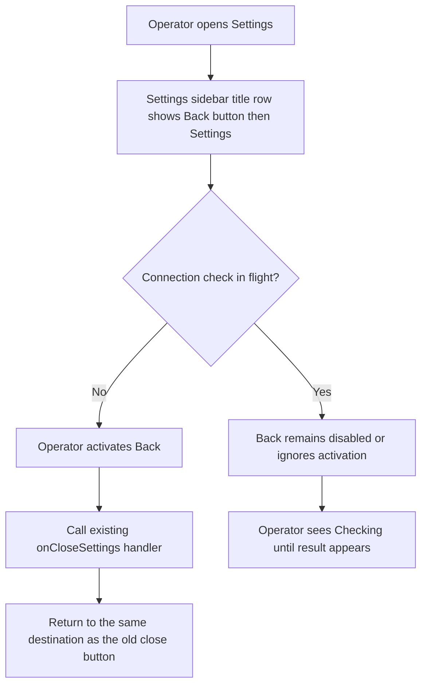
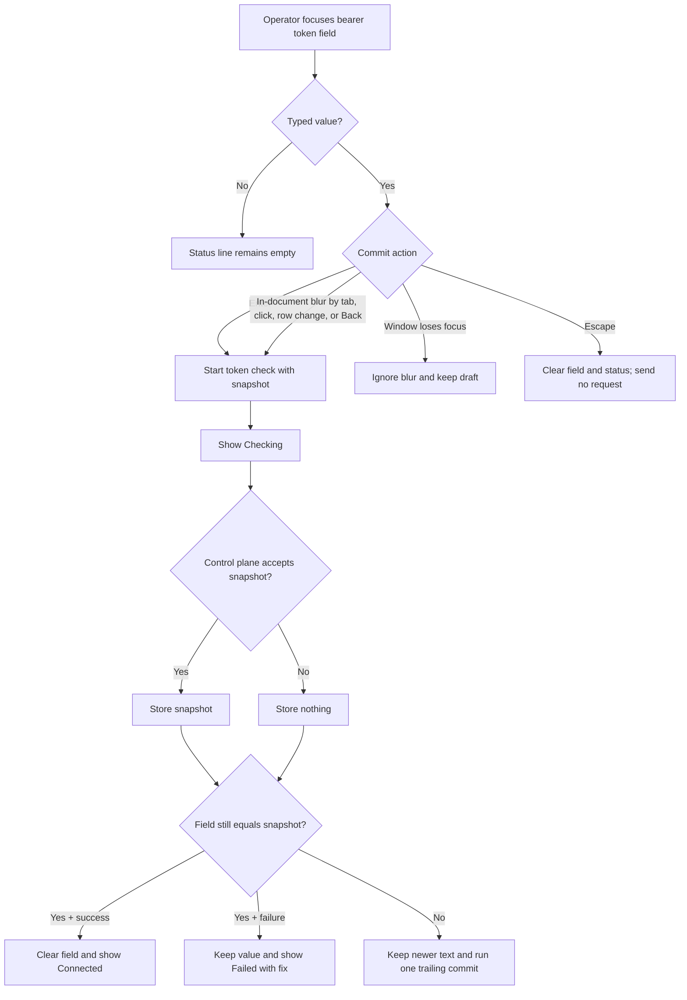
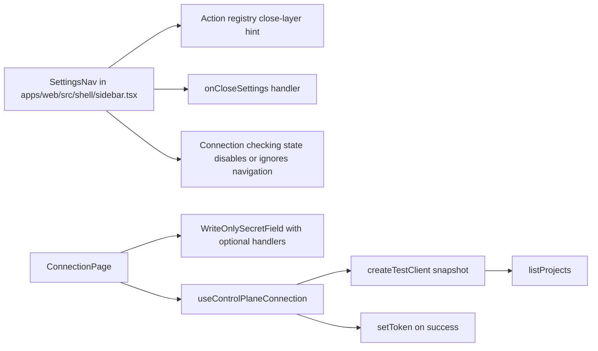
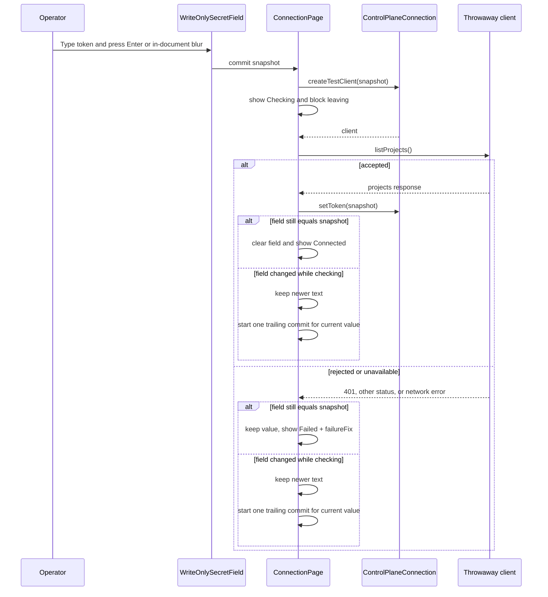

# Settings back button and Connection apply on commit

## What

Settings should feel like a place an operator visits and then leaves, not like a dialog they dismiss. The settings sidebar title row changes from a title with a close button at the far right to a back button followed by the title, so the navigation reads as `← Settings` and returns to the prior app view.

The Connection page should apply a bearer token when the operator commits the field. The page keeps one write-only token field and a status line, removes the Test connection, Save, and Cancel controls, and checks then stores a typed token on `Enter` or an in-document blur. A rejected token stays visible with an inline fix and does not change the app-wide authorization state.

## Why

Operators should not have to reason about a one-field form with separate test and save steps. Testing and saving are the same intent here: make this token the app credential if the control plane accepts it. Applying the token on commit also matches the immediate-apply behavior planned for other simple settings pages.

The back button makes settings navigation clearer. It communicates that settings is a place in the shell, preserves the existing close behavior, and keeps the keyboard layer order unchanged.

## Personas

- **Enzo (Engineer)** configures local and fake-mode control-plane access, validates that runs load, and needs fast recovery from a mistyped token.
- **Phoebe (PM)** opens settings during review or demos and expects navigation to feel consistent with the shell rather than modal.
- **Dani (Designer)** reviews the settings frame for alignment, focus, and keyboard behavior against the design system.

## Narratives

### Correcting a wrong token

Enzo opens Settings with `Cmd+,` or `Ctrl+,` and lands on Connection. The sidebar title starts with a back arrow and the Settings label, so he knows the control returns him to the shell. The Connection page shows only the write-only bearer token field and an empty status line because no token is being checked.

He pastes an old token and presses `Enter`. The status changes to `Checking`, then `Failed` with the existing one-line fix for a rejected token. The token remains in the field, the app-wide authorization state does not change, and he can edit the same value instead of starting over.

Enzo replaces it with the fake-mode token and tabs away. The in-document blur commits the value, the check succeeds, the token is stored, the field clears, and the status reads `Connected`. He clicks Back and returns to the runs list, which now loads with the accepted token.

### Copying the rest of a token

Phoebe starts typing a token and switches to a password manager or terminal to copy the rest. The browser blurs the field because the window lost focus, but Connection does not commit the partial value. When she returns and finishes the token, the field still contains her draft and no failed check has been sent.

She can then press `Enter`, tab to another control, click the page background, click another settings row, or click Back to commit the complete token. Only blurs that keep focus inside the document, or move focus to the document body from an in-page click, count as commit intent.

### Editing during a check

Enzo presses `Enter` and immediately notices a typo while `Checking` is visible. The field stays editable, so he fixes the value before the first check returns. The first request uses the original snapshot; when it finishes, Connection does not erase the newer text.

Because the current field value differs from the committed snapshot, Connection runs exactly one trailing commit with the newer value. If the original request fails, the edited value still remains and the trailing request checks it. If the original request succeeds but the field has changed, the newer value is preserved and then checked so the status and stored token converge on the latest text.

### Leaving after committing

Phoebe types a token and clicks Back. The blur starts a check, and settings does not leave while `Checking` is visible. Back and settings-row navigation are temporarily disabled or ignore activation until the check finishes, so the result is always visible on the Connection page.

If the token is wrong, she sees `Failed` and the fix before she can leave. If the token is accepted, the token is stored, `Connected` is shown, and Back can then return her to the runs list.

## User stories

- Enzo can use a Back button in the settings sidebar title row to leave settings the same way the old close button did.
- Enzo can type or paste a bearer token and press `Enter` to check and store it in one step.
- Enzo can tab or click within the page away from a non-empty token field and have that in-document blur commit the token.
- Enzo can switch windows while a partial token is typed without committing the partial value.
- Enzo can edit the field while a check is in flight without losing newer text when the earlier snapshot finishes.
- Enzo can see `Checking`, `Connected`, or `Failed` status without the secret value appearing in text, names, logs, or URLs.
- Enzo can recover from a rejected token because the typed value stays in the field and the app-wide authorization remains unchanged.
- Phoebe can press `Escape` in a non-empty token field to clear the draft token and status without closing settings or sending a request.
- Phoebe can press `Escape` in an empty field and keep the existing shell layer behavior.
- Phoebe can click Back after a commit result is visible, so a failed token is not hidden by navigation.
- Dani can verify that the settings title row still aligns with the header title row and that keyboard focus is visible and ordered.

## Goals

- Replace the settings sidebar close affordance with a keyboard-reachable `Back` icon button that uses the existing settings close handler and `close-layer` key hint.
- Remove Connection page action buttons and apply non-empty typed tokens on `Enter` or blur only when focus remains in the document.
- Ignore window-loss blur so partial tokens are not sent while an operator switches to another app.
- Preserve newer field edits during in-flight checks and run exactly one trailing commit for a changed value.
- Keep the operator on Connection while a check is in flight so failed leave attempts remain visible.
- Preserve write-only secret guarantees: never render, name, log, or place the token in a URL.
- Prevent rejected tokens from mutating the app-wide authorization state.
- Cover the changed behavior with unit and Playwright tests, including fake mode on the production path.
- Update agent-facing documentation that describes settings, Connection, and navigation.

## Non-goals

- No control to clear or delete the stored token.
- No change to Projects credentials, including its Test credentials, Save, and Cancel controls.
- No change to where Settings appears in the primary sidebar.
- No re-check of the stored token on page load.
- No new control-plane endpoint or bearer-token persistence backend.
- No global toast or out-of-page failure surface for Connection checks; checks block leaving instead.

## Design spec

### User flows

### Key UI components

#### Settings sidebar title row

- The row contains an `ArrowLeft` icon button followed by the text `Settings`.
- The former right-aligned `X` close button is removed.
- The button accessible name is `Back`.
- The tooltip label is `Back` and includes the key hint for the registry `close-layer` action.
- Activation calls the existing `onCloseSettings` behavior only when Connection is not currently checking a committed token.
- While Connection is checking, Back is disabled or ignores activation so the operator remains on the page until `Connected` or `Failed` is visible.
- The row keeps the current header/title row vertical edges and text baseline alignment rules.
- The tab order starts with the Back button, then the Connection row. If Back is disabled while checking, the disabled state must be accessible and must not create a keyboard trap.

#### Connection page

- The page contains the existing write-only secret field and a status line.
- The page does not render Test connection, Save, Cancel, or Saved controls/text.
- With no stored token, the label is `Bearer token`; with a stored token, the label is `Bearer token (leave blank to keep existing)`.
- The stored token is never placed in the field.
- The field is not `required` on this page, or the surrounding form uses `noValidate`, so `Enter` in an empty field does not show a native browser validation bubble.
- `Enter` is handled once, preferably in the input `onKeyDown`, with `preventDefault` for the commit key. The form may still prevent default submit as a defensive fallback, but it must not create a second commit path.
- Empty typed values do not commit and do not send a request.
- A non-empty typed value commits on `Enter` or an in-document blur.
- A blur caused by the browser window or tab losing focus does not commit. Implementation checks `document.hasFocus()` and the blur target/active element: ignore blur when `document.hasFocus()` is false or when `document.activeElement` is still the field; commit when focus moves to another element in the document or to `document.body` from an in-page click.
- During commit, the status line shows `Checking`; the field remains editable and duplicate triggers for the same snapshot are ignored while the request is in flight.
- Each commit takes a snapshot of the field value. Completion applies to that snapshot.
- On success, `connection.setToken(snapshot)` runs once for that snapshot. The field clears only if its current value still equals the snapshot; otherwise, newer text remains in the field and exactly one trailing commit starts for the current value.
- On failure, the page stores nothing. The field keeps its current value; if the current value differs from the failed snapshot, exactly one trailing commit starts for the current value.
- `Connected` stays visible until the operator edits the field or leaves the page.
- `Failed` and its fix stay visible until the field is edited, the field is cleared with `Escape`, or a new check starts.
- A new commit replaces the previous result with `Checking`, then the new final result.

#### Write-only secret field component

- `WriteOnlySecretField` remains the shared write-only field used by Connection and future Projects credentials.
- The component receives additive optional input event props, such as `onBlur` and `onKeyDown`, or equivalently named commit/escape callbacks. They default to doing nothing.
- The component forwards these optional handlers to the underlying `Input` without changing existing callers.
- Existing props, including `required`, remain available for forms such as Projects, but Connection opts out of native required validation.

### Keyboard and layer behavior

- `Escape` in the token field with typed text clears the field, clears `Connected`/`Failed` status, and stops propagation so no layer closes.
- `Escape` in the empty token field follows the existing layer order: confirm popover, overlay, full page, then settings.
- Back-button navigation and settings-row navigation count as commit intent only through a valid in-document blur. If the check starts, navigation waits until the check finishes.
- Focus rings remain visible on the Back button and field.

## Tech spec

### Introduction and overview

This feature modifies the existing web shell settings sidebar, the shared write-only secret field, and the Connection page. It depends on issue #132 for the settings frame and Connection page, the current action registry for `close-layer` key hints, and the existing `useControlPlaneConnection` provider API with `createTestClient(token)`, `listProjects`, and `setToken`. It does not add API routes, persistence tables, or SDK methods.

Technical goals:

- Reuse the existing close-settings path so Back is behaviorally identical to the old close button when no token check is pending.
- Use the throwaway client for token validation so a bad typed token cannot change app-wide authorization.
- Ignore window-loss blur so partial tokens are not sent to the control plane.
- Serialize commit attempts by snapshot and run one trailing commit when the field changes during an in-flight check.
- Keep settings mounted while a check is pending so a failed commit is visible before the operator leaves.
- Guard page-local state updates after unmount for non-checking teardown and defensive cleanup.
- Keep token values out of status strings, accessible names, URLs, and logs.

Glossary:

- **Commit**: an attempt to validate and, on success, store a typed token snapshot.
- **Snapshot**: the exact field value captured when a commit starts.
- **Typed token**: the value currently in the write-only field; never the stored token.
- **Trailing commit**: one follow-up commit for the latest current value after an in-flight snapshot finishes and the field value has changed.
- **In-document blur**: a blur where focus remains in the document, either on another element or `document.body` after an in-page click.
- **Throwaway client**: the client returned by `connection.createTestClient(typed)` for checking a token without changing app-wide authorization.

### System design and architecture

Modified components:

- `apps/web/src/shell/sidebar.tsx`: replace the settings title row close button with an `ArrowLeft` back button before the title, keep `onCloseSettings`, update accessible name and tooltip, and prevent leaving while Connection reports `Checking`.
- `apps/web/src/settings/connection-page.tsx`: replace form/action-row state with commit-on-enter/in-document-blur state, remove Test connection/Save/Cancel/Saved rendering, opt out of native required validation, implement snapshot/trailing commit behavior, and update the file comment.
- `apps/web/src/ui/write-only-secret-field.tsx`: add optional event handlers and forward them to the input without breaking existing callers.
- Existing tests for sidebar, write-only secret field, and Connection page: rename queries from `Close settings` to `Back` and assert the new flow.
- Playwright fake-mode test: exercise wrong token failure then `fake-mode-token` success through the production path.
- `context-agent/wiki/design-system.md` and `context-agent/wiki/code-map.md`: document the changed pattern and file flow during implementation.

Primary commit sequence:

### Detailed design

No data model or API contract changes are required. The existing `listProjects` check remains the validation call. The existing failure mapping remains authoritative, including `401`, other status, and network or no-answer cases.

Connection page logic:

1. Track the typed field value, status state, failure fix text, stored-token presence, the current in-flight snapshot, and whether a trailing commit is needed.
2. Add optional input event props to `WriteOnlySecretField` and pass Connection handlers through to the underlying `Input`.
3. Opt Connection out of native required validation by dropping `required` for this page or setting `noValidate` on the form. Empty `Enter` sends no request and shows no native validation bubble.
4. Handle `Enter` in the input `onKeyDown` as the single intended commit path. Prevent default, ignore empty values, and commit the current value if no matching request is already in flight. Keep form `onSubmit` as prevent-default only if the form remains.
5. Handle blur by first deciding whether it is a commit blur. Ignore blur when `document.hasFocus()` is false, when `document.activeElement` is still the input, or when the value is empty. Commit when focus moves to another document element or to `document.body` because of an in-page click.
6. On commit, capture a snapshot and call `connection.createTestClient(snapshot)` and then `listProjects`.
7. While a snapshot is in flight, show `Checking` and prevent settings navigation through Back or settings rows by disabling those controls or ignoring activation.
8. If another `Enter` or blur occurs while checking and the current field value equals the in-flight snapshot, do nothing. If the current field value differs from the in-flight snapshot, remember that one trailing commit is needed for the latest value after the in-flight check finishes.
9. On success, call `connection.setToken(snapshot)` exactly once for the accepted snapshot. If the field still equals the snapshot, clear the field and show `Connected`. If the field differs, keep the newer text and start exactly one trailing commit for the current value.
10. On failure, do not call `connection.setToken`. If the field still equals the snapshot, keep the value, show `Failed`, and show unchanged `failureFix`. If the field differs, keep the newer text and start exactly one trailing commit for the current value.
11. `Connected` remains until the operator edits the field or leaves the page. `Failed` and its fix remain until the field is edited, cleared with `Escape`, or a new check starts. `Checking` replaces any previous result during a new request.
12. `Escape` with a typed value clears the field and clears `Connected` or `Failed` status, sends no request, and stops propagation. `Escape` with an empty value falls through to existing layer handling.
13. Use an unmount guard as a defensive measure, but normal Back/settings-row navigation cannot unmount the page while a check is in flight.

Back button logic:

1. Import and render `ArrowLeft` using the project icon conventions.
2. Put the button before `Settings` in the settings sidebar title row.
3. Remove the right-side close button.
4. Use accessible name `Back`.
5. Use tooltip text `Back` plus the formatted key hint from the `close-layer` registry action.
6. Call the existing `onCloseSettings` handler on click and keyboard activation when no Connection check is pending.
7. While Connection is checking, disable Back or ignore activation, and apply the same pending-navigation rule to settings rows that would leave Connection.

### Security, privacy, and compliance

- The typed token is sensitive. It must not appear in status text, accessible names, URLs, log lines, test names that include runtime values, or thrown error messages.
- Window-loss blur must not commit because operators commonly switch to a password manager, terminal, or another app while a partial token is typed. This avoids needless rejected-token requests and reduces the chance that partial bearer tokens appear in control-plane access logs.
- A rejected token must not change the app-wide authorization state. The throwaway client remains the only validation path before `setToken`.
- The field remains write-only: no reveal button, no stored badge, no clear/delete stored-token control, and no populated stored value.
- Unit and E2E tests must avoid real model calls and use fake mode or mocked clients only.

### Observability

No new telemetry is required. If existing error logging runs during failed checks, it must use sanitized messages that do not include the typed token. Status text remains user-facing and generic: `Checking`, `Connected`, or `Failed` plus the existing one-line fix.

### Testing plan

Unit/component tests:

- Settings sidebar renders `Back`, no `Close settings`, uses the `close-layer` hint, and has the expected tab order.
- Back activation calls the same settings close path as before when no check is pending.
- Back and settings-row activation while `Checking` do not leave Connection; a wrong token followed by Back leaves the operator seeing `Failed` and the fix.
- A good token followed by Back stores the token, then allows leaving settings so the runs list loads.
- `WriteOnlySecretField` forwards new optional `onBlur` and `onKeyDown` handlers to the input and existing callers can omit them.
- Connection page renders no Test connection, Save, Cancel, or Saved controls.
- `Enter` with a typed value calls `createTestClient(snapshot)`, calls `listProjects`, then calls `connection.setToken(snapshot)` once on success.
- `Enter` in an empty field shows no native validation message and sends no request.
- In-document blur with a typed value commits exactly once; empty values send no request.
- A blur dispatched while `document.hasFocus()` is false sends no request.
- A blur with focus moving to another element sends exactly one request.
- 401, other-status, and network failures show `Failed` and the fix, keep the typed value, call no `setToken`, and do not mutate app-wide authorization.
- While checking, repeated `Enter` and unchanged blur do not start a second request.
- Edit during a check, then success: the field keeps the newer text and a second check runs.
- Edit during a check, then failure: the field keeps the newer text and a second check runs.
- No field change during a check results in exactly one request.
- Edit after `Connected` clears the status.
- `Escape` after `Failed` clears the status and the field.
- A new commit replaces the previous result with `Checking` and then the new result.
- `Escape` with a typed value clears the field and makes no request; `Escape` with an empty field keeps existing layer behavior.
- Unmount during an in-flight check, if forced directly by a test harness, does not set page-local state after unmount.
- Existing secret-safety tests continue to pass.

Playwright test:

- In fake mode on the production path, open Settings, type a wrong token, press `Enter`, assert `Failed` plus the fix, then type `fake-mode-token`, press `Enter` or tab, assert `Connected`, and verify the run list works after Back. The test must not use a test-only hook and must make no model call.

Documentation checks:

- Update `context-agent/wiki/design-system.md` Settings pages and write-only secret field rules.
- Update `context-agent/wiki/code-map.md` with the changed Connection flow.
- Update the Connection page file comment.

### Alternatives considered

- Keep Test connection plus Save: rejected because it preserves unnecessary ceremony for one field and differs from simple settings that apply at once.
- Save first, then test stored authorization: rejected because a bad token would temporarily change app-wide authorization, which is exactly what testing is meant to prevent.
- Commit every blur, including window-loss blur: rejected because copying tokens from another app is normal and this would send partial tokens.
- Disable the field while checking: rejected because it slows typo correction. Snapshot plus trailing commit preserves edits without duplicate requests.
- Surface after-unmount failures in a global toast or runs-list status: rejected for this feature because settings can simply block leaving until the commit result is visible.
- Add a clear/delete stored-token control: rejected because the design system intentionally has no stored-token clear control for this secret field.

### Risks

- Browser focus behavior differs across test environments. Mitigation: centralize commit-blur detection and cover `document.hasFocus()`, active element, body focus, tab, and click cases.
- `Enter` followed by blur may accidentally double-submit if event ordering is not guarded. Mitigation: use snapshot identity, an in-flight marker, and a no-change duplicate guard.
- Editable-while-checking behavior can be confusing if multiple edits happen before the first request returns. Mitigation: only one trailing commit runs for the latest current value.
- Blocking settings navigation while checking can feel unresponsive on a slow control plane. Mitigation: show `Checking`, keep the field editable, and keep controls visibly disabled or consistently ignored only for the short validation window.
- Tooltip/key-hint formatting may depend on existing registry hooks. Mitigation: reuse the current action registry and tooltip helpers rather than hard-coding platform chords.

## Task list

- [ ] **Story: Settings sidebar back navigation**
  - [ ] **Task: Replace settings close button with Back button**
    - **Description**: Update `apps/web/src/shell/sidebar.tsx` so the settings title row renders an `ArrowLeft` icon button before the `Settings` title and removes the right-aligned close button. Wire the button to the existing `onCloseSettings` handler when Connection is not checking.
    - **Acceptance criteria**:
      - [ ] The settings title row renders an `ArrowLeft` icon button followed by `Settings`.
      - [ ] No right-side `Close settings` button remains.
      - [ ] The button accessible name is `Back`.
      - [ ] Activating the button leaves settings exactly as the previous close button did when no Connection check is in flight.
      - [ ] The tooltip label is `Back` and includes the registry `close-layer` key hint.
    - **Dependencies**: None
  - [ ] **Task: Block settings navigation while Connection is checking**
    - **Description**: Add state wiring so Back and settings rows that would leave Connection are disabled or ignore activation while a token check is in flight. This keeps failed commits visible on the Connection page.
    - **Acceptance criteria**:
      - [ ] Clicking Back during `Checking` does not leave settings.
      - [ ] Clicking another settings row during `Checking` does not hide the pending Connection result.
      - [ ] A wrong token followed by Back leaves the operator seeing `Failed` and the fix.
      - [ ] A good token followed by Back stores the token and then allows the runs list to load after the check completes.
      - [ ] The disabled or ignored state is keyboard-accessible and creates no keyboard trap.
    - **Dependencies**: `Task: Replace settings close button with Back button`, `Task: Implement commit-on-enter and commit-on-valid-blur`
  - [ ] **Task: Preserve settings row alignment and keyboard order**
    - **Description**: Adjust sidebar title-row layout only as needed so the row keeps the design-system top/bottom edges, text baseline, focus visibility, and tab order.
    - **Acceptance criteria**:
      - [ ] The settings title row aligns with the header title row with the sidebar open and closed.
      - [ ] The Back button has a visible focus ring.
      - [ ] The Back button is keyboard reachable when enabled.
      - [ ] The settings sidebar tab order is Back, then Connection.
    - **Dependencies**: `Task: Replace settings close button with Back button`
  - [ ] **Task: Update sidebar tests for Back and pending checks**
    - **Description**: Update existing sidebar and shell tests that query `Close settings` so they assert the new Back button behavior and no stale close button name. Add pending-check navigation tests.
    - **Acceptance criteria**:
      - [ ] Tests that previously found `Close settings` now find `Back`.
      - [ ] Tests assert activation calls the existing settings close path when enabled.
      - [ ] Tests cover Back being disabled or ignored while Connection is checking.
      - [ ] Tests cover the tooltip/key-hint expectation where current test helpers support it.
    - **Dependencies**: `Task: Block settings navigation while Connection is checking`

- [ ] **Story: Write-only secret field event support**
  - [ ] **Task: Add optional input handlers to WriteOnlySecretField**
    - **Description**: Extend `apps/web/src/ui/write-only-secret-field.tsx` with additive optional handlers such as `onBlur` and `onKeyDown`, or equivalent commit/escape callbacks, and forward them to the underlying `Input`. Defaults must preserve existing callers.
    - **Acceptance criteria**:
      - [ ] Existing props and behavior remain compatible.
      - [ ] Optional blur and key handlers are forwarded to the input.
      - [ ] Callers can omit the new props without behavior changes.
      - [ ] A unit test proves the new handlers fire for consumers such as Connection and future Projects credentials.
    - **Dependencies**: None

- [ ] **Story: Connection token applies on commit**
  - [ ] **Task: Remove Connection form action controls and native required validation**
    - **Description**: Update `apps/web/src/settings/connection-page.tsx` so the page renders only the write-only token field and status line, with no Test connection, Save, Cancel, or Saved UI. Opt out of native required validation for this page.
    - **Acceptance criteria**:
      - [ ] The page has the bearer token field and a status line.
      - [ ] Test connection, Save, Cancel, and Saved text are not rendered.
      - [ ] The field is not `required` on this page or the form uses `noValidate`.
      - [ ] Pressing `Enter` in an empty field shows no native validation bubble.
      - [ ] With no stored token, no typed value, and no check, the status line is empty.
      - [ ] Existing tests that asserted removed controls are updated with equivalent coverage of the new commit behavior.
    - **Dependencies**: `Task: Add optional input handlers to WriteOnlySecretField`
  - [ ] **Task: Implement commit-on-enter and commit-on-valid-blur**
    - **Description**: Add commit logic that checks a non-empty typed token on `Enter` or valid in-document blur using `connection.createTestClient(snapshot)` and `listProjects`. Ignore empty values and window-loss blur.
    - **Acceptance criteria**:
      - [ ] Pressing `Enter` with a typed value makes one check with a snapshot of that value.
      - [ ] `Enter` is handled once through input key handling, with form submit only preventing default if the form remains.
      - [ ] Blurring with focus moving to another element in the document makes exactly one check.
      - [ ] Blurring to `document.body` from an in-page click makes exactly one check.
      - [ ] Dispatching blur while `document.hasFocus()` is false sends no request.
      - [ ] Blur is ignored when `document.activeElement` is still the field.
      - [ ] An empty field makes no request.
      - [ ] The check uses the throwaway client and does not mutate app-wide authorization before success.
    - **Dependencies**: `Task: Remove Connection form action controls and native required validation`
  - [ ] **Task: Store successful snapshots and preserve newer edits**
    - **Description**: On successful `listProjects`, store the accepted snapshot through `connection.setToken`. Clear the field only if the current value still equals the snapshot; otherwise keep newer text and run one trailing commit.
    - **Acceptance criteria**:
      - [ ] `connection.setToken` is called once with the accepted snapshot after a successful check.
      - [ ] The field is emptied after success only when it still equals the snapshot.
      - [ ] If the field changed while checking, the newer text remains and exactly one trailing commit runs for the current value.
      - [ ] The status line shows `Connected` only for the latest settled successful value with no newer typed text.
      - [ ] The label becomes `Bearer token (leave blank to keep existing)` when a token was not already stored.
      - [ ] Unit tests cover success without edits and success after in-flight edits.
    - **Dependencies**: `Task: Implement commit-on-enter and commit-on-valid-blur`
  - [ ] **Task: Handle rejected and unavailable token checks with trailing commits**
    - **Description**: Preserve existing failure mapping and show `Failed` plus `failureFix` without storing a rejected token. Keep the current field value and run one trailing commit if it changed while the failed snapshot was in flight.
    - **Acceptance criteria**:
      - [ ] A 401 check shows `Failed` and the rejected-token fix when the field still equals the failed snapshot.
      - [ ] Other status failures show `Failed` and the appropriate existing fix.
      - [ ] Network or no-answer failures show `Failed` and the existing control-plane-did-not-answer message/fix.
      - [ ] `connection.setToken` is not called on failure.
      - [ ] The current typed value remains in the field on failure.
      - [ ] If the field changed while checking, exactly one trailing commit runs for the current value.
      - [ ] App-wide authorization state does not change on failure.
      - [ ] Unit tests cover 401, another status, a network error, and failure after in-flight edits.
    - **Dependencies**: `Task: Implement commit-on-enter and commit-on-valid-blur`
  - [ ] **Task: Define status lifecycle and Escape reset**
    - **Description**: Implement status lifetime rules so results are not stale or contradictory as the operator edits, clears, or starts another commit.
    - **Acceptance criteria**:
      - [ ] `Checking` appears while a request is in flight.
      - [ ] `Connected` stays until the operator edits the field or leaves the page.
      - [ ] Editing after `Connected` clears the status.
      - [ ] `Failed` and its fix stay until the field is edited, cleared with `Escape`, or a new check starts.
      - [ ] `Escape` after `Failed` clears both the field and the status.
      - [ ] A new commit replaces the previous result with `Checking`, then the new final result.
      - [ ] Unit tests cover each status lifecycle rule.
    - **Dependencies**: `Task: Store successful snapshots and preserve newer edits`, `Task: Handle rejected and unavailable token checks with trailing commits`
  - [ ] **Task: Guard duplicate commits and defensive unmounts**
    - **Description**: Add in-flight handling so duplicate events do not start duplicate checks for the same snapshot and page-local state is not set after forced unmounts.
    - **Acceptance criteria**:
      - [ ] While a check is in flight, an unchanged second `Enter` does not start a second request.
      - [ ] While a check is in flight, an unchanged blur does not start a second request.
      - [ ] No field change during the check results in exactly one request.
      - [ ] The field remains editable while checking.
      - [ ] A unit test that forcibly unmounts during a check observes no state-after-unmount failure.
    - **Dependencies**: `Task: Store successful snapshots and preserve newer edits`, `Task: Handle rejected and unavailable token checks with trailing commits`
  - [ ] **Task: Implement Escape clearing behavior**
    - **Description**: Update field keyboard handling so `Escape` clears a non-empty typed token and status and sends no request, while empty-field `Escape` keeps the existing shell layer behavior.
    - **Acceptance criteria**:
      - [ ] `Escape` with a typed value empties the field.
      - [ ] `Escape` with a typed value clears `Connected` or `Failed` status.
      - [ ] `Escape` with a typed value makes no request.
      - [ ] `Escape` with an empty field closes the top layer as before.
      - [ ] Unit tests cover non-empty Escape, Escape after `Failed`, and empty Escape behavior.
    - **Dependencies**: `Task: Define status lifecycle and Escape reset`
  - [ ] **Task: Preserve write-only secret safety**
    - **Description**: Audit status text, labels, accessible names, errors, request paths, and new tests touched by the flow so the typed token never appears outside the password input value.
    - **Acceptance criteria**:
      - [ ] The token never appears in status text.
      - [ ] The token never appears in an accessible name.
      - [ ] The token never appears in a log line or URL in the changed code paths.
      - [ ] Window-loss blur sends no partial token request.
      - [ ] Existing secret-safety tests pass.
    - **Dependencies**: `Task: Store successful snapshots and preserve newer edits`, `Task: Handle rejected and unavailable token checks with trailing commits`

- [ ] **Story: End-to-end coverage in fake mode**
  - [ ] **Task: Add production-path Playwright coverage for token commit**
    - **Description**: Add or update a Playwright test that starts fake mode, opens Settings, rejects a wrong token, accepts `fake-mode-token`, and verifies the run list works without using test-only hooks.
    - **Acceptance criteria**:
      - [ ] The test types a wrong token and sees `Failed` with the fix.
      - [ ] The test then types `fake-mode-token`, commits it, and sees `Connected`.
      - [ ] The test verifies a working run list after Back.
      - [ ] The test uses the production path and no test-only hook.
      - [ ] The test makes no model call.
    - **Dependencies**: `Task: Block settings navigation while Connection is checking`, `Task: Store successful snapshots and preserve newer edits`, `Task: Handle rejected and unavailable token checks with trailing commits`

- [ ] **Story: Documentation and code map updates**
  - [ ] **Task: Update settings design-system documentation**
    - **Description**: Update `context-agent/wiki/design-system.md` so Settings pages describe the title row as Back plus title, Connection as apply-on-commit with valid blur behavior, and Projects as the form page that keeps test/action-row controls. Update the write-only secret field rule to say the field empties after a successful check when the field still contains the checked value.
    - **Acceptance criteria**:
      - [ ] Settings pages document the Back button and title row.
      - [ ] Connection documents commit on `Enter` or valid in-document blur and no action row.
      - [ ] Connection documents ignoring window-loss blur.
      - [ ] Connection documents checking-state navigation blocking.
      - [ ] Projects keeps the form-page test button and action-row rules.
      - [ ] The write-only secret field section says the field empties after a successful check when the field still contains the checked value.
    - **Dependencies**: `Task: Block settings navigation while Connection is checking`, `Task: Remove Connection form action controls and native required validation`
  - [ ] **Task: Update code map and Connection page comment**
    - **Description**: Update `context-agent/wiki/code-map.md` and the file comment in `apps/web/src/settings/connection-page.tsx` so future agents can find and understand the apply-on-commit flow, valid blur rule, snapshot/trailing commit behavior, and navigation blocking.
    - **Acceptance criteria**:
      - [ ] The code map mentions Back navigation in `sidebar.tsx`.
      - [ ] The code map mentions Connection commit-on-enter/valid-blur, ignored window-loss blur, throwaway-client check, success store, failure no-store behavior, trailing commits, and pending-check navigation blocking.
      - [ ] The Connection page file comment describes the write-only apply-on-commit flow.
    - **Dependencies**: `Task: Store successful snapshots and preserve newer edits`, `Task: Handle rejected and unavailable token checks with trailing commits`, `Task: Block settings navigation while Connection is checking`

## Acceptance criteria

### Back button

- [ ] The settings sidebar's title row shows an `ArrowLeft` icon button, then the title `Settings`, and no button at the right. The button's accessible name is `Back` and its tooltip is `Back` with the `close-layer` key from the registry. Activating it leaves settings exactly as the close button did when no token check is in flight.
- [ ] While Connection shows `Checking`, Back and settings-row navigation are disabled or ignore activation so the operator remains on Connection until `Connected` or `Failed` is visible.
- [ ] The title row's top and bottom edges and its text baseline still equal the header title row's alignment rules, with the sidebar open and closed.
- [ ] The button has a visible focus ring and is reachable by keyboard when enabled. The settings sidebar's tab order is the back button, then the Connection row.
- [ ] Existing tests that find the `Close settings` button use the new name.

### Connection page

- [ ] The page has the token field and a status line, and no Test connection, Save or Cancel button and no `Saved` text.
- [ ] `WriteOnlySecretField` supports additive optional input event handlers for blur and keydown, defaulting to no behavior change for other callers.
- [ ] Connection opts out of native required validation, so pressing `Enter` in an empty field shows no browser validation bubble and sends no request.
- [ ] Pressing `Enter` in the field with a typed value makes one check with a snapshot of the typed token.
- [ ] Moving focus out of the field with a typed value makes one check only when focus moves to another element in the document or to `document.body` from an in-page click.
- [ ] A blur fired while `document.hasFocus()` is false, or while `document.activeElement` is still the field, sends no request.
- [ ] A check that succeeds stores the token snapshot, empties the field only if its current value still equals the snapshot, shows `Connected`, and the label becomes `Bearer token (leave blank to keep existing)` if it was not already. A unit test shows `connection.setToken` called once with the accepted snapshot.
- [ ] If the operator edits the field while a check is in flight, completion never clears the newer text. If the current value differs from the snapshot, exactly one trailing commit runs for the current value after success or failure.
- [ ] A check that fails with a `401` shows `Failed` and the rejected-token fix when the field still equals the failed snapshot, stores nothing, keeps the current typed value in the field and does not change the app-wide authorization state. Unit tests cover `401`, another status, and a network error.
- [ ] While a check is in flight the status line shows `Checking`, an unchanged second `Enter` or blur does not start a second request, and the field stays editable.
- [ ] `Connected` stays until the field is edited or the operator leaves the page. `Failed` and its fix stay until the field is edited, cleared with `Escape`, or a new check starts. A new commit replaces the previous result.
- [ ] `Escape` in the field with a typed value empties it, clears the status, and makes no request. With an empty field it behaves as before and closes the top layer.
- [ ] Clicking Back or another settings row with a typed value commits through a valid in-document blur and then waits for the result; failed checks remain visible on Connection, and successful checks store the token before the operator leaves.
- [ ] With no stored token, no typed value and no check, the status line is empty. The token never appears in the status text, an accessible name, a log line or a URL.
- [ ] A Playwright test against fake mode on the production path types the wrong token and sees `Failed` with the fix, then types `fake-mode-token`, presses `Enter` and sees `Connected` and a working run list after Back. It uses no test-only hook.
- [ ] Existing tests that assert the Test connection, Save, Cancel or `Saved` controls are updated, and none is deleted without an equivalent.
- [ ] No test makes a model call.

### Docs

- [ ] `context-agent/wiki/design-system.md` Settings pages is updated: the settings sidebar's title row is a back button and the title, and the Connection page is documented as applying on commit. The form-page rules, test button, and action row stay for Projects. The write-only secret field's `After a save, the field empties` rule says `after a successful check when the field still contains the checked value`.
- [ ] `context-agent/wiki/code-map.md` and the Connection page's file comment describe the flow, including valid blur, ignored window-loss blur, snapshot/trailing commit behavior, and checking-state navigation blocking.

## How to try it

1. Start fake mode using `docs/operators/fake-mode.md`, open `http://127.0.0.1:4010`, and open Settings with `Cmd+,` or `Ctrl+,`. The sidebar's top row reads `← Settings`.
2. On Connection, type half a token, switch to another app, and return. Nothing is sent and the field still has your draft.
3. Type a wrong token and press `Enter`. The status shows `Failed` and a fix, and the field keeps your text. Press `Escape`; the field and status clear.
4. Type `fake-mode-token`, then press `Tab`. The status shows `Connected` and the field is empty.
5. Type something and press `Enter`, then edit it while `Checking` is visible. The newer text stays and is checked next.
6. Type a wrong token and click Back. Settings stays on Connection until `Failed` is visible. Replace it with `fake-mode-token`, commit, wait for `Connected`, then click Back. You leave settings, and the runs list loads.

## References

- `context-agent/wiki/design-system.md` Settings pages, Focus and keyboard, Alignment.
- `context-agent/wiki/code-map.md`.
- `apps/web/src/shell/sidebar.tsx`.
- `apps/web/src/settings/connection-page.tsx`.
- `apps/web/src/ui/write-only-secret-field.tsx`.
- `apps/web/src/client/client-provider.tsx`.
- Issue #132 settings frame and Connection page.
- Issue #161 General and Appearance apply at once.
- Issue #142 Projects.
