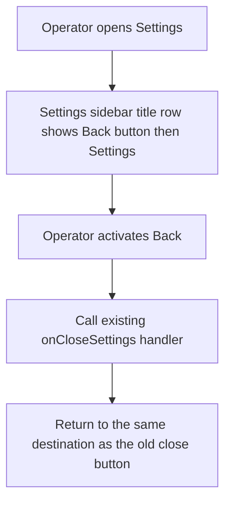
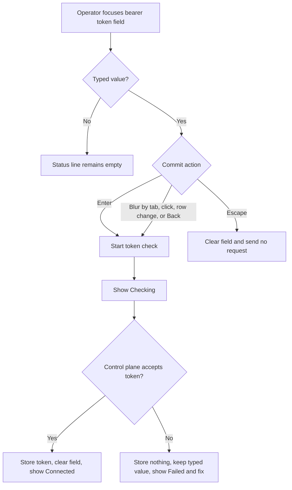
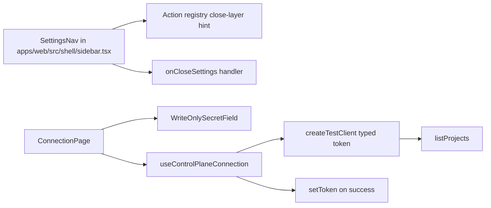
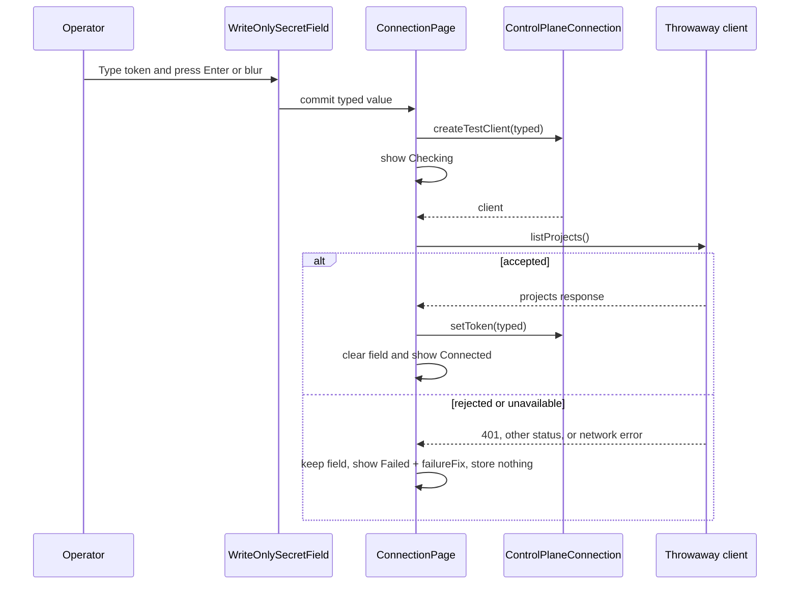

# Settings back button and Connection apply on commit

## What

Settings should feel like a place an operator visits and then leaves, not like a dialog they dismiss. The settings sidebar title row changes from a title with a close button at the far right to a back button followed by the title, so the navigation reads as `← Settings` and returns to the prior app view.

The Connection page should apply a bearer token when the operator commits the field. The page keeps one write-only token field and a status line, removes the Test connection, Save, and Cancel controls, and checks then stores a typed token on `Enter` or blur. A rejected token stays in the field with an inline fix and does not change the app-wide authorization state.

## Why

Operators should not have to reason about a one-field form with separate test and save steps. Testing and saving are the same intent here: make this token the app credential if the control plane accepts it. Applying the token on commit also matches the immediate-apply behavior planned for other simple settings pages.

The back button makes settings navigation clearer. It communicates that settings is a place in the shell, preserves the existing close behavior, and keeps the keyboard layer order unchanged.

## Personas

- **Enzo (Engineer)** configures local and fake-mode control-plane access, validates that runs load, and needs fast recovery from a mistyped token.
- **Phoebe (PM)** opens settings during review or demos and expects navigation to feel consistent with the shell rather than modal.
- **Dani (Designer)** reviews the settings frame for alignment, focus, and keyboard behavior against the design system.

## Narratives

### Correcting a wrong token

Enzo opens Settings with `Cmd+,` or `Ctrl+,` and lands on Connection. The sidebar title starts with a back arrow and the Settings label, so he knows the control returns him to the shell. The Connection page shows only the write-only bearer token field and an empty status line because no token is being checked.

He pastes an old token and presses `Enter`. The status changes to `Checking`, then `Failed` with the existing one-line fix for a rejected token. The token remains in the field, the app-wide authorization state does not change, and he can edit the same value instead of starting over.

Enzo replaces it with the fake-mode token and tabs away. The blur commits the value, the check succeeds, the token is stored, the field clears, and the status reads `Connected`. He clicks Back and returns to the runs list, which now loads with the accepted token.

### Leaving settings while typing

Phoebe opens Settings to check the current connection state and begins typing a token. If she presses `Escape` while the field has text, the field clears and no network request is sent. If she instead clicks another settings row or the back button, the field blurs and the typed token commits just as it would when tabbing away.

If the commit is still checking while she leaves the page, the app must not set state on the unmounted Connection page. A successful check may still store the token through the connection provider, but page-local status updates must be guarded. Failed checks must still avoid changing the app-wide authorization state.

## User stories

- Enzo can use a Back button in the settings sidebar title row to leave settings the same way the old close button did.
- Enzo can type or paste a bearer token and press `Enter` to check and store it in one step.
- Enzo can tab or click away from a non-empty token field and have that blur commit the token.
- Enzo can see `Checking`, `Connected`, or `Failed` status without the secret value appearing in text, names, logs, or URLs.
- Enzo can recover from a rejected token because the typed value stays in the field and the app-wide authorization remains unchanged.
- Phoebe can press `Escape` in a non-empty token field to clear the draft token without closing settings or sending a request.
- Phoebe can press `Escape` in an empty field and keep the existing shell layer behavior.
- Dani can verify that the settings title row still aligns with the header title row and that keyboard focus is visible and ordered.

## Goals

- Replace the settings sidebar close affordance with a keyboard-reachable `Back` icon button that uses the existing settings close handler and `close-layer` key hint.
- Remove Connection page action buttons and apply non-empty typed tokens on `Enter` or blur.
- Preserve write-only secret guarantees: never render, name, log, or place the token in a URL.
- Prevent rejected tokens from mutating the app-wide authorization state.
- Cover the changed behavior with unit and Playwright tests, including fake mode on the production path.
- Update agent-facing documentation that describes settings, Connection, and navigation.

## Non-goals

- No control to clear or delete the stored token.
- No change to Projects credentials, including its Test credentials, Save, and Cancel controls.
- No change to where Settings appears in the primary sidebar.
- No re-check of the stored token on page load.
- No new control-plane endpoint or bearer-token persistence backend.

## Design spec

### User flows

### Key UI components

#### Settings sidebar title row

- The row contains an `ArrowLeft` icon button followed by the text `Settings`.
- The former right-aligned `X` close button is removed.
- The button accessible name is `Back`.
- The tooltip label is `Back` and includes the key hint for the registry `close-layer` action.
- Activation calls the existing `onCloseSettings` behavior.
- The row keeps the current header/title row vertical edges and text baseline alignment rules.
- The tab order starts with the Back button, then the Connection row.

#### Connection page

- The page contains the existing write-only secret field and a status line.
- The page does not render Test connection, Save, Cancel, or Saved controls/text.
- With no stored token, the label is `Bearer token`; with a stored token, the label is `Bearer token (leave blank to keep existing)`.
- The stored token is never placed in the field.
- Empty typed values do not commit and do not send a request.
- A non-empty typed value commits on `Enter` or blur.
- During commit, the status line shows `Checking`; the field remains editable and duplicate commits are ignored while the request is in flight.
- On success, the page shows `Connected`, clears the field, and updates stored-token label state.
- On failure, the page shows `Failed` and the existing `failureFix`, keeps the typed value, and stores nothing.

### Keyboard and layer behavior

- `Escape` in the token field with typed text clears the field and stops propagation so no layer closes.
- `Escape` in the empty token field follows the existing layer order: confirm popover, overlay, full page, then settings.
- Back-button navigation and settings-row navigation count as blur for a non-empty field and therefore commit the typed token.
- Focus rings remain visible on the Back button and field.

## Tech spec

### Introduction and overview

This feature modifies the existing web shell settings sidebar and Connection page. It depends on issue #132 for the settings frame and Connection page, the current action registry for `close-layer` key hints, and the existing `useControlPlaneConnection` provider API with `createTestClient(token)`, `listProjects`, and `setToken`. It does not add API routes, persistence tables, or SDK methods.

Technical goals:

- Reuse the existing close-settings path so Back is behaviorally identical to the old close button.
- Use the throwaway client for token validation so a bad typed token cannot change app-wide authorization.
- Serialize commit attempts so `Enter` plus blur, repeated `Enter`, or rapid focus changes start at most one check for the current commit.
- Guard page-local state updates after unmount.
- Keep token values out of status strings, accessible names, URLs, and logs.

Glossary:

- **Commit**: an attempt to validate and, on success, store the typed token.
- **Typed token**: the value currently in the write-only field; never the stored token.
- **Throwaway client**: the client returned by `connection.createTestClient(typed)` for checking a token without changing app-wide authorization.

### System design and architecture

Modified components:

- `apps/web/src/shell/sidebar.tsx`: replace the settings title row close button with an `ArrowLeft` back button before the title, keep `onCloseSettings`, and update accessible name and tooltip.
- `apps/web/src/settings/connection-page.tsx`: replace form/action-row state with commit-on-enter/blur state, remove Test connection/Save/Cancel/Saved rendering, and update the file comment.
- Existing tests for sidebar and Connection page: rename queries from `Close settings` to `Back` and assert the new flow.
- Playwright fake-mode test: exercise wrong token failure then `fake-mode-token` success through the production path.
- `context-agent/wiki/design-system.md` and `context-agent/wiki/code-map.md`: document the changed pattern and file flow during implementation.

Primary commit sequence:

### Detailed design

No data model or API contract changes are required. The existing `listProjects` check remains the validation call. The existing failure mapping remains authoritative, including `401`, other status, and network or no-answer cases.

Connection page logic:

1. Track the typed field value, status state, failure fix text, stored-token presence, and an in-flight commit marker.
2. On `Enter`, if the typed value is non-empty and no commit is in flight, prevent default form submission behavior and commit the current value.
3. On blur, if the typed value is non-empty and no commit is in flight, commit the current value.
4. If the typed value is empty, do nothing and leave the status empty unless a prior success or failure should still be visible. With the initial no-stored/no-typed/no-check state, render an empty status line.
5. On commit, call `connection.createTestClient(typed)` and then `listProjects`.
6. On success, call `connection.setToken(typed)` exactly once, clear the field, set status to `Connected`, and update the label state so an existing token is reflected.
7. On failure, do not call `connection.setToken`, keep the typed value, set status to `Failed`, and show the unchanged `failureFix`.
8. While in flight, ignore additional `Enter` or blur commits for the same field. The field remains editable; the implementation may either commit the original snapshot or, if current code patterns support it safely, ignore edits until the next user commit after the in-flight request completes.
9. Use an unmount guard or abort-aware pattern so page-local state is not set after unmount. Do not log typed tokens in cleanup or failure paths.

Back button logic:

1. Import and render `ArrowLeft` using the project icon conventions.
2. Put the button before `Settings` in the settings sidebar title row.
3. Remove the right-side close button.
4. Use accessible name `Back`.
5. Use tooltip text `Back` plus the formatted key hint from the `close-layer` registry action.
6. Call the existing `onCloseSettings` handler on click and keyboard activation.

### Security, privacy, and compliance

- The typed token is sensitive. It must not appear in status text, accessible names, URLs, log lines, test names that include runtime values, or thrown error messages.
- A rejected token must not change the app-wide authorization state. The throwaway client remains the only validation path before `setToken`.
- The field remains write-only: no reveal button, no stored badge, no clear/delete stored-token control, and no populated stored value.
- Unit and E2E tests must avoid real model calls and use fake mode or mocked clients only.

### Observability

No new telemetry is required. If existing error logging runs during failed checks, it must use sanitized messages that do not include the typed token. Status text remains user-facing and generic: `Checking`, `Connected`, or `Failed` plus the existing one-line fix.

### Testing plan

Unit/component tests:

- Settings sidebar renders `Back`, no `Close settings`, uses the `close-layer` hint, and has the expected tab order.
- Back activation calls the same settings close handler as before.
- Connection page renders no Test connection, Save, Cancel, or Saved controls.
- `Enter` with a typed value calls `createTestClient(typed)`, calls `listProjects`, then calls `connection.setToken(typed)` once on success.
- Blur with a typed value commits once; empty values send no request.
- 401, other-status, and network failures show `Failed` and the fix, keep the typed value, call no `setToken`, and do not mutate app-wide authorization.
- While checking, repeated `Enter` and blur do not start a second request.
- `Escape` with a typed value clears the field and makes no request; `Escape` with an empty field keeps existing layer behavior.
- Unmount during an in-flight check does not set page-local state after unmount.
- Existing secret-safety tests continue to pass.

Playwright test:

- In fake mode on the production path, open Settings, type a wrong token, press `Enter`, assert `Failed` plus the fix, then type `fake-mode-token`, press `Enter` or tab, assert `Connected`, and verify the run list works. The test must not use a test-only hook and must make no model call.

Documentation checks:

- Update `context-agent/wiki/design-system.md` Settings pages and write-only secret field rules.
- Update `context-agent/wiki/code-map.md` with the changed Connection flow.
- Update the Connection page file comment.

### Alternatives considered

- Keep Test connection plus Save: rejected because it preserves unnecessary ceremony for one field and differs from simple settings that apply at once.
- Save first, then test stored authorization: rejected because a bad token would temporarily change app-wide authorization, which is exactly what testing is meant to prevent.
- Add a clear/delete stored-token control: rejected because the design system intentionally has no stored-token clear control for this secret field.

### Risks

- `Enter` followed by blur may accidentally double-submit if event ordering is not guarded. Mitigation: use an in-flight marker and commit snapshot.
- Leaving the page during a check can cause React state updates after unmount. Mitigation: use cleanup guard and test unmount during check.
- Editable-while-checking behavior can be confusing if the operator changes text before the previous check returns. Mitigation: commit a snapshot, ignore duplicate triggers while in flight, and leave the next edited value available for a later commit.
- Tooltip/key-hint formatting may depend on existing registry hooks. Mitigation: reuse the current action registry and tooltip helpers rather than hard-coding platform chords.

## Task list

- [ ] **Story: Settings sidebar back navigation**
  - [ ] **Task: Replace settings close button with Back button**
    - **Description**: Update `apps/web/src/shell/sidebar.tsx` so the settings title row renders an `ArrowLeft` icon button before the `Settings` title and removes the right-aligned close button. Wire the button to the existing `onCloseSettings` handler.
    - **Acceptance criteria**:
      - [ ] The settings title row renders an `ArrowLeft` icon button followed by `Settings`.
      - [ ] No right-side `Close settings` button remains.
      - [ ] The button accessible name is `Back`.
      - [ ] Activating the button leaves settings exactly as the previous close button did.
      - [ ] The tooltip label is `Back` and includes the registry `close-layer` key hint.
    - **Dependencies**: None
  - [ ] **Task: Preserve settings row alignment and keyboard order**
    - **Description**: Adjust sidebar title-row layout only as needed so the row keeps the design-system top/bottom edges, text baseline, focus visibility, and tab order.
    - **Acceptance criteria**:
      - [ ] The settings title row aligns with the header title row with the sidebar open and closed.
      - [ ] The Back button has a visible focus ring.
      - [ ] The Back button is keyboard reachable.
      - [ ] The settings sidebar tab order is Back, then Connection.
    - **Dependencies**: `Task: Replace settings close button with Back button`
  - [ ] **Task: Update sidebar tests for Back**
    - **Description**: Update existing sidebar and shell tests that query `Close settings` so they assert the new Back button behavior and no stale close button name.
    - **Acceptance criteria**:
      - [ ] Tests that previously found `Close settings` now find `Back`.
      - [ ] Tests assert activation calls the existing settings close path.
      - [ ] Tests cover the tooltip/key-hint expectation where current test helpers support it.
    - **Dependencies**: `Task: Replace settings close button with Back button`

- [ ] **Story: Connection token applies on commit**
  - [ ] **Task: Remove Connection form action controls**
    - **Description**: Update `apps/web/src/settings/connection-page.tsx` so the page renders only the write-only token field and status line, with no Test connection, Save, Cancel, or Saved UI.
    - **Acceptance criteria**:
      - [ ] The page has the bearer token field and a status line.
      - [ ] Test connection, Save, Cancel, and Saved text are not rendered.
      - [ ] With no stored token, no typed value, and no check, the status line is empty.
      - [ ] Existing tests that asserted removed controls are updated with equivalent coverage of the new commit behavior.
    - **Dependencies**: None
  - [ ] **Task: Implement commit-on-enter and commit-on-blur**
    - **Description**: Add commit logic that checks a non-empty typed token on `Enter` or blur using `connection.createTestClient(typed)` and `listProjects`. Empty values must not send requests.
    - **Acceptance criteria**:
      - [ ] Pressing `Enter` with a typed value makes one check with that value.
      - [ ] Blurring with a typed value makes one check with that value.
      - [ ] An empty field makes no request.
      - [ ] The check uses the throwaway client and does not mutate app-wide authorization before success.
    - **Dependencies**: `Task: Remove Connection form action controls`
  - [ ] **Task: Store successful tokens and update success state**
    - **Description**: On successful `listProjects`, store the typed token through `connection.setToken`, clear the field, show `Connected`, and update label state for an existing stored token.
    - **Acceptance criteria**:
      - [ ] `connection.setToken` is called once with the typed value after a successful check.
      - [ ] The field is emptied after success.
      - [ ] The status line shows `Connected`.
      - [ ] The label becomes `Bearer token (leave blank to keep existing)` when a token was not already stored.
      - [ ] A unit test covers the successful path and exact `setToken` call count.
    - **Dependencies**: `Task: Implement commit-on-enter and commit-on-blur`
  - [ ] **Task: Handle rejected and unavailable token checks**
    - **Description**: Preserve existing failure mapping and show `Failed` plus `failureFix` without storing a rejected token. Keep the typed value editable for correction.
    - **Acceptance criteria**:
      - [ ] A 401 check shows `Failed` and the rejected-token fix.
      - [ ] Other status failures show `Failed` and the appropriate existing fix.
      - [ ] Network or no-answer failures show `Failed` and the existing control-plane-did-not-answer message/fix.
      - [ ] `connection.setToken` is not called on failure.
      - [ ] The typed value remains in the field on failure.
      - [ ] App-wide authorization state does not change on failure.
      - [ ] Unit tests cover 401, another status, and a network error.
    - **Dependencies**: `Task: Implement commit-on-enter and commit-on-blur`
  - [ ] **Task: Guard concurrent commits and unmounts**
    - **Description**: Add in-flight and cleanup handling so duplicate events do not start duplicate checks and page-local state is not set after the Connection page unmounts.
    - **Acceptance criteria**:
      - [ ] While a check is in flight, the status line shows `Checking`.
      - [ ] A second `Enter` while checking does not start a second request.
      - [ ] A blur while checking does not start a second request.
      - [ ] The field remains editable while checking.
      - [ ] Leaving the page by Back or another settings row commits typed text as a blur does.
      - [ ] A unit test unmounts during a check and observes no state-after-unmount failure.
    - **Dependencies**: `Task: Implement commit-on-enter and commit-on-blur`
  - [ ] **Task: Implement Escape clearing behavior**
    - **Description**: Update field keyboard handling so `Escape` clears a non-empty typed token and sends no request, while empty-field `Escape` keeps the existing shell layer behavior.
    - **Acceptance criteria**:
      - [ ] `Escape` with a typed value empties the field.
      - [ ] `Escape` with a typed value makes no request.
      - [ ] `Escape` with an empty field closes the top layer as before.
      - [ ] Unit tests cover both non-empty and empty Escape behavior.
    - **Dependencies**: `Task: Remove Connection form action controls`
  - [ ] **Task: Preserve write-only secret safety**
    - **Description**: Audit status text, labels, accessible names, errors, and request paths touched by the new flow so the typed token never appears outside the password input value.
    - **Acceptance criteria**:
      - [ ] The token never appears in status text.
      - [ ] The token never appears in an accessible name.
      - [ ] The token never appears in a log line or URL in the changed code paths.
      - [ ] Existing secret-safety tests pass.
    - **Dependencies**: `Task: Store successful tokens and update success state`, `Task: Handle rejected and unavailable token checks`

- [ ] **Story: End-to-end coverage in fake mode**
  - [ ] **Task: Add production-path Playwright coverage for token commit**
    - **Description**: Add or update a Playwright test that starts fake mode, opens Settings, rejects a wrong token, accepts `fake-mode-token`, and verifies the run list works without using test-only hooks.
    - **Acceptance criteria**:
      - [ ] The test types a wrong token and sees `Failed` with the fix.
      - [ ] The test then types `fake-mode-token`, commits it, and sees `Connected`.
      - [ ] The test verifies a working run list after connection.
      - [ ] The test uses the production path and no test-only hook.
      - [ ] The test makes no model call.
    - **Dependencies**: `Task: Store successful tokens and update success state`, `Task: Handle rejected and unavailable token checks`, `Task: Replace settings close button with Back button`

- [ ] **Story: Documentation and code map updates**
  - [ ] **Task: Update settings design-system documentation**
    - **Description**: Update `context-agent/wiki/design-system.md` so Settings pages describe the title row as Back plus title, Connection as apply-on-commit, and Projects as the form page that keeps test/action-row controls. Update the write-only secret field rule to say the field empties after a successful check.
    - **Acceptance criteria**:
      - [ ] Settings pages document the Back button and title row.
      - [ ] Connection documents commit on `Enter` or blur and no action row.
      - [ ] Projects keeps the form-page test button and action-row rules.
      - [ ] The write-only secret field section says the field empties after a successful check.
    - **Dependencies**: `Task: Remove Connection form action controls`, `Task: Replace settings close button with Back button`
  - [ ] **Task: Update code map and Connection page comment**
    - **Description**: Update `context-agent/wiki/code-map.md` and the file comment in `apps/web/src/settings/connection-page.tsx` so future agents can find and understand the apply-on-commit flow.
    - **Acceptance criteria**:
      - [ ] The code map mentions Back navigation in `sidebar.tsx`.
      - [ ] The code map mentions Connection commit-on-enter/blur, throwaway-client check, success store, and failure no-store behavior.
      - [ ] The Connection page file comment describes the write-only apply-on-commit flow.
    - **Dependencies**: `Task: Store successful tokens and update success state`, `Task: Handle rejected and unavailable token checks`

## Acceptance criteria

### Back button

- [ ] The settings sidebar's title row shows an `ArrowLeft` icon button, then the title `Settings`, and no button at the right. The button's accessible name is `Back` and its tooltip is `Back` with the `close-layer` key from the registry. Activating it leaves settings exactly as the close button did.
- [ ] The title row's top and bottom edges and its text baseline still equal the header title row's alignment rules, with the sidebar open and closed.
- [ ] The button has a visible focus ring and is reachable by keyboard. The settings sidebar's tab order is the back button, then the Connection row.
- [ ] Existing tests that find the `Close settings` button use the new name.

### Connection page

- [ ] The page has the token field and a status line, and no Test connection, Save or Cancel button and no `Saved` text.
- [ ] Pressing `Enter` in the field with a typed value, or moving focus out of it with a typed value, makes one check with the typed token. An empty field makes no request.
- [ ] A check that succeeds stores the token, empties the field, shows `Connected`, and the label becomes `Bearer token (leave blank to keep existing)` if it was not already. A unit test shows `connection.setToken` called once with the typed value.
- [ ] A check that fails with a `401` shows `Failed` and the rejected-token fix, stores nothing, keeps the typed value in the field and does not change the app-wide authorization state. Unit tests cover `401`, another status, and a network error.
- [ ] While a check is in flight the status line shows `Checking`, a second `Enter` or blur does not start a second request, and the field stays editable.
- [ ] `Escape` in the field with a typed value empties it and makes no request. With an empty field it behaves as before and closes the top layer.
- [ ] Leaving the page by clicking the back button or another settings row commits a typed value as a blur does, and does not set state after the page has unmounted. A unit test unmounts during a check.
- [ ] With no stored token, no typed value and no check, the status line is empty. The token never appears in the status text, an accessible name, a log line or a URL.
- [ ] A Playwright test against fake mode on the production path types the wrong token and sees `Failed` with the fix, then types `fake-mode-token`, presses `Enter` and sees `Connected` and a working run list. It uses no test-only hook.
- [ ] Existing tests that assert the Test connection, Save, Cancel or `Saved` controls are updated, and none is deleted without an equivalent.
- [ ] No test makes a model call.

### Docs

- [ ] `context-agent/wiki/design-system.md` Settings pages is updated: the settings sidebar's title row is a back button and the title, and the Connection page is documented as applying on commit. The form-page rules, test button, and action row stay for Projects. The write-only secret field's `After a save, the field empties` rule says `after a successful check`.
- [ ] `context-agent/wiki/code-map.md` and the Connection page's file comment describe the flow.

## How to try it

1. Start fake mode using `docs/operators/fake-mode.md`, open `http://127.0.0.1:4010`, and open Settings with `Cmd+,` or `Ctrl+,`. The sidebar's top row reads `← Settings`.
2. On Connection, type a wrong token and press `Enter`. The status shows `Failed` and a fix, and the field keeps your text. Clear the field, type `fake-mode-token`, then press `Tab`. The status shows `Connected` and the field is empty.
3. Type something, press `Escape`. The field empties and nothing is sent.
4. Click the back button. You leave settings, and the runs list loads.

## References

- `context-agent/wiki/design-system.md` Settings pages, Focus and keyboard, Alignment.
- `context-agent/wiki/code-map.md`.
- `apps/web/src/shell/sidebar.tsx`.
- `apps/web/src/settings/connection-page.tsx`.
- `apps/web/src/ui/write-only-secret-field.tsx`.
- `apps/web/src/client/client-provider.tsx`.
- Issue #132 settings frame and Connection page.
- Issue #161 General and Appearance apply at once.
- Issue #142 Projects.
