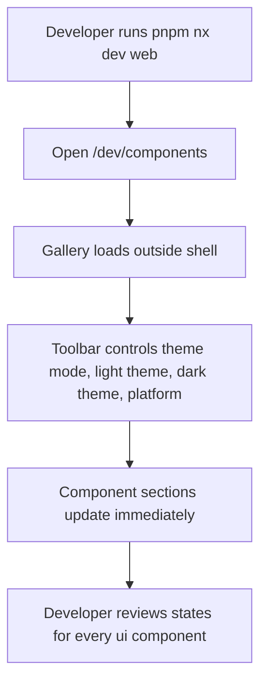
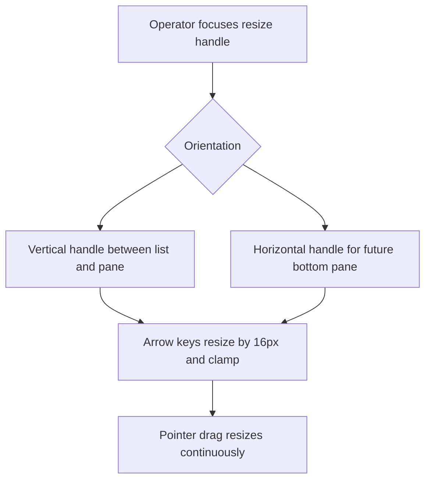
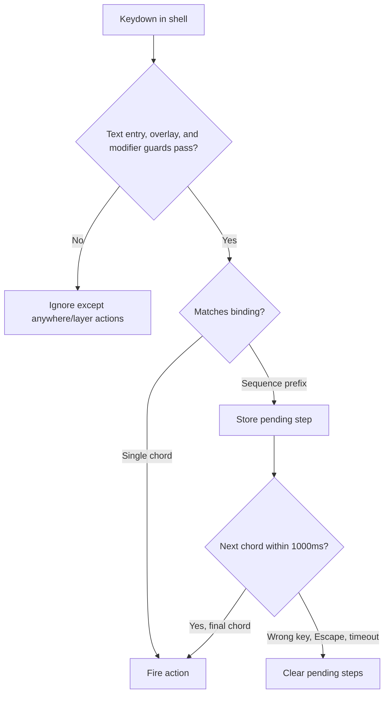
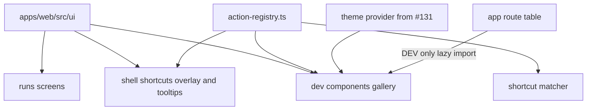

# Shared UI components and component gallery

## What

Autocatalyst web gains a shared set of small client-owned UI building blocks and a dev-only component gallery. The feature gives developers one place to reuse the resize handle, chip, empty state, description list, and keyboard shortcut displays, and one page where operators and developers can inspect those components across states, themes, and key-cap platforms.

The work also upgrades the shell shortcut model so an action can declare one or more alternate bindings, where each binding can be a single chord or a two- or three-step sequence. Existing screens keep their current layout and wording; this feature moves existing markup into reusable components and makes the shortcut behavior precise before upcoming keyboard-heavy changes land.

## Why

The web client already follows ADR-032's rule that screens import client-owned components instead of primitive library APIs. Adding the next shared components now prevents run-list, run-detail, shell, and future view-menu work from copying one-off markup and styling. The gallery makes visual review faster because every component and state can be judged in one place instead of by navigating through live app scenarios.

The shortcut changes remove ambiguity before new Shift and sequence shortcuts are added. Operators should be able to trust that `j`, `Shift+J`, `?`, `Cmd+Shift+K`, alternates, and sequences are distinct, documented, and displayed accessibly.

## Personas

- **Olive: Operator** - Uses the run console daily and benefits from consistent keyboard hints, predictable resizing, and unchanged run-list/detail behavior.
- **Devon: Developer** - Adds and reuses web UI components, checks component states in the gallery, and needs tests that prevent gallery drift.
- **Daria: Designer-reviewer** - Reviews themes, focus states, empty states, chips, and keyboard displays from one page without needing a live run scenario.

## Narratives

### Reusing run detail building blocks

Devon opens the run detail code to prepare for a new status treatment. Instead of copying the existing work-kind chip or summary fact markup, they find `Chip`, `DescriptionList`, and `DescriptionItem` in `apps/web/src/ui/`, each with a file comment that states whether it wraps Base UI or is custom. The detail header and Summary tab still look the same, but the reusable parts now live behind named client components.

Devon checks the resize behavior after replacing the private run separator. The vertical pane handle still widens the side pane when dragged or moved left with the keyboard, and the same geometry assertions pass. A horizontal orientation is available for the future bottom pane without changing existing screen layout.

### Reviewing components in one gallery

Daria starts the web dev server and opens `/dev/components`. The page is outside the shell and needs no token, so it can be used even when the control plane is not connected. The toolbar lets Daria switch theme mode, light theme, dark theme, and key-cap platform, and the page updates immediately without writing preferences.

Daria scrolls through every component under `ui/`: buttons, dialogs, fields, inputs, tabs, tooltips, the write-only secret field, and the new resize handle, chip, empty state, description list, and shortcut components. Each component shows useful states such as default, hover, focus, disabled, error, and loading where they apply. A completeness test fails if a future `ui/` component is missing from the gallery.

### Reading and using shortcuts

Olive opens the keyboard shortcuts overlay. Alternates are separated by "or" instead of appearing like a sequence, and sequences use a small "then" separator with an accessible name such as "g then r". Tooltips and menus still show the first binding only, while the overlay can show all bindings.

When Olive presses keys, the matcher respects the new model. Plain `j` and `Shift+J` are different, `?` still works even though Shift is held, `Cmd+Shift+K` requires all named modifiers, and sequence state clears on a wrong key, Escape, or timeout. Existing actions keep their bindings and behavior.

## User stories

**Reusing run detail building blocks**

- Devon can import shared UI components from `apps/web/src/ui/` instead of copying run-specific markup.
- Devon can tell from each component file comment whether the component wraps Base UI or is custom.
- Devon can use one resize handle component for vertical and horizontal resizing.
- Olive can resize the run detail pane exactly as before after the separator component moves.

**Reviewing components in one gallery**

- Daria can open `/dev/components` in development without a token or control-plane connection.
- Daria can switch theme mode, light theme, dark theme, and key-cap platform and see the gallery update immediately.
- Devon can add a future `ui/` component and get a failing test until a gallery entry exists.
- Devon can verify that production builds do not include or route to the dev gallery.

**Reading and using shortcuts**

- Olive can distinguish alternate shortcut bindings from multi-step sequences visually and through accessible names.
- Olive can use existing shortcuts with no behavior regression.
- Devon can declare Shift, Alt, mod, alternates, and sequences in one registry shape.
- Devon can rely on registry tests to prevent conflicting bindings and sequence-prefix conflicts.

## Goals

- All new and existing shared components in `apps/web/src/ui/` have gallery entries and file comments that state Base UI wrapper versus custom.
- Existing run list and run detail layout, wording, and geometry assertions remain unchanged after moving markup to shared components.
- Shortcut matching and display support lowercase-authored letter chords, CapsLock-safe matching, Shift, Alt via physical `event.code`, mod, alternates, two-step sequences, and three-step sequences with unit coverage.
- Gallery theme coverage renders the three light themes in light mode, the five dark themes in dark mode, plus system mode under both OS color-scheme settings.
- `/dev/components` is available only in Vite development, lazily imported, absent from production bundles, and routes to not-found in a production fake-mode serve.
- Documentation records the new components, shortcut model, gallery usage, and the requirement to add gallery entries for new `ui/` components.

## Non-goals

- Changing the status chip, run list appearance, or detail pane appearance planned for issue #176.
- Adding grab handles for reordering.
- Adding `Menu`, `Select`, `Popover`, or `Switch` wrappers.
- Adding a shortcut editor.
- Adding row density controls to the gallery.
- Adding Storybook.
- Splitting the shell zones into new components.

## Design spec

### User flows

### Key UI components

#### ResizeHandle

- Custom `ui/` component because Base UI has no resizable-panel primitive.
- Supports `vertical` and `horizontal` orientations.
- Takes current value, minimum, maximum, accessible label, and a direction flag describing whether movement toward the start of the axis increases or decreases the value.
- Renders a focusable `role="separator"` with matching `aria-orientation`, `aria-valuenow`, `aria-valuemin`, and `aria-valuemax`.
- Uses `--color-border-subtle` at rest and `--color-primary` on hover, focus, and drag.
- Keeps the existing side-pane behavior: ArrowLeft and dragging left widen the side pane.

#### Chip

- Custom non-interactive label component.
- Uses `--text-xs`, `--radius-sm`, no wrap, and token-only colors.
- Tones map to tokens as follows:

| Tone | Treatment |
| --- | --- |
| `neutral` | `--color-border` outline with `--color-text` |
| `muted` | outline with `--color-subtext` |
| `primary` | `--color-primary` fill with `--color-on-primary` |
| `green` | outline with `--color-green` text |
| `red` | outline with `--color-red` text |

- Replaces the detail header work-kind chip and filled waiting chip without visual changes.

#### EmptyState

- Custom component following the design-system empty-state pattern.
- Centered title in `--text-md`, one message line in `--text-sm` and `--color-subtext`, optional single action, no illustration.
- Replaces run detail empty states, the run-gone state, and the no-run text while keeping copy descriptors in `runs/run-detail-empty-states.ts`.

#### DescriptionList and DescriptionItem

- Custom semantic description-list components.
- Render `dl`, `dt`, and `dd`.
- Replace private Summary-tab facts while preserving the current label-above-value look.

#### Kbd, Shortcut, and ShortcutList

- Custom display components for keyboard bindings.
- `Kbd` renders one `kbd` cap with current cap styling: `--font-mono`, `--text-xs`, `--color-subtext`, `--color-surface`, and `--color-border`.
- `Shortcut` renders one binding. One chord is one cap; sequences render caps with a small "then" separator and accessible names such as "g then r".
- `ShortcutList` renders alternate bindings separated by "or" and supports a `limit` so tooltips/menus show the first binding while the overlay shows all bindings.
- Both shortcut components take `platform` so the gallery can show macOS and non-macOS caps side by side.

#### Component gallery

- Development-only route at `/dev/components`, outside the shell.
- Has no bearer-token or control-plane dependency.
- Lazily imported and registered only when `import.meta.env.DEV` is true.
- Toolbar controls theme mode, light theme, dark theme, and platform. Changes apply immediately and do not write stored preferences.
- Lists every `ui/` component and useful states. Fields include error and loading states; components include default, hover, focus, and disabled states where applicable.
- No density switch; row density remains a view setting owned by issue #159.

## Tech spec

### Introduction and overview

#### Prerequisites and assumptions

- Depends on issue #134 for the run list, run table, action registry, shortcuts overlay, and current `runs/run-separator.tsx`.
- Depends on issue #135 for the run detail pane, header, Summary tab, and run detail empty-state modules.
- Uses ADR-032: screens import client-owned `ui/` components and do not import Base UI primitives directly.
- Uses the design-system tokens and patterns in `context-agent/wiki/design-system.md`, especially resizing, empty states, overlays, menus/buttons, and focus/keyboard rules.
- No backend API, persistence schema, SDK, or control-plane contract changes are needed.

#### Technical goals

- Keep Base UI imports restricted to `apps/web/src/ui/` wrappers and document each new `ui/` file as Base UI wrapper or custom.
- Preserve current screen output for moved markup except where the shortcut overlay gains explicit alternates and sequence display.
- Make shortcut binding validation deterministic and testable in pure modules.
- Keep the dev gallery out of production route registration and production bundles.

#### Non-goals

- No data model or API changes.
- No production navigation entry for the gallery.
- No new primitive-library dependency.
- No visual restyling of existing run screens beyond component extraction.

#### Glossary

- **Chord**: One keyboard event shape, `{ key, mod?, shift?, alt? }`.
- **Binding**: A non-empty ordered list of chords. A one-chord binding is a combo; a multi-chord binding is a sequence.
- **Alternate**: A different binding for the same action.
- **Sequence**: A binding with two or more chords, matched in order within `SEQUENCE_TIMEOUT_MS`.
- **Platform**: Key-cap rendering target, macOS or other.

### System design and architecture

#### Component breakdown

- `apps/web/src/ui/resize-handle.tsx`: custom separator component with pointer and keyboard resizing for both orientations. Exports `RESIZE_STEP_PX = 16`.
- `apps/web/src/ui/chip.tsx`: custom label component with tone variants.
- `apps/web/src/ui/empty-state.tsx`: custom empty-state component with optional action.
- `apps/web/src/ui/description-list.tsx`: custom semantic description list components.
- `apps/web/src/ui/shortcut.tsx`: custom `Kbd`, `Shortcut`, and `ShortcutList` display components.
- Existing `ui/` wrappers remain in place and gain/keep comments that identify Base UI wrapper or custom.
- `apps/web/src/dev/components-gallery.tsx` or equivalent route module: dev-only gallery page and registry of component examples.
- `apps/web/src/dev/component-gallery-registry.ts` or equivalent pure registry: lists gallery entries and supports the completeness test.
- `apps/web/src/shell/key-utils.ts`: expands chord shape and formatting helpers.
- `apps/web/src/shell/action-registry.ts`: changes `ActionDescriptor.keys` from flat chords to bindings, validates conflicts, and exposes display helpers for binding lists.
- `apps/web/src/shell/use-action-keys.ts`: owns pending sequence state, timeout handling, and event-to-action dispatch.
- `apps/web/src/shell/shortcuts-overlay.tsx`: uses `ShortcutList`; removes local `CAP_CLASSES`.
- Run modules (`run-table.tsx`, `run-detail-header.tsx`, `run-detail-pane.tsx`, `run-detail-summary.tsx`, routes using separator) import the new shared components.

#### Shortcut matching design

- `ShellChord` becomes `{ key: string; code?: string; mod?: 'mod'; shift?: boolean; alt?: boolean }`. Letter chords are authored with lowercase `key` values. Chords that name `alt` also name a physical `code` such as `KeyK`, because macOS Option changes `event.key`.
- `ActionDescriptor.keys` becomes `readonly Binding[]`, where `Binding = readonly [ShellChord, ...ShellChord[]]` or a runtime-validated non-empty readonly list if TypeScript ergonomics require an alias.
- Letter chord matching is CapsLock-safe: compare `event.key.toLowerCase()` to `chord.key`, then require `event.shiftKey === (chord.shift === true)`. Thus `{ key: 'j' }` matches plain `j` even when CapsLock reports `event.key === 'J'`, and `{ key: 'j', shift: true }` matches Shift+J.
- Non-letter chords such as `?` and `[` compare `event.key` exactly and ignore Shift because the key value already carries the printable result.
- The old blanket `modifierHeld` guard is replaced for shortcut actions by exact per-chord comparison of `mod`, `shift`, and `alt` against the event. `mod` means Cmd on macOS and Ctrl elsewhere; unnamed `mod` means that platform modifier must not be held. Unnamed `alt` means Alt must not be held; named `alt` requires Alt and matches the physical `code`. AltGraph remains blocked unless a future chord explicitly supports it.
- The hard-coded settings-toggle and Escape special cases move into the generic matcher as registry actions. Their existing applies-when behavior is preserved: settings works anywhere, and Escape remains the layer-close action.
- `SEQUENCE_TIMEOUT_MS = 1000` is a named exported constant.
- A sequence fires only when the final chord matches and every prior chord matched in order within the timeout. Wrong key, `Escape`, or timeout clears pending steps. After a wrong key clears a pending prefix, that same key is evaluated again as a fresh first chord, so `g` then `j` clears `g` and runs the `j` action if `j` is otherwise valid. Guard rules apply to every chord of a sequence.
- Sequence state has one shared owner: either a module-level sequence tracker or a single dispatcher that all `useActionKeys` instances register handlers with. Every window keydown passes through the shared owner once, so multiple mounted hook instances cannot maintain conflicting pending states.
- Registry validation fails when two actions share an identical binding or when a binding is both a complete action and the prefix of a sequence. Failure messages name both actions.

#### Production gating design

- Route registration checks `import.meta.env.DEV` at route-construction time.
- The gallery route uses `lazy()`/dynamic import behind that DEV guard. Because Vite replaces `import.meta.env.DEV` with `false` in production, the guarded dynamic import is eliminated.
- The production build output must contain no gallery code: no emitted chunk for the gallery module and no emitted file containing a unique marker string from the gallery module, such as its page title.
- Production fake-mode serve of `apps/web/dist` returns the not-found page for `/dev/components`.

### Detailed design

#### Data model and schema

No database, API-contract, SDK, or persistence schema changes. All data is local TypeScript component state, props, and shell registry metadata.

#### API contracts

No HTTP API changes. The gallery intentionally does not call the control plane and must require no model or network call.

#### Key algorithms and logic

#### Gallery theming without preference writes

- The gallery toolbar does not call `updatePreferences`.
- The gallery owns local toolbar state and writes `data-theme` and `data-theme-mode` directly to `document.documentElement` so the page and Base UI portal content such as Dialog and Tooltip examples share the selected theme.
- On mount, the gallery records the previous root `data-theme` and `data-theme-mode` values. On unmount, it restores those exact prior values, including removing an attribute that was previously absent.
- The toolbar also sets local platform state for shortcut key caps; this never touches stored preferences.

1. **ResizeHandle keyboard**
   - On ArrowLeft/ArrowRight for vertical or ArrowUp/ArrowDown for horizontal, compute signed delta from orientation and the `startAxisChange` direction prop.
   - Apply `RESIZE_STEP_PX`.
   - Clamp to `[min, max]`.
   - Call the existing value-change callback only with the clamped value.

2. **ResizeHandle pointer drag**
   - On pointer down, capture pointer and store start coordinate/value.
   - On pointer move, compute axis delta and signed value delta using orientation and direction prop.
   - Clamp continuously and notify.
   - On pointer up/cancel, release capture and clear drag state.

3. **Chord matching**
   - Normalize platform mod: macOS uses `metaKey`, other platforms use `ctrlKey`.
   - For letter chords, compare `event.key.toLowerCase()` to the lowercase-authored `chord.key`, then require Shift equality with `chord.shift === true`.
   - For non-letter chords, compare `event.key` exactly and ignore Shift.
   - For Alt chords, require `event.altKey === true` and compare the physical `event.code` to `chord.code`, because macOS Option changes `event.key`; when `alt` is not named, Alt must not be held.
   - Replace blanket modifier blocking with exact per-chord comparison for `mod`, `shift`, and `alt`, while preserving applies-when gates for text entry, open layers, anywhere, layer-open, and list focus.
   - Include tests for CapsLock-on letter matching, Shift+letter matching, and an Alt chord whose `event.key` changes but whose `event.code` matches.

4. **Sequence state**
   - Use one shared module-level tracker or one dispatcher shared by all `useActionKeys` instances.
   - Store pending `{ actionId, binding, nextIndex, lastMatchedAt }` candidates after a matching sequence prefix.
   - Clear state on wrong key, Escape, guard failure, or timeout.
   - After a wrong key clears pending state, evaluate that same key as a fresh first chord.
   - Fire the action when the final chord matches, then clear state.
   - Do not ship any production action with a sequence in this issue; use scripted test registries and gallery examples for sequence display.
   - Include a test with two mounted `useActionKeys` instances showing that a sequence handler owned by one instance completes through the shared tracker and that a wrong key clears pending state for both instances.

5. **Gallery completeness**
   - A test lists non-spec component files in `apps/web/src/ui/`.
   - It compares file basenames or exported component IDs against the gallery registry.
   - Missing entries fail with the missing filename.

### Security, privacy, and compliance

- The gallery is development-only and outside the shell, but it must not read bearer tokens, call the SDK, call the control plane, or make model calls.
- Gallery controls must not write to the stored preferences record from the theme provider. Use local component state or a temporary provider override.
- Keyboard handling must keep text-entry and open-layer guards so shortcuts do not capture user input unexpectedly.
- No sensitive data is displayed in the gallery. `WriteOnlySecretField` examples use placeholders only.

### Observability

- No new production logs or metrics are required.
- Tests should fail on console warnings for gallery rendering to catch React accessibility or invalid DOM regressions.
- Existing route and error behavior should remain unchanged outside `/dev/components` in development.

### Testing plan

- Unit/component tests for `ResizeHandle` keyboard and pointer behavior in both orientations, including clamp range and existing vertical behavior.
- Existing run geometry tests continue to pass after replacing `run-separator.tsx`.
- Component tests for `Chip`, `EmptyState`, `DescriptionList`, and shortcut display semantics where useful.
- Shortcut matcher tests for plain vs Shift letters, `?`, `Cmd+Shift+K`, Alt, alternates, sequence timeout, wrong key, Escape, and guard rules on each sequence chord.
- Registry validation tests for duplicate bindings and sequence-prefix conflicts, with failure messages naming both actions.
- Shortcuts overlay tests proving `ShortcutList` shows all alternates without `CAP_CLASSES`.
- Gallery render tests for the exact theme matrix: three light themes in light mode, five dark themes in dark mode, plus system mode under mocked light and dark OS color-scheme settings, with no error and no console warning.
- Gallery preference tests proving that changing every toolbar control leaves the `autocatalyst.preferences` storage value byte-identical and that unmounting restores the previous root `data-theme` and `data-theme-mode` attributes.
- Gallery completeness test that names missing `ui/` files.
- Route-table unit test proving `/dev/components` registers only when `import.meta.env.DEV` is true.
- Playwright production-path test serving `apps/web/dist` in fake mode and asserting `/dev/components` shows not-found.
- Production build-output assertion after `pnpm nx build web` that reads `apps/web/dist` and fails if an emitted file contains the gallery marker string or if a gallery chunk exists.
- No test makes a model call.

### Alternatives considered

- **Storybook instead of an in-app gallery.** Rejected for this issue because the project already has Vite, theme provider, and fake-mode production serving; an in-app dev route is enough and keeps setup small.
- **Keep shortcut keys as a flat chord list.** Rejected because flat chords cannot distinguish alternates from sequences and already make `j ↓` read like a sequence.
- **Use a third-party resizable panel primitive.** Rejected because ADR-032 and Base UI usage keep primitive imports behind client components, and Base UI has no resizable-panel primitive. The needed behavior is small and already exists in custom code.

### Risks

- Route gating can accidentally include gallery code in production if the dynamic import is referenced outside a DEV guard. Mitigate with production build/serve Playwright coverage.
- Sequence matching can interfere with existing single-key actions if prefix conflicts are allowed. Mitigate with registry validation that rejects prefix conflicts.
- Theme overrides in the gallery can accidentally persist preferences. Mitigate by designing the gallery controls as local state and testing that preference writes are not invoked.
- Moving markup into shared components can unintentionally alter spacing or accessible names. Mitigate by keeping existing assertions and adding targeted component tests.

## Task list

- [ ] **Story: Shared UI component extraction**
  - [ ] **Task: Add `ResizeHandle` to `apps/web/src/ui/`**
    - **Description**: Create the custom resize separator component with vertical and horizontal orientations, ARIA separator attributes, keyboard resizing, pointer dragging, clamping, token-based states, and a file comment explaining that it is custom because Base UI has no resizable-panel primitive.
    - **Acceptance criteria**:
      - [ ] Component takes orientation, current value, min, max, accessible label, and start-axis direction props.
      - [ ] It renders focusable `role="separator"` with matching orientation and value ARIA attributes.
      - [ ] Arrow keys resize by `RESIZE_STEP_PX` (`16`) in both orientations.
      - [ ] Pointer drag resizes continuously in both orientations.
      - [ ] Values clamp to the declared range.
      - [ ] Rest, hover, focus, and drag colors use the design-system tokens from the resizing pattern.
      - [ ] Unit tests cover keyboard, drag, orientation behavior, and clamping.
    - **Dependencies**: None
  - [ ] **Task: Replace `run-separator.tsx` with `ResizeHandle`**
    - **Description**: Update the runs page composition to import the shared `ResizeHandle`, preserve existing side-pane direction behavior, remove the old `runs/run-separator.tsx` module, and update tests/imports accordingly.
    - **Acceptance criteria**:
      - [ ] `apps/web/src/runs/run-separator.tsx` is removed.
      - [ ] The vertical handle still widens the side pane on ArrowLeft and left drag.
      - [ ] Existing geometry assertions for the handle pass unchanged.
      - [ ] No screen layout or wording changes.
    - **Dependencies**: `Task: Add `ResizeHandle` to `apps/web/src/ui/``
  - [ ] **Task: Add and adopt `Chip`**
    - **Description**: Create a custom non-interactive `Chip` component with the required tone variants and migrate the run detail work-kind chip and run table filled waiting chip to use it without changing their rendered look.
    - **Acceptance criteria**:
      - [ ] `Chip` lives in `apps/web/src/ui/` and has a custom-component file comment.
      - [ ] Tones use the explicit mapping: `neutral` is `--color-border` outline with `--color-text`; `muted` is outline with `--color-subtext`; `primary` is `--color-primary` fill with `--color-on-primary`; `green` is outline with `--color-green` text; `red` is outline with `--color-red` text.
      - [ ] Unit tests assert the class or computed color for each tone.
      - [ ] Chip uses `--text-xs`, `--radius-sm`, and no wrapping.
      - [ ] Detail header work-kind chip and table waiting chip render as before.
      - [ ] Existing detail header and run table tests pass.
    - **Dependencies**: None
  - [ ] **Task: Add and adopt `EmptyState`**
    - **Description**: Move the reusable empty-state pattern to `ui/`, keep copy descriptors in `runs/run-detail-empty-states.ts`, update run detail empty, run-gone, and no-run states to use the shared component, and remove the old run-specific component.
    - **Acceptance criteria**:
      - [ ] `EmptyState` lives in `apps/web/src/ui/` and has a custom-component file comment.
      - [ ] It renders centered title, one message line, optional one action, and no illustration.
      - [ ] Detail pane empty states, run-gone state, and no-run text use it.
      - [ ] `apps/web/src/runs/run-detail-empty-state.tsx` is removed.
      - [ ] Tests that assert through copy descriptors pass unchanged.
    - **Dependencies**: None
  - [ ] **Task: Add and adopt `DescriptionList` and `DescriptionItem`**
    - **Description**: Create semantic description-list components and replace the private Summary-tab fact markup while preserving the current label-above-value appearance.
    - **Acceptance criteria**:
      - [ ] Components live in `apps/web/src/ui/` and have custom-component file comments.
      - [ ] They render `dl`, `dt`, and `dd`.
      - [ ] The Summary tab's seven facts use them.
      - [ ] Summary tab appearance remains unchanged.
    - **Dependencies**: None

- [ ] **Story: Shortcut model and display components**
  - [ ] **Task: Implement `Kbd`, `Shortcut`, and `ShortcutList`**
    - **Description**: Add keyboard display components in `ui/` and move cap styling out of the shortcuts overlay. Support platform-aware rendering, sequence "then" separators, alternate "or" separators, accessible names, and `limit`.
    - **Acceptance criteria**:
      - [ ] `Kbd` renders one styled `kbd` cap using current cap tokens.
      - [ ] `Shortcut` renders one binding as a combo or sequence with accessible names.
      - [ ] `ShortcutList` renders alternates separated by "or" and honors `limit`.
      - [ ] Components take platform input for macOS and non-macOS caps.
      - [ ] The shortcuts overlay uses `ShortcutList` with no limit.
      - [ ] The overlay's `CAP_CLASSES` copy is removed.
    - **Dependencies**: None
  - [ ] **Task: Upgrade shortcut registry types and display helpers**
    - **Description**: Change `ShellChord` and `ActionDescriptor.keys` to the new chord/binding/alternate model, update registry helpers such as `actionTooltipKey` and `actionKeyCaps`, and migrate shipped actions while keeping their behavior.
    - **Acceptance criteria**:
      - [ ] `ShellChord` includes `shift` and `alt`.
      - [ ] `ActionDescriptor.keys` is a list of non-empty bindings.
      - [ ] Existing actions keep their current bindings and behavior.
      - [ ] `shell-keys.ts`, registry tests, display helpers, and all tests that read `keys` use the new shape.
      - [ ] Tooltip/menu display can limit to the first binding.
    - **Dependencies**: `Task: Implement `Kbd`, `Shortcut`, and `ShortcutList``
  - [ ] **Task: Implement exact modifier and sequence matching**
    - **Description**: Update the pure matcher and hook state so letters distinguish Shift, named Alt and mod are required, non-letter printable keys such as `?` ignore Shift, and sequence state fires on the final chord within `SEQUENCE_TIMEOUT_MS`.
    - **Acceptance criteria**:
      - [ ] Tests prove `j` does not trigger `Shift+J` and `Shift+J` does not trigger `j`.
      - [ ] Tests prove CapsLock-on plain `j` still matches a `{ key: 'j' }` chord.
      - [ ] Tests prove `?` triggers with Shift held.
      - [ ] Tests prove `Cmd+Shift+K` requires all named modifiers.
      - [ ] Tests prove an Alt chord matches by physical `event.code` when `event.key` changes on macOS.
      - [ ] Fake-timer tests cover two-chord and three-chord sequences firing on the last chord.
      - [ ] Pending sequence state clears on wrong key, Escape, and after `SEQUENCE_TIMEOUT_MS`.
      - [ ] A wrong key after a prefix is evaluated as a fresh first chord after clearing pending state.
      - [ ] Guard rules apply to every chord of a sequence.
      - [ ] `SEQUENCE_TIMEOUT_MS` is a named constant.
      - [ ] A two-mounted-instance test proves shared sequence state across `useActionKeys` instances.
    - **Dependencies**: `Task: Upgrade shortcut registry types and display helpers`
  - [ ] **Task: Add registry conflict validation**
    - **Description**: Add deterministic validation that rejects duplicate bindings and rejects any chord binding that is also a sequence prefix, then cover validation with registry tests.
    - **Acceptance criteria**:
      - [ ] A test fails when two actions share a binding.
      - [ ] A test fails when a chord that starts a sequence is also a binding on its own.
      - [ ] Failure messages name both conflicting actions.
      - [ ] Shipped registry passes validation.
    - **Dependencies**: `Task: Upgrade shortcut registry types and display helpers`
  - [ ] **Task: Test shortcut display with scripted registries**
    - **Description**: Add unit tests using scripted actions for a sequence and a two-alternate action to verify display text, accessible names, and limit behavior on macOS and non-macOS platforms.
    - **Acceptance criteria**:
      - [ ] Tests cover one sequence binding.
      - [ ] Tests cover one action with two alternates.
      - [ ] Tests assert display text and accessible names on macOS.
      - [ ] Tests assert display text and accessible names on another platform.
      - [ ] Tests assert `limit` behavior.
      - [ ] No shipped action uses a sequence yet.
    - **Dependencies**: `Task: Implement exact modifier and sequence matching`

- [ ] **Story: Development component gallery**
  - [ ] **Task: Build the dev-only component gallery route**
    - **Description**: Add `/dev/components` outside the shell, lazily import the gallery only in development, and build a toolbar that controls theme mode, light theme, dark theme, and key-cap platform without writing stored preferences.
    - **Acceptance criteria**:
      - [ ] `/dev/components` renders in Vite development without token or control-plane access.
      - [ ] The route is registered only when `import.meta.env.DEV` is true.
      - [ ] Gallery code is lazily imported.
      - [ ] Toolbar changes update the page immediately.
      - [ ] Toolbar changes do not call `updatePreferences` and do not change the byte value stored under `autocatalyst.preferences`.
      - [ ] The gallery sets `data-theme` and `data-theme-mode` on `document.documentElement` from local state and restores previous root attributes on unmount.
      - [ ] The gallery has no row-density switch.
    - **Dependencies**: `Task: Implement `Kbd`, `Shortcut`, and `ShortcutList``
  - [ ] **Task: Add gallery entries for all `ui/` components**
    - **Description**: Create gallery examples for every component in `apps/web/src/ui/`, including all existing wrappers and new custom components, showing required states and platform examples for shortcuts.
    - **Acceptance criteria**:
      - [ ] Every `ui/` component has a gallery entry.
      - [ ] Entries show default, hover, focus, and disabled states where applicable.
      - [ ] Field-like entries include error and loading states where applicable.
      - [ ] Shortcut entry shows a combo, a `g` then `r` sequence, and `j` or `ArrowDown` alternates.
      - [ ] Examples use placeholder data and make no model calls.
    - **Dependencies**: `Task: Build the dev-only component gallery route`, `Task: Add and adopt `Chip``, `Task: Add and adopt `EmptyState``, `Task: Add and adopt `DescriptionList` and `DescriptionItem``
  - [ ] **Task: Add gallery coverage tests**
    - **Description**: Add Vitest coverage for rendering the gallery in all themes and modes, plus a filesystem-based completeness test for `ui/` entries.
    - **Acceptance criteria**:
      - [ ] Vitest renders the exact matrix: three light themes in light mode, five dark themes in dark mode, plus system mode with mocked light and dark OS color-scheme settings.
      - [ ] The render test expects no error and no console warning.
      - [ ] A unit test lists non-spec files in `apps/web/src/ui/`.
      - [ ] The completeness test fails when a file has no gallery entry.
      - [ ] The completeness failure names the missing file.
    - **Dependencies**: `Task: Add gallery entries for all `ui/` components`
  - [ ] **Task: Prove production exclusion**
    - **Description**: Add production-route coverage so the gallery is unavailable in built fake-mode serving and absent from the production route table.
    - **Acceptance criteria**:
      - [ ] A route-table unit test shows `/dev/components` is registered only in development.
      - [ ] A Playwright production-path test serves `apps/web/dist` in fake mode and opens `/dev/components`.
      - [ ] The production-path test sees the not-found page.
      - [ ] The production build output contains no gallery code: no gallery chunk and no emitted file containing the gallery marker string.
    - **Dependencies**: `Task: Build the dev-only component gallery route`

- [ ] **Story: Documentation and navigation updates**
  - [ ] **Task: Document component and shortcut changes**
    - **Description**: Update agent-facing docs with the new shared components, shortcut model, gallery route, and design-system focus/keyboard rules for sequences, alternates, and Shift chords.
    - **Acceptance criteria**:
      - [ ] `context-agent/wiki/code-map.md` records each new component.
      - [ ] `context-agent/wiki/code-map.md` records the shortcut model and gallery.
      - [ ] The design system's Focus and keyboard section documents sequences.
      - [ ] The design system documents alternates as "or".
      - [ ] The design system documents Shift chord matching rules.
    - **Dependencies**: `Task: Implement exact modifier and sequence matching`, `Task: Add gallery entries for all `ui/` components`
  - [ ] **Task: Document how to open and maintain the gallery**
    - **Description**: Update `apps/web/README.md` with local gallery usage and the requirement that every new `ui/` component gets a gallery entry.
    - **Acceptance criteria**:
      - [ ] README says to run `pnpm nx dev web` and open `/dev/components`.
      - [ ] README says a new `ui/` component needs a gallery entry.
      - [ ] README notes the gallery is development-only.
    - **Dependencies**: `Task: Build the dev-only component gallery route`

## Acceptance criteria

- [ ] Shared components are added under `apps/web/src/ui/` and each file comment identifies Base UI wrapper versus custom.
- [ ] Existing run screens keep their layout and wording after adopting shared components.
- [ ] The resize handle supports vertical and horizontal orientation, ARIA separator semantics, pointer drag, keyboard resizing by 16 px, clamping, and existing side-pane behavior.
- [ ] `Chip`, `EmptyState`, `DescriptionList`, `DescriptionItem`, `Kbd`, `Shortcut`, and `ShortcutList` meet the design and behavior described above.
- [ ] Shortcut registry and matching support bindings, alternates, lowercase-authored letter chords, CapsLock-safe matching, Shift, Alt via physical `event.code`, mod, two-step sequences, and three-step sequences.
- [ ] Registry validation rejects duplicate bindings and sequence-prefix conflicts with messages naming both actions.
- [ ] `/dev/components` shows every `ui/` component in relevant states across themes and platforms in development only.
- [ ] Production build/fake-mode serve shows not-found for `/dev/components`.
- [ ] Tests make no model calls.
- [ ] Code map, design-system docs, and web README are updated.

## How to try it

1. From the repository root, run `pnpm nx dev web` and open `http://localhost:<port>/dev/components` using the port printed by the dev server.
2. Scroll the page and verify each component shows its states. Use the toolbar to switch between Catppuccin Latte, Catppuccin Mocha, the other themes, macOS key caps, and other-platform key caps.
3. Find the Shortcut section. It should show a combo (`⌘,` on macOS), a sequence (`g` then `r`), and an action with two alternates (`j` or `↓`).
4. Run `pnpm nx build web`, serve it with fake mode as described in `docs/operators/fake-mode.md`, and open `/dev/components`. It should show the not-found page.
5. Open the app, select a run, and drag the handle between the list and pane. It should work as before.

## References

- `context-human/adrs/adr-032-web-client-stack.md`
- `context-agent/wiki/design-system.md`
- `context-agent/wiki/code-map.md`
- `apps/web/src/shell/action-registry.ts`
- `apps/web/src/shell/key-utils.ts`
- `apps/web/src/shell/shortcuts-overlay.tsx`
- `apps/web/src/runs/run-separator.tsx`
- `apps/web/src/runs/run-detail-header.tsx`
- `apps/web/src/runs/run-detail-summary.tsx`
- `apps/web/src/runs/run-detail-empty-state.tsx`
- Issue #142 (`Select`)
- Issue #156 (`Menu`)
- Issues #157, #158, #165, and #166 for upcoming Shift and layout-related shortcut/handle needs
