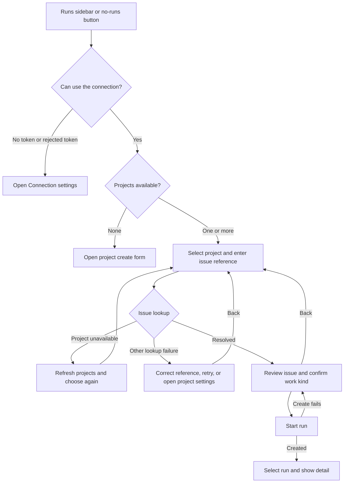
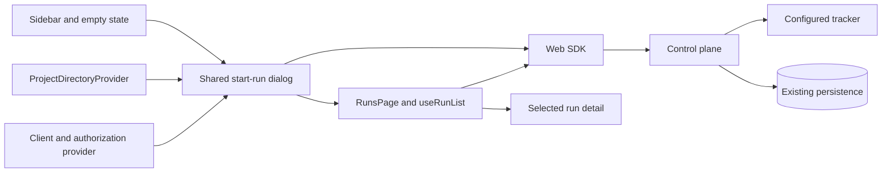
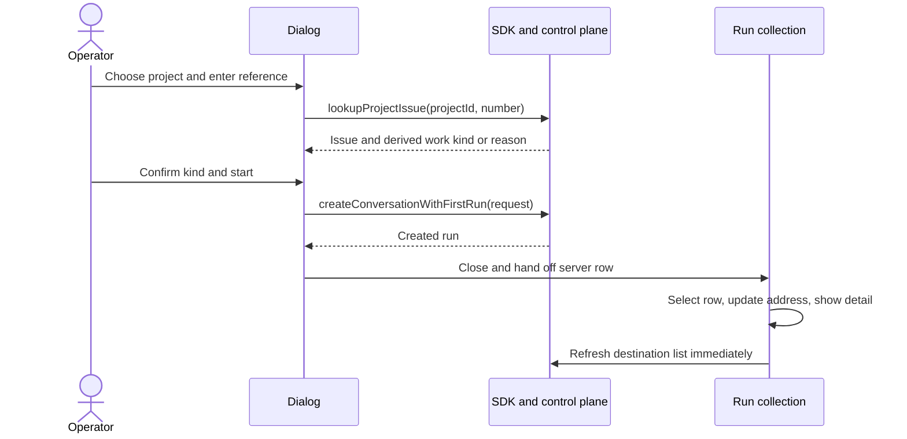

# Start a run from an issue

## What

An Autocatalyst operator can start a run from an issue in a configured project. The operator supplies the issue reference, checks the issue and work kind, and lands on the new run ready to follow its progress.

## Why

The tracked issue already describes the work. The operator should not have to copy that description or leave the client to start a run. Showing the issue and work kind before starting helps the operator catch a wrong repository or workflow.

## Personas

- **Phoebe: PM** — Starts runs from filed issues and reviews the specs before work proceeds.
- **Enzo: Engineer** — Checks the issue and workflow, reviews the implementation, and follows the pull request or investigates a failure.

## Narratives

### From a filed issue to a merged pull request

Phoebe opens Start a run from the sidebar. Her only project is already selected, so she types `#5`. The issue appears, but Autocatalyst cannot suggest a work kind. She picks `feature` and starts the run. Its row is selected and the issue title appears in the detail pane.

At the spec gate, Phoebe comments on a passage, requests changes, and approves after the revision addresses the comment. Enzo approves at the implementation gate. Once the pull request merges, he presses Check now and sees Done.

### Recover without guessing what went wrong

Enzo opens Start a run before connecting. The dialog sends him to Connection settings instead of waiting for projects it cannot load. Later, if his selected project is no longer available, the dialog tells him to choose a project again rather than asking him to find another issue number.

If a project has no issue tracker, Enzo follows Open project settings to that project's edit form. When he reads a valid issue but wants another one, Back clears the reference without making him pick the project again.

## User stories

**From a filed issue to a merged pull request**

- Phoebe can open the same dialog from Runs or the no-runs state.
- Phoebe can verify the issue, even if it is closed, before starting a run.
- Phoebe can accept a suggested work kind, override it, or supply one when none is suggested.
- Phoebe can see the new run selected immediately, even when her current project filter excludes it.
- Phoebe and Enzo can review the spec and implementation and confirm the merge in the client.

**Recover without guessing what went wrong**

- Enzo can connect or add a project when either prerequisite is missing.
- Enzo can distinguish a missing project from a missing issue and pick an available project without retyping the reference.
- Enzo can go directly to the affected project's settings for a tracker setup or credential problem.
- Enzo can retry a temporary lookup or create failure and see the reason if an accepted run later fails.

## Goals

- Accept all three supported reference forms and send no lookup for invalid input or a repository mismatch.
- Send one create request per activation with an explicit choice from the four supported work kinds.
- Display the selected run in the list, pane, and address without waiting for a poll.
- Prove the full unseeded fake-mode browser loop through merge, plus a forced run failure and a project setup recovery path, with no real model or provider calls.

## Non-goals

- A description box, free-text classification, questions, issue creation or links to create an issue, and work kinds `file_issue` and `question`.
- Listing, searching, or filtering issues, or showing whether an issue already has a run.
- A command palette entry or opening shortcut; on-demand credential checks, project deletion, or a docs gate.
- Control-plane, SDK contract, database, or workflow changes; smoke tests against live providers.

## Design spec

### User flow



### Entry, layout, and focus

- Place an icon button beside, not inside, the Runs link. Its accessible name and tooltip are **Start a run**. Keep it reachable through the collapsed sidebar's existing reveal and keyboard expansion. Add **Start a run** to the ready **No runs yet** state. Keep the list's no-connection and no-project states distinct.
- Use the centered `Dialog` wrapper and viewport backing. Title: **Start a run**. Description: **Choose a project and enter a tracked issue.** Put the Project `Select` first and Work kind `Select` beside it. Put the Issue reference field, inline feedback, and the preview below. Back belongs in the body. The right-aligned action row puts **Cancel** left of **Start run**. Follow the [design system](../../context-agent/wiki/design-system.md) for spacing, tokens, and interaction states.
- Trap focus in the dialog. Cancel and Escape close it and return focus to the opener if it remains on the page. An open Select consumes Escape first. Keep a revealed sidebar available for focus return. When navigation or a successful start removes the opener, focus the destination rather than the document body; on success from the empty state, focus the selected run row. While creating, block dismissal and other dialog actions until the request settles.

### Connection, projects, and issue preview

- **No connection takes precedence over project loading and errors.** With no bearer token or a rejected token, show **Connect to the control plane** and **Open connection settings**. The button closes the dialog and opens Settings > Connection. Show no project picker, work-kind picker, issue field, project retry, or Start run action in this state.
- With an available connection, show directory loading and offer a project-load retry for ordinary errors. With no projects, show **Add a project to get started** and **Add project**, which opens the #142 create form with the Runs return path. Show no issue field in this state.
- Show projects by display name. On initial load, select the only project; with several, start unselected even in a project-filtered view. Disable the issue field until a project is selected. If lookup reports that the selected project is unavailable, clear the selection, refresh the directory, and require a deliberate selection before trying again. Keep the reference so the operator can use it with the next project.
- Show validation and lookup feedback beneath the issue field. Show loading in the issue area while reading. The preview shows number, title, labels, and state. Mark a closed issue **Closed** beside its number and allow it to start a run.
- The Work kind control is disabled until an issue resolves. Offer `feature`, `enhancement`, `bug`, and `chore`. Preselect the kind returned by the control plane and allow an override. If no kind is returned, show **Needs a work kind** and either **No work-kind label matched.** (`no_match`) or **More than one work-kind label matched.** (`ambiguous_labels`). Keep Start run disabled until a kind is chosen. Preserve the choice while the project and reference stay unchanged.
- Show Back after a resolved issue or failed lookup. It clears the reference, preview, work kind, and messages, keeps any valid project selection, and sends no request. Return focus to the issue box, or to the project picker if the project was cleared and the box is disabled. If the refreshed directory is empty, focus Add project instead.

### Issue feedback

| Condition | Message and action |
| --- | --- |
| Invalid reference | **Enter an issue number, #number or an issue URL.** No lookup. |
| GitHub URL for a different repository | **This issue belongs to a different repository**. No lookup. |
| `404 not_found`, `details.resource: 'issue'` | **That issue was not found in this repository**. Keep the selected project. |
| `404 not_found`, `details.resource: 'project'` | **This project is no longer available.** Clear the project selection and refresh the shared directory. Keep this feedback visible during refresh. Do not retry lookup against that project automatically. |
| `tracker_auth_failed` | **This project's issue tracker credential was rejected.** Show **Open project settings**. |
| `tracker_credential_missing` | **This project is missing an issue tracker credential.** Show **Open project settings**. |
| `tracker_not_configured` | **This project has no issue tracker.** Show **Open project settings**. |
| `tracker_provider_unavailable`, network error, or unrecognized lookup failure | **The issue could not be read.** Show **Try again**. |

Associate feedback with its control and announce asynchronous changes without moving focus. Open project settings closes the dialog and opens the selected project's edit form. Try again repeats the current lookup. All lookup failures disable Start run. An ordinary failed create keeps the dialog open with the preview and kind intact and reenables Start run. A rejected control-plane bearer instead shows the connection state above.

## Tech spec

### Introduction and overview

This feature builds on #134 (run list and action registry), #140 (implementation gate and PR checks), #141 (lookup and explicit work kind), #142 (projects, directory, and Select), and #128–#130 (fake mode, built-client serving, and Playwright). It follows [ADR-031](../adrs/adr-031-web-client-architecture.md), [ADR-032](../adrs/adr-032-web-client-stack.md), and the [UX](../concepts/ux.md), [collection](../concepts/collection.md), [run detail](../concepts/run-detail.md), [intake](../concepts/intake.md), and [tracker](../concepts/trackers.md) concepts. No new API or schema is needed. A reference identifies a tracked issue; the work kind chooses the workflow. For each current lookup attempt send at most one read, and for each accepted Start activation send one create.

### System design and architecture



The shell owns one dialog and exposes the opener through the Runs outlet context. Put the dialog and pure reference extractor under `apps/web/src/runs/`. Reuse the active SDK client and shared project directory, not a parallel store. `RunsPage` and `useRunList` still own list state and selection. Use `CONNECTION_PATH`, `NEW_PROJECT_PATH`, `projectPath`, `runPath`, and `projectRunsPath` for navigation.



### Detailed design

1. **Gate on connection before reading district data.** Use `hasBearerToken()` and `useControlPlaneConnection().authorization`. A present token with authorization `unknown` may proceed; `unauthorized` may not. Do not use footer availability flags or the directory phase to infer auth. Check this gate before interpreting the directory snapshot and before scheduling lookup, retry, directory refresh, or create in the dialog. While it is open, defer Runs auth-driven navigation so a `401` from the active client shows the dialog recovery state rather than leaving a modal over Settings; outside the dialog preserve the existing automatic redirect. On authorization loss or client change, invalidate requests and clear issue and selection state. Do not confuse a control-plane `401` with a `400` carrying a project's `tracker_auth_failed`.
2. **Parse the full reference locally.** Trim only for validation. Accept whole decimal numbers with or without `#`, or `https://github.com/<owner>/<name>/issues/<digits>` with an optional trailing slash. Require a positive safe integer, as in `packages/api-contract/src/project-issue.ts`. Reject PR URLs, other hosts or schemes, user info, nondefault ports, query strings, fragments, and arbitrary text. Compare owner and repository case-insensitively with `project.hostRepository`; reject GitHub URLs for non-GitHub projects. A numeric reference takes its scope from the chosen project. Keep the input as typed for create. Lookup sends only project id and number. A blank editing field is idle; explicit Enter on blank shows the validation hint.
3. **Schedule and scope lookup.** Use `ISSUE_LOOKUP_DEBOUNCE_MS = 300`. Enter in the issue field cancels the timer and starts the current lookup immediately without submitting the form. Do not duplicate a lookup already dispatched for the same input revision. An edit or project change clears the old preview, kind, and errors. Revalidate and schedule the retained reference when a project changes. Try again explicitly starts a fresh attempt. Use a request generation to ignore stale success and failure after edits, project or client changes, disconnection, retry, Back, and close. Back cancels pending lookup work and triggers no lookup or directory refresh.
4. **Interpret typed results.** Call `lookupProjectIssue`, which uses `GET /v1/projects/:id/issues/:number`. Read `issue` and `workKind.kind` from the `200`; use the reason enum when the kind is null. Do not rederive it in the client. For `ControlPlaneClientError`, match status and envelope code before reading the allowed enum: `response.error.details.resource` for `404 not_found` and `response.error.details.trackerCode` for `400 intake_routing_error`. Never render the lookup envelope's message or other details. Missing or unknown enum values use the generic retryable read failure. Apply the `project` 404 recovery only to the current attempt. Clear the selected id and preview, suppress automatic selection for the rest of that dialog session, and use the shared directory refresh; if a directory read is already pending, ensure a reconciliation read runs after it rather than dropping the refresh. Prevent reselection of the stale entry until reconciliation returns it as available. Do not evict a project or refresh the directory for an `issue` 404. When the operator selects a project again, validate the retained reference before reading it.
5. **Send one explicit create.** Use the existing `POST /v1/conversations` SDK method and the request below. The identity is a fixed source marker, not an operator identity or record id; the bearer principal remains authoritative. Omit `channel`. Acquire a synchronous in-flight guard before awaiting the SDK. Require a current resolved issue and chosen work kind. On ordinary typed create failures, show the safe control-plane envelope message as text, never details or raw causes. Use **The run could not be started.** for untyped failures, unexpected work-kind `400 intake_routing_error`, and any provider text that is not safe to display. Do not automatically retry a write.

```ts
{
  projectId,
  identity: 'web',
  topic: { title: issue.title },
  submission: {
    kind: 'issue_reference',
    issue: { number: issue.number },
    workKind: chosenKind,
    body: rawReference
  }
}
```

`rawReference` is exactly what the operator typed, including accepted surrounding whitespace. Always send `chosenKind`, including an unchanged server suggestion.

6. **Land on the created run without polling.** From the `201` response close the dialog, hand off the returned run as a fresh server row, select it, and reveal the detail pane. Navigate to `/runs/:runId`; retain the project query only if it matches the created run's project. Read the collection immediately in the destination scope, even if a prior read was pending. Ignore earlier reads that would undo the handoff. Reconcile by id using the existing freshness rule and keep the returned row and selection through a transient refresh failure. A list refresh failure is not a create failure. Preserve normal back/forward, paging, and detail tab behavior.

### Security, privacy, and compliance

The control plane still validates input and authorizes access to the project and issue. The browser uses only the SDK and never calls a tracker directly. Render issue text and safe messages as text and build settings links with existing route helpers. Do not log the raw reference or add it to browser storage; its only new durable use is the normal submission body. The dialog does not read or expose credential values or references, bearer tokens, or raw provider data.

### Observability

Use inline feedback and the existing run state line. Add no telemetry or alerts. In fake mode, use the documented scripted-launch counter alongside fake mode's exclusive scripted dispatch to verify execution without real models.

### Testing plan

- **Unit and component:** Use the public SDK interface for test doubles. Cover all reference forms and validation failures, project change, debounce and Enter using fake timers, and stale success and failure using deferred promises. Cover directory states, both disconnected cases, lookup in progress, every specified lookup error and action, both 404 resource values with distinct recovery, missing and derived work-kind states, closed issues, Back and focus, and create payload, duplicate guard, and retry. Test immediate success handoff in and across project filters, including a prior list request in flight.
- **Browser wiring:** Add `apps/web/e2e/start-run-from-issue.spec.ts` using #130's `fake-server` fixture, a free port, a fresh state directory, and the built client. Start each scenario with no seed and connect and configure projects through the browser, not a preconnected storage fixture. Use no test-only routes or headers, injected state, or mocked SDK. Use the real authenticated SDK for final read-only verification, and only the documented fake-state helpers for merge, forced failure, and launch count. Wait for visible states rather than sleeping.
- **Geometry:** In both light and dark themes, measure the popup center, viewport backing edges (including over the footer), and right-aligned action row with Cancel left of Start run, using the design system's geometry conventions.
- **Manual:** From the repo root run `pnpm nx build web`, then `AUTOCATALYST_CLIENT_DIR=apps/web/dist pnpm nx run control-plane:serve-fake` with no seed. Open `http://127.0.0.1:4010`, connect with `fake-mode-token`, and create the fixture project in Settings. Try `#5`, choose `feature`, and drive the gates and PR check as below. Also try a matching issue URL, Back, `abc`, and a no-tracker project. Run browser coverage with `pnpm nx run web:e2e`.

### Alternatives considered

- Start directly from the issue number: saves a confirmation but hides issue and workflow mistakes. Keep the preview and explicit work kind.
- Wait for polling after create: needs less handoff code but leaves the result uncertain and does not repair a mismatched filter. Use the returned row and refresh immediately.

### Risks

- **Late requests can restore invalid state.** Scope lookup and list updates to the current request and test out-of-order completions, including a late project 404 after the operator switches projects.
- **A valid preview can become invalid before create.** Keep ordinary create failures local, preserve the operator's choice, and let the operator decide whether to retry.
- **A seeded browser test can miss production wiring.** Begin with no projects or runs, verify no scripted launches before Start, and drive every gate through the browser.

## Task list

- [ ] **Story: Open and resolve a tracked issue**
  - [ ] **Task: Add the shared dialog and entry points**
    - **Description**: Mount one dialog in the shell and expose the opener to Runs. Add its project, connection, and setup states using the existing wrappers and routes.
    - **Acceptance criteria**:
      - [ ] The sidebar icon and no-runs button open the same dialog; the icon is reachable when collapsed and has the accessible name and tooltip Start a run.
      - [ ] Cancel and Escape restore focus to the opener where it remains; modal keys do not trigger underlying actions.
      - [ ] Component tests cover no token and rejected token, including a `401` while open. The dialog offers Connection settings, shows no project or issue controls or retry, and starts no further dialog requests.
      - [ ] No projects offers the #142 create form without an issue field. One project is selected on initial load; several leave the issue field disabled until selection.
    - **Dependencies**: None.
  - [ ] **Task: Extract references and schedule issue reads**
    - **Description**: Add a pure extractor and coordinate reads by project, input revision, and active client.
    - **Acceptance criteria**:
      - [ ] All three accepted forms send only project id and number. Invalid input and repository mismatches show the specified copy and send nothing.
      - [ ] Fake timers prove no read before the delay, one after it, and immediate Enter without a duplicate. Deferred results prove stale responses are ignored and changing projects revalidates and reads the retained reference.
      - [ ] Loading clears the previous preview and disables Start run.
    - **Dependencies**: Task: Add the shared dialog and entry points.
  - [ ] **Task: Render the preview, work kind, and recovery**
    - **Description**: Render issue metadata, apply the server's work-kind result, and wire fixed feedback, Back, settings, and retry.
    - **Acceptance criteria**:
      - [ ] The preview shows number, title, labels, and state. Closed does not block create. The four kinds support a derived default and override; both missing-kind reasons require a choice.
      - [ ] Separate component tests prove an issue 404 preserves selection without refreshing and a project 404 clears selection, refreshes the shared directory, and never automatically looks up the stale project again. A late project 404 cannot clear a newer selection.
      - [ ] Component tests cover all four tracker codes, network failure, retry, the project edit link, no raw output or credentials, and Back clearing the reference and restoring focus without a request.
    - **Dependencies**: Task: Extract references and schedule issue reads.
- [ ] **Story: Start the run and select it**
  - [ ] **Task: Submit the explicit issue-reference request**
    - **Description**: Gate create on the current preview and kind, send the documented payload, and keep ordinary failures in the dialog.
    - **Acceptance criteria**:
      - [ ] Tests check project id, `identity: 'web'`, issue title and number, raw body, and explicit derived or overridden kind.
      - [ ] Pending create disables actions and duplicate activation sends nothing. Ordinary failures retain the preview and kind, allow retry, and show the safe envelope message; a work-kind routing failure uses generic copy.
    - **Dependencies**: Task: Render the preview, work kind, and recovery.
  - [ ] **Task: Select the server-returned run and refresh**
    - **Description**: Hand the new row to the collection and reconcile it with an immediate destination-scope read.
    - **Acceptance criteria**:
      - [ ] The dialog closes and the new row is selected with its title in the pane and id in the address before any poll.
      - [ ] A mismatched project filter clears and a matching one remains. A stale or failed list read does not undo selection or appear as a failed create.
    - **Dependencies**: Task: Submit the explicit issue-reference request.
- [ ] **Story: Prove the operator loop in a browser**
  - [ ] **Task: Drive startup through the revised spec gate**
    - **Description**: Start one unseeded happy-path test. Enter `fake-mode-token` on Connection. Through Settings > Projects, create `Fixture app` with URL `https://github.com/autocatalyst-fixtures/demo-app`, owner `autocatalyst-fixtures`, name `demo-app`, `github` host repository, tracker, and code host, and `fake-token` for the tracker and code-host credentials.
    - **Acceptance criteria**:
      - [ ] The test opens the sidebar dialog, types `#5`, sees the preview and Needs a work kind with Start run disabled, picks `feature`, and sees the new run selected with the issue title in the pane.
      - [ ] At the spec gate the decision starts at Approve. The test selects spec text, adds a comment, sees Request changes (1), confirms, and waits for the scripted revision. It sees the comment addressed, checks that the Approve popover says approval confirms the addressed comment, then approves.
    - **Dependencies**: Task: Select the server-returned run and refresh.
  - [ ] **Task: Complete the same browser test through merge**
    - **Description**: Continue the happy-path test on the same server and run.
    - **Acceptance criteria**:
      - [ ] At the implementation gate the test sees Approve and the Acceptance tab's empty state, then approves.
      - [ ] Summary shows an open pull request. Check now leaves it open. The test reads `n` from the row, writes `merged` to `<state directory>/pull-requests/<n>.state` through the fixture, presses Check now, and sees Merged and Done.
      - [ ] The real SDK reads the run as `done` with kind `feature`. The fake-state launch counter starts at zero and accounts for the scripted spec, revision, implementation, and PR finalization launches; fake mode registers no real provider adapter.
    - **Dependencies**: Task: Drive startup through the revised spec gate.
  - [ ] **Task: Verify forced failure and missing tracker**
    - **Description**: Add two independent tests in the same file with fresh fake state and project setup through the browser.
    - **Acceptance criteria**:
      - [ ] The failure test writes `{"step":"spec.author"}` to `<state directory>/failures/issue-8.json` through the fixture before starting labeled issue 8 via the dialog. The state line shows Failed and its scripted reason.
      - [ ] The settings test creates a second project with repository name `no-tracker` and no issue tracker, selects it in the dialog, enters a number, and follows the no-tracker message's link to that project's edit form.
    - **Dependencies**: Task: Select the server-returned run and refresh.
  - [ ] **Task: Verify dialog geometry and update the agent docs**
    - **Description**: Measure the modal and document the new empty-state rule and code locations.
    - **Acceptance criteria**:
      - [ ] Browser geometry checks show a centered dialog, viewport backing, and Cancel left of Start run in both themes.
      - [ ] The design system's Empty states section adds only the missing-work-kind rule: Needs a work kind, a line explaining why, and Start run disabled until selection.
      - [ ] `context-agent/wiki/code-map.md` records the dialog, extractor, and browser tests. All browser scenarios use the production client and unseeded fake mode without test-only hooks or real model or provider calls.
    - **Dependencies**: Task: Complete the same browser test through merge; Task: Verify forced failure and missing tracker.
