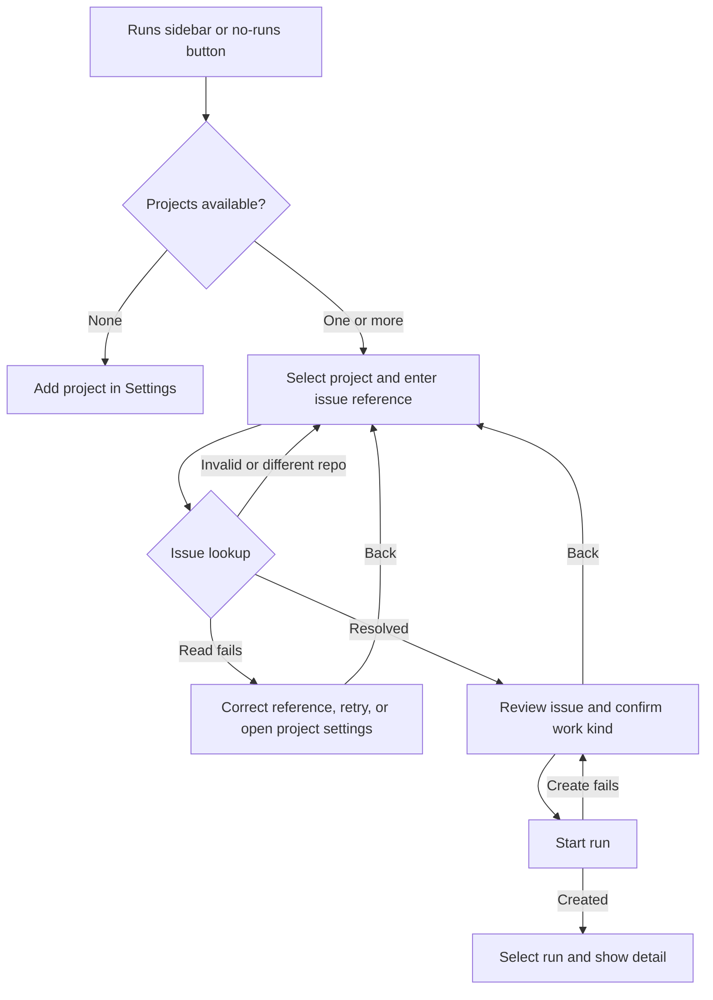
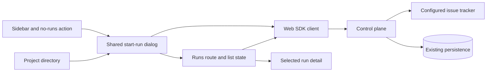
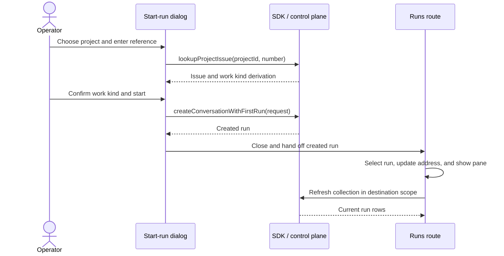

# Start a run from an issue

## What

An Autocatalyst operator can start a run from an issue in a configured project. The operator supplies the issue reference, verifies the issue and the work kind, and lands on the new run ready to review its progress.

## Why

The tracked issue already describes the work. The operator should not have to copy that description, leave the client to start a run, or wait for the list to notice it. Previewing the issue and exposing the work kind lets the operator catch a wrong repository or workflow before starting.

## Personas

- **Phoebe: PM** — Starts a run from a filed issue, reviews its spec, and decides when it should proceed.
- **Enzo: Engineer** — Verifies the selected issue and workflow, reviews the implementation, and checks the pull request or investigates a failed run.

## Narratives

### From a filed issue to a merged pull request

Phoebe opens Start a run from the sidebar. Her only project is already selected, so she enters `#5`. The issue appears with its title and state, but there is no suggested work kind. She chooses `feature` and starts the run; its row is selected and its title appears in the detail pane.

At the spec gate, Phoebe comments on a passage, requests changes, then approves the revised spec after seeing the comment addressed. Enzo sees the implementation gate and approves it. When the pull request merges, he presses Check now and sees the run reach Done.

### Recover from a project setup problem

Enzo has two projects and picks the one he thinks owns the issue. The dialog explains that the project has no issue tracker. He follows Open project settings and lands on the edit form for that project, not a general settings page.

After fixing the setup, Enzo opens Start a run again. He selects the project, pastes the issue URL, and verifies the issue before starting. If he has the wrong issue, Back lets him enter another reference without picking the project again.

## User stories

**From a filed issue to a merged pull request**

- Phoebe can open the same dialog from Runs or the no-runs state.
- Phoebe can verify a tracked issue before starting work, including when the issue is closed.
- Phoebe can accept a suggested work kind, override it, or supply one when Autocatalyst cannot choose.
- Phoebe can start the run and see it selected without waiting for the next list poll.
- Phoebe and Enzo can review the run through the existing gates and confirm the merged pull request in the client.

**Recover from a project setup problem**

- Enzo can add a project when none exists and choose a project when several exist.
- Enzo can distinguish a bad reference, a repository mismatch, a missing issue, a setup problem, and a temporary read failure.
- Enzo can open the affected project's settings without seeing any credential or raw provider output.
- Enzo can retry a temporary lookup failure or reset the issue while keeping the project.
- Enzo can retry a failed start without reentering the issue or work kind, and can read the failure reason if an accepted run later fails.

## Goals

- Resolve all three supported reference forms and make no lookup for invalid or mismatched input.
- Submit exactly one create request per activation, with an explicit choice from the four supported work kinds.
- Show the new run in the list, detail pane, and address immediately on success, including when the current project filter excludes it.
- Prove the full unseeded fake-mode browser loop from connection through merge, plus a forced run failure and a project setup recovery path. No test calls a real model or provider.

## Non-goals

- Collecting a description, classifying free text, asking a question, creating or linking to issue creation, or supporting `file_issue` and `question`.
- Listing, searching, or filtering issues, or showing whether an issue already has a run.
- A command palette entry, keyboard shortcut for opening the dialog, or a new project credential check or delete action.
- Control-plane, SDK contract, database, or workflow changes, including a docs gate; testing against live providers.

## Design spec

### User flow

### Entry, layout, and focus

- Place a plus icon button beside, not inside, the Runs link. Its accessible name and tooltip are **Start a run**. In the collapsed sidebar it remains reachable through the existing left-edge reveal and keyboard-accessible sidebar expansion. Add a **Start a run** button to the ready **No runs yet** state. Keep the list's no-project and no-connection states distinct.
- Use the centered `Dialog` wrapper with a viewport backing. Title: **Start a run**. Description: **Choose a project and enter a tracked issue.** In the body, place **Project** first and **Work kind** beside it, then **Issue reference**, inline feedback, and the issue preview. Place Back in the body when available; the right-aligned action row has **Cancel** left of **Start run**. Use the existing `Button`, `Tooltip`, and `Select` wrappers and design tokens.
- Trap focus in the dialog. Escape and Cancel close without starting and restore focus to the opener. If the opener has disappeared after navigation, put focus on the destination rather than the document body; for a successful start from the disappearing empty-state button, use the selected row. Keep a revealed sidebar available for focus return. An open Select gets first use of Escape; the next Escape closes the dialog, not the sidebar. While creating, ignore dismissal and other dialog actions until the response arrives.

### Project, issue, and work kind

- Once the project directory is ready, use its display names. Select the only project automatically; with several, start unselected even in a project-filtered view. Disable the issue field until there is a selection. A project load error offers a retry, not a no-project prompt. With no project, show **Add a project to get started** and **Add project**, opening the #142 create form with the Runs return path. Do not show an issue field in this state.
- Show feedback beneath the issue field and a loading message in the issue area while reading. A resolved issue shows its number, title, labels, and state. Show **Closed** beside the number for a closed issue; it is still eligible. Back appears after a resolution or a lookup failure. It resets the issue text, preview, work kind, and messages, keeps the project, returns focus to the issue field, and sends no request.
- The Work kind Select offers `feature`, `enhancement`, `bug`, and `chore`. Disable it until the issue resolves. Show the control plane's derived kind when present and let the operator change it. With no derived kind, show **Needs a work kind** and either **No work-kind label matched.** or **More than one work-kind label matched.** according to the reason. Keep Start run disabled until the operator picks a kind. Keep their choice until the project or reference changes, Back resets the issue, or the dialog closes.

### Issue feedback

| Condition | Message and action |
| --- | --- |
| Invalid reference | **Enter an issue number, #number or an issue URL.** No lookup. |
| GitHub URL for a different repository | **This issue belongs to a different repository**. No lookup. |
| `404 not_found` | **That issue was not found in this repository**. |
| `tracker_auth_failed` | **This project's issue tracker credential was rejected.** Show **Open project settings**. |
| `tracker_credential_missing` | **This project is missing an issue tracker credential.** Show **Open project settings**. |
| `tracker_not_configured` | **This project has no issue tracker.** Show **Open project settings**. |
| `tracker_provider_unavailable`, network error, or unexpected lookup failure | **The issue could not be read.** Show **Try again**. |

Associate errors and work-kind guidance with their controls and announce asynchronous feedback without moving focus. Keep Start run disabled on a lookup error. Opening project settings closes the dialog and goes directly to the selected project's edit form. A failed create keeps the dialog open with the resolved issue and chosen kind, shows an error in the dialog, and reenables Start run.

## Tech spec

### Introduction and overview

This is a web-client feature. It builds on #134 (runs and keyboard actions), #140 (implementation gate and PR checks), #141 (lookup and explicit work kind), #142 (project directory, project forms, Select), and #128/#130 (fake mode and Playwright). The current checkout includes `7c477704d3a0399defec071f7cf99b2a4a79102a`. [ADR-031](../adrs/adr-031-web-client-architecture.md) and [ADR-032](../adrs/adr-032-web-client-stack.md) govern the web boundary and stack. The [UX](../concepts/ux.md), [collection](../concepts/collection.md), [run detail](../concepts/run-detail.md), [intake](../concepts/intake.md), and [tracker](../concepts/trackers.md) concepts govern the existing behavior.

A *reference* is the operator's issue number, hash-prefixed number, or GitHub issue URL. A *work kind* selects the run workflow. The preview is read-only; the explicit choice belongs to the create request. No new data model, migration, endpoint, or client-side durable run state is needed.

### System design and architecture

Keep a single dialog owner in the shell and share the open action with `RunsPage` through the existing outlet context. Put the dialog and its pure reference extractor under `apps/web/src/runs/`. Use `ProjectDirectoryProvider` and the active `ControlPlaneClient`; the dialog does not fetch its own directory or read credentials. Keep list and selection ownership in `RunsPage` and `useRunList`, and use existing `NEW_PROJECT_PATH`, `projectPath`, `runPath`, and `projectRunsPath` helpers. Use the existing dialog and keyboard layer behavior; do not add an open-dialog shortcut.

### Detailed design

1. **Parse the reference locally.** Trim for validation only. Match the whole input against decimal digits, optionally prefixed by `#`, or an HTTPS GitHub issue URL of the form `https://github.com/<owner>/<name>/issues/<digits>` (an optional trailing slash is fine). Require a positive safe integer, matching the lookup contract in `packages/api-contract/src/project-issue.ts`. Reject PR URLs, other hosts, user info, nondefault ports, query strings, fragments, and arbitrary text. Match GitHub owner and repository case-insensitively against `project.hostRepository`, not display name or clone URL. A GitHub URL cannot resolve against a non-GitHub host repository. Numeric references take their scope from the selected project. Keep the original text for create; lookup sends only project id and the extracted number.
2. **Coordinate lookup by input revision.** Use `ISSUE_LOOKUP_DEBOUNCE_MS = 300`. For valid input, Enter triggers the current lookup immediately and cancels its scheduled timer; do not let a timer and Enter issue duplicate reads for the same revision. Enter in the field never submits the create form. Clear the old issue, work kind and messages immediately on input or project change. Revalidate the existing text for a new project and schedule a fresh lookup if valid there. Treat a blank editing field as idle; an explicit Enter on blank can show the validation hint. Use a monotonically increasing request generation to ignore stale success or failure after edits, project or client changes, retry, Back, or close. Try again starts a fresh read of the current pair immediately. No lookup runs as a side effect of Back.
3. **Use the typed lookup outcome.** `lookupProjectIssue` reads `GET /v1/projects/:projectId/issues/:number`. On `200`, use `issue` and `workKind.kind` from the response; a null kind carries `no_match` or `ambiguous_labels`. Do not rederive it from labels or title in the browser. Map `ControlPlaneClientError.status`, `response.error.code`, and the known tracker code in `response.error.details` to the design table. Use fixed copy on parse/network/unexpected failures and the existing connection handling for `401`. Never interpolate lookup error messages or details.
4. **Send one explicit create.** `createConversationWithFirstRun` posts to `POST /v1/conversations` and returns `201` with the run. The exact request is `{ projectId, identity: 'web', topic: { title: issue.title }, submission: { kind: 'issue_reference', issue: { number: issue.number }, workKind: chosenKind, body: rawReference } }`. `identity` is a fixed source marker, not the operator's identity or a record id; the bearer principal remains authoritative. Omit `channel`. `rawReference` is exactly what the operator typed, including accepted surrounding whitespace, not the issue body. Only submit for the current resolved input with a chosen kind; acquire a synchronous in-flight guard before awaiting the SDK. Disable the form while creating. For ordinary typed create failures render the safe control-plane envelope message as text; never render details or raw causes. Use **The run could not be started.** for untyped failures and for an unexpected work-kind `400 intake_routing_error`; there is no separate work-kind recovery flow. Also suppress unsafe provider text if a tracker read fails between preview and create. Retain the preview and choice on failure; retry is operator-initiated, not automatic.
5. **Land on the created run without polling.** Pass the returned `Run` into the destination list scope as a fresh server row; select its id, show the pane even if it was hidden, and navigate to `/runs/:runId`. Keep the project query only if it matches the run's project; otherwise navigate unfiltered. Trigger an immediate collection read in that destination scope. Invalidate any earlier read that could overwrite the handoff or selection, including a poll already in flight, and do not drop the refresh because the old list is busy. Keep the returned row available across the route/filter change and a transient refresh failure; merge with the authoritative result by id using the existing `updatedAt` freshness rule. A list read failure after a successful create is a list error, not a failed start. Keep the new run selected through refresh without changing normal browser back/forward, paging, or detail-tab behavior.

### Security, privacy, and compliance

The existing SDK provider supplies bearer authentication, and the control plane still validates input and checks access to the project and issue. The web client never contacts the tracker directly. Render titles, labels, and safe messages as text, and build settings links from trusted route helpers and project ids. Do not log or persist issue input in browser storage, credentials, credential references, tokens, or raw provider responses. The only durable reference text is the normal submission body written by the service on create.

### Observability

Use the existing dialog loading/error states, run state line, and SDK reads for operator feedback. Add no telemetry, logging, or alerts for this flow. In fake mode, the documented scripted-launch counter provides evidence of scripted execution alongside the fake server's exclusive dispatch configuration.

### Testing plan

- **Unit and component:** Test the extractor across all accepted and rejected forms, case-insensitive repository matching, and numeric boundaries. Fake timers and deferred SDK promises prove no call before the delay, one call at the delay, Enter without duplication, project relookup, and ignored stale success and failure. At the public SDK interface, cover project availability, loading, all specified lookup failures and actions, no sensitive error leakage, open/closed issue rendering, derived and overridden kinds, both missing-kind reasons, Back, dismissal/focus, exact create payload including raw body and derived kind, duplicate activation, and create failure/retry. Exercise same-scope and cross-filter success, including an in-flight list read and an immediate refresh independent of polling.
- **Browser wiring:** Add `apps/web/e2e/start-run-from-issue.spec.ts`. Each test uses #130's fake-server fixture on a free port with a fresh state directory, serving the built client. Do not seed, inject data or browser storage, intercept requests, add headers or routes, or mock the SDK. Set up projects through the UI. Use only the fixture's public state-file helpers for external merge/failure controls and its launch counter, and the real authenticated SDK for final read-only verification. Wait on visible states, not sleeps.
- **Geometry:** In both light and dark themes, compare the centered popup and viewport edges with `getBoundingClientRect` per the design system. Check the backing covers the viewport, including the footer, and Cancel precedes Start run on the same right-aligned action row.
- **Manual verification:** From the root, run `pnpm nx build web`, then `AUTOCATALYST_CLIENT_DIR=apps/web/dist pnpm nx run control-plane:serve-fake`, without running the seed command. Open `http://127.0.0.1:4010`, connect with `fake-mode-token`, and create the fixture project through Settings. Try `#5`, a matching issue URL, Back, `abc`, and a no-tracker project. Drive the gates and use the documented PR state file to simulate merge. Run automated browser coverage with `pnpm nx run web:e2e`.

### Alternatives considered

- **Start after resolving the number without a preview.** This saves one interaction but hides routing and work-kind mistakes. Use the server preview and always submit the visible kind.
- **Wait for the next collection poll.** This avoids handoff code but leaves the operator unsure whether Start worked and does not solve a mismatched filter. Use the returned row and an immediate authoritative refresh.

### Risks

- **Old requests can restore stale data or route to the wrong run.** Guard lookup and collection commits by scope and generation, and test out-of-order completion.
- **A successful preview does not guarantee a successful create.** The issue or credential can change between calls. Retain the current choice, show a safe error, and never retry a write automatically.
- **Browser tests can accidentally prove a seeded shortcut rather than operator wiring.** Start from a fresh fake server, verify no launches before Start, drive every gate in the browser, and allow only the documented external state-file controls.

## Task list

- [ ] **Story: Open and resolve a tracked issue**
  - [ ] **Task: Add the shared start-run dialog and entry points**
    - **Description**: Mount one dialog using the shell and Runs outlet context. Add the sidebar and empty-state controls, project selection, setup route, and focus behavior.
    - **Acceptance criteria**:
      - [ ] Both entry points open the same centered Dialog; the sidebar button is reachable when collapsed and has the accessible name and tooltip Start a run.
      - [ ] Cancel and Escape return focus to the opener without a request; modal keyboard handling does not trigger underlying actions.
      - [ ] No projects opens the #142 create form and hides the issue field; one project is preselected; several projects start unselected with the issue field disabled.
    - **Dependencies**: None.
  - [ ] **Task: Parse and schedule issue lookups**
    - **Description**: Add the pure reference extractor and scope the lookup to project, text revision, and active client.
    - **Acceptance criteria**:
      - [ ] `42`, `#42`, and matching GitHub issue URLs send only project id and number; malformed, mismatched, PR, foreign-host, and out-of-range references show the specified feedback and send no lookup.
      - [ ] Fake timers and deferred promises prove debounce, immediate Enter, no duplicate read, project relookup, and rejection of stale responses.
      - [ ] Loading clears the previous preview and disables Start run.
    - **Dependencies**: Task: Add the shared start-run dialog and entry points.
  - [ ] **Task: Show issue, work kind, and recovery states**
    - **Description**: Render the resolved issue and the work-kind Select, map lookup failures to fixed copy, and wire Back, Try again, and project settings.
    - **Acceptance criteria**:
      - [ ] The preview includes number, title, labels and state; Closed does not block create.
      - [ ] The four choices include a derived default and allow override; both missing-kind reasons require an explicit choice; the choice persists while project/reference are unchanged.
      - [ ] Component tests cover every specified lookup error, retry, correct edit route, no raw output or secrets, and Back clearing issue state and focusing the field without a request.
    - **Dependencies**: Task: Parse and schedule issue lookups.
- [ ] **Story: Start the run and hand off to the collection**
  - [ ] **Task: Submit the explicit issue-reference request**
    - **Description**: Gate create on the current preview and choice, send the documented payload through the SDK, and keep errors local to the dialog.
    - **Acceptance criteria**:
      - [ ] Tests verify project id, `identity: 'web'`, issue title, exact raw body, issue number, and explicit kind for both derived and operator-selected kinds.
      - [ ] Pending create disables dialog actions and duplicate activation sends nothing. A failed start preserves the issue and kind, shows safe copy, and permits retry; a work-kind routing failure uses the generic message.
    - **Dependencies**: Task: Show issue, work kind, and recovery states.
  - [ ] **Task: Select the created run and refresh its list**
    - **Description**: Hand off the server-returned row to `RunsPage`/`useRunList` and reconcile it with an immediate read in the destination scope.
    - **Acceptance criteria**:
      - [ ] The dialog closes; the run appears selected with its title in the shown pane and its id in the address before any poll.
      - [ ] A mismatched project filter clears, a matching one remains, and a stale or failed collection read cannot make the create look unsuccessful or undo the selection.
    - **Dependencies**: Task: Submit the explicit issue-reference request.
- [ ] **Story: Prove the operator loop with fake-mode browser tests**
  - [ ] **Task: Cover startup through the revised spec gate**
    - **Description**: Begin one continuous happy-path test on a fresh, unseeded fake server. Enter `fake-mode-token` on Connection. Create `Fixture app` through Settings > Projects using `https://github.com/autocatalyst-fixtures/demo-app`, owner `autocatalyst-fixtures`, name `demo-app`, GitHub host/tracker/code-host providers, and `fake-token` for the configured credentials as documented in `docs/operators/fake-mode.md`.
    - **Acceptance criteria**:
      - [ ] The test opens the sidebar dialog, enters `#5`, sees the issue and Needs a work kind with Start run disabled, picks `feature`, and sees the new run selected and titled in the pane.
      - [ ] At the spec gate the decision initially reads Approve; the test selects text, adds a comment, sees Request changes (1), confirms, and waits for the scripted revision. It sees the comment addressed and verifies the Approve popover confirms it before approving.
    - **Dependencies**: Task: Select the created run and refresh its list.
  - [ ] **Task: Complete the same test through merge**
    - **Description**: Extend the happy-path test without restarting the server or adding another setup path.
    - **Acceptance criteria**:
      - [ ] At the implementation gate the test sees Approve and the Acceptance tab's empty state, then approves.
      - [ ] Summary shows an open PR. Check now leaves it open. The test reads the PR number from the row, uses `writePullRequestState(n, 'merged')`, presses Check now, and sees Merged and Done.
      - [ ] The real SDK reads the selected run as `done` with `feature`. The fixture counter starts at zero and the final count accounts for the scripted launches for initial spec, revision, implementation, and PR finalization; the fake server registers no real provider adapter.
    - **Dependencies**: Task: Cover startup through the revised spec gate.
  - [ ] **Task: Cover a forced failure and missing tracker**
    - **Description**: Add two separate tests in the same file, each with fresh fake state and UI setup.
    - **Acceptance criteria**:
      - [ ] The failure test calls `writeFailure(8, 'spec.author')` before starting labeled issue 8 through the dialog and sees Failed with the scripted reason on the state line.
      - [ ] The settings test creates a second project through the form with host repository name `no-tracker` and no issue tracker. It selects it in the dialog, enters a number, sees the no-issue-tracker message, and follows the link to that project's edit form.
    - **Dependencies**: Task: Cover startup through the revised spec gate.
  - [ ] **Task: Verify geometry and record the new UI rule**
    - **Description**: Measure the modal in both themes and document only the new empty-state rule and code locations.
    - **Acceptance criteria**:
      - [ ] Geometry tests show a centered dialog, viewport-covering backing, and Cancel left of Start run in light and dark themes.
      - [ ] `context-agent/wiki/design-system.md` adds the missing-work-kind rule under Empty states: Needs a work kind, a line saying why, and Start run disabled until selection.
      - [ ] `context-agent/wiki/code-map.md` records the dialog, extractor, and Playwright spec. All browser tests use the production client and unseeded fake mode, with no real model or provider calls.
    - **Dependencies**: Task: Complete the same test through merge; Task: Cover a forced failure and missing tracker.
