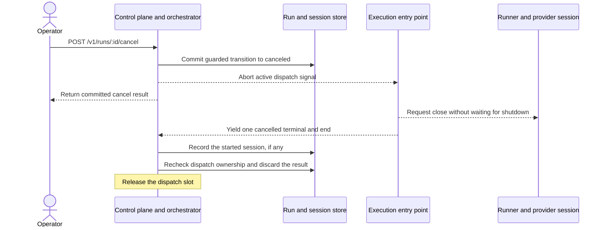

# Stop a canceled run's running session

## What

When an operator cancels a run, Autocatalyst stops waiting for the active agent session and asks the provider to stop it. Claude and Codex receive the stop request. The run stays `canceled` even if the provider ignores the request, and an interrupted build starts no more implementer or reviewer sessions.

## Why

Marking a run canceled prevents its result from advancing the workflow, but it can leave an agent using model time and writing to the workspace. Asking the provider to stop limits that work. Ending the dispatch without waiting for the provider also frees the queue slot for other work.

## Personas

- **Phoebe: PM** ([app personas](../app.md)). Cancels spec work when an issue is withdrawn.
- **Enzo: Engineer** ([app personas](../app.md)). Cancels implementation work when the team decides not to continue the build.

## Narratives

### Withdraw a spec while the author is working

Phoebe withdraws an issue while its Claude author is still working. She cancels the run and gets confirmation without waiting for Claude to acknowledge the stop.

The interrupted author appears in the run's session history. Any draft returned after cancellation stays out of human review.

### Stop a build during its first round

Enzo cancels during the first implementer session of a build that allows three rounds. Autocatalyst asks Codex to stop. The build starts neither the reviewer for that round nor the implementer for the next round.

If the provider keeps emitting events, Autocatalyst stops reading them and releases the dispatch slot anyway. Enzo still sees a canceled run, not a failed build or a request for guidance.

## User stories

**Withdraw a spec while the author is working**

- Phoebe can cancel without waiting for the author session to finish.
- Phoebe can find the interrupted session in the run's history.
- Phoebe can withdraw the work without a late draft reaching human review.

**Stop a build during its first round**

- Enzo can request a stop for an active Claude or Codex build session through the existing cancel action.
- Enzo can cancel without triggering another implementer or reviewer session.
- Enzo can rely on the canceled run state even if the provider does not stop.

## Goals

- A committed `POST /v1/runs/:id/cancel` signals only the matching active dispatch. The response does not wait for provider shutdown or session recording.
- Scripted Claude and Codex launches observe cancellation. A provider that hangs or keeps emitting cannot hold the dispatch slot or apply its late result.
- Cancel during round one of a scripted three-round `implementation.build` interrupts the current role and prevents any further role launch. With no cancel, the same script produces the existing rounds and result.
- A started `spec.author` session interrupted by cancel appears in `GET /v1/runs/:id/sessions` after the dispatch unwinds. A pre-launch abort does not create a session row.

## Non-goals

- Implementing the cancel route, guarded transition, or stale-result protection. These come from #153.
- Changing the OpenAI agent adapter or promising its underlying agent stops.
- Adding other stop triggers, including timeouts and run failure, or interrupting deterministic operations or direct provider calls.
- Undoing workspace writes, closing a pull request, or guaranteeing that detached provider work has stopped.

## Related features

- [Run operator actions](feature-run-operator-actions.md) (#153) supplies the cancel route and terminal-state guards.
- [Producing-step convergence](feature-producing-step-convergence-loop.md) defines build rounds; [spec author convergence](enhancement-spec-author-convergence.md) defines reviewed spec attempts.
- [Scripted fake mode](feature-scripted-fake-mode-seed-command.md) (#128) returns immediately. Cancellation tests inject launches they can hold open.

## Design spec

Backend only. The existing cancel action, run status, and session history are the operator-facing surfaces. There are no new controls or API fields. `canceled` confirms the run is terminal; it does not confirm that the provider has stopped.

## Tech spec

### Introduction and overview

This feature depends on #153's guarded cancel write and dispatch ownership recheck. The existing [commands](../concepts/commands.md), [run lifecycle](../concepts/run.md), [orchestrator](../concepts/orchestrator.md), and [human pause](../concepts/hitl.md) contracts still apply. [ADR-003](../adrs/adr-003-hosting-and-plane-boundary.md) and [ADR-022](../adrs/adr-022-runner-structure.md) keep provider-specific behavior behind the runner and adapter boundary. A *dispatch* is one queued unit of run work; a convergence dispatch can drive several role sessions. Use `canceled` for run state and `cancelled` for the execution and session outcome.

### System design and architecture

Core owns dispatch cancellation and run-state commits. The control plane passes the signal through the production unit of work. Execution interrupts event consumption and asks the runner to close; the runner forwards close to the provider session. The store remains authoritative for run state and records session history independently of whether a result is accepted.

### Detailed design

**Dispatch ownership.** In `packages/core/src/orchestrator.ts`, keep one controller per active dispatch, keyed by the same tenant and run identity as the reservation. Register it inside the admitted queue job under the run mutation lock, together with the dispatch source recheck and before starting session or convergence work. If cancel wins before that recheck, queued work never starts. Remove the controller in `finally` on normal, failed, and stale exits; remove it only if it still belongs to that dispatch.

Signal the matching controller after the guarded cancel commits at the shared directive boundary used by `cancelRun` and `applyDirective`, including the repair-owned cancel path. Do not wait for the dispatch queue or provider I/O. A rejected cancel does not signal; a committed cancel with no controller needs no extra work. Contain an abort-request failure and log one warning with the run ID. Owned abort handlers must not throw into the cancel path or block it.

**Signal wiring.** Add optional `signal?: AbortSignal` to `RunWorkInput`, `ExecutionEntryPointInput`, `ConvergenceEngineInput`, and the reviewed spec convergence input. `RunRoleWorkInput` inherits it. Forward the same dispatch signal through ordinary agent work, testing-guide sessions, reviewed `spec.author`, and build convergence. Keep it on repair build or review callbacks when they run within the reserved dispatch; preserve claim checks and workspace holds. `createExecutionRunUnitOfWork` and the delegating entry point in `apps/control-plane/src/server.ts` forward it to each per-attempt execution entry point. Recheck it before retries and native resume fallback; cancel during backoff ends the retry wait without launching another attempt.

**Execution stream.** A pre-aborted call yields one cancellation terminal without materializing a workspace or starting a runner; the delegating entry point checks before creating a runner. Recheck after asynchronous setup before starting `runner.run`. If a runner was allocated during setup, close it without starting a session. Once reading runner events, race a pending read against abort. Abort observed before handing off the boundary terminal wins over a buffered terminal or a shutdown error. Do not start result validation or correction after abort; discard any result already in flight. On abort, stop reading, request `runner.close()` once, and end without awaiting iterator disposal, provider close, or final provider metadata. Observe late rejections and remove abort listeners on exit. Without abort, preserve existing terminal validation and close ordering.

`agent-orchestrator-runner.ts` remembers a close request that arrives before `adapter.startSession()` returns. It closes a late handle without reading it, and does not report a new start after the cancellation terminal. Use the existing launch callback and safe runner launch facts already captured at the cancellation boundary to determine whether a session started. Do not fabricate a session from a reserved dispatch or pending setup.

**Terminal, history, and failure isolation.** Add an optional internal `cancelled` outcome marker to the execution boundary's `runner_terminal_result`. Emit exactly one such terminal for abort, even before launch. The boundary result can retain its existing `fail` shape with a static cancellation reason for compatibility, but the event consumer must check the marker before ordinary failure projection and carry it into the internal work result. The cancellation-marked result is a discard value, never a `fail` directive. Branch on it before failure recovery, retry, failure activity, or normal convergence and custody processing. Finish reviewed attempt custody as unaccepted and route dispatch completion through #153's stale-result path without applying a transition. A terminal re-read must also exit through discard, not synthesize a failure. Keep the durable source and occurrence guards for ordinary results that race with cancel.

For a started session, attach the recorded model, inference settings, and start time, with a local cancellation end time and `sessionMetadata.outcome: cancelled`. Include only usage evidence already available; otherwise mark usage unavailable rather than recording zero. Record the session through the existing unit of work. For pre-launch cancellation, omit session metadata and do not insert a session row. If the normal terminal was already handed off, do not replace it or add a second row; #153 still discards its workflow effects if cancel committed first.

**Claude and Codex.** Use the existing `ClaudeSessionLaunchOptions.signal` as the sole cancellation input at the launch seam. The adapter already owns a controller per session and aborts it in `close()` before removing session-owned skill files. Pass its signal for every conversation mode, not just `in_memory`. For the default fresh and retained launch paths, bridge that signal to a query-local `AbortController` and pass the controller as the Claude SDK `query` option `abortController`. Handle an already-aborted signal without starting a query, and remove the bridge listener when the query ends. Do not add an `abortController` field to `ClaudeSessionLaunchOptions`.

The existing `ClaudeLiveQuery.turn` signal-to-close link stays in place for `in_memory`, where the reusable query owns its own controller. Canceling an active turn closes that query; an ordinary close after a completed turn does not evict a reusable query. Keep per-session cancellation out of the query fingerprint. Codex already forwards its session signal to its auth probe and launch and aborts it on close. Change no Codex adapter code.

**Convergence.** Give the basic and layered build engines a tenant-scoped run reader and wire the production layered engine to the run repository. Before every round after the first, re-read the run and stop if it is terminal or the signal is aborted. Once a dispatch has started a round, the first round at a new altitude counts as a later round. Check the signal immediately before every role, including the first implementer and the reviewer within the current round. Recheck on return before interpreting the result or writing a checkpoint. Return a marked discard result on stop, including when the run read is terminal without a local abort. Do not publish a cancellation checkpoint or raise a convergence escalation. Keep existing ownership checks for races with storage commits. The reviewed spec loop forwards the same signal, stops before launching another role, and skips candidate acceptance on cancellation.

### Security, privacy, and compliance

Keep existing authorization, tenant-scoped reads, and run mutation authority. There are no stored schema or public API changes. Cancel warnings and session recording use safe metadata only; do not expose prompts, draft contents, credentials, provider payloads, or raw shutdown errors.

### Observability

Log one structured warning for a failed abort request, with the run ID and a safe error code or class. Observe asynchronous close failures without replacing the terminal or classifying the run as failed. Keep existing stale-result logging and session history. No new metrics or alerts are required.

### Testing plan

Use deferred gates for launch, cancel, and release. Verify the response and dispatch completion before releasing an uncooperative provider; use timeouts only to fail a hung test. Exercise the two provider launch seams, a production HTTP cancellation, and both the canceled and non-canceled build paths. Assert no failure recovery call or `failed` transition on cancellation in separate stale-result and terminal re-read cases. No test makes a model call. Run `pnpm nx run-many -t test -p core execution claude-agent-adapter codex-agent-adapter control-plane`.

### Alternatives considered

- **Use only the stale-result guard.** It protects run state but leaves the provider working and the queue slot occupied.
- **Poll for cancellation while reading provider events.** A check between events cannot interrupt a blocked read. A signal handles the blocked read; a durable run read between build rounds covers terminal state independently.
- **Wait for provider acknowledgement.** This could confirm shutdown, but it lets an uncooperative provider hold the dispatch. Record the local cancellation and end the dispatch independently.

### Risks

- A late event, rejected read, or delayed session handle can outlive dispatch. Ignore late output, observe rejections, and close a late handle without reopening the stream.
- Detached provider work may still touch its workspace. Cancellation neither rolls back writes nor proves that provider-side processes are gone. Keep existing workspace retention and hold rules.
- Closing a reusable Claude query on every session close would break conversation reuse. Test active-turn cancellation separately from ordinary close after a successful turn.

## Task list

- [ ] **Story: Signal the active dispatch after cancel commits**
  - [ ] **Task: Own dispatch abort controllers in the orchestrator**
    - **Description**: Register a controller under the run mutation lock when the queued dispatch passes its source recheck. Abort after the shared cancel commit and remove the controller by identity when dispatch work ends.
    - **Acceptance criteria**:
      - [ ] Tests verify controller removal after normal completion and failure.
      - [ ] A committed cancel aborts only its run's active controller. A rejected cancel does not abort, and cancel before admission prevents launch.
      - [ ] Cancel returns without waiting for shutdown. An injected abort-request failure produces one warning with the run ID and leaves the committed result unchanged.
    - **Dependencies**: #153.
  - [ ] **Task: Carry the dispatch signal through production execution**
    - **Description**: Add and forward the optional work and entry-point signals through the production unit of work, including reviewed spec roles, retry and fallback attempts, and the other agent work paths.
    - **Acceptance criteria**:
      - [ ] The unit of work and delegating and per-attempt entry points receive the same signal.
      - [ ] Cancel during setup or retry backoff prevents a new provider launch. An interrupted spec attempt cannot start a reviewer or accept a candidate.
    - **Dependencies**: Task: Own dispatch abort controllers in the orchestrator.
- [ ] **Story: End execution without waiting for provider cooperation**
  - [ ] **Task: Interrupt event consumption and close the runner**
    - **Description**: Interrupt a pending read, handle close during startup, and emit a single marked cancellation terminal without waiting for provider shutdown.
    - **Acceptance criteria**:
      - [ ] A pre-aborted signal yields one `cancelled` terminal without runner start. Abort with a buffered but undelivered terminal yields only the cancellation terminal.
      - [ ] A blocked read, late event, or rejected read or close cannot block dispatch completion or produce another terminal. A handle returned after close is closed without being read.
      - [ ] Existing signal-free entry-point specs pass unchanged.
    - **Dependencies**: Task: Carry the dispatch signal through production execution.
  - [ ] **Task: Record the interrupted session without failing the run**
    - **Description**: Record safe launch facts, propagate the cancellation marker, and discard the result before failure handling or reviewed candidate acceptance.
    - **Acceptance criteria**:
      - [ ] A started session is recorded as `cancelled` without waiting for final provider metadata. Unknown usage is unavailable, and pre-launch abort produces no row.
      - [ ] A script that ignores abort and keeps emitting cannot hold the queue slot. The run stays `canceled`, no late events or synthetic failure activity are published, and reviewed custody is unaccepted.
      - [ ] In the stale-result guard case and, separately, in the terminal re-read case, a cancellation-marked result never calls failure recovery and never writes or emits a `failed` transition.
    - **Dependencies**: Task: Interrupt event consumption and close the runner.
  - [ ] **Task: Connect Claude and verify Codex shutdown**
    - **Description**: Forward Claude's existing launch signal in all modes, bridge it to the SDK controller for fresh and retained queries, and preserve the existing in-memory turn link. Verify both providers through orchestrator cancel.
    - **Acceptance criteria**:
      - [ ] Scripted `launchClaudeSession` observes its existing `signal` abort before skill-file removal. The launch seam has no second cancellation field.
      - [ ] Default-launch tests verify that the SDK `abortController` aborts for fresh and retained queries. In-memory tests verify active-turn cancellation and reuse after ordinary close.
      - [ ] Scripted `launchCodexSession` observes its existing `signal` fire. No Codex adapter code changes.
    - **Dependencies**: Task: Interrupt event consumption and close the runner.
- [ ] **Story: Prevent further build work after cancellation**
  - [ ] **Task: Stop convergence at round and role boundaries**
    - **Description**: Add the run reader, wire the production layered engine, and guard role launch and post-role processing with the shared signal.
    - **Acceptance criteria**:
      - [ ] Both engines forward the same signal on each `runRole` call. A terminal read before a later round stops the loop even without a signal, including when the next round changes altitude.
      - [ ] In a scripted three-round build, cancel during the first implementer or reviewer aborts that role, starts no further role, and publishes no cancellation checkpoint or escalation. Run both cases.
      - [ ] The same scripted build without cancel produces its existing rounds and result.
    - **Dependencies**: Task: Carry the dispatch signal through production execution; Task: Record the interrupted session without failing the run.
- [ ] **Story: Verify and document the operator contract**
  - [ ] **Task: Verify cancellation through the production server**
    - **Description**: Use `createControlPlaneServer` with a test-injected Claude adapter whose scripted launch blocks `spec.author`. Exercise the production workflow, unit of work, and HTTP routes.
    - **Acceptance criteria**:
      - [ ] After the launch gate, `POST /v1/runs/:id/cancel` returns before the provider is released, and the launch's `signal` aborts.
      - [ ] The run remains `canceled` and `GET /v1/runs/:id/sessions` records the author session as `cancelled`. Releasing the script cannot publish its late spec or advance the run.
      - [ ] The five-package command in the testing plan passes without model calls.
    - **Dependencies**: Task: Connect Claude and verify Codex shutdown; Task: Stop convergence at round and role boundaries.
  - [ ] **Task: Document dispatch and provider cancellation**
    - **Description**: Update the agent code map and record dispatch controller ownership. Propose the commands concept change for human approval.
    - **Acceptance criteria**:
      - [ ] `context-agent/wiki/code-map.md` locates the per-run controller, signal on `RunWorkInput`, execution and convergence inputs, production wiring, and Claude abort. An agent decision note records ownership and the no-wait rule.
      - [ ] With human approval, `context-human/concepts/commands.md` states that cancel aborts the running session where the provider allows it, without waiting for shutdown or applying a late dispatch result. The approved change preserves session history and follows `context-agent/standards/editorial-guidelines.md`.
    - **Dependencies**: Task: Verify cancellation through the production server.
