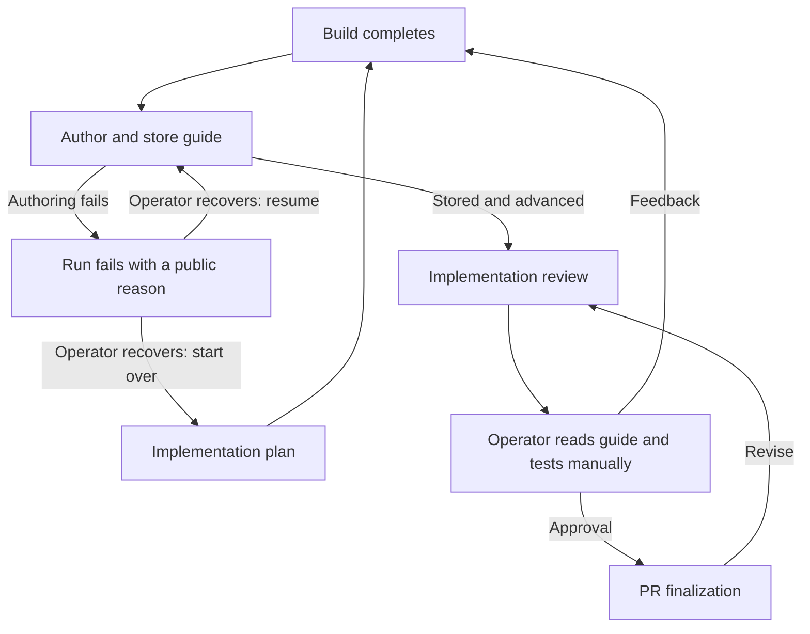
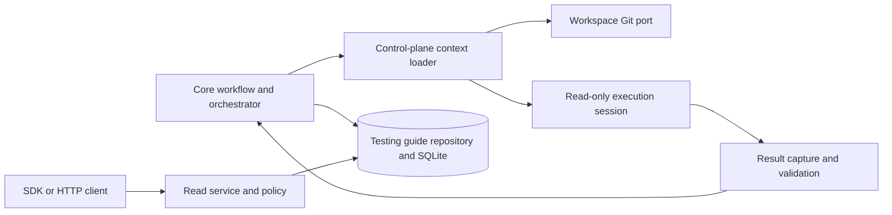
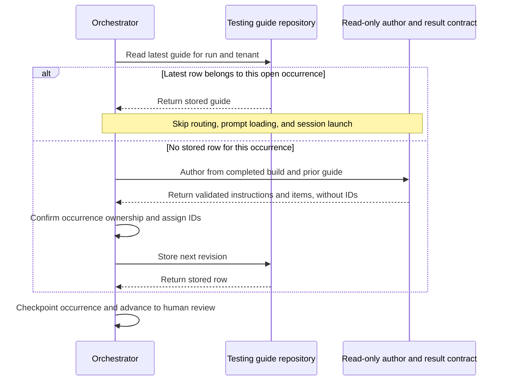

# Testing guide after the build

## What

Autocatalyst prepares a testing guide before handing a completed feature, enhancement, bug, or chore build to the operator. The guide explains how to get the build running and what to try, with expected results where useful. The operator can retrieve the latest guide even after the workspace is removed.

When a revised build comes back for review, it comes with a complete new guide. An unchanged check keeps its identity; a check whose wording or expected result changes gets a new identity.

## Why

Today the operator has to reconstruct what changed, how to run it, and what to check before they can test a build. A guide based on the completed work gives them a starting point. Preserving the identity of unchanged checks also lets later test-result tracking carry marks forward without applying an old mark to a changed check.

## Personas

- **Enzo: Engineer** — tests completed work, gives implementation feedback, and retests revised builds.

## Narratives

### Test a completed build

Enzo gets a feature at implementation review. He retrieves the guide, reads the setup instructions, and tries a check for the behavior that changed. The expected result tells him what to look for.

Later, after the workspace has been reclaimed, Enzo retrieves the same guide without checking out the branch or recreating the workspace.

### Retest after feedback

Enzo finds a problem and sends the implementation back using the existing feedback reply. When the run returns to review, he retrieves the entire new guide rather than piecing it together from two revisions.

A check that moved still has its original ID. A check whose expected result changed has a new ID, so a future mark on the earlier check cannot be mistaken for a mark on the revised one.

## User stories

**Test a completed build**

- Enzo can retrieve a guide when any of the four build workflows reaches implementation review through the build path.
- Enzo can read how to start or inspect the build and what to try.
- Enzo can see what outcome to look for where the guide supplies one.
- Enzo can retrieve the latest guide without the workspace.

**Retest after feedback**

- Enzo can send the build back with the existing implementation feedback reply.
- Enzo can retrieve a complete replacement guide when the revised build returns.
- Enzo can recognize unchanged checks by ID regardless of their position in the list.
- Enzo can distinguish new or rewritten checks from checks on the preceding guide.

## Goals

- Each normal completed build pass in the four build workflows runs one guide-authoring step before implementation review. Neither non-build workflow gains that step.
- Each successful guide occurrence stores one numbered revision containing instructions and 1–30 unique checks. Re-dispatching an occurrence that already stored its guide starts no new session and stores no extra revision.
- A check keeps its ID exactly when its normalized text and expected result match a check in the immediately preceding revision.
- An authorized same-tenant reader can retrieve the latest stored guide without a workspace. An absent guide or a missing or cross-tenant run returns `404`.

## Non-goals

- Record test marks, general acceptance feedback, or gate decisions (#164), or render the guide in the Acceptance tab (#165). The existing implementation gate and replies still work as before.
- Expose revision history, edit guides by hand, or execute the checks automatically.
- Add a guide reviewer, guide convergence, routing resolver changes, a startup route check, or a new recovery policy.
- Write guide content to the workspace repository, commit or file it, or change `Run.testingGuideResult`.
- Deliver a runnable build to the operator; that remains an execution-runtime concern.

## Design spec

This is a workflow and read API change. It adds no screens, visual states, or controls.



The read API returns `404` before the first guide is stored. During a later pass it returns the last stored revision, even if that pass fails. A new row becomes readable when stored; it does not by itself mean the gate has opened. Use the run step and `waitingOn` for review state. A return from PR finalization goes directly to the implementation gate and keeps the latest guide.

## Tech spec

### Introduction and overview

Extend the existing workflow catalog, role-aware routing, and step verification boundaries ([ADR-024](../adrs/adr-024-role-aware-routing-key.md), [ADR-025](../adrs/adr-025-workflow-step-catalog.md), [ADR-027](../adrs/adr-027-step-contract-verification.md)). Use the existing SQLite/Drizzle repositories and typed REST conventions ([ADR-004](../adrs/adr-004-persistence-state-store.md), [ADR-005](../adrs/adr-005-api-style-transport.md), [ADR-007](../adrs/adr-007-shared-types.md), [ADR-009](../adrs/adr-009-auth-rbac-envelope.md), [ADR-019](../adrs/adr-019-persistence-layout.md)). Fake mode (#128, merged in #148) and recovery (#121, merged in #144) already exist. The checked-out catalog includes `kind` (#151).

A **pass** normally means a completed build followed by guide authoring. An **occurrence** is a durable `RunStep` row. A **revision** is a successfully stored guide, numbered per run from 1. Failed authoring attempts do not reserve a revision. Re-dispatching an open occurrence differs from recovering a failed run, which opens a new occurrence under the existing recovery policy.

### System design and architecture



Core owns the prompt, ID matching, and completion order. The control plane loads evidence and configures the session. Execution validates the structured result. Persistence keeps the revision history. The read service depends on the database, not on execution or Git.



### Detailed design

#### Workflow and recovery

Add `implementation.testing_guide` to `runStepIds` and `runStepDefinitions` in `packages/core/src/run-step-catalog.ts`: phase `implementation`, kind `work`, `waitingOn: 'ai'`, roles `['implementer']`. Insert it after `implementation.build` in `featureSteps` (shared with enhancements), `bugSteps`, and `choreSteps` in `run-workflows.ts`. The generated workflow edge is `advance` to `implementation.human_review`. No guide-specific `revise` or `needs_input` edge is added. Preserve system failure and cancellation, existing build input pauses, the `question` and `file_issue` paths, and the existing PR repair path. Implementation review still revises to `implementation.build`; `pr.finalize` still revises to `implementation.human_review` without authoring another guide. Do not backfill runs already at or past the gate.

Use the one-shot dispatch path in `orchestrator.ts` with a fresh implementer session and `toolPolicyMode: 'read_only'`. Allow only `Read`, `Glob`, and `Grep`. Do not continue a build session, invoke convergence, or reuse PR publication logic. Output correction is result handling, not a review pass.

Keep `resolveRecoveryPlan` and the policy in [run.md](../concepts/run.md) unchanged. With committed checkpoints, a default recovery resumes at the failed `implementation.testing_guide` step on the run branch. Without committed checkpoints, default recovery starts over at `implementation.plan` on the freshly fetched default branch and reaches the guide through the build. Existing explicit `resume` and `start_over` overrides still apply. Either path uses a new guide occurrence; its next successful revision follows the latest stored one. A post-store transition interruption leaves the original occurrence open for re-dispatch; it is not recovery of a failed run.

#### Prompt and final diff

Add `buildTestingGuidePrompt` in `packages/core/src/testing-guide.ts`. Load evidence in the control plane, following the PR finalize and spec-authoring loaders:

1. Load the linked issue with the spec-authoring issue reader and tenant checks; omit the issue section if there is no link. Use the run's artifact record for a feature/enhancement spec or bug triage location. Represent a file artifact as a repository-relative path and an issue-canonical triage artifact as an issue reference. Chores have no spec line.
2. Read the cumulative implementation summary from the latest completed `implementation.build` checkpoint. If the checkpoint has no summary, label it unavailable rather than substituting an older build's summary.
3. With a recorded `provisionedBaseRef`, call `getChangedFiles` and a new `RunWorkspaceGitPort.getDiffText({ workspaceRepoRoot, baseRef, headRef? })` against the same final build head. Implement `getDiffText` in `apps/control-plane/src/run-workspace-git-port.ts`, with `HEAD` as the default head. Reuse diff ref validation and workspace containment, pass Git arguments without a shell, and disable external diff and text conversion for patch capture. Do not use a PR integration candidate. A comparison failure follows the dispatch error path; a successful comparison with no changes is an empty diff. Without a recorded base, do not compare: list the summary's changed files and say the diff is unavailable.
4. Include up to 200,000 UTF-8 bytes of diff text. If longer, keep the longest prefix of complete lines at or below the limit and emit a separate truncation notice. If the first line cannot fit, show only the notice. Capture large output in a bounded way that allows truncation rather than failing merely because the patch exceeds the prompt budget. Do not truncate the changed-file list.
5. When a prior guide exists, include its items and the implementation feedback the build addressed since it was written. Use the prior guide's occurrence in run history as the lower bound and fixed dispositions from intervening completed implementation build checkpoints as evidence. Look up those feedback IDs for this tenant and run; include only implementation-target items. Include an empty list if there are none, rather than reporting all historically addressed feedback as new work.

Ask for the complete guide every pass and tell the author to copy each unchanged item's text and expected result word for word. Ask for setup and run instructions grounded in the supplied evidence, concise manual checks, and expected results where supported. Do not invent commands or claim tests were run. Treat repository, issue, and feedback text as evidence, not instructions to the author.

#### Result contract and item IDs

Define and export the strict author result schema, stored guide schema, and limits from `packages/api-contract/src/testing-guide.ts` and `index.ts`.

| Constant | Value |
| --- | --- |
| `TESTING_GUIDE_DIFF_MAX_BYTES` | 200,000 UTF-8 bytes |
| `TESTING_GUIDE_INSTRUCTIONS_MAX_LENGTH` | 20,000 characters |
| `TESTING_GUIDE_MAX_ITEMS` | 30 |
| `TESTING_GUIDE_ITEM_TEXT_MAX_LENGTH` | 500 characters |
| `TESTING_GUIDE_ITEM_EXPECTED_MAX_LENGTH` | 1,000 characters |

The author returns exactly `{ instructions, items }`: a Markdown string of length 1–20,000 and 1–30 strict item objects, each with required `text` of length 1–500 and optional string `expected` of length 0–1,000. Reject extra fields, model-supplied IDs, and duplicate match keys. The shared schema uses string-length checks for these fields, not diff byte counts. The stored and public guide is `{ id, runId, revision, instructions, items, createdAt }`; each stored item has an opaque host-assigned `id`, `text`, and optional `expected`. `revision` is a positive integer and `createdAt` is an ISO date-time.

Register `createTestingGuideResultContract` in `packages/execution/src/result-contracts.ts` and `createControlPlaneStepResultContractRegistry`. `resolveScratchResultValidationConfig` selects schema `autocatalyst.testing_guide.v1` and result filename `testing-guide-result.json` for this step in all four work kinds. Wire structured output projection for supported transports and enforce the strict canonical result after transport decoding. The host captures the result in runtime scratch, isolated from other attempts and the workspace repository.

Wire a correction requester to the bounded result-tolerance path for malformed or invalid guide output. Corrections stay in the guide occurrence under its read-only policy and must pass the same schema. If correction cannot produce a valid result, fail with public `testing_guide_failed`, added to `knownFailureReasonCodes`. Provider or routing failures keep their existing reasons, such as `provider_auth_failed` or `route_not_found`. Neither kind of failure inserts a guide or replaces any earlier revision.

Share one match-key routine between duplicate validation and `assignTestingGuideItemIds(previous, next)` in `packages/core/src/testing-guide.ts`. Normalize each present string to Unicode NFC, trim leading and trailing whitespace, and replace each remaining whitespace run with one space. Keep case. Encode the pair of normalized values unambiguously; absent `expected` differs from present empty `expected`. Iterate in new-list order, reuse the preceding revision's ID on an exact key match, and generate a new ID otherwise. Store the original wording and order. All first-revision items get new IDs. Removed items remain only in older rows; reintroducing one after a gap gets a new ID.

#### Persistence and completion

Add the `testing_guides` table in `packages/persistence/src/schema.ts`. All columns are non-null.

| Column | Type and constraints |
| --- | --- |
| `id` | `TEXT PRIMARY KEY`, host-assigned |
| `run_id` | `TEXT`, foreign key to `runs.id` |
| `tenant` | `TEXT`, copied from the owning run |
| `revision` | `INTEGER`, at least 1 |
| `run_step_id` | `TEXT`, foreign key to `run_steps.id`, unique |
| `instructions` | `TEXT`, Markdown |
| `items_json` | `TEXT`, serialized stored items |
| `created_at` | `TEXT`, ISO date-time |

Create unique indexes on `(run_id, revision)` and `run_step_id`. Use the next free `<number>_testing_guides.sql` in `packages/persistence/drizzle` and add its `meta/_journal.json` entry. The checked-out journal ends at `0014_agent_conversation_slots`; check both the directory and journal when implementation starts. The migration is additive and does not backfill.

Add `TestingGuideRepository` to `packages/core/src/domain-repositories.ts` and implement it in `packages/persistence/src/domain-repositories.ts`. The port has only `create` and `findLatestByRun`. Use the run and tenant to scope operations. Reject an unknown run, a tenant mismatch, or an occurrence that does not belong to the specified run and guide step. A repeated `create` for the same valid occurrence returns the original row without replacing it. The latest read returns the highest revision or `null`, including internal `runStepId` for dispatch; the HTTP response omits it. Keep older rows without adding a history reader.

At dispatch, compare the latest stored row's `runStepId` with the reserved open occurrence before resolving a provider or loading the prompt. A row for that occurrence must be the latest: another guide occurrence cannot open on the normal path before this one advances. If the IDs match, skip the author session entirely and complete from the stored row. Otherwise, author with the latest row as the predecessor. After validation, use guarded per-run completion to recheck ownership before storing. Assign IDs against the latest prior revision and insert revision `(latest?.revision ?? 0) + 1`; the indexes protect against duplicate writes. A stale result cannot write a guide or advance the run.

Store before advancing. Use the row returned by `create`, or the existing row on re-dispatch, to checkpoint `{ kind: 'testing_guide', revision, itemCount }` and advance the same occurrence. If the store succeeds but advance does not commit, keep that occurrence open. The auto-dispatch failure handler must not terminalize a guide occurrence with a durable row on a post-store transition error; log the interruption and allow the existing dispatch admission path to retry it after the reservation is released. On that re-dispatch, assert zero additional provider launches or session records, no new revision, and one successful advance. If the transition already committed, stale retries do nothing. No new recovery API or run-wide retry policy is introduced.

#### Routing and rollout

Use the existing agent route for `(implementation.testing_guide, implementer)` and then its step default. An active table with neither fails at the new step with `route_not_found`; resolver error details name `implementation.testing_guide`. An explicit default provider profile applies only when no active table exists, as in fake mode.

Create or update `docs/operators/real-dispatch.md` to instruct operators with an active table to add a route **before upgrading**. Use `PATCH /v1/configuration-records/:id` on the active `model_routing_table` record. Patch `settings.entries` with the existing entries plus one of the following, using a unique entry ID and an existing agent profile. The array replaces the previous array; do not drop other routes when adding this entry.

```json
{"id":"guide-author","profileId":"<agent-profile-id>","route":{"mode":"agent","step":"implementation.testing_guide","role":"implementer"}}
```

```json
{"id":"guide-default","profileId":"<agent-profile-id>","route":{"mode":"agent","step":"implementation.testing_guide","defaultForStep":true}}
```

#### Read API and SDK

`GET /v1/runs/:id/testing-guide` takes the run ID path parameter and no body or query parameters. Follow `getRunSpec` for the route and service structure. In `getRunTestingGuide`, call policy before repository work with action `run_testing_guide.read` and resource `{ kind: 'run_testing_guide', id, path: '/v1/runs/:id/testing-guide' }`. Then call `requireTenantRun` and read the latest guide from the database for that run and tenant.

| Status | Response |
| --- | --- |
| `200` | Latest guide in the shared public shape, without `tenant`, `runStepId`, or a scratch path. |
| `401` | Existing authentication error. |
| `403` | Policy denial; neither run nor guide repository is called. |
| `404` | Existing not-found envelope for no guide yet, missing run, or cross-tenant run. Includes `question` and `file_issue` runs with no guide. |
| `500` | Existing safe internal-error envelope for unexpected service or persistence errors. |

Register the OpenAPI path and schemas and assert `200`, `403`, and `404` in `openapi.spec.ts`. Add `getRunTestingGuide(id)` to `packages/sdk/src/client.ts`; parse success with the shared schema and use normal SDK error handling for `404`.

#### Fake mode

On a fresh guide dispatch, have the orchestrator pass `testingGuidePass` on the one-shot work input, computed as `(latest?.revision ?? 0) + 1` from the same prior guide used for authoring. In `server.ts` forward the value to `ExecutionContext.task.inputs.testingGuidePass`. Read that positive integer in `scripted-claude-adapter.ts` and pass it to `selectScriptedResult` in `scripted-results.ts`. The fake adapter does not query the database or parse the prompt. Do not use `bumpSpecAuthorPass` or a guide launch counter to choose a fixture: a launch that fails before storage does not consume a fixture pass. A same-occurrence re-dispatch after storage never enters the adapter.

| Pass | Items |
| --- | --- |
| 1 | A, B, C, D |
| 2 | A, B, C unchanged; D rewritten; E added |
| 3 and later | Pass 2 word for word |

Use one fenced command block in the instructions on every pass with a command that works in the fake repository. Keep the instructions and item literals in the fixture and `docs/operators/fake-mode.md`, including both versions of D for #165 to quote. Keep A–C's text and expected results identical. The existing one-shot failure file accepts `{"step":"implementation.testing_guide"}` and the operator docs list that step.

Read `requiredDispositions` from build task inputs in the fake adapter. The scripted build implementer returns `fixed` with a nonblank summary for each required human implementation feedback ID. Preserve the empty result when there are none and leave spec review dispositions unchanged. A feedback reply at implementation review must return to the gate with the item `addressed`. Normal fake-mode launch counts gain one guide session per completed build pass. Failed attempts still count as launches, but do not determine the fixture pass.

### Security, privacy, and compliance

Apply existing authentication, policy, and tenant isolation to the guide read and evidence loading. Enforce read-only tools at execution, not just in the prompt. The host never executes guide commands. Treat the diff, issue text, and Markdown as untrusted; this feature does not render Markdown. Persist the validated guide, not a copy of its inputs, in the guide row. Do not log raw prompts, diffs, guide content, or credentials.

### Observability

Record the author session with `implementation.testing_guide` and normal usage and cost accounting. `GET /v1/runs/:id/sessions` lists it; step history holds the revision and item count checkpoint. An advance-only re-dispatch adds no session or provider cost. Use existing structured dispatch diagnostics with safe run, step, and error identifiers. No new metrics or alerts are required.

### Testing plan

- Unit-test the catalog, graph, prompt, UTF-8 limit, strict schemas and transport projection, ID matching, routing, fake fixtures, and SDK parsing.
- Integration-test temporary Git reads and migration on empty and populated databases. Test repository constraints, policy and tenant isolation, correction, provider failure, the post-store interruption, recovery, and retrieval after workspace removal.
- Spawn the production entrypoint in fake mode for feature and chore wiring coverage. Interact with runs only through the SDK. Revise the feature and compare revisions, IDs, feedback status, and step order. Use deterministic adapters throughout; no test calls a model service.

To try it by hand, run `pnpm nx run control-plane:serve-fake` from the repository root, then `pnpm nx run control-plane:seed-fake -- --scenario implementation-review` in another terminal. With the printed run ID:

```bash
curl -s -H 'Authorization: Bearer fake-mode-token' \
  http://127.0.0.1:4010/v1/runs/<id>/testing-guide
```

Expect revision 1 with a command block and items A–D. Check `/v1/runs/<id>/steps` for build → guide → review. Post `{"kind":"feedback","title":"Try again","body":"Rerun the build."}` as JSON to `/v1/runs/<id>/replies` with the same authorization header. Wait until `/v1/runs/<id>` shows `implementation.human_review` again. The next guide read returns revision 2 with A–C's original IDs, a new ID for rewritten D, and a new ID for E.

### Alternatives considered

A workspace file would be easy to inspect with the build, but it would disappear during reclamation or require a commit unrelated to the build. Storing a single value on the run would overwrite prior guides or load history into the run row. A run-parented revision table keeps both the latest read and historical identity independent of workspace lifetime. Authoring inside the build session would tie the guide to per-round output; a separate read-only session sees the completed result. A review round would add cost for content the operator already reads at the gate.

### Risks

- **An existing route table blocks the next run after upgrade.** Document the prerequisite and test the typed miss and both route shapes.
- **An interruption between store and advance duplicates work.** Check the stored occurrence before launch, guard completion, and fault-inject between insert and advance.
- **A changed check inherits an old mark.** Use the same exact normalized key for validation and ID matching; do not use fuzzy matching.
- **The guide leaves out a change or suggests an unsupported command.** Keep the full changed-file list, label missing or truncated evidence, and leave execution and acceptance to the operator.

## Task list

- [ ] **Story: Define guide content and storage**
  - [ ] **Task: Define guide schemas and item matching**
    - **Description**: Export the five limits and both schemas. Share match-key normalization with `assignTestingGuideItemIds`.
    - **Acceptance criteria**:
      - [ ] Schema tests cover valid boundaries and reject zero or 31 items, empty instructions and text, overlong instructions, text and expected result, unknown keys, model IDs, and duplicate normalized keys.
      - [ ] Matching tests cover first-revision IDs, unchanged and reordered items, whitespace and NFC equivalence, changed expected result, absent versus empty expected result, case change, removal, and reintroduction.
    - **Dependencies**: None
  - [ ] **Task: Store guide revisions in SQLite**
    - **Description**: Add the next SQL change, journal entry, Drizzle table, and repository with `create` and `findLatestByRun` only.
    - **Acceptance criteria**:
      - [ ] The full SQL change sequence applies on an empty database and upgrades a database with runs without changing those rows.
      - [ ] Tests reject missing runs and wrong tenant or occurrence, enforce unique revisions and occurrences, and return the original row on repeat create.
      - [ ] Latest returns `null` before insertion and revision 2 after two occurrences store; revision 1 is still in the table.
    - **Dependencies**: Task: Define guide schemas and item matching
- [ ] **Story: Author the guide after the build**
  - [ ] **Task: Add the guide step to build workflows**
    - **Description**: Add the catalog entry and insert the step after the build in the three lists that serve the four build workflows.
    - **Acceptance criteria**:
      - [ ] Tests assert phase, work kind in the step catalog (`kind: 'work'`), wait state, and implementer-only role; all four paths advance build → guide → gate.
      - [ ] Tests preserve both revise edges, build input pauses, and the complete `question` and `file_issue` paths. Update old build-to-gate assertions without changing unrelated behavior.
    - **Dependencies**: None
  - [ ] **Task: Load final build evidence and compose the prompt**
    - **Description**: Add `getDiffText`, load run-scoped context, and build the prompt with previous items and addressed feedback when available.
    - **Acceptance criteria**:
      - [ ] Temporary Git repository tests show patch text for an added and a modified file, reject invalid refs and out-of-root paths, and distinguish an empty diff from an unavailable one.
      - [ ] Prompt tests assert the issue, spec or triage reference, cumulative summary, full changed-file list, patch, previous items, and addressed feedback. A chore has no spec line; unrelated feedback is excluded.
      - [ ] Tests assert the full-guide and word-for-word instructions, the no-base summary fallback, and UTF-8 truncation at a complete line within the byte limit, including a single oversized line. A notice is shown and the file list is intact.
    - **Dependencies**: Task: Define guide schemas and item matching; Task: Store guide revisions in SQLite; Task: Add the guide step to build workflows
  - [ ] **Task: Capture and correct the structured guide result**
    - **Description**: Register the result contract, select it for the guide step, and wire output projection and bounded correction.
    - **Acceptance criteria**:
      - [ ] Tests assert the schema ID and scratch filename for all four build work kinds and exercise supported output projections without model calls.
      - [ ] Invalid output requests correction; a valid correction is accepted. Persistently invalid output fails with `testing_guide_failed` and inserts no guide.
      - [ ] A forced provider error retains its public reason and inserts no guide.
    - **Dependencies**: Task: Define guide schemas and item matching; Task: Add the guide step to build workflows
  - [ ] **Task: Persist and checkpoint read-only guide dispatch**
    - **Description**: Wire the one-shot session, check the latest row before launch, pass the next revision as `testingGuidePass` on fresh dispatch, and store and advance under occurrence ownership.
    - **Acceptance criteria**:
      - [ ] A dispatch test shows only `Read`, `Glob`, and `Grep`, no reviewer or convergence, and a guide session in session history with normal cost accounting. Authoring adds no commit or repository guide file.
      - [ ] The guide is stored before the checkpoint and advance. Stale results cannot insert or advance.
      - [ ] An injected failure after insert but before advance leaves the run at the same open guide occurrence. Re-dispatch uses the stored row, adds zero launches and session records, stores no second revision, and advances once. A stale retry after advance changes nothing.
    - **Dependencies**: Task: Store guide revisions in SQLite; Task: Load final build evidence and compose the prompt; Task: Capture and correct the structured guide result
  - [ ] **Task: Verify existing recovery and routing at the new step**
    - **Description**: Test recovery and routing without changing their policies. Document the upgrade requirement in `docs/operators/real-dispatch.md`.
    - **Acceptance criteria**:
      - [ ] After a guide failure, `POST /v1/runs/:id/recover` resumes the failed step by default with committed checkpoints and starts over at `implementation.plan` without them; both paths run the guide in a new occurrence and store the next revision after the last success. Explicit overrides retain their existing behavior.
      - [ ] An active table with a build route but no guide route fails with `route_not_found` and details naming the guide step. Either supported guide entry lets the run pass; without a table the explicit default profile works.
      - [ ] The operator guide shows the patch endpoint, both entry shapes, preservation of existing routes, when to add the entry, and what happens if it is absent.
    - **Dependencies**: Task: Persist and checkpoint read-only guide dispatch
- [ ] **Story: Read the latest guide through the control plane**
  - [ ] **Task: Serve the tenant-scoped guide route**
    - **Description**: Add the policy action and resource, database-only service method, REST route, and OpenAPI entry.
    - **Acceptance criteria**:
      - [ ] A same-tenant run returns the highest revision in the public `200` shape, including after workspace removal.
      - [ ] Tests assert `404` before the first guide, for `question` and `file_issue`, and for missing and cross-tenant runs.
      - [ ] Policy denial returns `403` without a repository call and uses the exact action and resource. OpenAPI tests assert the route and `200`, `403`, and `404` responses.
    - **Dependencies**: Task: Store guide revisions in SQLite
  - [ ] **Task: Add the SDK guide reader**
    - **Description**: Add `getRunTestingGuide(id)` with shared response parsing and normal SDK errors.
    - **Acceptance criteria**:
      - [ ] SDK tests verify a parsed `200` and the normal typed error for `404`.
    - **Dependencies**: Task: Serve the tenant-scoped guide route
- [ ] **Story: Verify repeated review in fake mode and document the feature**
  - [ ] **Task: Script guide passes and build feedback dispositions**
    - **Description**: Forward `testingGuidePass` through task inputs to the fake adapter and script guide output, one-shot failure support, and required build dispositions. Document the fixtures in `docs/operators/fake-mode.md`.
    - **Acceptance criteria**:
      - [ ] `scripted-results.spec.ts` checks passes 1–3 against the real contract: A–D, then unchanged A–C plus rewritten D and new E, then pass 2 word for word. Each guide has one fenced command block.
      - [ ] Fake tests verify exactly the required `fixed` dispositions with nonblank summaries and account for one normal guide launch per completed build pass.
      - [ ] Operator docs show the instructions, item texts including both versions of D, pass mapping, and the valid failure step.
    - **Dependencies**: Task: Persist and checkpoint read-only guide dispatch
  - [ ] **Task: Exercise production fake-mode wiring through the SDK**
    - **Description**: Exercise fake-mode seeding, repeated implementation review, and failure-file recovery using the SDK for run interactions with the production entrypoint.
    - **Acceptance criteria**:
      - [ ] `seed-fake --scenario implementation-review` returns a run whose SDK guide read shows revision 1 with A–D.
      - [ ] Feature and chore runs reach implementation review and serve guides. Feature feedback is `addressed` on return to the gate. Feature revision 2 retains A–C IDs and assigns D and E IDs absent from revision 1.
      - [ ] SDK step history shows build → guide → gate on both feature passes and the chore pass.
      - [ ] A first-pass guide failure file fires once and leaves no guide. Recovering through the SDK produces revision 1 with fixture A–D, not the pass 2 list. No test calls a live model.
    - **Dependencies**: Task: Script guide passes and build feedback dispositions; Task: Add the SDK guide reader; Task: Verify existing recovery and routing at the new step
  - [ ] **Task: Propose concept updates and record code locations**
    - **Description**: Prepare narrow human-owned concept diffs and update `context-agent/wiki/code-map.md` in the same implementation change.
    - **Acceptance criteria**:
      - [ ] `acceptance-testing.md` and `domain-model.md` describe run-parented database content, the authoring step, revisions and item matching, state derived from the run, and that the guide is never committed or filed.
      - [ ] `workflow.md` adds the step to its catalog and step lists and describes build as the last step that changes code, followed by a guide step that reads the result. No recovery policy doc change is required.
      - [ ] Submit proposed concept diffs through `docs.human_review` under `context-agent/standards/doc-maintenance.md` and follow the editorial guidelines. The code map lists the step, prompt and matching module, contract, table and repository, Git diff method, route, SDK method, and operator routing prerequisite.
    - **Dependencies**: Task: Exercise production fake-mode wiring through the SDK
