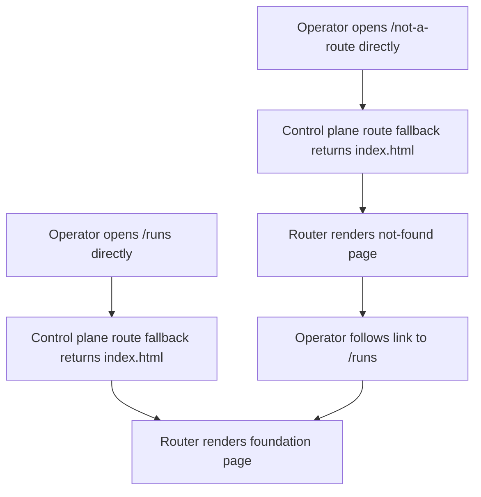
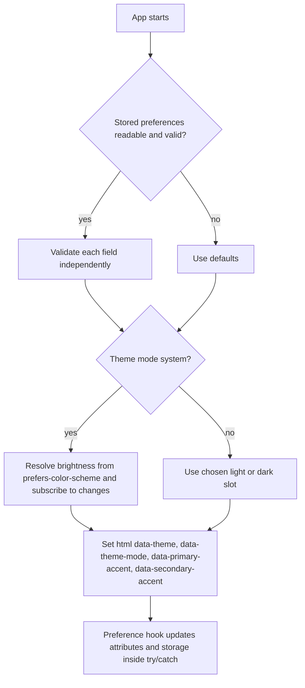
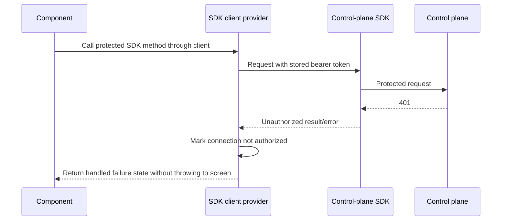

# Web app foundation

## What

Autocatalyst needs a working web client foundation served by the control plane. This feature adds the first real `apps/web` application so an operator can open the served root URL, land on a themed foundation page, and verify that the browser client can reach the control plane health endpoint.

The foundation includes the client-side project targets, routing, design tokens, theme preferences, safe token storage, typed SDK access, first UI wrappers, syntax highlighting, and the first end-to-end route served from the built output. It creates enough structure for later web screens to build on without introducing the full shell, settings frame, run screens, or token entry flow.

## Why

Without this foundation, later web issues would each need to solve routing, theming, SDK access, component boundaries, build integration, and control-plane serving separately. Shipping the base app first gives the project one tested browser runtime and one set of conventions before feature screens start accumulating.

Operators benefit because the first browser experience proves the core loop: the control plane serves the client at `/`, the client follows the design system, and the client talks to the control plane through the SDK rather than through ad hoc fetch calls.

## Personas

- **Olivia: Operator** - Opens the control-plane web UI and needs a trustworthy, themed client that can verify connection state.
- **Devon: Developer** - Builds future web screens and needs clear project targets, UI wrapper conventions, theme primitives, and SDK access patterns.
- **Riley: Reviewer** - Reviews implementation quality and needs automated checks for bundle safety, design token coverage, boundaries, and served-route behavior.

## Narratives

### First served web page

Olivia starts the control plane in fake mode with the built client directory configured. She opens the root URL and sees a page that matches her system light or dark setting before the React app finishes mounting. The page redirects to `/runs`, shows the Autocatalyst heading, and keeps working when she refreshes the client route.

She hovers the icon-only connection button and sees the required tooltip. When she clicks it, the app calls the control plane health endpoint through the typed SDK client and displays the response as highlighted JSON. If the server is unreachable, she sees a plain error message instead of a crash or stack trace.

### Foundation for future screens

Devon starts work on a later web screen. The app already has Vite, React 19, Tailwind 4 tokens, browser routing, strict TypeScript configs, Vitest, Playwright coverage, and Nx targets. Devon imports `Button` and `Tooltip` from the client wrapper directory and cannot accidentally import Base UI primitives from a screen file.

Devon also uses the client provider instead of calling `fetch` directly. The bearer token remains in its dedicated store and never flows into component display APIs, while theme preferences use a separate storage key and tolerate blocked or invalid browser storage.

### Review of browser safety and conventions

Riley reviews the implementation and runs the repository checks. The build fails if a browser bundle contains `node:` imports, lint prevents direct Base UI imports outside wrappers, and module boundaries prevent `scope:web` from depending on control-plane application code.

Riley also verifies that Shiki is not in the entry chunk, that syntax highlighting loads only after the health response is requested, and that the Playwright run exercises the real built app served by the control plane fake server rather than a fixture page.

## User stories

**First served web page**

- Olivia can open the control-plane root URL and see the themed web foundation page.
- Olivia can refresh `/runs` and still see the client route served correctly.
- Olivia can hover the icon-only connection button and read its tooltip.
- Olivia can click the connection button and see highlighted health JSON from the control plane.
- Olivia can see a readable failure message when the health call fails.

**Foundation for future screens**

- Devon can build, develop, test, lint, and e2e the web app through Nx targets.
- Devon can use Tailwind utilities backed by the documented design tokens.
- Devon can use client wrapper components instead of importing Base UI primitives in screens.
- Devon can get a typed control-plane SDK client from a provider hook.
- Devon can rely on separate preference and bearer-token stores with safe storage fallbacks.

**Review of browser safety and conventions**

- Riley can confirm the browser bundle contains no Node-only imports.
- Riley can confirm web module boundaries prevent dependencies on `apps/control-plane`.
- Riley can confirm Shiki loads lazily outside the entry chunk.
- Riley can confirm token values do not appear in URLs, logs, thrown messages, or the DOM.
- Riley can confirm documentation records the web project conventions and proposed human-doc changes.

## Goals

- `pnpm nx build web` emits a Vite production build to `apps/web/dist` with hashed asset names.
- Starting the control plane with `AUTOCATALYST_CLIENT_DIR=apps/web/dist` serves the built React app at `/` and falls back to `index.html` for client routes.
- `pnpm nx run-many -t build lint test` includes `web` and passes, and `pnpm test:boundaries` passes.
- The foundation page calls `getHealth()` through the SDK and renders highlighted JSON only after Shiki loads lazily.
- Theme and token tests cover the documented themes, accents, contrast ratios, storage failure cases, and first-paint theme script.

## Non-goals

- The application shell, settings frame, connection page, token entry screen, and run detail screen are out of scope.
- Appearance and general settings pages are out of scope; preferences may be changed manually in browser storage until those screens exist.
- Wrappers beyond `Button` and `Tooltip` are out of scope and should be added only by the first screen that uses them.
- Vite dev proxy, CORS support, service worker behavior, offline use, and desktop or mobile packaging are out of scope.
- New ADRs are out of scope; this feature implements ADR-031, ADR-032, and ADR-033.

## Design spec

### User flows

```mermaid
graph TD
    A[Operator opens control plane root /] --> B[Control plane serves apps/web/dist/index.html]
    B --> C[First-paint script sets html theme attributes from preferences or system defaults]
    C --> D[React app mounts router]
    D --> E[/ redirects to /runs]
    E --> F[Foundation page renders Autocatalyst heading and connection button]
    F --> G[Operator hovers icon-only button]
    G --> H[Tooltip shows Check connection]
    F --> I[Operator clicks Check connection]
    I --> J[Button becomes aria-disabled]
    J --> K[Client provider calls SDK getHealth]
    K --> L[Shiki loads lazily]
    L --> M[Highlighted health JSON appears]
    K --> N[Failure returns plain error text with no stack trace]
```





### Key UI components

#### Foundation route at `/runs`

- Purpose: temporary landing page until the full shell and runs screen arrive.
- Content: `Autocatalyst` as the main heading, a themed surface using `bg-background` and `text-text`, one icon-only `Check connection` button, and an output area for highlighted JSON or failure text.
- Behavior: clicking the button calls `getHealth()` from the SDK client provider; while pending, the icon button uses `aria-disabled` so its tooltip remains available.
- Error state: display only a concise error message, never a stack trace.
- Replacement: issue #132 may replace the placeholder page with the shell, and issue #134 adds `/runs/<run id>`.

#### Not-found route

- Purpose: handle unknown browser routes without breaking control-plane fallback.
- Content: simple message that the route was not found and a link back to `/runs`.
- Behavior: direct loads and client navigation both render the not-found page.

#### `Button` wrapper

- Purpose: first client-owned wrapper around Base UI button behavior. Screens import this wrapper, never `@base-ui/react`.
- Variants: primary, secondary, destructive.
- Sizes: `control-sm`, `control-base`, and `control-lg` heights from the design system.
- States: default, hover, disabled, icon-only disabled via `aria-disabled`, and visible `:focus-visible` ring using `--color-focus`.
- Styling: token-only styling; no hex, `rgb(`, or `--ctp-*` values outside `src/styles/`.

#### `Tooltip` wrapper

- Purpose: first client-owned wrapper around Base UI tooltip behavior.
- Behavior: shows the label, or `Label (key)` when a keyboard key is provided.
- Required use: every icon-only button has a tooltip.

#### Theme provider

- Purpose: apply design-system themes and expose controlled preference updates.
- Attributes: sets `data-theme`, `data-theme-mode`, `data-primary-accent`, and `data-secondary-accent` on `html`.
- Storage: reads and writes one preferences key inside try/catch; invalid JSON and blocked storage fall back to defaults without crashing.
- System mode: follows `prefers-color-scheme` and updates attributes when the system setting changes.

#### Highlighted JSON output

- Purpose: prove browser-side Shiki integration before spec-rendering screens exist.
- Behavior: loads Shiki on first health-response render, requests only JSON support, selects light or dark code theme from the resolved app theme brightness, and reuses the highlighter for later calls.

### Visual references

No static mockup is required. The page should be intentionally minimal: full-page themed background, a centered or comfortably padded surface, the `Autocatalyst` heading, an icon-only connection button with tooltip, and a code block area that uses the tokenized theme. The implementation should follow `context-agent/wiki/design-system.md` for colors, type, spacing, control heights, radii, elevation, motion, overlays, and button treatment.

## Tech spec

### Introduction and overview

#### Prerequisites and assumptions

- Depends on #129: the control plane can serve a configured client directory and fall back to `index.html` for client routes.
- Depends on #130: `apps/web` exists as an Nx project with an `e2e` target and fake-server fixture conventions.
- Implements ADR-031 web client architecture: one stateless browser app that talks only to the control plane through the SDK and stores only operator preferences plus the bearer token until the desktop wrapper supplies keychain storage.
- Implements ADR-032 web client stack: React 19, Vite, Tailwind 4, Base UI behind client wrappers, lucide-react, Shiki, and Vitest.
- References ADR-033 for future browser spec rendering; this issue uses Shiki on health JSON as the first browser highlighting use.
- Uses source aliases to `@autocatalyst/sdk` and `@autocatalyst/api-contract` following the control plane Vite config unless implementation proves built package imports work in the browser build. The spec choice is source aliases so browser bundling can verify no Node-only modules enter the bundle.

#### Technical goals

- Add the first real React app in `apps/web` without replacing the existing `e2e` target.
- Keep browser TypeScript strict while using DOM, JSX, and Bundler module resolution rather than control-plane NodeNext settings.
- Make unsafe browser dependencies visible through build and lint checks.
- Establish client-owned UI wrappers and lint rules before future screens depend on UI primitives.
- Keep preferences and bearer-token storage separate, guarded, and documented.

#### Non-goals

- No new backend API endpoint, database schema, migration, or API contract change.
- No token entry UI; #132 supplies it.
- No full run list, shell, settings frame, action registry, keyboard shortcuts, or additional wrappers.
- No service worker or dev proxy.

#### Glossary

- **Foundation page**: temporary `/runs` page proving theme, routing, SDK, wrappers, and Shiki integration.
- **Preference store**: browser localStorage value for theme mode, theme slots, accents, and font choices.
- **Token store**: separate browser localStorage value for the bearer token, with in-memory fallback and no display API.
- **Wrapper directory**: `src/ui/`, the only web source area allowed to import `@base-ui/react`.
- **Resolved theme**: the concrete light or dark theme selected after applying theme mode and system color scheme.

### System design and architecture

```mermaid
graph TD
    Browser[Browser]
    HTML[index.html first-paint script]
    App[React app]
    Router[Browser router]
    Theme[Theme provider and preferences store]
    Token[Bearer token store]
    Client[Control-plane SDK client provider]
    SDK[@autocatalyst/sdk]
    CP[Control plane origin]
    Shiki[Lazy Shiki highlighter chunk]

    Browser --> CP
    CP --> HTML
    HTML --> App
    App --> Theme
    App --> Router
    Router --> Runs[/runs foundation page/]
    Runs --> Client
    Client --> Token
    Client --> SDK
    SDK --> CP
    Runs --> Shiki
```

#### Component breakdown

- `apps/web/index.html`: Vite entry HTML plus first-paint theme script. The script must be small, inline, guarded by try/catch, and independent of app code.
- `apps/web/src/main.tsx`: creates the React root and mounts providers and app.
- `apps/web/src/app.tsx`: owns router creation and route definitions.
- `apps/web/src/styles/`: Tailwind 4 imports, `@theme` token declarations, theme blocks selected by `data-theme`, derived token definitions, accent variables, and motion overrides.
- `apps/web/src/theme/`: preference schema, validation, defaults, storage helpers, provider, and hook.
- `apps/web/src/auth/` or `src/client/`: bearer-token store, SDK client provider, authorization state, and hook.
- `apps/web/src/ui/`: `Button` and `Tooltip` wrappers only.
- `apps/web/src/highlight/`: lazy Shiki loader and highlight function.
- `apps/web/src/routes/`: foundation and not-found route components.
- `apps/web/README.md`: project conventions, router choice, target commands, aliases, token store, wrapper policy, Shiki loader, and fake-mode usage.
- Root config updates: Nx target inputs, ESLint TSX coverage, React hooks rules, Base UI import restriction, icon package restriction, and `scope:web` dep constraint.

#### Health check sequence


#### Authorization failure sequence



### Detailed design

#### Project configuration

- Add `index.html`, `src/main.tsx`, and `src/app.tsx`.
- Add exact-pinned dependencies to the lockfile: `react`, `react-dom`, `@vitejs/plugin-react`, `tailwindcss`, `@tailwindcss/vite`, `@base-ui/react`, `lucide-react`, `shiki`, a router package, `jsdom`, `@testing-library/react`, and `@testing-library/user-event`. Versions must be at least two weeks old at implementation time.
- Choose **React Router** as the router package unless repository constraints discovered during implementation make it unsuitable. Record the final choice and rationale in `apps/web/README.md`; React Router is the default because it is the common React browser-history router, supports redirects and not-found routes directly, and does not require a framework runtime.
- Extend `apps/web/project.json` with `build`, `dev`, `test`, and `lint` targets next to the existing `e2e` target.
  - `build`: Vite production build to `apps/web/dist`; `outputs` names that directory.
  - `dev`: Vite dev server with no API proxy.
  - `test`: `vitest run` from `apps/web` using `sharedTestPool`.
  - `lint`: lints `.ts`, `.tsx`, and the two JSON config files.
- Update `nx.json` production named input exclusions to include `*.spec.tsx` and `e2e/**`.
- Use `apps/web/tsconfig.app.json` and `apps/web/tsconfig.spec.json` split similar to the control plane, while setting DOM libs, JSX, Bundler module resolution, and no Node types.
- Add `vite.config.ts` with React and Tailwind plugins, source aliases to workspace packages, manifest output for build assertions, hashed production assets, and a build-time check plugin that rejects emitted browser chunks containing `node:` imports.

#### Module boundaries and linting

- Add a `scope:web` dep constraint in `eslint.config.mjs`: web code may depend on `type:lib` projects only and must not depend on `apps/control-plane`.
- Ensure lint config includes `.tsx` files and React hooks rules.
- Add a restriction so only files under `apps/web/src/ui/` may import `@base-ui/react`.
- Add a restriction or test so icons come only from `lucide-react` and are imported by name.
- Add a lint fixture or test proving a screen-file direct import of `@base-ui/react` fails.

#### Tokens, themes, and styles

- Implement Tailwind 4 `@theme` declarations in `src/styles/` for every design-system color token plus type, spacing, control height, radius, elevation, layer, motion, and shell dimension tokens.
- Implement the eight `data-theme` theme blocks: Catppuccin Latte, GitHub Light, Solarized Light, Catppuccin Frappe, Catppuccin Macchiato, Catppuccin Mocha, GitHub Dark, and Dracula. Each block defines every color token and all fourteen `--accent-<id>` variables.
- Define derived tokens once as mixes of base tokens, including `--color-border-subtle`, `--color-hover`, sentiment tokens, comment tokens, and other documented derived values.
- Define `--primary-accent` and `--secondary-accent` from selected accent IDs, with default sapphire and teal. `--color-primary`, `--color-secondary`, and `--color-focus` read those accent variables.
- Default font tokens to the design-system stacks.
- Set motion durations to `0` under `prefers-reduced-motion`.
- Enforce no hex colors, `rgb(` values, or `--ctp-*` names outside `src/styles/`.

#### Theme preferences

- Preference shape includes `themeMode`, light theme slot, dark theme slot, primary accent, secondary accent, and two font choices.
- Store preferences under one localStorage key, expected to be documented as `autocatalyst.preferences` unless implementation finds an existing repository convention.
- Every localStorage read and write must be inside try/catch.
- Invalid JSON or blocked storage renders with defaults and does not crash.
- Unknown theme or accent IDs fall back field-by-field while preserving valid fields.
- Provider sets `data-theme`, `data-theme-mode`, `data-primary-accent`, and `data-secondary-accent` on `document.documentElement`.
- System mode watches `prefers-color-scheme` and updates when the media query changes.
- `index.html` inline script duplicates only the minimal safe resolution logic needed to set `data-theme` before first paint.

#### Bearer token store and SDK client provider

- Store the bearer token under its own localStorage key, separate from preferences. The README must document the exact key.
- Every token storage read/write/clear is inside try/catch and falls back to an in-memory value when storage fails.
- Expose write and clear operations needed by future token entry, but no component-facing function that returns the token for display.
- Build one `createControlPlaneClient` from `window.location.origin` and the current token. Recreate it when the token changes.
- Components get the client through a hook; components must not call `fetch` for control-plane routes.
- On `401` from any SDK call, mark provider state as not authorized and keep that state readable for #132. Do not throw the 401 through to route UI.
- Ensure token values never appear in URLs, logs, thrown error messages, or DOM output.
- `getHealth` must not send the `Authorization` header; protected calls send `Authorization: Bearer <token>`.

#### Shiki loader

- `src/highlight/` exports one function that dynamically imports Shiki on first use.
- Use the JavaScript regex engine.
- Load only requested languages and the code theme matching the resolved app theme brightness.
- Reuse one highlighter for subsequent calls.
- Keep Shiki and grammars out of the entry chunk; assert this through the Vite manifest/build output.

#### Router and route behavior

- Use browser history with base `/`.
- Define `/` redirecting to `/runs`.
- Define `/runs` as the foundation page.
- Define catch-all not-found route linking back to `/runs`.
- The Playwright e2e target must depend on `web:build`, use the #130 fake server with `apps/web/dist` as its client directory, and delete the old fixture client.

#### Documentation changes

- `apps/web/README.md` is added or updated with project purpose, targets, fake-mode usage, router choice, alias choice, token store decision, wrapper convention, Shiki loader, and no per-app agent note file.
- `context-agent/wiki/code-map.md` records `apps/web`, its source layout, targets, build output directory served by the control plane, and the new boundary constraint; update its `Last updated` line.
- Human-owned docs `context-human/adrs/adr-031-web-client-architecture.md` and `context-human/concepts/ux.md` need proposed diffs, not direct edits without the docs review gate, to say the browser stores preferences and bearer token until the desktop wrapper supplies keychain storage.
- `context-agent/wiki/design-system.md` changes only if implementation token names or values differ from the document; otherwise leave it unchanged.

### Security, privacy, and compliance

- The bearer token is a secret, not a preference. It must use a separate storage key and must never be displayed, logged, placed in URLs, or included in thrown messages.
- Browser storage is untrusted and unreliable. Preference and token reads must validate shape and catch all access failures.
- The SDK client is the only path for control-plane calls from components. This centralizes authorization handling and prevents accidental direct fetch behavior.
- Direct DOM insertion for highlighted markup must use trusted Shiki output from local input generated by the app, and route UI must avoid rendering stack traces.
- The browser bundle must not include Node-only imports. The build check fails on `node:` imports and has a test proving detection.

### Observability

- No new telemetry pipeline is introduced.
- Development diagnostics may report generic connection failure state, but must not include bearer-token values.
- Tests should spy on console output for sentinel token leakage during unauthorized and unreachable-server scenarios.

### Testing plan

- Unit/rendering tests for theme provider defaults, invalid storage, blocked storage, field-level fallback, attribute updates, storage writes, and first-paint inline script.
- Contrast test calculating required ratios for every theme and accent: text/background at 4.5:1, on-primary/primary at 4.5:1, on-destructive/red at 4.5:1, and focus ring and component boundaries at 3:1.
- Build-check test proving `node:` imports are rejected.
- Lint rule or fixture test proving direct `@base-ui/react` import outside `src/ui/` is rejected.
- Wrapper rendering tests for `Button` and `Tooltip`: roles, accessible names, focus ring class, disabled icon tooltip behavior, and `Label (key)` text.
- SDK provider tests with the SDK `fetch` option stubbed: Authorization header present on protected calls, absent on `getHealth`, 401 handled as state, and sentinel token absent from console output, errors, URLs, and DOM.
- Shiki tests: dynamic import runs once across two calls, light/dark theme switch changes highlighted markup, and manifest shows Shiki outside the entry chunk.
- App rendering tests: health success displays highlighted JSON; rejected health call displays failure text without stack trace.
- Playwright test against real build served by fake control plane: root/runs/not-found routing, heading, connection click, highlighted `"status": "ok"`, entry chunk loaded, Shiki chunk only after click, no requests to another origin, no model call, no `page.route`, no injected storage, no test-only hook.
- Validation commands: `pnpm nx run-many -t build lint test`, `pnpm test:boundaries`, and `pnpm nx e2e web`.

### Alternatives considered

- **Use built package imports for SDK and API contract**: rejected for the initial spec because source aliases match the control plane convention and make browser bundle checks direct. If implementation proves built packages are browser-safe and preferred by repository conventions, document the change in `apps/web/README.md`.
- **Create all Base UI wrappers now**: rejected because the issue is at the file-count cap and wrappers should exist only when a screen exercises them.
- **Use direct `fetch` on the foundation page**: rejected because it would bypass the SDK and duplicate authorization/error behavior.
- **Bundle Shiki in the entry chunk**: rejected because spec rendering is not needed at startup and acceptance criteria require lazy loading.
- **Store bearer token with preferences**: rejected because the token is secret material and must be isolated for future desktop keychain replacement.

### Risks

- **File-count pressure**: keep wrappers, routes, and helper modules minimal; do not add unused wrapper components.
- **Design token completeness**: the design-system token tables are broad; tests should parse/verify coverage rather than relying on visual inspection only.
- **Browser safety of workspace packages**: source aliases could reveal Node-only imports in SDK or contracts; the build check must catch this early.
- **First-paint script drift**: keep the inline script minimal and test it against stored dark preferences so it stays aligned with provider defaults.
- **Human-owned docs gate**: ADR-031 and UX updates are required as proposed diffs and must not be applied without the documented docs review gate.

## Task list

- [ ] **Story: Web project targets and browser build foundation**
  - [ ] **Task: Add the React/Vite application entrypoints and config**
    - **Description**: Add `apps/web/index.html`, `src/main.tsx`, `src/app.tsx`, Vite config, Tailwind plugin wiring, and strict web tsconfig split using DOM, JSX, and Bundler module resolution. Keep existing `e2e` target and use source aliases for workspace SDK and API contract packages unless implementation proves built package imports are browser-safe.
    - **Acceptance criteria**:
      - [ ] `apps/web` contains `index.html`, `src/main.tsx`, and `src/app.tsx`.
      - [ ] React 19, Vite, Tailwind 4, and TypeScript compile with `strict`, `noUncheckedIndexedAccess`, and `exactOptionalPropertyTypes`.
      - [ ] `apps/web/tsconfig.app.json` and `tsconfig.spec.json` follow the control-plane split while dropping Node types.
      - [ ] Workspace package aliases are documented in `apps/web/README.md`.
    - **Dependencies**: None
  - [ ] **Task: Add exact-pinned web dependencies and document router choice**
    - **Description**: Add required runtime and test dependencies with exact versions at least two weeks old, update the lockfile, choose the router package, and record the rationale in `apps/web/README.md`.
    - **Acceptance criteria**:
      - [ ] Lockfile contains exact-pinned `react`, `react-dom`, `@vitejs/plugin-react`, `tailwindcss`, `@tailwindcss/vite`, `@base-ui/react`, `lucide-react`, `shiki`, router package, `jsdom`, `@testing-library/react`, and `@testing-library/user-event`.
      - [ ] The chosen router is named in `apps/web/README.md` with rationale.
      - [ ] Dependency versions satisfy the two-week age requirement at implementation time.
    - **Dependencies**: None
  - [ ] **Task: Define Nx build, dev, test, and lint targets**
    - **Description**: Update `apps/web/project.json` to add the application targets next to `e2e`; update `nx.json` named input exclusions for web specs and e2e files.
    - **Acceptance criteria**:
      - [ ] `build` writes to `apps/web/dist` and declares that directory in `outputs`.
      - [ ] `dev` runs the Vite dev server with no proxy.
      - [ ] `test` runs `vitest run` from `apps/web` with `sharedTestPool`.
      - [ ] `lint` covers `.ts`, `.tsx`, and the two JSON files.
      - [ ] `nx.json` excludes `*.spec.tsx` and `e2e/**` from the `production` named input.
    - **Dependencies**: Task: Add the React/Vite application entrypoints and config
  - [ ] **Task: Add browser bundle Node-import guard**
    - **Description**: Add a build-time check that fails when emitted browser chunks contain `node:` imports and add a targeted test proving the guard catches an injected Node-only import.
    - **Acceptance criteria**:
      - [ ] Production build fails on a browser bundle containing `node:` imports.
      - [ ] A test demonstrates the guard rejects an injected Node-only import.
      - [ ] Normal `pnpm nx build web` passes without Node-only imports.
    - **Dependencies**: Task: Add the React/Vite application entrypoints and config

- [ ] **Story: Boundaries, lint rules, and project conventions**
  - [ ] **Task: Extend ESLint for web boundaries and TSX**
    - **Description**: Update root lint configuration so web files participate in boundary enforcement, `.tsx` files are linted, React hooks rules run, and `scope:web` can depend only on `type:lib` projects.
    - **Acceptance criteria**:
      - [ ] `eslint.config.mjs` includes a `scope:web` dep constraint.
      - [ ] Web code cannot depend on `apps/control-plane`.
      - [ ] `.tsx` files are covered by lint.
      - [ ] React hooks lint rules run for web components.
      - [ ] `pnpm test:boundaries` passes.
    - **Dependencies**: Task: Define Nx build, dev, test, and lint targets
  - [ ] **Task: Enforce Base UI and icon import conventions**
    - **Description**: Add lint restrictions or fixtures so only `apps/web/src/ui/` may import `@base-ui/react`, screens never import Base UI directly, and icons come only from named `lucide-react` imports.
    - **Acceptance criteria**:
      - [ ] Direct `@base-ui/react` import from a screen file is rejected by a test or lint fixture.
      - [ ] Files under `src/ui/` may import `@base-ui/react`.
      - [ ] Non-`lucide-react` icon package imports are rejected.
      - [ ] Named lucide icon imports are allowed.
    - **Dependencies**: Task: Extend ESLint for web boundaries and TSX

- [ ] **Story: Design tokens, themes, and contrast coverage**
  - [ ] **Task: Implement Tailwind theme tokens and global styles**
    - **Description**: Create `src/styles/` with Tailwind 4 `@theme` declarations for color, type, spacing, control height, radius, elevation, layer, motion, and shell dimension tokens from the design system.
    - **Acceptance criteria**:
      - [ ] Utilities such as `bg-background` and `text-subtext` are available.
      - [ ] Every design-system Color table token is declared.
      - [ ] Type, spacing, control height, radius, elevation, layer, motion, and shell dimension tokens are declared.
      - [ ] `prefers-reduced-motion` sets motion durations to `0`.
    - **Dependencies**: Task: Add the React/Vite application entrypoints and config
  - [ ] **Task: Implement themes, accents, and derived tokens**
    - **Description**: Add the eight documented `data-theme` blocks, all fourteen accent IDs per theme, default primary/secondary accents, and derived tokens as centralized mixes of base tokens.
    - **Acceptance criteria**:
      - [ ] Catppuccin Latte, GitHub Light, Solarized Light, Catppuccin Frappe, Catppuccin Macchiato, Catppuccin Mocha, GitHub Dark, and Dracula exist as `data-theme` blocks.
      - [ ] Each theme defines every color token and all fourteen `--accent-<id>` values.
      - [ ] `--primary-accent` and `--secondary-accent` default to sapphire and teal.
      - [ ] `--color-primary`, `--color-secondary`, and `--color-focus` read the selected accent variables.
      - [ ] Derived tokens are defined once in `src/styles/`.
      - [ ] No component or stylesheet outside `src/styles/` contains a hex color, `rgb(` value, or `--ctp-*` name.
    - **Dependencies**: Task: Implement Tailwind theme tokens and global styles
  - [ ] **Task: Add token contrast and style-safety tests**
    - **Description**: Add tests that compute contrast ratios across every theme/accent combination and enforce style-token safety outside `src/styles/`.
    - **Acceptance criteria**:
      - [ ] Text on background is at least 4.5:1 for every theme.
      - [ ] `--color-on-primary` on `--color-primary` is at least 4.5:1 for every accent.
      - [ ] `--color-on-destructive` on `--color-red` is at least 4.5:1.
      - [ ] Focus rings and component boundaries meet 3:1.
      - [ ] Tests fail on prohibited hex, `rgb(`, or `--ctp-*` usage outside `src/styles/`.
    - **Dependencies**: Task: Implement themes, accents, and derived tokens

- [ ] **Story: Theme provider and preference storage**
  - [ ] **Task: Build validated preference storage helpers**
    - **Description**: Implement preference defaults, schema validation, field-level fallback, and try/catch localStorage read/write helpers under one storage key.
    - **Acceptance criteria**:
      - [ ] Preferences include theme mode, light and dark theme slots, primary and secondary accents, and two font choices.
      - [ ] Every localStorage read and write is inside try/catch.
      - [ ] Invalid JSON falls back to defaults without crashing.
      - [ ] Blocked or throwing storage falls back to defaults without crashing.
      - [ ] Unknown theme or accent IDs fall back only for that field and keep valid fields.
    - **Dependencies**: Task: Implement themes, accents, and derived tokens
  - [ ] **Task: Build theme provider and hook**
    - **Description**: Implement provider state, preference update hook, html attribute updates, system color-scheme watching, and storage writes.
    - **Acceptance criteria**:
      - [ ] Provider sets `data-theme`, `data-theme-mode`, `data-primary-accent`, and `data-secondary-accent` on `html`.
      - [ ] `system` mode follows `prefers-color-scheme`.
      - [ ] System setting changes update the resolved theme.
      - [ ] Rendering test changes mode, slot, and accent through the hook and sees attributes and stored values update.
    - **Dependencies**: Task: Build validated preference storage helpers
  - [ ] **Task: Add first-paint theme script and tests**
    - **Description**: Add a small inline script to `index.html` that resolves stored preferences before first paint inside try/catch and set up Vitest and Playwright coverage for dark first paint.
    - **Acceptance criteria**:
      - [ ] Inline script sets `data-theme` before React mounts.
      - [ ] Script handles missing, invalid, or inaccessible storage without throwing.
      - [ ] Vitest runs the script against a stored dark preference and sees `data-theme` set.
      - [ ] Playwright emulates dark system color scheme and sees a dark `data-theme` before app mount.
    - **Dependencies**: Task: Build theme provider and hook

- [ ] **Story: Bearer token store and SDK client provider**
  - [ ] **Task: Implement safe bearer token store**
    - **Description**: Add a token store with a dedicated localStorage key, try/catch access, clear/write behavior, in-memory fallback, and no component display getter.
    - **Acceptance criteria**:
      - [ ] Token key is separate from the preference key.
      - [ ] Read, write, and clear operations catch storage failures.
      - [ ] Storage failure uses an in-memory fallback.
      - [ ] Public component-facing API does not return the token for display.
      - [ ] `apps/web/README.md` documents the key separation and future desktop keychain replacement.
    - **Dependencies**: Task: Add the React/Vite application entrypoints and config
  - [ ] **Task: Build SDK client provider and authorization state**
    - **Description**: Create a provider that builds one `createControlPlaneClient` from `window.location.origin` and the current token, recreates on token change, exposes client and connection state via hooks, and handles 401s as provider state.
    - **Acceptance criteria**:
      - [ ] Components can get the SDK client from a hook.
      - [ ] Client is recreated when token state changes.
      - [ ] Components do not call `fetch` for control-plane routes.
      - [ ] Any 401 marks state as not authorized and does not throw to the screen.
      - [ ] State is readable for #132 connection UI.
    - **Dependencies**: Task: Implement safe bearer token store
  - [ ] **Task: Add SDK client security tests**
    - **Description**: Add tests using the SDK documented `fetch` option to verify authorization header behavior, 401 handling, unreachable server handling, and sentinel-token non-disclosure.
    - **Acceptance criteria**:
      - [ ] Protected calls send `Authorization: Bearer <token>`.
      - [ ] `getHealth` sends no Authorization header.
      - [ ] 401 updates provider state without throwing to route UI.
      - [ ] Sentinel token does not appear in URLs, logs, thrown error messages, or DOM.
      - [ ] Unreachable server failure does not leak the token.
    - **Dependencies**: Task: Build SDK client provider and authorization state

- [ ] **Story: UI wrappers and foundation components**
  - [ ] **Task: Build `Button` wrapper**
    - **Description**: Implement the client-owned `Button` wrapper in `src/ui/` using Base UI and token-only styling for variants, sizes, focus ring, and icon-button disabled behavior.
    - **Acceptance criteria**:
      - [ ] Variants include primary, secondary, and destructive.
      - [ ] Sizes use `control-sm`, `control-base`, and `control-lg` heights.
      - [ ] `:focus-visible` ring uses `--color-focus`.
      - [ ] Disabled icon button uses `aria-disabled` so its tooltip remains available.
      - [ ] Rendering test asserts role, accessible name, focus ring class, and disabled icon tooltip behavior.
    - **Dependencies**: Task: Enforce Base UI and icon import conventions; Task: Implement Tailwind theme tokens and global styles
  - [ ] **Task: Build `Tooltip` wrapper**
    - **Description**: Implement the client-owned `Tooltip` wrapper in `src/ui/` using Base UI and token-only styling, including optional key display.
    - **Acceptance criteria**:
      - [ ] Tooltip displays the label.
      - [ ] Tooltip displays `Label (key)` when a key is provided.
      - [ ] Rendering test asserts tooltip text and accessible behavior.
      - [ ] Styling uses tokens only.
    - **Dependencies**: Task: Enforce Base UI and icon import conventions; Task: Implement Tailwind theme tokens and global styles
  - [ ] **Task: Document wrapper convention**
    - **Description**: Update `apps/web/README.md` to explain that screens import client wrappers, never Base UI directly, and that remaining wrappers are created by the first issue whose screen uses them.
    - **Acceptance criteria**:
      - [ ] README names `Menu`, `Popover`, `Dialog`, `Tabs`, `Select`, `Switch`, and form fields as future wrappers.
      - [ ] README states screens never import `@base-ui/react`.
      - [ ] README states no wrapper should exist without a screen that exercises it.
    - **Dependencies**: Task: Build `Button` wrapper; Task: Build `Tooltip` wrapper

- [ ] **Story: Lazy Shiki highlighting**
  - [ ] **Task: Implement browser Shiki highlight loader**
    - **Description**: Add `src/highlight/` with one exported function that dynamically imports Shiki, creates/reuses a highlighter with the JavaScript regex engine, loads only requested languages, and selects code theme by resolved brightness.
    - **Acceptance criteria**:
      - [ ] Shiki loads through dynamic import on first call.
      - [ ] JavaScript regex engine is used.
      - [ ] Only requested languages are loaded.
      - [ ] Further calls reuse the highlighter.
      - [ ] Light and dark resolved themes produce matching code theme markup.
    - **Dependencies**: Task: Build theme provider and hook
  - [ ] **Task: Add Shiki chunk and reuse tests**
    - **Description**: Add rendering/unit tests and manifest assertions proving lazy loading, one-time dynamic import, and separate chunks.
    - **Acceptance criteria**:
      - [ ] Calling highlight twice runs the dynamic import once.
      - [ ] Switching from light to dark returns dark-theme markup.
      - [ ] Build output puts Shiki and grammars in separate chunks.
      - [ ] Manifest test asserts the entry chunk does not reference Shiki chunks.
    - **Dependencies**: Task: Implement browser Shiki highlight loader; Task: Add browser bundle Node-import guard

- [ ] **Story: Router, foundation page, and served build behavior**
  - [ ] **Task: Implement browser routes**
    - **Description**: Mount the browser router with base `/`, redirect `/` to `/runs`, render the foundation page at `/runs`, and render a not-found page with a link to `/runs` for unknown paths.
    - **Acceptance criteria**:
      - [ ] `/` redirects to `/runs`.
      - [ ] `/runs` renders the foundation page.
      - [ ] Unknown paths render the not-found page.
      - [ ] Not-found page links to `/runs`.
    - **Dependencies**: Task: Add exact-pinned web dependencies and document router choice; Task: Build theme provider and hook; Task: Build SDK client provider and authorization state
  - [ ] **Task: Build foundation page health interaction**
    - **Description**: Create the `/runs` foundation page with heading, themed surface, icon-only connection button with tooltip, SDK `getHealth()` call, lazy highlighted JSON output, pending state, and failure text.
    - **Acceptance criteria**:
      - [ ] Page shows `Autocatalyst` as a heading.
      - [ ] Surface uses `bg-background` and `text-text`.
      - [ ] Icon-only button uses lucide named import and `Tooltip` text `Check connection`.
      - [ ] Activating the button calls `getHealth()` through the client provider.
      - [ ] Pending state uses `aria-disabled`.
      - [ ] Success shows highlighted JSON.
      - [ ] Failure shows message text and no stack trace.
    - **Dependencies**: Task: Implement browser routes; Task: Build `Button` wrapper; Task: Build `Tooltip` wrapper; Task: Implement browser Shiki highlight loader
  - [ ] **Task: Add foundation page rendering tests**
    - **Description**: Add Vitest rendering tests that mount the app with SDK fetch stubs for health success and failure.
    - **Acceptance criteria**:
      - [ ] Success test clicks the button and sees highlighted health response.
      - [ ] Failure test sees failure text when the stub rejects.
      - [ ] Tests verify no direct component fetch is used for control-plane routes.
    - **Dependencies**: Task: Build foundation page health interaction
  - [ ] **Task: Verify control-plane serving of built app**
    - **Description**: Ensure the built output works when served by the control plane with `AUTOCATALYST_CLIENT_DIR=apps/web/dist`, including route fallback and cache expectations inherited from #129.
    - **Acceptance criteria**:
      - [ ] Starting the control plane with `AUTOCATALYST_CLIENT_DIR=apps/web/dist` serves the built page at `/`.
      - [ ] Refreshing `/runs` returns `index.html` and renders the same page.
      - [ ] Build emits hashed asset filenames.
      - [ ] `index.html` remains eligible for #129 `no-cache` behavior while hashed assets use the long cache lifetime.
    - **Dependencies**: Task: Build foundation page health interaction; Task: Define Nx build, dev, test, and lint targets

- [ ] **Story: End-to-end coverage with the real build**
  - [ ] **Task: Replace fixture client with built web app in Playwright**
    - **Description**: Update the #130 Playwright setup so `web:e2e` depends on `web:build`, the fake-server fixture serves `apps/web/dist`, and the old fixture client is deleted.
    - **Acceptance criteria**:
      - [ ] `web:build` is a dependency of `e2e`.
      - [ ] Fake-server fixture receives `apps/web/dist` as the client directory.
      - [ ] Fixture client from #130 is removed.
      - [ ] The e2e spec uses no model call, no `page.route`, no injected browser storage, and no test-only hook.
    - **Dependencies**: Task: Verify control-plane serving of built app
  - [ ] **Task: Add Playwright route, health, chunk, and origin assertions**
    - **Description**: Extend the Playwright spec to exercise the real build, direct routes, health highlighting, lazy Shiki loading, and same-origin requests.
    - **Acceptance criteria**:
      - [ ] Spec asserts the `Autocatalyst` heading.
      - [ ] Spec clicks `Check connection` and sees `"status": "ok"`.
      - [ ] Spec asserts entry chunk loaded on page load.
      - [ ] Spec asserts Shiki chunk loads only after the click.
      - [ ] Spec asserts no request went to another origin.
      - [ ] Spec loads `/runs` directly and sees the foundation page.
      - [ ] Spec loads `/not-a-route` directly and sees the not-found page.
    - **Dependencies**: Task: Replace fixture client with built web app in Playwright

- [ ] **Story: Documentation and final validation**
  - [ ] **Task: Write `apps/web/README.md`**
    - **Description**: Document what the web app is, targets, fake-mode usage, token store, wrapper convention, Shiki loader, chosen router, aliases, and the absence of per-app agent notes.
    - **Acceptance criteria**:
      - [ ] README describes `dev`, `build`, `test`, `lint`, and `e2e`.
      - [ ] README explains how to run against fake mode.
      - [ ] README documents preference and bearer-token storage decisions.
      - [ ] README documents wrapper convention and Shiki loader.
      - [ ] README records chosen router and alias approach.
      - [ ] No per-app agent note file is added.
    - **Dependencies**: Task: Add exact-pinned web dependencies and document router choice; Task: Implement safe bearer token store; Task: Document wrapper convention; Task: Implement browser Shiki highlight loader
  - [ ] **Task: Update agent code map and design-system docs if needed**
    - **Description**: Update `context-agent/wiki/code-map.md` for `apps/web`, its layout, targets, build output, and boundary constraint. Update `context-agent/wiki/design-system.md` only if implementation token values or names differ from the document.
    - **Acceptance criteria**:
      - [ ] Code map records `apps/web` source layout.
      - [ ] Code map records targets and `apps/web/dist` as the served build output.
      - [ ] Code map records the `scope:web` boundary constraint.
      - [ ] Code map `Last updated` line changes.
      - [ ] Design-system doc is unchanged unless code differs from documented token names or values.
    - **Dependencies**: Task: Define Nx build, dev, test, and lint targets; Task: Implement themes, accents, and derived tokens; Task: Extend ESLint for web boundaries and TSX
  - [ ] **Task: Prepare proposed human-doc diffs for storage wording**
    - **Description**: Prepare docs-review-gated proposed changes for ADR-031 and `context-human/concepts/ux.md` to say the browser stores operator preferences and bearer token until the desktop wrapper supplies keychain storage. Do not apply without the human-doc review gate.
    - **Acceptance criteria**:
      - [ ] Proposed diff covers `context-human/adrs/adr-031-web-client-architecture.md`.
      - [ ] Proposed diff covers `context-human/concepts/ux.md`.
      - [ ] Proposed wording distinguishes preferences from the bearer token.
      - [ ] Work follows `context-agent/standards/doc-maintenance.md` and does not bypass human-owned doc approval.
    - **Dependencies**: Task: Implement safe bearer token store
  - [ ] **Task: Run final validation commands**
    - **Description**: Run the required repository checks for this feature and fix any failures within scope.
    - **Acceptance criteria**:
      - [ ] `pnpm nx run-many -t build lint test` passes with `web` included.
      - [ ] `pnpm test:boundaries` passes.
      - [ ] `pnpm nx e2e web` passes.
      - [ ] Any skipped check is documented with the exact reason.
    - **Dependencies**: Task: Add Playwright route, health, chunk, and origin assertions; Task: Write `apps/web/README.md`; Task: Update agent code map and design-system docs if needed; Task: Prepare proposed human-doc diffs for storage wording
