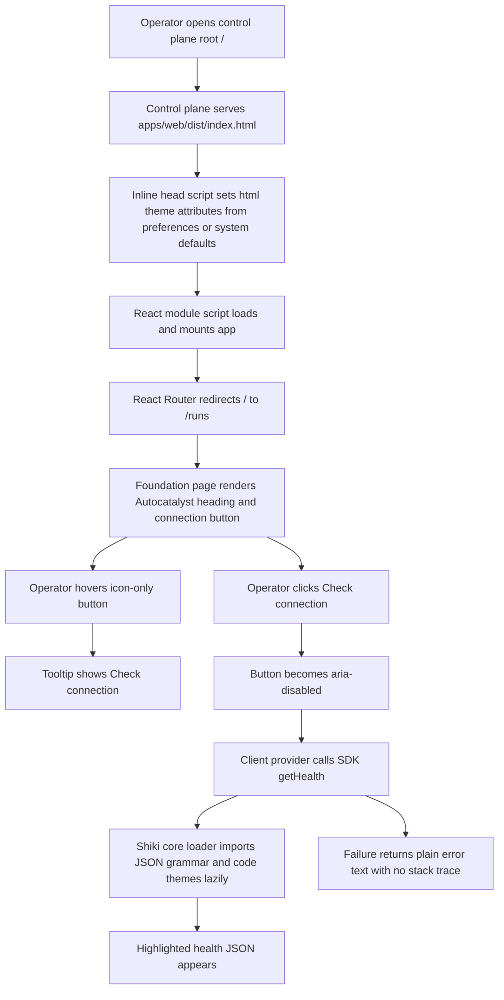
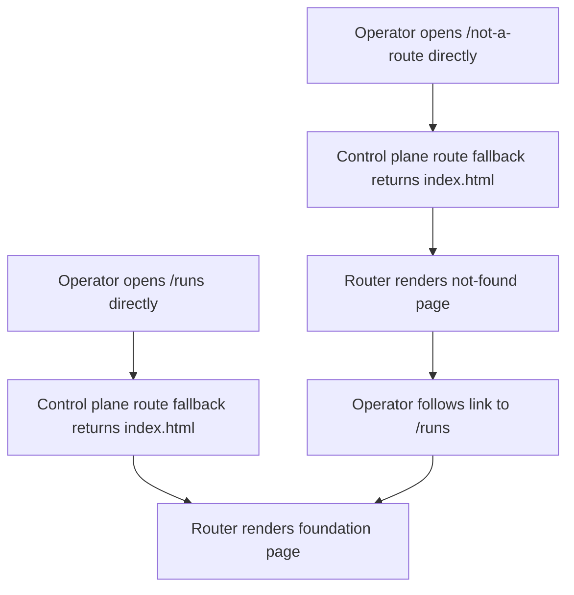
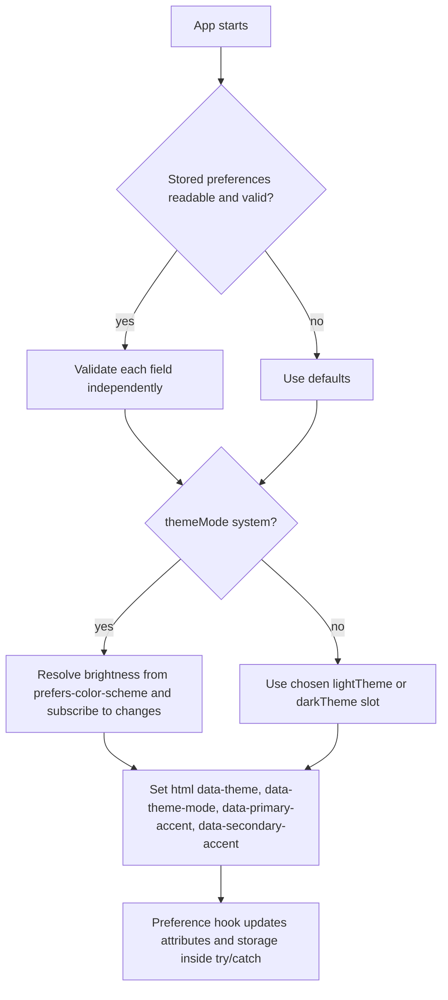
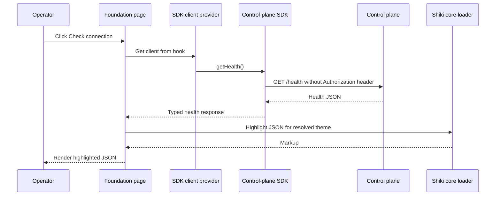
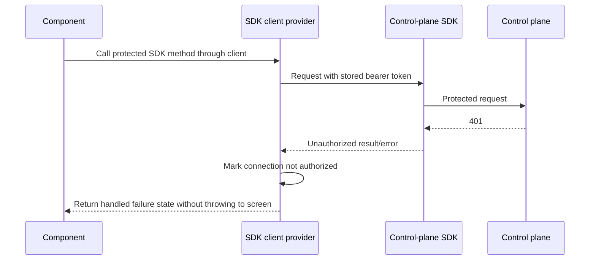

# Web app foundation

## What

Autocatalyst needs a working web client foundation served by the control plane. This feature adds the first real `apps/web` application so an operator can open the served root URL, land on a themed foundation page, and verify that the browser client can reach the control plane health endpoint.

The foundation includes the client-side project targets, routing, design tokens with concrete palette values, theme preferences, safe token storage, typed SDK access, first UI wrappers, syntax highlighting, and the first end-to-end route served from the built output. It creates enough structure for later web screens to build on without introducing the full shell, settings frame, run screens, or token entry flow.

## Why

Without this foundation, later web issues would each need to solve routing, theming, SDK access, component boundaries, build integration, and control-plane serving separately. Shipping the base app first gives the project one tested browser runtime and one set of conventions before feature screens start accumulating.

Operators benefit because the first browser experience proves the core loop: the control plane serves the client at `/`, the client follows the design system, and the client talks to the control plane through the SDK rather than through ad hoc fetch calls.

## Personas

- **Olivia: Operator** - Opens the control-plane web UI and needs a trustworthy, themed client that can verify connection state.
- **Devon: Developer** - Builds future web screens and needs clear project targets, UI wrapper conventions, theme primitives, and SDK access patterns.
- **Riley: Reviewer** - Reviews implementation quality and needs automated checks for bundle safety, palette provenance, contrast, boundaries, and served-route behavior.

## Narratives

### First served web page

Olivia starts the control plane in fake mode with the built client directory configured. She opens the root URL and sees a page that matches her system light or dark setting before the React app finishes mounting. The page redirects to `/runs`, shows the Autocatalyst heading, and keeps working when she refreshes the client route.

She hovers the icon-only connection button and sees the required tooltip. When she clicks it, the app calls the control plane health endpoint through the typed SDK client and displays the response as highlighted JSON. If the server is unreachable, she sees a plain error message instead of a crash or stack trace.

### Foundation for future screens

Devon starts work on a later web screen. The app already has Vite, React 19, React Router, Tailwind 4 tokens, browser routing, strict TypeScript configs, Vitest, Playwright coverage, and Nx targets. Devon imports `Button` and `Tooltip` from the client wrapper directory and cannot accidentally import Base UI primitives from a screen file.

Devon also uses the client provider instead of calling `fetch` directly. The bearer token remains in its dedicated store and never flows into component display APIs, while theme preferences use a separate storage key and tolerate blocked or invalid browser storage.

### Review of browser safety and conventions

Riley reviews the implementation and runs the repository checks. The build fails if a browser bundle contains `node:` imports, lint prevents direct Base UI imports outside wrappers, and module boundaries prevent `scope:web` from depending on control-plane application code.

Riley also verifies that palette values have named upstream sources, that contrast tests check exact token pairs, that Shiki is not in the entry chunk, that syntax highlighting loads only after the health response is requested, and that the Playwright run exercises the real built app served by the control plane fake server rather than a fixture page.

## User stories

**First served web page**

- Olivia can open the control-plane root URL and see the themed web foundation page.
- Olivia can refresh `/runs` and still see the client route served correctly.
- Olivia can hover the icon-only connection button and read its tooltip.
- Olivia can click the connection button and see highlighted health JSON from the control plane.
- Olivia can see a readable failure message when the health call fails.

**Foundation for future screens**

- Devon can build, develop, test, lint, and e2e the web app through Nx targets.
- Devon can use Tailwind utilities backed by documented design tokens and concrete palette values.
- Devon can use client wrapper components instead of importing Base UI primitives in screens.
- Devon can get a typed control-plane SDK client from a provider hook.
- Devon can rely on separate preference and bearer-token stores with safe storage fallbacks.

**Review of browser safety and conventions**

- Riley can confirm the browser bundle contains no Node-only imports.
- Riley can confirm web module boundaries prevent dependencies on `apps/control-plane`.
- Riley can confirm Shiki uses the fine-grained core API and loads lazily outside the entry chunk.
- Riley can confirm token values do not appear in URLs, logs, thrown messages, or the DOM.
- Riley can confirm documentation records the web project conventions and the proposed human-doc patch location.

## Goals

- `pnpm nx build web` emits a Vite production build to `apps/web/dist` with hashed asset names.
- Starting the control plane with `AUTOCATALYST_CLIENT_DIR=apps/web/dist` serves the built React app at `/` and falls back to `index.html` for client routes.
- `pnpm nx run-many -t build lint test` includes `web` and passes, and `pnpm test:boundaries` passes.
- The foundation page calls `getHealth()` through the SDK and renders highlighted JSON only after the Shiki core chunk loads lazily.
- Theme and token tests cover the documented themes, accents, exact contrast token pairs, storage failure cases, and first-paint script ordering.

## Non-goals

- The application shell, settings frame, connection page, token entry screen, and run detail screen are out of scope.
- Appearance and general settings pages are out of scope; preferences may be changed manually in browser storage until those screens exist.
- Wrappers beyond `Button` and `Tooltip` are out of scope and should be added only by the first screen that uses them.
- Vite dev proxy, CORS support, service worker behavior, offline use, and desktop or mobile packaging are out of scope.
- New ADRs are out of scope; this feature implements ADR-031, ADR-032, and ADR-033.

## Design spec

### User flows







### Key UI components

#### Foundation route at `/runs`

- Purpose: temporary landing page until the full shell and runs screen arrive.
- Content: `Autocatalyst` as the main heading, a themed surface using `bg-background` and `text-text`, one icon-only `Check connection` button, and an output area for highlighted JSON or failure text.
- Behavior: clicking the button calls `getHealth()` from the SDK client provider; while pending, the icon button uses `aria-disabled` so its tooltip remains available.
- Error state: display only a concise error message, never a stack trace.
- Replacement: issue #132 may replace the placeholder page with the shell, and issue #134 adds `/runs/<run id>`.

#### Not-found route

- Purpose: handle unknown browser routes without breaking control-plane fallback.
- Content: simple message that the route was not found and a link back to `/runs`.
- Behavior: direct loads and client navigation both render the not-found page.

#### `Button` wrapper

- Purpose: first client-owned wrapper around Base UI button behavior. Screens import this wrapper, never `@base-ui/react`.
- Variants: primary, secondary, destructive.
- Sizes: `control-sm`, `control-base`, and `control-lg` heights from the design system.
- States: default, hover, disabled, icon-only disabled via `aria-disabled`, and visible `:focus-visible` ring using `--color-focus`.
- Styling: token-only styling; no hex, `rgb(`, or raw `--ctp-*` variable references outside `src/styles/`.

#### `Tooltip` wrapper

- Purpose: first client-owned wrapper around Base UI tooltip behavior.
- Behavior: shows the label, or `Label (key)` when a keyboard key is provided.
- Required use: every icon-only button has a tooltip.

#### Theme provider

- Purpose: apply design-system themes and expose controlled preference updates.
- Attributes: sets `data-theme`, `data-theme-mode`, `data-primary-accent`, and `data-secondary-accent` on `html`.
- Storage: reads and writes `autocatalyst.preferences` inside try/catch; invalid JSON and blocked storage fall back to defaults without crashing.
- Preference fields: `themeMode`, `lightTheme`, `darkTheme`, `primaryAccent`, `secondaryAccent`, `bodyFont`, and `monoFont`.
- System mode: follows `prefers-color-scheme` and updates attributes when the system setting changes.

#### Highlighted JSON output

- Purpose: prove browser-side Shiki integration before spec-rendering screens exist.
- Behavior: uses `shiki/core` on first health-response render, imports only `shiki/langs/json.mjs`, imports one light and one dark code theme, selects by resolved app theme brightness, and reuses the highlighter for later calls.

### Visual references

No static mockup is required. The page should be intentionally minimal: full-page themed background, a centered or comfortably padded surface, the `Autocatalyst` heading, an icon-only connection button with tooltip, and a code block area that uses the tokenized theme. The implementation should follow `context-agent/wiki/design-system.md` for token roles, type, spacing, control heights, radii, elevation, motion, overlays, and button treatment, while this spec supplies the concrete palette provenance and mapping rules.

## Tech spec

### Introduction and overview

#### Prerequisites and assumptions

- Depends on #129: the control plane can serve a configured client directory and fall back to `index.html` for client routes.
- Depends on #130: `apps/web` exists as an Nx project with an `e2e` target and fake-server fixture conventions.
- Implements ADR-031 web client architecture, with this issue proposing the doc wording change that the browser stores operator preferences and the bearer token until the desktop wrapper supplies keychain storage.
- Implements ADR-032 web client stack: React 19, Vite, Tailwind 4, Base UI behind client wrappers, lucide-react, Shiki, and Vitest.
- References ADR-033 for future browser spec rendering; this issue uses Shiki on health JSON as the first browser highlighting use.
- Use source aliases for both `@autocatalyst/api-contract` and `@autocatalyst/sdk` in the web Vite config. The control plane already aliases `@autocatalyst/api-contract`; the web app must add its own `@autocatalyst/sdk` source alias because the control plane resolves SDK through package output and browser builds need source-level bundling checks. The root `tsconfig.base.json` paths already cover both packages, so add new path entries only if implementation discovers they are missing.

#### Technical goals

- Add the first real React app in `apps/web` without replacing the existing `e2e` target.
- Keep browser TypeScript strict while using DOM, JSX, and Bundler module resolution rather than control-plane NodeNext settings.
- Make unsafe browser dependencies visible through build and lint checks.
- Establish client-owned UI wrappers and lint rules before future screens depend on UI primitives.
- Keep preferences and bearer-token storage separate, guarded, and documented.

#### Non-goals

- No new backend API endpoint, database schema, migration, or API contract change.
- No token entry UI; #132 supplies it.
- No full run list, shell, settings frame, action registry, keyboard shortcuts, or additional wrappers.
- No service worker or dev proxy.

#### Glossary

- **Foundation page**: temporary `/runs` page proving theme, routing, SDK, wrappers, and Shiki integration.
- **Preference store**: browser localStorage value `autocatalyst.preferences` for `themeMode`, `lightTheme`, `darkTheme`, `primaryAccent`, `secondaryAccent`, `bodyFont`, and `monoFont`.
- **Token store**: separate browser localStorage value `autocatalyst.bearerToken` for the bearer token, with in-memory fallback and no display API.
- **Wrapper directory**: `src/ui/`, the only web source area allowed to import `@base-ui/react`.
- **Resolved theme**: the concrete light or dark theme selected after applying theme mode and system color scheme.

### System design and architecture

```mermaid
graph TD
    Browser[Browser]
    HTML[index.html head first-paint script]
    App[React app]
    Router[React Router BrowserRouter]
    Theme[Theme provider and preferences store]
    Token[Bearer token store]
    Client[Control-plane SDK client provider]
    SDK[@autocatalyst/sdk via source alias]
    CP[Control plane origin]
    Shiki[Lazy shiki/core chunk]

    Browser --> CP
    CP --> HTML
    HTML --> App
    App --> Theme
    App --> Router
    Router --> Runs[/runs foundation page/]
    Runs --> Client
    Client --> Token
    Client --> SDK
    SDK --> CP
    Runs --> Shiki
```

#### Component breakdown

- `apps/web/index.html`: Vite entry HTML plus first-paint theme script in `<head>` before the Vite module script. The script must be small, inline, guarded by try/catch, and independent of app code.
- `apps/web/src/main.tsx`: creates the React root and mounts providers and app.
- `apps/web/src/app.tsx`: owns declarative React Router setup using `BrowserRouter`, `Routes`, `Route`, and `Navigate` with base `/`.
- `apps/web/src/styles/`: Tailwind 4 imports, `@theme` token declarations, literal palette values, theme blocks selected by `data-theme`, derived token definitions, accent variables, and motion overrides.
- `apps/web/src/theme/`: preference schema, validation, defaults, storage helpers, provider, and hook.
- `apps/web/src/auth/` or `src/client/`: bearer-token store, SDK client provider, authorization state, and hook.
- `apps/web/src/ui/`: `Button` and `Tooltip` wrappers only.
- `apps/web/src/highlight/`: lazy Shiki core loader and highlight function.
- `apps/web/src/routes/`: foundation and not-found route components.
- `apps/web/README.md`: project conventions, React Router choice, target commands, aliases, token store, wrapper policy, Shiki loader, palette sources, and fake-mode usage.
- Root config updates: Nx target inputs, ESLint TSX coverage, React hooks rules, Base UI import restriction, icon package restriction, and `scope:web` dep constraint.

#### Health check sequence



#### Authorization failure sequence



### Detailed design

#### Project configuration

- Add `index.html`, `src/main.tsx`, and `src/app.tsx`.
- Add exact-pinned app/runtime dependencies to `apps/web/package.json` and the lockfile: `react`, `react-dom`, `react-router-dom`, `@base-ui/react`, `lucide-react`, and `shiki`.
- Add exact-pinned direct dev/test/build dependencies needed by the web project and root lint config: `@types/react`, `@types/react-dom`, `@vitejs/plugin-react`, `tailwindcss`, `@tailwindcss/vite`, `jsdom`, `@testing-library/react`, `@testing-library/user-event`, and `eslint-plugin-react-hooks`. Versions must be at least two weeks old at implementation time.
- The router is **React Router via `react-router-dom` using declarative `BrowserRouter`/`Routes`/`Route`/`Navigate` APIs**. Record this exact choice and rationale in `apps/web/README.md`: it supplies normal browser history, redirects, and not-found routing without a framework runtime.
- Extend `apps/web/project.json` with `build`, `dev`, `test`, and `lint` targets next to the existing `e2e` target.
  - `build`: Vite production build to `apps/web/dist`; `outputs` names that directory; `dependsOn` includes building source dependencies if Nx requires it for package outputs, but the web Vite config still aliases `@autocatalyst/sdk` and `@autocatalyst/api-contract` to source for browser bundle checks.
  - `dev`: Vite dev server with no API proxy.
  - `test`: `vitest run` from `apps/web` using `sharedTestPool`.
  - `lint`: lints `.ts`, `.tsx`, `package.json`, and `project.json`; dependency-checks must see every directly imported package listed in `apps/web/package.json`.
- Update `nx.json` production named input exclusions to include `*.spec.tsx` and `e2e/**`.
- Use `apps/web/tsconfig.app.json` and `apps/web/tsconfig.spec.json` split similar to the control plane, while setting DOM libs, JSX, Bundler module resolution, and no Node types.
- Add `vite.config.ts` with React and Tailwind plugins, source aliases to `@autocatalyst/sdk` and `@autocatalyst/api-contract`, manifest output for build assertions, hashed production assets, and a build-time check plugin that rejects emitted browser chunks containing `node:` imports.

#### Module boundaries and linting

- Add a `scope:web` dep constraint in `eslint.config.mjs`: web code may depend on `type:lib` projects only and must not depend on `apps/control-plane`.
- Ensure lint config includes `.tsx` files and `eslint-plugin-react-hooks` rules.
- Add a restriction so only files under `apps/web/src/ui/` may import `@base-ui/react`.
- Add a restriction or test so icons come only from `lucide-react` and are imported by name.
- Add a lint fixture or test proving a screen-file direct import of `@base-ui/react` fails.

#### Palette sources, theme mapping, and style tokens

All concrete palette values are copied as literals into `apps/web/src/styles/` rather than added through a palette dependency. `apps/web/README.md` must name the upstream palette and version/source URL used for each theme. The implementation should preserve upstream values unless a listed contrast test fails; in that case adjust only the mapped token in `src/styles/`, document the adjustment in a comment next to the literal and in the README palette table, and do not add contrast exemptions.

Palette sources:

- Catppuccin themes use the official Catppuccin palette v1.7.1 values for Latte, Frappe, Macchiato, and Mocha. These provide the raw Catppuccin color names, including the fourteen accent IDs `rosewater`, `flamingo`, `pink`, `mauve`, `red`, `maroon`, `peach`, `yellow`, `green`, `teal`, `sky`, `sapphire`, `blue`, and `lavender`. Raw `--ctp-*` variables may exist only inside `src/styles/` as source variables or comments; components and other styles must use semantic tokens.
- GitHub Light and GitHub Dark use GitHub Primer Primitives color values from `@primer/primitives` release v9.3.0 as copied literals, without adding the package dependency.
- Solarized Light uses Ethan Schoonover Solarized palette values from the canonical Solarized repository commit/tag documented in the README, copied as literals.
- Dracula uses Dracula Theme palette values from the official Dracula specification release/source documented in the README, copied as literals.

Semantic base mapping:

- Catppuccin: map documented names directly: `base -> background`, `mantle -> mantle`, `crust -> crust`, `surface0/1/2 -> surface-0/1/2`, `overlay0/1/2 -> overlay-0/1/2`, `subtext0/1 -> subtext-0/1`, and `text -> text`.
- GitHub themes: `canvas.default -> background`, `canvas.inset -> mantle`, `canvas.subtle -> crust`, `neutral.subtle -> surface-0`, `neutral.muted -> surface-1`, `neutral.emphasis -> surface-2`, `border.default -> overlay-0`, `border.muted -> overlay-1`, `fg.muted -> overlay-2`, `fg.subtle -> subtext-0`, `fg.muted -> subtext-1`, and `fg.default -> text`; if any boundary contrast fails, adjust the specific surface/overlay semantic value in `src/styles/` and document it.
- Solarized Light: `base3 -> background`, `base2 -> mantle`, a documented mix of `base2` and `base3` -> crust, `base2 -> surface-0`, a documented mix of `base1` and `base2` -> surface-1, `base1 -> surface-2`, `base1 -> overlay-0`, `base0 -> overlay-1`, `base00 -> overlay-2`, `base1 -> subtext-0`, `base0 -> subtext-1`, and `base00 -> text`; mixes must be literal CSS color-mix expressions or precomputed literals in `src/styles/` with comments.
- Dracula: `background -> background`, a documented darker mix of `background` and black -> mantle, a darker second mix -> crust, `currentLine -> surface-0`, a documented mix of `currentLine` and `foreground` -> surface-1`, `comment -> surface-2`, `comment -> overlay-0`, a documented mix of `comment` and `foreground` -> overlay-1`, `foreground -> overlay-2`, `comment -> subtext-0`, a documented mix of `comment` and `foreground` -> subtext-1`, and `foreground -> text`.

Fourteen accent IDs for non-Catppuccin themes are mapped as follows and must be declared in every theme block:

| Accent ID | GitHub Light/Dark Primer source | Solarized source | Dracula source |
| --- | --- | --- | --- |
| `rosewater` | `scale.pink.2` light / `scale.pink.3` dark | mix `magenta` 70% + `base3` 30% | mix `pink` 70% + `foreground` 30% |
| `flamingo` | `scale.coral.3` light / `scale.coral.3` dark | mix `orange` 55% + `magenta` 45% | mix `orange` 55% + `pink` 45% |
| `pink` | `scale.pink.5` light / `scale.pink.4` dark | `magenta` | `pink` |
| `mauve` | `scale.purple.5` light / `scale.purple.4` dark | mix `violet` 70% + `magenta` 30% | `purple` |
| `red` | `scale.red.5` light / `scale.red.4` dark | `red` | `red` |
| `maroon` | `scale.red.6` light / `scale.red.5` dark | mix `red` 65% + `orange` 35% | mix `red` 70% + `orange` 30% |
| `peach` | `scale.orange.5` light / `scale.orange.4` dark | `orange` | `orange` |
| `yellow` | `scale.yellow.5` light / `scale.yellow.3` dark | `yellow` | `yellow` |
| `green` | `scale.green.5` light / `scale.green.4` dark | `green` | `green` |
| `teal` | `scale.green.4` light / `scale.green.3` dark | `cyan` | mix `cyan` 60% + `green` 40% |
| `sky` | `scale.blue.3` light / `scale.blue.3` dark | mix `cyan` 75% + `base3` 25% | `cyan` |
| `sapphire` | `scale.blue.5` light / `scale.blue.4` dark | mix `blue` 70% + `cyan` 30% | mix `cyan` 70% + `purple` 30% |
| `blue` | `scale.blue.5` light / `scale.blue.4` dark | `blue` | mix `cyan` 50% + `purple` 50% |
| `lavender` | `scale.purple.4` light / `scale.purple.3` dark | `violet` | mix `purple` 70% + `foreground` 30% |

- Implement Tailwind 4 `@theme` declarations in `src/styles/` for every design-system color role plus type, spacing, control height, radius, elevation, layer, motion, and shell dimension tokens.
- Implement the eight `data-theme` theme blocks: Catppuccin Latte, GitHub Light, Solarized Light, Catppuccin Frappe, Catppuccin Macchiato, Catppuccin Mocha, GitHub Dark, and Dracula. Each block defines every semantic base token and all fourteen `--accent-<id>` variables.
- Define derived tokens once as mixes of base tokens, including `--color-border-subtle`, `--color-hover`, sentiment tokens, comment tokens, and other documented derived values.
- Define `--primary-accent` and `--secondary-accent` from selected accent IDs, with default sapphire and teal. `--color-primary`, `--color-secondary`, and `--color-focus` read those accent variables.
- Define `--color-on-primary` as a computed token, not one fixed literal: default it with `color-contrast(var(--color-primary) vs var(--color-background), var(--color-text), white, black)` if supported by the toolchain, otherwise set it through per-accent theme selectors generated in `src/styles/` so every theme/accent combination has a readable foreground. Use the same computed/per-accent approach for `--color-on-secondary` if implemented. Do not constrain accent choices to avoid contrast.
- Default font tokens to the design-system stacks.
- Set motion durations to `0` under `prefers-reduced-motion`.
- Enforce no hex colors, `rgb(` values, or raw `--ctp-*` names outside `src/styles/`.

#### Exact contrast tests

The contrast test checks these exact pairs and fails the build/test suite if any fail. There are no exemptions for upstream palettes; when an upstream value fails, adjust the mapped semantic token or per-accent foreground in `src/styles/` and document the adjustment.

- Body text: `--color-text` on `--color-background` >= 4.5:1 and `--color-text` on `--color-mantle` >= 4.5:1.
- Secondary text: `--color-subtext` on `--color-background` >= 4.5:1. `--color-subtext-1` is not required to meet 4.5:1 unless the design system maps it to readable body copy; it may be used only for lower-emphasis decoration if below 4.5:1.
- Primary action foreground: `--color-on-primary` on `--color-primary` >= 4.5:1 for every theme and every `data-primary-accent` value.
- Destructive foreground: `--color-on-destructive` on `--color-red` >= 4.5:1 for every theme.
- Focus ring: `--color-focus` on `--color-background` >= 3:1 and `--color-focus` on `--color-mantle` >= 3:1 for every theme and every primary accent.
- Component boundary: `--color-border` on `--color-background` >= 3:1 and `--color-border` on `--color-mantle` >= 3:1. Fainter derived tokens such as `--color-border-subtle` are not tested as required non-text boundaries and must not be the only visible boundary for controls.

#### Theme preferences

- Preference key: `autocatalyst.preferences`.
- Preference shape fields: `themeMode`, `lightTheme`, `darkTheme`, `primaryAccent`, `secondaryAccent`, `bodyFont`, and `monoFont`.
- Valid `themeMode` values: `system`, `light`, `dark`.
- Default preferences: `themeMode: 'system'`, `lightTheme: 'catppuccin-latte'`, `darkTheme: 'catppuccin-mocha'`, `primaryAccent: 'sapphire'`, `secondaryAccent: 'teal'`, `bodyFont` set to the design-system body stack ID, and `monoFont` set to the design-system mono stack ID.
- Every localStorage read and write must be inside try/catch.
- Invalid JSON or blocked storage renders with defaults and does not crash.
- Unknown theme or accent IDs fall back field-by-field while preserving valid fields.
- Provider sets `data-theme`, `data-theme-mode`, `data-primary-accent`, and `data-secondary-accent` on `document.documentElement`.
- System mode watches `prefers-color-scheme` and updates when the media query changes.
- `index.html` inline script duplicates only the minimal safe resolution logic needed to set `data-theme` before first paint.

#### First-paint proof

Because Playwright cannot pause between the inline head script and React mounting without banned hooks or routing, the proof is split across tests:

- A Vitest test executes the exact inline script source against stored dark preferences and verifies it sets `data-theme` before app code is loaded.
- A build test parses built `apps/web/dist/index.html` and asserts the inline theme script appears in `<head>` before the Vite module script, contains no imports, and does not reference app bundle globals.
- The Playwright test uses `page.emulateMedia({ colorScheme: 'dark' })`, loads the built page with no injected storage, and asserts the final `data-theme` is a dark theme. This proves served-build behavior, while the Vitest and build-order tests carry the before-first-paint claim.

#### Bearer token store and SDK client provider

- Token key: `autocatalyst.bearerToken`.
- Store the bearer token under that key, separate from preferences.
- Every token storage read/write/clear is inside try/catch and falls back to an in-memory value when storage fails.
- Expose write and clear operations needed by future token entry, but no component-facing function that returns the token for display.
- Build one `createControlPlaneClient` from `window.location.origin` and the current token. Recreate it when the token changes.
- Components get the client through a hook; components must not call `fetch` for control-plane routes.
- On `401` from any SDK call, mark provider state as not authorized and keep that state readable for #132. Do not throw the 401 through to route UI.
- Ensure token values never appear in URLs, logs, thrown error messages, or DOM output.
- `getHealth` must not send the `Authorization` header; protected calls send `Authorization: Bearer <token>`.

#### Shiki loader

- Use the fine-grained Shiki core API, not bundled `createHighlighter` from the top-level entry.
- `src/highlight/` exports one function that dynamically imports `shiki/core`, `shiki/engine/javascript`, `shiki/langs/json.mjs`, `shiki/themes/github-light.mjs`, and `shiki/themes/github-dark.mjs` on first use. If the installed Shiki version exposes `createJavaScriptRegexEngine` from a different documented module path, use that documented path and record it in README.
- Language list for this issue is exactly JSON. Future callers may extend the function to accept additional explicitly imported languages in their own issues.
- Code themes are `github-light` for resolved light app themes and `github-dark` for resolved dark app themes.
- Reuse one highlighter for subsequent calls.
- Keep Shiki and the JSON grammar out of the entry chunk.
- The manifest test identifies Shiki chunks by module IDs containing `/shiki/`, `shiki/langs/json.mjs`, `shiki/themes/github-light.mjs`, `shiki/themes/github-dark.mjs`, or `shiki/engine/javascript`, and asserts those module IDs are absent from the entry chunk and present only in async chunks.

#### Router and route behavior

- Use `react-router-dom` with declarative `BrowserRouter`, `Routes`, `Route`, and `Navigate`; router base is `/`.
- Define `/` redirecting to `/runs`.
- Define `/runs` as the foundation page.
- Define catch-all not-found route linking back to `/runs`.
- The Playwright e2e target must depend on `web:build`, use the #130 fake server with `apps/web/dist` as its client directory, and delete the old fixture client.

#### E2E migration from #130 fixture page

- Rewrite `apps/web/e2e/served-page.spec.ts` to target the real built foundation page instead of the fixture page.
- Preserve the no-model-call assertion by continuing to check the fake server launch counter and asserting `readLaunchCount()` is `0`.
- Rewrite the #130 restart test: after `fakeServer.restart()` and page reload, click `Check connection` and expect highlighted JSON containing `"status": "ok"`.
- Update `apps/web/e2e/support/fake-server.ts` so the default `clientDir` is `apps/web/dist` instead of the deleted fixture directory. Keep support for explicit clientDir overrides if tests need them.
- Keep `fake-server.spec.ts` coverage for running two fake servers at once working against the real build/default client directory.

#### Documentation changes

- `apps/web/README.md` is added or updated with project purpose, targets, fake-mode usage, React Router choice, alias choice, exact storage keys and preference field names, token store decision, wrapper convention, Shiki core loader, palette sources/mappings/adjustments, and no per-app agent note file.
- `context-agent/wiki/code-map.md` records `apps/web`, its source layout, targets, build output directory served by the control plane, and the new boundary constraint; update its `Last updated` line.
- Human-owned docs `context-human/adrs/adr-031-web-client-architecture.md` and `context-human/concepts/ux.md` are not edited directly in this implementation step. Instead, write a reviewable patch file at `context-agent/proposed-human-docs/issue-131-browser-token-storage.patch`.
  - The patch must contain a diff for `context-human/adrs/adr-031-web-client-architecture.md` changing the current statement that the browser stores only preferences to say the browser stores operator preferences and the bearer token until the desktop wrapper supplies keychain storage.
  - The patch must contain a diff for `context-human/concepts/ux.md` changing the current equivalent statement to the same meaning.
  - The patch must distinguish preferences from the bearer token and state that the token has a separate key and is not displayed.
  - A reviewer checks this by opening the patch file, verifying both file paths are present in the diff headers, verifying the old “only preferences” wording is replaced, and then applying or requesting changes through the human docs review process outside this feature implementation.
- `context-agent/wiki/design-system.md` changes only if implementation token names or values differ from the document; otherwise leave it unchanged.

### Security, privacy, and compliance

- The bearer token is a secret, not a preference. It must use `autocatalyst.bearerToken` and must never be displayed, logged, placed in URLs, or included in thrown messages.
- Browser storage is untrusted and unreliable. Preference and token reads must validate shape and catch all access failures.
- The SDK client is the only path for control-plane calls from components. This centralizes authorization handling and prevents accidental direct fetch behavior.
- Direct DOM insertion for highlighted markup must use trusted Shiki output from local input generated by the app, and route UI must avoid rendering stack traces.
- The browser bundle must not include Node-only imports. The build check fails on `node:` imports and has a test proving detection.

### Observability

- No new telemetry pipeline is introduced.
- Development diagnostics may report generic connection failure state, but must not include bearer-token values.
- Tests should spy on console output for sentinel token leakage during unauthorized and unreachable-server scenarios.

### Testing plan

- Unit/rendering tests for theme provider defaults, invalid storage, blocked storage, field-level fallback, attribute updates, storage writes, and first-paint inline script.
- Build-order test for `index.html` proving the inline theme script is in `<head>` before the module script and independent of app code.
- Contrast test calculating the exact token pairs listed in this spec across every theme and accent, with no exemptions.
- Palette provenance README check or unit fixture ensuring each theme records its upstream source and any adjusted semantic values.
- Build-check test proving `node:` imports are rejected.
- Lint rule or fixture test proving direct `@base-ui/react` import outside `src/ui/` is rejected.
- Wrapper rendering tests for `Button` and `Tooltip`: roles, accessible names, focus ring class, disabled icon tooltip behavior, and `Label (key)` text.
- SDK provider tests with the SDK `fetch` option stubbed: Authorization header present on protected calls, absent on `getHealth`, 401 handled as state, and sentinel token absent from console output, errors, URLs, and DOM.
- Shiki tests: dynamic import runs once across two calls, light/dark theme switch changes highlighted markup, and manifest shows `shiki/core`, JavaScript regex engine, JSON grammar, and GitHub code themes outside the entry chunk.
- App rendering tests: health success displays highlighted JSON; rejected health call displays failure text without stack trace.
- Playwright test against real build served by fake control plane: launch counter remains `0`, root/runs/not-found routing, dark final `data-theme` under emulated dark system preference, heading, connection click, highlighted `"status": "ok"`, entry chunk loaded, Shiki chunk only after click, no requests to another origin, restart then click still returns `"status": "ok"`, no model call, no `page.route`, no injected storage, no test-only hook.
- Fake-server tests continue to prove two fake servers can run at once against the real build/default client directory.
- Validation commands: `pnpm nx run-many -t build lint test`, `pnpm test:boundaries`, and `pnpm nx e2e web`.

### Alternatives considered

- **Use built package imports for SDK and API contract**: rejected for the initial web app because source aliases for both packages make browser bundle checks direct. Nx `dependsOn` may still build dependencies where required by target orchestration, but browser code resolves SDK and API contract through source aliases.
- **Create all Base UI wrappers now**: rejected because the issue is at the file-count cap and wrappers should exist only when a screen exercises them.
- **Use direct `fetch` on the foundation page**: rejected because it would bypass the SDK and duplicate authorization/error behavior.
- **Use top-level bundled Shiki `createHighlighter`**: rejected because it can cause Vite to emit every bundled grammar and theme chunk. The chosen `shiki/core` API imports only JSON plus GitHub light/dark code themes.
- **Store bearer token with preferences**: rejected because the token is secret material and must be isolated for future desktop keychain replacement.
- **Leave non-Catppuccin accent IDs undefined**: rejected because theme switching needs a stable accent vocabulary across all themes.

### Risks

- **File-count pressure**: keep wrappers, routes, and helper modules minimal; do not add unused wrapper components.
- **Palette completeness**: non-Catppuccin themes require semantic and accent mappings; README provenance and contrast tests reduce ambiguity.
- **Contrast failures**: upstream palettes may fail the exact pairs; implementation must adjust semantic values in `src/styles/` and document the adjustment rather than adding exemptions.
- **Browser safety of workspace packages**: source aliases could reveal Node-only imports in SDK or contracts; the build check must catch this early.
- **First-paint script drift**: keep the inline script minimal and test exact script execution plus built HTML ordering.
- **Human-owned docs gate**: ADR-031 and UX changes are required as a patch file under `context-agent/proposed-human-docs/` and must not be applied directly without human review.

## Task list

- [ ] **Story: Web project targets and browser build foundation**
  - [ ] **Task: Add the React/Vite application entrypoints and config**
    - **Description**: Add `apps/web/index.html`, `src/main.tsx`, `src/app.tsx`, Vite config, Tailwind plugin wiring, and strict web tsconfig split using DOM, JSX, and Bundler module resolution. Configure Vite source aliases for both `@autocatalyst/sdk` and `@autocatalyst/api-contract`.
    - **Acceptance criteria**:
      - [ ] `apps/web` contains `index.html`, `src/main.tsx`, and `src/app.tsx`.
      - [ ] React 19, Vite, Tailwind 4, and TypeScript compile with `strict`, `noUncheckedIndexedAccess`, and `exactOptionalPropertyTypes`.
      - [ ] `apps/web/tsconfig.app.json` and `tsconfig.spec.json` follow the control-plane split while dropping Node types.
      - [ ] Vite aliases `@autocatalyst/sdk` and `@autocatalyst/api-contract` to source for browser bundling.
      - [ ] Alias and any target `dependsOn` choices are documented in `apps/web/README.md`.
    - **Dependencies**: None
  - [ ] **Task: Add exact-pinned web dependencies and document React Router choice**
    - **Description**: Add required runtime, build, lint, type, and test dependencies with exact versions at least two weeks old, update the lockfile, and record the React Router choice in `apps/web/README.md`.
    - **Acceptance criteria**:
      - [ ] `apps/web/package.json` and lockfile contain exact-pinned `react`, `react-dom`, `react-router-dom`, `@base-ui/react`, `lucide-react`, and `shiki`.
      - [ ] Dev dependencies include exact-pinned `@types/react`, `@types/react-dom`, `@vitejs/plugin-react`, `tailwindcss`, `@tailwindcss/vite`, `jsdom`, `@testing-library/react`, `@testing-library/user-event`, and `eslint-plugin-react-hooks` where the repository convention places them.
      - [ ] Direct imports used by the web app are listed so `@nx/dependency-checks` passes.
      - [ ] README states the router is `react-router-dom` with declarative `BrowserRouter` APIs and explains why.
      - [ ] Dependency versions satisfy the two-week age requirement at implementation time.
    - **Dependencies**: None
  - [ ] **Task: Define Nx build, dev, test, and lint targets**
    - **Description**: Update `apps/web/project.json` to add the application targets next to `e2e`; update `nx.json` named input exclusions for web specs and e2e files.
    - **Acceptance criteria**:
      - [ ] `build` writes to `apps/web/dist` and declares that directory in `outputs`.
      - [ ] `build` has any required `dependsOn` for source dependencies while preserving source aliases in Vite.
      - [ ] `dev` runs the Vite dev server with no proxy.
      - [ ] `test` runs `vitest run` from `apps/web` with `sharedTestPool`.
      - [ ] `lint` covers `.ts`, `.tsx`, `package.json`, and `project.json`.
      - [ ] `nx.json` excludes `*.spec.tsx` and `e2e/**` from the `production` named input.
    - **Dependencies**: Task: Add the React/Vite application entrypoints and config; Task: Add exact-pinned web dependencies and document React Router choice
  - [ ] **Task: Add browser bundle Node-import guard**
    - **Description**: Add a build-time check that fails when emitted browser chunks contain `node:` imports and add a targeted test proving the guard catches an injected Node-only import.
    - **Acceptance criteria**:
      - [ ] Production build fails on a browser bundle containing `node:` imports.
      - [ ] A test demonstrates the guard rejects an injected Node-only import.
      - [ ] Normal `pnpm nx build web` passes without Node-only imports.
    - **Dependencies**: Task: Add the React/Vite application entrypoints and config

- [ ] **Story: Boundaries, lint rules, and project conventions**
  - [ ] **Task: Extend ESLint for web boundaries and TSX**
    - **Description**: Update root lint configuration so web files participate in boundary enforcement, `.tsx` files are linted, React hooks rules run through `eslint-plugin-react-hooks`, and `scope:web` can depend only on `type:lib` projects.
    - **Acceptance criteria**:
      - [ ] `eslint.config.mjs` includes a `scope:web` dep constraint.
      - [ ] Web code cannot depend on `apps/control-plane`.
      - [ ] `.tsx` files are covered by lint.
      - [ ] React hooks lint rules run for web components.
      - [ ] `pnpm test:boundaries` passes.
    - **Dependencies**: Task: Define Nx build, dev, test, and lint targets
  - [ ] **Task: Enforce Base UI and icon import conventions**
    - **Description**: Add lint restrictions or fixtures so only `apps/web/src/ui/` may import `@base-ui/react`, screens never import Base UI directly, and icons come only from named `lucide-react` imports.
    - **Acceptance criteria**:
      - [ ] Direct `@base-ui/react` import from a screen file is rejected by a test or lint fixture.
      - [ ] Files under `src/ui/` may import `@base-ui/react`.
      - [ ] Non-`lucide-react` icon package imports are rejected.
      - [ ] Named lucide icon imports are allowed.
    - **Dependencies**: Task: Extend ESLint for web boundaries and TSX

- [ ] **Story: Palette, design tokens, themes, and contrast coverage**
  - [ ] **Task: Copy palette values and document provenance**
    - **Description**: Copy literal palette values into `src/styles/` from Catppuccin v1.7.1, GitHub Primer Primitives v9.3.0, canonical Solarized, and official Dracula sources. Add README provenance and any adjustment notes.
    - **Acceptance criteria**:
      - [ ] `src/styles/` contains literal values or documented CSS color mixes for all eight themes.
      - [ ] README names the upstream source and version/source URL for each theme.
      - [ ] Catppuccin raw names or `--ctp-*` references appear only in `src/styles/` if used.
      - [ ] Any adjusted value is commented next to the literal and documented in README.
    - **Dependencies**: Task: Add the React/Vite application entrypoints and config
  - [ ] **Task: Implement semantic mappings and fourteen accents per theme**
    - **Description**: Implement the semantic base token mappings and the non-Catppuccin accent mapping table from the spec for GitHub, Solarized, and Dracula.
    - **Acceptance criteria**:
      - [ ] Catppuccin Latte, GitHub Light, Solarized Light, Catppuccin Frappe, Catppuccin Macchiato, Catppuccin Mocha, GitHub Dark, and Dracula exist as `data-theme` blocks.
      - [ ] Each theme defines every semantic base token.
      - [ ] Each theme defines all fourteen `--accent-<id>` variables.
      - [ ] Mantle, crust, surface, overlay, and subtext values for non-Catppuccin themes follow the spec mapping or documented adjusted values.
    - **Dependencies**: Task: Copy palette values and document provenance
  - [ ] **Task: Implement Tailwind theme tokens and derived tokens**
    - **Description**: Create Tailwind 4 `@theme` declarations for design-system tokens, derived tokens, accent-selected primary/secondary/focus colors, computed or per-accent `--color-on-primary`, font stacks, and reduced-motion overrides.
    - **Acceptance criteria**:
      - [ ] Utilities such as `bg-background` and `text-subtext` are available.
      - [ ] Every design-system Color table role is declared.
      - [ ] Type, spacing, control height, radius, elevation, layer, motion, and shell dimension tokens are declared.
      - [ ] `--primary-accent` and `--secondary-accent` default to sapphire and teal.
      - [ ] `--color-on-primary` reaches contrast for every accent through computed or per-accent values.
      - [ ] `prefers-reduced-motion` sets motion durations to `0`.
      - [ ] No component or stylesheet outside `src/styles/` contains a hex color, `rgb(` value, or raw `--ctp-*` name.
    - **Dependencies**: Task: Implement semantic mappings and fourteen accents per theme
  - [ ] **Task: Add exact contrast and style-safety tests**
    - **Description**: Add tests that compute the exact token pairs from the spec across every theme/accent combination and enforce style-token safety outside `src/styles/`.
    - **Acceptance criteria**:
      - [ ] `--color-text` on `--color-background` and `--color-mantle` is at least 4.5:1.
      - [ ] `--color-subtext` on `--color-background` is at least 4.5:1.
      - [ ] `--color-on-primary` on `--color-primary` is at least 4.5:1 for every primary accent.
      - [ ] `--color-on-destructive` on `--color-red` is at least 4.5:1.
      - [ ] `--color-focus` on `--color-background` and `--color-mantle` is at least 3:1 for every primary accent.
      - [ ] `--color-border` on `--color-background` and `--color-mantle` is at least 3:1.
      - [ ] Tests fail on prohibited hex, `rgb(`, or raw `--ctp-*` usage outside `src/styles/`.
    - **Dependencies**: Task: Implement Tailwind theme tokens and derived tokens

- [ ] **Story: Theme provider and preference storage**
  - [ ] **Task: Build validated preference storage helpers**
    - **Description**: Implement preference defaults, schema validation, field-level fallback, and try/catch localStorage read/write helpers under `autocatalyst.preferences` using fields `themeMode`, `lightTheme`, `darkTheme`, `primaryAccent`, `secondaryAccent`, `bodyFont`, and `monoFont`.
    - **Acceptance criteria**:
      - [ ] Defaults are `system`, `catppuccin-latte`, `catppuccin-mocha`, `sapphire`, `teal`, and the design-system body/mono font stack IDs.
      - [ ] Every localStorage read and write is inside try/catch.
      - [ ] Invalid JSON falls back to defaults without crashing.
      - [ ] Blocked or throwing storage falls back to defaults without crashing.
      - [ ] Unknown theme or accent IDs fall back only for that field and keep valid fields.
    - **Dependencies**: Task: Implement Tailwind theme tokens and derived tokens
  - [ ] **Task: Build theme provider and hook**
    - **Description**: Implement provider state, preference update hook, html attribute updates, system color-scheme watching, and storage writes.
    - **Acceptance criteria**:
      - [ ] Provider sets `data-theme`, `data-theme-mode`, `data-primary-accent`, and `data-secondary-accent` on `html`.
      - [ ] `system` mode follows `prefers-color-scheme`.
      - [ ] System setting changes update the resolved theme.
      - [ ] Rendering test changes mode, slot, and accent through the hook and sees attributes and stored values update.
    - **Dependencies**: Task: Build validated preference storage helpers
  - [ ] **Task: Add first-paint theme script and proof tests**
    - **Description**: Add a small inline script to the `index.html` head that resolves stored preferences before the module script. Add Vitest, build-order, and Playwright coverage as defined in the spec.
    - **Acceptance criteria**:
      - [ ] Inline script sets `data-theme` before React app code loads in the script-unit test.
      - [ ] Script handles missing, invalid, or inaccessible storage without throwing.
      - [ ] Vitest runs the exact script source against a stored dark preference and sees `data-theme` set.
      - [ ] Build test asserts the inline script is in `<head>` before the Vite module script and has no app-code dependency.
      - [ ] Playwright emulates dark system color scheme and sees final `data-theme` set to a dark theme without injected storage.
    - **Dependencies**: Task: Build theme provider and hook

- [ ] **Story: Bearer token store and SDK client provider**
  - [ ] **Task: Implement safe bearer token store**
    - **Description**: Add a token store with key `autocatalyst.bearerToken`, try/catch access, clear/write behavior, in-memory fallback, and no component display getter.
    - **Acceptance criteria**:
      - [ ] Token key is `autocatalyst.bearerToken` and is separate from `autocatalyst.preferences`.
      - [ ] Read, write, and clear operations catch storage failures.
      - [ ] Storage failure uses an in-memory fallback.
      - [ ] Public component-facing API does not return the token for display.
      - [ ] `apps/web/README.md` documents the key separation and future desktop keychain replacement.
    - **Dependencies**: Task: Add the React/Vite application entrypoints and config
  - [ ] **Task: Build SDK client provider and authorization state**
    - **Description**: Create a provider that builds one `createControlPlaneClient` from `window.location.origin` and the current token, recreates on token change, exposes client and connection state via hooks, and handles 401s as provider state.
    - **Acceptance criteria**:
      - [ ] Components can get the SDK client from a hook.
      - [ ] Client is recreated when token state changes.
      - [ ] Components do not call `fetch` for control-plane routes.
      - [ ] Any 401 marks state as not authorized and does not throw to the screen.
      - [ ] State is readable for #132 connection UI.
    - **Dependencies**: Task: Implement safe bearer token store
  - [ ] **Task: Add SDK client security tests**
    - **Description**: Add tests using the SDK documented `fetch` option to verify authorization header behavior, 401 handling, unreachable server handling, and sentinel-token non-disclosure.
    - **Acceptance criteria**:
      - [ ] Protected calls send `Authorization: Bearer <token>`.
      - [ ] `getHealth` sends no Authorization header.
      - [ ] 401 updates provider state without throwing to route UI.
      - [ ] Sentinel token does not appear in URLs, logs, thrown error messages, or DOM.
      - [ ] Unreachable server failure does not leak the token.
    - **Dependencies**: Task: Build SDK client provider and authorization state

- [ ] **Story: UI wrappers and foundation components**
  - [ ] **Task: Build `Button` wrapper**
    - **Description**: Implement the client-owned `Button` wrapper in `src/ui/` using Base UI and token-only styling for variants, sizes, focus ring, and icon-button disabled behavior.
    - **Acceptance criteria**:
      - [ ] Variants include primary, secondary, and destructive.
      - [ ] Sizes use `control-sm`, `control-base`, and `control-lg` heights.
      - [ ] `:focus-visible` ring uses `--color-focus`.
      - [ ] Disabled icon button uses `aria-disabled` so its tooltip remains available.
      - [ ] Rendering test asserts role, accessible name, focus ring class, and disabled icon tooltip behavior.
    - **Dependencies**: Task: Enforce Base UI and icon import conventions; Task: Implement Tailwind theme tokens and derived tokens
  - [ ] **Task: Build `Tooltip` wrapper**
    - **Description**: Implement the client-owned `Tooltip` wrapper in `src/ui/` using Base UI and token-only styling, including optional key display.
    - **Acceptance criteria**:
      - [ ] Tooltip displays the label.
      - [ ] Tooltip displays `Label (key)` when a key is provided.
      - [ ] Rendering test asserts tooltip text and accessible behavior.
      - [ ] Styling uses tokens only.
    - **Dependencies**: Task: Enforce Base UI and icon import conventions; Task: Implement Tailwind theme tokens and derived tokens
  - [ ] **Task: Document wrapper convention**
    - **Description**: Update `apps/web/README.md` to explain that screens import client wrappers, never Base UI directly, and that remaining wrappers are created by the first issue whose screen uses them.
    - **Acceptance criteria**:
      - [ ] README names `Menu`, `Popover`, `Dialog`, `Tabs`, `Select`, `Switch`, and form fields as future wrappers.
      - [ ] README states screens never import `@base-ui/react`.
      - [ ] README states no wrapper should exist without a screen that exercises it.
    - **Dependencies**: Task: Build `Button` wrapper; Task: Build `Tooltip` wrapper

- [ ] **Story: Lazy Shiki highlighting**
  - [ ] **Task: Implement fine-grained Shiki core loader**
    - **Description**: Add `src/highlight/` with one exported function that dynamically imports `shiki/core`, the JavaScript regex engine, `shiki/langs/json.mjs`, `shiki/themes/github-light.mjs`, and `shiki/themes/github-dark.mjs`, then creates/reuses a highlighter for JSON.
    - **Acceptance criteria**:
      - [ ] Shiki loads through dynamic import on first call.
      - [ ] JavaScript regex engine is used.
      - [ ] Only JSON language support is imported for this issue.
      - [ ] Code themes are GitHub Light and GitHub Dark.
      - [ ] Further calls reuse the highlighter.
      - [ ] Light and dark resolved themes produce matching code theme markup.
    - **Dependencies**: Task: Build theme provider and hook
  - [ ] **Task: Add Shiki chunk and reuse tests**
    - **Description**: Add rendering/unit tests and manifest assertions proving lazy loading, one-time dynamic import, and separate chunks identified by Shiki module IDs.
    - **Acceptance criteria**:
      - [ ] Calling highlight twice runs the dynamic import once.
      - [ ] Switching from light to dark returns dark-theme markup.
      - [ ] Build output puts `shiki/core`, JavaScript regex engine, JSON grammar, and GitHub code themes in async chunks.
      - [ ] Manifest test asserts Shiki module IDs are absent from the entry chunk.
    - **Dependencies**: Task: Implement fine-grained Shiki core loader; Task: Add browser bundle Node-import guard

- [ ] **Story: Router, foundation page, and served build behavior**
  - [ ] **Task: Implement React Router routes**
    - **Description**: Mount declarative React Router with `BrowserRouter` base `/`, redirect `/` to `/runs`, render the foundation page at `/runs`, and render a not-found page with a link to `/runs` for unknown paths.
    - **Acceptance criteria**:
      - [ ] `/` redirects to `/runs`.
      - [ ] `/runs` renders the foundation page.
      - [ ] Unknown paths render the not-found page.
      - [ ] Not-found page links to `/runs`.
    - **Dependencies**: Task: Add exact-pinned web dependencies and document React Router choice; Task: Build theme provider and hook; Task: Build SDK client provider and authorization state
  - [ ] **Task: Build foundation page health interaction**
    - **Description**: Create the `/runs` foundation page with heading, themed surface, icon-only connection button with tooltip, SDK `getHealth()` call, lazy highlighted JSON output, pending state, and failure text.
    - **Acceptance criteria**:
      - [ ] Page shows `Autocatalyst` as a heading.
      - [ ] Surface uses `bg-background` and `text-text`.
      - [ ] Icon-only button uses lucide named import and `Tooltip` text `Check connection`.
      - [ ] Activating the button calls `getHealth()` through the client provider.
      - [ ] Pending state uses `aria-disabled`.
      - [ ] Success shows highlighted JSON.
      - [ ] Failure shows message text and no stack trace.
    - **Dependencies**: Task: Implement React Router routes; Task: Build `Button` wrapper; Task: Build `Tooltip` wrapper; Task: Implement fine-grained Shiki core loader
  - [ ] **Task: Add foundation page rendering tests**
    - **Description**: Add Vitest rendering tests that mount the app with SDK fetch stubs for health success and failure.
    - **Acceptance criteria**:
      - [ ] Success test clicks the button and sees highlighted health response.
      - [ ] Failure test sees failure text when the stub rejects.
      - [ ] Tests verify no direct component fetch is used for control-plane routes.
    - **Dependencies**: Task: Build foundation page health interaction
  - [ ] **Task: Verify control-plane serving of built app**
    - **Description**: Ensure the built output works when served by the control plane with `AUTOCATALYST_CLIENT_DIR=apps/web/dist`, including route fallback and cache expectations inherited from #129.
    - **Acceptance criteria**:
      - [ ] Starting the control plane with `AUTOCATALYST_CLIENT_DIR=apps/web/dist` serves the built page at `/`.
      - [ ] Refreshing `/runs` returns `index.html` and renders the same page.
      - [ ] Build emits hashed asset filenames.
      - [ ] `index.html` remains eligible for #129 `no-cache` behavior while hashed assets use the long cache lifetime.
    - **Dependencies**: Task: Build foundation page health interaction; Task: Define Nx build, dev, test, and lint targets

- [ ] **Story: End-to-end coverage with the real build**
  - [ ] **Task: Replace fixture client defaults with built web app**
    - **Description**: Update the #130 Playwright setup so `web:e2e` depends on `web:build`, `fake-server.ts` defaults `clientDir` to `apps/web/dist`, and the old fixture client is deleted.
    - **Acceptance criteria**:
      - [ ] `web:build` is a dependency of `e2e`.
      - [ ] Fake-server fixture default `clientDir` is `apps/web/dist`, replacing `FIXTURE_CLIENT_DIR` as the default.
      - [ ] Explicit clientDir overrides still work if existing tests need them.
      - [ ] Fixture client from #130 is removed.
      - [ ] `fake-server.spec.ts` still proves two fake servers can run at once against the real build/default client directory.
    - **Dependencies**: Task: Verify control-plane serving of built app
  - [ ] **Task: Rewrite served-page Playwright spec for the foundation page**
    - **Description**: Rewrite `apps/web/e2e/served-page.spec.ts` so the existing no-model-call and restart coverage continue against the real foundation page, then add route, chunk, and origin assertions.
    - **Acceptance criteria**:
      - [ ] Spec preserves the launch-counter assertion and expects `readLaunchCount()` to be `0`.
      - [ ] Spec asserts the `Autocatalyst` heading.
      - [ ] Spec clicks `Check connection` and sees `"status": "ok"`.
      - [ ] Restart test calls `fakeServer.restart()`, reloads, clicks `Check connection`, and sees `"status": "ok"` again.
      - [ ] Spec asserts entry chunk loaded on page load.
      - [ ] Spec asserts Shiki chunk loads only after the click.
      - [ ] Spec asserts no request went to another origin.
      - [ ] Spec loads `/runs` directly and sees the foundation page.
      - [ ] Spec loads `/not-a-route` directly and sees the not-found page.
      - [ ] Spec uses no model call, no `page.route`, no injected browser storage, and no test-only hook.
    - **Dependencies**: Task: Replace fixture client defaults with built web app

- [ ] **Story: Documentation and final validation**
  - [ ] **Task: Write `apps/web/README.md`**
    - **Description**: Document what the web app is, targets, fake-mode usage, token store, wrapper convention, Shiki core loader, React Router choice, aliases, storage keys/fields, and palette provenance/mappings.
    - **Acceptance criteria**:
      - [ ] README describes `dev`, `build`, `test`, `lint`, and `e2e`.
      - [ ] README explains how to run against fake mode.
      - [ ] README documents `autocatalyst.preferences`, `autocatalyst.bearerToken`, and preference fields.
      - [ ] README documents wrapper convention and Shiki core loader.
      - [ ] README records `react-router-dom` declarative `BrowserRouter` choice and alias approach.
      - [ ] README records palette sources, versions/source URLs, non-Catppuccin accent mapping, and any contrast-driven adjustments.
      - [ ] No per-app agent note file is added.
    - **Dependencies**: Task: Add exact-pinned web dependencies and document React Router choice; Task: Implement safe bearer token store; Task: Document wrapper convention; Task: Implement fine-grained Shiki core loader; Task: Copy palette values and document provenance
  - [ ] **Task: Update agent code map and design-system docs if needed**
    - **Description**: Update `context-agent/wiki/code-map.md` for `apps/web`, its layout, targets, build output, and boundary constraint. Update `context-agent/wiki/design-system.md` only if implementation token values or names differ from the document.
    - **Acceptance criteria**:
      - [ ] Code map records `apps/web` source layout.
      - [ ] Code map records targets and `apps/web/dist` as the served build output.
      - [ ] Code map records the `scope:web` boundary constraint.
      - [ ] Code map `Last updated` line changes.
      - [ ] Design-system doc is unchanged unless code differs from documented token names or values.
    - **Dependencies**: Task: Define Nx build, dev, test, and lint targets; Task: Implement semantic mappings and fourteen accents per theme; Task: Extend ESLint for web boundaries and TSX
  - [ ] **Task: Write proposed human-doc patch for storage wording**
    - **Description**: Write `context-agent/proposed-human-docs/issue-131-browser-token-storage.patch` with proposed diffs for ADR-031 and `context-human/concepts/ux.md`. Do not edit the human-owned docs directly.
    - **Acceptance criteria**:
      - [ ] Patch file contains a diff header for `context-human/adrs/adr-031-web-client-architecture.md`.
      - [ ] Patch file contains a diff header for `context-human/concepts/ux.md`.
      - [ ] Patch replaces the current “browser stores only preferences” wording in both files.
      - [ ] New wording says the browser stores operator preferences and the bearer token until the desktop wrapper supplies keychain storage.
      - [ ] New wording says the token has a separate key and is not displayed.
      - [ ] Reviewer can verify the proposed changes by reading the patch file without applying it.
    - **Dependencies**: Task: Implement safe bearer token store
  - [ ] **Task: Run final validation commands**
    - **Description**: Run the required repository checks for this feature and fix any failures within scope.
    - **Acceptance criteria**:
      - [ ] `pnpm nx run-many -t build lint test` passes with `web` included.
      - [ ] `pnpm test:boundaries` passes.
      - [ ] `pnpm nx e2e web` passes.
      - [ ] Any skipped check is documented with the exact reason.
    - **Dependencies**: Task: Rewrite served-page Playwright spec for the foundation page; Task: Write `apps/web/README.md`; Task: Update agent code map and design-system docs if needed; Task: Write proposed human-doc patch for storage wording
