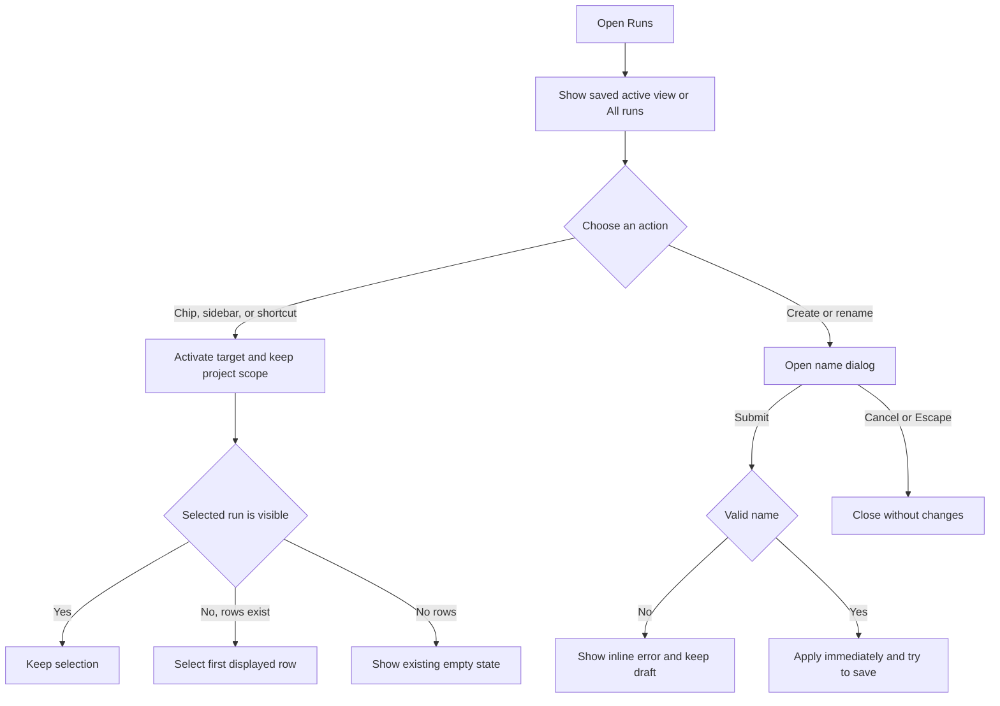
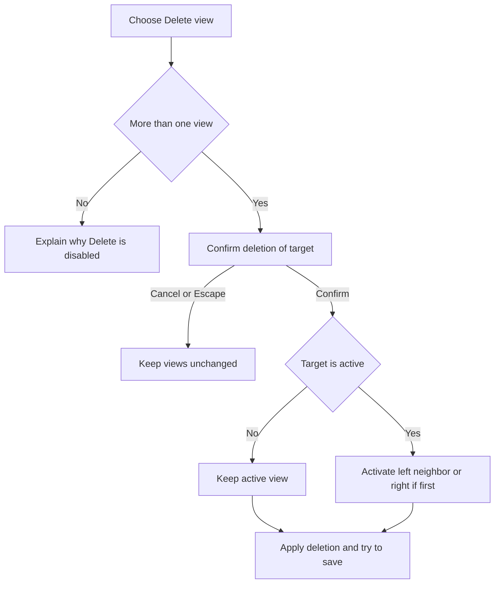
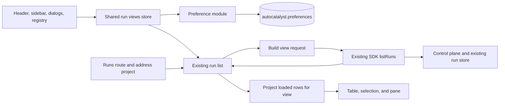
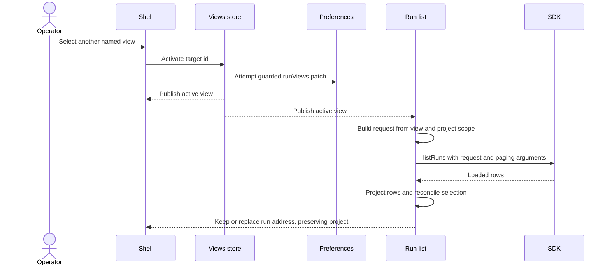

# Named run views and view chips

## What

Operators can create, select, rename, and delete named views of the run list. Autocatalyst starts with **All runs**. The browser remembers the views, their order, and which one is active.

A view changes how runs are presented, not which runs exist or how they execute. In this release, all views show the same table in server order for the current project scope. Later features add settings that make the views differ.

## Why

Operators need recognizable places to return to when switching between kinds of work. Named views let them establish those places and pick up where they left off after a reload. This release establishes how operators manage views before filters and other presentation settings arrive.

## Personas

- **Enzo: Engineer** ([Autocatalyst personas](../app.md)) — Reviews technical specs and implementations and moves between runs while giving feedback.

## Narratives

### Set up a review view

Enzo starts on **All runs** and creates **Review**. The new view becomes active without changing the run order or the selected run. Enzo renames it to **My review** from the header and reloads the page.

The title and active chip still say **My review**. Both views appear under **Runs** in the sidebar. Enzo selects **All runs** there and keeps the same run selected.

### Switch views within a project

Enzo opens a project from the sidebar and selects a run. The header shows the project as context and the active view as the title. Enzo presses `.` to move to the next view, keeping the project and selected run, then presses `,` to move back.

Enzo deletes **My review** from its chip's context menu without selecting it first. **All runs** stays active. The remaining view's Delete item explains why it cannot be deleted.

## User stories

**Set up a review view**

- Enzo can start with All runs in a fresh browser.
- Enzo can create a view and use it immediately without saving separately.
- Enzo can correct an invalid name without closing the dialog or losing the draft.
- Enzo can rename a view without changing its identity or position.
- Enzo can recover saved names, order, and active view after reloading.
- Enzo can select any view from the Runs section of the sidebar.

**Switch views within a project**

- Enzo can use the same views with or without a project scope.
- Enzo can move one view at a time by keyboard without wrapping.
- Enzo can switch views without clearing the project or a still-visible run selection.
- Enzo can delete an inactive view without changing the active view.
- Enzo can dismiss a built-in view while another view remains and not see it return on reload.
- Enzo can tell why the last view cannot be deleted.

## Goals

- Start with exactly one active view, All runs. After a successful write, restore the ordered views and active view on reload.
- Keep the title, chips, and sidebar in sync. At twelve views, the chips scroll horizontally without wrapping or increasing the row height. Switching reveals an off-screen active chip without moving keyboard focus or scrolling the page.
- Preserve `?project=<id>` and any still-visible selected run when switching views. With unchanged server data, all views show the same rows within a given project scope.
- Register all five view shortcuts with their route and position guards, and check all registered bindings for conflicts.

## Non-goals

- To do, Pinned, pin controls, and counts (#158); properties, sort, group, and row density (#159); filters, project filter conditions, and two filtered defaults (#160); preview mode (#166).
- Other layouts, drag reordering, duplication, or view identity in the address.
- Server-side view storage, sharing views between browsers or operators, or live synchronization between tabs.
- Changes to `GET /v1/runs`, bearer token storage, `Popover`, or run-detail gate behavior.

## Design spec

### User flows





### Key UI components

- **Header.** On `/runs` and `/runs/<run id>`, the banner heading is the active view name, including when the list is empty or loading. Without a project in the address there is no breadcrumb. With a project, show its display name as a non-interactive breadcrumb. Until the directory resolves the name, show **Loading project…**; if the directory cannot resolve it after loading, show **Project unavailable**. Never substitute the project name or id for the view title or show a previously scoped project's name. Put an icon-only button with accessible name and tooltip **View settings** at the right end of the title row. Settings keeps its existing header and shows neither view controls nor chips.
- **Chips.** Below the title, show a region named **Collection views** at `--height-chip-row`, with one chip per view in stored order, followed by the plus chip named **Create named view**. Follow the [View chips rule](../../context-agent/wiki/design-system.md#collection) for size, radius, text, padding, maximum width, truncation, and active, inactive, and hover styles. Retain full accessible names. Only the active chip has `aria-current="true"`. Scroll horizontally without wrapping. On activation, adjust only the strip's horizontal scroll position as needed to bring the active chip fully into view; do not focus the chip or scroll an ancestor. If the viewport is narrower than a chip, reveal as much of the chip as possible. Put the divider only at the bottom of the banner, not between its rows.
- **Sidebar.** List every view under **Runs**, in stored order. Keep the Runs link, Start a run control, and Projects links. On a run route, scoped or unscoped, the active view row alone has active styling and `aria-current="page"` in Primary navigation. The Runs parent and every project link have neither. The breadcrumb, not a second current row, tells the operator which project is in scope. Activating a view row on a run route keeps the current project and run address while selection is reconciled; from another destination with Primary navigation it opens `/runs`. The Runs parent still opens the unscoped list without changing the active view. Keep labels clear of other row elements and keep all rows reachable when sidebar content overflows.
- **Menus.** View settings targets the active view. A chip's pointer or keyboard context menu targets that chip without selecting it. Both offer **Rename view** and **Delete view** with key caps from the registry. With one view, the Delete item has `aria-disabled="true"` and the tooltip **The last view cannot be deleted** on hover and keyboard focus. It cannot activate.
- **Name dialogs.** Use #134's small `Dialog` with a labeled **Name** field, Cancel, and a primary Create or Rename button. **New view** focuses an empty field. **Rename view** focuses the prefilled field with the current name selected. `Enter` submits; `Escape` cancels. Associate the inline error with the field and keep the draft open. Cancel or Escape from New view returns focus to the plus chip even when opened by shortcut. Rename returns focus to the persistent trigger, or to the active chip when opened by shortcut.
- **Delete dialog.** Name the target, start focus on Cancel, and use destructive styling for the **Delete view** confirm button. Cancel and Escape make no changes. Return focus to the trigger when it remains available, otherwise to the active chip. Recheck that the target exists and is not the last view at confirmation.

### Keyboard actions

All five actions require a named run view, not Settings or the future To do surface. They respect the registry's text-entry and open-menu/dialog guards. Menu items invoke the same view commands but do not go through shortcut dispatch.

| Action | Key | Additional condition |
| --- | --- | --- |
| Create view | `Shift+N` | None |
| Rename view | `Shift+V` | Targets the active view |
| Delete view | `Shift+D` | More than one view; targets the active view |
| Previous view | `,` | Active view is not first |
| Next view | `.` | Active view is not last |

The `?` overlay lists all five. Previous and Next move one position without wrapping. Require no modifiers for `,` and `.`, including Shift; make this restriction specific to these bindings, not a global change to punctuation handling. `Cmd+,` on macOS and `Ctrl+,` elsewhere retain the existing Settings behavior, including from text entry, without moving the active view.

### Visual reference

The existing sidebar sits beside a two-row banner: `[project /] active view title … View settings` above `view chip · view chip · +`. The banner bottom is the common start of the table column header and detail pane bar. Use the [design system](../../context-agent/wiki/design-system.md) for Header, Alignment, Dividers, Collection, Overlays, Focus and keyboard, and Playwright geometry. Alignment with the To do slot belongs to #158.

## Tech spec

### 1. Introduction and overview

- [#131](feature-web-app-foundation.md) supplies the preference record and wrapper convention; [#132](feature-web-shell-settings-connection.md) supplies the shell and connected fixture; [#134](feature-run-list-selection.md) supplies the list, selection, router, registry, and `Dialog`; [#133](enhancement-filter-page-run-list.md) supplies the SDK request; #142 supplies project navigation and request scope.
- [Collection](../concepts/collection.md), [UX](../concepts/ux.md), [ADR-031](../adrs/adr-031-web-client-architecture.md), and [ADR-032](../adrs/adr-032-web-client-stack.md) govern this client change. Use one preference key, one owner of the view schema and defaults, and two functions for interpreting view configuration in the list. No server, API, or database changes.
- A *view id* identifies a saved entry. A *built-in id* identifies a starter definition even after a rename. *Project scope* is the `project` search parameter, not a field of a view.

### 2. System design and architecture



Mount one live view state for the shell and Runs route. A module under `apps/web/src/runs/` owns the stored schema, defaults table, normalization, and view commands. `theme/preferences.ts` owns guarded storage reads and field patches. `routes/runs-page.tsx` and `runs/use-run-list.ts` retain route selection and list ownership. The shell supplies project scope and the directory's name-resolution state to the header and coordinates menu targets, dialogs, and keyboard handlers. `src/ui/menu.tsx` wraps Base UI Menu and Context Menu behind one token-styled client API that #157 and #158 can reuse. Screens do not import the primitives directly.



### 3. Detailed design

#### Stored shape and default resolution

`runViews` is an optional field of #131's `autocatalyst.preferences` record. Define the written shape and runtime schema in the view-store module:

```ts
type StoredRunViews = {
  version: 1;
  views: { id: string; name: string; builtIn?: string; layout: 'table' }[];
  activeViewId: string;
  dismissedDefaultIds: string[];
};
```

1. Start the defaults table with **All runs**, `builtIn: 'all-runs'`, and `layout: 'table'`. Derive stable starter view ids from built-in ids in a reserved namespace. Generate operator-created ids in the browser outside that namespace. Ids do not depend on names.
2. An absent or malformed envelope reads as the default state. Treat a recognized version marker with an unsupported version number as a separate read result, even if the rest of the object does not match the v1 shape. A recognized marker is a positive integer on a `runViews` object; an absent or malformed marker is invalid data, not an unsupported format. An unsupported version also displays defaults, but is protected from writes as described below.
3. In a v1 envelope with a `views` array, normalize fields independently. Drop entries with missing or unusable `id` or `name` (wrong type or blank; names must meet the trimmed length bound). Keep the first entry for duplicate ids. Read invalid or missing `layout` as `table` and invalid or missing `builtIn` as absent. Treat a bad active id as unset; treat a missing or non-array dismissal list as empty, keeping valid unique ids from an array.
4. Append unseen, undismissed defaults in defaults-table order on every read. Match by `builtIn`, never by name. If an appended default's name is taken ignoring case, retain its built-in identity and use the first available numbered variant within the length limit. If corrupt data leaves no views and dismisses every default, recover with All runs and clear its dismissal in memory; normal edits cannot reach that state. Use the stored active id if it resolves after normalization and default append, otherwise select the first view.
5. Extend the shape in the same module. New view fields are optional, with independent defaults for missing or invalid values. Adding one does not bump `version` or require a backfill or write on read. #158 adds pin fields; #159 adds properties, sort, group, and density; #160 adds filters and two defaults via the defaults table; #166 adds preview mode.

#### Preference writes and commands

Merge field patches into the latest readable preference record through `theme/preferences.ts`. Move existing full-record writers to patch semantics. A view write preserves theme, fonts, sidebar, and pane fields; an unrelated preference write preserves the raw stored `runViews` value even if malformed or unsupported. Guard storage access, parsing, and serialization with `try/catch`. Blocked storage or invalid JSON starts with defaults. If reading the key throws during a patch, abort that write rather than replacing a record that could not be read. If the key can be read but the JSON is malformed, a later successful patch can repair the record. Do not add a key or touch the bearer token store.

**Unsupported version.** Keep the saved value; do not downgrade it to v1. A tab that reads an unsupported version shows defaults and permits ordinary view changes in memory only for the life of that tab session, until the app is reloaded. In addition, on every attempted view write, check the latest raw `runViews` version in the same read/merge/write operation. If it is unsupported, skip the patch and keep subsequent view edits in memory until reload. This protects a stale v1 tab that started before another build wrote an incompatible version. Non-view preference patches still proceed without changing the unsupported value. A build that supports the version can read it again; this feature adds no reset or conversion action. This check guards the version observed at write time; it does not make `localStorage` read/modify/write atomic across tabs.

Validate Create and Rename against the trimmed name: 1–60 Unicode code points and no case-insensitive match to another view. Exclude the target on rename; preserve the submitted casing. Invalid input stays in the dialog with a required, length, or duplicate error and causes no write. Create appends a default table view and activates it. Rename changes only the target name. Delete adds the target's `builtIn`, if present, to the dismissal list. Deleting an inactive view keeps the active id; deleting the active view selects its left neighbor or, if first, its right neighbor. Resolve targets by id and recheck guards before applying.

Attempt one immediate patch per successful state change, including switches, unless the tab is already in the unsupported-version fallback. On a blocked or failed write, the change remains usable in memory until reload; only a successful write promises persistence. Cancel, invalid input, boundary shortcuts, and no-op operations do not write. There is no Save button.

#### Header and sidebar integration

Change `headerContentForPath` in `shell/navigation.ts` and its caller in `shell/header.tsx` to resolve the run title from the active view and the project breadcrumb from the current route and directory state. Preserve the existing settings mapping. Do not derive project scope or project focus from `aria-current`: on the footer's Expand Projects action, `shell/shell-layout.tsx` focuses the project link matching the route project id if present, otherwise the first project link. Preserve that behavior after removing current-page styling and semantics from project links.

#### List request, projection, and selection

- `buildRunViewRequest(view, projectId)` produces the SDK request fields other than pagination, or an explicit no-request result. For #156 it returns `{}` without a project and `{ projectId }` with one. The address scope and view conditions combine by AND. When #160 adds project filters, retain the address project if allowed; if disallowed, return the no-request result and present no rows without an SDK read. Never interpret that result as an unfiltered request.
- `projectRunViewRows(view, loadedRows)` returns loaded rows unchanged, in server order, for #156. Apply it after accumulation, deduplication, and project safeguards and before rendering or reconciling selection. Keep raw rows and cursors separate from the presentation. #159 extends projection; #158 can reuse both functions for counts. The list may use the view id for read and selection bookkeeping but does not read view configuration outside these functions.
- On a new active id, reevaluate both functions and refresh using the new request. When the effective request and SDK client are unchanged, keep loaded rows and page depth while refreshing, including a selection on a later loaded page. When effective scope changes, retire obsolete rows and cursors and load the new scope. In either case, invalidate in-flight results owned by the previous view so they cannot replace rows, selection, the address, or connection state. Paging and polling use the active request with the existing visibility, no-overlap, paging, and connection guards. Rename alone does not reset the list.
- For a view switch, keep the selected run if displayed; otherwise select the first displayed run or clear selection on a confirmed empty result. Do not interpret loading or error as empty. Automatic selection uses route replacement, keeping `?project=<id>` and #134's detail-tab policy. If the selection still resolves, leave `/runs/<run id>` and its query unchanged. Ordinary same-view polling still uses #134's selection rule, not the view-switch fallback.

#### Registry conflict check

Keep the module-load `assertRegistryValid(ACTIONS)` as a **structural check only**. It rejects malformed bindings, repeated equivalent bindings within one action, and cases where one complete binding is a proper prefix of another sequence, regardless of eligibility. Remove cross-action equal-binding rejection from this import-time path. Two different actions can share a complete binding; the production module does not load or run the sample matrix. Dispatch still filters by live eligibility before matching, including at each step of a sequence. No new priority rule resolves overlaps.

Extend the existing conflict check in `shell/action-registry.ts` to accept explicit sample contexts for cross-action equal-binding validation. In `shell/action-registry-sequences.spec.ts`, pass those contexts to the checker for the entire shipped `ACTIONS` registry. For each pair of actions and their alternates, determine equality using matcher semantics, not display text or raw descriptor equality. Resolve modifiers for each sampled platform. A pair fails if the same complete binding can fire both actions in any one sample; report the binding, both action ids, and a witness context. Keep prefix rejection separate and unconditional so allowing equal bindings does not relax sequence-prefix protection.

Use the same eligibility predicate for live dispatch and the matrix. Supply route, view position, focus and overlay state, and the run and gate state that existing handlers use. Move action applicability that currently lives only in handler no-op checks into shared eligibility where needed, preserving existing gate behavior; handlers may still recheck state before executing. Sample Settings, named run views at singleton/first/middle/last positions, no selection, every run status and human gate, and relevant combinations of detail tab, comment availability, focus and overlay state. Cover macOS and non-macOS. This finite matrix catches conflicts in sampled states; it is not a proof over unsampled states.

Replace the old unconditional cross-action duplicate expectations in `action-registry-sequences.spec.ts`: module-load structural validation must accept both a structurally valid overlapping fixture and a disjoint fixture; the sampled check must reject the overlapping fixture and accept the disjoint one. Dispatch the disjoint fixture in both contexts to show each action fires where eligible. Retain or add structural fixtures for malformed bindings, within-action repeats, and prefixes, and keep the existing sequence behavior tests. Current #138 actions participate without changing their keys here. #157, #158, #165, #166, and later gate bindings reuse this suite. The change introducing a clash picks another key and adds a sample when it introduces a new kind of context.

### 4. Security, privacy, and compliance

Treat browser storage as untrusted and render names as text. Store presentation preferences only, not run rows or credentials. Existing SDK authentication and server authorization stay in place. Project scope is a filter, not a grant of access.

Accept the [ADR-031](../adrs/adr-031-web-client-architecture.md) tradeoff: views stay in one browser and origin and do not follow the operator to another device. Each tab loads its own view snapshot. For compatible formats, a view change writes the whole `runViews` field, so the last successful view write wins and a stale tab can overwrite compatible changes. This release does not listen for storage events or merge concurrent view edits. The unsupported-format guard protects incompatible data observed before a write; field patches protect unrelated preferences.

### 5. Observability

Keep the existing list error and connection indicators. Storage failures and unsupported formats do not interrupt navigation. Do not log view names, raw preferences, or tokens. No new telemetry or alerts are required.

### 6. Testing plan

- **Unit:** Cover schema recovery, storage failures, patch isolation, unsupported-version protection on load and on a stale tab's next write, and all view commands. Verify request scope and row order directly. Exercise dispatch guards and the registry-wide conflict matrix with overlapping and disjoint fixtures.
- **Component and list:** Use the real UI, router, preference module, and registry. A scripted implementation of the SDK interface is the only substituted application boundary in component tests. List unit tests observe both view functions receiving the new active view and the SDK receiving the computed request; a changed title alone does not prove either function ran. With fake timers, check the next poll uses the new view. Test selection fallback, later-page selection retention, and a stale response arriving after a switch.
- **Production path:** Use `apps/web/e2e/fixtures/connected.ts` with the built client served by fake mode. On a fresh server, seed `spec-review`, `implementation-review`, `pr-open`, `merged`, and `failed` through `fakeServer.seed`. The built seed entry creates or reuses **Fixture app** through the public SDK and starts every seeded run in it. Discover its id through authenticated `listProjects`, open its Projects sidebar link, and expect the same five seeded run ids in scope. No new seed flag or endpoint is needed.
- **Playwright journey:** Start unscoped with All runs and five rows. Select a non-first run, create **Review**, rename it to **My review**, switch by chip and sidebar, and use `.` to advance from All runs. Open **Fixture app** from the sidebar, select a non-first seeded run in that scope, and switch again. Assert that all five rows remain, the selected run id and `?project=<id>` stay in the address, the view title changes, and the project breadcrumb remains. Check one current chip, one current Primary navigation row, and one selected run after each switch. Finish on My review, reload and verify it remains active, delete it, verify the last-view guard, and reload to see only All runs.
- **Overflow:** At a viewport wide enough to fit each chip but narrow enough to overflow the strip, create twelve views through the UI. Check fixed height, no wrapping, and horizontal overflow. Return the strip to its starting edge without switching views. Focus a sidebar row whose chip is outside the strip's viewport. After focus settles, snapshot the focused element and page scroll offsets, then activate the row with `Enter`. Assert that the target chip becomes current, its bounding box is fully inside the strip's horizontal client bounds, the strip scrolled, focus stays on the same sidebar row, and `window.scrollX` and `window.scrollY` do not change.
- **Geometry:** Check sidebar label bounds, border placement, shared top and bottom edges, and baselines with the [design-system geometry assertions](../../context-agent/wiki/design-system.md#playwright-geometry-assertions). Run applicable checks with the sidebar open and closed in light and dark themes. Leave To do geometry to #158 and density variants to #159.
- **Test boundaries:** Do not use `page.route`, inject browser storage, or add test-only app hooks in Playwright. No test makes a model call.

**Manual check.** From the repository root run `pnpm nx build web`, then `AUTOCATALYST_CLIENT_DIR=apps/web/dist pnpm nx run control-plane:serve-fake`. In a second terminal run `pnpm nx run control-plane:seed-fake -- --scenario all` (see [fake mode](../../docs/operators/fake-mode.md)). Open `http://127.0.0.1:4010` and save `fake-mode-token` in Connection settings if asked. Create Review, rename it to My review, switch by chip, sidebar, and keyboard, reload, and delete it. Check that the last view cannot be deleted and that `?` lists the view keys. In browser developer tools, verify `runViews` is part of `autocatalyst.preferences`, not a separate entry.

### 7. Alternatives considered

- **Separate views key:** Simplifies isolated writes, but splits the preference record and bypasses its storage contract. Use field patches in the existing record.
- **Overwrite unsupported versions:** Makes fallback edits persist after a rollback, but destroys data a compatible build could recover. Keep incompatible data and allow temporary edits instead.
- **Run the shortcut context matrix on import:** Would retain startup rejection for sampled overlaps but tie application startup to test fixtures. Keep startup checks structural and run overlap validation in the existing suite.
- **View id in the address or on the control plane:** Could support shareable links or cross-device recovery, but adds route or service state this release does not need. Keep the address for the project and selected run.
- **Read view settings directly in the list hook:** Simple for table-only views, but duplicates interpretation when filters and counts arrive. Use the shared request and projection functions.

### 8. Risks

- A rollback or stale build could discard saved views. Preserve unsupported formats on unrelated writes and recheck the raw version before writing views. Concurrent edits to compatible formats remain subject to last-write-wins.
- A prior read can finish after a view switch. Retire obsolete results and test both a late response and selection on a later loaded page.
- A new shortcut can overlap in a state the matrix does not sample. Require new kinds of context to add samples in the registry suite and keep runtime and test predicates shared.
- A second banner row could break alignment or project navigation. Test the heading, breadcrumb, Expand Projects focus, active-chip reveal, and shell geometry.

## Task list

- [ ] **Story: Persist named views in the browser**
  - [ ] **Task: Define the view schema and default resolution**
    - **Description**: Add the stored shape, runtime validation, normalization, ids, and defaults table in one web view module.
    - **Acceptance criteria**:
      - [ ] Fresh state has active All runs. An unresolved active id falls back to the first view.
      - [ ] Unit tests cover a malformed envelope, an invalid layout or built-in marker retaining other fields, entries without id or name, a minimal `id`/`name`/`layout` entry receiving all defaults, and recovery from a corrupt empty state.
      - [ ] A second test default appends to existing views unless already present by built-in id or dismissed. A name collision does not block append.
      - [ ] An unsupported version reads as defaults with a distinct result that tells the store not to persist that fallback.
    - **Dependencies**: None.
  - [ ] **Task: Persist guarded preference field patches**
    - **Description**: Extend #131's preference module with field patches and a latest-version check for view writes. Move existing full-record writers to patch semantics.
    - **Acceptance criteria**:
      - [ ] Tests show that throwing storage and invalid JSON yield defaults without a crash, and that a read exception during a patch cannot trigger a blind overwrite.
      - [ ] View writes preserve theme, fonts, sidebar, and pane preferences. Theme writes preserve valid, malformed, and unsupported `runViews` values. Invalid `runViews` does not reset other preferences.
      - [ ] A view patch after a v1 read cannot replace an unsupported value inserted before the patch. Assert the stored `runViews` value is unchanged, including fields the v1 schema does not recognize.
      - [ ] No new key or bearer token change; all storage access remains guarded by `try/catch`.
    - **Dependencies**: Task: Define the view schema and default resolution; #131 preference module.
  - [ ] **Task: Add shared view state and commands**
    - **Description**: Mount one state for the shell and Runs route and implement create, rename, delete, and activation by id.
    - **Acceptance criteria**:
      - [ ] Unit tests cover empty, too-long, and duplicate names, trimming and preserving casing, and excluding the target on rename.
      - [ ] Tests cover append-and-activate, rename preserving identity and position, inactive delete retaining the active id, active delete choosing the left neighbor or right if first, the last-view guard, and built-in dismissal surviving a read.
      - [ ] Successful state changes attempt one immediate patch where persistence is available; cancelled, invalid, and no-op operations do not write. Failed writes leave edits usable in the current tab.
      - [ ] When an unsupported version is present on load or discovered during a write, create, rename, delete, and activation remain usable in memory without replacing it. Reload against the same record restores the fallback defaults, not the temporary edits. Unrelated preference changes can still persist.
    - **Dependencies**: Task: Persist guarded preference field patches.

- [ ] **Story: Present the active view in the run list**
  - [ ] **Task: Define the request and row projection functions**
    - **Description**: Establish the two entry points for view configuration without changing the SDK or API.
    - **Acceptance criteria**:
      - [ ] Unit tests show the request adds no view filter, carries `projectId` only when supplied, and leaves pagination to the list.
      - [ ] Row projection keeps loaded rows and server order unchanged.
    - **Dependencies**: Task: Define the view schema and default resolution; #133 SDK contract and #142 project address.
  - [ ] **Task: Wire view switches into list reads and selection**
    - **Description**: Pass active view and route project to the list, use the two view functions, and reconcile selection after projection.
    - **Acceptance criteria**:
      - [ ] Unit and scripted SDK coverage verifies both functions receive the new view, `listRuns` receives the computed request, and the next fake-timer poll uses the active view's request.
      - [ ] Tests cover retained selection on a later loaded page, first-row fallback, confirmed empty results, and a late response that cannot override the new state or route.
      - [ ] Scoped switches keep `?project=<id>` and a still-valid run address; existing paging, no-token, and same-view polling selection tests pass.
    - **Dependencies**: Task: Define the request and row projection functions; Task: Add shared view state and commands; #134 run list and selection.

- [ ] **Story: Manage and switch views from the shell**
  - [ ] **Task: Add the shared Menu wrapper**
    - **Description**: Wrap the Base UI menu and context-menu primitives in `src/ui/menu.tsx` with tokens, registry key caps, and disabled-item tooltip support.
    - **Acceptance criteria**:
      - [ ] Rendering tests cover role, accessible name, keyboard movement, key cap, and Escape dismissal.
      - [ ] A disabled item can explain why it is unavailable on hover and focus without activating; screens use only the client wrapper.
    - **Dependencies**: #131 wrapper rule and ADR-032.
  - [ ] **Task: Register view shortcuts**
    - **Description**: Add the five actions, wire their handlers, and supply live route and view-position guards to the registry.
    - **Acceptance criteria**:
      - [ ] Tests verify each binding on named run views and its absence on other routes, plus text-entry and overlay guards, singleton and boundary behavior, and no wrapping.
      - [ ] `Cmd+,` and `Ctrl+,` still open Settings without moving the view. Modified punctuation does not move the view, and existing punctuation shortcuts keep their behavior.
      - [ ] The registry supplies names, tooltip text, and key caps; the shortcuts overlay lists all five actions.
    - **Dependencies**: Task: Add shared view state and commands; #134 action registry.
  - [ ] **Task: Separate import-time validation from contextual overlap checks**
    - **Description**: Keep structural fail-fast checks at module load and move cross-action equal-binding rejection to the sampled check in `action-registry-sequences.spec.ts`. Share actual action eligibility with dispatch.
    - **Acceptance criteria**:
      - [ ] `assertRegistryValid` still rejects structural errors and sequence-prefix conflicts on import, but does not reject two structurally valid actions merely for sharing a complete binding. No context matrix ships in the import path.
      - [ ] The sampled check covers every shipped action and alternate on both platform mappings. An overlapping fixture fails with both actions, the binding, and a witness context; a disjoint fixture passes and dispatches the correct action in each context.
      - [ ] The suite replaces the old unconditional duplicate expectation and keeps coverage of malformed bindings, repeated bindings within one action, sequence-prefix conflicts, and sequence dispatch. Existing #138 gate behavior stays unchanged.
    - **Dependencies**: Task: Register view shortcuts; #134 action registry and existing #138 gate descriptors.
  - [ ] **Task: Render the view title and project breadcrumb**
    - **Description**: Change `headerContentForPath` and its Header and ShellLayout inputs so the active view owns the heading and the route's project owns the breadcrumb.
    - **Acceptance criteria**:
      - [ ] Update `shell/navigation.spec.ts` and `shell/header.spec.tsx` to replace the unscoped `Runs` title expectation with `All runs`. Test a renamed view, the loaded project name, `Loading project…`, `Project unavailable`, and unchanged settings headings.
      - [ ] Update affected app, shell, and production-path heading assertions without renaming the Runs sidebar link or grid. In `apps/web/e2e/projects.spec.ts`, replace project-name heading checks (including `Renamed project`) with `All runs` as the heading and the original or renamed project name as the breadcrumb. Keep the existing project route and rename coverage.
    - **Dependencies**: Task: Add shared view state and commands; #142 project directory and navigation.
  - [ ] **Task: Add chips and sidebar view rows**
    - **Description**: Render ordered chips and Runs view rows, wire them to shared view state, and separate project-focus lookup from current-page semantics.
    - **Acceptance criteria**:
      - [ ] Scripted SDK component tests cover order, the named plus chip, activation, and exactly one current chip (`true`) and one current Primary navigation row (`page`) in scoped and unscoped cases. The Runs and project links have no `aria-current` or active styling on run routes.
      - [ ] Replace the old Runs current-page assertions in app and sidebar tests and the project current-page assertion in `apps/web/e2e/projects.spec.ts`. Expand Projects still focuses the scoped project or the first project if none matches.
      - [ ] The chips row follows the fixed-height, horizontal overflow, truncation, and divider rules. Activation reveals the chip by scrolling only the strip. Sidebar labels retain their full accessible name, and every view row remains reachable. Settings shows no chips or View settings button.
    - **Dependencies**: Task: Wire view switches into list reads and selection; Task: Render the view title and project breadcrumb.
  - [ ] **Task: Connect view menus and dialogs**
    - **Description**: Add the title-row View settings button, chip context actions, and create, rename, and destructive delete flows using `Dialog`.
    - **Acceptance criteria**:
      - [ ] Scripted SDK component tests exercise the plus chip and shortcuts, View settings, pointer and keyboard context actions on an inactive chip, and registry caps on menu items.
      - [ ] Tests cover field focus, rename text selection, inline errors, Enter, Escape, focus return, and destructive confirmation. Cancelling changes nothing.
      - [ ] Delete on the last view exposes `aria-disabled` and its explanatory tooltip and cannot activate by pointer, keyboard, or shortcut.
    - **Dependencies**: Task: Add the shared Menu wrapper; Task: Register view shortcuts; Task: Add chips and sidebar view rows; #134 Dialog wrapper.

- [ ] **Story: Verify behavior and document extension points**
  - [ ] **Task: Exercise named views on the production path**
    - **Description**: Add a connected fake-mode Playwright journey for edits, switches, reloads, and project scope.
    - **Acceptance criteria**:
      - [ ] The test sees active All runs and five seeded rows, creates Review, renames it to My review, switches by chip, sidebar, and next key, reloads with My review active, deletes it, and reloads with only All runs.
      - [ ] The same test opens Fixture app, which the built seed command creates or reuses for all five runs. It asserts five seeded rows in scope and switches views while retaining the project breadcrumb, project query parameter, and chosen run. Chip, sidebar, and run selection each expose exactly one current or selected item in their own region.
      - [ ] The test uses the connected fixture and existing seed path, with no route interception, injected storage, test-only hooks, or model calls.
    - **Dependencies**: Task: Connect view menus and dialogs.
  - [ ] **Task: Verify overflow and shell geometry**
    - **Description**: Extend Playwright geometry coverage for the two-row banner, active-chip reveal, and sidebar labels.
    - **Acceptance criteria**:
      - [ ] At twelve views the strip scrolls horizontally, does not wrap, and stays at `--height-chip-row`; no sidebar label overlaps another row element.
      - [ ] At twelve views, activating a sidebar row with `Enter` reveals its initially off-screen chip. The chip's bounds end up fully inside the visible strip; the strip scrolls, the focused row is unchanged, and both page scroll offsets are unchanged.
      - [ ] No border lies between title and chips. The column header and pane bar tops match the banner bottom. Applicable checks pass with the sidebar open and closed in light and dark themes; #134 assertions still pass. To do geometry remains for #158.
    - **Dependencies**: Task: Connect view menus and dialogs.
  - [ ] **Task: Document view storage, integration, and checks**
    - **Description**: Update the code map, web README, and Collection design-system notes with the implementation.
    - **Acceptance criteria**:
      - [ ] `context-agent/wiki/code-map.md` locates the store and shape, defaults and extension rule, both view functions and project rule, chips, settings menu, `Menu`, five keys, shared conflict check, and Playwright spec.
      - [ ] `apps/web/README.md` explains the one preference record, ADR-031's browser-local limit, last-write-wins for compatible formats, the unsupported-version write guard, optional-field defaults, and the registry-wide duplicate-key test.
      - [ ] The Collection section gains one line for the name field, inline error, Enter, and Escape. Change other design-system text only where implementation changes a documented rule.
    - **Dependencies**: Task: Exercise named views on the production path; Task: Verify overflow and shell geometry; Task: Separate import-time validation from contextual overlap checks.
