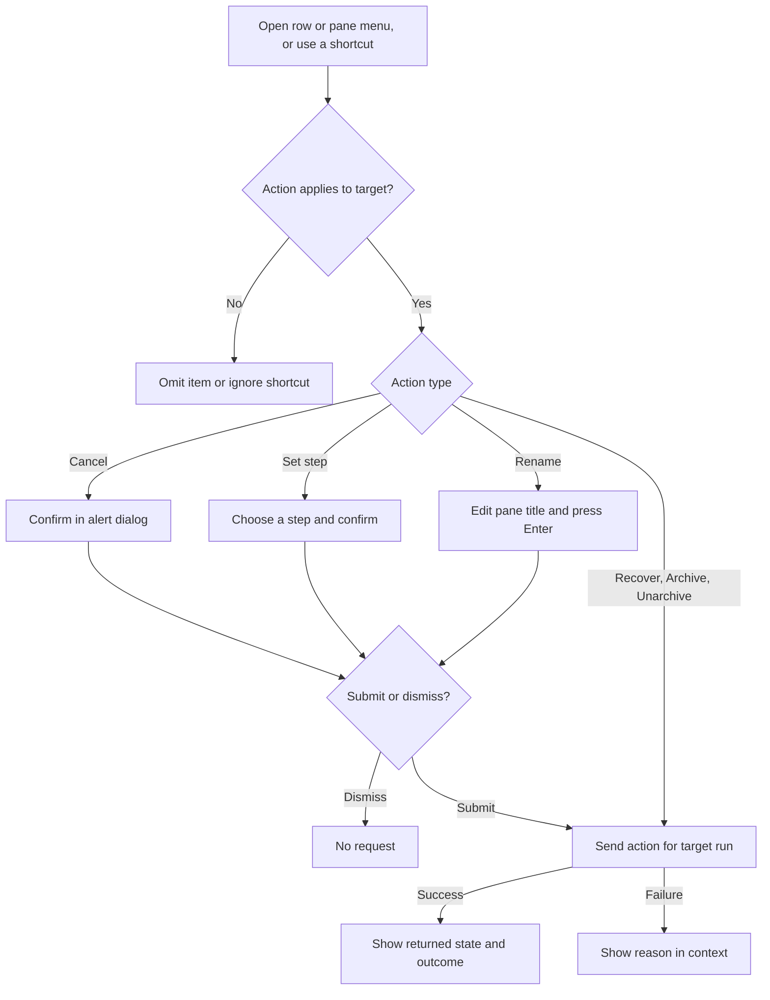
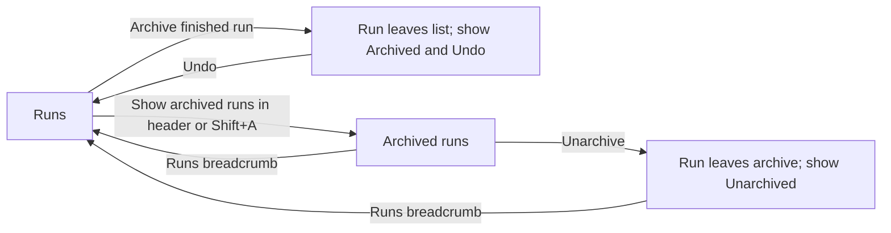
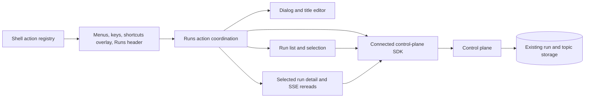
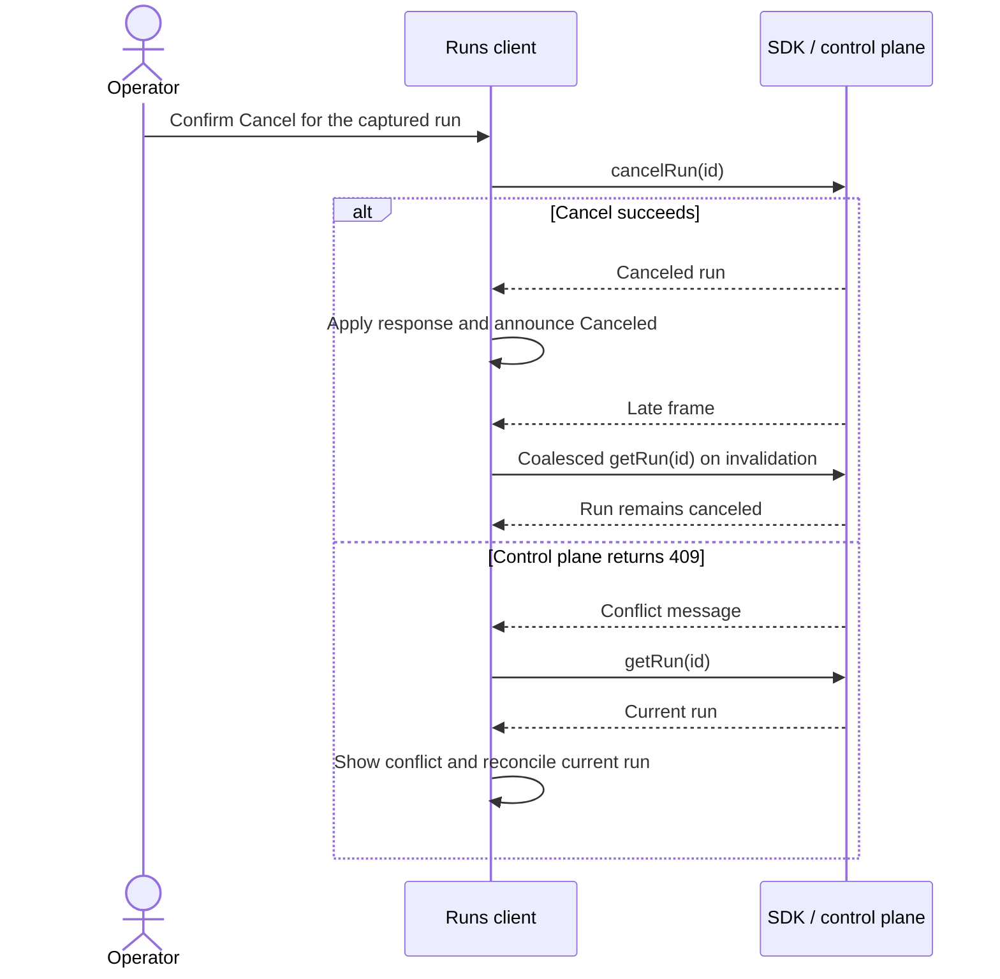

# Web run actions

## What

Operators can recover, cancel, archive, unarchive, rename, or move a run back from the web client. The client offers only the actions that apply to the target run and shows what happened after each request. Archived runs remain readable in a separate list from which operators can restore them.

## Why

An operator should not need to leave the run they are reviewing to recover a failure, end work, or repeat an earlier step. Cancel needs deliberate confirmation because recovery cannot undo it. Archive keeps finished work out of the day-to-day list without losing its history. A clearer title helps operators find the work again without renaming its tracked issue.

## Personas

- **Phoebe: PM** — approves specs, cancels work that should not continue, and keeps the run list readable.
- **Enzo: Engineer** — recovers failed runs and sends work back to an earlier step during review.

## Narratives

### Get work back to review

Enzo opens a failed run and sees Recover. He starts recovery without choosing a mode. The client tells him whether the run resumed or started over, and the spec gate becomes ready for review.

Later, Enzo wants an implementation to run again. He opens Set step, chooses the build step from the run's history, and confirms. The previous work remains visible while the new attempt runs and comes back to the implementation gate.

### Clear the list without losing work

Phoebe decides a run at spec review should not continue. She opens Cancel from its row, reads the warning, and dismisses it while she checks the issue. When she confirms later, the run shows Canceled immediately, even if the runner is still winding down.

Phoebe archives the canceled run and the list moves to the next run. She can undo the archive from the outcome line or use Show archived runs in the Runs header to find it again. Before returning it to the default list, she renames it so it is easier to find. The issue link still points to the same issue.

## User stories

**Get work back to review**

- Enzo can see which actions apply before invoking them.
- Enzo can recover an unarchived failed run without knowing the recovery policy.
- Enzo can tell which recovery mode the control plane chose.
- Enzo can choose a previously reached step and confirm before repeating work.
- Enzo can read why a move was refused without losing his choice.

**Clear the list without losing work**

- Phoebe can cancel a run from its row or detail pane and back out before sending a request.
- Phoebe can tell that cancellation has taken effect without waiting for a session to end.
- Phoebe can archive a finished run and undo that action without leaving the collection.
- Phoebe can open an archive-only list, inspect a run, and restore it to the default list.
- Phoebe can rename a run without changing the tracked issue and see that title after reloading.

## Goals

- Register seven actions once. Both run menus and keyboard dispatch share the eligibility rules for the six run-specific actions; the shortcuts overlay lists all seven.
- Confirm both Cancel and Set step before sending a mutation. Escape before submission sends no request. Late runner frames do not reverse a canceled status.
- Reflect each successful mutation in the affected row, pane, or collection without a reload. The resulting title and archive membership persist across reloads.
- Verify the operator flows in the built web app against the real fake-mode API, with no model calls or browser request interception.

## Non-goals

- New control-plane routes or recovery policy changes (#153 and #144); stopping the running session after cancel (#154); choosing a recovery mode.
- Purge, moving forward, pausing or resuming a run, or acting on multiple runs at once.
- A command palette or run actions on Activity rows.
- Adding archived runs to named views or filters, or introducing title sorting where it does not exist.

## Design spec

### User flows

### Action inventory

| Name | Applies when | Key | Confirmation |
| --- | --- | --- | --- |
| Recover | Run is `failed` and `archivedAt` is absent | `Shift+R` | None |
| Cancel | Run is `in_progress`, including a run awaiting human input | `Shift+X` | Alert dialog |
| Archive | Run is `done`, `failed`, or `canceled`, and `archivedAt` is absent | `e` | None; offer Undo after success |
| Unarchive | `archivedAt` is present | `Shift+E` | None |
| Rename | Any run | `n` | Edit title in place |
| Set step | Run is `in_progress` and has a nonempty history-based candidate list | `s` | Pick a step in a dialog |
| Show archived runs | Runs collection outside archive mode, even when no run is selected | `Shift+A` | None; navigate to the archived collection |

The issue proposed `c` for Cancel and `r` for Rename. On this branch #138 already uses those keys for Next comment and Resolve comment. Both rules overlap with the proposed run rules on a live spec review. This feature lands second, so it uses `Shift+X` and `n`, preserving the existing comment keys. Unshifted `x` still expands the spec and `Shift+N` still creates a view. Use the final bindings in the registry, tests, overlay, and manual checks.

### Menus and keyboard

- The row's `…` trigger is visually hidden until hover or focus within the row, but remains keyboard reachable. It has an accessible name and tooltip. It opens actions for that row, not for whichever row happens to be selected.
- The pane trigger is an icon-only button named “Run actions” with a tooltip. Place it after the flexible gap and before Expand and the decision button. Keep the decision button's dimensions and alignment. Both menus use the existing `Menu` wrapper, omit inapplicable items, and show a platform-formatted key cap at the right of each item. Show archived runs is a collection action listed in the shortcuts overlay, not in either run menu.
- Keys act on the selected run and do nothing if no eligible target exists. The collection shortcut does not need a selected run. Respect the existing guards for input, textarea, select, editable content, open menus and dialogs, and modifiers: bare keys require no modifiers; shifted bindings require Shift only. Menu navigation and dialog Escape belong to the open layer, not to global run shortcuts.
- An action selected from a row menu captures that row's run ID. Rename selects the target and reveals the detail pane if needed so the operator can edit its title. Other actions do not select an unrelated run or retarget themselves if selection changes. Return focus to the opener when it survives, or to the reconciled row or collection when the opener disappears.

### Dialogs, inline editing, and feedback

- **Cancel:** Show an alert dialog titled “Cancel this run?” with the description “Canceling ends this run, and it cannot be recovered.” Put dismiss “Cancel” to the left of “Cancel run”; use `--color-red` and `--color-on-destructive` on the confirm button. Focus the dismiss button first. Escape before confirmation closes the dialog and sends nothing. After confirmation, show the returned state without waiting for a session to stop. On a conflict, close the dialog, show the server message, and reread the run.
- **Set step:** Show a `Dialog` titled “Move the run back” with the description “The run repeats from the chosen step. Earlier steps and sessions are kept.” Show a single-choice list of candidate IDs in `--font-mono`, then Cancel and primary “Move back”. Start with no choice; disable Move back until one is selected. On `400` or `409`, keep the dialog and choice open and show the server message and any distinct `details.reason`. On success, close and show the returned run.
- **Rename:** Activating the pane title by pointer or keyboard, or choosing Rename, replaces the title with a focused input with a `--color-primary` border. Prefill and select the displayed title. Enter saves; Escape before submission restores the title and sends nothing. Blur does not save. Reject a blank trimmed title or a trimmed title over 200 characters under the input without sending a request. Show a rejected save under the input and keep the draft. Leave the issue number and link unchanged.
- **Outcomes:** Use one action outcome line under the pane header, with `role="status"` for success and `role="alert"` for failure. Use “Recovered (resumed)” or “Recovered (started over)”, “Canceled”, “Archived” with Undo, “Unarchived”, “Renamed”, or “Moved back”. For conflicts, use the public control-plane message. When Set step or Rename stays open, announce the error in the dialog or field instead of duplicating it in the outcome line. Clear the prior outcome on the next action or operator selection change. Automatic reselection caused by archive or unarchive does not clear it. Keep the outcome line accessible in the collection when no pane header is visible, including when the last row is removed. Undo targets the archived run, not the automatically selected one.

### Archived collection

In the non-archive Runs header, put a small secondary text button labeled “Show archived runs” in the right-hand controls of the title row, before View settings when it is present. Its tooltip reads “Open Archived runs” on hover or keyboard focus. The button works without a selected run, including on an empty list. Omit it in archive mode, where the Runs breadcrumb is the way back.

`/runs?archived=only` shows a linked Runs breadcrumb and the title “Archived runs”. Reuse the table and detail pane. Order rows newest first and do not show named-view chips or settings in archive mode. The status cell and pane meta line add the word “Archived” after the existing status; do not replace the status chip. When the archive is empty, say “Archived runs appear here.” Unarchive removes the row without switching collections. The breadcrumb opens the default list, where the run is visible again. Preserve archive mode when selecting rows or reloading a selected archived run.

**Layout references:** Use the existing [design system](../../context-agent/wiki/design-system.md) for The shell, Collection, Detail pane, Gate decision, Overlays, menus, and buttons, and Focus and keyboard. The pane bar order is `existing controls · flexible gap · Run actions · Expand · decision`. The Runs title row is `title or breadcrumb/title · flexible gap · Show archived runs · View settings (when present)`. The archive header is `Runs / Archived runs`.

## Tech spec

### Introduction and overview

This is a web-client feature under [ADR-031](../adrs/adr-031-web-client-architecture.md) and [ADR-032](../adrs/adr-032-web-client-stack.md). It consumes the typed REST and event interfaces from ADR-005 through ADR-007 and preserves the auth seam in ADR-009. The service remains the source of truth for lifecycle, history, title, and archive membership. No new endpoint, event type, database table, migration, or persistent browser run store is needed.

- **Product contracts:** [UX](../concepts/ux.md), [Collection](../concepts/collection.md), [Run detail](../concepts/run-detail.md), [Commands](../concepts/commands.md), and [Human-in-the-loop](../concepts/hitl.md).
- **Prerequisites:** #134 supplies the list, selection rule, action registry and `Dialog`; #135 supplies the pane and stream rereads; #156 supplies `Menu` and duplicate-key checks; #153 supplies mutations, archive filtering and the title projection; #144 supplies Recover. #154 is not a dependency. If #159's title sort already exists, switch it to the shared title helper here; otherwise #159 adopts the helper when it lands.
- **Terms:** A *finished* run is `done`, `failed`, or `canceled`. *Archive membership* is separate from status. A *candidate* is a reached step the client can offer for validation, not a promise that the control plane will accept the move.

### System design and architecture

Extend `shell/action-registry.ts` with the descriptors, tooltip text, and live eligibility rules. The Runs route (`routes/runs-page.tsx`) supplies context for the selected run or the row being acted on and coordinates the target, pending request, and outcome. Reuse `runs/use-run-list.ts` for paging and selection, `runs/use-run-detail.ts` for detail and history, and `runs/run-fields.ts` for title projection. Render through the existing table, pane, and `Menu` and `Dialog` wrappers. If `Dialog` lacks alert semantics, add an alert variant to the wrapper; screen code does not import Base UI primitives.

The shell header uses the same archive-mode route state as the list. Wire its Show archived runs button and `Shift+A` to one registry-backed navigation action. Use the existing button and tooltip wrappers; the shell renders the title, breadcrumb, and controls but does not fetch the list.

### Detailed design

#### SDK calls and results

Use the connected `ControlPlaneClient` and the public response schemas in `packages/api-contract`. The five #153 mutations return `{ run }`; Recover returns `{ run, mode }`. Apply the returned run rather than constructing lifecycle state locally.

| Action | SDK call | Existing HTTP operation |
| --- | --- | --- |
| Recover | `recoverRun(id)`; no mode argument | `POST /v1/runs/:id/recover` |
| Cancel | `cancelRun(id)` | `POST /v1/runs/:id/cancel` |
| Archive | `archiveRun(id)` | `POST /v1/runs/:id/archive` |
| Unarchive / Undo | `unarchiveRun(id)` | `POST /v1/runs/:id/unarchive` |
| Set step | `setRunStep(id, { step })` | `POST /v1/runs/:id/set-step` |
| Rename | `renameRun(id, { title })` with a trimmed title | `PATCH /v1/runs/:id` |

Handle server `409` messages for all mutations. A rejected request does not apply a speculative update. Cancel additionally calls `getRun(id)` on `409`; if the read fails, keep the last known snapshot and the original conflict message. Recover does not change the snapshot on `409`. Rename handles `400` under the input and Set step handles both `400` and `409` in its dialog. Keep existing connection and unauthorized handling. For other errors, show failure in the same surface without reporting success or automatically retrying. Prevent repeat submission while the request is pending. Dismissal before submission sends nothing; leaving the surface after submission does not undo a request already sent.

#### Set-step history

Use `listRunSteps` as the history source. Reuse the selected run's history read when available, including when a keyboard action needs it with the pane hidden. For another row, load history on menu open rather than for every visible row. While the target history is unknown, loading, or unreadable, omit Set step; a history failure leaves other actions usable. Recompute when history resolves or the current step changes. Ignore reads that resolve for a retired client or obsolete target.

Order occurrences by `occurrence.index`, omit every occurrence of `currentStep` and records with `phase: null`, then deduplicate by step ID in first-reached order. An empty result hides the action and its shortcut does nothing. Use the same candidate calculation for the dialog and eligibility. Do not hard-code step IDs or infer workflow order from occurrence order. A previously reached step can be forward on the current path after a revise. Pauses, path membership, earlier workflow position, and dispatch occupancy are server checks. If the server refuses, show why without moving the run or silently replacing the operator's choice.

#### Freshness, selection, and collection membership

1. Capture run ID and authenticated client at invocation. Recheck applicability against locally known state before opening and submitting; conditions can still change on the server. Once sent, a result can update its own row in a compatible collection but must not overwrite a newer selection's editor, dialog, or feedback. Retire old UI completions on client or collection change. A pre-submit editor or dialog must never move to a different target when selection changes.
2. Apply a successful response immediately through the existing list/detail update paths. Retire or reconcile reads started before the mutation so stale polls, pages, or detail reads cannot roll it back. Keep existing stream invalidation and coalesced authoritative rereads. A frame is not a replacement run snapshot. A late transition or runner frame after cancel can update Activity; any run reread uses `getRun`, and the pane remains Canceled.
3. Use a single display title helper: `title`, then `trackedIssue.title` when absent, then `id`. Use it for rows, archived rows and the pane header, and for #159's title sort when present. Rename updates the topic, not the tracker. Update the title of loaded rows with the same `topicId` without copying the target's status or archive marker. The server may change title or archive metadata without changing the run's `updatedAt`. Apply the mutation projection and allow post-mutation authoritative reads to reconcile these fields even with equal timestamps. Do not let a pre-mutation read restore old metadata or a removed row.
4. Make `archived=only` a separate Runs request scope. Pass `archived: 'only'` to `listRuns` for initial reads, polls and cursor pages. Do not apply named-view or project/filter projection in this scope. Default views omit the archive option and retain current behavior. Reuse #134's polling cadence, visibility behavior and paging. In archive mode keep server order (`createdAt` descending, then ID descending). Keep the archive query on selection navigation, and retire in-flight reads when scopes change.
5. On archive or unarchive success, remove a row that no longer belongs and refresh through the scoped list. If the selected row disappears, select the row now at its former index, otherwise the last row, otherwise nothing. If the removed row was not selected, preserve selection. The outcome and Undo survive this automatic selection. Undo calls unarchive for the captured ID without confirmation, refreshes membership, and does not force selection back to the restored run. Opening the default list after unarchive reads the restored run from the server.

### Security, privacy, and compliance

All reads and writes use the existing authenticated SDK and server policy. Menu visibility and input validation are usability checks, not authorization. The server still validates the caller, run, lifecycle, title, and target step. Render titles and public errors as text. Show only the public reason from error details, not arbitrary structured data. Do not add drafts, bearer tokens, or raw errors to persistent browser storage or telemetry.

### Observability

The outcome line is operator feedback, not telemetry. Reuse existing list, detail, and connection diagnostics. Cancel and Set step already produce service transitions; archive, unarchive, and rename do not need new events. Add no metrics, alerts, or raw mutation logging.

### Testing plan

Unit-test the action matrix, key conflicts, step candidates, display title, and title sort when present. Use scripted SDK component tests for each mutation's request, success and conflict, as well as dialog focus, Escape, inline validation, error placement, archive routing and selection, and stale responses. Exercise all six run mutations in `apps/web/e2e/run-actions.spec.ts` against the production build with #128's five seeded scenarios, #130's fake-server fixture, and #132's connected fixture. Check “Waiting on you” on the marker for the intended gate; the shared run status chip calls that state “Needs review”. For Set step, prove a new build attempt occurred rather than just asserting the gate text that was already present.

**Manual check:** From the repository root, build with `pnpm nx build web`. Start `AUTOCATALYST_CLIENT_DIR=apps/web/dist pnpm nx run control-plane:serve-fake`, then seed from a second terminal with `pnpm nx run control-plane:seed-fake -- --scenario all`. Open `http://127.0.0.1:4010` and save `fake-mode-token` in Connection settings if prompted. Check both run menus and `?`, open the archive from the header, then exercise `Shift+R`, `Shift+X`, `e`, `Shift+A`, `Shift+E`, `s`, and `n` as in the browser tasks below. Automated checks: `pnpm nx test web` and `pnpm nx e2e web`. See [fake mode](../../docs/operators/fake-mode.md).

### Alternatives considered

- **Separate menus and shortcut handlers:** Easier to wire independently, but eligibility and labels can drift. Use one registry and shared dispatch with an explicit target.
- **Filter archived items in the browser:** Cannot page archives correctly from a server page that already excludes them. Use the existing `archived=only` API query.
- **Duplicate server step validation in the client:** Could hide some invalid candidates but duplicates workflow and occupancy rules and still races. Use documented history candidates and show the server's refusal.

### Risks

- **Shortcut collisions:** #138 conflicts with two proposed keys. Check the production registry against overlapping spec-review, archive, and failed-archive contexts without narrowing eligibility to conceal a collision.
- **Old reads can restore old rows or titles:** Cover equal timestamps, stale in-flight polls, and connection or selection changes with deterministic scripted responses.
- **Fast fake-mode transitions can hide an intermediate build:** Assert an additional build occurrence and a return to the implementation gate instead of using a fixed delay or catching a transient label.

## Task list

Planning output only. This list does not authorize implementation.

- [ ] **Story: Discover and invoke the right run action**
  - [ ] **Task: Register action names, keys, and eligibility**
    - **Description**: Extend the registry with six run actions and the archive navigation action. Pass target context and history-candidate availability to its predicates. Reuse existing key matching, tooltip and shortcut display.
    - **Acceptance criteria**:
      - [ ] The seven entries appear once each, with the action table's names, final bindings, predicates, and tooltip text. The shortcuts overlay lists them all.
      - [ ] A unit matrix covers in-progress runs with and without candidates, done, failed, canceled, archived, failed-and-archived, and no selection. Show archived runs works on an empty default collection and not in the archive.
      - [ ] The #156 conflict test passes with archived and failed-archived samples and an in-progress spec review where Resolve comment and Next comment apply. Existing #134, #138 and #156 bindings still work.
      - [ ] Tests show that ineligible keys do nothing, eligible run keys use the selected run, and editable targets, open menus or dialogs, and incorrect modifiers suppress the shortcuts.
    - **Dependencies**: #134 registry; #156 conflict tests.
  - [ ] **Task: Add the row and pane menus**
    - **Description**: Use `Menu` to show registry actions from the hovered or focused row trigger and the Run actions pane trigger. Pass the correct run and opener to the shared dispatcher.
    - **Acceptance criteria**:
      - [ ] A component test hovers a row, reaches its labeled trigger by keyboard, opens it, and sees exactly the applicable actions once history is available. Opening a different row's menu uses that row rather than the selected one.
      - [ ] The pane trigger has a tooltip and accessible name, sits after the gap and before Expand and decision, and shows the same items for the same run. Decision button geometry is unchanged.
      - [ ] Both menus show right-aligned platform key caps, including Mac glyphs where applicable and spelled keys elsewhere. No screen imports the primitive library.
    - **Dependencies**: Register action names, keys, and eligibility; #135 pane; #156 `Menu`.
- [ ] **Story: Apply lifecycle actions and explain the outcome**
  - [ ] **Task: Coordinate action requests and run snapshots**
    - **Description**: Track the target and request in route state. Share mutation result handling, feedback and focus handoff, and protection against stale reads in list and detail.
    - **Acceptance criteria**:
      - [ ] The outcome line announces success or failure once, clears on the next action or operator selection, and stays accessible without a selected detail. Automatic reselection preserves archive and unarchive outcomes.
      - [ ] A pending operation cannot submit twice. A late completion does not overwrite another selection's editor or feedback, and a retired client or collection cannot change the new view.
      - [ ] Scripted tests show that a read started before a mutation cannot restore stale status or metadata, including when metadata has the same `updatedAt`.
    - **Dependencies**: #134 list; #135 detail and stream; #153 SDK mutations.
  - [ ] **Task: Wire Recover and confirmed Cancel**
    - **Description**: Submit Recover without a mode and submit Cancel only from the wrapper-based alert dialog. Apply the returned run and handle conflicts as specified.
    - **Acceptance criteria**:
      - [ ] Recover calls `recoverRun(id)` once, updates row and pane, and announces both response-mode labels in tests. A `409` displays the server message and leaves the snapshot unchanged.
      - [ ] Cancel has the specified alert semantics, copy, button order and colors. Focus starts on dismiss; Escape restores focus and makes no call. Confirmation calls `cancelRun(id)` and shows Canceled without waiting for the runner.
      - [ ] A cancel `409` displays the server message and rereads the target with `getRun`. Component tests deliver late transition and runner frames after success and still see Canceled.
    - **Dependencies**: Coordinate action requests and run snapshots; Add the row and pane menus; #134 `Dialog`; #144 Recover.
  - [ ] **Task: Offer and submit a set-step choice**
    - **Description**: Load target-specific step history, share the candidate calculation between eligibility and the dialog, and send the chosen ID on confirmation.
    - **Acceptance criteria**:
      - [ ] Tests cover repeated attempts, out-of-order input occurrences, current step, null phases, empty history, and pending history for a nonselected row. No candidates means no Set step item or shortcut action.
      - [ ] The dialog shows the specified copy, monospace IDs, Cancel, and disabled Move back until a choice is made. Dismissal sends nothing.
      - [ ] Confirm calls `setRunStep(id, { step })` and applies the returned run. Scripted `400` and `409` each show the server message and distinct reason, keep the dialog and choice, and leave the run snapshot unchanged.
    - **Dependencies**: Coordinate action requests and run snapshots; Add the row and pane menus; #134 `Dialog`; #135 step history.
- [ ] **Story: Name, archive, and restore runs**
  - [ ] **Task: Add the shared title and inline rename**
    - **Description**: Use one title projection in the pane and list, let the operator edit the pane title, and apply the persisted title to the target and other loaded runs on the same topic.
    - **Acceptance criteria**:
      - [ ] Unit tests cover run title, issue-title fallback, and ID fallback. Both collections and the pane use the helper. If #159's title sort is present, test that it sorts by the renamed title.
      - [ ] Rename and title activation focus and select the prefilled field. Escape restores the title without a request. Enter submits the trimmed value. Tests cover blank, 200 and 201 characters after trimming, and server `400` and `409` with the draft retained.
      - [ ] Successful `renameRun(id, { title })` updates the pane and affected rows immediately. The issue link and number remain unchanged. An unrelated topic's title is unchanged.
    - **Dependencies**: Coordinate action requests and run snapshots; Add the row and pane menus; #153 title projection.
  - [ ] **Task: Add the archived collection and navigation**
    - **Description**: Reuse the Runs route and list in an archive-only scope. Add the labeled header button, breadcrumb, empty state, and archive labels.
    - **Acceptance criteria**:
      - [ ] Outside archive mode, the right-hand title-row controls show a small secondary text button labeled “Show archived runs”, before View settings when present. Its tooltip reads “Open Archived runs” on hover or focus. Pointer or keyboard activation and `Shift+A` open `/runs?archived=only`, even when no run is selected.
      - [ ] The archive header says “Archived runs”, has no archive entry button or named-view controls, and its Runs breadcrumb returns to the default collection. Selecting an archived row and reloading preserve archive mode.
      - [ ] Component tests verify `archived: 'only'` on the first page, poll, and next page, newest-first order, no named-view or project filter in this mode, and no stale response crossing scopes. Default requests still omit archived runs.
      - [ ] The shared row and pane status show “Archived” after the status; an empty archive shows “Archived runs appear here.”
    - **Dependencies**: Register action names, keys, and eligibility; #134 collection; #153 archive query.
  - [ ] **Task: Wire Archive, Unarchive, and Undo**
    - **Description**: Reconcile list membership from the successful response and preserve the action target for Undo after automatic reselection.
    - **Acceptance criteria**:
      - [ ] `archiveRun(id)` removes the run from the default list, uses the vanished-selection rule, and announces Archived with Undo. Undo invokes `unarchiveRun` for that ID, not the successor row.
      - [ ] Direct unarchive calls `unarchiveRun(id)` without confirmation, removes the row from the archive and announces Unarchived; returning to Runs shows it again. Removing a nonselected or last remaining row preserves the selection and feedback rules.
      - [ ] Scripted `409` tests for Archive, Unarchive and Undo show the server message and do not change membership. A stale poll cannot restore a removed row in that collection.
    - **Dependencies**: Coordinate action requests and run snapshots; Add the row and pane menus; Add the archived collection and navigation.
- [ ] **Story: Verify and document the production path**
  - [ ] **Task: Exercise run actions in the built app**
    - **Description**: Add `apps/web/e2e/run-actions.spec.ts` using the built-client fake-server and connected fixtures with all five seeded scenarios. Isolate mutations so one test does not consume another's starting state.
    - **Acceptance criteria**:
      - [ ] On `failed`, `Shift+R` leaves Failed and reaches `spec.human_review` with “Waiting on you” on that gate. The fixture's scripted `spec.author` failure fires once.
      - [ ] On `spec-review`, open Cancel from the row menu, press Escape and verify the run is unchanged. Reopen with `Shift+X`, confirm, and see Canceled. Press `e`, verify successor selection, open the archive with `Shift+A`, select the canceled run, and unarchive with `Shift+E`. Follow Runs and see it restored.
      - [ ] On `implementation-review`, press `s`, choose `implementation.build`, and confirm. Observe another build attempt and “Waiting on you” at `implementation.human_review`.
      - [ ] On `merged`, press `n`, edit and press Enter. The title changes in row and pane and persists after reload.
      - [ ] Check the exact applicable items in both menus for an in-progress and a finished run. The end-to-end tests make no model call, use no `page.route`, inject no data around the API, and use no test-only hooks.
    - **Dependencies**: Wire Recover and confirmed Cancel; Offer and submit a set-step choice; Add the shared title and inline rename; Wire Archive, Unarchive, and Undo; #128, #130 and #132 fixtures.
  - [ ] **Task: Record the UI rules and code map**
    - **Description**: Update the agent-owned design-system and code-map docs to reflect the shipped client behavior and module locations.
    - **Acceptance criteria**:
      - [ ] `context-agent/wiki/design-system.md` has one line each for the pane bar menu order, action outcome line, Archived status suffix in pane and row, archive header (`Runs / Archived runs`), archive empty state, and set-step dialog layout.
      - [ ] The design system has a separate line under The shell → Header for the Runs archive entry: a small secondary text button labeled “Show archived runs” in the title row's right-hand controls before View settings when present, with the tooltip “Open Archived runs” on hover or focus, shown only outside archive mode.
      - [ ] `context-agent/wiki/code-map.md` locates the registry entries, menus, dialogs, title helper, archived list and header entry, and Playwright spec, and updates its `Last updated` line.
    - **Dependencies**: Exercise run actions in the built app.
