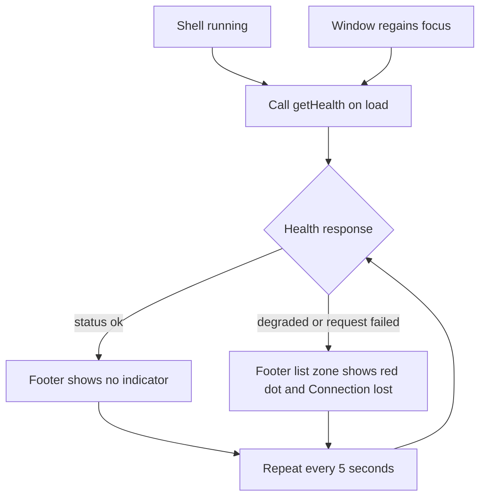
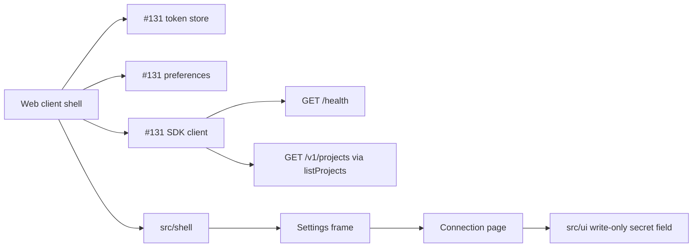
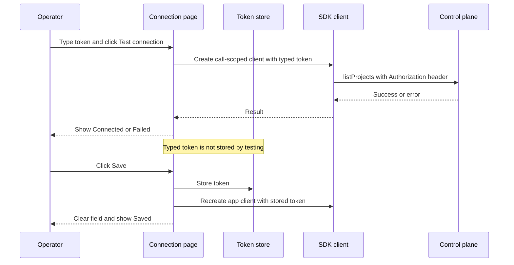
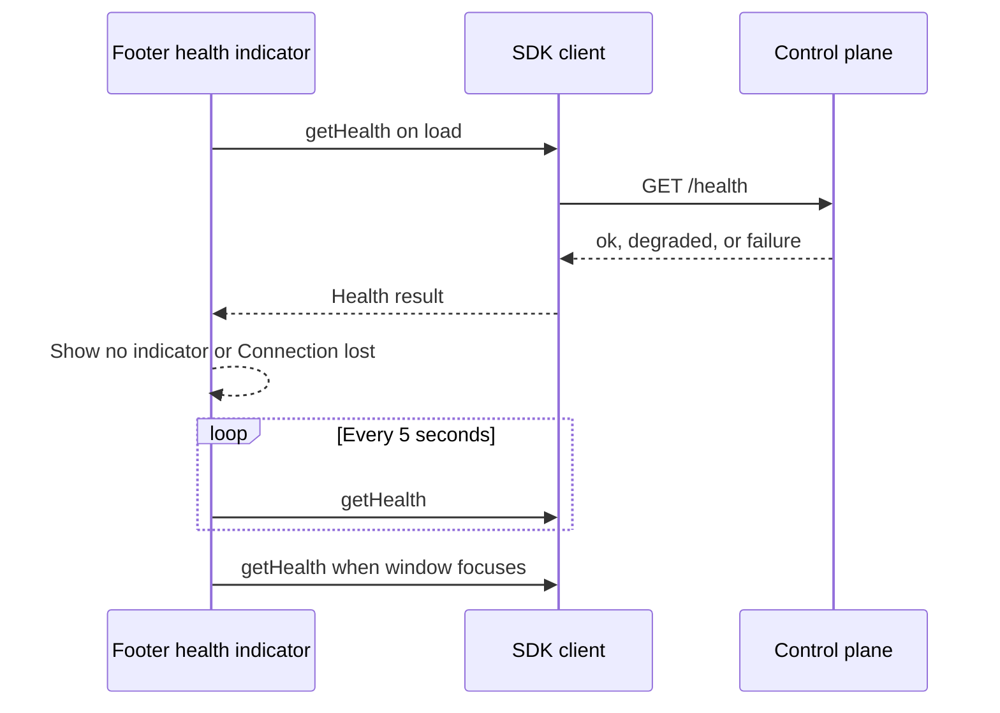

# Web shell, settings frame, and connection page

## What

Build the first usable web client shell for operators. The shell gives the client its persistent structure: sidebar navigation, header, main area, and footer. It also adds the settings frame and the first settings page, Connection, where an operator provides the control plane bearer token.

The initial Runs destination exists but has no run list yet. It shows an empty main area, or a connection empty state when no token is stored. The sidebar only lists destinations that exist now: Runs and Settings. The settings sidebar only lists Connection.

## Why

Operators need a stable place to start using the web client before run management screens arrive. This feature lets an operator open the client, enter the bearer token once, test it, save it, and see whether the control plane is reachable. It also establishes the layout geometry, keyboard behavior, and test fixtures that later run-list and settings work will depend on.

## Personas

- **Olivia: Operator** — Opens the client, connects it to the control plane, and watches for connection health while managing runs.
- **Dylan: Developer** — Implements later shell destinations and needs stable shell regions, tokens, wrappers, and fixtures.
- **Riley: Reviewer** — Reviews the shell against design-system geometry, accessibility, and secret-handling rules.

## Narratives

### First connection

Olivia opens the client on Runs. The shell loads with a sidebar, header, empty main area, and footer. Because no token is stored, the main area explains that she needs to connect to the control plane and offers one primary button to open connection settings.

She follows the button to Settings. The sidebar changes to the settings sidebar with Connection selected, while the footer remains in place. Olivia enters a bearer token, tests it, sees Connected, saves it, and the field clears so the token is never shown again.

### Losing and recovering connectivity

After Olivia saves the token, the Runs route no longer asks her to connect. The footer quietly checks the control plane health route. When the control plane stops answering or reports degraded health, the footer list zone shows a red dot and the words Connection lost.

When the control plane comes back, the indicator clears without Olivia entering the token again. If a protected call returns 401, the health indicator does not turn into Connection lost; authentication failures stay separate from reachability.

### Working with the shell

Olivia uses the keyboard to move quickly. She presses `[` to close and open the sidebar, or moves the pointer to the left edge to show the sidebar as an overlay while it is closed. Escape closes the hover sidebar first and closes settings when no higher-priority layer is open.

She presses `Cmd+,` or `Ctrl+,` from anywhere, including inside a field, to open and close Settings. The detail pane button is already in its final footer position but remains disabled until the run detail work enables it in #134.

## User stories

### First connection

- Olivia can open the client and recognize the persistent sidebar, header, main area, and footer.
- Olivia can see that the Runs destination exists even before the run list is implemented.
- Olivia can navigate from the no-token empty state to Connection settings.
- Olivia can enter, test, and save a bearer token without the saved token being displayed.
- Olivia can reload the page and see that a token exists without seeing the token value.

### Losing and recovering connectivity

- Olivia can see no footer warning while the control plane reports healthy status.
- Olivia can see a red dot and words when the health route fails or reports degraded status.
- Olivia can recover automatically when the control plane becomes healthy again.
- Olivia can distinguish token rejection on the Connection page from control-plane reachability in the footer.

### Working with the shell

- Olivia can toggle the sidebar by button or `[` and keep that preference across reloads.
- Olivia can use the hover sidebar overlay without moving the main area.
- Olivia can open and close Settings with the Settings entry, close button, Escape, or `Cmd+,`/`Ctrl+,`.
- Riley can verify shell geometry by role, accessible name, and design tokens rather than hard-coded dimensions.
- Dylan can reuse the write-only secret field and connected Playwright fixture in later settings and runs work.

## Goals and non-goals

### Goals

- Implement the shell regions and footer zones using the design-system dimension tokens, with no viewport scrolling.
- Add the settings frame and Connection page with write-only bearer token behavior.
- Persist sidebar state and bearer token through the stores created by #131, with guarded storage access.
- Add health polling on load, at a fixed 5 second interval, and when the window regains focus.
- Cover the shell, connection flow, health indicator, secret redaction, and geometry with unit and Playwright tests against fake mode.

### Non-goals

- Do not implement the run list, detail pane content, detail pane enabled state, resize handle, `]` behavior, or pane zone content; #134 owns those.
- Do not add To do, Pinned, Projects, General, or Appearance navigation rows.
- Do not add the action registry, shortcuts overlay, command palette, or Dialog wrapper.
- Do not add a control-plane address field, sign-in flow, token deletion, or toast system.
- Do not write browser storage directly from Playwright specs.

## Design spec

### User flows

```mermaid
graph TD
    A[Open /runs] --> B{Token stored?}
    B -- No --> C[Runs shell with connect empty state]
    C --> D[Open connection settings]
    B -- Yes --> E[Runs shell with empty main area]
    D --> F[/settings/connection]
    F --> G[Type bearer token]
    G --> H[Test connection]
    H --> I{Authenticated listProjects succeeds?}
    I -- Yes --> J[Show Connected]
    I -- 401 --> K[Show rejected token failure]
    I -- Network error --> L[Show did not answer failure]
    I -- Other status --> M[Show status and response code failure]
    J --> N[Save token, clear field, show Saved]
    N --> E
```

```mermaid
graph TD
    A[Sidebar open by default] --> B[Press '[' or click footer left control]
    B --> C[Sidebar closed and preference saved]
    C --> D[Pointer enters left hover zone]
    D --> E[Sidebar overlay appears above header and footer]
    E --> F{Close trigger}
    F -- Pointer leaves and focus outside --> C
    F -- Escape --> C
    C --> G[Press '[' or click left control]
    G --> A
```



### Key UI components

#### App shell

- Renders `navigation`, `banner`, `main`, and `contentinfo` regions that fill the viewport and do not scroll.
- Uses only `--width-sidebar`, `--height-header-bar`, `--height-footer`, and `--width-footer-control` for shell dimensions.
- Keeps tab order as sidebar, header, main area, footer.
- Removes the foundation page from #131 from the Runs route.

#### Footer

- Contains five named zones: Left control, Sidebar, List, Detail pane, and Right control. Each zone is locatable in tests as `role="group"` with `aria-label` equal to its zone name.
- Places the sidebar toggle in the left control zone and the disabled detail pane toggle in the right control zone.
- Places the health connection item in the List zone. With no list or pane, the List zone spans the main area and the Detail pane zone has zero width.
- Shows the disabled detail pane toggle with `aria-disabled="true"`, tooltip `Detail pane (])`, no activation behavior, and no `]` behavior until #134.

#### Primary sidebar and hover overlay

- Shows a title row of `--height-header-bar`, a Runs entry, and a Settings entry.
- Marks Runs with `aria-current="page"` on `/runs`.
- Omits To do, Pinned, Projects, and any view chips row.
- Opens by default, persists open/closed state through #131 preferences, and wraps every storage access in `try/catch`.
- When closed, the left hover strip is `--width-hover-zone` wide and ends at the footer top. Pointer entry shows the same sidebar component as a `--width-sidebar` overlay with its own right divider and `--shadow-popover`. The overlay covers header and footer, takes the pointer, and does not move header or main.
- Closed sidebar content is removed from the tab order and accessibility tree, either by not rendering it or by using `inert`/equivalent semantics. Hover overlay content is focusable only while the overlay is shown. A keyboard operator reaches sidebar entries by reopening the sidebar with `[` or the footer toggle.

#### Header

- Shows only the title on top-level views such as Runs.
- Shows breadcrumb plus title for deeper views such as Settings / Connection.
- Provides tests for both cases, including a second-level route case for breadcrumb behavior.

#### Settings frame

- Replaces the normal sidebar with a settings sidebar and replaces the main area with one settings page.
- Keeps the footer unchanged.
- Uses route `/settings/connection`; `/settings` redirects to it.
- The settings sidebar has a title row with a close button and one row, Connection.
- Closing settings returns to the route the operator came from, or `/runs` if there was none.
- Settings pages scroll with 24 px padding and a content column no wider than `--width-settings-column`.

#### Connection page

- Contains one write-only bearer token field and the form action row from the design system.
- The field is a password input with `autocomplete="off"`, no reveal control, no mask display for stored values, no stored badge, and no clear/delete control.
- The label is `Bearer token` when no token exists and `Bearer token (leave blank to keep existing)` when the token store reports that a token exists.
- Save is disabled until a typed value exists. Save writes through the token store, clears the field, shows Saved, and recreates the SDK client with the new token.
- Cancel clears the field and restores the saved state.
- Test connection uses the typed token when present, otherwise the stored token when present. It is disabled when neither exists and uses `aria-disabled` while running. A typed-token test never stores that value.
- The result region has `role="status"`, an 8 px dot, and states Not tested, Testing, Connected, and Failed with the exact failure distinctions in the requirements.

#### Reusable UI wrappers

- Add only the wrappers needed by this feature beyond #131: `Input`, labelled `Field` with hint, and the write-only secret field.
- Build wrappers on Base UI and style them with tokens.
- Cover each wrapper with rendering tests.

## Tech spec

### Introduction and overview

#### Prerequisites and assumptions

- Depends on #131 for the app foundation, providers, token store, preferences store, UI tokens, `Button`, `Tooltip`, and SDK client construction.
- Depends on #129 for the control plane serving the client from its own origin, so the Connection page does not ask for a server address.
- Depends on #130 for fake-server Playwright fixtures and fake mode token behavior.
- Uses ADR-031 for the web client architecture and ADR-032 for the web client stack.
- Uses `packages/sdk/src/client.ts` for `getHealth` and `listProjects`. The unversioned `/health` route does not require the bearer token; `/v1` routes do.

#### Technical goals

- Keep shell layout values single-sourced from CSS tokens.
- Keep secret values out of URLs, logs, DOM text, accessible names, status text, toasts, and Playwright storage setup code.
- Keep #134 integration points stable by shipping final footer toggle positions and a disabled detail pane toggle.
- Provide connected Playwright storage state through a fixture that uses the real Connection page once per fake server.

#### Glossary

- **Control plane** — The server that serves the client and exposes API routes.
- **Bearer token** — The secret token required for protected `/v1` SDK calls.
- **Write-only secret field** — A field that can replace a stored secret but never receives or displays the stored value.
- **Hover sidebar** — The overlay version of the sidebar shown from the left edge while the sidebar is closed.

### System design and architecture



#### Component breakdown

- `src/shell/` owns shell layout, sidebar state, hover overlay, header title/breadcrumb rules, footer zones, footer health indicator, and temporary key hooks.
- Settings routing owns `/settings`, `/settings/connection`, return-route tracking, and the settings sidebar.
- The Connection page owns bearer token editing, test connection behavior, saved confirmation, and failure message mapping.
- `src/ui/Input`, `src/ui/Field`, and `src/ui/WriteOnlySecretField` provide reusable form building blocks used by Connection and later by #142.
- E2E fixtures add a connected storage-state helper by driving the real UI.

#### Connection test sequence



#### Health sequence



### Detailed design

#### Routes and navigation

- `/runs` is the default operator view and renders the shell with Runs selected.
- `/settings` redirects to `/settings/connection`.
- `/settings/connection` activates settings mode, uses the settings sidebar, and shows the Connection page.
- Settings stores the previous route in memory before opening. Closing settings navigates back to that route, falling back to `/runs`.

#### State management

- Extend `apps/web/src/theme/preferences.ts` with `sidebarOpen: boolean`. Add it to `Preferences`, `DEFAULT_PREFERENCES` with default `true`, and `validatePreferences`; missing or non-boolean values fall back to `true`.
- Sidebar open/closed state is updated through the theme provider's preferences update hook, not through a second direct `readPreferences`/`writePreferences` writer. This prevents stale whole-object writes from dropping theme fields or the sidebar flag. All storage calls remain wrapped in `try/catch`; failed reads use defaults and failed writes do not break interaction.
- Hover-sidebar visibility is ephemeral UI state. It closes on pointer leave when focus is not inside the overlay and on Escape.
- Token presence comes from a boolean on the token store. Connection never reads the token value for display.
- Extend the #131 client context with `createTestClient(token)`. It returns a client using the same base fetch seam passed to `ControlPlaneClientProvider`, but it does not use the provider's observing fetch wrapper. This keeps unit tests able to stub fetch while preventing typed-token tests from mutating app-wide authorization state.
- Saving a token writes through the token store and triggers client recreation through the #131 client provider.
- Health indicator state is independent from authenticated route failures. A 401 on `listProjects` or another protected call does not set Connection lost.

#### Keyboard behavior

- Add `src/shell/shell-keys.ts` as the single source for shell key definitions before #134 ships the registry. The table uses the registry shape #134 will own: `id`, `label`, `keys`, and `appliesWhen`. Entries cover sidebar toggle, settings toggle, close layer, and detail pane toggle.
- Hooks, tooltip key text, and README shortcut text read from `shell-keys.ts`; components do not hard-code `[` or `]` labels. #134 can replace the table with registry entries without touching components.
- Key matching uses `KeyboardEvent.key` for printable bracket shortcuts so the visible character matches the tooltip. AltGr is treated as a text-entry modifier: if `event.getModifierState('AltGraph')` is true, single-key shortcuts do not fire. This means layouts that require AltGr for `[` or `]` cannot use those shell shortcuts until #134 decides whether to add layout-aware registry support; the tooltip still reflects the design-system key.
- The sidebar toggle fires for `[` only when focus is not in an input, textarea, select, or editable element; no menu or dialog is open; no modifier is held; and AltGr is not active.
- `Cmd+,` on macOS or `Ctrl+,` elsewhere opens and closes settings from anywhere, including inside form fields.
- Escape closes the hover sidebar first, then settings when no other layer is open.
- `]` is deliberately present in the table and deliberately no-ops while the detail pane toggle is disabled. This preserves the final tooltip and key contract for #134 even though no pane exists yet.
- Tooltips use `Label (key)`, with glyphs on macOS and spelled keys elsewhere, and unit tests assert tooltip key text comes from `shell-keys.ts`.

#### API use

- Connection test calls `listProjects` through an SDK client. For typed tokens, call `createTestClient(token)` from the client provider and discard the returned client after the test. Typed-token tests never change app-wide `authorization`. For stored-token tests with an empty field, use the app client; if the stored token receives a 401 through the observing fetch wrapper, app-wide `authorization` changes to `unauthorized`.
- Health indicator calls `getHealth` on load, every 5 seconds, and when the window regains focus.
- No new backend endpoints or data schemas are required.

#### Failure mapping

- 401 from `listProjects`: `The control plane rejected the token. Check the bearer token the server was started with.`
- Network/unreachable failure: `The control plane did not answer. Check that it is running.`
- Any other status: show Failed, the status code, and the error code from the response body when present.
- A failed typed-token test leaves the typed value in the field and leaves the stored token unchanged.
- A successful test does not save the token.

### Security, privacy, and compliance

- Treat the bearer token as a secret. Never render it in text nodes, accessible names, URLs, logs, toasts, or status messages.
- Use `autocomplete="off"` for the password input.
- Do not pass stored token values into the Connection page or write-only field. Pass only the `hasStoredValue` boolean.
- Do not add reveal, clear, delete, or stored-value mask behavior. Clearing/deleting a stored token is out of scope.
- Tests must use a sentinel token and search the document, console output, and failure messages after save, passing test, and failing test.

### Observability

- Do not log token values or request authorization headers.
- UI state is visible through tests rather than new telemetry.
- Health polling failures should update the footer indicator but should not spam user-visible toasts.

### Testing plan

#### Unit and rendering tests

- Test `Input`, `Field`, and write-only secret field rendering, labels, hints, and empty-after-save behavior.
- Test sidebar preference reads/writes with storage failures handled through `try/catch`.
- Test health indicator state transitions with the SDK `fetch` option stubbed for ok, degraded, network error, and recovery.
- Test header title/breadcrumb rules for Runs and a second-level route.
- Test shortcut guards for input/editable focus, modifiers, menu/dialog-open guards where applicable, settings toggle from input, and Escape priority.

#### Playwright E2E

- Extend `apps/web/e2e/fixtures/connected.ts` to drive the real Connection page once per fake server, enter the fixture token, test, save, and keep storage state in the fixture temporary directory. Other specs create contexts from that state and do not write browser storage.
- Add `apps/web/e2e/connection.spec.ts` against the real build served by fake mode. Cover the no-token empty state, wrong token failure, right token success, save/clear behavior, reload label, token absence from page text, offline health indicator, recovery, and fake-server restart recovery. Use no `page.route` and no injected data.
- Add `apps/web/e2e/shell-geometry.spec.ts` for design-system geometry assertions that apply now. Locate regions by role and accessible name, read tokens from the document, avoid hard-coded sizes, and assert edges within 0.5 px and baselines within 1 px. Run with sidebar open and closed, light and dark color schemes, Runs, and Connection.
- Repeat contrast checks for rendered shell text in one light and one dark theme; #131 owns the full eight-theme unit contrast sweep.

#### Commands

- `pnpm nx test web`
- `pnpm nx e2e web`
- `pnpm nx build web` for the manual fake-mode try-it flow

### Alternatives considered

- **Address plus token form** — Rejected because the control plane serves the client from its own origin in #129. Adding an address field would create extra configuration and transport questions outside this issue.
- **Direct storage seeding in Playwright** — Rejected because specs must exercise the real Connection page and avoid test-only storage hooks. The connected fixture can cache storage state only after using the real UI.
- **Show a stored secret mask or badge** — Rejected by the write-only secret rule. The page may show that a token exists through the label but never shows a stored value or mask.

### Risks

- Geometry tests can become brittle if they hard-code dimensions. Mitigate by reading CSS tokens and asserting roles and accessible names.
- Health polling may briefly show stale state during control-plane restart. Mitigate with fixed 5 second polling and focus-triggered refresh.
- Temporary shortcut hooks can diverge from #134's action registry. Mitigate by keeping scope small and documenting that #134 replaces them.
- Browser storage can fail in private or restricted contexts. Mitigate by wrapping every preference storage access in `try/catch` and keeping safe defaults.

## Task list

- [ ] **Story: Shell regions and navigation**
  - [ ] **Task: Build `src/shell/` viewport layout**
    - **Description**: Create the shell container and semantic regions for sidebar navigation, header banner, main content, and footer contentinfo. Use the design-system dimension tokens for shell sizing and remove the #131 foundation page from the Runs route.
    - **Acceptance criteria**:
      - [ ] Shell fills the viewport and does not scroll.
      - [ ] Regions expose `navigation`, `banner`, `main`, and `contentinfo` semantics.
      - [ ] Shell dimensions use `--width-sidebar`, `--height-header-bar`, `--height-footer`, and `--width-footer-control`.
      - [ ] `/runs` shows the shell instead of the foundation page.
    - **Dependencies**: None
  - [ ] **Task: Add Runs and Settings sidebar entries**
    - **Description**: Implement the primary sidebar title row and the only current navigation rows: Runs and Settings. Omit destinations owned by later issues.
    - **Acceptance criteria**:
      - [ ] Sidebar title row is `--height-header-bar` tall.
      - [ ] Runs is present and has `aria-current="page"` on `/runs`.
      - [ ] Settings opens settings mode.
      - [ ] To do, Pinned, Projects, General, Appearance, and view chips are absent.
    - **Dependencies**: "Task: Build `src/shell/` viewport layout"
  - [ ] **Task: Implement header title and breadcrumb rules**
    - **Description**: Render the route title for top-level views and breadcrumb plus title for deeper views, including Settings / Connection.
    - **Acceptance criteria**:
      - [ ] Runs header shows title `Runs` and no breadcrumb.
      - [ ] Connection settings header shows breadcrumb `Settings` and title `Connection`.
      - [ ] A unit/rendering test covers a second-level route where breadcrumb appears.
      - [ ] A unit/rendering test covers Runs with no breadcrumb.
    - **Dependencies**: "Task: Build `src/shell/` viewport layout"
  - [ ] **Task: Render the Runs empty states**
    - **Description**: Add the current Runs main-area behavior: empty content when a token is stored, and the design-system connection empty state when no token is stored.
    - **Acceptance criteria**:
      - [ ] With no stored token, Runs shows title `Connect to the control plane`.
      - [ ] Empty state includes one explanatory line and primary button `Open connection settings`.
      - [ ] Button navigates to `/settings/connection`.
      - [ ] With a stored token, Runs main area is empty until #134 adds the list.
    - **Dependencies**: "Task: Add Runs and Settings sidebar entries"

- [ ] **Story: Footer zones and health indicator**
  - [ ] **Task: Implement five footer zones**
    - **Description**: Build the footer as five named zones with final control placement and no internal dividers. Preserve detail-pane zone zero-width behavior before #134.
    - **Acceptance criteria**:
      - [ ] Zones are named Left control, Sidebar, List, Detail pane, and Right control.
      - [ ] Sidebar toggle is in Left control.
      - [ ] Detail pane toggle is in Right control.
      - [ ] Each zone uses `role="group"` and `aria-label` equal to the zone name.
      - [ ] List zone holds the connection item and spans the main area when no list or pane exists.
      - [ ] Detail pane zone has zero width before #134.
    - **Dependencies**: "Task: Build `src/shell/` viewport layout"
  - [ ] **Task: Add sidebar and detail-pane footer controls**
    - **Description**: Add final footer control buttons using #131 `Button` and `Tooltip`, including the disabled detail pane toggle.
    - **Acceptance criteria**:
      - [ ] Sidebar toggle has an accessible label and tooltip `Sidebar ([)`.
      - [ ] Detail pane toggle has an accessible label, `aria-disabled="true"`, and tooltip `Detail pane (])`.
      - [ ] Activating the detail pane toggle does nothing.
      - [ ] `]` does nothing until #134.
      - [ ] Both controls keep stable size and position across sidebar states.
    - **Dependencies**: "Task: Implement five footer zones"
  - [ ] **Task: Implement footer health polling**
    - **Description**: Call `getHealth` on load, every 5 seconds, and on window focus; show or clear the footer connection indicator based on health result.
    - **Acceptance criteria**:
      - [ ] `status: ok` shows no indicator.
      - [ ] `degraded` or failed request shows an 8 px red dot and `Connection lost` in red.
      - [ ] Recovery clears the indicator.
      - [ ] 401 from a protected call does not set or change `Connection lost`.
      - [ ] Unit test stubs SDK fetch for ok, degraded, network error, and recovery.
    - **Dependencies**: "Task: Implement five footer zones"

- [ ] **Story: Sidebar states and keyboard behavior**
  - [ ] **Task: Persist open and closed sidebar state**
    - **Description**: Make the sidebar open by default, toggled by the footer control and `[`, animated with `--duration-layout`, and persisted through #131 preferences.
    - **Acceptance criteria**:
      - [ ] Sidebar opens by default.
      - [ ] Footer left control toggles open and closed.
      - [ ] `[` toggles open and closed when shortcut guards allow it.
      - [ ] Layout animates over `--duration-layout`.
      - [ ] `Preferences`, `DEFAULT_PREFERENCES`, and `validatePreferences` include `sidebarOpen: boolean` with default `true`.
      - [ ] Missing or non-boolean `sidebarOpen` validates to `true`.
      - [ ] Sidebar changes write through the theme provider's preferences update hook, not a separate whole-object writer.
      - [ ] Preference storage reads and writes are wrapped in `try/catch`.
      - [ ] Tests prove a theme change preserves `sidebarOpen` and a sidebar toggle preserves theme fields.
    - **Dependencies**: "Task: Add sidebar and detail-pane footer controls"
  - [ ] **Task: Implement hover sidebar overlay**
    - **Description**: Show the same sidebar component as an overlay when the closed sidebar's left-edge hover zone is entered.
    - **Acceptance criteria**:
      - [ ] Hover zone is `--width-hover-zone` wide and ends at the footer top.
      - [ ] Overlay is `--width-sidebar` wide and full viewport height.
      - [ ] Overlay appears above header and footer with right divider and `--shadow-popover`.
      - [ ] Overlay takes pointer events and does not move header or main.
      - [ ] Overlay closes on Escape and on pointer leave when focus is outside.
      - [ ] Open sidebar and overlay share one component and width token.
      - [ ] Closed sidebar content is absent from the tab order and accessibility tree.
      - [ ] Hover overlay content is focusable only while the overlay is shown.
    - **Dependencies**: "Task: Persist open and closed sidebar state"
  - [ ] **Task: Add temporary shell shortcut hooks**
    - **Description**: Implement issue-local keyboard hooks until #134 introduces the action registry.
    - **Acceptance criteria**:
      - [ ] `src/shell/shell-keys.ts` defines sidebar toggle, settings toggle, close layer, and pane toggle entries with `id`, `label`, `keys`, and `appliesWhen`.
      - [ ] Hooks, tooltips, and README shortcut text read key labels from `shell-keys.ts`.
      - [ ] Printable bracket shortcuts match `KeyboardEvent.key`; AltGr (`getModifierState('AltGraph')`) is treated as a modifier and prevents single-key shortcuts.
      - [ ] `[` does not fire in input, textarea, select, editable elements, menus, dialogs, with modifiers, or with AltGr.
      - [ ] `Cmd+,` or `Ctrl+,` opens and closes settings from anywhere, including inputs.
      - [ ] Escape closes hover sidebar before settings.
      - [ ] `]` is deliberately bound but no-ops while the detail pane toggle is disabled.
      - [ ] Tooltip key labels use macOS glyphs on macOS and spelled keys elsewhere.
      - [ ] Unit test proves every shell tooltip's key text comes from `shell-keys.ts`.
    - **Dependencies**: "Task: Implement hover sidebar overlay", "Task: Build settings frame routing"
  - [ ] **Task: Apply focus and divider rules**
    - **Description**: Ensure tab order, focus-visible rings, and dividers match the design system.
    - **Acceptance criteria**:
      - [ ] Tab order is sidebar, header, main area, footer.
      - [ ] Interactive elements show `--color-focus` ring on `:focus-visible`.
      - [ ] Mouse focus does not show the focus ring.
      - [ ] Sidebar right divider stops at footer top.
      - [ ] No divider exists between footer zones or sidebar sections.
    - **Dependencies**: "Task: Implement hover sidebar overlay"

- [ ] **Story: Settings frame and routing**
  - [ ] **Task: Build settings frame routing**
    - **Description**: Add settings mode routes and return-route behavior without changing the footer.
    - **Acceptance criteria**:
      - [ ] `/settings` redirects to `/settings/connection`.
      - [ ] `/settings/connection` replaces the sidebar with the settings sidebar and main area with Connection.
      - [ ] Footer remains unchanged in settings.
      - [ ] Closing settings returns to the prior route or `/runs` when none exists.
      - [ ] Settings entry opens settings from anywhere.
    - **Dependencies**: "Task: Add Runs and Settings sidebar entries"
  - [ ] **Task: Implement settings sidebar**
    - **Description**: Add the settings sidebar title row, close button, and Connection row.
    - **Acceptance criteria**:
      - [ ] Title row is `--height-header-bar` tall.
      - [ ] Close button has an accessible label and tooltip.
      - [ ] Connection is the only settings row.
      - [ ] General, Appearance, and Projects rows are absent.
      - [ ] Connection row is selected on `/settings/connection`.
    - **Dependencies**: "Task: Build settings frame routing"
  - [ ] **Task: Implement settings page layout**
    - **Description**: Add the common settings page scroller, padding, content column, title, and description styling.
    - **Acceptance criteria**:
      - [ ] Settings pages scroll with 24 px padding.
      - [ ] Content column width is at most `--width-settings-column`.
      - [ ] Page title uses `--text-lg` and weight 600.
      - [ ] Description uses `--text-sm` and `--color-subtext`.
    - **Dependencies**: "Task: Build settings frame routing"

- [ ] **Story: Connection page and secret handling**
  - [ ] **Task: Create `Input` and `Field` wrappers**
    - **Description**: Add the Base UI input wrapper and labelled field wrapper with hint support in `src/ui/`, styled only with design tokens.
    - **Acceptance criteria**:
      - [ ] `Input` renders an accessible input and accepts password type.
      - [ ] `Field` connects label, hint, and input accessibly.
      - [ ] Wrappers use token-based styling.
      - [ ] Rendering tests cover both wrappers.
      - [ ] No unused wrapper is added.
    - **Dependencies**: None
  - [ ] **Task: Create reusable write-only secret field**
    - **Description**: Build a reusable password field that receives only `hasStoredValue`, supports replace-only behavior, and never displays stored secret values.
    - **Acceptance criteria**:
      - [ ] Label is `Bearer token` when `hasStoredValue` is false.
      - [ ] Label is `Bearer token (leave blank to keep existing)` when `hasStoredValue` is true.
      - [ ] Field uses `autocomplete="off"`.
      - [ ] Field never receives or shows a stored value.
      - [ ] Field has no mask, reveal, stored badge, clear, or delete control.
      - [ ] Rendering test covers both labels and empty state after save.
    - **Dependencies**: "Task: Create `Input` and `Field` wrappers"
  - [ ] **Task: Build Connection page form**
    - **Description**: Add the Connection settings page with the write-only token field, test result region, and design-system action row.
    - **Acceptance criteria**:
      - [ ] Page has one bearer token password field.
      - [ ] No-token state requires the field.
      - [ ] Action row contains `Test connection`, flexible gap, `Saved`, Cancel, and Save.
      - [ ] Save is disabled until the field has a value.
      - [ ] Cancel clears the field and restores saved state.
      - [ ] Field is empty every time the page opens.
    - **Dependencies**: "Task: Implement settings page layout", "Task: Create reusable write-only secret field"
  - [ ] **Task: Implement token save and client refresh**
    - **Description**: Wire Save to the #131 token store and client provider without exposing token values to the page after save.
    - **Acceptance criteria**:
      - [ ] Saving writes the typed token through the token store.
      - [ ] Saving clears the field.
      - [ ] Saving shows `Saved`.
      - [ ] Saving creates a new SDK client with the new token.
      - [ ] The Connection page receives only token-presence state, not stored token value.
    - **Dependencies**: "Task: Build Connection page form"
  - [ ] **Task: Implement connection testing and failure states**
    - **Description**: Wire Test connection to `listProjects`, map results to status UI, and preserve typed-token safety.
    - **Acceptance criteria**:
      - [ ] Test button is secondary and uses `aria-disabled` while running.
      - [ ] Test uses typed value when present.
      - [ ] Test uses stored token when field is empty and token exists.
      - [ ] Test is disabled when neither typed nor stored token exists.
      - [ ] Typed-token test uses `createTestClient(token)` from the client provider and does not store the value.
      - [ ] Status region has `role="status"`, an 8 px dot, and Not tested, Testing, Connected, and Failed states.
      - [ ] 401, unreachable server, and other status failures use the required distinct text.
      - [ ] Failed typed-token test leaves typed value and stored token unchanged.
      - [ ] Typed-token 401 does not change app-wide `authorization`.
      - [ ] Stored-token 401 through the app client changes app-wide `authorization` to `unauthorized`.
      - [ ] Successful test does not store the typed value.
    - **Dependencies**: "Task: Implement token save and client refresh"
  - [ ] **Task: Add secret redaction tests**
    - **Description**: Add tests that use a sentinel token and prove the token is not exposed through UI text, DOM text, accessible names, logs, or failure messages.
    - **Acceptance criteria**:
      - [ ] Test covers save.
      - [ ] Test covers passing connection test.
      - [ ] Test covers failing connection test.
      - [ ] Test searches the document for the sentinel token.
      - [ ] Test checks captured console output and failure messages.
    - **Dependencies**: "Task: Implement connection testing and failure states"

- [ ] **Story: Playwright fake-mode coverage**
  - [ ] **Task: Add connected Playwright fixture**
    - **Description**: Extend `apps/web/e2e/fixtures/connected.ts` so tests obtain authenticated storage state only by driving the real Connection page against fake mode once per fake server.
    - **Acceptance criteria**:
      - [ ] Fixture starts from the fake-server fixture from #130.
      - [ ] Fixture opens the real Connection page, enters `fake-mode-token`, tests, and saves.
      - [ ] Fixture stores Playwright storage state in its temporary directory.
      - [ ] Other specs can create contexts from that state.
      - [ ] No spec writes browser storage directly.
    - **Dependencies**: "Task: Implement connection testing and failure states"
  - [ ] **Task: Add `connection.spec.ts`**
    - **Description**: Cover the real end-to-end connection flow against the built client served by fake mode.
    - **Acceptance criteria**:
      - [ ] Spec runs against `apps/web/dist` served by fake-server fixture token `fake-mode-token`.
      - [ ] Spec opens `/runs`, sees the connect empty state, and follows its button to Connection.
      - [ ] Wrong token shows Failed and the 401 fix text.
      - [ ] Right token shows Connected.
      - [ ] Save shows Saved and clears the field.
      - [ ] Reload shows the stored-token label and an empty Runs main area.
      - [ ] Token value is absent from page text at every step.
      - [ ] Offline mode shows Connection lost after the interval, online mode clears it, and fake-server `restart()` clears without entering the token again.
      - [ ] Spec uses no `page.route` and no injected data.
    - **Dependencies**: "Task: Add connected Playwright fixture"
  - [ ] **Task: Add `shell-geometry.spec.ts`**
    - **Description**: Implement the design-system geometry assertions that apply before the run list and detail pane exist.
    - **Acceptance criteria**:
      - [ ] Specs locate regions and footer zones by role and accessible name, including footer zone groups named Left control, Sidebar, List, Detail pane, and Right control.
      - [ ] Specs read CSS tokens from the document and do not hard-code shell sizes.
      - [ ] Edge assertions use 0.5 px tolerance and baseline assertions use 1 px tolerance.
      - [ ] Header title row top and bottom equal the sidebar title row and title baselines match when the sidebar is open.
      - [ ] Header left edge equals the sidebar right edge when open and the viewport left edge when closed; header right edge equals viewport right edge.
      - [ ] Footer top edge equals viewport height minus `--height-footer` and footer spans viewport width.
      - [ ] Sidebar bottom edge and sidebar divider bottom edge equal footer top edge.
      - [ ] Five footer zones are contiguous in order with no gap, overlap, left border, or right border.
      - [ ] Left and right control zones are at least `--width-footer-control` wide.
      - [ ] Sidebar toggle box is identical with sidebar open, closed, and hovered; pane toggle box never changes.
      - [ ] Sidebar zone right edge equals sidebar right edge when open and sidebar zone width is zero when closed.
      - [ ] Each footer zone's content is centered and text in all five zones shares one baseline.
      - [ ] Hover overlay top and bottom equal the viewport and width equals `--width-sidebar`.
      - [ ] `elementFromPoint` at header and footer points inside the overlay range returns an element inside the overlay.
      - [ ] Hover overlay closes on Escape and pointer leave, while header and main positions remain unchanged.
      - [ ] Every applicable geometry rule still holds after each `[` toggle.
      - [ ] With the sidebar closed, tabbing from the page start reaches the header before any sidebar entry.
      - [ ] Connection page passes settings column and settings sidebar alignment assertions.
      - [ ] Specs run in light and dark system color schemes.
      - [ ] Chips, To do, table, row, pane, resize handle, and comments assertions are omitted as out of scope.
    - **Dependencies**: "Task: Apply focus and divider rules", "Task: Implement settings sidebar"
  - [ ] **Task: Add rendered theme and contrast checks**
    - **Description**: Add the issue-scoped appearance checks for the rendered shell without duplicating #131's full theme sweep.
    - **Acceptance criteria**:
      - [ ] One test emulates a dark system color scheme with `page.emulateMedia`.
      - [ ] Body background equals the dark theme `--color-background`.
      - [ ] Geometry remains unchanged in dark mode.
      - [ ] Rendered shell text contrast is checked in one light and one dark theme.
      - [ ] No spec writes browser storage.
    - **Dependencies**: "Task: Add `shell-geometry.spec.ts`"

- [ ] **Story: Documentation and verification**
  - [ ] **Task: Update agent code map**
    - **Description**: Record the shell modules, settings frame, Connection page, key hooks, and Playwright specs in `context-agent/wiki/code-map.md`.
    - **Acceptance criteria**:
      - [ ] Code map records `src/shell/`.
      - [ ] Code map records settings frame and Connection page locations.
      - [ ] Code map records temporary key hooks.
      - [ ] Code map records the two Playwright specs and connected fixture.
      - [ ] `Last updated` line changes.
    - **Dependencies**: "Task: Add `connection.spec.ts`", "Task: Add `shell-geometry.spec.ts`"
  - [ ] **Task: Update design-system deltas only**
    - **Description**: Add only the new or changed design-system rules required by this issue.
    - **Acceptance criteria**:
      - [ ] Focus and keyboard section states that the detail pane toggle is disabled before the pane exists and keeps tooltip `Detail pane (])`.
      - [ ] Empty states section documents the no-token `Connect to the control plane` empty state.
      - [ ] No unrelated design-system rules are copied or rewritten.
      - [ ] Dimensions change only if code and design intentionally differ.
    - **Dependencies**: "Task: Add sidebar and detail-pane footer controls", "Task: Render the Runs empty states"
  - [ ] **Task: Update web README shortcuts**
    - **Description**: Document the shortcuts this shell ships and the planned #134 replacement.
    - **Acceptance criteria**:
      - [ ] `apps/web/README.md` lists `[`, `Cmd+,`/`Ctrl+,`, Escape, and disabled `]` behavior.
      - [ ] README says #134 replaces temporary key hooks with the action registry.
      - [ ] README does not describe out-of-scope shortcuts.
    - **Dependencies**: "Task: Add temporary shell shortcut hooks"
  - [ ] **Task: Run required validation**
    - **Description**: Run the web build, unit tests, and Playwright tests needed to prove the feature.
    - **Acceptance criteria**:
      - [ ] `pnpm nx build web` passes.
      - [ ] `pnpm nx test web` passes.
      - [ ] `pnpm nx e2e web` passes.
      - [ ] Manual fake-mode try-it flow is documented as passing or any failure is captured with exact command output.
    - **Dependencies**: "Task: Update agent code map", "Task: Update design-system deltas only", "Task: Update web README shortcuts"

## Out of scope

- Run list content and detail pane behavior from #134.
- Projects settings from #142.
- To do, Pinned, chips row, General settings, and Appearance settings.
- Action registry, shortcuts overlay, command palette, Dialog wrapper, and toast system.
- Control-plane address entry, transport security changes, hosted sign-in, and stored-token deletion.

## References

- `context-human/concepts/ux.md`
- `context-agent/wiki/design-system.md`
- `context-human/adrs/adr-031-web-client-architecture.md`
- `context-human/adrs/adr-032-web-client-stack.md`
- `packages/sdk/src/client.ts`
- `packages/core/src/routes.ts`
- Related issues: #129, #130, #131, #134, #142
