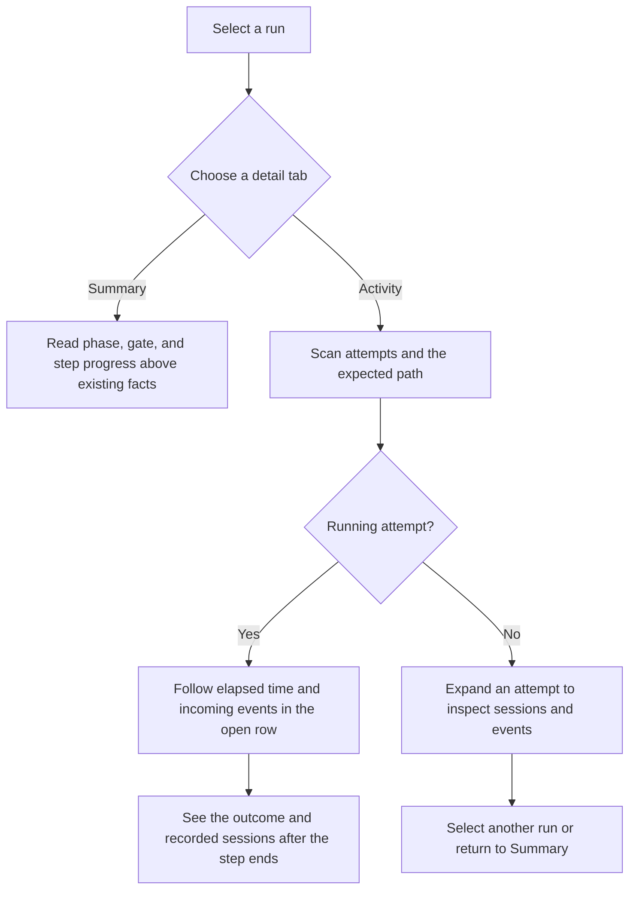
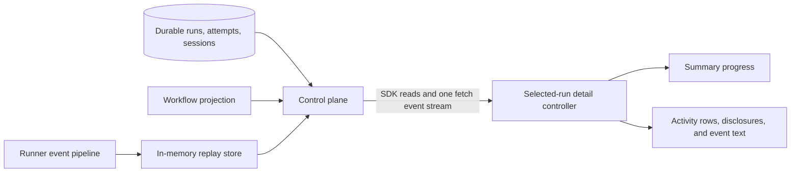
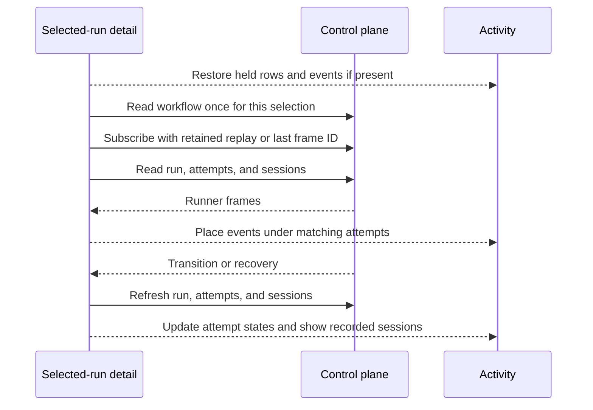

# Show run progress and activity

## What

Operators can see where a run is, what lies ahead, and what happened on each visit to a step. They can tell work in progress from a wait for human input, and skipped steps from steps the run has not reached. While work is underway, they can follow recent activity without reloading.

## Why

The current step alone does not tell an operator whether a run is advancing, retrying, or waiting for a decision. Seeing the run's own workflow helps operators know when to act. Seeing each attempt helps them investigate a failure or follow what happened after they requested changes.

## Personas

- **Phoebe: PM** — checks where a run is and whether it needs her review.
- **Enzo: Engineer** — follows implementation, investigates failures, and checks what happened after requesting changes.

## Narratives

### Find the next decision

Phoebe selects a feature run and sees it waiting at the spec gate. Implementation and pull request work are still ahead. She opens Activity and expands the authoring attempt to see its sessions and recent events before reviewing the spec.

Phoebe requests changes through the existing review flow. The next authoring attempt appears without replacing the first one. When the run returns to the gate, she can see both visits and tell which one needs her attention.

### Follow work without reloading

Enzo opens a running step and sees its elapsed time and progress messages. He checks another run and comes back. The events the page still holds are visible in their attempt rows before the server replays anything. When the step finishes, its recorded duration and session appear without a reload.

Enzo opens a failed run and distinguishes the failed attempt from later steps that never started. On a bug run, he sees the Triage label and no spec review gate. The view reflects that run's workflow rather than assuming every run is a feature.

## User stories

**Find the next decision**

- Phoebe can see phases in workflow order and identify the current step.
- Phoebe can tell which gate is waiting for her and which gates lie ahead.
- Phoebe can distinguish skipped steps from steps not yet reached.
- Phoebe can inspect an attempt's recorded sessions and recent events.
- Phoebe can see a second authoring and review attempt without losing the first.

**Follow work without reloading**

- Enzo can see a running attempt's elapsed time and the age of its latest event.
- Enzo can watch new events arrive while the attempt is open.
- Enzo can switch away and return to the events the page still holds.
- Enzo can see a finished step's session without reloading.
- Enzo can distinguish the attempt at which a run failed from work that never started.
- Enzo can compare runs without seeing phases, steps, or gates that do not apply.

## Goals

- Show one segment per workflow phase, one row per nonterminal attempt, placeholders for unvisited expected steps, and a final terminal row. Adding, dropping, relabeling, or reordering phases requires no renderer change.
- Use one event stream per visible selected run and one one-second clock in the visible Activity tab. Show incoming events without a reload.
- Keep at most 500 displayable events per run in page memory. Show each event ID at most once and identify attempts whose earlier events the page dropped.
- Verify five seeded scenarios, the spec revision loop, and a live delayed launch against the built web app and fake control plane over the real API.

## Non-goals

- Build or change the workflow endpoint (#151), run lifecycle, or session persistence.
- Add durable event history, search, filters, export, or tool input and output.
- Add transcripts, session detail pages, or workspace reads for Activity.
- Introduce step display labels or client-supplied phase labels.
- Add run actions to Activity rows, including Set step (#157).

## Design spec

### User flow



### Summary progress

Place the progress bar and step line above the existing Summary facts. Keep all #135 facts and the header unchanged, including the state fact's status, waiting text, current step, and failure reason where applicable. The new step line names the actual current step, including a terminal step. On failure or cancellation the bar separately marks where work stopped. Explain that distinction in accessible text, for example, “Stopped in Phase 2 of 3, Implementation, at implementation.build; current step failed.”

Use the [design system](../../context-agent/wiki/design-system.md#detail-pane) for segment geometry and done, current, and upcoming fills; never use primary fill. For one to five phases show all labels. With six or more, show the current segment's label and number the others from 1, with the label available on hover and keyboard focus. If there is no current segment in this compact layout, number them all. Keep the bar inside the pane body's padding at both width limits.

Draw a 6 px `--color-overlay` ring at each on-path gate's position within its phase. Fill it with `--color-text` only while the run waits there. Hover or focus shows the gate step ID; accessible text states whether it is waiting. These marks are indicators, not controls. Name the bar **Run progress** and expose segment states and position in text, for example, “Phase 2 of 3, Implementation, step implementation.build.” Do not rely on color.

The line below the bar uses the current phase's returned label and the step ID in `--font-mono`. For a phase-less step, show only the step ID. Omit the bar for a zero-phase workflow, regardless of run status, but still show the step. If the workflow read fails, show the step ID and existing facts without guessing phase labels or segments. A done run with phases shows all segments done. The header carries the terminal outcome.

### Activity rows

Replace #135's Activity empty state with attempt and expected-path rows. Group consecutive rows of the same phase under the returned label. A phase can have multiple groups when the run moves back. Phase-less rows have no heading. If workflow data is unavailable, show ungrouped history rather than using phase IDs as labels.

Each attempt row shows a marker and readable state, the monospaced step ID, the attempt number only when above 1, and duration or elapsed time in `tabular-nums`. Use the existing [step markers](../../context-agent/wiki/design-system.md#status-and-waiting-indicators) for Done, Failed, Canceled, Waiting on you, Running, Skipped, and Not started. Add **Ended** for a historical attempt that preceded a stop superseded by recovery and whose outcome is not established by the durable reads. Its marker is a static 14 px outline `Square` icon in `--color-overlay`, with the visible label **Ended**. Keep the row at normal opacity and fully expandable. Do not use a success check, an outcome-colored icon, or the faded treatment of an unvisited row.

Dim **Skipped** and **Not started** rows and show those words; they have no duration or disclosure. Once workflow and steps are loaded, an active run ends with its on-path terminal placeholder marked **Not started**. A finished run ends with its actual terminal occurrence once the step read has caught up. A superseded off-path terminal occurrence is not shown anywhere in the workflow-backed list; the **Ended** row still shows the preceding attempt and its details.

Use keyboard-operable attempt disclosures with separate session and event groups. A running attempt opens by default; respect a manual collapse for that attempt. Show **Last event 12s ago** or **No events yet** in its details. Events show a time and short plain-text description, newest last. Show **Earlier events are not shown** on attempts whose events the page evicted. Use a static running icon under `prefers-reduced-motion`. Do not announce the clock tick in a live region.

Distinguish loading from confirmed empty history. On a read failure, show an inline reason without hiding independent data. A failed steps refresh keeps prior rows. A failed workflow read says the expected path could not be read and shows durable history without synthetic rows. A failed session read leaves attempts and events visible. Returning to a run restores the held rows and events before new reads or replay finish. Show connection or refresh state without hiding held data.

```text
Summary:  [ Spec  ● ] [ Implementation  ○ ] [ Pull request  ○ ]
          Spec · spec.human_review
          … existing Summary facts …

Activity: intake                   Done
          Spec
          ▸ spec.author            Done            8s
          ▸ spec.human_review      Waiting on you  12s
          Implementation
            implementation.plan    Not started
          … remaining expected steps …
          done                     Not started
```

## Tech spec

### Introduction and overview

Extend the [run detail pane (#135)](feature-run-detail-pane.md) and consume the [workflow projection (#151)](feature-run-workflow-phases-and-expected-path.md). Verification uses [scripted fake mode (#128)](feature-scripted-fake-mode-seed-command.md), [#130's served-build fixture](feature-control-plane-serves-built-client-event-stream.md), and #132's connected fixture and pane geometry checks. Follow the [run detail](../concepts/run-detail.md), [run](../concepts/run.md), [workflow](../concepts/workflow.md), [API](../concepts/api.md), and [domain model](../concepts/domain-model.md) contracts. ADR-004 and ADR-019 govern durable storage, ADR-005 and ADR-009 govern transport and authentication, ADR-031 and ADR-032 govern the web client, and ADR-034 governs session pricing. No new ADR, API operation, migration, or workspace read is needed.

An **attempt** is one durable `RunStep` occurrence. A **session** is a model invocation recorded after it ends. The **expected path** is the ordered list of projected steps with `onPath: true`, not a prediction of the branches the run will take. Events supplement the durable history. They do not replace it.

### System design and architecture



Extend `apps/web/src/runs/use-run-detail.ts` and its existing server-sent events (SSE) reader. Neither tab subscribes independently. Share the attempts read with the spec audit where applicable and the sessions read with Summary. Preserve the existing run-list update, pull request check, and spec-audit behavior. Keep progress projection, Activity placement, the event buffer, and the event text table independently testable.



### Detailed design

#### Reads, selection, and reconnect

- Call `getRunWorkflow(id)` (`GET /v1/runs/:id/workflow`) once per actual selection, including reselection, not on a tab change, transition, recovery, or reconnect. Use the returned `phases` order and `label` verbatim. Join attempt `step` to workflow step `id`. Do not key the projection by work kind or workflow ID. Keep the last successful projection for immediate rendering on return until the new read settles. If that read fails, use the history-only fallback.
- Use the existing run read, `listRunSteps(id)`, and `listRunSessions(id)` for mutable facts. Keep the last successful attempts and sessions per run; restore them synchronously on return, then refresh. Track errors independently of stored values. Do not add path placeholders before the first successful attempts read. Start mutable reads on stream attachment as in #135, with a read fallback if the initial connection fails. Preserve the current refresh coalescer with a trailing read, and guard late responses and frames from obsolete selections or connections.
- Store each run's SSE cursor above tab and selection lifetimes. Subscribe with `lastEventId` if saved and `replay: 'retained'` otherwise; never send both. Update the cursor from any valid frame with an SSE ID, including a frame with no event line. Keep fetch-based authentication, backoff, and run-gone handling. Hiding the pane or changing selection aborts the stream; changing tabs does not reconnect. An attached stream can receive recovery after a failure; do not abort it on a terminal run read.
- On `run_state_transition` or `run_recovery`, refresh the run, attempts, and sessions through the same coalescer. Keep #135's other refresh behavior. The run read supplies authoritative state. A runner result alone is not proof that a session row was recorded.
- On a `409` for an expired or unknown cursor, clear that run's cursor, resubscribe with retained replay, and refresh mutable facts after attachment. Keep held rows and events; do not reread the workflow. Coalesce replay-driven triggers with the attachment refresh. Explain the replay gap separately from known client eviction.
- Scope held snapshots, event buffers, and cursors to the authenticated connection and run ID. Clear them on connection or principal change and on page reload. Returning to a run must not depend on any new SDK response or replay to show already placed events.

#### Progress projection

Render one segment per returned phase. For gate placement, take the phase's ordered `steps` and keep on-path, nonterminal members. A `kind: gate` member at zero-based index `i` among `n` members sits at `(i + 0.5) / n` of the segment width. Fill it only when it is the current step of a nonterminal run waiting on a human.

For an active run, use the current step's projected phase, including for an off-path pause. Mark that phase current, earlier phases done, and later phases upcoming. If the current step has no phase, show no current segment: mark phases through the most recent phased attempt done and the rest upcoming. With no phased attempt, all are upcoming. On failure or cancellation, apply the same rule using history before the current terminal occurrence and the last nonterminal attempt as the stop position; if that attempt is phase-less, do not invent a current phase. When reads have not caught up, use available pre-terminal history rather than inferring a terminal phase. A done status makes all returned segments done. No terminal step is a segment. The visible step line continues to use actual `run.currentStep`, not the stop position.

#### Attempt placement and state

1. Sort attempts by `occurrence.index`, key by attempt row ID, and number by `occurrence.attempt`. Keep repeated visits distinct and retain reached off-path nonterminal attempts, including pauses, at their occurrence positions. Record the step IDs visited anywhere in the loaded history.
2. Walk history with a forward-only cursor through on-path, nonterminal steps. When an on-path attempt advances it, insert intervening expected steps that have no attempt anywhere in the loaded history as **Skipped**, immediately before that attempt. Backward visits do not rewind the cursor or duplicate placeholders. Off-path visits do not advance it. A recorded `kind: terminal`, `onPath: true` occurrence indicates completed path and marks remaining unvisited nonterminal steps **Skipped**. Without path completion, append any remaining unvisited expected nonterminal steps as **Not started**. An off-path terminal never implies a skip.
3. With workflow metadata, omit all superseded off-path terminal occurrences from Activity entirely: do not show them at their historical positions or in the final slot. Keep the nonterminal attempts that preceded them. While the run is active, append the on-path terminal placeholder as **Not started**. When the run is terminal and the latest occurrence matches its current terminal step, append that occurrence once, after the unreached tail, and use run status for its outcome. If the run read is ahead of the attempts read, keep the existing history while refreshing; do not invent a terminal occurrence. Without workflow metadata, identify the current terminal only from terminal run status and a matching latest occurrence. Show the remaining durable rows in occurrence order without guessing historical terminal IDs, phase labels, or path placeholders. In this fallback, historical stops that cannot be identified remain ordinary history.
4. An ordinary closed nonterminal attempt is **Done**. For the current failed or canceled terminal, mark the nonterminal attempt just before it **Failed** or **Canceled** as well. For a superseded off-path terminal identified in rule 3, mark its preceding nonterminal attempt **Ended**, with the neutral marker defined above. Do not infer the old stop's outcome from today's status or the workflow transition table. For a nonterminal run, only the latest matching open nonterminal attempt is current. Use the run's `waitingOn` value, falling back to workflow metadata when absent: `human` gives **Waiting on you**; `ai` or `system` gives **Running**. During a read mismatch, keep unmatched open history visible without a running marker and show the refreshing state rather than claiming it is current. A terminal occurrence's open timestamp never starts the running clock. Group displayed rows by consecutive phase ID, breaking the group at phase-less rows.

#### Sessions, events, and time

- Assign a session to the same-step attempt whose time window contains its `startedAt`. The window starts at attempt `startedAt` and ends at `endedAt`, or now for an open attempt. At a shared boundary or overlap, choose the greatest `occurrence.index`. Leave an unmatched session out of attempt details until a read can place it. Order sessions by `sequence`. Show role, round, model, duration, token total, API list-price cost, and outcome. Reuse #135's `run-summary-totals` integer arithmetic and display conversions. Keep legacy or incomplete token counts and partial or estimated prices distinct. A missing rate is **Unknown**, not zero.
- Keep runner frames and displayable recovery frames per run. Deduplicate by payload `id`, independently of the SSE cursor. Keep at most `RUN_ACTIVITY_EVENTS_PER_RUN = 500` displayable frames and evict the oldest first by `createdAt` with a stable ID tie-break. Use the same order for replay so older frames cannot displace newer ones. Retain an eviction cutoff so replay cannot resurrect dropped rows. Keep loss metadata for affected attempts, or unresolved step and time until a match is available, not discarded text. The server retains only the last 256 events per run in memory and loses them on restart; a page reload starts with whatever the server still retains. Event absence does not establish that work did not occur.
- Place a runner event in the same-step attempt open at the event's `createdAt`, or the latest same-step attempt started by that time if none was open. This applies to live delivery and replay, so a retained event from attempt 1 cannot move to attempt 2 merely because attempt 2 is now open. Use transition and recovery `runStep` values as occurrence hints while history catches up. At equal timestamps, use stream order relative to an available hint; otherwise prefer the greatest matching `occurrence.index`. Hold unresolved frames within the same buffer until matched, then key lines to attempt IDs. Place `run_recovery` under its exact `runStep`; `run_state_transition` triggers refresh but is not an event line.
- Use one timer while Activity is visible and has a current open attempt. Recompute elapsed time and latest event age from timestamps each second, clamping negative values to zero. Closed attempts show their recorded duration or a dash if absent. Stop the timer when the tab is inactive or unmounted. It does not poll the API.

Keep one exhaustive event table in `apps/web` keyed by the `clientRunEventSchema` discriminant in `packages/api-contract/src/run-events.ts`. Test its keys against the schema, including the refresh-only entry.

| Frame | Text or handling |
| --- | --- |
| `run_state_transition` | Refresh only. |
| `run_recovery` | Recovery mode. |
| `runner_assistant_turn` | First line of text. |
| `runner_tool_activity` | Tool name, action, and status only. |
| `runner_progress` | Plan title, task `label completed of total`, or intent summary. |
| `runner_notification` | Severity and message. |
| `runner_step_checkpoint` | Checkpoint name only. |
| `runner_terminal_result` | Directive with its question or reason if present. |

#### Fake-mode launches and delay file

Extend `apps/control-plane/src/fake/scripted-claude-adapter.ts` and its launch helpers. Emit native scripted events through the same Claude adapter mapping and runner publication path used by real sessions. Each structured or unstructured launch emits at least one assistant turn, one ordinary tool activity, and one valid task-progress event before its scripted conclusion. An injected failure still fails after the prelude; it must not become a successful result. Do not publish directly to the event bus or branch on fake mode in `packages/core`.

Read `<state directory>/delays/issue-<number>.json` with `{"step":"<step id>","ms":5000}`. Require a positive issue number, a nonempty step ID, and a positive safe integer duration in milliseconds. Follow the failure-file convention: the first matching launch claims the file by renaming it to `.json.fired`. A missing file or lost claim means no delay. Leave malformed and nonmatching files untouched. Hold the launch's conclusion for at least the configured interval and emit one progress event per elapsed second during the wait, including the final elapsed second if it falls on the delay boundary. Honor cancellation and clear pending timers. Preserve launch counters and result contracts. If a delay and failure file both match, delay the same failure outcome.

### Security, privacy, and compliance

Reuse authenticated SDK routes, header-based credentials, and the existing frame validator. Render all event fields as text, never HTML or Markdown. Do not render raw payloads, tool arguments or results, or checkpoint data. Keep buffers out of browser persistence, telemetry, and workspace files. Validate the delay filename inputs and JSON in fake mode, keep the control file within fake state, and expose no HTTP route for it.

### Observability

Show inline read errors, a replay-gap message after cursor loss, and a per-attempt note for known client eviction. A replay gap alone does not prove a particular attempt lost events. Preserve category-only malformed-frame logging without event contents. Add no production metrics or alerts. Verify fake-mode behavior through the API, stream, and documented delay file rather than test-only application signals.

### Testing plan

Use scripted SDK tests for the read and stream lifecycle, component tests for visual and accessible states, and pure tests for projection, session and event placement, formatting, and retention. Scan only the new progress, Activity, and event table modules for literal phase and step IDs from `packages/core/src/run-step-catalog.ts`. Use shared status mappings for run outcomes; do not embed catalog IDs to determine terminality. Other client features intentionally name specific gates and are outside the scan.

Use control-plane integration tests for the scripted event prelude and delay. Run `apps/web/e2e/progress-and-activity.spec.ts` against the built client served by #130's fake-server fixture with #132's connected state. Extend pane geometry coverage and use a fixture helper that writes the documented delay file. Do not use model calls, `page.route`, injected data that bypasses the API, or test-only application hooks. Planned checks: `pnpm nx test web`, `pnpm nx test control-plane`, and `pnpm nx e2e web`.

For a manual check, run `pnpm nx build web`, then `AUTOCATALYST_CLIENT_DIR=apps/web/dist pnpm nx run control-plane:serve-fake`. Seed with `pnpm nx run control-plane:seed-fake -- --scenario all`. Open `http://127.0.0.1:4010` with `fake-mode-token` saved in Connection settings. Compare the feature at spec review, the bug's Triage phase with no spec gate, the chore's missing spec step, and the failed run's unreached tail. To see live work, create `.autocatalyst-fake/delays/issue-7.json` with `{"step":"spec.author","ms":20000}`, run `pnpm nx run control-plane:seed-fake -- --scenario spec-review --issue 7` in another terminal, and select that run before the seed finishes waiting for the gate. Confirm that elapsed time and progress update, then a recorded session appears.

### Alternatives considered

- **Ship a workflow map in web.** It saves one read but duplicates labels and order, misses overrides, and requires a web release for workflow changes. Use the run-specific workflow projection.
- **Open an Activity-only stream or persist events in the browser.** A second stream duplicates replay and lifecycle handling. Browser storage would retain runner output after the page closes. Use the existing stream and page-memory buffer.

### Risks

- Frames and durable reads can arrive in either order. Hold unresolved frames, pin resolved lines to attempt IDs, and test delayed reads, replay from an earlier revision, and stale responses.
- Replay can be incomplete. Keep durable history visible and distinguish a lost cursor from known client eviction.
- Fast fake launches can finish before the browser sees a running step. Open the connected collection before starting the spare issue and use the documented delay. Assert changes while the row is running rather than sleeping until the run finishes.

## Task list

- [ ] **Story: Show workflow progress in Summary**
  - [ ] **Task: Read workflow and share durable detail facts**
    - **Description**: Extend the selected-run controller with the workflow read and shared attempt and session snapshots scoped to the run and authenticated connection.
    - **Acceptance criteria**:
      - [ ] Scripted SDK tests verify one workflow read per selection, including reselection, and none on tab switch, transition, recovery, or reconnect. Runs of the same kind can use different projections.
      - [ ] Mutable reads coalesce with a trailing refresh. Late results cannot replace another selection's facts. Existing Summary, PR, and spec-audit behavior is preserved without a second Activity-only sessions read.
      - [ ] Returning to a run restores successful snapshots before new reads finish. Failed steps and session refreshes preserve held values and expose independent reasons; a failed workflow read uses history-only fallback.
    - **Dependencies**: #135 and #151.
  - [ ] **Task: Render the progress bar and step line**
    - **Description**: Put workflow-derived segment fills and gate rings above the unchanged Summary facts. Separate the actual current step from the phase where failed or canceled work stopped.
    - **Acceptance criteria**:
      - [ ] A made-up four-phase workflow renders its new order and labels without any client mapping. Three- and seven-phase tests check fills, full and compact labels, numbering, and hover and focus tooltips.
      - [ ] At `spec.human_review`, the spec gate ring is filled and the implementation gate ring is empty. Tests verify ring positions, step tooltips, and textual waiting state.
      - [ ] Tests cover a phase-less step, running and terminal zero-phase workflows, all-done fills, failed and canceled positioning, and workflow failure. The bar is named Run progress and communicates position and states without color.
      - [ ] The state fact retains status, waiting text, current step, and applicable failure reason. On failure or cancellation the monospaced step line and state fact agree on the actual terminal step; the bar marks the last pre-terminal attempt's phase when available.
    - **Dependencies**: Task: Read workflow and share durable detail facts.
- [ ] **Story: Read the durable path and its attempts**
  - [ ] **Task: Derive ordered Activity rows**
    - **Description**: Project ordered occurrences, skipped and not-started placeholders, phase groups, and sessions from the durable reads.
    - **Acceptance criteria**:
      - [ ] Tests cover forward skips, an unreached tail, backward revisions, an off-path pause, phase-less rows, and repeated phase headings. An author/gate/author/gate sequence stays in occurrence order and numbers both second visits 2.
      - [ ] An active run ends with the on-path terminal placeholder marked Not started. Path completion skips remaining unvisited work. A current failed or canceled terminal leaves the unreached tail Not started, marks the preceding attempt, and appears once at the end with no competing placeholder.
      - [ ] Tests cover superseded off-path failed and canceled terminal occurrences in workflow-backed history. Neither appears anywhere in the list, neither advances the path cursor, and each preceding attempt remains visible as Ended. An active recovered run still ends with the Not started terminal placeholder; a run that subsequently finishes shows only its current terminal last.
      - [ ] Session tests cover repeated steps, open and closed windows, overlap or a shared boundary, and an unmatched session. Workflow failure renders durable history without guessed phases, inferred historical stops, or synthetic rows.
    - **Dependencies**: Task: Read workflow and share durable detail facts.
  - [ ] **Task: Render attempt rows and session details**
    - **Description**: Replace Activity's empty state with attempt disclosures, markers, state text, and recorded session facts.
    - **Acceptance criteria**:
      - [ ] Component tests cover all seven existing markers and the Ended treatment: visible Ended text, static 14 px outline Square in `--color-overlay`, normal row opacity, and an operable disclosure. Only Skipped and Not started are dimmed placeholders. Tests also cover attempt numbering, monospaced step IDs, tabular times, and keyboard disclosures.
      - [ ] Expanded sessions show role, round, model, duration, tokens, cost or Unknown, and outcome. Tests verify shared integer conversions and distinguish unknown pricing from zero.
      - [ ] Tests distinguish loading, confirmed empty history, a failed steps refresh with retained rows, a failed workflow read with history only, and a session failure that leaves attempts and events usable. Activity makes no workspace reads.
    - **Dependencies**: Task: Derive ordered Activity rows.
- [ ] **Story: Follow live activity on the existing stream**
  - [ ] **Task: Resume the selected-run stream and retain events**
    - **Description**: Route validated frames from #135's reader into a per-run page-memory buffer and refresh mutable facts on transition, recovery, and replay loss.
    - **Acceptance criteria**:
      - [ ] Scripted SDK tests assert retained replay on first subscription and last-frame-ID resume on return, with no request sending both. Hiding aborts the stream; changing tabs does not subscribe again. Late frames cannot enter another run's buffer.
      - [ ] Transition and recovery both reread run, attempts, and sessions. A finished session appears without reload. A cursor-loss `409` retries with retained replay, refreshes the same facts, preserves held events, and does not reread workflow.
      - [ ] With fresh workflow, attempts, sessions, and replay all held pending, switching away and back immediately shows retained events in the right rows. A replayed payload ID does not produce a duplicate.
      - [ ] The buffer test exceeds `RUN_ACTIVITY_EVENTS_PER_RUN`, keeps the newest 500, marks only affected attempts, and proves old replay cannot resurrect evicted rows. Reload and connection or principal changes discard held data and cursors.
    - **Dependencies**: Task: Read workflow and share durable detail facts.
  - [ ] **Task: Place and format Activity events**
    - **Description**: Match event frames to attempts and format lines with one exhaustive plain-text table.
    - **Acceptance criteria**:
      - [ ] Tests cover frames arriving before attempts, retained frames from a prior visit, the latest same-step fallback at event time, equal-time ties, and recovery placement by exact attempt ID.
      - [ ] Formatter keys match every `clientRunEventSchema` type. Tests check all line descriptions, the three progress variants, and refresh-only transition handling. A new type without a table entry fails the test.
      - [ ] An assistant turn containing literal `` produces text and no `img` element. Tool arguments and results and raw checkpoint or terminal payloads are not rendered.
    - **Dependencies**: Task: Derive ordered Activity rows; Task: Resume the selected-run stream and retain events.
  - [ ] **Task: Render live events and attempt time**
    - **Description**: Add live event lines, retention messages, and the visible-tab clock to Activity.
    - **Acceptance criteria**:
      - [ ] The running attempt opens by default and respects manual collapse. One one-second timer updates elapsed and last-event age and stops when inactive. The running icon is static under reduced motion.
      - [ ] Events arrive without reload and display newest last. No events yet, Last event age, Earlier events are not shown, and the replay-gap message appear only in their applicable states.
      - [ ] A web test scans the new progress, Activity, and event table modules and finds no literal step or phase IDs from `packages/core/src/run-step-catalog.ts`.
    - **Dependencies**: Task: Render attempt rows and session details; Task: Place and format Activity events; Task: Render the progress bar and step line.
- [ ] **Story: Verify the feature on the production path**
  - [ ] **Task: Emit scripted runner events**
    - **Description**: Add an assistant, tool, and progress prelude to fake launches through the real Claude adapter and runner path.
    - **Acceptance criteria**:
      - [ ] Tests verify the prelude before structured and unstructured conclusions and preserve the injected failure outcome.
      - [ ] A control-plane test seeds `spec-review`, subscribes with `replay=retained`, and sees all three required runner event types for `spec.author`. No direct event-bus publication or `packages/core` fake-mode branch is added.
    - **Dependencies**: #128.
  - [ ] **Task: Add and document the one-shot fake launch delay**
    - **Description**: Claim the matching issue delay file in the fake launch path, hold the conclusion, and stream progress while waiting.
    - **Acceptance criteria**:
      - [ ] A control-plane test delays issue 7 at `spec.author`, observes that step with no completed session row for at least the configured interval, sees per-second progress and `.json.fired`, and then sees `spec.human_review`.
      - [ ] Tests cover nonmatching and malformed files, one-shot consumption, cancellation, and a delay paired with injected failure.
      - [ ] `docs/operators/fake-mode.md` documents the delay path, JSON, cadence, rename, and scripted event types.
    - **Dependencies**: Task: Emit scripted runner events.
  - [ ] **Task: Verify seeded workflows and geometry**
    - **Description**: Cover representative workflows in `apps/web/e2e/progress-and-activity.spec.ts` and add progress bar assertions to pane geometry tests.
    - **Acceptance criteria**:
      - [ ] In `spec-review`, `implementation-review`, `pr-open`, `merged`, and `failed`, assert the expected segment states, gate rings, Activity markers, and unreached tails. Active scenarios end with a Not started terminal row, `merged` shows all phases done, and `failed` identifies the failed attempt while keeping unreached work Not started.
      - [ ] Bug issue 3 shows Triage and `spec.author` but neither the spec gate ring nor a `spec.human_review` row. Chore issue 4 does not show `spec.author`.
      - [ ] Segments stay inside the pane body's padding at minimum and maximum widths. Tests use the connected built app and real fake-mode API with no interception, injected UI data, model calls, or test-only application hooks.
    - **Dependencies**: #130 and #132; Task: Render live events and attempt time; Task: Emit scripted runner events.
  - [ ] **Task: Verify revision and live progress in the browser**
    - **Description**: Exercise revision via the SDK and watch a five-second spare-issue launch in the same Playwright spec.
    - **Acceptance criteria**:
      - [ ] Calling `replyToRun(id, { kind: 'feedback', title, body })` on `spec-review` shows `spec.author` attempt 2 and then `spec.human_review` attempt 2 without reload.
      - [ ] Write the documented five-second delay file for a spare issue and `spec.author`, start the run via SDK, and open Activity. The row shows Running, elapsed time increases, and at least two progress events arrive while it is running. The row becomes Done and lists its session without reload.
    - **Dependencies**: Task: Verify seeded workflows and geometry; Task: Add and document the one-shot fake launch delay.
  - [ ] **Task: Record display and module conventions**
    - **Description**: Update the agent design system and code map with the rendering rules, stream ownership, and verification path.
    - **Acceptance criteria**:
      - [ ] The design system's Progress bar guidance records the gate ring and step line. Status and waiting indicators adds the Ended marker, label, normal opacity and disclosure behavior, and the Earlier events are not shown note.
      - [ ] `context-agent/wiki/code-map.md` records the bar, Activity placement rules, exhaustive event table, buffer and its constant, fake delay file, and Playwright spec. Its Last updated line changes.
    - **Dependencies**: Task: Verify revision and live progress in the browser.
